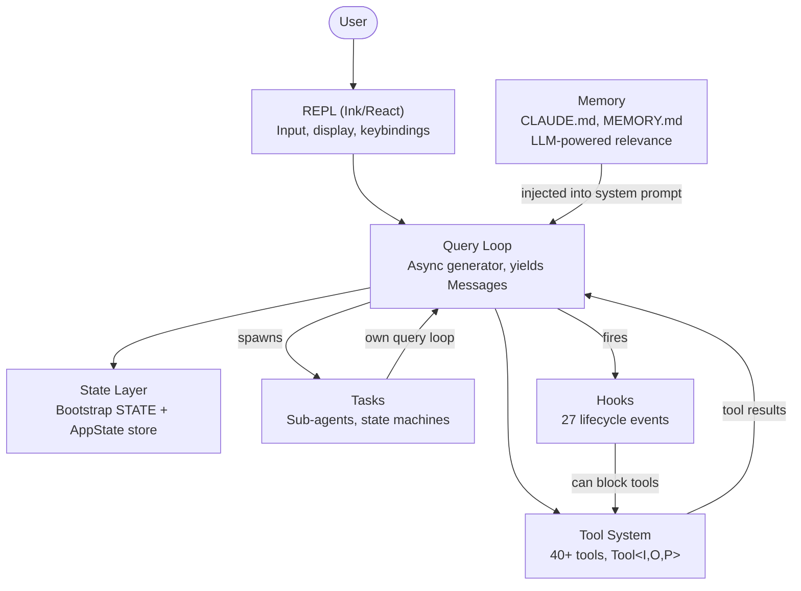
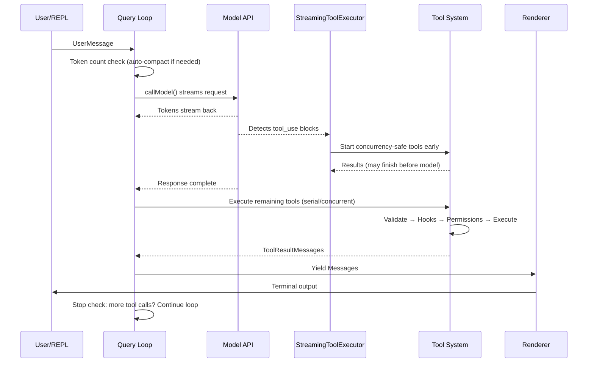
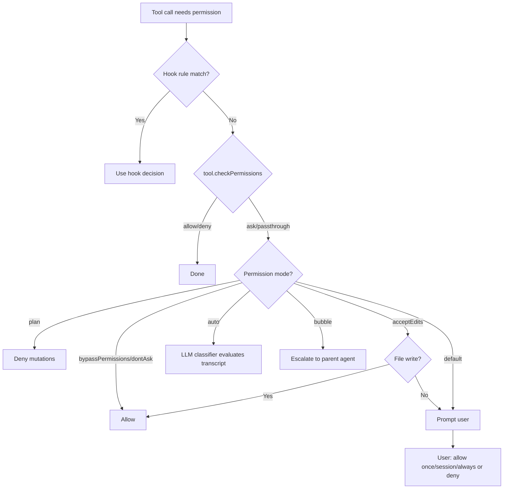
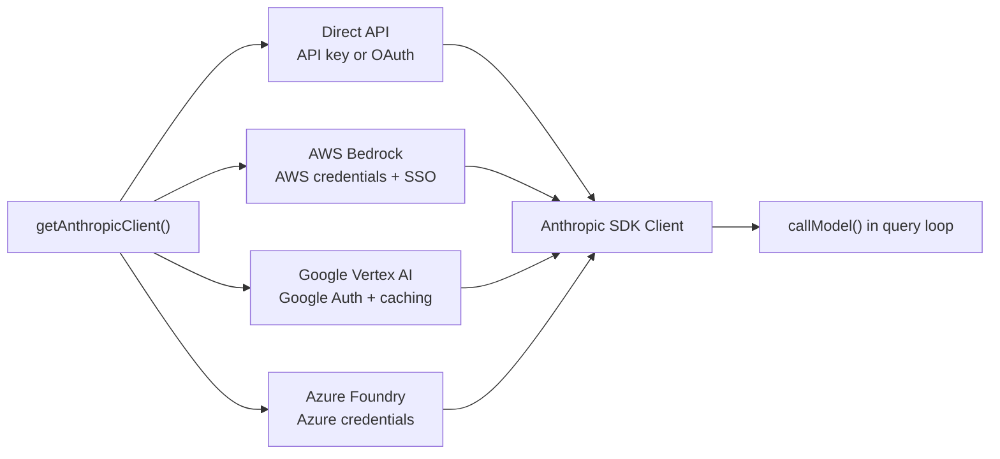
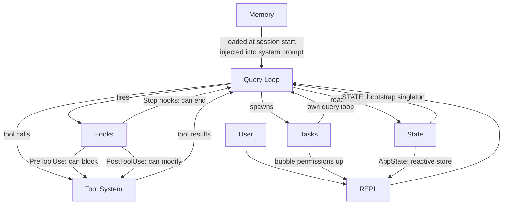

<a id="chapter-1-the-architecture-of-an-ai-agent"></a>

# 제1장: AI 에이전트의 아키텍처

<a id="what-youre-looking-at"></a>

## 이 책에서 살펴볼 것

전통적인 CLI는 하나의 함수처럼 동작합니다. 인수를 받아 작업을 수행하고 종료합니다. `grep`이 스스로 `sed`까지 실행하기로 결정하지는 않습니다. `curl`이 다운로드한 내용을 바탕으로 파일을 열어 수정하지도 않습니다. 약속은 단순합니다. 하나의 명령, 하나의 동작, 그리고 결정론적 출력입니다.

에이전트 CLI는 해당 계약의 모든 부분을 위반합니다. 자연어 프롬프트를 받아 어떤 도구를 사용할지 결정하고, 상황에 따라 필요한 순서대로 도구를 실행하고, 결과를 평가하고, 작업이 완료되거나 사용자가 중지할 때까지 반복합니다. "프로그램"은 고정된 명령어 순서가 아닙니다. 런타임에 자체 명령어 시퀀스를 생성하는 언어 모델 주위의 루프입니다. 도구 호출은 외부 상태에 영향을 주는 동작입니다. 모델의 추론은 제어 흐름입니다.

Claude Code는 이 아이디어를 Anthropic이 구현한 제품입니다. 즉, 터미널을 Claude가 제공하는 완전한 개발 환경으로 바꾸는 약 2,000개의 파일로 구성된 TypeScript 단일체입니다. 수십만 명의 개발자에게 출시되었습니다. 이는 모든 아키텍처 결정이 실제 결과를 가져온다는 것을 의미합니다. 이 장에서는 개념 모델을 제공합니다. 6개의 추상화로 전체 시스템이 정의됩니다. 단일 데이터 흐름이 이들을 연결합니다. 키 입력부터 최종 출력까지 골든 경로를 내부화하면 이후의 모든 장은 해당 경로의 한 부분을 확대합니다.

다음은 회고적 분해입니다. 이 6가지 추상화는 화이트보드에 미리 설계되지 않았습니다. 이는 서비스용 에이전트를 대규모 사용자 기반으로 배송해야 한다는 압력에서 나타났습니다. 계획한 대로가 아니라 있는 그대로 이해하면 책의 나머지 부분에 대한 올바른 기대치가 설정됩니다.

---

<a id="the-six-key-abstractions"></a>

## 6가지 핵심 추상화

Claude Code는 6가지 핵심 추상화를 기반으로 구축되었습니다. 400개가 넘는 유틸리티 파일, 포크된 터미널 렌더러, vim 에뮬레이션, 비용 추적기 등 다른 모든 것은 이 6가지를 지원하기 위해 존재합니다.



각각의 기능과 존재 이유는 다음과 같습니다.

**1. 쿼리 루프**(`query.ts`, ~1,700줄). 전체 시스템의 핵심인 비동기 생성기입니다. 모델 응답을 스트리밍하고, 도구 호출을 수집하고, 실행하고, 결과를 메시지 기록에 추가하고, 반복합니다. REPL, SDK, 하위 에이전트, 헤드리스 `--print` 등 모든 상호 작용은 이 단일 기능을 통해 진행됩니다. UI가 사용하는 `Message` 객체를 생성합니다. 반환 유형은 루프가 중지된 이유(정상 완료, 사용자 중단, 토큰 예산 소진, 중지 훅 개입, 최대 회전 또는 복구할 수 없는 오류)를 정확하게 인코딩하는 `Terminal`이라는 구별된 공용체입니다. 콜백이나 이벤트 이미터가 아닌 생성기 패턴은 자연스러운 역압, 깔끔한 취소 및 입력된 터미널 상태를 제공합니다. 5장에서는 루프의 내부 전체를 다룹니다.

**2. 도구 시스템**(`Tool.ts`, `tools.ts`, `services/tools/`). 도구는 파일 읽기, 셸 명령 실행, 코드 편집, 웹 검색 등 에이전트가 세상에서 할 수 있는 모든 것입니다. 목적의 단순성은 중요한 기계를 숨깁니다. 각 도구는 ID, 스키마, 실행, 권한 및 렌더링을 다루는 풍부한 인터페이스를 구현합니다. 도구는 단순한 기능이 아닙니다. 자체 권한 논리, 동시성 선언, 진행 상황 보고 및 UI 렌더링을 수행합니다. 시스템은 도구 호출을 동시 및 직렬 배치로 분할하고 스트리밍 실행기는 모델이 응답을 완료하기도 전에 동시성이 안전한 도구를 시작합니다. 6장에서는 전체 도구 인터페이스와 실행 파이프라인을 다룹니다.

**3. 작업**(`Task.ts`, `tasks/`). 작업은 백그라운드 작업 단위(주로 하위 에이전트)입니다. 상태 머신은 `pending -> running -> completed | failed | killed`을 따릅니다. `AgentTool`은 자체 메시지 기록, 도구 세트 및 권한 모드를 갖춘 새로운 `query()` 생성기를 생성합니다. 작업은 Claude Code에 재귀적 기능을 제공합니다. 에이전트는 하위 에이전트에 위임할 수 있으며 하위 에이전트는 추가로 위임할 수 있습니다.

**4. 상태**(2개 레이어). 시스템은 두 가지 수준에서 상태를 유지합니다. 변경 가능한 싱글톤(`STATE`)은 작업 디렉터리, 모델 구성, 비용 추적, 원격 측정 카운터, 세션 ID 등 최대 80개의 세션 수준 인프라 필드를 보유합니다. 시작 시 한 번 설정되고 직접 변경됩니다. 즉, 반응성이 없습니다. 최소 반응형 저장소(34줄, Zustand 모양)는 UI(메시지, 입력 모드, 도구 승인, 진행률 표시기)를 구동합니다. 분리는 의도적인 것입니다. 인프라 상태는 거의 변경되지 않으며 다시 렌더링을 트리거할 필요가 없습니다. UI 상태는 지속적으로 변경되며 반드시 변경되어야 합니다. 3장에서는 2계층 아키텍처를 자세히 다루고 있습니다.

**5. 메모리**(`memdir/`). 세션 전반에 걸쳐 에이전트의 지속적인 컨텍스트입니다. 세 가지 계층: 프로젝트 수준(저장소의 `CLAUDE.md` 파일), 사용자 수준(`~/.claude/MEMORY.md`), 팀 수준(Symlink를 통해 공유). 세션 시작 시 시스템은 모든 메모리 파일을 검색하고 머리말을 구문 분석하며 LLM은 현재 대화와 관련된 메모리를 선택합니다. 메모리는 Claude Code가 코드베이스 규칙, 아키텍처 결정 및 디버깅 기록을 "기억"하는 방식입니다.

**6. 훅**(`hooks/`, `utils/hooks/`). 셸 명령, 단일 샷 LLM 프롬프트, 다중 턴 에이전트 대화 및 HTTP 웹훅 등 4가지 실행 유형에 걸쳐 27개의 개별 이벤트에서 실행되는 사용자 정의 수명 주기 인터셉터입니다. 훅은 도구 실행을 차단하고, 입력을 수정하고, 추가 컨텍스트를 삽입하거나, 전체 쿼리 루프를 단락시킬 수 있습니다. 권한 시스템 자체는 훅을 통해 부분적으로 구현됩니다. -- `PreToolUse` 훅은 대화형 권한 프롬프트가 실행되기 전에 도구 호출을 거부할 수 있습니다.

---

<a id="the-golden-path-from-keystroke-to-output"></a>

## 황금 경로: 키 입력에서 출력까지

시스템을 통해 단일 요청을 추적합니다. 사용자는 "로그인 기능에 오류 처리 추가"를 입력하고 Enter 키를 누릅니다.



이 흐름에 대해 주목해야 할 세 가지 사항입니다.

첫째, 쿼리 루프는 콜백 체인이 아니라 생성기입니다. REPL은 `for await`을 통해 메시지를 가져옵니다. 이는 배압이 자연스러운 현상임을 의미합니다. UI가 따라잡을 수 없으면 생성기가 일시 중지됩니다. 이는 이벤트 방출자 또는 관찰 가능한 스트림에 대한 의도적인 선택입니다.

둘째, 도구 실행이 모델 스트리밍과 겹칩니다. `StreamingToolExecutor`은 동시성 안전 도구를 시작하기 전에 모델이 완료될 때까지 기다리지 않습니다. `Read` 호출은 모델이 나머지 응답을 생성하는 동안 완료되고 결과를 반환할 수 있습니다. 이는 추측 실행입니다. 모델의 최종 출력이 도구 호출을 무효화하는 경우(드물지만 가능함) 결과가 삭제됩니다.

셋째, 전체 루프가 재진입 가능합니다. 모델이 도구를 호출하면 결과가 메시지 기록에 추가되고 루프는 업데이트된 컨텍스트로 모델을 다시 호출합니다. 별도의 "도구 결과 처리" 단계는 없으며 모두 하나의 루프입니다. 모델은 더 이상 도구를 호출하지 않음으로써 작업이 완료되는 시점을 결정합니다.

---

<a id="the-permission-system"></a>

## 허가 시스템

Claude Code는 컴퓨터에서 임의의 쉘 명령을 실행합니다. 파일을 편집합니다. 하위 프로세스를 생성하고, 네트워크를 요청하고, Git 기록을 수정할 수 있습니다. 권한 시스템이 없으면 이는 보안 재앙입니다.

시스템은 최대 허용 모드부터 최소 허용 모드까지 순서대로 7가지 권한 모드를 정의합니다.

| 모드 | 행동 |
|------|----------|
| `bypassPermissions` | 모든 것이 허용됩니다. 수표가 없습니다. 내부/테스트 전용입니다. |
| `dontAsk` | 모두 허용되지만 여전히 기록됩니다. 사용자 메시지가 없습니다. |
| `auto` | LLM(Transcript Classifier)이 허용/거부를 결정합니다. |
| `acceptEdits` | 파일 수정이 자동 승인되었습니다. 다른 모든 돌연변이는 프롬프트됩니다. |
| `default` | 표준 대화형 모드. 사용자는 각 작업을 승인합니다. |
| `plan` | 읽기 전용입니다. 모든 돌연변이가 차단되었습니다. |
| `bubble` | 상위 에이전트에게 결정을 에스컬레이션합니다(하위 에이전트 모드). |

도구 호출에 권한이 필요한 경우 해결 방법은 엄격한 체인을 따릅니다.



`auto` 모드는 특별한 주의를 기울일 가치가 있습니다. 대화 내용을 기준으로 도구 호출을 분류하는 별도의 경량 LLM 호출을 실행합니다. 분류자는 도구 입력의 간결한 표현을 확인하고 해당 작업이 사용자가 요청한 것과 일치하는지 여부를 결정합니다. 이는 Claude Code가 반자동으로 작동할 수 있는 모드입니다. 즉, 일상적인 작업을 승인하는 동시에 사용자의 의도에서 벗어나는 것처럼 보이는 모든 것에 플래그를 지정합니다.

하위 에이전트는 기본적으로 `bubble` 모드로 설정되어 있으며 이는 자신의 위험한 작업을 승인할 수 없음을 의미합니다. 권한 요청은 상위 에이전트 또는 궁극적으로 사용자에게 전파됩니다. 이렇게 하면 사용자가 본 적이 없는 파괴적인 명령을 하위 에이전트가 자동으로 실행하는 것을 방지할 수 있습니다.

---

<a id="multi-provider-architecture"></a>

## 다중 공급자 아키텍처

Claude Code는 나머지 시스템에 모두 투명한 네 가지 인프라 경로를 통해 Claude와 통신합니다.



핵심 통찰력은 Anthropic SDK가 직접 API 클라이언트와 동일한 인터페이스를 제공하는 각 클라우드 공급자에 대한 래퍼 클래스를 제공한다는 것입니다. `getAnthropicClient()` 팩토리는 환경 변수와 구성을 읽어 사용할 공급자를 결정하고 적절한 클라이언트를 구성한 후 반환합니다. 그 시점부터 `callModel()`과 다른 모든 소비자는 이를 일반 Anthropic 클라이언트로 취급합니다.

공급자 선택은 시작 시 결정되며 `STATE`에 저장됩니다. 쿼리 루프는 어떤 공급자가 활성화되어 있는지 확인하지 않습니다. 즉, Direct API에서 Bedrock으로 전환하는 것은 코드 변경이 아닌 구성 변경입니다. 에이전트 루프, 도구 시스템 및 권한 모델은 전적으로 공급자에 구애받지 않습니다.

---

<a id="the-build-system"></a>

## 빌드 시스템

Claude Code는 내부 Anthropic 도구와 공개 npm 패키지로 제공됩니다. 동일한 코드베이스는 포함되는 항목을 제어하는 ​​컴파일 타임 기능 플래그를 통해 두 가지 모두를 제공합니다.

```typescript
// Conditional imports guarded by feature flags
const reactiveCompact = feature('REACTIVE_COMPACT')
  ? require('./services/compact/reactiveCompact.js')
  : null
```

`feature()` 함수는 Bun의 내장 번들러 API인 `bun:bundle`에서 제공됩니다. 빌드 시 각 기능 플래그는 부울 리터럴로 확인됩니다. 그런 다음 번들러의 데드 코드 제거는 플래그가 false인 경우 `require()` 호출을 완전히 제거합니다. 모듈은 로드되지 않고, 번들에 포함되지 않으며, 배송되지 않습니다.

패턴은 일관됩니다. 즉, `require()` 호출을 래핑하는 최상위 `feature()` 가드입니다. 특히 `import` 대신 `require()`이 사용됩니다. 왜냐하면 동적 `require()`은 가드가 false인 경우 번들러에 의해 완전히 제거될 수 있는 반면 동적 `import()`은 그럴 수 없기 때문입니다(번들이 보존해야 하는 Promise를 반환함).

주목할 만한 아이러니가 있다. 초기 npm 릴리스와 함께 게시된 소스 맵에는 내부 전용 코드 경로를 포함한 전체 원본 TypeScript 소스인 `sourcesContent`이 포함되어 있습니다. 기능 플래그는 런타임 코드를 성공적으로 제거했지만 소스는 맵에 남겨두었습니다. 이것이 Claude Code 소스가 공개적으로 읽을 수 있게 된 방법입니다.

---

<a id="how-the-pieces-connect"></a>

## 조각이 연결되는 방법

6가지 추상화는 종속성 그래프를 형성합니다.



메모리는 시스템 프롬프트의 일부로 쿼리 루프에 공급됩니다. 쿼리 루프는 도구 실행을 구동합니다. 도구 결과는 쿼리 루프에 메시지로 피드백됩니다. 작업은 격리된 메시지 기록이 있는 재귀 쿼리 루프입니다. 훅은 정의된 지점에서 쿼리 루프를 가로챕니다. 상태는 UI에 연결되는 반응형 저장소를 통해 모든 항목에서 읽고 쓰여집니다.

쿼리 루프와 도구 시스템 간의 순환 종속성은 시스템을 정의하는 특성입니다. 모델은 도구 호출을 생성합니다. 도구는 실행되고 결과를 생성합니다. 결과는 메시지 기록에 추가됩니다. 모델은 결과를 보고 다음에 무엇을 할지 결정합니다. 이 주기는 모델이 도구 호출 생성을 중지하거나 외부 제약(토큰 예산, 최대 회전수, 사용자 중단)으로 인해 모델이 종료될 때까지 계속됩니다.

다음 장에 연결되는 방법은 다음과 같습니다. 입력에서 출력까지의 황금 경로는 책 전체를 통과하는 스레드입니다. 2장에서는 이 경로가 실행될 수 있는 지점까지 시스템이 부팅되는 방법을 추적합니다. 3장에서는 경로가 읽고 쓰는 2계층 상태 아키텍처에 대해 설명합니다. 4장에서는 쿼리 루프가 호출하는 API 계층을 다룹니다. 각 후속 장에서는 방금 본 경로의 한 부분을 확대합니다.

---

<a id="apply-this"></a>

## 직접 적용하기

LLM이 런타임에 어떤 작업을 수행할지 결정하는 시스템인 에이전트 시스템을 구축하는 경우 전송되는 Claude Code 아키텍처의 패턴은 다음과 같습니다.

**생성기 루프 패턴.** 콜백이나 이벤트 이미터가 아닌 비동기 생성기를 에이전트 루프로 사용합니다. 생성기는 자연스러운 역압(소비자가 자신의 속도에 따라 끌어당김), 완전한 취소(생성기의 `.return()`) 및 터미널 상태에 대해 입력된 반환 값을 제공합니다. 해결되는 문제: 콜백 기반 에이전트 루프에서는 루프가 "완료"되는 시점과 그 이유를 알기가 어렵습니다. 생성기는 종료를 유형 시스템의 최우선 부분으로 만듭니다.

**자체 설명 도구 인터페이스.** 모든 도구는 자체 동시성 안전성, 권한 요구 사항 및 렌더링 동작을 선언해야 합니다. 각 도구를 "알고 있는" 중앙 오케스트레이터에 이 논리를 넣지 마십시오. 이것이 해결하는 문제: 중앙 오케스트레이터는 도구가 추가될 때마다 업데이트되어야 하는 신(god) 개체가 됩니다. 자체 설명 도구는 선형적으로 확장됩니다. N+1 도구를 추가하면 기존 코드를 전혀 변경할 필요가 없습니다.

**인프라 상태를 반응 상태와 분리합니다.** 모든 상태가 UI 업데이트를 트리거할 필요는 없습니다. 세션 구성, 비용 추적 및 원격 측정은 일반 변경 가능 개체에 속합니다. 메시지 기록, 진행률 표시기 및 승인 대기열은 반응 저장소에 속합니다. 문제는 해결됩니다. 모든 것을 반응형으로 만들면 시작 시 한 번 변경되고 천 번 읽히는 상태에 구독 오버헤드와 복잡성이 추가됩니다. 두 계층은 두 가지 액세스 패턴과 일치합니다.

**권한 확인이 아닌 권한 모드.** 명명된 모드(계획, 기본값, 자동, 우회)의 작은 집합을 정의하고 모드를 통해 모든 권한 결정을 해결합니다. 도구 구현을 통해 `if (isAllowed)` 검사를 분산시키지 마십시오. 이것이 해결하는 문제: 일관되지 않은 권한 적용. 모든 도구가 동일한 모드 기반 해결 체인을 거치면 어떤 모드가 활성화되어 있는지 파악하여 시스템의 보안 상태를 추론할 수 있습니다.

**작업을 통한 재귀 에이전트 아키텍처.** 하위 에이전트는 특수한 코드 경로가 아닌 자체 메시지 기록이 있는 동일한 에이전트 루프의 새 인스턴스여야 합니다. 권한 에스컬레이션은 `bubble` 모드를 통해 위쪽으로 진행됩니다. 해결되는 문제: 기본 에이전트 루프에서 분기되는 하위 에이전트 논리로 인해 동작 및 오류 처리에 미묘한 차이가 발생합니다. 하위 에이전트가 동일한 루프인 경우 동일한 보장을 모두 상속합니다.
