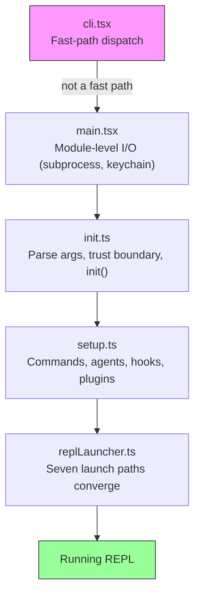
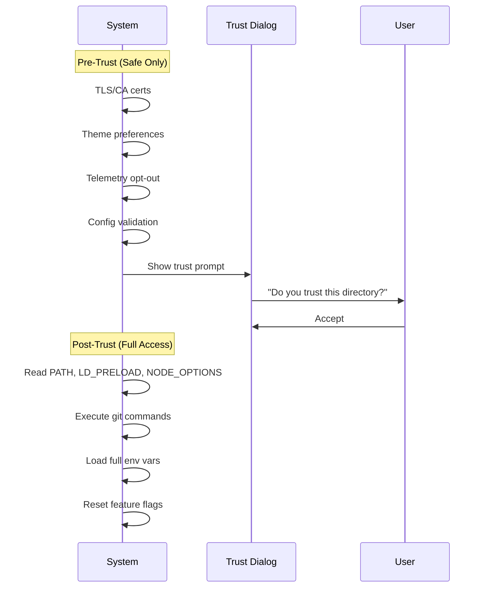

<a id="chapter-2-starting-fast----the-bootstrap-pipeline"></a>

# 제2장: 빠른 시작 — 부트스트랩 파이프라인

1장이 Claude Code의 아키텍처에 대한 지도를 제공했다면, 이 장에서는 작동 상태에 도달하는 데 필요한 경로를 제공합니다. 쿼리 루프, 도구 시스템, 상태 계층, 훅, 메모리 등 6가지 추상화의 모든 구성 요소는 사용자에게 커서가 표시되기 전에 초기화되어야 합니다. 모든 예산은 300밀리초입니다.

300밀리초는 인간이 도구를 순간적으로 인식하는 임계값입니다. 그것을 건너면 CLI가 느리게 느껴집니다. 많이 놓치면 개발자는 사용을 중단합니다. 이 장의 모든 내용은 그 선을 따르기 위해 존재합니다.

부트스트랩은 환경 검증, 보안 경계 설정, 통신 계층 구성, UI 렌더링이라는 네 가지 작업을 수행해야 합니다. 300ms 이내에 4개를 모두 수행해야 합니다. 아키텍처적 통찰력은 이 네 가지 작업이 이 복잡한 시스템에서는 불가능하다고 느껴지는 예산 범위에 맞게 부분적으로 중첩되고, 주의 깊게 정렬되고, 적극적으로 정리될 수 있다는 것입니다.

방법론에 대한 참고 사항: 이 장의 타임스탬프는 코드베이스의 자체 프로파일링 체크포인트에서 파생된 대략적인 것입니다. 이는 최신 하드웨어의 일반적인 웜 스타트 타이밍을 나타냅니다. 콜드 스타트가 느려집니다. 절대적인 숫자는 상대 구조, 즉 어떤 작업이 중복되고, 어떤 작업이 차단되고, 어떤 작업이 지연되는지보다 덜 중요합니다.

---

<a id="the-shape-of-the-pipeline"></a>

## 파이프라인의 모양

시작 파이프라인은 순서대로 실행되는 5개의 파일에 있습니다. 각 파일은 시스템이 다음에 수행해야 하는 작업의 범위를 좁힙니다.



각 파일은 제어권을 다음 파일로 전달하기 전에 필요한 최소한의 작업을 수행합니다. `cli.tsx`은 무거운 항목을 가져오기 전에 종료를 시도합니다. `main.tsx`은 가져오기 평가 중에 부작용으로 느린 작업을 실행합니다. `init.ts`은 구성을 확인하고 신뢰 경계를 설정합니다. `setup.ts`은 기능을 등록합니다. `replLauncher.ts`은 올바른 진입점을 선택하고 UI를 시작합니다.

세 가지 병렬성 전략으로 이를 빠르게 수행할 수 있습니다.

1. **모듈 수준 하위 프로세스 디스패치.** *가져오기 평가 중* 부작용으로 Fire 키체인 및 MDM 읽기가 발생합니다. 나머지 ~135ms의 정적 가져오기가 로드되는 동안 하위 프로세스가 실행됩니다.
2. **설정 시 병렬 처리를 약속합니다.** 소켓 바인딩, 훅 스냅샷 생성, 명령 로딩 및 에이전트 정의 로딩이 모두 동시에 실행됩니다.
3. **렌더링 후 지연된 프리페치.** 사용자가 첫 번째 메시지를 입력하기 전에 필요하지 않은 모든 것(git 상태, 모델 기능, AWS 자격 증명)은 프롬프트가 표시된 후에 실행됩니다.

네 번째 전략은 덜 눈에 띄지만 똑같이 중요합니다: **모듈 평가를 연기하기 위한 동적 가져오기**. 코드베이스는 필요할 때까지 코드 로드를 방지하기 위해 최소 12개 위치에서 `await import('./module.js')`을 사용합니다. OpenTelemetry(400KB + 700KB gRPC)는 원격 분석이 초기화될 때만 로드됩니다. React 구성 요소는 렌더링할 때만 로드됩니다. 각 동적 가져오기는 콜드 경로 대기 시간(처음 사용 시 모듈 평가 트리거)을 핫 경로 속도(시작 시 사용하지 않을 수도 있는 모듈에 대해서는 비용을 지불하지 않음)로 교환합니다.

---

<a id="phase-0-fast-path-dispatch-clitsx"></a>

## 0단계: 빠른 경로 디스패치(cli.tsx)

프로세스가 입력하는 첫 번째 파일인 `cli.tsx`에는 전체 부트스트랩 파이프라인이 필요한지 여부를 결정하는 작업이 하나 있습니다. `claude --version`, `claude --help`, `claude mcp list` 등 많은 호출에는 특정 답변만 필요하며 다른 것은 필요하지 않습니다. React를 로드하고, 원격 측정을 초기화하고, 키체인을 읽고, 도구 시스템을 설정하는 것은 순수한 낭비입니다.

패턴은 다음과 같습니다. `argv`을 확인하고 필요한 핸들러만 동적으로 가져오고 나머지 시스템이 로드되기 전에 종료합니다.

```typescript
// Pseudocode for the fast-path pattern
if (args.length === 1 && args[0] === '--version') {
  const { printVersion } = await import('./commands/version.js')
  await printVersion()
  process.exit(0)
}
```

버전, 도움말, 구성, MCP 서버 관리 및 업데이트 확인을 포함하는 대략 12개의 빠른 경로가 있습니다. 세부 사항은 중요하지 않습니다. 패턴이 중요합니다. 각 경로는 정확히 하나의 모듈을 동적으로 가져오고 하나의 함수를 호출한 후 종료됩니다. 나머지 코드베이스는 로드되지 않습니다.

이는 부트스트랩 전반에 걸쳐 반복되는 원칙의 첫 번째 사례입니다. **의도에 대해 더 많이 알면 더 적은 일을 할 수 있습니다**. argv 배열은 사용자의 의도를 드러냅니다. 의도가 좁다면 실행 경로도 좁아야 합니다.

일치하는 빠른 경로가 없으면 `cli.tsx`이 전체 `main.tsx` 가져오기로 전환되고 실제 시작이 시작됩니다.

---

<a id="phase-1-module-level-io-maintsx"></a>

## 1단계: 모듈 수준 I/O(main.tsx)

`main.tsx`을 가져오면 평가 중에 파일의 함수가 호출되기 전에 모듈 수준의 부작용이 발생합니다. 이는 전체 부트스트랩에서 성능이 가장 중요한 기술입니다.

```typescript
// These run at import time, not at call time
const mdmPromise = startMDMSubprocess()
const keychainPromise = readKeychainCredentials()
```

JavaScript 엔진이 나머지 `main.tsx`과 전이적 가져오기(~138ms의 모듈 평가)를 평가하는 동안 이 두 약속은 이미 실행 중입니다. MDM(모바일 장치 관리) 하위 프로세스는 조직의 보안 정책을 확인합니다. 키체인 읽기는 저장된 자격 증명을 가져옵니다. 둘 다 중요 경로에서 직렬화되는 I/O 바인딩 작업입니다.

통찰력: 모듈 평가는 유휴 시간이 아니라 I/O와 겹칠 수 있는 시간입니다. `main.tsx`의 내보낸 함수가 처음 호출될 때 이러한 약속은 이미 해결된 경우가 많습니다.

이 기술을 사용하려면 관련 파일에서 ESLint의 최상위 대기 및 모듈 범위 내 부작용 규칙을 억제해야 합니다. 코드베이스에는 모듈 범위에서 제어된 부작용을 허용하는 동시에 다른 곳에서는 제어되지 않는 부작용을 방지하는 `process.env` 액세스 패턴을 위한 사용자 정의 ESLint 규칙이 있습니다.

---

<a id="phase-2-parse-and-trust-initts"></a>

## 2단계: 구문 분석 및 신뢰(init.ts)

`init()` 함수는 메모되어 있으므로 여러 번 호출해도 안전하며 동일한 결과를 반환합니다. 여러 진입점(REPL, 인쇄 모드, SDK 모드)이 각각 `init()`을 호출할 수 있고 메모이제이션이 정확히 한 번 실행되도록 보장하기 때문에 이는 중요합니다.

이 함수는 Commander를 통해 명령줄 인수를 확인하고, 여러 소스(전역 설정, 프로젝트 설정, 환경 변수)에서 구성을 로드한 다음 파이프라인에서 가장 중요한 경계에 도달합니다.

<a id="the-trust-boundary"></a>

### 신뢰 경계

신뢰 경계 이전에는 시스템이 제한 모드로 작동합니다. 그 후에는 모든 기능을 사용할 수 있습니다. Claude Code가 환경 변수를 읽기 때문에 경계가 존재하며 환경 변수가 오염될 수 있습니다.



신뢰 경계는 Claude Code를 신뢰하는 사용자에 관한 것이 아닙니다. *환경*을 신뢰하는 Claude Code에 관한 것입니다. 악의적인 `.bashrc`은 모든 하위 프로세스에 코드를 삽입하도록 `LD_PRELOAD`을 설정할 수 있습니다. 신뢰 대화 상자는 다른 사람이 구성했을 수 있는 디렉터리에서 작업하는 데 사용자가 명시적으로 동의하는지 확인합니다.

시스템에는 10가지의 서로 다른 신뢰에 민감한 작업이 있습니다. 사용자가 신뢰 대화 상자를 수락하기 전에 TLS 인증서 구성, 테마 기본 설정, 원격 측정 거부 등 안전한 작업만 실행됩니다. 신뢰 후에 시스템은 잠재적으로 위험한 환경 변수(PATH, LD_PRELOAD, NODE_OPTIONS)를 읽고 git 명령을 실행하며 전체 환경 구성을 적용합니다.

<a id="the-preaction-hook"></a>

### 사전 조치 훅

Commander의 `preAction` 훅은 건축의 핵심입니다. Commander는 아무것도 실행하지 않고 *명령 구조(플래그, 하위 명령, 위치 인수)를 구문 분석합니다. `preAction` 훅은 구문 분석 후 일치하는 명령 핸들러가 실행되기 전에 실행됩니다.

```typescript
program.hook('preAction', async (thisCommand) => {
  await init(thisCommand)
})
```

이러한 분리는 빠른 경로 명령(Commander가 로드되기 전에 `cli.tsx`에서 처리됨)이 `init()` 비용을 지불하지 않음을 의미합니다. 전체 환경이 필요한 명령만 초기화를 트리거합니다.

---

<a id="phase-3-setup-setupts"></a>

## 3단계: 설정(setup.ts)

`init()`이 완료된 후 `setup()`은 시스템에 필요한 모든 기능을 등록합니다.

```mermaid
gantt
    title Phase 3: Parallel Setup
    dateFormat X
    axisFormat %Lms

    section Sequential
    Commands registration   :0, 5
    section Parallel
    Agent definitions      :5, 15
    Hook registration      :5, 12
    Plugin initialization  :5, 20
    MCP server connections :5, 25
```



가능한 경우 명령, 에이전트, 훅 및 플러그인이 모두 병렬로 등록됩니다. 설정 단계는 시스템이 "내 구성을 알고 있음"에서 "모든 기능을 갖추고 있음"으로 전환되는 단계입니다. 설정 후에는 모든 도구가 등록되고 모든 훅가 연결되며 시스템은 사용자 입력을 처리할 준비가 됩니다.

설치 프로그램은 보안 훅 스냅샷도 처리합니다. 훅 구성은 디스크에서 한 번 읽힌 후 변경할 수 없는 스냅샷으로 고정되고 나머지 세션 동안 사용됩니다. 디스크의 훅 구성 파일에 대한 이후 수정 사항은 무시됩니다. 이렇게 하면 세션이 시작된 후 공격자가 훅 규칙을 수정하는 것을 방지할 수 있습니다. 고정된 스냅샷은 권한 결정에 대한 유일한 정보 소스입니다.

---

<a id="phase-4-launch-repllauncherts"></a>

## 4단계: 출시(replLauncher.ts)

대화형 REPL, 인쇄 모드(`--print`), SDK 모드, 재개(`--resume`), 계속(`--continue`), 파이프 모드 및 헤드리스의 7가지 코드 경로가 `replLauncher.ts`에 수렴됩니다. 런처는 `init()`에서 생성된 구성을 검사하고 올바른 진입점으로 디스패치합니다.

두 가지 예는 범위를 보여줍니다.

**대화형 REPL** -- 표준 사례입니다. 런처는 React/Ink 구성 요소 트리를 마운트하고 터미널 렌더러를 시작한 다음 이벤트 루프에 들어갑니다. 사용자는 프롬프트를 보고 입력을 시작할 수 있습니다.

**인쇄 모드** (`--print`) - argv의 단일 프롬프트. 런처는 React 트리 없이 헤드리스 쿼리 루프를 생성하고 완료될 때까지 실행한 다음 출력을 stdout으로 스트리밍하고 종료합니다. 동일한 에이전트 루프, 다른 프레젠테이션.

중요한 세부 사항: 7개 경로 모두 결국 `query()`을 호출합니다. 이는 1장의 동일한 에이전트 루프입니다. 실행 경로는 *무엇을* 수행하는지가 아니라 루프가 표시되는 *방법*(대화형 터미널, 단일 샷, SDK 프로토콜)을 결정합니다. 이러한 융합은 아키텍처를 테스트 및 예측 가능하게 만듭니다. 사용자가 Claude Code를 호출하는 방법에 관계없이 핵심 동작은 동일합니다.

---

<a id="the-startup-timeline"></a>

## 스타트업 타임라인

시간에 따른 전체 파이프라인의 모습은 다음과 같습니다.

```mermaid
gantt
    title Bootstrap Timeline (~240ms)
    dateFormat X
    axisFormat %Lms

    section Phase 0
    Fast-path check          :0, 5

    section Phase 1
    Module evaluation        :5, 143
    MDM subprocess (parallel) :8, 60
    Keychain read (parallel)  :8, 50

    section Phase 2
    Commander parse          :143, 146
    init()                   :146, 160
    Trust boundary           :160, 175

    section Phase 3
    setup() + parallel registration :175, 210

    section Phase 4
    Launch path selection    :210, 215
    First render             :215, 240
```



중요한 경로는 모듈 평가(~138ms의 가장 긴 단일 단계)를 거쳐 Commander 구문 분석, 초기화 및 설정을 통해 실행됩니다. 병렬 I/O 작업(MDM, 키체인)은 모듈 평가와 겹치며 일반적으로 필요하기 전에 해결됩니다.

<a id="the-performance-budget"></a>

### 성과예산

| 위상 | 시간 | 무슨 일이 일어나는가 |
|-------|------|-------------|
| 빠른 경로 확인 | ~5ms | argv를 확인하고 가능하면 일찍 종료하세요. |
| 모듈 평가 | ~138ms | 트리 가져오기, 병렬 I/O 실행 |
| 사령관 파싱 | ~3ms | 플래그 및 하위 명령 구문 분석 |
| 초기화() | ~14ms | 구성 확인, 신뢰 경계 |
| 설정() | ~35ms | 명령, 에이전트, 훅, 플러그인 |
| 실행 + 첫 번째 렌더링 | ~25ms | 경로 선택, React 마운트, 첫 번째 페인트 |
| **합계** | **~240ms** | 300ms 예산 미만 |

총계는 최신 머신에서 약 240ms입니다. 즉, 300ms 예산에서 60ms의 헤드룸입니다. 콜드 스타트(재부팅 후 첫 번째 실행, OS 캐시 비어 있음)는 모듈 평가를 200ms 이상으로 밀어 넣어 총 평가가 한도에 가까워질 수 있습니다.

---

<a id="the-migration-system"></a>

## 마이그레이션 시스템

초기화 중에 실행되는 하위 시스템 중 하나인 스키마 마이그레이션에 대한 간략한 참고 사항입니다. Claude Code는 구성 및 세션 데이터를 로컬 파일 및 디렉터리에 저장합니다. 버전 간에 형식이 변경되면 시작 시 마이그레이션이 자동으로 실행됩니다.

각 마이그레이션은 버전 번호가 있는 기능입니다. 시스템은 가장 높은 마이그레이션 버전과 비교하여 현재 스키마 버전을 확인하고 보류 중인 마이그레이션을 순서대로 실행한 후 버전을 업데이트합니다. 마이그레이션은 멱등성이 있고 빠릅니다(데이터베이스가 아닌 작은 로컬 파일에서 작동). 전체 마이그레이션 단계는 일반적으로 5ms 이내에 완료됩니다. 마이그레이션이 실패하면 오류가 기록되고 계속됩니다. 가용성은 로컬 구성의 엄격한 일관성보다 중요합니다.

---

<a id="what-startup-teaches-about-system-design"></a>

## 스타트업이 시스템 설계에 대해 가르치는 것

부트스트랩 파이프라인은 범위를 좁히는 연구입니다. 각 단계는 가능성의 공간을 줄입니다.

- 0단계는 "모든 CLI 호출"에서 "전체 부트스트랩 필요"로 범위가 좁아집니다.
- 1단계는 "모든 것이 로드되어야 함"에서 "I/O와 병렬로 로드"로 범위가 좁아집니다.
- 2단계는 "알 수 없는 환경"에서 "신뢰할 수 있고 구성된 환경"으로 범위를 좁힙니다.
- 3단계는 "기능 없음"에서 "완전히 등록됨"으로 범위가 좁아집니다.
- 4단계는 "7가지 가능한 모드"에서 "하나의 구체적인 발사 경로"로 범위가 좁아집니다.

REPL이 렌더링될 때쯤에는 모든 결정이 내려졌습니다. 쿼리 루프는 현재 모드, 사용 가능한 도구 또는 적용되는 권한에 대해 모호함 없이 완전히 구성된 환경을 수신합니다. 300ms 예산은 단순한 성능 목표가 아닙니다. 이는 부트스트랩이 결정이 연기되고 코드베이스 전체에 분산되는 지연 초기화 시스템이 되는 것을 방지하는 강제 기능입니다.

---

<a id="apply-this"></a>

## 직접 적용하기

**초기화와 I/O 중복.** 모듈 평가 시간에 필요하기 전에 느린 작업(하위 프로세스 생성, 자격 증명 읽기, 네트워크 검사)을 실행합니다. JavaScript 엔진은 어쨌든 동기 작업을 수행합니다. 해당 시간을 병렬 I/O에 사용합니다. 패턴: 파일 상단의 `const promise = startSlowThing()`, 사용 시점의 `await promise`.

**가능한 한 빨리 범위를 좁힙니다.** 부트스트랩 파이프라인의 5개 파일은 깔때기를 형성합니다. 각 단계는 후속 단계에서 수행할 필요가 없는 작업을 제거합니다. 빠른 경로 파견이 가장 극적인 예이지만 이 원칙은 모든 곳에 적용됩니다. 구문 분석 시 코드 경로가 불필요하다고 판단되면 건너뛰십시오.

**신뢰 경계를 명시적으로 설정합니다.** 애플리케이션이 제어하지 않는 환경(환경 변수, 구성 파일, 셸 설정)에서 읽는 경우 "사용자가 동의하기 전에 읽어도 안전함"과 "동의한 후에만 읽기" 사이에 명확한 선을 긋습니다. 신뢰 경계는 사용자가 애플리케이션을 평가하기 전에 악의적인 환경이 애플리케이션을 손상시키는 공격 클래스를 방지합니다.

**초기화 함수를 기억해 두세요.** 초기화를 멱등성으로 만듭니다. 두 번 호출하면 동일한 결과가 생성됩니다. 이는 여러 진입점이 각각 초기화를 트리거할 수 있는 경우 순서 지정 버그를 제거합니다. 메모 패턴은 사소하지만 이중 초기화 버그의 전체 클래스를 제거합니다.

**양보하기 전에 초기 입력을 캡처합니다.** 이벤트 중심 시스템에서는 초기화 중에 도착한 사용자 입력이 손실될 수 있습니다. Claude Code는 비동기 작업이 시작되기 전에 argv에서 초기 프롬프트를 캡처하여 초기화가 예상보다 오래 걸리는 경우 `claude "fix the bug"`이 프롬프트를 삭제하지 않도록 합니다.
