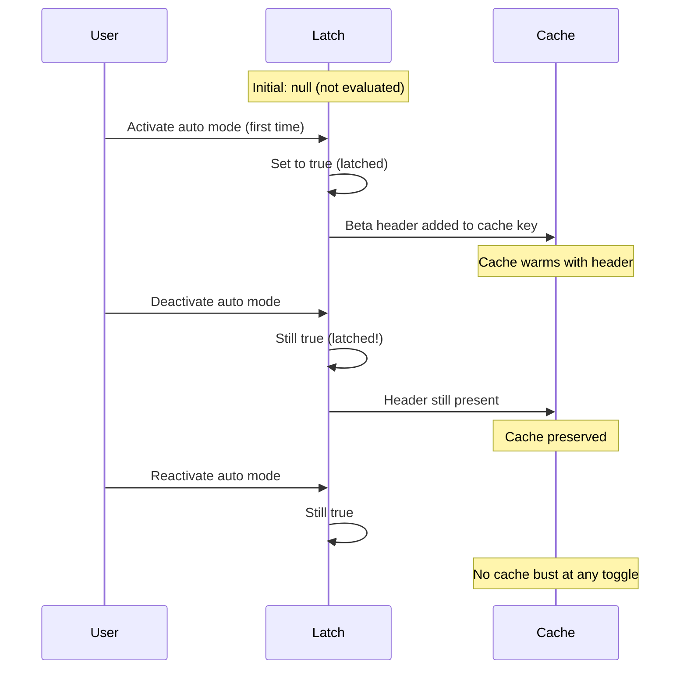
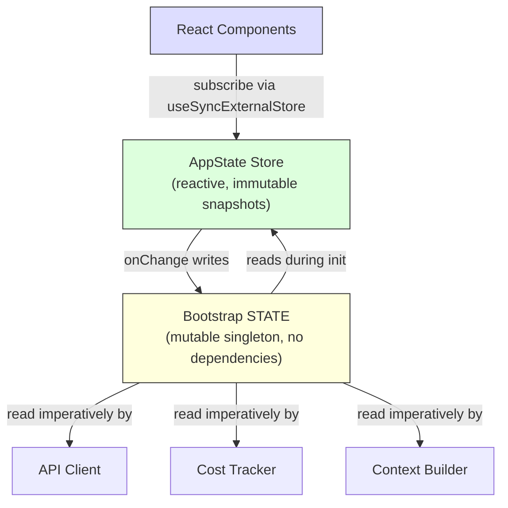

<a id="chapter-3-state----the-two-tier-architecture"></a>

# 제3장: 상태 — 2계층 아키텍처

2장에서는 프로세스 시작부터 첫 번째 렌더링까지 부트스트랩 파이프라인을 추적했습니다. 결국 시스템은 완전히 구성된 환경을 갖게 되었습니다. 하지만 *무엇*으로 구성되었나요? 세션 ID는 어디에 있습니까? 현재 모델은? 메시지 기록? 비용 추적기? 권한 모드? 국가는 어디에 살고 있으며 왜 그곳에 살고 있습니까?

모든 장기 실행 애플리케이션은 결국 이 문제에 직면하게 됩니다. 간단한 CLI 도구의 경우 대답은 간단합니다. `main()`의 몇 가지 변수입니다. 하지만 Claude Code는 단순한 CLI 도구가 아닙니다. 이는 몇 시간에 걸친 프로세스 수명주기, 임의의 시간에 로드되는 플러그인 시스템, 캐시된 컨텍스트에서 프롬프트를 구성해야 하는 API 계층, 프로세스 재시작 후에도 유지되는 비용 추적기, 서로 가져오지 않고 공유 데이터를 읽고 써야 하는 수십 개의 인프라 모듈을 갖춘 Ink를 통해 렌더링되는 React 애플리케이션입니다.

단일 글로벌 저장소인 순진한 접근 방식은 즉시 실패합니다. 비용 추적기가 React 재렌더링을 구동하는 동일한 저장소를 업데이트한 경우 모든 API 호출은 전체 구성 요소 트리 조정을 트리거합니다. 인프라 모듈(부트스트랩, 컨텍스트 구축, 비용 추적, 원격 측정)은 React를 가져올 수 없습니다. React가 마운트되기 전에 실행됩니다. React가 마운트 해제된 후에 실행됩니다. 구성 요소 트리가 전혀 존재하지 않는 컨텍스트에서 실행됩니다. 모든 것을 React 인식 저장소에 넣으면 전체 가져오기 그래프에 걸쳐 순환 종속성이 생성됩니다.

Claude Code는 인프라 상태에 대한 변경 가능한 프로세스 싱글톤과 UI 상태에 대한 최소 반응 저장소라는 2계층 아키텍처로 이 문제를 해결합니다. 이 장에서는 두 계층, 이를 연결하는 부작용 시스템 및 이 기반에 의존하는 지원 하위 시스템에 대해 설명합니다. 이후의 모든 장에서는 국가가 어디에 있고 왜 거기에 있는지 이해하고 있다고 가정합니다.

---

<a id="31-bootstrap-state----the-process-singleton"></a>

## 3.1 부트스트랩 상태 - 프로세스 싱글톤

<a id="why-a-mutable-singleton"></a>

### 가변 싱글톤이 필요한 이유

부트스트랩 상태 모듈(`bootstrap/state.ts`)은 프로세스 시작 시 한 번 생성되는 단일 변경 가능한 개체입니다.

```typescript
const STATE: State = getInitialState()
```

이 줄 위의 주석은 `AND ESPECIALLY HERE`입니다. 유형 정의 위의 두 줄: `DO NOT ADD MORE STATE HERE - BE JUDICIOUS WITH GLOBAL STATE`. 이러한 의견에는 관리되지 않는 전역 개체의 비용을 어렵게 배운 엔지니어의 어조가 있습니다.

여기서는 세 가지 이유로 변경 가능한 싱글톤이 올바른 선택입니다. 첫째, 프레임워크가 초기화되기 전, 즉 React가 마운트되기 전, 저장소가 생성되기 전, 플러그인이 로드되기 전에 부트스트랩 상태를 사용할 수 있어야 합니다. 모듈 범위 초기화는 가져오기 시 가용성을 보장하는 유일한 메커니즘입니다. 둘째, 데이터는 본질적으로 세션 ID, 원격 측정 카운터, 비용 누산기, 캐시된 경로 등 프로세스 범위에 속합니다. 비교할 의미 있는 "이전 상태"도 없고, 알릴 구독자도 없고, 실행 취소 기록도 없습니다. 셋째, 모듈은 가져오기 종속성 그래프의 리프여야 합니다. React, 저장소 또는 서비스 모듈을 가져오면 2장에서 설명한 부트스트랩 시퀀스를 깨는 주기가 생성됩니다. 유틸리티 유형과 `node:crypto`에만 의존하여 어디에서든 가져올 수 있습니다.

<a id="the-80-fields"></a>

### ~80개 필드

`State` 유형에는 약 80개의 필드가 포함되어 있습니다. 샘플링을 통해 그 폭을 알 수 있습니다.

**ID 및 경로** -- `originalCwd`, `projectRoot`, `cwd`, `sessionId`, `parentSessionId`. `originalCwd`은 `realpathSync`을 통해 확인되고 프로세스 시작 시 NFC 정규화됩니다. 결코 변하지 않습니다.

**비용 및 지표** -- `totalCostUSD`, `totalAPIDuration`, `totalLinesAdded`, `totalLinesRemoved`. 이는 세션을 통해 단조롭게 누적되며 종료 시 디스크에 유지됩니다.

**원격 측정** -- `meter`, `sessionCounter`, `costCounter`, `tokenCounter`. OpenTelemetry 핸들은 모두 null이 가능합니다(원격 측정이 초기화될 때까지 null).

**모델 구성** -- `mainLoopModelOverride`, `initialMainLoopModel`. 사용자가 세션 중에 모델을 변경할 때 재정의가 설정됩니다.

**세션 플래그** -- `isInteractive`, `kairosActive`, `sessionTrustAccepted`, `hasExitedPlanMode`. 세션 기간 동안 동작을 제어하는 ​​부울입니다.

**캐시 최적화** -- `promptCache1hAllowlist`, `promptCache1hEligible`, `systemPromptSectionCache`, `cachedClaudeMdContent`. 이는 중복 계산을 방지하고 즉각적인 캐시 무효화를 방지하기 위해 존재합니다.

<a id="the-gettersetter-pattern"></a>

### 게터/세터 패턴

`STATE` 객체는 내보내지지 않습니다. 모든 액세스는 약 100개의 개별 getter 및 setter 함수를 거칩니다.

```typescript
// Pseudocode — illustrates the pattern
export function getProjectRoot(): string {
  return STATE.projectRoot
}

export function setProjectRoot(dir: string): void {
  STATE.projectRoot = dir.normalize('NFC')  // NFC normalization on every path setter
}
```

이 패턴은 모든 경로 설정기에서 캡슐화, NFC 정규화(macOS에서 유니코드 불일치 방지), 유형 축소 및 부트스트랩 격리를 시행합니다. 트레이드 오프는 장황함입니다. 즉, 80개의 필드에 대해 100개의 함수가 있습니다. 그러나 길 잃은 돌연변이가 50,000개의 토큰 프롬프트 캐시를 파괴할 수 있는 코드베이스에서는 명시성이 승리합니다.

<a id="the-signal-pattern"></a>

### 신호 패턴

부트스트랩은 리스너(DAG 리프)를 가져올 수 없으므로 `createSignal`이라는 최소 게시/구독 기본 요소를 사용합니다. `sessionSwitched` 신호에는 PID 파일을 동기화 상태로 유지하는 `concurrentSessions.ts`이라는 정확히 하나의 소비자가 있습니다. 신호는 `onSessionSwitch = sessionSwitched.subscribe`으로 노출되어 호출자가 자신이 누구인지 부트스트랩 없이 스스로 등록할 수 있도록 합니다.

<a id="the-five-sticky-latches"></a>

### 다섯 개의 끈끈한 걸쇠

부트스트랩 상태에서 가장 미묘한 필드는 동일한 패턴을 따르는 5개의 부울 래치입니다. 즉, 세션 중에 기능이 처음 활성화되면 해당 플래그는 나머지 세션 동안 `true`으로 유지됩니다. 그것들은 모두 한 가지 이유 때문에 존재합니다: 신속한 캐시 보존.



Claude의 API는 서버 측 프롬프트 캐싱을 지원합니다. 연속 요청이 동일한 시스템 프롬프트 접두사를 공유하는 경우 서버는 캐시된 계산을 재사용합니다. 그러나 캐시 키에는 HTTP 헤더와 요청 본문 필드가 포함됩니다. 요청 N에는 베타 헤더가 나타나지만 N+1 요청에는 나타나지 않으면 프롬프트 내용이 동일하더라도 캐시가 버스트됩니다. 50,000개 토큰을 초과하는 시스템 프롬프트의 경우 캐시 누락으로 인한 비용이 많이 듭니다.

5개의 래치:

| 래치 | 예방하는 것 |
|-------|-----------------|
| `afkModeHeaderLatched` | Shift+Tab 자동 모드를 전환하면 AFK 베타 헤더를 켜거나 끌 수 있습니다. |
| `fastModeHeaderLatched` | 빠른 모드 쿨다운 시작/종료는 빠른 모드 헤더를 뒤집습니다. |
| `cacheEditingHeaderLatched` | 원격 기능 플래그가 활성 사용자의 캐시마다 변경됩니다. |
| `thinkingClearLatched` | 확인된 캐시 누락(>1시간 유휴) 시 트리거됩니다. 다시 활성화된 사고 블록이 갓 예열된 캐시를 파괴하는 것을 방지합니다. |
| `pendingPostCompaction` | 원격 분석을 위한 한 번 사용 플래그: 압축으로 인한 캐시 누락과 TTL 만료 누락을 구별합니다. |

5개 모두 3가지 상태 유형인 `boolean | null`을 사용합니다. `null` 초기 값은 "아직 평가되지 않음"을 의미합니다. `true`은 "걸려 있음"을 의미합니다. `true`으로 설정된 후에는 `null` 또는 `false`으로 반환되지 않습니다. 이것이 래치의 정의 속성입니다.

구현 패턴:

```typescript
function shouldSendBetaHeader(featureCurrentlyActive: boolean): boolean {
  const latched = getAfkModeHeaderLatched()
  if (latched === true) return true       // Already latched -- always send
  if (featureCurrentlyActive) {
    setAfkModeHeaderLatched(true)          // First activation -- latch it
    return true
  }
  return false                             // Never activated -- don't send
}
```

왜 항상 모든 베타 헤더를 보내면 안 되나요? 헤더는 캐시 키의 일부이기 때문입니다. 인식할 수 없는 헤더를 보내면 다른 캐시 네임스페이스가 생성됩니다. 래치는 실제로 필요할 때만 캐시 네임스페이스를 입력하고 그 상태를 유지하도록 보장합니다.

---

<a id="32-appstate----the-reactive-store"></a>

## 3.2 AppState -- 반응형 저장소

<a id="the-34-line-implementation"></a>

### 34라인 구현

UI 상태 저장소는 `state/store.ts`에 있습니다.

저장소 구현은 약 30줄입니다. `state` 변수에 대한 클로저, 가짜 업데이트를 방지하기 위한 `Object.is` 동일성 검사, 동기식 리스너 알림, 부작용에 대한 `onChange` 콜백입니다. 해골은 다음과 같습니다.

```typescript
// Pseudocode — illustrates the pattern
function makeStore(initial, onTransition) {
  let current = initial
  const subs = new Set()
  return {
    read:      () => current,
    update:    (fn) => { /* Object.is guard, then notify */ },
    subscribe: (cb) => { subs.add(cb); return () => subs.delete(cb) },
  }
}
```

34줄. 미들웨어도 없고, 개발 도구도 없고, 시간 이동 디버깅도 없고, 작업 유형도 없습니다. 변경 가능한 변수, 리스너 세트 및 `Object.is` 동등성 검사에 대한 클로저입니다. 도서관이 없는 Zustand 입니다.

검토해 볼 만한 디자인 결정:

**업데이터 기능 패턴.** `setState(newValue)`은 없으며 `setState((prev) => next)`만 있습니다. 모든 변이는 현재 상태를 받고 다음 상태를 생성해야 하며 동시 변이에서 오래된 상태 버그를 제거해야 합니다.

**`Object.is` 동일성 검사.** 업데이트 프로그램이 동일한 참조를 반환하는 경우 변형은 작동하지 않습니다. 청취자가 발사되지 않습니다. 부작용이 발생하지 않습니다. 성능에 중요 - 값을 변경하지 않고 확산 및 설정되는 구성 요소는 다시 렌더링되지 않습니다.

**`onChange`은 리스너보다 먼저 실행됩니다.** 선택적 `onChange` 콜백은 이전 상태와 새 상태를 모두 수신하고 구독자에게 알림을 보내기 전에 동기적으로 실행됩니다. 이는 UI가 다시 렌더링되기 전에 완료되어야 하는 부작용(섹션 3.4)에 사용됩니다.

**미들웨어나 개발자 도구가 없습니다.** 이는 실수가 아닙니다. 상점에 정확히 세 가지 작업(가져오기, 설정, 구독), `Object.is` 동일성 확인 및 동기식 `onChange` 훅가 필요한 경우 소유한 34줄의 코드가 종속성보다 낫습니다. 정확한 의미를 제어합니다. 30초 안에 전체 구현 내용을 읽을 수 있습니다.

<a id="the-appstate-type"></a>

### AppState 유형

`AppState` 유형(~452줄)은 UI가 렌더링하는 데 필요한 모든 것의 모양입니다. 함수 유형이 포함된 필드를 명시적으로 제외하고 대부분의 필드에 대해 `DeepImmutable<>`으로 래핑됩니다.

```typescript
export type AppState = DeepImmutable<{
  settings: SettingsJson
  verbose: boolean
  // ... ~150 more fields
}> & {
  tasks: { [taskId: string]: TaskState }  // Contains abort controllers
  agentNameRegistry: Map<string, AgentId>
}
```

교차 유형을 사용하면 함수, 맵 및 변경 가능한 참조를 보유하는 필드를 제외하면서 대부분의 필드를 완전히 변경할 수 없습니다. 유형 시스템이 런타임 의미론과 싸우는 수술 탈출 해치를 사용하면 완전한 불변성이 기본값입니다.

<a id="react-integration"></a>

### 반응 통합

상점은 `useSyncExternalStore`을 통해 React와 통합됩니다.

```typescript
// Standard React pattern — useSyncExternalStore with a selector
export function useAppState<T>(selector: (state: AppState) => T): T {
  const store = useContext(AppStoreContext)
  return useSyncExternalStore(
    store.subscribe,
    () => selector(store.getState()),
  )
}
```

선택기는 불필요한 재렌더링을 방지하기 위해 `Object.is` 비교를 위해 기존 하위 개체 참조(새로 생성된 개체가 아님)를 반환해야 합니다. `useAppState(s => ({ a: s.a, b: s.b }))`을 작성하면 렌더링할 때마다 새 개체 참조가 생성되고 구성 요소는 상태가 변경될 때마다 다시 렌더링됩니다. 이는 Zustand 사용자가 직면하는 것과 동일한 제약입니다. 즉, 비교 비용이 저렴하지만 선택기 작성자는 참조 ID를 이해해야 합니다.

---

<a id="33-how-the-two-tiers-relate"></a>

## 3.3 두 계층의 관계

두 계층은 명시적이고 좁은 인터페이스를 통해 통신합니다.



부트스트랩 상태는 초기화 중에 AppState로 흘러갑니다. `getDefaultAppState()`은 디스크에서 설정을 읽고(부트스트랩이 찾는 데 도움이 됨) 기능 플래그를 확인하고(부트스트랩이 평가한) 초기 모델을 설정합니다(부트스트랩이 CLI 인수 및 설정에서 확인됨).

AppState는 부작용을 통해 부트스트랩 상태로 다시 돌아갑니다. 사용자가 모델을 변경하면 `onChangeAppState`이 부트스트랩에서 `setMainLoopModelOverride()`을 호출합니다. 설정이 변경되면 부트스트랩의 자격 증명 캐시가 지워집니다.

그러나 두 계층은 참조를 공유하지 않습니다. 부트스트랩 상태를 가져오는 모듈은 React에 대해 알 필요가 없습니다. AppState를 읽는 구성 요소는 프로세스 싱글톤에 대해 알 필요가 없습니다.

구체적인 예를 통해 데이터 흐름이 명확해집니다. 사용자가 `/model claude-sonnet-4`을 입력하는 경우:

1. 명령 처리기가 `store.setState(prev => ({ ...prev, mainLoopModel: 'claude-sonnet-4' }))`을 호출합니다.
2. 상점의 `Object.is` 확인에서 변경 사항이 감지되었습니다.
3. `onChangeAppState`이 실행되고, 변경된 모델을 감지하고, `setMainLoopModelOverride()`(부트스트랩 업데이트) 및 `updateSettingsForSource()`(디스크에 유지)을 호출합니다.
4. 모든 상점 구독자가 실행됩니다 - 새 모델 이름을 표시하기 위해 React 구성 요소가 다시 렌더링됩니다.
5. 다음 API 호출은 부트스트랩 상태의 `getMainLoopModelOverride()`에서 모델을 읽습니다.

1~4단계는 동기식입니다. 5단계의 API 클라이언트는 몇 초 후에 실행될 수 있습니다. 그러나 AppState가 아닌 부트스트랩 상태(3단계에서 업데이트됨)에서 읽습니다. 이는 2계층 핸드오프입니다. 즉, UI 저장소는 사용자가 선택한 정보의 원본이지만, 부트스트랩 상태는 API 클라이언트가 사용하는 정보의 출처입니다.

DAG 속성(부트스트랩은 아무것도 의존하지 않고, AppState는 초기화를 위해 부트스트랩에 의존하고, React는 AppState에 의존함)은 `bootstrap/state.ts`이 허용된 세트 외부의 모듈을 가져오는 것을 방지하는 ESLint 규칙에 의해 시행됩니다.

---

<a id="34-side-effects-onchangeappstate"></a>

## 3.4 부작용: onChangeAppState

`onChange` 콜백은 두 계층이 동기화되는 위치입니다. 모든 `setState` 호출은 이전 상태와 새 상태를 모두 수신하고 실행할 외부 효과를 결정하는 `onChangeAppState`을 트리거합니다.

**권한 모드 동기화**가 주요 사용 사례입니다. 이 중앙 집중식 처리기 이전에는 권한 모드가 8개 이상의 변형 경로 중 2개에 의해서만 원격 세션(CCR)에 동기화되었습니다. 나머지 6개(Shift+Tab 순환, 대화 상자 옵션, 슬래시 명령, 되감기, 브리지 콜백)는 모두 CCR에 알리지 않고 AppState를 변경했습니다. 외부 메타데이터가 동기화되지 않았습니다.

해결 방법: 돌연변이 사이트 전체에 알림이 분산되는 것을 중지하고 대신 diff를 한 곳에 연결합니다. 소스 코드의 주석에는 손상된 모든 돌연변이 경로가 나열되어 있으며 "위의 분산된 호출 사이트에는 변경 사항이 필요하지 않습니다."라고 나와 있습니다. 이는 중앙 집중식 부작용의 구조적 이점입니다. 적용 범위는 수동이 아니라 구조적입니다.

**모델 변경** 부트스트랩 상태를 UI가 렌더링하는 것과 동기화되도록 유지합니다. **설정 변경** 자격 증명 캐시를 지우고 환경 변수를 다시 적용합니다. **상세 토글** 및 **확장된 보기**는 전역 구성에 유지됩니다.

패턴(diffable 상태 전환에 대한 중앙 집중식 부작용)은 본질적으로 개별 이벤트가 아닌 상태 diff의 세분성에 적용되는 관찰자 패턴입니다. 부작용의 수가 돌연변이 사이트의 수보다 훨씬 느리게 증가하기 때문에 분산된 이벤트 방출보다 확장성이 더 좋습니다.

---

<a id="35-context-building"></a>

## 3.5 컨텍스트 구축

`context.ts`의 세 가지 메모된 비동기 기능은 모든 대화에 추가되는 시스템 프롬프트 컨텍스트를 구축합니다. 각각은 턴당이 아닌 세션당 한 번씩 계산됩니다.

`getGitStatus`은 5개의 git 명령(`Promise.all`)을 병렬로 실행하여 현재 분기, 기본 분기, 최근 커밋 및 작업 트리 상태가 포함된 블록을 생성합니다. `--no-optional-locks` 플래그는 git이 다른 터미널의 동시 git 작업을 방해할 수 있는 쓰기 잠금을 취하는 것을 방지합니다.

`getUserContext`은 CLAUDE.md 콘텐츠를 로드하고 `setCachedClaudeMdContent`을 통해 부트스트랩 상태로 캐시합니다. 이 캐시는 순환 종속성을 깨뜨립니다. 자동 모드 분류자에는 CLAUDE.md 콘텐츠가 필요하지만 CLAUDE.md 로드는 분류자를 호출하는 권한을 통과하는 파일 시스템을 통과합니다. 부트스트랩 상태(DAG 리프)에서 캐싱하면 주기가 중단됩니다.

세 가지 컨텍스트 기능 모두 TTL 기반 캐싱 대신 Lodash의 `memoize`(한 번 계산하고 영원히 캐시)을 사용합니다. 이유: git 상태가 5분마다 다시 계산되면 변경 사항으로 인해 서버 측 프롬프트 캐시가 손상됩니다. 시스템 프롬프트는 모델에게 다음과 같이 알려줍니다. "이것은 대화 시작 시의 git 상태입니다. 이 상태는 시간에 따른 스냅샷입니다."

---

<a id="36-cost-tracking"></a>

## 3.6 비용 추적

모든 API 응답은 모델별 사용량을 누적하고, 부트스트랩 상태를 업데이트하고, OpenTelemetry에 보고하고, Advisor 도구 사용량(응답 내의 중첩 모델 호출)을 반복적으로 처리하는 `addToTotalSessionCost`을 통해 흐릅니다.

비용 상태는 프로젝트 구성 파일에 대한 저장 및 복원을 통해 프로세스를 다시 시작해도 유지됩니다. 세션 ID는 보호 장치로 사용됩니다. 지속된 세션 ID가 재개되는 세션과 일치하는 경우에만 비용이 복원됩니다.

히스토그램은 저장소 샘플링(알고리즘 R)을 사용하여 제한된 메모리를 유지하면서 분포를 정확하게 나타냅니다. 1,024개 항목 저장소는 p50, p95 및 p99 백분위수를 생성합니다. 단순 실행 평균이 아닌 이유는 무엇입니까? 평균은 분포 형태를 숨기기 때문입니다. API 호출의 95%가 200ms가 걸리고 5%가 10초가 걸리는 세션은 모든 호출이 690ms가 걸리는 세션과 평균은 동일하지만 사용자 경험은 근본적으로 다릅니다.

---

<a id="37-what-we-learned"></a>

## 3.7 우리가 배운 것

코드베이스는 단순한 CLI에서 ~450줄의 상태 유형 정의, ~80개의 프로세스 상태 필드, 부작용 시스템, 다중 지속성 경계 및 캐시 최적화 래치를 갖춘 시스템으로 성장했습니다. 이 중 어느 것도 사전에 설계되지 않았습니다. 캐시 무효화가 측정 가능한 비용 문제가 되었을 때 고정 래치가 추가되었습니다. `onChange` 핸들러는 8개의 권한 동기화 경로 중 6개가 손상된 것으로 발견되었을 때 중앙 집중화되었습니다. 순환 종속성이 나타날 때 CLAUDE.md 캐시가 추가되었습니다.

이는 복잡한 애플리케이션에서 상태의 자연스러운 성장 패턴입니다. 2계층 아키텍처는 성장을 억제할 수 있는 충분한 구조를 제공합니다. 새로운 부트스트랩 필드는 React 렌더링에 영향을 주지 않으며, 새로운 AppState 필드는 가져오기 주기를 생성하지 않습니다. 동시에 원래 디자인에서 예상하지 못한 패턴을 수용할 수 있을 만큼 유연성을 유지합니다.

---

<a id="38-state-architecture-summary"></a>

## 3.8 상태 아키텍처 요약

| 재산 | 부트스트랩 상태 | 앱스테이트 |
|---|---|---|
| **위치** | 모듈 범위 싱글톤 | 반응 컨텍스트 |
| **변경 가능성** | 세터를 통해 변경 가능 | 업데이터를 통한 변경 불가능한 스냅샷 |
| **구독자** | 특정 이벤트에 대한 신호(pub/sub) | React용 `useSyncExternalStore` |
| **가용성** | 가져오기 시간(React 이전) | 공급자 마운트 후 |
| **지속성** | 프로세스 종료 핸들러 | onChange를 통해 디스크로 |
| **평등** | 해당 없음(필수 읽기) | `Object.is` 참조 확인 |
| **종속성** | DAG 리프(아무 것도 가져오지 않음) | 코드베이스 전체에서 유형을 가져옵니다. |
| **테스트 재설정** | `resetStateForTests()` | 새 스토어 인스턴스 생성 |
| **주요 소비자** | API 클라이언트, 비용 추적기, 컨텍스트 빌더 | React 컴포넌트, 부작용 |

---

<a id="apply-this"></a>

## 직접 적용하기

**도메인이 아닌 액세스 패턴으로 상태를 분리합니다.** 세션 ID는 추상적으로 "인프라"이기 때문이 아니라 React가 마운트되기 전에 읽을 수 있어야 하고 구독자에게 알리지 않고 쓸 수 있어야 하기 때문에 싱글톤에 속합니다. 권한 모드를 변경하면 다시 렌더링 및 부작용이 발생해야 하기 때문에 권한 모드는 반응형 저장소에 속합니다. 액세스 패턴에 따라 계층이 결정되고 아키텍처는 자연스럽게 따릅니다.

**고정 래치 패턴.** 캐시(프롬프트 캐시, CDN, 쿼리 캐시)와 상호 작용하는 모든 시스템은 동일한 문제에 직면합니다. 세션 중에 캐시 키를 변경하는 기능 토글로 인해 무효화가 발생합니다. 기능이 활성화되면 캐시 키 기여가 세션 동안 활성 상태로 유지됩니다. 3가지 상태 유형(`boolean | null`, "평가되지 않음 / 켜짐 / 절대 꺼짐 없음"을 의미)은 의도를 자체 문서화합니다. 캐시를 통제할 수 없을 때 특히 유용합니다.

**상태 차이에 대한 부작용을 중앙화합니다.** 여러 코드 경로가 동일한 상태를 변경할 수 있는 경우 알림을 변형 사이트에 분산시키지 마세요. 상점의 `onChange` 콜백을 연결하고 어떤 필드가 변경되었는지 감지합니다. 적용 범위는 수동이 아닌 구조적(모든 돌연변이가 효과를 유발함)이 됩니다(각 돌연변이 사이트는 알림을 기억해야 함).

**자신이 소유하지 않은 라이브러리보다 소유한 34개 라인을 선호합니다.** 요구 사항이 정확하게 가져오기, 설정, 구독 및 변경 콜백인 경우 최소한의 구현을 통해 의미 체계를 완벽하게 제어할 수 있습니다. 상태 관리 버그로 인해 실제 비용이 발생할 수 있는 시스템에서는 투명성이 가치가 있습니다. 핵심 통찰력은 라이브러리가 *필요하지* 않은 때를 인식하는 것입니다.

**의도가 있는 지속성 경계로 프로세스 종료를 사용합니다.** 여러 하위 시스템은 프로세스 종료 시 상태를 유지합니다. 트레이드오프는 명백합니다. 비정상적 종료(SIGKILL, OOM)는 축적된 데이터를 잃습니다. 데이터는 트랜잭션용이 아니라 진단용이므로 모든 상태 변경 시 디스크에 쓰는 것은 세션당 수백 번 증가하는 카운터에 비해 비용이 너무 많이 들기 때문에 허용됩니다.

---

이 장에서 확립된 2계층 아키텍처(인프라용 부트스트랩 싱글턴, UI용 반응 저장소, 이를 연결하는 부작용)는 모든 후속 장의 기반이 됩니다. 대화 루프(4장)는 메모된 빌더에서 컨텍스트를 읽습니다. 도구 시스템(5장)은 AppState의 권한을 확인합니다. 에이전트 시스템(8장)은 부트스트랩 상태에서 비용을 추적하는 동안 AppState에 작업 항목을 생성합니다. 국가가 어디에 있고 왜 존재하는지 이해하는 것은 이러한 시스템이 어떻게 작동하는지 이해하는 데 전제 조건입니다.

일부 필드는 경계에 걸쳐 있습니다. 기본 루프 모델은 두 계층, 즉 AppState의 `mainLoopModel`(UI 렌더링용)과 부트스트랩 상태의 `mainLoopModelOverride`(API 클라이언트 사용용)에 존재합니다. `onChangeAppState` 처리기는 동기화를 유지합니다. 이러한 중복은 2계층 분할 비용입니다. 그러나 API 클라이언트가 React 저장소를 가져오거나 프로세스 싱글톤에서 React 구성 요소를 읽도록 하는 대안은 아키텍처를 건전하게 유지하는 종속성 방향을 위반하게 됩니다. 중앙 집중식 동기화 지점에 의해 연결되는 소량의 제어된 복제가 얽힌 종속성 그래프보다 바람직합니다.
