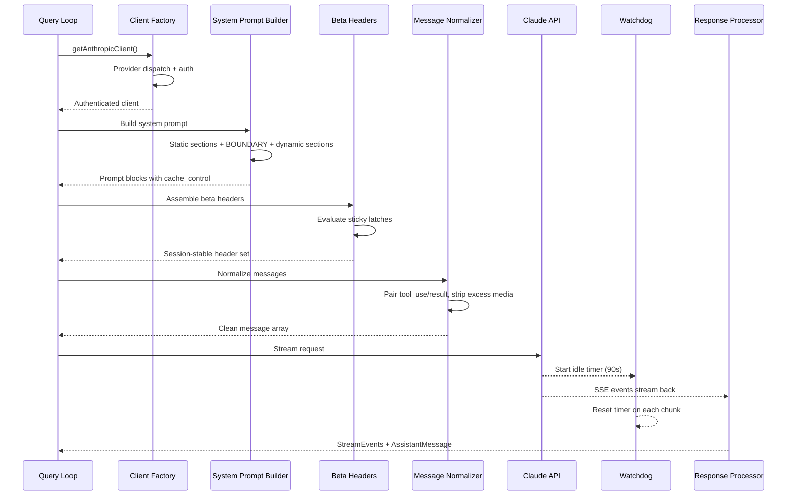
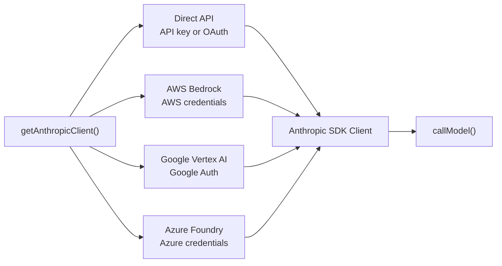
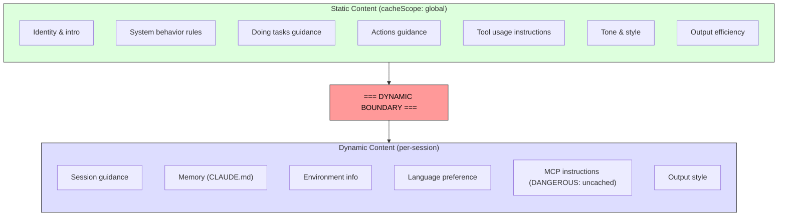

# 제4장: Claude와 대화하기 — API 계층

3장은 국가가 어디에 거주하는지와 두 계층이 어떻게 소통하는지를 확립했습니다. 이제 우리는 해당 상태가 사용될 때 무슨 일이 일어나는지 따라갑니다. 즉, 시스템은 언어 모델과 대화해야 합니다. Claude Code의 모든 것(부트스트랩 시퀀스, 상태 시스템, 권한 프레임워크)은 이 순간을 제공하기 위해 존재합니다.

이 계층은 시스템의 다른 부분보다 더 많은 오류 모드를 처리합니다. 단일 투명 인터페이스를 통해 4개의 클라우드 공급자를 통해 라우팅해야 합니다. 잘못 배치된 단일 섹션으로 인해 50,000개 이상의 토큰에 해당하는 캐시가 파열될 수 있으므로 서버의 프롬프트 캐시 작동 방식을 바이트 수준으로 인식하여 시스템 프롬프트를 구성해야 합니다. TCP 연결이 자동으로 종료되므로 활성 오류 감지를 통해 응답을 스트리밍해야 합니다. 그리고 기능 플래그에 대한 대화 중간 변경으로 인해 눈에 보이지 않는 성능 저하가 발생하지 않도록 세션 안정성 불변성을 유지해야 합니다.

단일 API 호출을 처음부터 끝까지 추적해 보겠습니다.

---

## 다중 공급자 클라이언트 팩토리

`getAnthropicClient()` 기능은 모든 모델 통신을 위한 단일 팩토리입니다. 배포 대상 공급자에 대해 구성된 Anthropic SDK 클라이언트를 반환합니다.

디스패치는 전적으로 환경 변수에 따라 진행되며 고정된 우선순위에 따라 평가됩니다. 4개의 공급자별 SDK 클래스는 모두 `as unknown as Anthropic`을 통해 `Anthropic`으로 캐스팅됩니다. 소스의 설명은 매우 정직합니다. "우리는 항상 반환 유형에 대해 거짓말을 해왔습니다." 이러한 의도적인 유형 삭제는 모든 소비자가 동일한 인터페이스를 보게 된다는 것을 의미합니다. 나머지 코드베이스는 공급자로 분기되지 않습니다.

각 공급자 SDK는 동적으로 가져옵니다. `AnthropicBedrock`, `AnthropicFoundry`, `AnthropicVertex`은 자체 종속성 트리가 있는 무거운 모듈입니다. 동적 가져오기는 사용되지 않는 공급자가 로드되지 않도록 보장합니다.

공급자 선택은 시작 시 결정되고 부트스트랩 `STATE`에 저장됩니다. 쿼리 루프는 어떤 공급자가 활성화되어 있는지 확인하지 않습니다. Direct API에서 Bedrock으로 전환하는 것은 코드 변경이 아니라 구성 변경입니다.

### buildFetch 래퍼

모든 아웃바운드 가져오기는 요청별로 생성된 UUID인 `x-client-request-id` 헤더를 삽입하기 위해 래핑됩니다. 요청 시간이 초과되면 서버는 응답에 요청 ID를 할당하지 않습니다. 클라이언트 측 ID가 없으면 API 팀은 시간 초과를 서버 측 로그와 연관시킬 수 없습니다. 이 헤더는 그 격차를 해소합니다. 이는 자사 Anthropic 엔드포인트로만 전송됩니다. 타사 제공업체는 알 수 없는 헤더를 거부할 수 있습니다.

---

## 시스템 신속한 구축

시스템 프롬프트는 전체 시스템에서 캐시에 가장 민감한 아티팩트입니다. Claude의 API는 서버 측 프롬프트 캐싱을 제공합니다. 요청 전체에 걸쳐 동일한 프롬프트 접두어를 캐시할 수 있어 대기 시간과 비용이 모두 절약됩니다. 200K 토큰 대화에는 이전 턴과 동일한 50-70K 토큰이 있을 수 있습니다. 해당 캐시를 무효화하면 서버가 모든 캐시를 다시 처리하게 됩니다.

### 동적 경계 마커

프롬프트는 중요한 구분선이 있는 문자열 섹션의 배열로 구성됩니다.

경계 이전의 모든 것은 세션, 사용자 및 조직 전반에 걸쳐 동일합니다. 즉, 가장 높은 서버 측 캐싱 계층을 얻습니다. 이후의 모든 내용에는 사용자별 콘텐츠가 포함되며 세션별 캐싱이 적용됩니다.

섹션의 명명 규칙은 의도적으로 큰 소리를 냅니다. 새 섹션을 추가하려면 `systemPromptSection`(안전함, 캐시됨)과 `DANGEROUS_uncachedSystemPromptSection`(캐시 중단, 이유 문자열 필요) 중에서 선택해야 합니다. `_reason` 매개변수는 런타임 시 사용되지 않지만 필수 문서 역할을 합니다. 모든 캐시 중단 섹션은 소스 코드에 그 정당성을 전달합니다.

### 2^N 문제

`prompts.ts`의 주석은 조건부 섹션이 경계 뒤에 와야 하는 이유를 설명합니다.

> 여기의 각 조건은 Blake2b 접두사 해시 변형(2^N)을 곱하는 런타임 비트입니다.

경계 앞의 모든 부울 조건은 고유한 전역 캐시 항목 수를 두 배로 늘립니다. 3개의 조건문은 8개의 변형을 생성합니다. 5개는 32개를 생성합니다. 정적 섹션은 의도적으로 무조건적입니다. 컴파일 시간 기능 플래그(번들러에 의해 해결됨)는 경계 이전에 허용됩니다. 런타임 검사(Haiku인가요? 사용자에게 자동 모드가 있나요?)가 이어져야 합니다.

이는 위반하기 전까지는 보이지 않는 일종의 제약 조건입니다. 선의의 엔지니어가 경계 앞에 사용자 설정 제어 섹션을 추가하면 글로벌 캐시가 자동으로 조각화되고 함대의 즉각적인 처리 비용이 두 배로 늘어날 수 있습니다.

---

## 스트리밍

### SDK 추상화를 통한 원시 SSE

스트리밍 구현에서는 SDK의 상위 수준 `BetaMessageStream` 대신 원시 `Stream<BetaRawMessageStreamEvent>`을 사용합니다. 이유: `BetaMessageStream`은 모든 `input_json_delta` 이벤트에서 `partialParse()`을 호출합니다. 대규모 JSON 입력(수백 줄의 파일 편집)이 포함된 도구 호출의 경우 모든 청크에서 증가하는 JSON 문자열을 처음부터 다시 구문 분석합니다(O(n^2) 동작). Claude Code는 도구 입력 누적을 자체적으로 처리하므로 부분적인 구문 분석은 순수한 낭비입니다.

### 유휴 감시견

TCP 연결은 알림 없이 종료될 수 있습니다. 서버가 충돌하거나 로드 밸런서가 자동으로 연결을 끊거나 회사 프록시가 시간 초과될 수 있습니다. SDK의 요청 시간 초과는 초기 가져오기에만 적용됩니다. HTTP 200이 도착하면 시간 초과가 충족됩니다. 스트리밍 바디가 멈추면 아무 것도 이를 포착하지 못합니다.

워치독: 수신된 모든 청크에서 재설정되는 `setTimeout`입니다. 90초 동안 청크가 도착하지 않으면 스트림이 중단되고 시스템은 비스트리밍 재시도로 대체됩니다. 45초가 지나면 경고가 발생합니다. 워치독이 실행되면 상관 관계를 위해 클라이언트 요청 ID와 함께 이벤트를 기록합니다.

### 비스트리밍 대체

스트리밍이 응답 도중에 실패하면(네트워크 오류, 중단, 잘림) 시스템은 동기식 `messages.create()` 호출로 대체됩니다. 이는 프록시가 SSE가 아닌 본문으로 HTTP 200을 반환하거나 SSE 스트림을 도중에 자르는 프록시 오류를 처리합니다.

폴백은 전체 요청을 다시 실행하고 잠재적으로 도구를 두 번 실행하므로 스트리밍 도구 실행이 활성화되면 폴백을 비활성화할 수 있습니다.

---

## 프롬프트 캐시 시스템

### 3개 계층

프롬프트 캐싱은 세 가지 수준에서 작동합니다.

**임시 캐시**(기본값): 서버 정의 TTL(~5분)을 사용한 세션별 캐싱입니다. 모든 사용자가 이것을 얻습니다.

**1시간 TTL**: 적격한 사용자는 확장된 캐싱을 받습니다. 적격성은 구독 상태에 따라 결정되며 부트스트랩 상태에서 래치됩니다. 3장의 `promptCache1hEligible` 고정 래치는 세션 중간 초과분 전환이 TTL을 변경하지 않도록 보장합니다.

**전역 범위**: 시스템 프롬프트 캐시 항목은 세션 간, 조직 간 공유를 얻습니다. 프롬프트의 정적 부분은 모든 Claude Code 사용자에게 동일하므로 캐시된 단일 복사본이 모든 사람에게 제공됩니다. MCP 도구 정의는 사용자별로 정의되고 캐시를 수백만 개의 고유 접두사로 조각화하기 때문에 MCP 도구가 있으면 전역 범위가 비활성화됩니다.

### 끈끈한 래치 작동

요청 생성 중에 3장의 5개 고정 래치가 여기에서 평가됩니다. 각 래치는 `null`으로 시작하고 일단 `true`으로 설정되면 세션 동안 `true`으로 유지됩니다. 래치 블록 위의 설명은 정확합니다. "동적 베타 헤더에 대한 고정 래치입니다. 처음 전송된 각 헤더는 나머지 세션 동안 계속 전송되므로 세션 중간 토글이 서버 측 캐시 키를 변경하지 않고 ~50-70K 토큰을 버스트하지 않습니다."

래치 패턴, 5가지 특정 래치 및 Always-send-all-headers가 올바른 솔루션이 아닌 이유에 대한 전체 설명은 3장, 섹션 3.1을 참조하세요.

---

## 쿼리모델 생성기

`queryModel()` 함수는 전체 API 호출 수명주기를 조정하는 비동기 생성기(~700줄)입니다. `StreamEvent`, `AssistantMessage` 및 `SystemAPIErrorMessage` 객체가 생성됩니다.

요청 어셈블리는 신중하게 정렬된 순서를 따릅니다.

1. **킬 스위치 확인** -- 가장 비싼 모델 등급을 위한 안전 밸브
2. **베타 헤더 조립** -- 모델별로 다르며 고정 래치가 적용됨
3. **도구 스키마 구축** -- `Promise.all()`을 통해 병렬, 발견될 때까지 지연된 도구는 제외됨
4. **메시지 정규화** -- 분리된 tool_use/tool_result 불일치 복구, 초과 미디어 제거, 오래된 블록 제거
5. **시스템 프롬프트 블록 구성** -- 동적 경계에서 분할하고 캐시 범위를 할당합니다.
6. **재시도 래핑 스트리밍** -- 529(오버로드), 모델 대체, 사고 다운그레이드, OAuth 새로고침 처리

### 출력 토큰 한도

기본 출력 한도는 일반적인 32K 또는 64K가 아닌 8,000개 토큰입니다. 생산 데이터에 따르면 p99 출력은 4,911개 토큰으로, 표준 한도는 8-16배 초과 예약되어 있습니다. 응답이 한도에 도달하면(요청의 1% 미만) 64K에서 한 번 완전히 재시도됩니다. 이는 차량 규모에서 상당한 비용을 절감합니다.

### 오류 처리 및 재시도

`withRetry()` 함수 자체는 UI가 재시도 상태를 표시할 수 있도록 `SystemAPIErrorMessage` 이벤트를 생성하는 비동기 생성기입니다. 재시도 전략:

- **529(오버로드)**: 기다렸다가 다시 시도하고 선택적으로 빠른 모드를 다운그레이드합니다.
- **모델 대체**: 기본 모델이 실패하면 대체를 시도합니다(예: Opus에서 Sonnet으로).
- **사고력 다운그레이드**: 컨텍스트 창 오버플로로 인해 사고 예산 감소
- **OAuth 401**: 토큰을 새로 고치고 한 번 다시 시도하세요.

생성기 패턴은 재시도 진행 상황("서버 오버로드, 5초 후에 재시도 중...")이 사이드 채널 알림이 아닌 이벤트 스트림의 자연스러운 부분으로 나타남을 의미합니다.

---

## 직접 적용하기

**프롬프트 캐싱을 기능 전환이 아닌 아키텍처 제약으로 처리합니다.** 대부분의 LLM 응용 프로그램은 캐싱을 "활성화"합니다. Claude Code는 이를 프롬프트 순서 지정, 섹션 메모, 헤더 래칭 및 구성 관리를 형성하는 설계 제약으로 간주합니다. 잘 구성된 프롬프트(50,000개의 토큰에 대한 캐시 적중)와 잘못 구성된 프롬프트(매 턴 전체 재처리) 사이의 차이는 시스템에서 가장 큰 단일 비용 요소입니다.

**비용이 많이 드는 탈출구에 대해 DANGEROUS 명명 규칙을 사용합니다.** 코드베이스에 실수로 위반하기 쉬운 불변이 있는 경우 큰 접두사를 사용하여 탈출구의 이름을 지정하면 세 가지 작업이 수행됩니다. 코드 검토에서 위반 사항을 표시하고 문서화를 강제하며(필수 이유 매개변수) 안전 기본값에 대한 심리적 마찰을 만듭니다. 이는 캐싱을 넘어 비용이 보이지 않는 모든 작업으로 일반화됩니다.

**단순한 시간 초과가 아닌 감시 기능을 사용하여 스트리밍을 구축합니다.** SDK의 요청 시간 초과는 HTTP 200을 충족하지만 응답 본문은 언제든지 도착을 중지할 수 있습니다. 모든 청크에서 재설정되는 `setTimeout`이 이를 포착합니다. 비스트리밍 폴백은 기업 환경에서 예상하는 것보다 더 일반적인 프록시 오류 모드(SSE가 아닌 본문이 있는 HTTP 200, 중간 스트림 잘림)를 처리합니다.

**재시도 전략은 예외 기반이 아닌 산출 기반으로 만듭니다.** 재시도 래퍼를 상태 이벤트를 생성하는 비동기 생성기로 만들어 호출자는 재시도 진행 상황을 이벤트 스트림의 자연스러운 부분으로 표시합니다. 모델 대체 패턴(Opus 실패, Sonnet 시도)은 프로덕션 복원력에 특히 유용합니다.

**전체 파이프라인에서 빠른 경로를 분리합니다.** 모든 API 호출에 도구 검색, 조언자 통합, 예산 고려 및 스트리밍 인프라가 필요한 것은 아닙니다. Claude Code의 `queryHaiku()` 기능은 모든 에이전트 문제를 건너뛰는 내부 작업(압축, 분류)에 대한 간소화된 경로를 제공합니다. 단순화된 인터페이스를 갖춘 별도의 기능은 우발적인 복잡성 누출을 방지합니다.

---

## 미래를 내다보며

API 레이어는 이후의 모든 것의 기초가 됩니다. 5장에서는 모델이 응답을 완료하기 전에 도구 실행을 시작하는 방법을 포함하여 쿼리 루프가 스트리밍 응답을 사용하여 도구 실행을 구동하는 방법을 보여줍니다. 6장에서는 대화가 컨텍스트 제한에 접근할 때 압축 시스템이 캐시 효율성을 유지하는 방법을 설명합니다. 7장에서는 각 에이전트 스레드가 자체 메시지 배열과 요청 체인을 얻는 방법을 보여줍니다.

이러한 모든 시스템은 여기에 설정된 제약 조건, 즉 아키텍처 불변으로서의 캐시 안정성, 클라이언트 팩토리를 통한 공급자 투명성, 래치 시스템을 통한 세션 안정성 구성을 상속합니다. API 계층은 단순히 요청을 보내는 것이 아니라 다른 모든 시스템이 작동하는 규칙을 정의합니다.
