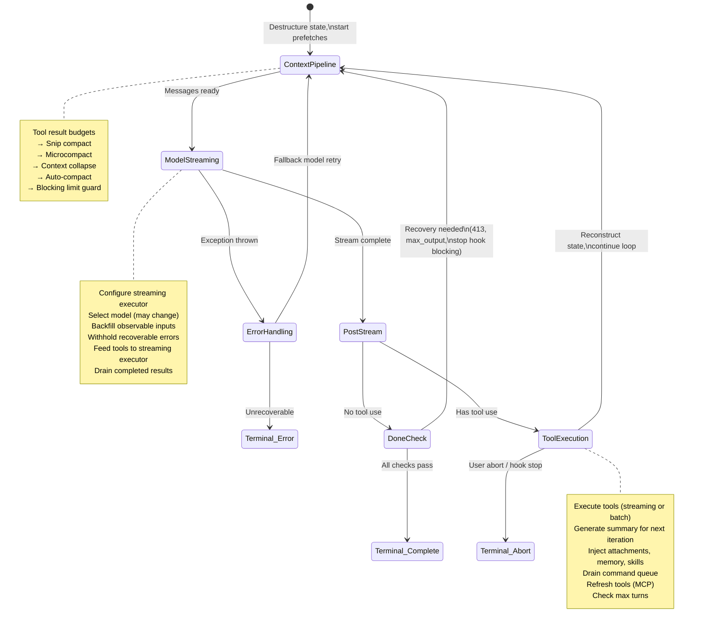
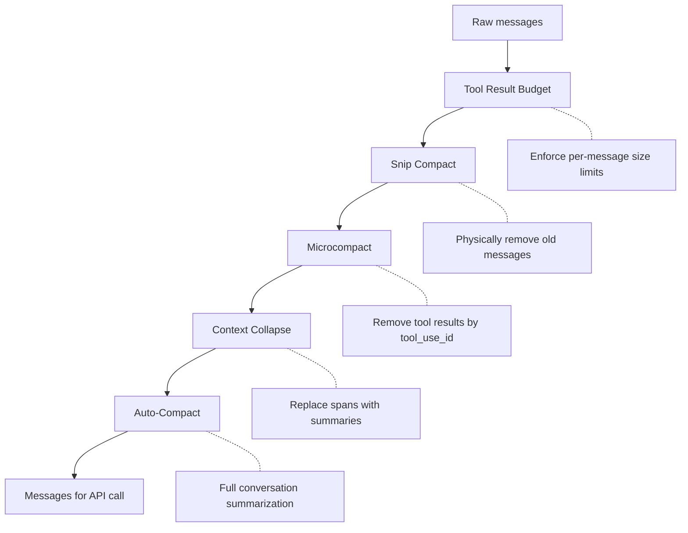
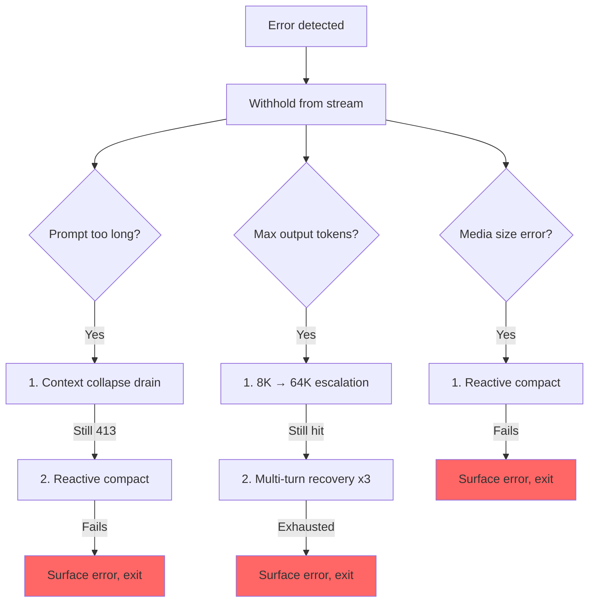

<a id="chapter-5-the-agent-loop"></a>

# 제5장: 에이전트 루프

<a id="the-beating-heart"></a>

## 뛰는 심장

4장에서는 API 계층이 구성을 스트리밍 HTTP 요청으로 변환하는 방법, 즉 클라이언트 구축 방법, 시스템 프롬프트 구성 방법, 응답이 서버 전송 이벤트로 도착하는 방법을 보여주었습니다. 해당 레이어는 모델과 대화하는 *메커니즘*을 처리합니다. 그러나 단일 API 호출은 에이전트가 아닙니다. 에이전트는 루프입니다. 작업이 완료될 때까지 모델을 호출하고, 도구를 실행하고, 결과를 다시 제공하고, 모델을 다시 호출합니다.

모든 시스템에는 무게 중심이 있습니다. 데이터베이스에서는 스토리지 엔진입니다. 컴파일러에서는 중간 표현입니다. Claude Code에서는 `query.ts`입니다. REPL의 첫 번째 키 입력부터 헤드리스 `--print` 호출의 마지막 도구 호출까지 모든 상호 작용을 실행하는 비동기 생성기를 포함하는 단일 1,730줄 파일입니다.

이것은 과장이 아닙니다. 모델과 통신하고, 도구를 실행하고, 컨텍스트를 관리하고, 오류를 복구하고, 중지 시기를 결정하는 코드 경로는 정확히 하나입니다. 해당 코드 경로는 `query()` 함수입니다. REPL이 그것을 호출합니다. SDK가 이를 호출합니다. 하위 에이전트가 호출합니다. 머리없는 주자가 그것을 부릅니다. Claude Code를 사용하는 경우 `query()` 내부에 있습니다.

파일은 밀도가 높지만 얽힌 상속 계층이 복잡한 것처럼 복잡하지 않습니다. 이는 잠수함이 복잡한 것처럼 복잡합니다. 하나의 선체에 많은 중복 시스템이 있고 바다가 길을 찾았기 때문에 각각 추가되었습니다. 모든 `if` 지점에는 이야기가 있습니다. 보류된 모든 오류 메시지는 SDK 소비자가 복구 중에 연결을 끊은 실제 버그를 나타냅니다. 모든 회로 차단기 임계값은 무한 루프에서 수천 개의 API 호출을 태운 실제 세션에 대해 조정되었습니다.

이 장에서는 시작부터 끝까지 전체 루프를 추적합니다. 결국에는 무슨 일이 일어나는지뿐만 아니라 각 메커니즘이 왜 존재하는지, 메커니즘 없이는 무엇이 중단되는지 이해하게 될 것입니다.

---

<a id="why-an-async-generator"></a>

## 비동기 생성기가 필요한 이유

첫 번째 아키텍처 질문: 에이전트 루프가 콜백 기반 이벤트 이미터가 아닌 생성기인 이유는 무엇입니까?

```typescript
// Simplified — shows the concept, not the exact types
async function* agentLoop(params: LoopParams): AsyncGenerator<Message | Event, TerminalReason>
```

실제 서명은 여러 메시지 및 이벤트 유형을 생성하고 루프가 중지된 이유를 식별된 통합 인코딩으로 반환합니다.

세 가지 이유(중요도 순).

**배압.** 소비자가 준비되었는지 여부에 관계없이 이벤트 이미터가 실행됩니다. 생성기는 소비자가 `.next()`을 호출할 때만 생성됩니다. REPL의 React 렌더러가 이전 프레임을 그리는 중일 때 생성기는 자연스럽게 일시 중지됩니다. SDK 소비자가 도구 결과를 처리하는 동안 생성기는 기다립니다. 버퍼 오버플로, 메시지 삭제, "빠른 생산자/느린 소비자" 문제가 없습니다.

**반환 값 의미.** 생성기의 반환 유형은 `Terminal`입니다. 이는 루프가 중지된 이유를 정확히 식별하는 유니온 인코딩입니다. 정상적으로 완료되었나요? 사용자가 중단되었나요? 토큰 예산 소진? 스톱훅 개입? 최대 회전 제한? 복구할 수 없는 모델 오류인가요? 10개의 고유한 터미널 상태가 있습니다. 호출자는 "종료" 이벤트를 구독할 필요가 없으며 페이로드에 이유가 포함되기를 바랍니다. `for await...of` 또는 `yield*`에서 형식화된 반환 값으로 이를 가져옵니다.

**`yield*`을 통한 구성성.** 외부 `query()` 함수는 `yield*`을 사용하여 `queryLoop()`에 위임하며, 이는 모든 산출된 값과 최종 반환을 투명하게 전달합니다. `handleStopHooks()`과 같은 하위 생성기는 동일한 패턴을 사용합니다. 이는 콜백 없이, 약속을 래핑하는 약속 없이, 이벤트 전달 상용구 없이 깨끗한 책임 체인을 생성합니다.

선택에는 비용이 듭니다. JavaScript의 비동기 생성기는 "되감기" 또는 포크될 수 없습니다. 그러나 에이전트 루프에는 둘 중 하나가 필요하지 않습니다. 이는 엄격하게 전진하는 상태 머신입니다.

한 가지 더 미묘한 점은 `function*` 구문이 함수를 *게으른* 상태로 만든다는 것입니다. 본문은 첫 번째 `.next()` 호출까지 실행되지 않습니다. 이는 `query()`이 즉시 반환됨을 의미합니다. 모든 무거운 초기화(구성 스냅샷, 메모리 프리패치, 예산 추적기)는 소비자가 값 가져오기를 시작할 때만 발생합니다. REPL에서 이는 루프의 첫 번째 줄이 실행되기 전에 React 렌더링 파이프라인이 이미 설정되었음을 의미합니다.

---

<a id="what-callers-provide"></a>

## 발신자가 제공하는 것

루프를 추적하기 전에 무엇이 들어가는지 아는 것이 도움이 됩니다.

```typescript
// Simplified — illustrates the key fields
type LoopParams = {
  messages: Message[]
  prompt: SystemPrompt
  permissionCheck: CanUseToolFn
  context: ToolUseContext
  source: QuerySource         // 'repl', 'sdk', 'agent:xyz', 'compact', etc.
  maxTurns?: number
  budget?: { total: number }  // API-level task budget
  deps?: LoopDeps             // Injected for testing
}
```

주목할만한 분야:

- **`querySource`**: `'repl_main_thread'`, `'sdk'`, `'agent:xyz'`, `'compact'` 또는 `'session_memory'`과 같은 문자열 판별자입니다. 많은 조건문이 이에 대해 분기됩니다. 압축 에이전트는 `querySource: 'compact'`을 사용하므로 차단 제한 가드가 교착 상태에 빠지지 않습니다(토큰 수를 *줄이기* 위해 압축 에이전트를 실행해야 함).

- **`taskBudget`**: API 수준 작업 예산(`output_config.task_budget`)입니다. `+500k` 자동 계속 토큰 예산 기능과 다릅니다. `total`은 전체 에이전트 차례에 대한 예산입니다. `remaining`은 누적 API 사용량을 통해 반복별로 계산되며 압축 경계에 걸쳐 조정됩니다.

- **`deps`**: 선택적 종속성 주입. 기본값은 `productionDeps()`입니다. 이는 테스트가 가짜 모델 호출, 가짜 압축 및 결정론적 UUID로 교체되는 이음새입니다.

- **`canUseTool`**: 해당 도구의 허용 여부를 반환하는 함수입니다. 이는 권한 계층입니다. 신뢰 설정, 훅 결정 및 현재 권한 모드를 확인합니다.

---

<a id="the-two-layer-entry-point"></a>

## 2층 진입점

공개 API는 실제 루프를 둘러싼 얇은 래퍼입니다.

외부 함수는 내부 루프를 래핑하여 차례 동안 대기 중인 명령이 소비되었는지 추적합니다. 내부 루프가 완료된 후 사용된 명령은 `'completed'`으로 표시됩니다. 루프가 발생하거나 `.return()`을 통해 생성기가 닫히면 완료 알림이 발생하지 않습니다. 실패한 회전은 명령이 성공적으로 처리된 것으로 표시되어서는 안 됩니다. `/` 슬래시 명령 또는 작업 알림을 통해 차례 동안 대기열에 있는 명령은 루프 내부에 `'started'`으로 표시되고 래퍼에는 `'completed'`으로 표시됩니다. 루프가 발생하거나 `.return()`을 통해 생성기가 닫히면 완료 알림이 실행되지 않습니다. 이는 의도적인 것입니다. 실패한 차례는 명령이 성공적으로 처리된 것으로 표시되어서는 안 됩니다.

---

<a id="the-state-object"></a>

## 상태 객체

루프는 단일 유형의 객체에 상태를 전달합니다.

```typescript
// Simplified — illustrates the key fields
type LoopState = {
  messages: Message[]
  context: ToolUseContext
  turnCount: number
  transition: Continue | undefined
  // ... plus recovery counters, compaction tracking, pending summaries, etc.
}
```

10개의 필드. 각각은 그 자리를 차지합니다.

| 필드 | 그것이 존재하는 이유 |
|-------|---------------|
| `messages` | 반복될 때마다 증가하는 대화 기록 |
| `toolUseContext` | 변경 가능한 컨텍스트: 도구, 중단 컨트롤러, 에이전트 상태, 옵션 |
| `autoCompactTracking` | 압축 상태 추적: 회전 카운터, 회전 ID, 연속 실패, 압축 플래그 |
| `maxOutputTokensRecoveryCount` | 출력 토큰 제한에 대한 다중 회전 복구 시도 횟수(최대 3회) |
| `hasAttemptedReactiveCompact` | 무한 반응 압축 루프에 대한 원샷 가드 |
| `maxOutputTokensOverride` | 에스컬레이션 중에는 64K로 설정되고 이후에는 삭제됩니다. |
| `pendingToolUseSummary` | 현재 스트리밍 중에 해결된 이전 반복의 Haiku 요약 약속 |
| `stopHookActive` | 차단 재시도 후 중지 훅가 다시 실행되는 것을 방지합니다. |
| `turnCount` | 단조 카운터, `maxTurns`에 대해 확인됨 |
| `transition` | 이전 반복이 계속되는 이유 - 첫 번째 반복에서 `undefined` |

<a id="immutable-transitions-in-a-mutable-loop"></a>

### 가변 루프의 불변 전환

루프의 모든 `continue` 문에 나타나는 패턴은 다음과 같습니다.

```typescript
const next: State = {
  messages: [...messagesForQuery, ...assistantMessages, ...toolResults],
  toolUseContext: toolUseContextWithQueryTracking,
  autoCompactTracking: tracking,
  turnCount: nextTurnCount,
  maxOutputTokensRecoveryCount: 0,
  hasAttemptedReactiveCompact: false,
  pendingToolUseSummary: nextPendingToolUseSummary,
  maxOutputTokensOverride: undefined,
  stopHookActive,
  transition: { reason: 'next_turn' },
}
state = next
```

모든 계속 사이트는 완전히 새로운 `State` 개체를 구성합니다. `state.messages = newMessages`이 아닙니다. `state.turnCount++`이 아닙니다. 전체 재구성. 장점은 모든 전환이 자체적으로 문서화된다는 것입니다. `continue` 사이트를 읽고 어떤 필드가 변경되고 어떤 필드가 유지되는지 정확하게 확인할 수 있습니다. 새로운 상태 기록의 `transition` 필드는 루프가 계속되는 *이유*를 기록합니다. 테스트는 이에 대해 주장하여 올바른 복구 경로가 실행되었는지 확인합니다.

---

<a id="the-loop-body"></a>

## 루프 바디

다음은 뼈대로 압축된 단일 반복의 전체 실행 흐름입니다.



이것이 전체 루프입니다. 메모리에서 하위 에이전트, 오류 복구에 이르기까지 Claude Code의 모든 기능은 이 단일 반복 구조에 공급되거나 소비됩니다.

---

<a id="context-management-four-compression-layers"></a>

## 컨텍스트 관리: 4개의 압축 계층

각 API 호출 전에 메시지 기록은 최대 4개의 컨텍스트 관리 단계를 거칩니다. 특정 순서로 실행되며 그 순서가 중요합니다.



<a id="layer-0-tool-result-budget"></a>

### 레이어 0: 도구 결과 예산

압축하기 전에 `applyToolResultBudget()`은 도구 결과에 메시지별 크기 제한을 적용합니다. 유한한 `maxResultSizeChars`이 없는 도구는 면제됩니다.

<a id="layer-1-snip-compact"></a>

### 레이어 1: Snip Compact

가장 가벼운 작업. Snip은 배열에서 오래된 메시지를 물리적으로 제거하여 UI에 제거를 알리는 경계 메시지를 생성합니다. 해제된 토큰 수를 보고하고 해당 숫자는 자동 압축의 임계값 확인에 연결됩니다.

<a id="layer-2-microcompact"></a>

### 레이어 2: 초소형

Microcompact는 더 이상 필요하지 않으며 `tool_use_id`으로 식별되는 도구 결과를 제거합니다. 캐시된 마이크로컴팩트(API 캐시 편집)의 경우 경계 메시지는 API 응답 이후까지 연기됩니다. 이유는 클라이언트 측 토큰 추정치가 신뢰할 수 없기 때문입니다. API 응답의 실제 `cache_deleted_input_tokens`은 실제로 무엇이 해제되었는지 알려줍니다.

<a id="layer-3-context-collapse"></a>

### 레이어 3: 컨텍스트 축소

컨텍스트 축소는 대화 범위를 요약으로 대체합니다. 자동 압축 전에 실행되며 순서는 의도적입니다. 축소로 인해 컨텍스트가 자동 압축 임계값 아래로 줄어들면 자동 압축은 작동하지 않습니다. 이는 모든 것을 단일한 단일 요약으로 대체하는 대신 세부적인 컨텍스트를 유지합니다.

<a id="layer-4-auto-compact"></a>

### 레이어 4: 자동 압축

가장 무거운 작업: 기록을 요약하기 위해 전체 Claude 대화를 분기합니다. 구현에는 회로 차단기가 있습니다. 3번 연속 실패하면 시도가 중지됩니다. 이렇게 하면 프로덕션에서 관찰되는 악몽 같은 시나리오, 즉 무한 압축 실패-재시도 루프에서 하루에 250,000개의 API 호출을 굽는 컨텍스트 제한을 초과하여 세션이 멈추는 상황이 방지됩니다.

<a id="auto-compact-thresholds"></a>

### 자동 압축 임계값

임계값은 모델의 컨텍스트 창에서 파생됩니다.

```
effectiveContextWindow = contextWindow - min(modelMaxOutput, 20000)

Thresholds (relative to effectiveContextWindow):
  Auto-compact fires:      effectiveWindow - 13,000
  Blocking limit (hard):   effectiveWindow - 3,000
```

| 상수 | 가치 | 목적 |
|----------|-------|---------|
| `AUTOCOMPACT_BUFFER_TOKENS` | 13,000 | 자동 압축 트리거를 위한 유효 창 아래의 헤드룸 |
| `MANUAL_COMPACT_BUFFER_TOKENS` | 3,000 | `/compact`이 계속 작동하도록 공간을 예약합니다. |
| `MAX_CONSECUTIVE_AUTOCOMPACT_FAILURES` | 3 | 회로 차단기 임계값 |

13,000개 토큰 버퍼는 하드 제한 이전에 자동 압축이 실행됨을 의미합니다. 자동 압축 임계값과 차단 제한 사이의 간격은 반응적 압축이 작동하는 곳입니다. 즉, 사전적 자동 압축이 실패하거나 비활성화된 경우 반응적 압축은 413 오류를 포착하고 요청 시 압축합니다.

<a id="token-counting"></a>

### 토큰 계산

정식 함수 `tokenCountWithEstimation`은 신뢰할 수 있는 API 보고 토큰 수(가장 최근 응답의)와 해당 응답 이후에 추가된 메시지에 대한 대략적인 추정치를 결합합니다. 근사치는 보수적입니다. 즉, 자동 압축 발사가 약간 늦기보다는 약간 일찍 이루어짐을 의미합니다.

---

<a id="model-streaming"></a>

## 모델 스트리밍

<a id="the-callmodel-loop"></a>

### callModel() 루프

API 호출은 모델 대체를 활성화하는 `while(attemptWithFallback)` 루프 내에서 발생합니다.

```typescript
let attemptWithFallback = true
while (attemptWithFallback) {
  attemptWithFallback = false
  try {
    for await (const message of deps.callModel({ messages, systemPrompt, tools, signal })) {
      // Process each streamed message
    }
  } catch (innerError) {
    if (innerError instanceof FallbackTriggeredError && fallbackModel) {
      currentModel = fallbackModel
      attemptWithFallback = true
      continue
    }
    throw innerError
  }
}
```

활성화되면 `StreamingToolExecutor`은 전체 응답이 완료된 후가 아니라 스트리밍 중에 `tool_use` 블록이 도착하자마자 도구 실행을 시작합니다. 도구를 동시 배치로 조정하는 방법은 7장의 주제입니다.

<a id="the-withholding-pattern"></a>

### 원천징수 패턴

이는 파일에서 가장 중요한 패턴 중 하나입니다. 복구 가능한 오류는 산출 스트림에서 억제됩니다.

```typescript
let withheld = false
if (contextCollapse?.isWithheldPromptTooLong(message)) withheld = true
if (reactiveCompact?.isWithheldPromptTooLong(message)) withheld = true
if (isWithheldMaxOutputTokens(message)) withheld = true
if (!withheld) yield yieldMessage
```

왜 보류합니까? SDK 소비자(데스크톱 앱인 Cowork)는 `error` 필드가 있는 모든 메시지에서 세션을 종료하기 때문입니다. 너무 긴 프롬프트 오류가 발생한 후 반응적 압축을 통해 성공적으로 복구한 경우 소비자의 연결이 이미 끊어진 것입니다. 복구 루프가 계속 실행되지만 아무도 듣고 있지 않습니다. 따라서 오류는 보류되고 다운스트림 복구 검사에서 오류를 찾을 수 있도록 `assistantMessages`으로 푸시됩니다. 모든 복구 경로가 실패하면 보류된 메시지가 최종적으로 표시됩니다.

<a id="model-fallback"></a>

### 모델 대체

`FallbackTriggeredError`이 포착되면(기본 모델에 대한 수요가 높음) 루프는 모델을 전환하고 재시도합니다. 그러나 사고 서명은 모델에 바인딩되어 있습니다. 즉, 한 모델에서 다른 대체 모델로 보호된 사고 블록을 재생하면 400 오류가 발생합니다. 코드는 재시도 전에 서명 블록을 제거합니다. 실패한 시도로 인해 분리된 모든 어시스턴트 메시지는 삭제 표시되므로 UI에서 해당 메시지를 제거합니다.

---

<a id="error-recovery-the-escalation-ladder"></a>

## 오류 복구: 에스컬레이션 사다리

query.ts의 오류 복구는 단일 전략이 아닙니다. 이는 이전 개입이 실패할 때 각각 촉발되는 점점 더 공격적인 개입의 사다리입니다.



<a id="the-death-spiral-guard"></a>

### 죽음의 나선 수호대

가장 위험한 실패 모드는 무한 루프입니다. 코드에는 여러 개의 가드가 있습니다.

1. **`hasAttemptedReactiveCompact`**: 원샷 플래그. 오류 유형당 한 번씩 반응형 컴팩트가 실행됩니다.
2. **`MAX_OUTPUT_TOKENS_RECOVERY_LIMIT = 3`**: 다중 턴 복구 시도에 대한 하드 캡입니다.
3. **자동 압축 시 회로 차단기**: 3번 연속 실패하면 자동 압축 시도가 완전히 중지됩니다.
4. **오류 응답 시 중지 훅 없음**: 마지막 메시지가 API 오류인 경우 중지 훅에 도달하기 전에 코드가 명시적으로 반환됩니다. 주석에는 "오류 -> 훅 차단 -> 재시도 -> 오류 -> ...(훅은 각 주기마다 더 많은 토큰을 주입합니다)"라고 설명되어 있습니다.
5. **중지 훅 재시도 전반에 걸쳐 `hasAttemptedReactiveCompact`이 보존됨**: 중지 훅가 차단 오류를 반환하고 강제로 재시도하면 반응형 컴팩트 가드가 보존됩니다. 댓글에는 버그에 대한 문서가 있습니다. "여기서 false로 재설정하면 수천 개의 API 호출이 소모되는 무한 루프가 발생합니다."

누군가가 프로덕션에서 실패 모드에 도달했기 때문에 이러한 각 가드가 추가되었습니다.

---

<a id="worked-example-fix-the-bug-in-authts"></a>

## 작업된 예: "auth.ts의 버그 수정"

루프를 구체적으로 만들기 위해 세 번의 반복을 통해 실제 상호 작용을 추적해 보겠습니다.

**사용자 유형:** `Fix the null pointer bug in src/auth/validate.ts`

**반복 1: 모델이 파일을 읽습니다.**

루프가 들어갑니다. 컨텍스트 관리가 실행됩니다(압축이 필요하지 않음 - 대화가 짧음). 모델은 "파일을 살펴보겠습니다."라는 응답을 스트리밍합니다. 단일 `tool_use` 블록인 `Read({ file_path: "src/auth/validate.ts" })`을 방출합니다. 스트리밍 실행자는 동시성이 안전한 도구를 확인하고 즉시 시작합니다. 모델이 응답 텍스트를 완료할 때쯤에는 파일 내용이 이미 메모리에 있습니다.

포스트 스트림 처리: 모델이 도구를 사용했으므로 도구 사용 경로를 입력합니다. 읽기 결과(줄 번호가 있는 파일 내용)가 `toolResults`으로 푸시됩니다. 하이쿠 요약 약속이 백그라운드에서 시작됩니다. 상태는 새 메시지 `transition: { reason: 'next_turn' }`으로 재구성되고 루프가 계속됩니다.

**반복 2: 모델이 파일을 편집합니다.**

컨텍스트 관리가 다시 실행됩니다(여전히 임계값 미만). 모델은 다음과 같이 스트리밍합니다. "라인 42에 버그가 있습니다 -- `userId`이 null일 수 있습니다." `Edit({ file_path: "src/auth/validate.ts", old_string: "const user = getUser(userId)", new_string: "if (!userId) return { error: 'unauthorized' }\nconst user = getUser(userId)" })`을 방출합니다.

편집은 동시성이 안전하지 않으므로 스트리밍 실행자는 응답이 완료될 때까지 편집을 대기열에 넣습니다. 그런 다음 14단계 실행 파이프라인이 실행됩니다. Zod 유효성 검사가 통과되고, 입력 백필이 경로를 확장하고, PreToolUse 훅가 권한을 확인하고(사용자가 승인함) 편집 내용이 적용됩니다. 반복 1에서 보류 중인 Haiku 요약은 스트리밍 중에 해결됩니다. 해당 결과는 `ToolUseSummaryMessage`으로 생성됩니다. 상태가 재구성되고 루프가 계속됩니다.

**반복 3: 모델이 완성을 선언합니다.**

모델은 다음과 같이 스트리밍합니다. "보호 절을 추가하여 널 포인터 버그를 수정했습니다." `tool_use` 블록이 없습니다. "완료" 경로로 들어갑니다. 복구가 너무 오래 걸리나요? 필요하지 않습니다. 최대 출력 토큰? 아니요. 중지 훅 실행 - 차단 오류가 없습니다. 토큰 예산 확인이 통과되었습니다. 루프는 `{ reason: 'completed' }`을 반환합니다.

총계: 3개의 API 호출, 2개의 도구 실행, 1개의 사용자 권한 프롬프트. 루프는 스트리밍 도구 실행, API 호출과 겹치는 Haiku 요약 및 전체 권한 파이프라인을 모두 동일한 `while(true)` 구조를 통해 처리했습니다.

---

<a id="token-budgets"></a>

## 토큰 예산

사용자는 턴에 대한 토큰 예산을 요청할 수 있습니다(예: `+500k`). 예산 시스템은 모델이 응답을 완료한 후 계속할지 또는 중지할지를 결정합니다.

`checkTokenBudget`은 세 가지 규칙을 사용하여 이진 계속/중지 결정을 내립니다.

1. **하위 에이전트는 항상 중지됩니다.** 예산은 최상위 개념일 뿐입니다.
2. **완료 임계값은 90%입니다.** `turnTokens < budget * 0.9`인 경우 계속합니다.
3. **반품 감소 감지.** 3회 이상 연속된 후 현재 및 이전 델타가 모두 500개 토큰 미만인 경우 일찍 중지합니다. 모델은 연속될 때마다 점점 더 적은 출력을 생성합니다.

결정이 "계속"이면 모델에 남은 예산을 알려주는 넛지 메시지가 주입됩니다.

---

<a id="stop-hooks-forcing-the-model-to-keep-working"></a>

## Stop Hooks: 모델이 계속 작동하도록 강제

도구 사용을 요청하지 않고 모델이 완료되면 중지 훅가 실행됩니다. 즉, 완료된 것으로 생각합니다. 훅은 실제로 *완료*되었는지 평가합니다.

파이프라인은 템플릿 작업 분류를 실행하고 백그라운드 작업(프롬프트 제안, 메모리 추출)을 시작한 다음 적절한 중지 훅을 실행합니다. 중지 훅가 차단 오류("완료했다고 말했지만 linter가 3개의 오류를 발견했습니다")를 반환하면 오류가 메시지 기록에 추가되고 루프가 `stopHookActive: true`으로 계속됩니다. 이 플래그는 재시도 시 동일한 훅가 다시 실행되는 것을 방지합니다.

중지 훅가 `preventContinuation` 신호를 보내면 루프는 `{ reason: 'stop_hook_prevented' }`과 함께 즉시 종료됩니다.

---

<a id="state-transitions-the-complete-catalog"></a>

## 상태 전환: 전체 카탈로그

루프의 모든 종료는 `Terminal`(루프 반환) 또는 `Continue`(루프 반복)의 두 가지 유형 중 하나입니다.

<a id="terminal-states-10-reasons"></a>

### 터미널 상태(10가지 이유)

| 이유 | 트리거 |
|--------|---------|
| `blocking_limit` | 하드 제한의 토큰 수, 자동 압축 꺼짐 |
| `image_error` | ImageSizeError, ImageResizeError 또는 복구할 수 없는 미디어 오류 |
| `model_error` | 복구할 수 없는 API/모델 예외 |
| `aborted_streaming` | 모델 스트리밍 중 사용자 중단 |
| `prompt_too_long` | 회수가 모두 소진된 후 보류 413 |
| `completed` | 정상 완료(도구 사용 없음, 예산 소진, API 오류) |
| `stop_hook_prevented` | 중지 훅가 명시적으로 차단된 연속 |
| `aborted_tools` | 도구 실행 중 사용자 중단 |
| `hook_stopped` | PreToolUse 훅가 계속 중지되었습니다. |
| `max_turns` | `maxTurns` 한도에 도달했습니다. |

<a id="continue-states-7-reasons"></a>

### 계속 상태(7가지 이유)

| 이유 | 트리거 |
|--------|---------|
| `collapse_drain_retry` | 413에서 컨텍스트 붕괴가 단계적으로 붕괴됨 |
| `reactive_compact_retry` | 413 또는 미디어 오류 이후 반응형 압축이 성공했습니다. |
| `max_output_tokens_escalate` | 8K 한도 히트, 64K로 확대 |
| `max_output_tokens_recovery` | 64K 계속 적중, 다회전 회복(최대 3회 시도) |
| `stop_hook_blocking` | 중지 훅가 차단 오류를 반환했습니다. 다시 시도해야 합니다. |
| `token_budget_continuation` | 토큰 예산이 소진되지 않았으며 넛지 메시지가 삽입되었습니다. |
| `next_turn` | 정상적인 도구 사용 지속 |

---

<a id="orphaned-tool-results-the-protocol-safety-net"></a>

## 고아 도구 결과: 프로토콜 안전망

API 프로토콜에서는 모든 `tool_use` 블록 뒤에 `tool_result`이 와야 합니다. `yieldMissingToolResultBlocks` 함수는 모델이 방출했지만 해당 결과를 얻지 못한 모든 `tool_use` 블록에 대해 `tool_result` 오류 메시지를 생성합니다. 이 안전망이 없으면 스트리밍 중 충돌이 발생하면 다음 API 호출에서 프로토콜 오류가 발생하는 고아 `tool_use` 블록이 남게 됩니다.

외부 오류 처리기(모델 충돌), 대체 처리기(모델 전환 중간 스트림), 중단 처리기(사용자 중단)의 세 위치에서 실행됩니다. 각 경로에는 서로 다른 오류 메시지가 있지만 메커니즘은 동일합니다.

---

<a id="abort-handling-two-paths"></a>

## 중단 처리: 두 가지 경로

중단은 스트리밍 중과 도구 실행 중 두 지점에서 발생할 수 있습니다. 각각 고유한 동작이 있습니다.

**스트리밍 중 중단**: 스트리밍 실행기(활성인 경우)는 남은 결과를 비워 대기 중인 도구에 대한 합성 `tool_results`을 생성합니다. 실행자가 없으면 `yieldMissingToolResultBlocks`이 공백을 채웁니다. `signal.reason` 검사는 강제 중단(Ctrl+C)과 제출 인터럽트(사용자가 새 메시지를 입력함)를 구별합니다. 제출 인터럽트는 대기 중인 사용자 메시지가 이미 컨텍스트를 제공하기 때문에 중단 메시지를 건너뜁니다.

**도구 실행 중 중단**: 도구가 진행 중임을 UI에 알리는 중단 메시지의 `toolUse: true` 매개변수를 사용하는 유사한 논리입니다.

---

<a id="the-thinking-rules"></a>

## 사고 규칙

Claude의 사고/수정_사고 블록에는 세 가지 불가침 규칙이 있습니다.

1. 사고 블록을 포함하는 메시지는 `max_thinking_length > 0`이 포함된 쿼리의 일부여야 합니다.
2. 사고 블록은 메시지의 마지막 블록이 아닐 수도 있습니다.
3. 사고 블록은 보조 궤적 기간 동안 보존되어야 합니다.

이들 중 하나라도 위반하면 불투명한 API 오류가 발생합니다. 코드는 이를 여러 위치에서 처리합니다. 대체 핸들러는 서명 블록(모델에 바인딩되어 있음)을 제거하고, 압축 파이프라인은 보호된 꼬리를 유지하며, 마이크로컴팩트 레이어는 생각 블록을 건드리지 않습니다.

---

<a id="dependency-injection"></a>

## 의존성 주입

`QueryDeps` 유형은 의도적으로 좁습니다. 즉, 40개가 아닌 4개의 종속성입니다.

주입된 4가지 종속성: 모델 호출자, 압축기, 마이크로 압축기 및 UUID 생성기. 테스트에서는 `deps`을 루프 매개변수에 전달하여 가짜를 직접 주입합니다. 유형 정의에 `typeof fn`을 사용하면 서명이 자동으로 동기화됩니다. 변경 가능한 `State` 및 주입 가능한 `QueryDeps`과 함께 변경 불가능한 `QueryConfig`은 `query()` 항목에서 한 번 스냅샷됩니다. 즉, 기능 플래그, 세션 상태 및 환경 변수가 한 번 캡처되고 다시 읽히지 않습니다. 3방향 분리(변경 가능한 상태, 변경 불가능한 구성, 주입 가능한 deps)는 루프를 테스트 가능하게 만들고 최종 `step(state, event, config)` 감속기로의 최종 리팩터링을 간단하게 만듭니다.

---

<a id="apply-this-building-your-own-agent-loop"></a>

## 적용: 나만의 에이전트 루프 구축

**콜백이 아닌 생성기를 사용하세요.** 배압은 무료입니다. 반환 값 의미 체계는 무료입니다. `yield*`을 통한 구성은 무료입니다. 에이전트 루프는 엄격하게 앞으로 이동하므로 되감거나 분기할 필요가 없습니다.

**상태 전환을 명시적으로 만듭니다.** 모든 `continue` 사이트에서 전체 상태 개체를 재구성합니다. 자세한 내용은 기능입니다. 부분 업데이트 버그를 방지하고 각 전환을 자체 문서화합니다.

**복구 가능한 오류를 보류합니다.** 소비자가 오류로 인해 연결을 끊는 경우 복구가 실패했음을 알 때까지 오류를 발생시키지 마십시오. 내부 버퍼로 푸시하고 복구를 시도한 후 탈진한 경우에만 표면으로 나타납니다.

**컨텍스트 관리를 계층화하세요.** 가벼운 작업이 먼저(제거), 무거운 작업이 나중에(요약)됩니다. 이는 가능한 경우 세부적인 컨텍스트를 유지하고 필요한 경우에만 모놀리식 요약으로 대체합니다.

**재시도할 때마다 회로 차단기를 추가합니다.** `query.ts`의 모든 복구 메커니즘에는 명시적인 제한이 있습니다(자동 압축 실패 3회, 최대 출력 복구 시도 3회, 반응적 압축 시도 1회). 이러한 제한이 없으면 실패 시 재시도 루프를 트리거하는 첫 번째 프로덕션 세션에서 밤새 API 예산이 소모됩니다.

처음부터 시작하는 경우 최소 에이전트 루프 뼈대:

```
async function* agentLoop(params) {
  let state = initState(params)
  while (true) {
    const context = compressIfNeeded(state.messages)
    const response = await callModel(context)
    if (response.error) {
      if (canRecover(response.error, state)) { state = recoverState(state); continue }
      return { reason: 'error' }
    }
    if (!response.toolCalls.length) return { reason: 'completed' }
    const results = await executeTools(response.toolCalls)
    state = { ...state, messages: [...context, response.message, ...results] }
  }
}
```

Claude Code 루프의 모든 기능은 이러한 단계 중 하나를 정교하게 만든 것입니다. 4개의 압축 레이어는 3단계(압축)를 자세히 설명합니다. 원천징수 패턴은 모델 호출을 정교하게 만듭니다. 에스컬레이션 사다리는 오류 복구를 자세히 설명합니다. 중지 훅은 "도구 사용 없음" 종료를 자세히 설명합니다. 이 뼈대부터 시작하세요. 해결된 문제에 도달했을 때만 각 정교함을 추가하십시오.

---

<a id="summary"></a>

## 요약

에이전트 루프는 모든 작업을 수행하는 단일 `while(true)`의 1,730개 라인입니다. 모델 응답을 스트리밍하고, 동시에 도구를 실행하고, 4개 계층을 통해 컨텍스트를 압축하고, 5가지 범주의 오류에서 복구하고, 수익 감소 감지로 토큰 예산을 추적하고, 모델을 다시 작동시킬 수 있는 중지 훅을 실행하고, 메모리 및 기술에 대한 프리페치 파이프라인을 관리하고, 중지된 정확한 이유에 대한 유형별 구별된 통합을 생성합니다.

이는 다른 모든 하위 시스템에 영향을 미치는 유일한 파일이기 때문에 시스템에서 가장 중요한 파일입니다. 컨텍스트 파이프라인이 여기에 공급됩니다. 도구 시스템이 그것으로부터 피드됩니다. 오류 복구가 이를 둘러쌉니다. 훅가 그것을 가로챕니다. 상태 레이어는 이를 통해 지속됩니다. UI가 여기에서 렌더링됩니다.

`query()`을 이해했다면 Claude Code를 이해한 것입니다. 다른 모든 것은 주변 장치입니다.
