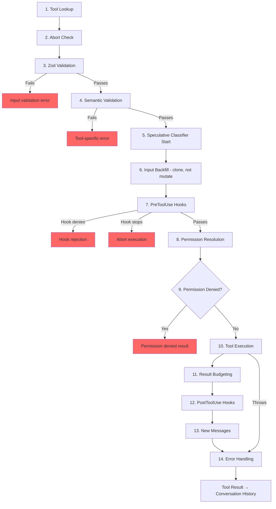

<a id="chapter-6-tools----from-definition-to-execution"></a>

# 제6장: 도구 — 정의부터 실행까지

<a id="the-nervous-system"></a>

## 신경계

5장에서는 모델 응답을 스트리밍하고, 도구 호출을 수집하고, 결과를 피드백하는 `while(true)`인 에이전트 루프를 보여주었습니다. 루프는 심장 박동입니다. 그러나 권한 확인, 결과 예산 책정 및 오류 처리를 통해 "모델이 `git status`을 실행하려고 합니다"를 실제 셸 명령으로 변환하는 신경계가 없으면 하트비트는 의미가 없습니다.

도구 시스템은 바로 신경계입니다. 이는 40개 이상의 도구 구현, 기능 플래그 게이팅이 포함된 중앙 집중식 레지스트리, 14단계 실행 파이프라인, 7개 모드가 있는 권한 확인자, 모델이 응답을 완료하기 전에 도구를 시작하는 스트리밍 실행기를 포괄합니다.

Claude Code의 모든 도구 호출(읽은 모든 파일, 모든 셸 명령, 모든 grep, 모든 하위 에이전트 디스패치)은 동일한 파이프라인을 통해 흐릅니다. 일관성이 핵심입니다. 도구가 내장된 Bash 실행기이든 타사 MCP 서버이든 동일한 유효성 검사, 동일한 권한 확인, 동일한 결과 예산 책정, 동일한 오류 분류를 얻습니다.

`Tool` 인터페이스에는 약 45개의 멤버가 있습니다. 너무 압도적으로 들리지만 시스템 작동 방식을 이해하는 데는 다섯 가지만 중요합니다.

1. **`call()`** -- 도구 실행
2. **`inputSchema`** -- 입력 검증 및 구문 분석
3. **`isConcurrencySafe()`** -- 병렬로 실행할 수 있나요?
4. **`checkPermissions()`** -- 이것이 허용됩니까?
5. **`validateInput()`** -- 이 입력이 의미상 의미가 있습니까?

그 밖의 모든 것(12가지 렌더링 방법, 분석 훅, 검색 힌트)은 UI 및 원격 측정 레이어를 지원하기 위해 존재합니다. 5개부터 시작하면 나머지는 제자리에 있게 됩니다.

---

<a id="the-tool-interface"></a>

## 도구 인터페이스

<a id="three-type-parameters"></a>

### 세 가지 유형 매개변수

모든 도구는 세 가지 유형으로 매개변수화됩니다.

```typescript
Tool<Input extends AnyObject, Output, P extends ToolProgressData>
```

`Input`은 이중 임무를 수행하는 Zod 객체 스키마입니다. 이는 API로 전송된 JSON 스키마를 생성하고(모델이 어떤 매개변수를 제공해야 하는지 알 수 있도록 함) `safeParse`을 통해 런타임 시 모델의 응답을 검증합니다. `Output`은 도구 결과의 TypeScript 유형입니다. `P`은 도구가 실행되는 동안 내보내는 진행 이벤트 유형입니다. BashTool은 stdout 청크를 내보내고, GrepTool은 일치 횟수를 내보내고, AgentTool은 하위 에이전트 기록을 내보냅니다.

<a id="buildtool-and-fail-closed-defaults"></a>

### buildTool() 및 페일클로즈 기본값

어떤 도구 정의도 `Tool` 개체를 직접 구성하지 않습니다. 모든 도구는 도구별 정의에 따라 기본 개체를 확산시키는 팩토리인 `buildTool()`을 통과합니다.

```typescript
// Pseudocode — illustrates the fail-closed defaults pattern
const SAFE_DEFAULTS = {
  isEnabled:         () => true,
  isParallelSafe:    () => false,   // Fail-closed: new tools run serially
  isReadOnly:        () => false,   // Fail-closed: treated as writes
  isDestructive:     () => false,
  checkPermissions:  (input) => ({ behavior: 'allow', updatedInput: input }),
}

function buildTool(definition) {
  return { ...SAFE_DEFAULTS, ...definition }  // Definition overrides defaults
}
```

기본값은 안전을 위해 중요한 경우 의도적으로 장애가 발생하면 닫힙니다. `isConcurrencySafe` 구현을 잊어버린 새 도구의 기본값은 `false`입니다. 즉, 병렬로 실행되지 않고 직렬로 실행됩니다. `isReadOnly`을 잊어버린 도구의 기본값은 `false`입니다. 시스템은 이를 쓰기 작업으로 처리합니다. `toAutoClassifierInput`을 잊어버린 도구는 빈 문자열을 반환합니다. 자동 모드 보안 분류자는 이를 건너뜁니다. 이는 자동화된 우회 대신 일반 권한 시스템이 이를 처리한다는 의미입니다.

실패 시 닫히지 *않는* 한 가지 기본값은 `allow`을 반환하는 `checkPermissions`입니다. 이는 계층화된 권한 모델을 이해할 때까지 거꾸로 보이는 것처럼 보입니다. `checkPermissions`은 일반 권한 시스템이 이미 규칙, 훅 및 모드 기반 정책을 평가한 *이후* 실행되는 도구별 논리입니다. `checkPermissions`에서 `allow`을 반환하는 도구는 "도구별 이의가 없습니다"라고 말하고 있으며 이는 포괄적인 액세스 권한을 부여하지 않습니다. 하위 개체(`options`, `readFileState`과 같은 명명된 필드)로 그룹화하면 40개 이상의 호출 사이트를 통해 5개의 별도 인터페이스 유형을 선언, 구현 및 스레딩하는 절차 없이 집중 인터페이스가 제공할 구조를 제공합니다.

<a id="concurrency-is-input-dependent"></a>

### 동시성은 입력에 따라 달라집니다

`isConcurrencySafe(input: z.infer<Input>): boolean` 서명은 구문 분석된 입력을 사용합니다. 동일한 도구가 일부 입력에는 안전하고 다른 입력에는 안전하지 않을 수 있기 때문입니다. BashTool은 표준적인 예입니다. `ls -la`은 읽기 전용이고 동시성이 안전하지만 `rm -rf /tmp/build`은 그렇지 않습니다. 이 도구는 명령을 구문 분석하고 알려진 안전한 집합에 대해 각 하위 명령을 분류하며 중립이 아닌 모든 부분이 검색 또는 읽기 작업인 경우에만 `true`을 반환합니다.

<a id="the-toolresult-return-type"></a>

### ToolResult 반환 유형

모든 `call()`은 `ToolResult<T>`을 반환합니다.

```typescript
type ToolResult<T> = {
  data: T
  newMessages?: (UserMessage | AssistantMessage | AttachmentMessage | SystemMessage)[]
  contextModifier?: (context: ToolUseContext) => ToolUseContext
}
```

`data`은 API의 `tool_result` 콘텐츠 블록으로 직렬화되는 형식화된 출력입니다. `newMessages`을 사용하면 도구가 대화에 추가 메시지를 삽입할 수 있습니다. AgentTool은 이를 사용하여 하위 에이전트 기록을 추가합니다. `contextModifier`은 후속 도구에 대해 `ToolUseContext`을 변경하는 함수입니다. 이것이 `EnterPlanMode`이 권한 모드를 전환하는 방법입니다. 컨텍스트 수정자는 동시성이 안전하지 않은 도구에만 적용됩니다. 도구가 병렬로 실행되는 경우 해당 수정자는 일괄 처리가 완료될 때까지 대기열에 추가됩니다.

---

<a id="toolusecontext-the-god-object"></a>

## ToolUseContext: 신 객체

`ToolUseContext`은 모든 도구 호출을 통해 스레드되는 대규모 컨텍스트 백입니다. 약 40개의 필드가 있습니다. 합리적인 정의에 따르면 그것은 신의 대상입니다. 대안이 더 나쁘기 때문에 존재합니다.

BashTool과 같은 도구에는 중단 컨트롤러, 파일 상태 캐시, 앱 상태, 메시지 기록, 도구 세트, MCP 연결 및 6개의 UI 콜백이 필요합니다. 이를 개별 매개변수로 스레딩하면 15개 이상의 인수가 포함된 함수 시그니처가 생성됩니다. 실용적인 솔루션은 관심사별로 그룹화된 단일 컨텍스트 개체입니다.

**구성**(`options` 하위 개체): 도구 세트, 모델 이름, MCP 연결, 디버그 플래그. 쿼리 시작 시 한 번 설정되며 대부분 변경할 수 없습니다.

**실행 상태**: 취소의 경우 `abortController`, LRU 파일 캐시의 경우 `readFileState`, 전체 대화 기록의 경우 `messages`입니다. 실행 중에 변경됩니다.

**UI 콜백**: `setToolJSX`, `addNotification`, `requestPrompt`. 대화형(REPL) 컨텍스트에서만 연결됩니다. SDK 및 헤드리스 모드는 정의되지 않은 상태로 둡니다.

**에이전트 컨텍스트**: `agentId`, `renderedSystemPrompt`(포크 하위 에이전트에 대한 상위 프롬프트 고정 - 기능 플래그 준비로 인해 다시 렌더링이 분기되고 캐시가 버스트될 수 있음)

`ToolUseContext`의 하위 에이전트 변형이 특히 드러납니다. `createSubagentContext()`은 하위 에이전트에 대한 컨텍스트를 구축할 때 공유할 필드와 격리할 필드를 신중하게 선택합니다. `setAppState`은 비동기 에이전트에 대해 작동하지 않고 `localDenialTracking`은 새로운 개체를 가져오고 `contentReplacementState`은 상위에서 복제됩니다. 각 선택에는 프로덕션 버그에서 배운 교훈이 포함되어 있습니다.

---

<a id="the-registry"></a>

## 레지스트리

<a id="getallbasetools-the-single-source-of-truth"></a>

### getAllBaseTools(): 진실의 단일 소스

`getAllBaseTools()` 함수는 현재 프로세스에 존재할 수 있는 모든 도구의 전체 목록을 반환합니다. 항상 존재하는 도구가 먼저 나온 다음 기능 플래그로 제어되는 조건부 포함 도구입니다.

```typescript
const SleepTool = feature('PROACTIVE') || feature('KAIROS')
  ? require('./tools/SleepTool/SleepTool.js').SleepTool
  : null
```

`bun:bundle`에서 `feature()` 가져오기는 번들 시간에 해결됩니다. `feature('AGENT_TRIGGERS')`이 정적으로 false인 경우 번들러는 전체 `require()` 호출을 제거합니다. 즉, 바이너리를 작게 유지하는 데드 코드 제거입니다.

<a id="assembletoolpool-merging-built-in-and-mcp-tools"></a>

### assembleToolPool(): 내장 도구와 MCP 도구 병합

모델에 도달하는 최종 도구 세트는 `assembleToolPool()`에서 제공됩니다.

1. 기본 제공 도구 가져오기(거부 규칙 필터링, REPL 모드 숨기기 및 `isEnabled()` 검사 포함)
2. 거부 규칙을 기준으로 MCP 도구 필터링
3. 각 파티션을 이름에 따라 알파벳순으로 정렬
4. 내장(접두사) + MCP 도구(접미사) 연결

정렬 후 연결 방식은 미학적 선호가 아닙니다. API 서버는 마지막 내장 도구 뒤에 프롬프트 캐시 중단점을 배치합니다. 모든 도구에 대한 단순 정렬은 MCP 도구를 기본 제공 목록에 인터리브하고 MCP 도구를 추가하거나 제거하면 기본 제공 도구 위치가 이동되어 캐시가 무효화됩니다.

---

<a id="the-14-step-execution-pipeline"></a>

## 14단계 실행 파이프라인

`checkPermissionsAndCallTool()` 함수는 의도가 동작이 되는 곳입니다. 모든 도구 호출은 이러한 14단계를 거칩니다.



<a id="steps-1-4-validation"></a>

### 1~4단계: 검증

**도구 조회**는 별칭 일치에 대해 `getAllBaseTools()`으로 대체되어 도구 이름이 변경된 이전 세션의 기록을 처리합니다. **중단 확인**은 Ctrl+C가 전파되기 전에 대기 중인 도구 호출에 대한 계산 낭비를 방지합니다. **Zod 유효성 검사**는 유형 불일치를 포착합니다. 지연된 도구의 경우 오류는 ToolSearch를 먼저 호출하라는 힌트를 추가합니다. **의미론적 검증**은 스키마 적합성을 뛰어넘습니다. FileEditTool은 무작동 편집을 거부하고 BashTool은 MonitorTool을 사용할 수 있는 경우 독립 실행형 `sleep`을 차단합니다.

<a id="steps-5-6-preparation"></a>

### 5~6단계: 준비

**예측 분류자 시작**은 Bash 명령에 대해 자동 모드 보안 분류자를 병렬로 시작하여 공통 경로를 수백 밀리초 단축합니다. **입력 백필**은 구문 분석된 입력을 복제하고 훅 및 권한에 대한 파생 필드(`~/foo.txt`을 절대 경로로 확장)를 추가하여 스크립트 안정성을 위해 원본을 유지합니다.

<a id="steps-7-9-permission"></a>

### 7~9단계: 권한

**PreToolUse Hooks**는 확장 메커니즘입니다. 권한 결정을 내리고, 입력을 수정하고, 컨텍스트를 삽입하거나, 실행을 완전히 중지할 수 있습니다. **권한 확인**은 훅와 일반 권한 시스템을 연결합니다. 훅가 이미 결정된 경우 이것이 최종입니다. 그렇지 않으면 `canUseTool()`이 규칙 일치, 도구별 검사, 모드 기반 기본값 및 대화형 프롬프트를 트리거합니다. **권한 거부 처리**는 오류 메시지를 작성하고 `PermissionDenied` 훅을 실행합니다.

<a id="steps-10-14-execution-and-cleanup"></a>

### 10~14단계: 실행 및 정리

**도구 실행**은 원래 입력으로 실제 `call()`을 실행합니다. **결과 예산**은 `~/.claude/tool-results/{hash}.txt`에 대한 대규모 출력을 유지하고 이를 미리 보기로 대체합니다. **PostToolUse Hooks**는 MCP 출력을 수정하거나 연속을 차단할 수 있습니다. **새 메시지**가 추가됩니다(하위 에이전트 기록, 시스템 알림). **오류 처리**는 원격 분석에 대한 오류를 분류하고 잠재적으로 손상된 이름에서 안전한 문자열을 추출하며 OTel 이벤트를 내보냅니다.

---

<a id="the-permission-system"></a>

## 허가 시스템

<a id="seven-modes"></a>

### 7가지 모드

| 모드 | 행동 |
|------|----------|
| `default` | 도구별 검사 인식할 수 없는 작업에 대해 사용자에게 프롬프트 |
| `acceptEdits` | 파일 편집을 자동으로 허용합니다. 다른 작업에 대한 프롬프트 |
| `plan` | 읽기 전용 - 모든 쓰기 작업을 거부합니다. |
| `dontAsk` | 일반적으로 메시지가 표시되는 항목을 자동 거부합니다(백그라운드 에이전트). |
| `bypassPermissions` | 메시지를 표시하지 않고 모든 것을 허용합니다. |
| `auto` | 성적표 분류기를 사용하여 결정(기능 플래그 지정) |
| `bubble` | 상위 에이전트로 에스컬레이션되는 하위 에이전트의 내부 모드 |

<a id="the-resolution-chain"></a>

### 해결 체인

도구 호출이 권한 해결에 도달하면 다음이 수행됩니다.

1. **훅 결정**: PreToolUse 훅가 이미 `allow` 또는 `deny`을 반환한 경우 이것이 최종입니다.
2. **규칙 일치**: 세 가지 규칙 세트(`alwaysAllowRules`, `alwaysDenyRules`, `alwaysAskRules`)는 도구 이름과 선택적 콘텐츠 패턴을 일치시킵니다. `Bash(git *)`은 `git`으로 시작하는 모든 Bash 명령과 일치합니다.
3. **도구별 확인**: 도구의 `checkPermissions()` 메서드. 대부분은 `passthrough`을 반환합니다.
4. **모드 기반 기본값**: `bypassPermissions`은 모든 것을 허용합니다. `plan`은 쓰기를 거부합니다. `dontAsk`은 프롬프트를 거부합니다.
5. **대화형 프롬프트**: `default` 및 `acceptEdits` 모드에서는 해결되지 않은 결정에 대해 프롬프트가 표시됩니다.
6. **자동 모드 분류기**: 2단계 분류기(빠른 모델, 모호한 경우에 대한 확장된 사고).

`safetyCheck` 변형에는 `classifierApprovable` 부울이 있습니다. `.claude/` 및 `.git/` 편집은 `classifierApprovable: true`(특이하지만 때로는 적법함)인 반면 Windows 경로 우회 시도는 `classifierApprovable: false`(거의 항상 적대적)입니다.

<a id="permission-rules-and-matching"></a>

### 권한 규칙 및 일치

권한 규칙은 `source` 추적 출처(userSettings, projectSettings, localSettings, cliArg,policySettings, session 등), `ruleBehavior`(허용, 거부, 요청) 및 도구 이름과 선택적 콘텐츠 패턴이 있는 `ruleValue`의 세 부분으로 구성된 `PermissionRule` 개체로 저장됩니다.

`ruleContent` 필드를 사용하면 세분화된 일치가 가능합니다. `Bash(git *)`은 `git`으로 시작하는 모든 Bash 명령을 허용합니다. `Edit(/src/**)`은 `/src` 내에서만 편집을 허용합니다. `Fetch(domain:example.com)`은 특정 도메인에서 가져오기를 허용합니다. `ruleContent`이 없는 규칙은 해당 도구의 모든 호출과 일치합니다.

BashTool의 권한 일치자는 `parseForSecurity()`(bash AST 구문 분석기)을 통해 명령을 구문 분석하고 복합 명령을 하위 명령으로 분할합니다. AST 구문 분석이 실패하면(heredocs 또는 중첩된 하위 쉘이 포함된 복잡한 구문) 매처는 `() => true`을 반환합니다. 즉, 훅가 항상 실행된다는 의미입니다. 명령이 구문 분석하기에는 너무 복잡하면 안전 검사에서 제외하기에는 너무 복잡하다고 가정합니다.

<a id="bubble-mode-for-sub-agents"></a>

### 하위 에이전트를 위한 버블 모드

코디네이터-작업자 패턴의 하위 에이전트는 권한 프롬프트를 표시할 수 없습니다. 터미널이 없습니다. `bubble` 모드를 사용하면 권한 요청이 상위 컨텍스트까지 전파됩니다. 터미널 액세스가 가능한 메인 스레드에서 실행되는 코디네이터 에이전트는 프롬프트를 처리하고 결정을 다시 보냅니다.

---

<a id="tool-deferred-loading"></a>

## 도구 지연 로딩

`shouldDefer: true`이 있는 도구는 `defer_loading: true`(전체 매개변수 스키마가 아닌 이름 및 설명)을 사용하여 API로 전송됩니다. 이렇게 하면 초기 프롬프트 크기가 줄어듭니다. 지연된 도구를 사용하려면 모델이 먼저 `ToolSearchTool`을 호출하여 해당 스키마를 로드해야 합니다. 실패 모드는 유익합니다. 지연된 도구를 로드하지 않고 호출하면 Zod 검증이 실패하고(입력된 모든 매개변수는 문자열로 도착함) 시스템이 대상 복구 힌트를 추가합니다.

지연된 로드는 캐시 적중률도 향상시킵니다. `defer_loading: true`과 함께 전송된 도구는 프롬프트에 해당 이름만 제공하므로 지연된 MCP 도구를 추가하거나 제거하면 프롬프트가 수백 개가 아닌 몇 개의 토큰만큼 변경됩니다.

---

<a id="result-budgeting"></a>

## 결과예산

<a id="per-tool-size-limits"></a>

### 도구별 크기 제한

각 도구는 `maxResultSizeChars`을 선언합니다.

| 도구 | maxResultSizeChars | 이론적 근거 |
|------|-------------------|-----------|
| Bash도구 | 30,000 | 가장 유용한 출력에 충분함 |
| 파일편집도구 | 100,000 | 차이가 클 수 있지만 모델에는 차이가 필요합니다. |
| GrepTool | 100,000 | 컨텍스트 라인이 포함된 검색 결과가 빠르게 추가됩니다. |
| 파일읽기도구 | 인피니티 | 자체 토큰 제한을 통한 자체 경계; 지속하면 순환 읽기 루프가 생성됩니다. |

결과가 임계값을 초과하면 전체 콘텐츠가 디스크에 저장되고 미리보기 및 파일 경로가 포함된 `<persisted-output>` 래퍼로 대체됩니다. 그러면 모델은 필요한 경우 `Read`을 사용하여 전체 출력에 액세스할 수 있습니다.

<a id="per-conversation-aggregate-budget"></a>

### 대화당 총 예산

도구별 제한을 넘어서 `ContentReplacementState`은 전체 대화에서 총 예산을 추적하여 수천 번의 삭감으로 인한 사망을 방지합니다. 각각 개별 제한의 90%를 반환하는 많은 도구는 여전히 컨텍스트 창을 압도할 수 있습니다.

---

<a id="individual-tool-highlights"></a>

## 개별 도구 하이라이트

<a id="bashtool-the-most-complex-tool"></a>

### BashTool: 가장 복잡한 도구

BashTool은 지금까지 시스템에서 가장 복잡한 도구입니다. 복합 명령을 구문 분석하고, 하위 명령을 읽기 전용 또는 쓰기로 분류하고, 백그라운드 작업을 관리하고, 매직 바이트로 이미지 출력을 감지하고, 안전한 편집 미리 보기를 위해 sed 시뮬레이션을 구현합니다.

복합 명령 구문 분석은 특히 흥미롭습니다. `splitCommandWithOperators()`은 `cd /tmp && mkdir build && ls build`과 같은 명령을 개별 하위 명령으로 나눕니다. 각각은 안전한 것으로 알려진 명령 세트(`BASH_SEARCH_COMMANDS`, `BASH_READ_COMMANDS`, `BASH_LIST_COMMANDS`)에 따라 분류됩니다. 복합 명령은 중립이 아닌 모든 부분이 안전한 경우에만 읽기 전용입니다. 중립 집합(echo, printf)은 무시됩니다. 명령을 읽기 전용으로 만들지는 않지만 쓰기 전용으로 만들지도 않습니다.

sed 시뮬레이션(`_simulatedSedEdit`)은 특별한 주의를 기울일 가치가 있습니다. 사용자가 권한 대화 상자에서 sed 명령을 승인하면 시스템은 샌드박스에서 sed 명령을 실행하고 출력을 캡처하여 결과를 미리 계산합니다. 사전 계산된 결과는 `_simulatedSedEdit`으로 입력에 주입됩니다. `call()`이 실행되면 셸 실행을 우회하고 편집 내용을 직접 적용합니다. 이는 사용자가 미리 본 내용이 정확히 기록되는 것임을 보장합니다. 미리 보기와 실행 사이에 파일이 변경된 경우 다른 결과를 생성할 수 있는 재실행이 아닙니다.

<a id="fileedittool-staleness-detection"></a>

### FileEditTool: 부실 감지

FileEditTool은 대화 전반에 걸쳐 유지되는 파일 콘텐츠 및 타임스탬프의 LRU 캐시인 `readFileState`과 통합됩니다. 편집 내용을 적용하기 전에 모델이 마지막으로 읽은 이후 파일이 수정되었는지 확인합니다. 파일이 오래된 경우(백그라운드 프로세스, 다른 도구 또는 사용자에 의해 수정됨) 모델에 먼저 파일을 다시 읽으라는 메시지와 함께 편집이 거부됩니다.

`findActualString()`의 퍼지 매칭은 모델에 공백이 약간 잘못되는 일반적인 경우를 처리합니다. 일치하기 전에 공백과 따옴표 스타일을 정규화하므로 후행 공백이 있는 `old_string`을 대상으로 하는 편집 내용은 여전히 ​​파일의 실제 내용과 일치합니다. `replace_all` 플래그를 사용하면 대량 교체가 가능합니다. 그렇지 않으면 고유하지 않은 일치 항목이 거부되므로 모델이 단일 위치를 식별하는 데 충분한 컨텍스트를 제공해야 합니다.

<a id="filereadtool-the-versatile-reader"></a>

### FileReadTool: 다재다능한 리더

FileReadTool은 `maxResultSizeChars: Infinity`이 포함된 유일한 내장 도구입니다. 읽기 출력이 디스크에 지속되는 경우 모델은 지속된 파일을 읽어야 하며, 이는 자체적으로 제한을 초과하여 무한 루프를 생성할 수 있습니다. 대신 도구는 토큰 추정을 통해 자체 바인딩되고 소스에서 잘립니다.

이 도구는 매우 다재다능합니다. 행 번호, 이미지(base64 다중 모달 콘텐츠 블록 반환), PDF(`extractPDFPages()`을 통해), Jupyter 노트북(`readNotebook()`을 통해) 및 디렉터리(`ls`으로 대체)가 포함된 텍스트 파일을 읽습니다. 위험한 장치 경로(`/dev/zero`, `/dev/random`, `/dev/stdin`)를 차단하고 macOS 스크린샷 파일 이름 문제(U+202F 좁은 중단 없는 공백과 "스크린샷" 파일 이름의 일반 공백)를 처리합니다.

<a id="greptool-pagination-via-head_limit"></a>

### GrepTool: head_limit를 통한 페이지 매김

GrepTool은 `ripGrep()`을 래핑하고 `head_limit`을 통해 페이지 매김 메커니즘을 추가합니다. 기본값은 250개 항목입니다. 유용한 결과를 얻으려면 충분하지만 컨텍스트 부풀림을 방지할 만큼 작습니다. 잘림이 발생하면 응답에 `appliedLimit: 250`이 포함되어 다음 페이지 매기기 호출에서 `offset`을 사용하도록 모델에 신호를 보냅니다. 명시적인 `head_limit: 0`은 제한을 완전히 비활성화합니다.

GrepTool은 6개의 VCS 디렉터리(`.git`, `.svn`, `.hg`, `.bzr`, `.jj`, `.sl`)를 자동으로 제외합니다. `.git/objects` 내부 검색은 모델이 원하는 것과 거의 일치하지 않으며 실수로 바이너리 팩 파일을 포함하면 토큰 예산이 크게 소모될 수 있습니다.

<a id="agenttool-and-context-modifiers"></a>

### AgentTool 및 컨텍스트 수정자

AgentTool은 자체 쿼리 루프를 실행하는 하위 에이전트를 생성합니다. `call()`은 하위 에이전트의 기록이 포함된 `newMessages`을 반환하고 선택적으로 상태 변경 사항을 상위 에이전트에 다시 전파하는 `contextModifier`을 반환합니다. AgentTool은 기본적으로 동시성이 안전하지 않기 때문에 단일 응답의 여러 에이전트 도구 호출이 순차적으로 실행됩니다. 즉, 다음 하위 에이전트가 시작되기 전에 각 하위 에이전트의 컨텍스트 수정자가 적용됩니다. 코디네이터 모드에서는 패턴이 반전됩니다. 코디네이터는 독립 작업을 위해 하위 에이전트를 디스패치하고 `isAgentSwarmsEnabled()` 확인은 병렬 에이전트 실행을 잠금 해제합니다.

---

<a id="how-tools-interact-with-the-message-history"></a>

## 도구가 메시지 기록과 상호 작용하는 방식

도구 결과는 단순히 데이터를 모델에 반환하지 않습니다. 그들은 구조화된 메시지로 대화에 참여합니다.

API는 도구 결과를 ID로 원래 `tool_use` 블록을 참조하는 `ToolResultBlockParam` 객체로 예상합니다. 대부분의 도구는 텍스트로 직렬화됩니다. FileReadTool은 다중 모드 응답을 위해 이미지 콘텐츠 블록(base64 인코딩)으로 직렬화할 수 있습니다. BashTool은 stdout의 매직 바이트를 검사하여 이미지 출력을 감지하고 그에 따라 이미지 블록으로 전환합니다.

`ToolResult.newMessages`은 도구가 단순한 호출 및 응답 패턴을 넘어 대화를 확장하는 방법입니다. **에이전트 기록**: AgentTool은 하위 에이전트의 메시지 기록을 첨부 메시지로 삽입합니다. **시스템 알림**: 메모리 도구는 도구 결과 후에 나타나는 시스템 메시지를 삽입합니다. 이는 다음 차례의 모델에 표시되지만 `normalizeMessagesForAPI` 경계에서는 제거됩니다. **첨부 메시지**: 훅 결과, 추가 컨텍스트 및 오류 세부정보는 모델이 후속 단계에서 참조할 수 있는 구조화된 메타데이터를 전달합니다.

`contextModifier` 함수는 실행 환경을 변경하는 도구에 대한 메커니즘입니다. `EnterPlanMode`이 실행되면 권한 모드를 `'plan'`으로 설정하는 수정자를 반환합니다. `ExitWorktree`이 실행되면 작업 디렉터리가 수정됩니다. 이러한 수정자는 도구가 후속 도구에 영향을 미치는 유일한 방법입니다. 각 도구 호출 전에 컨텍스트가 확산 복사되기 때문에 `ToolUseContext`의 직접적인 변형은 불가능합니다. 직렬 전용 제한은 오케스트레이션 계층에 의해 시행됩니다. 두 개의 동시 도구가 모두 작업 디렉터리를 수정하는 경우 어느 쪽이 이기나요?

---

<a id="apply-this-designing-a-tool-system"></a>

## 적용: 도구 시스템 설계

**페일클로즈 기본값.** 새로운 도구는 달리 명시적으로 표시될 때까지 보수적이어야 합니다. 플래그 설정을 잊어버린 개발자는 위험한 동작이 아닌 안전한 동작을 얻습니다.

**입력에 따른 안전성.** `isConcurrencySafe(input)` 및 `isReadOnly(input)`은 서로 다른 입력의 동일한 도구가 서로 다른 안전 프로필을 갖기 때문에 구문 분석된 입력을 사용합니다. BashTool을 "항상 직렬"로 표시하는 도구 레지스트리는 정확하지만 낭비입니다.

**권한을 계층화하세요.** 도구별 검사, 규칙 기반 일치, 모드 기반 기본값, 대화형 프롬프트 및 자동 분류자가 각각 다른 사례를 처리합니다. 단일 메커니즘으로는 충분하지 않습니다.

**단지 입력이 아닌 예산 결과.** 입력에 대한 토큰 한도는 표준입니다. 그러나 도구 결과는 임의로 클 수 있으며 차례대로 누적됩니다. 도구별 제한으로 인해 개별 폭발이 방지됩니다. 집계된 대화 제한은 누적 오버플로를 방지합니다.

**오류 분류를 원격 측정으로 안전하게 만듭니다.** 축소된 빌드에서는 `error.constructor.name`이 손상되었습니다. `classifyToolError()` 함수는 원시 오류 메시지를 분석에 기록하지 않고 원격 측정 안전 메시지, 오류 번호 코드, 안정적인 오류 이름 등 사용 가능한 가장 유익한 안전 문자열을 추출합니다.

---

<a id="what-comes-next"></a>

## 다음은 무엇입니까

이 장에서는 단일 도구 호출이 정의부터 검증, 권한, 실행 및 결과 예산 책정을 거쳐 어떻게 흘러가는지 추적했습니다. 그러나 모델이 한 번에 하나의 도구만 요청하는 경우는 거의 없습니다. 도구를 동시 배치로 조정하는 방법은 7장의 주제입니다.
