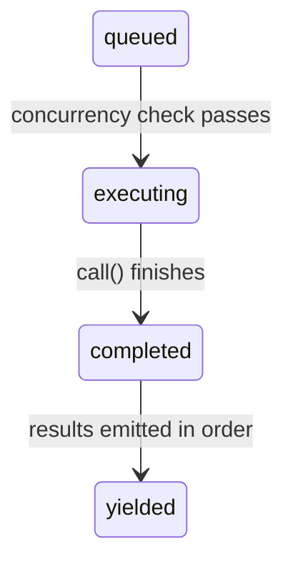

<a id="chapter-7-concurrent-tool-execution"></a>

# 제7장: 도구 동시 실행

<a id="the-cost-of-waiting"></a>

## 기다리는 비용

6장에서는 API 응답의 원시 `tool_use` 블록부터 입력 유효성 검사, 권한 확인, 실행 및 결과 형식 지정을 통해 단일 도구 호출의 수명 주기를 추적했습니다. 해당 파이프라인은 하나의 도구를 처리합니다. 그러나 모델이 하나만 요청하는 경우는 거의 없습니다.

일반적인 Claude Code 상호 작용에는 턴당 3~5개의 도구 호출이 포함됩니다. "이 두 파일을 읽고 이 패턴을 grep한 다음 이 기능을 편집하세요." 모델은 단일 응답으로 모든 것을 방출합니다. 각 도구에 200밀리초가 걸리는 경우 순차적으로 실행하는 데는 1초의 비용이 듭니다. Read 및 Grep 호출이 독립적이고 실행 중인 경우 병렬로 실행하면 200밀리초로 단축됩니다. 5대1 개선, 무료.

그러나 모든 도구가 독립적인 것은 아닙니다. `config.ts`을 수정하는 편집은 `config.ts`을 수정하는 다른 편집과 동시에 실행할 수 없습니다. 디렉터리를 생성하는 Bash 명령은 해당 디렉터리에 파일을 쓰는 Bash 명령보다 먼저 완료되어야 합니다. 동시성은 도구의 전역 속성이 아닙니다. 이는 특정 입력을 사용한 특정 도구 호출의 속성입니다.

이것이 전체 동시성 시스템을 구동하는 통찰력입니다. **안전은 도구 유형별이 아니라 호출별입니다**. `Bash("ls -la")`은 병렬화해도 안전합니다. `Bash("rm -rf build/")`은 그렇지 않습니다. 동일한 도구, 다른 입력, 다른 동시성 분류. 시스템은 결정하기 전에 입력을 검사해야 합니다.

Claude Code는 두 계층의 동시성 최적화를 구현합니다. 첫 번째는 **일괄 오케스트레이션**입니다. 모델의 응답이 완전히 수신된 후 도구 호출을 동시 그룹과 직렬 그룹으로 분할한 다음 각 그룹을 적절하게 실행합니다. 두 번째는 **추측 실행**입니다. *모델이 응답을 스트리밍하는 동안* 도구 실행을 시작하여 응답이 완료되기도 전에 결과를 수집합니다. 이 두 가지 메커니즘을 함께 사용하면 기다리는 데 소요되는 벽시계 시간의 대부분이 제거됩니다.

---

<a id="the-partition-algorithm"></a>

## 파티션 알고리즘

진입점은 `toolOrchestration.ts`의 `partitionToolCalls()`입니다. `ToolUseBlock` 메시지의 정렬된 배열을 취하고 각 배치가 "모두 동시 안전"이거나 "단일 직렬 도구"인 배치 배열을 생성합니다.

```typescript
// Pseudocode — illustrates the partition algorithm
type Group = { parallel: boolean; calls: ToolCall[] }

function groupBySafety(calls: ToolCall[], registry: ToolRegistry): Group[] {
  return calls.reduce((groups, call) => {
    const def = registry.lookup(call.name)
    const input = def?.schema.safeParse(call.input)
    // Fail-closed: parse failure or exception → serial
    const safe = input?.success
      ? tryCatch(() => def.isParallelSafe(input.data), false)
      : false
    // Merge consecutive safe calls into one group
    if (safe && groups.at(-1)?.parallel) {
      groups.at(-1)!.calls.push(call)
    } else {
      groups.push({ parallel: safe, calls: [call] })
    }
    return groups
  }, [] as Group[])
}
```

알고리즘은 배열을 왼쪽에서 오른쪽으로 이동합니다. 각 도구 호출에 대해 다음을 수행합니다.

1. **도구 정의**를 이름으로 찾아보세요.
2. `safeParse()`을 통해 도구의 Zod 스키마로 **입력을 구문 분석**합니다. 구문 분석이 실패하면 도구는 동시성이 안전하지 않은 것으로 보수적으로 분류됩니다.
3. **도구 정의에서 `isConcurrencySafe(parsedInput)`**을 호출하세요. 여기에서 입력별 분류가 발생합니다. Bash 도구는 명령 문자열을 구문 분석하고 모든 하위 명령이 읽기 전용인지(`ls`, `grep`, `cat`, `git status`) 확인하고 전체 복합 명령이 순수 읽기인 경우에만 `true`을 반환합니다. 읽기 도구는 항상 `true`을 반환합니다. 편집 도구는 항상 `false`을 반환합니다. 호출은 try-catch로 래핑됩니다. `isConcurrencySafe`이 발생하는 경우(예: Bash 명령 문자열을 쉘 인용 라이브러리로 구문 분석할 수 없는 경우) 도구는 기본적으로 직렬로 설정됩니다.
4. **배치 병합 또는 생성.** 현재 도구가 동시성이 안전하고 가장 최근의 일괄처리도 동시성이 안전한 경우 해당 배치에 추가하세요. 그렇지 않으면 새 배치를 시작하십시오.

결과는 동시 그룹과 개별 직렬 항목을 번갈아 사용하는 일련의 배치입니다. 구체적인 예를 살펴보세요.

```
Model requests: [Read, Read, Grep, Edit, Read]

Step 1: Read  → concurrent-safe → new batch {safe, [Read]}
Step 2: Read  → concurrent-safe → append   {safe, [Read, Read]}
Step 3: Grep  → concurrent-safe → append   {safe, [Read, Read, Grep]}
Step 4: Edit  → NOT safe        → new batch {serial, [Edit]}
Step 5: Read  → concurrent-safe → new batch {safe, [Read]}

Result: 3 batches
  Batch 1: [Read, Read, Grep]  — run concurrently
  Batch 2: [Edit]              — run alone
  Batch 3: [Read]              — run concurrently (just one tool)
```

파티셔닝은 탐욕적이고 질서를 유지합니다. 연속된 안전 도구는 단일 배치로 누적됩니다. 안전하지 않은 도구는 실행을 중단하고 새 배치를 시작합니다. 이는 모델이 도구 호출을 내보내는 순서가 중요하다는 것을 의미합니다. 두 개의 읽기 사이에 쓰기를 인터리브하면 두 개가 아닌 세 개의 배치를 얻게 됩니다. 실제로 모델은 읽기를 함께 클러스터링하는 경향이 있는데, 이는 알고리즘이 최적화되는 일반적인 경우입니다.

---

<a id="batch-execution"></a>

## 일괄 실행

`runTools()` 생성기는 분할된 배치를 반복하고 각 배치를 적절한 실행기로 전달합니다.

<a id="concurrent-batches"></a>

### 동시 배치

동시 배치의 경우 `runToolsConcurrently()`은 동시성 제한에서 활성 생성기를 제한하는 `all()` 유틸리티를 사용하여 모든 도구를 병렬로 실행합니다.

```typescript
// Pseudocode — illustrates the concurrent dispatch pattern
async function* dispatchParallel(calls, context) {
  yield* boundedAll(
    calls.map(async function* (call) {
      context.markInProgress(call.id)
      yield* executeSingle(call, context)
      context.markComplete(call.id)
    }),
    MAX_CONCURRENCY,  // Default: 10
  )
}
```

동시성 제한의 기본값은 10이며, `CLAUDE_CODE_MAX_TOOL_USE_CONCURRENCY`을 통해 구성할 수 있습니다. 10개는 넉넉합니다. 단일 모델 응답에서 5~6개 이상의 도구 호출을 거의 볼 수 없습니다. 한계는 일반적인 제약이 아닌 병리학적 사례에 대한 안전판으로 존재합니다.

`all()` 유틸리티는 제한된 동시성을 갖춘 `Promise.all`의 생성기 인식 변형입니다. N개의 생성기를 동시에 시작하고, 먼저 완료된 생성기에서 결과를 산출하고, 각 생성기가 완료되면 대기 중인 다음 생성기를 시작합니다. 메커니즘은 세마포어 보호 작업 풀과 유사하지만 중간 결과를 생성하는 비동기 생성기에 맞게 조정되었습니다.

**컨텍스트 수정자 대기열**은 미묘한 부분입니다. 일부 도구는 후속 도구를 위해 `ToolUseContext`을 변환하는 기능인 *컨텍스트 수정자*를 생성합니다. 도구가 동시에 실행되는 경우 동일한 배치의 다른 도구가 동일한 컨텍스트를 읽기 때문에 이러한 수정자를 즉시 ​​적용할 수 없습니다. 대신 수정자는 도구 사용 ID로 키가 지정된 맵에 수집됩니다.

```typescript
const queuedContextModifiers: Record<
  string,
  ((context: ToolUseContext) => ToolUseContext)[]
> = {}
```

전체 동시 일괄 처리가 완료된 후 수정자는 도구 순서(완료 순서 아님)로 적용되어 결정적 컨텍스트 진화를 유지합니다.

```typescript
for (const block of blocks) {
  const modifiers = queuedContextModifiers[block.id]
  if (!modifiers) continue
  for (const modifier of modifiers) {
    currentContext = modifier(currentContext)
  }
}
```

실제로 현재 동시성이 안전한 도구 중 어느 것도 컨텍스트 수정자를 생성하지 않습니다. 코드베이스의 주석은 이를 명시적으로 인정합니다. 그러나 MCP 서버에서 도구를 추가할 수 있고 사용자 정의 읽기 전용 MCP 도구가 합법적으로 컨텍스트를 수정하려고 할 수 있기 때문에 인프라가 존재합니다(예: "표시된 파일" 세트 업데이트).

<a id="serial-batches"></a>

### 직렬 배치

직렬 실행은 간단합니다. 각 도구가 실행되고 해당 컨텍스트 수정자가 즉시 적용되며 다음 도구는 업데이트된 컨텍스트를 확인합니다.

```typescript
for (const toolUse of toolUseMessages) {
  for await (const update of runToolUse(toolUse, /* ... */)) {
    if (update.contextModifier) {
      currentContext = update.contextModifier.modifyContext(currentContext)
    }
    yield { message: update.message, newContext: currentContext }
  }
}
```

이것이 중요한 차이점입니다. 직렬 도구는 후속 도구의 세상을 바꿀 수 있습니다. 편집은 파일을 수정합니다. 다음 읽기에서는 수정된 버전이 표시됩니다. Bash 명령은 디렉터리를 생성합니다. 다음 Bash 명령이 여기에 기록됩니다. 컨텍스트 수정자는 이러한 종속성을 공식화한 것입니다. 이를 통해 도구는 "실행 환경이 변경되었습니다. 방법은 다음과 같습니다."라고 말할 수 있습니다.

---

<a id="the-streaming-tool-executor"></a>

## 스트리밍 도구 실행자

일괄 오케스트레이션은 모델의 응답이 도착한 *후* 불필요한 직렬화를 제거합니다. 그러나 더 큰 기회가 있습니다. 모델의 응답을 스트리밍하는 데 시간이 걸립니다. 일반적인 다중 도구 응답은 완전히 도달하는 데 2~3초가 걸릴 수 있습니다. 첫 번째 도구 호출은 500밀리초 후에 구문 분석 가능합니다. 왜 남은 2초를 기다리나요?

`StreamingToolExecutor` 클래스는 추측 실행을 구현합니다. 모델이 응답을 스트리밍함에 따라 각 `tool_use` 블록은 완전히 구문 분석되는 순간 실행자에게 전달됩니다. 모델이 다음 도구 호출을 계속 생성하는 동안 실행자는 즉시 실행을 시작합니다. 응답 스트리밍이 완료될 때까지 여러 도구가 이미 완료되었을 수 있습니다.

```mermaid
gantt
    title Sequential vs Streaming Tool Execution
    dateFormat X
    axisFormat %Ls

    section Sequential
    Model streams response     :a1, 0, 2500
    Tool 1 (0.2s)              :a2, after a1, 200
    Tool 2 (0.3s)              :a3, after a2, 300
    Tool 3 (0.1s)              :a4, after a3, 100

    section Streaming Executor
    Model streams response     :b1, 0, 2500
    Tool 1 starts at 0.5s      :b2, 500, 700
    Tool 2 starts at 1.2s      :b3, 1200, 1500
    Tool 3 drain after stream  :b4, 2500, 2600
```



연속 합계: 3.1초. 스트리밍 총 시간: 2.6초 -- 스트리밍 중에 도구 1과 2가 완료되어 벽시계 시간이 16% 절약됩니다.

저축 복합물. 모델이 5개의 읽기 전용 도구를 요청하고 응답을 스트리밍하는 데 3초가 걸리면 5개의 도구 모두 해당 3초 동안 시작하고 완료될 수 있습니다. 스트림 후 배수 단계에서는 더 이상 할 일이 없습니다. 사용자는 모델 응답의 마지막 문자가 나타난 직후에 결과를 봅니다.

<a id="tool-lifecycle"></a>

### 도구 수명주기

실행기가 추적하는 각 도구는 네 가지 상태를 통해 진행됩니다.



- **대기 중**: `tool_use` 블록이 구문 분석되고 등록되었습니다. 실행을 허용하는 동시성 조건을 기다리는 중입니다.
- **실행 중**: 도구의 `call()` 기능이 실행 중입니다. 결과는 버퍼에 누적됩니다.
- **완료**: 실행이 완료되었습니다. 결과는 대화에 반영될 준비가 되어 있습니다.
- **yielded**: 결과가 출력되었습니다. 터미널 상태.

<a id="addtool-queuing-during-the-stream"></a>

### addTool(): 스트림 중 대기열

```typescript
addTool(block: ToolUseBlock, assistantMessage: AssistantMessage): void
```

완전한 `tool_use` 블록이 도착할 때마다 스트리밍 응답 파서에 의해 호출됩니다. 방법:

1. 도구 정의를 조회합니다. 찾을 수 없으면 즉시 오류 메시지와 함께 `completed` 항목을 생성합니다. 존재하지 않는 도구를 대기열에 넣을 필요는 없습니다.
2. 입력을 구문 분석하고 `partitionToolCalls()`과 동일한 논리를 사용하여 `isConcurrencySafe`을 결정합니다.
3. `'queued'` 상태로 `TrackedTool`을 푸시합니다.
4. 도구를 즉시 시작할 수 있는 `processQueue()`을 호출합니다.

`processQueue()`에 대한 호출은 실행 후 잊어버리기(`void this.processQueue()`)입니다. 집행자는 그것을 기다리지 않습니다. 이는 의도적인 것입니다. `addTool()`은 스트리밍 파서의 이벤트 핸들러에서 호출되며 이를 차단하면 응답 구문 분석이 중단됩니다. 파서가 스트림을 계속 사용하는 동안 도구는 백그라운드에서 실행을 시작합니다.

<a id="processqueue-the-admission-check"></a>

### processQueue(): 승인 확인

승인 확인은 단일 조건자입니다.

```typescript
// Pseudocode — illustrates the mutual exclusion rule
canRun = noToolsRunning || (newToolIsSafe && allRunningAreSafe)
```

다음과 같은 경우에만 도구 실행이 시작될 수 있습니다.
- **현재 실행 중인 도구가 없습니다**(큐가 비어 있음) 또는
- **새 도구와 현재 실행 중인 모든 도구는 모두 동시성이 안전합니다.**

상호 배제 계약입니다. 비동시 도구에는 단독 액세스가 필요하며 다른 어떤 것도 실행될 수 없습니다. 동시 도구는 다른 동시 도구와 활주로를 공유할 수 있지만 실행 세트의 단일 비동시 도구는 모든 사람을 차단합니다.

`processQueue()` 메서드는 모든 도구를 순서대로 반복합니다. 대기열에 있는 각 도구에 대해 `canExecuteTool()`을 확인합니다. 도구를 실행할 수 있으면 도구가 시작됩니다. 비동시 도구가 아직 실행될 수 없으면 루프가 *깨집니다*. 비동시 도구는 순서를 유지해야 하기 때문에 후속 도구 검사가 완전히 중지됩니다. 동시 도구가 실행될 수 없는 경우(실행 중인 비동시 도구에 의해 차단됨) 루프가 *계속*됩니다. 그러나 실제로는 이것이 거의 도움이 되지 않습니다. 왜냐하면 비동시 차단기 이후의 동시 도구는 일반적으로 어쨌든 그 결과에 의존하기 때문입니다.

<a id="executetool-the-core-execution-loop"></a>

### excuteTool(): 핵심 실행 루프

이 방법은 실제 복잡성이 존재하는 곳입니다. 중단 컨트롤러, 오류 계단식, 진행 보고 및 컨텍스트 수정자를 관리합니다.

**하위 중단 컨트롤러.** 각 도구는 공유 형제 수준 컨트롤러의 하위인 자체 `AbortController`을 갖습니다.

계층 구조는 세 가지 수준으로 구성됩니다. 즉, 쿼리 수준 컨트롤러(REPL 소유, 사용자 Ctrl+C에서 실행)는 각 도구의 개별 컨트롤러를 부모하는 형제 컨트롤러(스트리밍 실행기 소유, Bash 오류 발생)의 부모입니다. 형제 컨트롤러를 중단하면 실행 중인 모든 도구가 종료됩니다. 도구의 개별 컨트롤러를 중단하면 해당 도구만 종료되지만 중단 이유가 형제 오류가 아닌 경우 쿼리 컨트롤러까지 버블링됩니다. 이 버블업은 예를 들어 권한 거부로 인해 전체 턴이 종료되어야 하는 경우 시스템이 실행기를 자동으로 폐기하는 것을 방지합니다.

이 버블업은 권한 거부에 필수적입니다. 사용자가 권한 대화 상자에서 도구를 거부하면 도구의 중단 컨트롤러가 실행됩니다. 해당 신호는 쿼리 루프에 도달해야 턴을 종료할 수 있습니다. 이것이 없으면 쿼리 루프는 아무 일도 일어나지 않은 것처럼 계속되어 오래된 거부 메시지를 모델에 보냅니다.

**형제 오류 연속.** 도구가 오류 결과를 생성하면 실행자는 형제 도구를 취소할지 여부를 확인합니다. 규칙: **Bash 오류만 연쇄적으로 발생합니다.** 셸 명령 오류가 발생하면 실행 프로그램은 오류를 기록하고 오류가 발생한 도구에 대한 설명을 캡처한 다음 형제 컨트롤러를 중단합니다. 그러면 일괄 처리에서 실행 중인 다른 모든 도구가 취소됩니다.

그 근거는 실용적이다. Bash 명령은 종종 암시적 종속성 체인인 `mkdir build && cp src/* build/ && tar -czf dist.tar.gz build/`을 형성합니다. `mkdir`이 실패하면 `cp` 및 `tar`을 실행하는 것은 의미가 없습니다. 형제 항목을 즉시 취소하면 시간이 절약되고 혼란스러운 오류 메시지가 발생하지 않습니다.

대조적으로 읽기 및 Grep 오류는 독립적입니다. 파일이 삭제되어 하나의 파일 읽기가 실패하는 경우 이는 다른 디렉토리를 검색하는 동시 grep과 관련이 없습니다. grep을 취소하면 아무 이유 없이 작업이 낭비됩니다.

오류 계단식은 형제 도구에 대한 종합적인 오류 메시지를 생성합니다.

```
Cancelled: parallel tool call Bash(mkdir build) errored
```

설명에는 오류가 발생한 도구의 명령 또는 파일 경로의 처음 40자가 포함되어 모델이 무엇이 잘못되었는지 이해할 수 있는 충분한 컨텍스트를 제공합니다.

**진행 메시지**는 결과와 별도로 처리됩니다. 결과가 버퍼링되어 순서대로 생성되는 동안 진행 메시지("파일 읽는 중..." 또는 "검색 중..."과 같은 상태 업데이트)는 `pendingProgress` 배열로 이동하고 `getCompletedResults()`을 통해 즉시 생성됩니다. 해결 콜백은 새로운 진행 상황이 도착할 때 `getRemainingResults()` 루프를 깨워 장기 실행 도구 중에 UI가 정지된 것처럼 보이는 것을 방지합니다.

**큐 재처리.** 각 도구가 완료된 후 `processQueue()`이 다시 호출됩니다.

```typescript
void promise.finally(() => {
  void this.processQueue()
})
```

동시 배치에 의해 차단된 직렬 도구가 시작되는 방법입니다. 마지막 동시 도구가 완료되면 후속 비동시 도구의 `canExecuteTool()` 검사가 통과되고 실행이 시작됩니다.

<a id="result-harvesting"></a>

### 결과 수확

스트리밍 실행기는 응답 수명 주기의 서로 다른 두 단계를 위해 설계된 두 가지 수집 방법을 노출합니다.

**`getCompletedResults()` -- 미드스트림 수집.** 이는 스트리밍 API 응답 청크 사이에 호출되는 동기 생성기입니다. 도구 배열을 순서대로 살펴보고 완료된 도구에 대한 결과를 산출합니다.

`getCompletedResults()`은 제출 순서대로 도구 배열을 탐색하는 동기 생성기입니다. 각 도구에 대해 먼저 보류 중인 진행 메시지를 모두 비웁니다. 도구가 완료되면 결과가 산출되고 산출된 것으로 표시됩니다. 중요한 규칙: 동시 실행이 아닌 도구가 계속 실행 중인 경우 걷기는 **중단**됩니다. 후속 도구가 이미 완료되었더라도 이후에는 아무것도 산출할 수 없습니다. 직렬 도구 이후의 결과는 컨텍스트 수정에 따라 달라질 수 있으므로 기다려야 합니다. 동시 도구의 경우 이 제한사항이 적용되지 않습니다. 루프는 동시 도구 실행을 건너뛰고 후속 항목을 계속 확인합니다.

이 중단은 순서 보존 메커니즘입니다. 비동시 도구가 계속 실행 중인 경우 후속 도구가 이미 완료되었더라도 이후에는 아무것도 생성될 수 없습니다. 직렬 도구 이후의 결과는 컨텍스트 수정에 따라 달라질 수 있으므로 기다려야 합니다. 동시 도구의 경우 이 제한사항이 적용되지 않습니다. 루프는 동시 도구 실행을 건너뛰고 후속 항목을 계속 확인합니다.

**`getRemainingResults()` -- 스트림 후 배수.** 모델의 응답이 완전히 수신된 후 호출됩니다. 이 비동기 생성기는 모든 도구가 생성될 때까지 반복됩니다.

`getRemainingResults()`은 포스트 스트림 배수입니다. 모든 도구가 생성될 때까지 반복됩니다. 각 반복에서 대기열을 처리하고(새로 차단 해제된 도구 시작) `getCompletedResults()`을 통해 완료된 결과를 산출한 다음, 도구가 여전히 실행 중이지만 새로운 작업이 완료되지 않은 경우 `Promise.race`을 사용하여 실행 도구의 약속 또는 진행 가능한 신호 중 먼저 끝나는 항목에 대해 유휴 대기합니다. 이렇게 하면 어떤 일이 발생하는 순간 깨어나면서 바쁜 폴링을 방지할 수 있습니다. 완료된 도구가 없고 새로 시작할 수 있는 도구가 없으면 실행기는 실행 도구가 완료될 때까지(또는 진행 상황이 도착할 때까지) 기다립니다. 이렇게 하면 어떤 일이 발생하는 순간 깨어나면서 바쁜 폴링을 방지할 수 있습니다.

<a id="order-preservation"></a>

### 주문 보존

결과는 도구가 *완료*된 순서가 아니라 *수신*된 순서대로 산출됩니다. 이는 의도적인 디자인 선택입니다.

`[Read("a.ts"), Read("b.ts"), Read("c.ts")]`을 요청하는 모델 응답을 고려해보세요. 3개 모두 동시에 시작됩니다. `c.ts`이 먼저 완료되고(더 작음) `a.ts`, `b.ts`이 차례로 완료됩니다. 완료 순서대로 결과가 산출된 경우 대화에 다음이 표시됩니다.

```
Tool result: c.ts contents
Tool result: a.ts contents
Tool result: b.ts contents
```

그러나 모델은 a-b-c 순서로 방출했습니다. 대화 기록은 모델의 기대와 일치해야 합니다. 그렇지 않으면 다음 차례에서 어떤 결과가 어떤 요청에 해당하는지 혼란스러워질 것입니다. 도착 순서대로 양보함으로써 대화는 일관되게 유지됩니다.

```
Tool result: a.ts contents  (completed second, yielded first)
Tool result: b.ts contents  (completed third, yielded second)
Tool result: c.ts contents  (completed first, yielded third)
```

비용은 미미합니다. 도구 1이 느리고 도구 2-5가 빠른 경우 빠른 결과는 도구 1이 완료될 때까지 버퍼에 보관됩니다. 그러나 대화의 불일치라는 대안은 훨씬 더 나쁩니다.

<a id="discard-the-streaming-fallback-escape-hatch"></a>

### 폐기(): 스트리밍 폴백 탈출 해치

API 응답 스트림이 중간에 실패하는 경우(네트워크 오류, 서버 연결 끊김) 시스템은 새 API 호출로 다시 시도합니다. 그러나 스트리밍 실행자는 실패한 시도로 인해 이미 도구를 시작했을 수 있습니다. 해당 결과는 이제 분리되었습니다. 즉, 완전히 수신되지 않은 응답에 해당합니다.

```typescript
discard(): void {
  this.discarded = true
}
```

`discarded = true`을 설정하면 다음이 발생합니다.
- `getCompletedResults()`은 결과 없이 즉시 반환됩니다.
- `getRemainingResults()`은 결과 없이 즉시 반환됩니다.
- 실행을 시작하는 모든 도구는 `getAbortReason()`을 확인하고 `streaming_fallback`을 확인하며 실제로 실행되는 대신 합성 오류를 받습니다.

폐기된 실행자는 폐기됩니다. 재시도를 위해 새로운 실행자가 생성됩니다.

---

<a id="tool-concurrency-properties"></a>

## 도구 동시성 속성

각 내장 도구는 `isConcurrencySafe()` 메서드를 통해 동시성 특성을 선언합니다. 분류는 임의적이지 않습니다. 공유 상태에 대한 도구의 실제 효과를 반영합니다.

| 도구 | 동시성 안전 | 상태 | 이론적 근거 |
|------|-----------------|-----------|-----------|
| **읽기** | 항상 | -- | 순수한 읽기. 부작용이 없습니다. |
| **그렙** | 항상 | -- | 순수한 읽기. ripgrep을 래핑합니다. |
| **글로브** | 항상 | -- | 순수한 읽기. 파일 목록. |
| **가져오기** | 항상 | -- | HTTP GET. 국소적인 부작용은 없습니다. |
| **웹 검색** | 항상 | -- | 검색 공급자에 대한 API 호출입니다. |
| **배쉬** | 가끔 | 읽기 전용 명령만 | `isReadOnly()`은 명령을 구문 분석하고 하위 명령을 분류합니다. `ls`, `git status`, `cat`, `grep`은 안전합니다. `rm`, `mkdir`, `mv`은 그렇지 않습니다. |
| **수정** | 절대로 | -- | 파일을 수정합니다. 동일한 파일을 두 번 동시에 편집하면 파일이 손상됩니다. |
| **쓰기** | 절대로 | -- | 파일을 생성하거나 덮어씁니다. 동일한 부패 위험. |
| **노트편집** | 절대로 | -- | `.ipynb` 파일을 수정합니다. |

Bash 도구의 분류는 자세히 설명할 가치가 있습니다. `splitCommandWithOperators()`을 사용하여 복합 명령(`&&`, `||`, `;`, `|`)을 분해한 다음 알려진 안전 세트에 대해 각 하위 명령을 분류합니다.

- **검색 명령**: `grep`, `rg`, `find`, `fd`, `ag`, `ack`
- **읽기 명령**: `cat`, `head`, `tail`, `wc`, `jq`, `less`, `file`, `stat`
- **명령 나열**: `ls`, `tree`, `du`, `df`
- **중립 명령**: `echo`, `printf`(부작용은 없지만 "읽기"는 불가능)

복합 명령은 중립이 아닌 모든 하위 명령이 검색, 읽기 또는 목록 세트에 있는 경우에만 읽기 전용입니다. `ls -la && cat README.md`은 안전합니다. `ls -la && rm -rf build/`은 그렇지 않습니다. `rm`은 전체 명령을 오염시킵니다.

---

<a id="the-interrupt-behavior-contract"></a>

## 인터럽트 행동 계약

도구가 실행되는 동안 사용자는 새 메시지를 입력할 수 있습니다. 무슨 일이 일어나야 할까요? 대답은 도구에 따라 다릅니다.

각 도구는 `'cancel'` 또는 `'block'`을 반환하는 `interruptBehavior()` 메서드를 선언합니다.

- **`'cancel'`**: 도구를 즉시 중지하고 부분 결과를 삭제한 후 새 사용자 메시지를 처리합니다. 부분 실행이 무해한 도구(읽기, 검색)에서 사용됩니다.
- **`'block'`**: 완료될 때까지 도구 실행을 유지합니다. 사용자의 새 메시지가 기다립니다. 중단으로 인해 시스템이 일관되지 않은 상태가 되는 도구에서 사용됩니다(비행 중, 장기 실행 bash 명령 작성). 이것이 기본값입니다.

스트리밍 실행기는 현재 도구 세트의 중단 가능 상태를 추적합니다.

인터럽트 가능 상태는 현재 실행 중인 모든 도구를 확인하여 업데이트됩니다. 모든 실행 도구가 취소를 지원하는 경우에만 세트가 인터럽트 가능합니다. 하나의 도구라도 인터럽트 동작이 `'block'`인 경우 전체 세트는 인터럽트 불가능으로 간주됩니다.

UI는 모든 실행 도구가 취소를 지원하는 경우에만 "중단 가능" 표시기를 표시합니다. 하나의 도구라도 `'block'`이면 전체 세트가 무정전으로 처리됩니다. 이는 보수적이지만 정확합니다. 하나의 도구가 계속 실행되는 배치를 의미 있게 중단할 수는 없습니다.

사용자가 중단하고 모든 도구를 취소할 수 있는 경우 중단 컨트롤러는 `'interrupt'` 이유와 함께 실행됩니다. 실행기의 `getAbortReason()` 메서드는 각 도구의 인터럽트 동작을 개별적으로 확인합니다. `'cancel'` 도구는 합성 `user_interrupted` 오류를 받는 반면 `'block'` 도구(완전히 인터럽트 가능한 세트에는 없지만 코드가 엣지 케이스를 처리함)는 계속 실행됩니다.

---

<a id="context-modifiers-the-serial-only-contract"></a>

## 컨텍스트 수정자: 직렬 전용 계약

컨텍스트 수정자는 `(context: ToolUseContext) => ToolUseContext` 유형의 함수입니다. 그들은 도구에 "후속 도구가 알아야 할 실행 환경에 대해 뭔가를 변경했습니다"라고 말하게 합니다.

계약은 간단합니다. **컨텍스트 수정자는 직렬(비동시 안전) 도구에만 적용됩니다.** 이는 소스에 명시적으로 명시되어 있습니다.

```typescript
// NOTE: we currently don't support context modifiers for concurrent
//       tools. None are actively being used, but if we want to use
//       them in concurrent tools, we need to support that here.
if (!tool.isConcurrencySafe && contextModifiers.length > 0) {
  for (const modifier of contextModifiers) {
    this.toolUseContext = modifier(this.toolUseContext)
  }
}
```

일괄 오케스트레이션 경로(`toolOrchestration.ts`)에서 일괄 처리가 완료된 후 도구 제출 순서에 따라 동시 일괄 수정자가 수집되고 적용됩니다. 이는 일괄 처리 내의 동시 도구가 서로의 컨텍스트 변경 사항을 볼 수 없지만 그 이후의 일괄 처리에서는 볼 수 있음을 의미합니다.

비대칭은 의도적인 것입니다. 도구 A가 컨텍스트를 수정하고 도구 B가 해당 컨텍스트를 읽는 경우 데이터 종속성이 있습니다. 데이터 종속성은 동시에 실행할 수 없음을 의미합니다. 정의에 따르면 두 도구가 동시성이 안전한 경우 어느 쪽도 다른 도구의 컨텍스트 수정에 의존해서는 안 됩니다. 시스템은 적용을 연기하여 이를 시행합니다.

---

<a id="apply-this"></a>

## 직접 적용하기

Claude Code의 동시성 패턴은 여러 개의 독립적인 작업을 조율하는 모든 시스템으로 일반화됩니다. 세 가지 원칙을 추출해 볼 가치가 있습니다.

**유형이 아닌 안전을 기준으로 분할합니다.** `isConcurrencySafe(input)` 메서드는 도구 이름뿐만 아니라 구문 분석된 입력을 받습니다. 이 호출별 분류는 "이 도구 유형은 항상 안전합니다"라는 정적 선언보다 더 정확합니다. 자신의 시스템에서 병렬화 여부를 결정하기 전에 작업의 인수를 검사하세요. 데이터베이스 읽기는 병렬화해도 안전합니다. 동일한 행에 대한 데이터베이스 쓰기는 그렇지 않습니다. 작업 유형만으로는 충분하지 않습니다.

**I/O 대기 중 추측 실행.** 스트리밍 실행기는 API 응답이 아직 도착하는 동안 도구를 시작합니다. 느린 생산자와 빠른 소비자가 있는 모든 곳에 동일한 패턴이 적용됩니다. 즉, 이후 항목이 계속 생성되는 동안 초기 항목 처리를 시작합니다. HTTP/2 서버 푸시, 컴파일러 파이프라인 병렬 처리 및 추측 CPU 실행은 모두 이 구조를 공유합니다. 핵심 요구 사항은 전체 지침 세트를 사용할 수 있기 전에 독립적인 작업을 식별할 수 있다는 것입니다.

**결과 제출 순서를 유지하세요.** 완료 순서로 결과를 산출하는 것은 유혹적입니다. 첫 번째 결과까지의 대기 시간을 최소화합니다. 그러나 소비자(이 경우 언어 모델)가 특정 순서의 결과를 기대하는 경우 결과를 다시 정렬하면 대기 시간을 절약하는 것보다 해결하는 데 더 많은 시간이 소요되는 혼란이 발생합니다. 완료된 결과를 버퍼링하고 요청된 순서대로 릴리스합니다. 구현 비용은 간단한 배열 탐색입니다. 정확성의 이점은 절대적입니다.

스트리밍 실행자 패턴은 에이전트 시스템에 특히 강력합니다. 에이전트 루프에 사고 단계가 여러 개의 독립적인 작업을 생성하는 "생각한 다음 행동" 주기가 포함될 때마다 생각의 꼬리와 행동의 시작을 겹칠 수 있습니다. 절감 효과는 인지 시간과 행동 시간의 비율에 비례합니다. 인지 시간(API 응답 생성)이 지배적인 언어 모델 에이전트의 경우 상당한 절감 효과가 있습니다.

---

<a id="summary"></a>

## 요약

Claude Code의 동시성 시스템은 두 가지 수준에서 작동합니다. 파티션 알고리즘(`partitionToolCalls`)은 연속적인 동시성 안전 도구를 병렬로 실행되는 배치로 그룹화하는 동시에 안전하지 않은 도구를 직렬 배치로 격리하여 각 도구가 이전 도구의 효과를 확인하게 합니다. 스트리밍 도구 실행기(`StreamingToolExecutor`)는 더 나아가 모델 응답 스트리밍 중에 도구가 도착할 때 도구를 추측적으로 시작하여 도구 실행과 응답 생성을 겹칩니다.

안전 모델은 설계상 보수적입니다. 동시성 안전성은 구문 분석된 입력을 검사하여 호출별로 결정됩니다. 알 수 없는 도구는 기본적으로 직렬입니다. 구문 분석 실패는 기본적으로 직렬입니다. 안전 확인의 예외는 기본적으로 직렬로 발생합니다. 시스템은 병렬화해도 안전한 것이 무엇인지 결코 추측하지 않습니다. 도구는 이를 확실하게 선언해야 합니다.

오류 처리는 도구의 종속성 구조를 따릅니다. 셸 명령은 암시적 파이프라인을 형성하는 경우가 많기 때문에 Bash 오류는 형제 오류로 이어집니다. 읽기 및 검색 오류는 독립적인 작업이므로 격리됩니다. 중단 컨트롤러 계층 구조(쿼리 컨트롤러, 형제 컨트롤러, 도구별 컨트롤러)는 각 수준에 상위 수준을 방해하지 않고 해당 범위를 취소할 수 있는 기능을 제공합니다.

그 결과, 대화 기록이 일관성 있고 순서화된 작업 순서를 반영한다는 불변성을 유지하면서 모델의 도구 요청에서 최대 병렬성을 추출하는 시스템이 탄생했습니다. 모델은 요청한 순서대로 결과를 봅니다. 사용자는 기본 작업이 허용하는 한 빨리 도구가 완료되는 것을 볼 수 있습니다. 실행 속도와 표시 순서 사이의 차이는 버퍼링을 통해 메워지며, 해당 버퍼는 전체 시스템에서 가장 간단한 부분입니다.
