<a id="chapter-8-spawning-sub-agents"></a>

# 제8장: 하위 에이전트 생성

<a id="the-multiplication-of-intelligence"></a>

## 지능의 증식

단일 에이전트는 강력합니다. 파일을 읽고, 코드를 편집하고, 테스트를 실행하고, 웹을 검색하고, 결과를 추론할 수 있습니다. 그러나 단일 대화에서 한 에이전트가 수행할 수 있는 작업에는 엄격한 상한선이 있습니다. 즉, 컨텍스트 창이 가득 차고 작업이 다른 기능을 요구하는 방향으로 분기되며 도구 실행의 연속적인 특성으로 인해 병목 현상이 발생합니다. 해결책은 더 큰 모델이 아닙니다. 더 많은 에이전트입니다.

Claude Code의 하위 에이전트 시스템을 통해 모델이 도움을 요청할 수 있습니다. 상위 에이전트가 위임을 통해 이익을 얻을 수 있는 작업(주 대화를 오염시키지 않아야 하는 코드베이스 검색, 적대적 사고를 요구하는 확인 패스, 병렬로 실행할 수 있는 일련의 독립적인 편집)을 발견하면 `Agent` 도구를 호출합니다. 해당 호출은 자체 대화 루프, 자체 도구 세트, 자체 권한 경계 및 자체 중단 컨트롤러를 갖춘 완전히 독립적인 에이전트인 하위 항목을 생성합니다. 아이는 작업을 수행하고 결과를 반환합니다. 부모는 아이의 내부 추론을 결코 볼 수 없으며 최종 결과만 볼 수 있습니다.

이는 편리한 기능이 아닙니다. 이는 병렬 파일 탐색부터 코디네이터-작업자 계층, 다중 에이전트 집단 팀에 이르기까지 모든 것을 위한 아키텍처 기반입니다. 그리고 이 모든 것은 모델 지향 인터페이스를 정의하는 `AgentTool.tsx`과 수명 주기를 구현하는 `runAgent.ts`이라는 두 파일을 통해 흐릅니다.

디자인 과제는 중요합니다. 하위 에이전트는 작업을 수행하는 데 충분한 컨텍스트가 필요하지만 관련 없는 정보에 토큰을 낭비할 정도로 많은 컨텍스트가 필요하지는 않습니다. 안전을 위해서는 엄격하지만 유틸리티를 위해서는 유연한 권한 경계가 필요합니다. 호출자가 정리할 항목을 기억하지 않고도 접촉하는 모든 리소스를 정리하는 수명 주기 관리가 필요합니다. 그리고 이 모든 것은 저렴하고 빠른 읽기 전용 Haiku 검색기부터 백그라운드에서 적대적 테스트를 실행하는 비싸고 철저한 Opus 기반 검증 에이전트에 이르기까지 다양한 에이전트 유형에서 작동해야 합니다.

이 장에서는 모델의 "도움이 필요합니다"부터 완전히 작동하는 하위 에이전트까지의 경로를 추적합니다. 모델이 보는 도구 정의, 실행 환경을 생성하는 15단계 라이프사이클, 6가지 기본 제공 에이전트 유형 및 각각의 최적화 대상, 사용자가 사용자 정의 에이전트를 정의할 수 있는 서문 시스템, 그리고 그 모든 것에서 나타나는 설계 원칙을 검토합니다.

용어에 대한 참고 사항: 이 장 전체에서 "상위"는 `Agent` 도구를 호출하는 에이전트를 나타내고 "하위"는 생성된 에이전트를 나타냅니다. 상위는 일반적으로(항상 그런 것은 아님) 최상위 REPL 에이전트입니다. 코디네이터 모드에서 코디네이터는 자식인 워커를 생성합니다. 중첩된 시나리오에서는 자식이 손자를 직접 생성할 수 있습니다. 동일한 수명 주기가 재귀적으로 적용됩니다.

오케스트레이션 계층은 `tools/AgentTool/`, `tasks/`, `coordinator/`, `tools/SendMessageTool/` 및 `utils/swarm/`에 걸쳐 약 40개의 파일에 걸쳐 있습니다. 이 장에서는 생성 메커니즘(AgentTool 정의 및 runAgent 수명 주기)에 중점을 둡니다. 다음 장에서는 진행 상황 추적, 결과 검색 및 다중 에이전트 조정 패턴과 같은 런타임을 다룹니다.

---

<a id="the-agenttool-definition"></a>

## AgentTool 정의

`AgentTool`은 이전 기록, 권한 규칙 및 훅 구성과의 이전 버전과의 호환성을 위해 레거시 별칭 `"Task"`을 사용하여 `"Agent"`이라는 이름으로 등록됩니다. 이는 표준 `buildTool()` 팩토리로 구축되었지만 해당 스키마는 시스템의 다른 도구보다 더 동적입니다.

<a id="the-input-schema"></a>

### 입력 스키마

입력 스키마는 `lazySchema()`을 통해 느리게 구성됩니다. 이 패턴은 처음 사용할 때까지 zod 컴파일을 연기하는 6장에서 본 패턴입니다. 기본 스키마와 다중 에이전트 및 격리 매개변수를 추가하는 전체 스키마라는 두 가지 계층이 있습니다.

기본 필드는 항상 존재합니다.

| 필드 | 유형 | 필수 | 목적 |
|-------|------|----------|---------|
| `description` | `string` | 예 | 작업에 대한 짧은 3~5단어 요약 |
| `prompt` | `string` | 예 | 에이전트에 대한 전체 작업 설명 |
| `subagent_type` | `string` | 아니요 | 어떤 전문 에이전트를 사용해야합니까? |
| `model` | `enum('sonnet','opus','haiku')` | 아니요 | 이 에이전트의 모델 재정의 |
| `run_in_background` | `boolean` | 아니요 | 비동기식으로 시작 |

전체 스키마는 다중 에이전트 매개변수(군집 기능이 활성화된 경우) 및 격리 제어를 추가합니다.

| 필드 | 유형 | 목적 |
|-------|------|---------|
| `name` | `string` | `SendMessage({to: name})`을 통해 에이전트의 주소를 지정할 수 있도록 합니다. |
| `team_name` | `string` | 생성을 위한 팀 컨텍스트 |
| `mode` | `PermissionMode` | 생성된 팀원에 대한 권한 모드 |
| `isolation` | `enum('worktree','remote')` | 파일 시스템 격리 전략 |
| `cwd` | `string` | 작업 디렉터리에 대한 절대 경로 재정의 |

다중 에이전트 필드는 9장: 동시에 실행되는 동안 `SendMessage({to: name})`을 통해 서로에게 메시지를 보낼 수 있는 명명된 에이전트에서 다룬 스웜 패턴을 활성화합니다. 격리 필드는 파일 시스템 안전을 가능하게 합니다. 작업 트리 격리는 에이전트가 저장소 복사본에서 작동하도록 임시 git 작업 트리를 생성하여 여러 에이전트가 동일한 코드베이스에서 동시에 작업할 때 편집 내용의 충돌을 방지합니다.

이 스키마를 특이한 점은 **기능 플래그에 의해 동적으로 형성**된다는 것입니다.

```typescript
// Pseudocode — illustrates the feature-gated schema pattern
inputSchema = lazySchema(() => {
  let schema = baseSchema()
  if (!featureEnabled('ASSISTANT_MODE')) schema = schema.omit({ cwd: true })
  if (backgroundDisabled || forkMode)    schema = schema.omit({ run_in_background: true })
  return schema
})
```

포크 실험이 활성화되면 모든 생성이 해당 경로에서 강제로 비동기화되므로 `run_in_background`이 스키마에서 완전히 사라집니다. 백그라운드 작업이 비활성화되면(`CLAUDE_CODE_DISABLE_BACKGROUND_TASKS`을 통해) 필드도 제거됩니다. KAIROS 기능 플래그가 꺼지면 `cwd`이 생략됩니다. 모델은 사용할 수 없는 필드를 볼 수 없습니다.

이것은 미묘하지만 중요한 디자인 선택입니다. 스키마는 단순한 검증이 아니라 모델의 사용 설명서입니다. 스키마의 모든 필드는 모델이 읽는 도구 정의에 설명되어 있습니다. 모델이 사용하지 말아야 할 필드를 제거하는 것이 프롬프트에 "이 필드를 사용하지 마십시오"를 추가하는 것보다 더 효과적입니다. 모델은 볼 수 없는 것을 오용할 수 없습니다.

<a id="the-output-schema"></a>

### 출력 스키마

출력은 두 가지 공개 변형이 있는 구별된 공용체입니다.

- `{ status: 'completed', prompt, ...AgentToolResult }` -- 에이전트의 최종 출력과 동기 완료
- `{ status: 'async_launched', agentId, description, prompt, outputFile }` -- 백그라운드 실행 승인

두 가지 추가 내부 변형(`TeammateSpawnedOutput` 및 `RemoteLaunchedOutput`)이 존재하지만 외부 빌드에서 데드 코드 제거를 활성화하기 위해 내보낸 스키마에서 제외됩니다. 번들러는 해당 기능 플래그가 비활성화되면 이러한 변형과 ​​관련 코드 경로를 제거하여 배포된 바이너리를 더 작게 유지합니다.

`async_launched` 변형은 에이전트가 완료될 때 에이전트 결과가 기록되는 `outputFile` 경로를 포함한다는 점에서 주목할 만합니다. 이를 통해 상위(또는 다른 소비자)는 파일의 결과를 폴링하거나 감시할 수 있으며 프로세스를 다시 시작해도 지속되는 파일 시스템 기반 통신 채널을 제공합니다.

<a id="the-dynamic-prompt"></a>

### 동적 프롬프트

`AgentTool` 프롬프트는 `getPrompt()`에 의해 생성되며 상황에 따라 다릅니다. 이는 사용 가능한 에이전트(프롬프트 캐시 무효화를 방지하기 위해 인라인 또는 첨부 파일로 나열), 포크가 활성 상태인지("포크할 시기" 지침 추가), 세션이 코디네이터 모드에 있는지 여부(코디네이터 시스템 프롬프트가 이미 사용량을 다루기 때문에 슬림 프롬프트) 및 구독 계층을 기반으로 조정됩니다. Pro가 아닌 사용자에게는 여러 에이전트를 동시에 시작하는 방법에 대한 참고 사항이 표시됩니다.

첨부 파일 기반 에이전트 목록은 강조할 가치가 있습니다. 코드베이스 주석은 동적 도구 설명으로 인해 발생하는 "플릿 캐시_생성 토큰의 약 10.2%"를 참조합니다. 도구 설명에서 첨부 메시지로 에이전트 목록을 이동하면 도구 설명이 정적으로 유지되므로 MCP 서버를 연결하거나 플러그인을 로드해도 후속 API 호출마다 프롬프트 캐시가 중단되지 않습니다.

이는 동적 콘텐츠가 포함된 도구 정의를 사용하는 모든 시스템에 대해 내부화할 가치가 있는 패턴입니다. Anthropic API는 프롬프트 접두사(시스템 프롬프트, 도구 정의 및 대화 기록)를 캐시하고 동일한 접두사를 공유하는 후속 요청에 대해 캐시된 계산을 재사용합니다. API 호출 사이에 도구 정의가 변경되면(에이전트가 추가되었거나 MCP 서버가 연결되었기 때문에) 전체 캐시가 무효화됩니다. 임시 콘텐츠를 도구 정의(캐시된 접두사의 일부)에서 첨부 메시지(캐시된 부분 뒤에 추가됨)로 이동하면 정보를 모델에 전달하는 동시에 캐시가 보존됩니다.

도구 정의를 이해했으므로 이제 모델이 실제로 이를 호출할 때 어떤 일이 발생하는지 추적할 수 있습니다.

<a id="feature-gating"></a>

### 기능 게이팅

하위 에이전트 시스템은 코드베이스에서 가장 복잡한 기능 게이팅을 가지고 있습니다. 최소 12개의 기능 플래그와 GrowthBook 실험은 사용 가능한 에이전트, 스키마에 나타나는 매개변수, 사용되는 코드 경로를 제어합니다.

| 기능 게이트 | 컨트롤 |
|-------------|----------|
| `FORK_SUBAGENT` | 포크 에이전트 경로 |
| `BUILTIN_EXPLORE_PLAN_AGENTS` | 에이전트 탐색 및 계획 |
| `VERIFICATION_AGENT` | 검증대행 |
| `KAIROS` | `cwd` 재정의, 보조 강제 비동기화 |
| `TRANSCRIPT_CLASSIFIER` | 핸드오프 분류, `auto` 모드 재정의 |
| `PROACTIVE` | 사전 예방적 모듈 통합 |

각 게이트는 Bun의 데드 코드 제거 시스템(컴파일 타임)의 `feature()` 또는 GrowthBook(런타임 A/B 테스트)의 `getFeatureValue_CACHED_MAY_BE_STALE()`을 사용합니다. 컴파일 타임 게이트는 빌드 중에 문자열로 대체됩니다. `FORK_SUBAGENT`이 `'ant'`이면 전체 포크 코드 경로가 포함됩니다. `'external'`인 경우 전체 제외될 수 있습니다. GrowthBook 게이트를 사용하면 실시간 실험이 가능합니다. `tengu_amber_stoat` 실험은 새 바이너리를 제공하지 않고도 탐색 및 계획 에이전트를 제거하여 사용자 행동을 변경하는지 여부를 A/B 테스트할 수 있습니다.

<a id="the-call-decision-tree"></a>

### call() 결정 트리

`runAgent()`이 호출되기 전에 `AgentTool.tsx`의 `call()` 메서드는 생성할 에이전트의 *종류*와 에이전트 생성 방법*을 결정하는 결정 트리를 통해 요청을 라우팅합니다.

```
1. Is this a teammate spawn? (team_name + name both set)
   YES -> spawnTeammate() -> return teammate_spawned
   NO  -> continue

2. Resolve effective agent type
   - subagent_type provided -> use it
   - subagent_type omitted, fork enabled -> undefined (fork path)
   - subagent_type omitted, fork disabled -> "general-purpose" (default)

3. Is this the fork path? (effectiveType === undefined)
   YES -> Recursive fork guard check -> Use FORK_AGENT definition

4. Resolve agent definition from activeAgents list
   - Filter by permission deny rules
   - Filter by allowedAgentTypes
   - Throw if not found or denied

5. Check required MCP servers (wait up to 30s for pending)

6. Resolve isolation mode (param overrides agent def)
   - "remote" -> teleportToRemote() -> return remote_launched
   - "worktree" -> createAgentWorktree()
   - null -> normal execution

7. Determine sync vs async
   shouldRunAsync = run_in_background || selectedAgent.background ||
                    isCoordinator || forceAsync || isProactiveActive

8. Assemble worker tool pool

9. Build system prompt and prompt messages

10. Execute (async -> registerAsyncAgent + void lifecycle; sync -> iterate runAgent)
```

1~6단계는 순수 라우팅입니다. 아직 에이전트가 생성되지 않았습니다. 실제 수명 주기는 `runAgent()`에서 시작되며, 동기화 경로는 직접 반복되고 비동기 경로는 `runAsyncAgentLifecycle()`에서 래핑됩니다.

라우팅은 `runAgent()`이 아닌 `call()`에서 수행됩니다. `runAgent()`은 팀원, 원격 에이전트 또는 포크 실험에 대해 알지 못하는 순수한 수명 주기 기능입니다. 해결된 에이전트 정의를 수신하고 이를 실행합니다. 해결할 *정의*, 에이전트를 격리하는 *방법*, 동기식으로 실행할 것인지 비동기적으로 실행할 것인지*에 대한 결정은 위 계층에 속합니다. 이러한 분리는 `runAgent()`을 테스트 및 재사용 가능하게 유지합니다. 이는 백그라운드 에이전트를 재개할 때 일반 AgentTool 경로와 비동기 수명 주기 래퍼 모두에서 호출됩니다.

3단계의 포크 가드는 주목할 만합니다. 포크 하위 항목은 `Agent` 도구를 자신의 풀에 유지하지만(상위 항목과 캐시가 동일한 도구 정의를 위해) 재귀적 포크는 병리적입니다. 두 명의 가드가 이를 방지합니다: `querySource === 'agent:builtin:fork'`(하위 컨텍스트 옵션에 설정, 자동 압축 유지) 및 `isInForkChild(messages)`(대체로 `<fork-boilerplate>` 태그에 대한 대화 기록을 검사). 벨트와 멜빵 - 기본 가드는 빠르고 안정적입니다. 폴백은 querySource가 스레드되지 않은 극단적인 경우를 포착합니다.

---

<a id="the-runagent-lifecycle"></a>

## runAgent 수명주기

`runAgent.ts`의 `runAgent()`은 하위 에이전트의 전체 수명 주기를 구동하는 비동기 생성기입니다. 에이전트가 작동하면 `Message` 개체가 생성됩니다. 모든 하위 에이전트(포크, 내장, 사용자 정의, 코디네이터 작업자)는 이 단일 기능을 통해 흐릅니다. 이 기능은 약 400줄인데, 모든 줄에는 이유가 있습니다.

함수 서명은 문제의 복잡성을 드러냅니다.

```typescript
export async function* runAgent({
  agentDefinition,       // What kind of agent
  promptMessages,        // What to tell it
  toolUseContext,        // Parent's execution context
  canUseTool,           // Permission callback
  isAsync,              // Background or blocking?
  canShowPermissionPrompts,
  forkContextMessages,  // Parent's history (fork only)
  querySource,          // Origin tracking
  override,             // System prompt, abort controller, agent ID overrides
  model,                // Model override from caller
  maxTurns,             // Turn limit
  availableTools,       // Pre-assembled tool pool
  allowedTools,         // Permission scoping
  onCacheSafeParams,    // Callback for background summarization
  useExactTools,        // Fork path: use parent's exact tools
  worktreePath,         // Isolation directory
  description,          // Human-readable task description
  // ...
}: { ... }): AsyncGenerator<Message, void>
```

17개의 매개변수. 각각은 수명주기가 처리해야 하는 변형의 차원을 나타냅니다. 이는 과도한 엔지니어링이 아닙니다. 이는 포크 에이전트, 기본 제공 에이전트, 사용자 지정 에이전트, 동기화 에이전트, 비동기 에이전트, 작업 트리 격리 에이전트 및 코디네이터 작업자를 제공하는 단일 기능의 자연스러운 결과입니다. 대안은 중복된 논리를 갖춘 7개의 서로 다른 수명 주기 기능이 될 것이며 이는 더 나쁩니다.

`override` 객체는 특히 중요합니다. 미리 계산된 값(시스템 프롬프트, 중단 컨트롤러, 에이전트 ID)을 다시 파생시키지 않고 수명 주기에 주입해야 하는 포크 에이전트 및 재개된 에이전트를 위한 탈출구입니다.

다음은 15단계입니다.

<a id="step-1-model-resolution"></a>

### 1단계: 모델 해상도

```typescript
const resolvedAgentModel = getAgentModel(
  agentDefinition.model,                    // Agent's declared preference
  toolUseContext.options.mainLoopModel,      // Parent's model
  model,                                    // Caller's override (from input)
  permissionMode,                           // Current permission mode
)
```

해결 체인은 **호출자 재정의 > 에이전트 정의 > 상위 모델 > 기본값**입니다. `getAgentModel()` 함수는 `'inherit'`(부모가 사용하는 모든 것을 사용) 및 특정 에이전트 유형에 대한 GrowthBook 제어 재정의와 같은 특수 값을 처리합니다. 예를 들어 Explore 에이전트는 외부 사용자를 위해 기본적으로 Haiku를 사용합니다. 이는 가장 저렴하고 빠른 모델로 주당 3,400만 번 실행되는 읽기 전용 검색 전문가에게 적합합니다.

이 순서가 중요한 이유: 호출자(상위 모델)는 도구 호출에 `model` 매개변수를 전달하여 에이전트 정의의 기본 설정을 재정의할 수 있습니다. 이를 통해 부모는 특히 복잡한 검색을 위해 일반적으로 저렴한 에이전트를 보다 유능한 모델로 승격하거나 작업이 단순할 때 값비싼 에이전트를 강등할 수 있습니다. 그러나 에이전트 정의의 모델은 상위 모델이 아닌 기본값입니다. Haiku Explore 에이전트는 달리 지정하지 않았기 때문에 실수로 상위 Opus 모델을 상속해서는 안 됩니다.

모델 결정 체인을 이해하는 것은 라이프사이클 전반에 걸쳐 반복되는 설계 원칙(**명시적 재정의가 비트 선언보다 우선, 선언이 상속보다 우선, 상속이 기본값보다 우선**)을 설정하기 때문에 중요합니다. 이와 동일한 원칙이 권한 모드, 중단 컨트롤러 및 시스템 프롬프트에 적용됩니다. 일관성은 시스템을 예측 가능하게 만듭니다. 하나의 해결 체인을 이해하면 모든 것을 이해하게 됩니다.

<a id="step-2-agent-id-creation"></a>

### 2단계: 에이전트 ID 생성

```typescript
const agentId = override?.agentId ? override.agentId : createAgentId()
```

에이전트 ID는 16진수 부분이 `crypto.randomUUID()`에서 파생되는 `agent-<hex>` 패턴을 따릅니다. 브랜드 유형 `AgentId`은 유형 수준에서 실수로 문자열이 혼동되는 것을 방지합니다. 대화 내용 연속성을 위해 원래 ID를 유지해야 하는 재개된 상담사를 위한 재정의 경로가 존재합니다.

<a id="step-3-context-preparation"></a>

### 3단계: 상황 준비

포크 에이전트와 신규 에이전트는 여기서 갈라집니다.

```typescript
const contextMessages: Message[] = forkContextMessages
  ? filterIncompleteToolCalls(forkContextMessages)
  : []
const initialMessages: Message[] = [...contextMessages, ...promptMessages]

const agentReadFileState = forkContextMessages !== undefined
  ? cloneFileStateCache(toolUseContext.readFileState)
  : createFileStateCacheWithSizeLimit(READ_FILE_STATE_CACHE_SIZE)
```

포크 에이전트의 경우 상위의 전체 대화 기록이 `contextMessages`에 복제됩니다. 그러나 중요한 필터가 있습니다. `filterIncompleteToolCalls()`은 일치하는 `tool_result` 블록이 없는 `tool_use` 블록을 제거합니다. 이 필터가 없으면 API는 잘못된 대화를 거부합니다. 이는 분기 시점에 상위 도구 실행이 중간에 있을 때 발생합니다. 즉, tool_use가 방출되었지만 결과가 아직 도착하지 않았습니다.

파일 상태 캐시는 동일한 포크 또는 새로 만들기 패턴을 따릅니다. Fork 자식은 부모 캐시의 복제본을 얻습니다(어떤 파일을 읽었는지 이미 "알고 있습니다"). 새로운 에이전트는 비어 있는 상태로 시작됩니다. 복제본은 얕은 복사본입니다. 파일 내용 문자열은 복제되지 않고 참조를 통해 공유됩니다. 이는 메모리에 중요합니다. 50개 파일 캐시를 가진 포크 자식은 50개 파일 내용을 복제하지 않고 50개 포인터를 복제합니다. LRU 제거 동작은 독립적입니다. 즉, 각 캐시는 자체 액세스 패턴을 기반으로 제거됩니다.

<a id="step-4-claudemd-stripping"></a>

### 4단계: CLAUDE.md 스트리핑

Explore 및 Plan과 같은 읽기 전용 에이전트의 정의에는 `omitClaudeMd: true`이 있습니다.

```typescript
const shouldOmitClaudeMd =
  agentDefinition.omitClaudeMd &&
  !override?.userContext &&
  getFeatureValue_CACHED_MAY_BE_STALE('tengu_slim_subagent_claudemd', true)
const { claudeMd: _omittedClaudeMd, ...userContextNoClaudeMd } = baseUserContext
const resolvedUserContext = shouldOmitClaudeMd
  ? userContextNoClaudeMd
  : baseUserContext
```

CLAUDE.md 파일에는 커밋 메시지, PR 규칙, 린트 규칙 및 코딩 표준에 대한 프로젝트별 지침이 포함되어 있습니다. 읽기 전용 검색 에이전트에는 이 중 어떤 것도 필요하지 않습니다. 즉, 커밋할 수 없고 PR을 만들 수 없으며 파일을 편집할 수 없습니다. 상위 에이전트는 전체 컨텍스트를 갖고 있으며 검색 결과를 해석합니다. 여기에 CLAUDE.md를 삭제하면 전체 전체에서 매주 수십억 개의 토큰이 절약됩니다. 이는 조건부 컨텍스트 주입의 추가 복잡성을 정당화하는 총 비용 절감입니다.

마찬가지로 Explore 및 Plan 에이전트에는 시스템 컨텍스트에서 `gitStatus`이 제거되었습니다. 세션 시작 시 생성된 git 상태 스냅샷은 최대 40KB까지 가능하며 명시적으로 오래된 것으로 표시됩니다. 이러한 에이전트에 git 정보가 필요한 경우 `git status`을 직접 실행하여 최신 데이터를 얻을 수 있습니다.

이는 조기 최적화가 아닙니다. 매주 3,400만 개의 Explore가 생성되므로 모든 불필요한 토큰이 측정 가능한 비용으로 합산됩니다. 킬 스위치(`tengu_slim_subagent_claudemd`)의 기본값은 true이지만 스트리핑으로 인해 회귀가 발생하는 경우 GrowthBook을 통해 뒤집을 수 있습니다.

<a id="step-5-permission-isolation"></a>

### 5단계: 권한 격리

이것은 가장 복잡한 단계입니다. 각 에이전트는 권한 구성을 상위 상태에 오버레이하는 사용자 정의 `getAppState()` 래퍼를 가져옵니다.

```typescript
const agentGetAppState = () => {
  const state = toolUseContext.getAppState()
  let toolPermissionContext = state.toolPermissionContext

  // Override mode unless parent is in bypassPermissions, acceptEdits, or auto
  if (agentPermissionMode && canOverride) {
    toolPermissionContext = {
      ...toolPermissionContext,
      mode: agentPermissionMode,
    }
  }

  // Auto-deny prompts for agents that can't show UI
  const shouldAvoidPrompts =
    canShowPermissionPrompts !== undefined
      ? !canShowPermissionPrompts
      : agentPermissionMode === 'bubble'
        ? false
        : isAsync
  if (shouldAvoidPrompts) {
    toolPermissionContext = {
      ...toolPermissionContext,
      shouldAvoidPermissionPrompts: true,
    }
  }

  // Scope tool allow rules
  if (allowedTools !== undefined) {
    toolPermissionContext = {
      ...toolPermissionContext,
      alwaysAllowRules: {
        cliArg: state.toolPermissionContext.alwaysAllowRules.cliArg,
        session: [...allowedTools],
      },
    }
  }

  return { ...state, toolPermissionContext, effortValue }
}
```

네 가지 뚜렷한 우려 사항이 함께 겹겹이 쌓여 있습니다.

**권한 모드 계단식.** 상위가 `bypassPermissions`, `acceptEdits` 또는 `auto` 모드에 있는 경우 상위 모드가 항상 승리합니다. 에이전트 정의는 이를 약화시킬 수 없습니다. 그렇지 않으면 에이전트 정의의 `permissionMode`이 적용됩니다. 이렇게 하면 사용자가 세션에 대해 허용 모드를 명시적으로 설정한 경우 사용자 지정 에이전트가 보안을 다운그레이드하는 것을 방지할 수 있습니다.

**프롬프트 방지.** 백그라운드 에이전트는 권한 대화 상자를 표시할 수 없습니다. 연결된 터미널이 없습니다. 따라서 `shouldAvoidPermissionPrompts`이 `true`으로 설정되어 권한 시스템이 차단되지 않고 자동 거부됩니다. `bubble` 모드는 예외입니다. 이러한 에이전트는 상위 터미널에 프롬프트를 표시하므로 동기화/비동기 상태에 관계없이 항상 프롬프트를 표시할 수 있습니다.

**자동 확인 순서.** 프롬프트(버블 모드)를 *표시할 수* 있는 백그라운드 에이전트는 `awaitAutomatedChecksBeforeDialog`을 설정합니다. 이는 분류자와 권한 훅가 먼저 실행됨을 의미합니다. 자동 해결이 실패하는 경우에만 사용자가 중단됩니다. 백그라운드 작업의 경우 분류자를 위해 추가로 몇 초를 기다리는 것이 좋습니다. 사용자가 불필요하게 중단되어서는 안 됩니다.

**도구 권한 범위 지정.** `allowedTools`이 제공되면 세션 수준 허용 규칙을 완전히 대체합니다. 이렇게 하면 상위 승인이 범위가 지정된 에이전트로 유출되는 것을 방지할 수 있습니다. 그러나 SDK 수준 권한(`--allowedTools` CLI 플래그의)은 유지됩니다. 이는 내장 애플리케이션의 명시적인 보안 정책을 나타내며 모든 곳에 적용되어야 합니다.

<a id="step-6-tool-resolution"></a>

### 6단계: 도구 해결

```typescript
const resolvedTools = useExactTools
  ? availableTools
  : resolveAgentTools(agentDefinition, availableTools, isAsync).resolvedTools
```

포크 에이전트는 상위 도구 배열을 변경 없이 전달하는 `useExactTools: true`을 사용합니다. 이는 단순한 편의성이 아니라 캐시 최적화입니다. 다양한 도구 정의는 다르게 직렬화되며(다양한 권한 모드는 다양한 도구 메타데이터를 생성함) 도구 블록에 차이가 있으면 프롬프트 캐시가 파괴됩니다. 포크 하위 항목에는 바이트가 동일한 접두사가 필요합니다.

일반 에이전트의 경우 `resolveAgentTools()`은 계층화된 필터를 적용합니다.
- `tools: ['*']`은 모든 도구를 의미합니다. `tools: ['Read', 'Bash']`은 다음을 의미합니다.
- `disallowedTools: ['Agent', 'FileEdit']`은 풀에서 해당 항목을 제거합니다.
- 기본 제공 에이전트와 사용자 지정 에이전트에는 서로 다른 기본 허용되지 않는 도구 세트가 있습니다.
- 비동기 에이전트는 `ASYNC_AGENT_ALLOWED_TOOLS`을 통해 필터링됩니다.

결과적으로 각 에이전트 유형에는 있어야 할 도구가 정확히 표시됩니다. Explore 에이전트는 FileEdit을 호출할 수 없습니다. 검증 에이전트는 에이전트를 호출할 수 없습니다(검증기에서 반복적으로 생성되지 않음). 사용자 지정 에이전트에는 기본 제공되는 것보다 더 제한적인 기본 거부 목록이 있습니다.

<a id="step-7-system-prompt"></a>

### 7단계: 시스템 프롬프트

```typescript
const agentSystemPrompt = override?.systemPrompt
  ? override.systemPrompt
  : asSystemPrompt(
      await getAgentSystemPrompt(
        agentDefinition, toolUseContext,
        resolvedAgentModel, additionalWorkingDirectories, resolvedTools
      )
    )
```

포크 에이전트는 `override.systemPrompt`을 통해 상위의 사전 렌더링된 시스템 프롬프트를 받습니다. 이는 `toolUseContext.renderedSystemPrompt`(마지막 API 호출에서 상위 항목이 사용한 정확한 바이트)에서 스레드됩니다. `getSystemPrompt()`을 통해 시스템 프롬프트를 다시 계산하면 다를 수 있습니다. GrowthBook 기능은 부모의 통화와 자녀의 통화 사이에 차가운 상태에서 따뜻한 상태로 전환되었을 수 있습니다. 시스템 프롬프트의 단일 바이트 차이로 인해 전체 프롬프트 캐시 접두사가 무효화됩니다.

일반 에이전트의 경우 `getAgentSystemPrompt()`은 에이전트 정의의 `getSystemPrompt()` 함수를 호출한 다음 절대 경로, 이모티콘 지침(Claude는 특정 상황에서 이모티콘을 과도하게 사용하는 경향이 있음) 및 모델별 지침과 같은 환경 세부 정보로 향상됩니다.

<a id="step-8-abort-controller-isolation"></a>

### 8단계: 컨트롤러 격리 중단

```typescript
const agentAbortController = override?.abortController
  ? override.abortController
  : isAsync
    ? new AbortController()
    : toolUseContext.abortController
```

세 줄, 세 가지 동작:

- **재정의**: 백그라운드 에이전트를 재개할 때 또는 특수 수명 주기 관리에 사용됩니다. 우선합니다.
- **비동기 에이전트는 연결되지 않은 새로운 컨트롤러를 얻습니다.** 사용자가 Esc 키를 누르면 상위의 중단 컨트롤러가 실행됩니다. 비동기 에이전트는 이 상황에서 살아남아야 합니다. 이는 사용자가 위임하기로 선택한 백그라운드 작업입니다. 독립된 컨트롤러는 계속 작동한다는 것을 의미합니다.
- **동기화 에이전트는 상위 컨트롤러를 공유합니다.** Escape는 둘 다 종료합니다. 아이가 부모를 차단하고 있습니다. 사용자가 중지하고 싶다면 모든 것을 중지하고 싶어합니다.

이것은 돌이켜보면 분명해 보이지만 잘못되면 재앙이 될 결정 중 하나입니다. 상위 에이전트가 중단될 때 중단되는 비동기 에이전트는 사용자가 후속 질문을 하기 위해 Esc 키를 누를 때마다 모든 작업을 잃게 됩니다. 상위 중단을 무시한 동기화 에이전트는 사용자가 정지된 터미널을 바라보게 만듭니다.

<a id="step-9-hook-registration"></a>

### 9단계: 훅 등록

```typescript
if (agentDefinition.hooks && hooksAllowedForThisAgent) {
  registerFrontmatterHooks(
    rootSetAppState, agentId, agentDefinition.hooks,
    `agent '${agentDefinition.agentType}'`, true
  )
}
```

에이전트 정의는 프론트매터에서 자체 훅(PreToolUse, PostToolUse 등)를 선언할 수 있습니다. 이러한 훅은 `agentId`을 통해 에이전트의 수명 주기로 범위가 지정됩니다. 이 훅은 이 에이전트의 도구 호출에 대해서만 실행되며 에이전트가 종료되면 `finally` 블록에서 자동으로 정리됩니다.

`isAgent: true` 플래그(최종 `true` 매개변수)는 `Stop` 훅을 `SubagentStop` 훅로 변환합니다. 하위 에이전트는 `Stop`이 아닌 `SubagentStop`을 트리거하므로 변환을 통해 훅가 올바른 이벤트에서 실행됩니다.

여기서 보안이 중요합니다. `strictPluginOnlyCustomization`이 훅에 대해 활성화되면 플러그인, 내장 및 정책 설정 에이전트 훅만 등록됩니다. 사용자 제어 에이전트(`.claude/agents/`에서)는 훅을 자동으로 건너뛰었습니다. 이렇게 하면 악의적이거나 잘못 구성된 에이전트 정의가 보안 제어를 우회하는 훅을 삽입하는 것을 방지할 수 있습니다.

<a id="step-10-skill-preloading"></a>

### 10단계: 스킬 사전 로딩

```typescript
const skillsToPreload = agentDefinition.skills ?? []
if (skillsToPreload.length > 0) {
  const allSkills = await getSkillToolCommands(getProjectRoot())
  // resolve names, load content, prepend to initialMessages
}
```

에이전트 정의는 머리말에 `skills: ["my-skill"]`을 지정할 수 있습니다. 해결 방법에서는 정확히 일치, 에이전트 플러그인 이름 접두사(예: `"my-skill"`이 `"plugin:my-skill"`이 됨), 플러그인 네임스페이스 기술에 대한 `":skillName"`의 접미사 일치라는 세 가지 전략을 시도합니다. 3가지 전략 해결 방법은 에이전트 작성자가 정규화된 이름, 짧은 이름 또는 플러그인 상대 이름을 사용했는지 여부에 관계없이 기술 참조가 작동하도록 보장합니다.

로드된 스킬은 에이전트의 대화 앞에 추가되는 사용자 메시지가 됩니다. 이는 에이전트가 작업 프롬프트를 보기 전에 기술 지침을 "읽는" 것을 의미합니다. 이는 자동화된 기술 주입을 위해 용도가 변경된 기본 REPL의 슬래시 명령에 사용되는 것과 동일한 메커니즘입니다. 여러 스킬이 지정된 경우 시작 대기 시간을 최소화하기 위해 스킬 콘텐츠가 `Promise.all()`을 통해 동시에 로드됩니다.

<a id="step-11-mcp-initialization"></a>

### 11단계: MCP 초기화

```typescript
const { clients: mergedMcpClients, tools: agentMcpTools, cleanup: mcpCleanup } =
  await initializeAgentMcpServers(agentDefinition, toolUseContext.options.mcpClients)
```

에이전트는 상위 클라이언트에 추가로 자체 MCP 서버를 정의할 수 있습니다. 두 가지 양식이 지원됩니다.

- **이름별 참조**: `"slack"`은 기존 MCP 구성을 조회하고 메모된 공유 클라이언트를 가져옵니다.
- **인라인 정의**: `{ "my-server": { command: "...", args: [...] } }`은 에이전트가 완료되면 정리되는 새 클라이언트를 생성합니다.

새로 생성된(인라인) 클라이언트만 정리됩니다. 공유 클라이언트는 상위 수준에서 기억되며 에이전트의 수명 이후에도 지속됩니다. 이러한 구별은 에이전트가 다른 에이전트나 상위 에이전트가 아직 사용하고 있는 MCP 연결을 실수로 중단하는 것을 방지합니다.

MCP 초기화는 훅 등록 및 스킬 사전 로드 *후*, 컨텍스트 생성 *전*에 발생합니다. 이 순서는 중요합니다. `createSubagentContext()`이 도구를 에이전트 옵션에 스냅샷하기 전에 MCP 도구를 도구 풀에 병합해야 합니다. 이러한 단계의 순서를 바꾸면 에이전트에 MCP 도구가 없거나 MCP 도구가 있지만 도구 풀에 없다는 의미입니다.

<a id="step-12-context-creation"></a>

### 12단계: 컨텍스트 생성

```typescript
const agentToolUseContext = createSubagentContext(toolUseContext, {
  options: agentOptions,
  agentId,
  agentType: agentDefinition.agentType,
  messages: initialMessages,
  readFileState: agentReadFileState,
  abortController: agentAbortController,
  getAppState: agentGetAppState,
  shareSetAppState: !isAsync,
  shareSetResponseLength: true,
  criticalSystemReminder_EXPERIMENTAL:
    agentDefinition.criticalSystemReminder_EXPERIMENTAL,
  contentReplacementState,
})
```

`utils/forkedAgent.ts`의 `createSubagentContext()`은 새로운 `ToolUseContext`을 어셈블합니다. 주요 격리 결정:

- **동기화 에이전트는 `setAppState`**을 상위 에이전트와 공유합니다. 상태 변경(예: 권한 승인)은 두 사람 모두에게 즉시 표시됩니다. 사용자는 하나의 일관된 상태를 봅니다.
- **비동기 에이전트는 격리된 `setAppState`**입니다. 상위 사본은 하위 항목의 쓰기에 대해 작동하지 않습니다. 그러나 `setAppStateForTasks`은 루트 저장소에 도달합니다. 즉, 자식은 UI가 관찰하는 작업 상태(진행, 완료)를 계속 업데이트할 수 있습니다.
- **둘 다 응답 측정항목 추적을 위해 `setResponseLength`**을 공유합니다.
- **포크 에이전트는 캐시와 동일한 API 요청에 대해 `thinkingConfig`**을 상속합니다. 일반 에이전트는 `{ type: 'disabled' }`을 얻습니다. 출력 비용을 제어하기 위해 사고(확장 추론 토큰)가 비활성화됩니다. 부모는 생각에 대한 비용을 지불합니다. 아이들은 처형한다.

`createSubagentContext()` 함수는 무엇을 *격리*하는지, 무엇을 *공유*하는지 조사해 볼 가치가 있습니다. 격리 경계는 전부 아니면 전무가 아닙니다. 이는 신중하게 선택된 공유 및 격리 채널 집합입니다.

| 우려 | 동기화 에이전트 | 비동기 에이전트 |
|---------|-----------|-------------|
| `setAppState` | 공유됨(부모님이 변경 사항을 확인함) | 격리됨(상위 사본은 작동하지 않음) |
| `setAppStateForTasks` | 공유됨 | 공유됨(작업 상태가 루트에 도달해야 함) |
| `setResponseLength` | 공유됨 | 공유(메트릭에는 전역 보기가 필요함) |
| `readFileState` | 자체 캐시 | 자체 캐시 |
| `abortController` | 부모의 | 독립 |
| `thinkingConfig` | 포크: 상속됨 / 일반: 비활성화됨 | 포크: 상속됨 / 일반: 비활성화됨 |
| `messages` | 자체 배열 | 자체 배열 |

`setAppState`(비동기용으로 격리됨)과 `setAppStateForTasks`(항상 공유됨) 간의 비대칭성은 핵심 설계 결정입니다. 비동기 에이전트는 상태 변경 사항을 상위 반응 저장소에 푸시할 수 없습니다. 이로 인해 상위 UI가 예기치 않게 점프하게 됩니다. 그러나 에이전트는 여전히 전역 작업 레지스트리를 업데이트할 수 있어야 합니다. 왜냐하면 그렇게 해야 상위 에이전트가 백그라운드 에이전트가 완료되었음을 알 수 있기 때문입니다. 분할 채널은 두 가지 요구 사항을 모두 해결합니다.

<a id="step-13-cache-safe-params-callback"></a>

### 13단계: 캐시 안전 매개변수 콜백

```typescript
if (onCacheSafeParams) {
  onCacheSafeParams({
    systemPrompt: agentSystemPrompt,
    userContext: resolvedUserContext,
    systemContext: resolvedSystemContext,
    toolUseContext: agentToolUseContext,
    forkContextMessages: initialMessages,
  })
}
```

이 콜백은 백그라운드 요약에 사용됩니다. 비동기 에이전트가 실행 중일 때 요약 서비스는 정확한 매개변수를 사용하여 캐시와 동일한 접두사를 구성하는 등 에이전트의 대화를 분기하고 기본 대화를 방해하지 않고 주기적인 진행 요약을 생성할 수 있습니다. 매개변수는 에이전트가 사용하는 것과 동일한 API 요청 접두사를 생성하여 캐시 적중을 최대화하므로 "캐시 안전"합니다.

<a id="step-14-the-query-loop"></a>

### 14단계: 쿼리 루프

```typescript
try {
  for await (const message of query({
    messages: initialMessages,
    systemPrompt: agentSystemPrompt,
    userContext: resolvedUserContext,
    systemContext: resolvedSystemContext,
    canUseTool,
    toolUseContext: agentToolUseContext,
    querySource,
    maxTurns: maxTurns ?? agentDefinition.maxTurns,
  })) {
    // Forward API request starts for metrics
    // Yield attachment messages
    // Record to sidechain transcript
    // Yield recordable messages to caller
  }
}
```

3장의 동일한 `query()` 함수가 하위 에이전트의 대화를 구동합니다. 하위 에이전트의 메시지는 호출자에게 다시 생성됩니다. 동기화 에이전트의 경우 `AgentTool.call()`(생성기를 인라인으로 반복) 또는 비동기 에이전트의 경우 `runAsyncAgentLifecycle()`(분리된 비동기 컨텍스트에서 생성기를 사용)입니다.

생성된 각 메시지는 에이전트당 추가 전용 JSONL 파일인 `recordSidechainTranscript()`을 통해 사이드체인 기록에 기록됩니다. 이를 통해 재개가 가능해집니다. 세션이 중단되면 해당 기록에서 에이전트를 재구성할 수 있습니다. 기록은 메시지당 `O(1)`이며, 체인 연속성을 위해 이전 UUID를 참조하여 새 메시지만 추가합니다.

<a id="step-15-cleanup"></a>

### 15단계: 정리

`finally` 블록은 정상 완료, 중단 또는 오류 시 실행됩니다. 이는 코드베이스에서 가장 포괄적인 정리 순서입니다.

```typescript
finally {
  await mcpCleanup()                              // Tear down agent-specific MCP servers
  clearSessionHooks(rootSetAppState, agentId)      // Remove agent-scoped hooks
  cleanupAgentTracking(agentId)                    // Prompt cache tracking state
  agentToolUseContext.readFileState.clear()         // Release file state cache memory
  initialMessages.length = 0                        // Release fork context (GC hint)
  unregisterPerfettoAgent(agentId)                 // Perfetto trace hierarchy
  clearAgentTranscriptSubdir(agentId)              // Transcript subdir mapping
  rootSetAppState(prev => {                        // Remove agent's todo entries
    const { [agentId]: _removed, ...todos } = prev.todos
    return { ...prev, todos }
  })
  killShellTasksForAgent(agentId, ...)             // Kill orphaned bash processes
}
```

에이전트가 수명 동안 접촉한 모든 하위 시스템이 정리됩니다. MCP 연결, 훅, 캐시 추적, 파일 상태, perfetto 추적, 할 일 항목 및 고아 쉘 프로세스. 수백 개의 에이전트를 생성하는 "고래 세션"에 대한 설명은 이러한 정리가 없으면 각 에이전트가 긴 세션에 걸쳐 측정 가능한 메모리 부족으로 축적되는 작은 누수를 남길 것이라고 말하고 있습니다.

`initialMessages.length = 0` 라인은 수동 GC 힌트입니다. 포크 에이전트의 경우 `initialMessages`에는 상위의 전체 대화 기록이 포함됩니다. 길이를 0으로 설정하면 해당 참조가 해제되어 가비지 수집기가 메모리를 회수할 수 있습니다. 5개의 포크 하위 항목을 생성하는 200K 토큰 컨텍스트가 있는 세션에서 이는 하위 항목당 1MB의 중복된 메시지 개체에 해당합니다.

장기 실행 에이전트 시스템의 리소스 관리에 대한 교훈이 있습니다. 각 정리 단계에서는 MCP 연결(파일 설명자), 훅(앱 상태 저장소의 메모리), 파일 상태 캐시(메모리 내 파일 콘텐츠), Perfetto 등록(메타데이터 추적), 할 일 항목(반응 상태 키) 및 셸 프로세스(OS 수준 프로세스) 등 다양한 종류의 누출을 해결합니다. 에이전트는 수명 동안 많은 하위 시스템과 상호 작용하며 에이전트가 완료되면 각 하위 시스템에 알림을 보내야 합니다. `finally` 블록은 이러한 모든 알림이 발생하는 단일 장소이며 생성기 프로토콜은 알림이 실행되도록 보장합니다. 이것이 생성기 기반 아키텍처가 단순한 편의성이 아닌 정확성 요구 사항인 이유입니다.

<a id="the-generator-chain"></a>

### 발전기 체인

내장된 에이전트 유형을 검토하기 전에 이 모든 작업을 수행하는 구조적 패턴을 살펴보는 것이 좋습니다. 전체 하위 에이전트 시스템은 비동기 생성기를 기반으로 구축되었습니다. 체인 흐름은 다음과 같습니다.

```mermaid
graph TD
    subgraph Sync Path
        S1[AgentTool.call] -->|iterates inline| S2[runAgent generator]
        S2 -->|yield* query| S3[Child query loop]
        S3 -->|messages| S2
        S2 -->|final result| S1
        S1 -->|tool_result| S4[Parent query loop]
    end

    subgraph Async Path
        A1[AgentTool.call] -->|detaches| A2[runAsyncAgentLifecycle]
        A2 -->|wraps| A3[runAgent generator]
        A3 -->|yield* query| A4[Child query loop]
        A1 -->|immediate return| A5[Parent continues]
        A4 -->|completion| A6[Task notification]
        A6 -->|injected| A5
    end

    subgraph Fork Path
        F1[AgentTool.call] -->|detaches, forced async| F2[runAsyncAgentLifecycle]
        F2 -->|wraps| F3[runAgent generator]
        F3 -->|yield* query with\nbyte-identical prefix| F4[Child query loop]
        F1 -->|immediate return| F5[Parent continues]
        F4 -->|completion| F6[Task notification]
    end
```



이 생성기 기반 아키텍처는 다음과 같은 네 가지 중요한 기능을 지원합니다.

**스트리밍.** 메시지는 시스템을 통해 점진적으로 흐릅니다. 상위(또는 비동기 수명 주기 래퍼)는 전체 대화를 버퍼링하지 않고도 각 메시지가 생성되는 대로 진행률 표시기 업데이트, 메트릭 전달, 기록 기록 등을 관찰할 수 있습니다.

**취소.** 비동기 반복자를 반환하면 `runAgent()`의 `finally` 블록이 트리거됩니다. 15단계 정리는 에이전트가 정상적으로 완료되었는지, 사용자에 의해 중단되었는지, 오류가 발생했는지에 관계없이 실행됩니다. JavaScript의 비동기 생성기 프로토콜은 이를 보장합니다.

**백그라운드 중.** 시간이 너무 오래 걸리는 동기화 에이전트는 실행 중에 백그라운드로 처리될 수 있습니다. 반복자는 전경(`AgentTool.call()`이 반복하는 위치)에서 비동기 컨텍스트(`runAsyncAgentLifecycle()`이 인계받는 위치)로 전달됩니다. 에이전트는 다시 시작되지 않고 원래 위치부터 계속됩니다.

**진행 상황 추적.** 생성된 각 메시지는 관찰 지점입니다. 비동기 수명 주기 래퍼는 이러한 관찰 지점을 사용하여 작업 상태 시스템을 업데이트하고, 진행률을 계산하고, 에이전트가 완료될 때 알림을 생성합니다.

---

<a id="built-in-agent-types"></a>

## 내장 에이전트 유형

내장 에이전트는 `builtInAgents.ts`의 `getBuiltInAgents()`을 통해 등록됩니다. 레지스트리는 동적입니다. 사용 가능한 에이전트는 기능 플래그, GrowthBook 실험 및 세션의 진입점 유형에 따라 다릅니다. 6개의 기본 제공 에이전트가 시스템과 함께 제공되며 각 에이전트는 특정 작업 클래스에 최적화되어 있습니다.

<a id="general-purpose"></a>

### 범용

`subagent_type`이 생략되고 포크가 활성화되지 않은 경우의 기본 에이전트입니다. 전체 도구 액세스, CLAUDE.md 누락 없음, `getDefaultSubagentModel()`에 의해 ​​결정된 모델. 시스템 프롬프트는 이를 완료 지향적 작업자로 지정합니다. "작업을 완전히 완료하세요. 금도금하지 말고 반만 남겨두지 마세요." 여기에는 검색 전략(넓은 순서, 좁은 순서) 및 파일 생성 규칙(작업에 필요한 경우가 아니면 파일을 생성하지 않음)에 대한 지침이 포함되어 있습니다.

이것이 바로 일꾼입니다. 모델이 어떤 종류의 에이전트가 필요한지 알지 못하는 경우 자체 하위 에이전트 생성을 제외하고 상위 에이전트가 수행할 수 있는 모든 작업을 수행할 수 있는 범용 에이전트를 얻습니다. "마이너스 생성" 제한이 중요합니다. 이 제한이 없으면 범용 하위 항목이 자신의 하위 항목을 생성할 수 있고, 이 하위 항목이 자신의 하위 항목을 생성하여 몇 초 만에 API 예산을 소진하는 기하급수적인 팬아웃을 생성할 수 있습니다. `Agent` 도구는 정당한 이유로 기본 허용되지 않는 목록에 있습니다.

<a id="explore"></a>

### 탐색

읽기 전용 검색 전문가입니다. Haiku(가장 저렴하고 빠른 모델)를 사용합니다. CLAUDE.md 및 git 상태를 생략합니다. `FileEdit`, `FileWrite`, `NotebookEdit` 및 `Agent`이 도구 풀에서 제거되었으며 도구 수준과 시스템 프롬프트의 `=== CRITICAL: READ-ONLY MODE ===` 섹션을 통해 시행되었습니다.

Explore 에이전트는 가장 자주 생성되므로(플릿 전체에서 주당 3,400만 번) 가장 공격적으로 최적화된 기본 제공 에이전트입니다. 이는 원샷 에이전트(`ONE_SHOT_BUILTIN_AGENT_TYPES`)로 표시됩니다. 이는 에이전트 ID, SendMessage 명령 및 사용 예고편이 프롬프트에서 건너뛰어 호출당 약 135자를 저장함을 의미합니다. 3,400만 번의 호출에서 해당 135자의 추가로 저장된 프롬프트 토큰은 주당 약 46억 자에 이릅니다.

가용성은 `BUILTIN_EXPLORE_PLAN_AGENTS` 기능 플래그와 A/B가 이러한 특수 에이전트 제거의 영향을 테스트하는 `tengu_amber_stoat` GrowthBook 실험에 의해 제어됩니다.

<a id="plan"></a>

### 계획

소프트웨어 아키텍트 에이전트. Explore와 동일한 읽기 전용 도구 세트이지만 모델에 `'inherit'`을 사용합니다(상위 도구와 동일한 기능). 시스템 프롬프트는 요구 사항 이해, 철저한 탐색, 솔루션 설계, 계획 세부 사항의 구조화된 4단계 프로세스를 안내합니다. "구현을 위한 중요 파일" 목록으로 끝나야 합니다.

아키텍처에는 구현과 동일한 추론 기능이 필요하기 때문에 계획 에이전트는 상위 모델을 상속합니다. Opus급 모델이 실행해야 하는 설계 결정을 Haiku급 모델이 내리는 것을 원하지 않습니다. 모델 불일치로 인해 실행 중인 에이전트가 따를 수 없는 계획이 생성되거나, 더 나쁜 경우에는 그럴듯해 보이지만 더 유능한 모델만이 잡을 수 있는 방식으로 미묘하게 잘못된 계획이 생성됩니다.

Explore(`BUILTIN_EXPLORE_PLAN_AGENTS` + `tengu_amber_stoat`)와 동일한 가용성 게이트입니다.

<a id="verification"></a>

### 검증

적대적인 테스터. 읽기 전용 도구인 `'inherit'` 모델은 항상 백그라운드(`background: true`)에서 실행되며 터미널에 빨간색으로 표시됩니다. 해당 시스템 프롬프트는 약 130줄로 구성된 내장 에이전트 중 가장 정교합니다.

검증 에이전트를 흥미롭게 만드는 것은 회피 방지 프로그래밍입니다. 프롬프트에는 모델이 도달할 수 있는 변명을 명시적으로 나열하고 "이를 인식하고 그 반대를 수행"하도록 지시합니다. 모든 검사에는 실제 터미널 출력이 포함된 "명령 실행" 블록이 포함되어야 합니다. 손을 흔들거나 "작동해야 합니다"라는 말은 없습니다. 에이전트에는 하나 이상의 적대적 프로브(동시성, 경계, 멱등성, 고아 정리)가 포함되어야 합니다. 그리고 실패를 보고하기 전에 해당 동작이 의도적인 것인지 아니면 다른 곳에서 처리된 것인지 확인해야 합니다.

`criticalSystemReminder_EXPERIMENTAL` 필드는 모든 도구 결과 후에 미리 알림을 삽입하여 이것이 검증 전용임을 강조합니다. 이는 "검증"에서 "수정"으로 표류하는 모델에 대한 가드 레일입니다. 이는 독립적인 검증 통과의 전체 목적을 훼손하는 경향입니다. 언어 모델은 도움이 되려는 경향이 강하며 대부분의 상황에서 "도움이 된다"는 것은 "문제를 해결한다"는 의미입니다. 검증 에이전트의 전체 가치 제안은 그러한 성향에 저항하는 데 달려 있습니다.

`background: true` 플래그는 확인 에이전트가 항상 비동기식으로 실행됨을 의미합니다. 부모는 검증 결과를 기다리지 않습니다. 검증자가 백그라운드에서 조사하는 동안 계속 작동합니다. 검증 프로그램이 완료되면 결과와 함께 알림이 표시됩니다. 이는 사람이 코드를 검토하는 방식을 반영합니다. 즉, 검토자가 PR을 읽는 동안 개발자는 코딩을 중단하지 않습니다.

가용성은 `VERIFICATION_AGENT` 기능 플래그와 `tengu_hive_evidence` GrowthBook 실험에 의해 제어됩니다.

<a id="claude-code-guide"></a>

### Claude Code 가이드

Claude Code 자체, Claude Agent SDK 및 Claude API에 대한 질문을 위한 문서 가져오기 에이전트입니다. Haiku를 사용하고 `dontAsk` 권한 모드로 실행되며(사용자 프롬프트가 필요하지 않음 - 문서 읽기만 함) 하드코딩된 문서 URL이 2개 있습니다.

`getSystemPrompt()`은 `toolUseContext`을 수신하고 프로젝트의 사용자 정의 기술, 사용자 정의 에이전트, 구성된 MCP 서버, 플러그인 명령 및 사용자 설정에 대한 컨텍스트를 동적으로 포함하기 때문에 고유합니다. 이를 통해 "X를 어떻게 구성하나요?"라고 대답할 수 있습니다. 이미 구성된 것이 무엇인지 아는 것입니다.

진입점이 SDK(TypeScript, Python 또는 CLI)인 경우 SDK 사용자가 Claude Code 사용 방법을 묻지 않으므로 제외됩니다. 그들은 그 위에 자신만의 도구를 만들고 있습니다.

Guide 에이전트는 사용자 프로젝트에 따라 시스템 프롬프트가 동적으로 변하는 유일한 내장 에이전트이기 때문에 에이전트 설계에 있어서 흥미로운 사례 연구입니다. "X를 어떻게 구성하나요?"라는 질문에 대답하려면 무엇이 구성되어 있는지 알아야 합니다. 효과적으로. 이로 인해 `getSystemPrompt()` 기능이 다른 기능보다 더 복잡해지지만 그만한 가치가 있습니다. 사용자가 이미 설정한 내용을 모르는 문서 에이전트는 아는 것보다 더 나쁜 답변을 제공합니다.

<a id="statusline-setup"></a>

### 상태표시줄 설정

터미널 상태 라인을 구성하기 위한 전문 에이전트입니다. 주황색으로 표시되는 Sonnet을 사용하며 `Read` 및 `Edit` 도구로만 제한됩니다. 쉘 PS1 이스케이프 시퀀스를 쉘 명령으로 변환하고, `~/.claude/settings.json`에 쓰고, `statusLine` 명령의 JSON 입력 형식을 처리하는 방법을 알고 있습니다.

이는 가장 좁은 범위의 기본 제공 에이전트입니다. 이는 상태 줄 구성이 범용 에이전트의 컨텍스트를 복잡하게 만드는 특정 형식 지정 규칙이 포함된 자체 포함 도메인이기 때문에 존재합니다. 항상 사용 가능하며 기능 게이트가 없습니다.

Statusline 설정 에이전트는 다음과 같은 중요한 원칙을 보여줍니다. **경우에 따라 특수 에이전트가 더 많은 컨텍스트를 갖춘 범용 에이전트보다 낫습니다.** 상태 라인 문서를 컨텍스트로 제공하는 범용 에이전트는 아마도 이를 올바르게 구성할 것입니다. 그러나 비용이 더 많이 들고(모델이 더 커짐), 속도가 느려지고(처리할 컨텍스트가 더 많음), 상태 줄 구문과 현재 작업 간의 상호 작용으로 인해 혼란스러울 가능성도 더 높습니다. 읽기 및 편집 도구와 집중적인 시스템 프롬프트를 갖춘 전용 Sonnet 에이전트가 작업을 더 빠르고 저렴하며 안정적으로 수행합니다.

<a id="the-worker-agent-coordinator-mode"></a>

### 작업자 에이전트(코디네이터 모드)

`built-in/` 디렉터리에는 없지만 코디네이터 모드가 활성화되면 동적으로 로드됩니다.

```typescript
if (isEnvTruthy(process.env.CLAUDE_CODE_COORDINATOR_MODE)) {
  const { getCoordinatorAgents } = require('../../coordinator/workerAgent.js')
  return getCoordinatorAgents()
}
```

작업자 에이전트는 코디네이터 모드의 모든 표준 기본 제공 에이전트를 대체합니다. 단일 유형 `"worker"`과 전체 도구 액세스 권한이 있습니다. 이러한 단순화는 의도적인 것입니다. 즉, 코디네이터가 작업자를 조정할 때 코디네이터는 각 작업자가 수행하는 작업을 결정합니다. 작업자에게는 탐색 또는 계획의 전문화가 필요하지 않습니다. 코디네이터가 할당하는 모든 작업을 수행하려면 유연성이 필요합니다.

---

<a id="fork-agents"></a>

## 포크 에이전트

하위가 상위의 전체 대화 기록, 시스템 프롬프트 및 프롬프트 캐시 활용을 위한 도구 배열을 상속하는 포크 에이전트는 9장의 주제입니다. 모델이 에이전트 도구 호출에서 `subagent_type`을 생략하고 포크 실험이 활성화되면 포크 경로가 트리거됩니다. 포크 시스템의 모든 설계 결정은 단일 목표로 추적됩니다. 즉, 병렬 하위 항목에 걸쳐 바이트가 동일한 API 요청 접두사를 사용하여 공유 컨텍스트에서 90% 캐시 할인을 가능하게 합니다.

---

<a id="agent-definitions-from-frontmatter"></a>

## Frontmatter의 에이전트 정의

사용자와 플러그인은 `.claude/agents/`에 마크다운 파일을 배치하여 사용자 정의 에이전트를 정의할 수 있습니다. Frontmatter 스키마는 모든 범위의 에이전트 구성을 지원합니다.

```yaml
---
description: "When to use this agent"
tools:
  - Read
  - Bash
  - Grep
disallowedTools:
  - FileWrite
model: haiku
permissionMode: dontAsk
maxTurns: 50
skills:
  - my-custom-skill
mcpServers:
  - slack
  - my-inline-server:
      command: node
      args: ["./server.js"]
hooks:
  PreToolUse:
    - command: "echo validating"
      event: PreToolUse
color: blue
background: false
isolation: worktree
effort: high
---

# My Custom Agent

You are a specialized agent for...
```

마크다운 본문은 에이전트의 시스템 프롬프트가 됩니다. 머리말 필드는 `runAgent()`이 사용하는 `AgentDefinition` 인터페이스에 직접 매핑됩니다. `loadAgentsDir.ts`의 로딩 파이프라인은 `AgentJsonSchema`에 대해 머리말의 유효성을 검사하고 소스(사용자, 플러그인 또는 정책)를 확인하고 사용 가능한 에이전트 목록에 에이전트를 등록합니다.

에이전트 정의의 네 가지 소스는 우선순위에 따라 존재합니다.

1. **내장 에이전트** -- TypeScript로 하드코딩되어 항상 사용 가능(기능 게이트에 따라 다름)
2. **사용자 에이전트** -- `.claude/agents/`의 마크다운 파일
3. **플러그인 에이전트** -- `loadPluginAgents()`을 통해 로드됨
4. **정책 에이전트** -- 조직 정책 설정을 통해 로드됨

모델이 `subagent_type`을 사용하여 `Agent`을 호출하면 시스템은 권한 규칙(`Agent(AgentName)`에 대한 거부 규칙) 및 도구 사양의 `allowedAgentTypes`을 기준으로 필터링하여 이 결합 목록에 대해 이름을 확인합니다. 요청한 에이전트 유형을 찾을 수 없거나 거부되면 도구 호출이 오류와 함께 실패합니다.

이 설계는 조직이 플러그인(코드 검토 에이전트, 보안 감사 에이전트, 배포 에이전트)을 통해 사용자 지정 에이전트를 제공하고 기본 제공 에이전트와 함께 원활하게 표시되도록 할 수 있음을 의미합니다. 모델은 동일한 인터페이스를 사용하여 동일한 목록에서 이를 확인하고 동일한 방식으로 위임합니다.

Frontmatter 정의 에이전트의 장점은 TypeScript가 필요하지 않다는 것입니다. "PR 검토" 에이전트를 원하는 팀 리더는 올바른 머리말이 포함된 마크다운 파일을 작성하고 이를 `.claude/agents/`에 넣습니다. 그러면 다음 세션에서 모든 팀 구성원의 에이전트 목록에 나타납니다. 시스템 프롬프트는 마크다운 본문입니다. 도구 제한 사항, 모델 기본 설정 및 권한 모드는 YAML에 선언됩니다. `runAgent()` 수명 주기는 동일한 15단계, 동일한 정리, 동일한 격리 보장 등 다른 모든 것을 처리합니다.

이는 또한 에이전트 정의가 코드베이스와 함께 버전 제어된다는 것을 의미합니다. 저장소는 아키텍처, 규칙 및 도구에 맞게 조정된 에이전트를 제공할 수 있습니다. 에이전트는 코드와 함께 진화합니다. 팀이 새로운 테스트 프레임워크를 채택하면 프레임워크 종속성을 추가하는 동일한 커밋에서 확인 에이전트의 프롬프트가 업데이트됩니다.

한 가지 중요한 보안 고려 사항이 있는데 바로 신뢰 경계입니다. 사용자 에이전트(`.claude/agents/`)는 사용자가 제어합니다. 해당 정책이 활성화되면 해당 훅, MCP 서버 및 도구 구성에 `strictPluginOnlyCustomization` 제한이 적용됩니다. 플러그인 에이전트와 정책 에이전트는 관리자가 신뢰할 수 있으며 이러한 제한을 우회합니다. 내장 에이전트는 Claude Code 바이너리 자체의 일부입니다. 시스템은 각 에이전트 정의의 `source`을 정확하게 추적하여 보안 정책이 "사용자가 이것을 작성했습니다"와 "조직이 이것을 승인했습니다"를 구별할 수 있습니다.

`source` 필드는 단순한 메타데이터가 아니라 실제 동작을 제어합니다. MCP에 대한 플러그인 전용 정책이 활성화되면 MCP 서버를 선언하는 사용자 에이전트 프론트매터가 자동으로 건너뜁니다(MCP 연결이 설정되지 않음). 플러그인 전용 정책이 훅에 대해 활성화되면 사용자 에이전트 프론트매터 훅가 등록되지 않습니다. 에이전트는 계속 실행됩니다. 즉, 신뢰할 수 없는 확장 프로그램 없이 실행됩니다. 이는 단계적 성능 저하의 원칙입니다. 에이전트는 전체 기능이 정책에 의해 제한되는 경우에도 유용합니다.

---

<a id="apply-this-designing-agent-types"></a>

## 적용: 에이전트 유형 설계

기본 제공 에이전트는 에이전트 설계를 위한 패턴 언어를 보여줍니다. Claude Code의 AgentTool을 직접 사용하든 자체 다중 에이전트 아키텍처를 설계하든 관계없이 하위 에이전트를 생성하는 시스템을 구축하는 경우 설계 공간은 5개 차원으로 나뉩니다.

<a id="dimension-1-what-can-it-see"></a>

### 차원 1: 무엇을 볼 수 있는가?

`omitClaudeMd`, git 상태 제거 및 스킬 사전 로드의 조합은 에이전트의 인식을 제어합니다. 읽기 전용 에이전트는 더 적게 봅니다(프로젝트 규칙이 필요하지 않음). 전문 에이전트이 더 많은 내용을 볼 수 있습니다(사전 로드된 기술이 도메인 지식을 주입합니다).

핵심 통찰력은 컨텍스트가 자유롭지 않다는 것입니다. 시스템 프롬프트, 사용자 컨텍스트 또는 대화 기록의 모든 토큰은 비용이 들고 작업 메모리를 대체합니다. Claude Code는 해당 지침이 해롭기 때문이 아니라 관련성이 없기 때문에 Explore 에이전트에서 CLAUDE.md를 제거합니다. 주당 3,400만 개 생성이라는 관련성이 인프라 청구서의 항목이 됩니다. 고유한 에이전트 유형을 설계할 때 "이 에이전트가 작업을 수행하려면 무엇을 알아야 합니까?"라고 질문하십시오. 다른 모든 것을 제거하십시오.

<a id="dimension-2-what-can-it-do"></a>

### 차원 2: 무엇을 할 수 있나요?

`tools` 및 `disallowedTools` 필드는 하드 경계를 설정합니다. 인증 에이전트는 파일을 편집할 수 없습니다. Explore 에이전트는 아무 것도 쓸 수 없습니다. 범용 에이전트는 자체 하위 에이전트 생성을 제외한 모든 작업을 수행할 수 있습니다.

도구 제한은 두 가지 목적으로 사용됩니다. **안전**(인증 에이전트는 독립성을 유지하면서 찾은 내용을 실수로 "수정"할 수 없음) 및 **집중**(도구가 적은 에이전트는 사용할 도구를 결정하는 데 더 적은 시간을 소비함)입니다. 도구 수준 제한과 시스템 프롬프트 지침(Explore의 `=== CRITICAL: READ-ONLY MODE ===`)을 결합하는 패턴은 심층적인 방어입니다. 도구는 경계를 기계적으로 적용하고 프롬프트는 경계가 존재하는 *이유*를 설명하므로 모델은 경계를 해결하려는 노력을 낭비하지 않습니다.

<a id="dimension-3-how-does-it-interact-with-the-user"></a>

### 차원 3: 사용자와 어떻게 상호작용하는가?

`permissionMode` 및 `canShowPermissionPrompts` 설정은 에이전트가 권한을 요청할지, 자동 거부할지, 부모 터미널에 메시지를 표시할지 결정합니다. 사용자를 방해할 수 없는 백그라운드 에이전트는 사전 승인된 경계 또는 버블 내에서 작업해야 합니다.

`awaitAutomatedChecksBeforeDialog` 설정은 이해할만한 뉘앙스입니다. 프롬프트를 *표시할 수* 있는(버블 모드) 백그라운드 에이전트는 사용자를 방해하기 전에 분류자와 권한 훅가 실행될 때까지 기다립니다. 이는 자동화된 시스템이 해결할 수 있는 문제가 아닌 실제로 모호한 권한에 대해서만 사용자가 중단된다는 것을 의미합니다. 5개의 백그라운드 에이전트가 동시에 실행되는 다중 에이전트 시스템에서 이것이 사용 가능한 인터페이스와 권한 프롬프트 공세의 차이입니다.

<a id="dimension-4-how-does-it-relate-to-the-parent"></a>

### 차원 4: 부모와 어떤 관련이 있습니까?

동기화 에이전트는 상위 항목을 차단하고 해당 상태를 공유합니다. 비동기 에이전트는 자체 중단 컨트롤러를 사용하여 독립적으로 실행됩니다. Fork 에이전트는 전체 대화 컨텍스트를 상속합니다. 선택은 사용자 경험(부모가 기다리는가?)과 시스템 동작(Escape가 자식을 죽이는가?)을 모두 결정합니다.

8단계의 중단 컨트롤러 결정은 이를 구체화합니다. 동기화 에이전트는 상위 컨트롤러를 공유하고(Escape는 둘 다 종료) 비동기 에이전트는 자체 컨트롤러를 얻습니다(Escape는 실행 상태로 유지). 포크 에이전트는 더 나아가 상위 시스템 프롬프트, 도구 배열 및 메시지 기록을 상속하여 프롬프트 캐시 공유를 최대화합니다. 각 관계 유형에는 명확한 사용 사례가 있습니다. 순차 위임을 위한 동기화("이 작업을 수행한 후 계속하겠습니다"), 병렬 작업을 위한 비동기("다른 작업을 수행하는 동안 이 작업을 수행"), 컨텍스트 중심 위임을 위한 포크("내가 아는 모든 것을 알고 있으니 이제 이 부분을 처리하세요")입니다.

<a id="dimension-5-how-expensive-is-it"></a>

### 차원 5: 얼마나 비싼가요?

모델 선택, 사고 구성 및 컨텍스트 크기는 모두 비용에 영향을 미칩니다. 저렴한 읽기 전용 작업을 위한 하이쿠. 적당한 작업을 위한 소네트. 부모의 추론 능력이 필요한 작업의 경우 부모로부터 상속됩니다. 출력 토큰 비용을 제어하기 위해 포크가 아닌 에이전트의 경우 사고가 비활성화됩니다. 부모는 추론에 대한 비용을 지불합니다. 아이들은 처형한다.

경제적 측면은 다중 에이전트 시스템 설계에서 나중에 고려되는 경우가 많지만 이는 Claude Code 아키텍처의 핵심입니다. Haiku 대신 Opus를 사용한 Explore 에이전트는 모든 개별 호출에 대해 잘 작동합니다. 그러나 주당 호출이 3,400만 건이므로 모델 선택에는 비용이 곱해집니다. Explore 호출당 135자를 저장하는 원샷 최적화는 매주 저장된 프롬프트 토큰을 46억 문자로 변환합니다. 이는 미세한 최적화가 아닙니다. 실행 가능한 제품과 감당할 수 없는 제품의 차이입니다.

<a id="the-unified-lifecycle"></a>

### 통합된 라이프사이클

`runAgent()` 라이프사이클은 15개 단계를 통해 5가지 차원을 모두 구현하여 동일한 빌딩 블록 세트에서 각 에이전트 유형에 대한 고유한 실행 환경을 구성합니다. 결과적으로 하위 에이전트를 생성하는 것이 "상위 에이전트의 다른 복사본 실행"이 아닌 시스템이 됩니다. 이는 정밀하게 범위가 지정되고 리소스가 제어되며 격리된 실행 컨텍스트를 생성하는 것입니다. 즉, 현재 작업에 맞게 조정되고 작업이 완료되면 완전히 정리됩니다.

건축학적 우아함은 통일성에 있습니다. 에이전트가 Haiku 기반의 읽기 전용 검색기이든 전체 도구 액세스 및 버블 권한이 있는 Opus 기반의 포크 하위이든 관계없이 동일한 15단계를 거칩니다. 단계는 에이전트 유형에 따라 분기되지 않으며 매개변수화됩니다. 모델 해상도는 올바른 모델을 선택합니다. 컨텍스트 준비는 올바른 파일 상태를 선택합니다. 권한 격리는 올바른 모드를 선택합니다. 에이전트 유형은 제어 흐름에서 인코딩되지 않습니다. 구성에서 인코딩됩니다. 이것이 시스템을 확장 가능하게 만드는 이유입니다. 새로운 에이전트 유형을 추가한다는 것은 수명주기를 수정하는 것이 아니라 정의를 작성하는 것을 의미합니다.

<a id="the-design-space-summarized"></a>

### 디자인 공간 요약

6개의 기본 제공 에이전트는 다음과 같은 스펙트럼을 포괄합니다.

| 대리인 | 모델 | 도구 | 맥락 | 동기/비동기 | 목적 |
|-------|-------|-------|---------|------------|---------|
| 범용 | 기본값 | 모두 | 전체 | 둘 중 하나 | 일꾼 위임 |
| 탐색 | 하이쿠 | 읽기 전용 | 벗겨진 | 동기화 | 빠르고 저렴한 검색 |
| 계획 | 상속 | 읽기 전용 | 벗겨진 | 동기화 | 건축 디자인 |
| 검증 | 상속 | 읽기 전용 | 전체 | 항상 비동기 | 적대적 테스트 |
| 가이드 | 하이쿠 | 읽기 + 웹 | 동적 | 동기화 | 문서 조회 |
| 상태표시줄 | 소네트 | 읽기 + 편집 | 최소한의 | 동기화 | 구성 작업 |

두 명의 에이전트이 다섯 가지 차원 모두에서 동일한 선택을 하지 않습니다. 각각은 특정 사용 사례에 최적화되어 있습니다. 그리고 `runAgent()` 수명 주기는 에이전트 정의에 의해 매개변수화된 동일한 15단계를 통해 모든 항목을 처리합니다. 이것이 아키텍처의 힘입니다. 라이프사이클은 범용 시스템이고 에이전트 정의는 이 시스템에서 실행되는 프로그램입니다.

다음 장에서는 병렬 위임을 경제적으로 실행 가능하게 만드는 신속한 캐시 활용 메커니즘인 포크 에이전트를 심층적으로 조사합니다. 10장은 그런 다음 오케스트레이션 계층에 대해 설명합니다. 비동기 에이전트가 작업 상태 시스템을 통해 진행 상황을 보고하는 방법, 상위 에이전트가 결과를 검색하는 방법, 코디네이터 패턴이 단일 목표를 위해 작동하는 수십 개의 에이전트를 오케스트레이션하는 방법입니다. 이 장이 에이전트 *만들기*에 관한 것이라면 9장은 에이전트를 저렴하게 만드는 것에 관한 것이고, 10장은 에이전트를 *관리*하는 것에 관한 것입니다.
