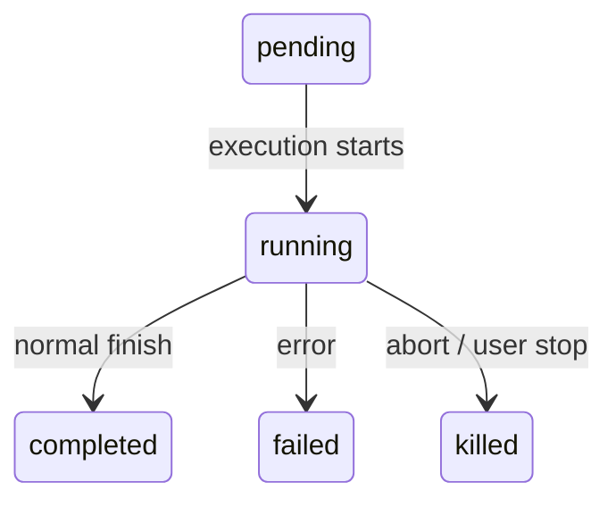
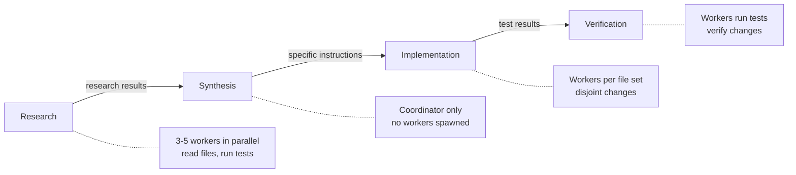
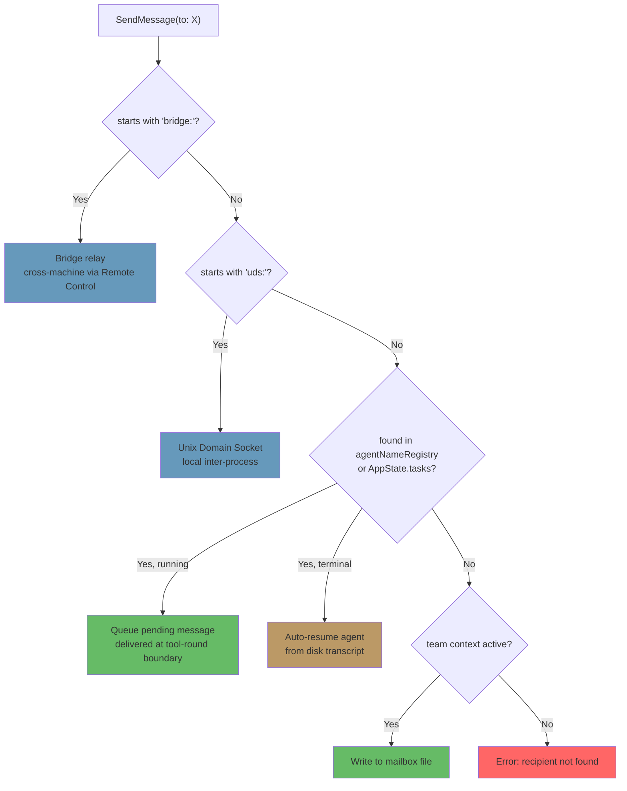

<a id="chapter-10-tasks-coordination-and-swarms"></a>

# 제10장: 작업, 조정, 에이전트 군집

<a id="the-limits-of-a-single-thread"></a>

## 단일 스레드의 한계

8장에서는 하위 에이전트(에이전트 정의에서 격리된 실행 컨텍스트를 구축하는 15단계 수명 주기)를 만드는 방법을 보여주었습니다. 9장에서는 신속한 캐시 활용을 통해 병렬 생성을 경제적으로 만드는 방법을 보여주었습니다. 하지만 에이전트를 만드는 것과 에이전트를 관리하는 것은 다른 문제입니다. 이 장에서는 두 번째에 대해 설명합니다.

단일 에이전트 루프(한 번에 하나의 모델, 하나의 대화, 하나의 도구)는 놀라운 양의 작업을 수행할 수 있습니다. 파일을 읽고, 코드를 편집하고, 테스트를 실행하고, 웹을 검색하고, 복잡한 문제에 대해 추론할 수 있습니다. 하지만 천장에 부딪힙니다.

천장은 지능이 아닙니다. 병렬성과 범위입니다. 대규모 리팩토링 작업을 수행하는 개발자는 40개의 파일을 업데이트하고, 각 배치 후에 테스트를 실행하고, 문제가 없는지 확인해야 합니다. 코드베이스 마이그레이션은 프런트엔드, 백엔드 및 데이터베이스 계층에 동시에 적용됩니다. 철저한 코드 검토를 통해 백그라운드에서 테스트 스위트를 실행하는 동안 수십 개의 파일을 읽습니다. 이것은 더 어려운 문제가 아니라 더 넓은 문제입니다. 여러 가지 일을 동시에 수행하고, 작업을 전문가에게 위임하고, 결과를 조율하는 능력이 필요합니다.

이 문제에 대한 Claude Code의 대답은 하나의 메커니즘이 아니라 각각 다른 형태의 작업에 적합한 계층화된 오케스트레이션 패턴 스택입니다. 실행 후 잊어버리기 명령에 대한 백그라운드 작업입니다. 관리자-근로자 계층을 위한 코디네이터 모드. P2P 협업을 위한 Swarm 팀. 그리고 이 모든 것을 하나로 묶는 통합 통신 프로토콜입니다.

오케스트레이션 계층은 `tools/AgentTool/`, `tasks/`, `coordinator/`, `tools/SendMessageTool/` 및 `utils/swarm/`에 걸쳐 약 40개의 파일에 걸쳐 있습니다. 이러한 폭에도 불구하고 디자인은 모든 패턴이 공유하는 단일 상태 머신에 의해 고정됩니다. 상태 머신(`Task.ts`의 `Task` 추상화)을 이해하는 것은 다른 모든 것을 이해하기 위한 전제 조건입니다.

이 장에서는 기본 작업 상태 머신부터 가장 정교한 다중 에이전트 토폴로지에 이르기까지 전체 스택을 추적합니다.

---

<a id="the-task-state-machine"></a>

## 작업 상태 머신

Claude Code의 모든 백그라운드 작업(셸 명령, 하위 에이전트, 원격 세션, 워크플로 스크립트)은 *작업*으로 추적됩니다. 작업 추상화는 `Task.ts`에 있으며 나머지 오케스트레이션 계층이 구축하는 통합 상태 모델을 제공합니다.

<a id="seven-types"></a>

### 7가지 유형

시스템은 각각 다른 실행 모델을 나타내는 7가지 작업 유형을 정의합니다.

7가지 작업 유형은 `local_bash`(백그라운드 셸 명령), `local_agent`(백그라운드 하위 에이전트), `remote_agent`(원격 세션), `in_process_teammate`(군집 팀원), `local_workflow`(워크플로 스크립트 실행), `monitor_mcp`(MCP 서버 모니터) 및 `dream`(추측적 배경 사고).

`local_bash` 및 `local_agent`은 각각 백그라운드 셸 명령과 백그라운드 하위 에이전트인 작업 도구입니다. `in_process_teammate`은 떼 기본 요소입니다. `remote_agent`은 원격 Claude Code Runtime 환경에 연결됩니다. `local_workflow`은 다단계 스크립트를 실행합니다. `monitor_mcp`은 MCP 서버 상태를 감시합니다. `dream`은 가장 특이한 것으로, 에이전트가 사용자 입력을 기다리는 동안 추론적으로 생각할 수 있도록 하는 백그라운드 작업입니다.

각 유형은 즉각적인 시각적 식별을 위해 단일 문자 ID 접두어를 갖습니다.

| 유형 | 접두사 | 예시 ID |
|------|--------|------------|
| `local_bash` | `b` | `b4k2m8x1` |
| `local_agent` | `a` | `a7j3n9p2` |
| `remote_agent` | `r` | `r1h5q6w4` |
| `in_process_teammate` | `t` | `t3f8s2v5` |
| `local_workflow` | `w` | `w6c9d4y7` |
| `monitor_mcp` | `m` | `m2g7k1z8` |
| `dream` | `d` | `d5b4n3r6` |

작업 ID는 단일 문자 접두사(에이전트의 경우 a, bash의 경우 b, 팀원의 경우 t 등)와 대소문자를 구분하지 않는 안전한 알파벳(숫자 및 소문자)에서 가져온 8개의 임의의 영숫자 문자를 사용합니다. 이는 약 2조 8천억 개의 조합을 생성합니다. 이는 디스크의 작업 출력 파일에 대한 무차별 대입 심볼릭 링크 공격을 저항할 수 있을 만큼 충분합니다.

로그 줄에 `a7j3n9p2`이 표시되면 이것이 백그라운드 에이전트라는 것을 즉시 알 수 있습니다. `b4k2m8x1`이 표시되면 쉘 명령입니다. 접두사는 인간 독자를 위한 미세한 최적화이지만 수십 개의 동시 작업이 있을 수 있는 시스템에서는 중요합니다.

<a id="five-statuses"></a>

### 5가지 상태

수명 주기는 주기가 없는 단순한 방향성 그래프입니다.



`pending`은 등록과 첫 실행 사이의 간략한 상태입니다. `running`은 작업이 적극적으로 작업을 수행하고 있음을 의미합니다. 세 가지 터미널 상태는 `completed`(성공), `failed`(오류) 및 `killed`(사용자, 코디네이터 또는 중단 신호에 의해 명시적으로 중지됨)입니다. 도우미 함수는 데드 작업과의 상호작용을 방지합니다.

```typescript
export function isTerminalTaskStatus(status: TaskStatus): boolean {
  return status === 'completed' || status === 'failed' || status === 'killed'
}
```

이 기능은 메시지 삽입 보호, 제거 논리, 고아 정리 및 메시지를 대기열에 넣을지 또는 죽은 에이전트를 재개할지 결정하는 SendMessage 라우팅 등 모든 곳에 나타납니다.

<a id="the-base-state"></a>

### 기본 상태

모든 작업 상태는 7가지 유형이 모두 공유하는 필드를 전달하는 `TaskStateBase`을 확장합니다.

```typescript
export type TaskStateBase = {
  id: string              // Prefixed random ID
  type: TaskType          // Discriminator
  status: TaskStatus      // Current lifecycle position
  description: string     // Human-readable summary
  toolUseId?: string      // The tool_use block that spawned this task
  startTime: number       // Creation timestamp
  endTime?: number        // Terminal-state timestamp
  totalPausedMs?: number  // Accumulated pause time
  outputFile: string      // Disk path for streaming output
  outputOffset: number    // Read cursor for incremental output
  notified: boolean       // Whether completion was reported to parent
}
```

두 가지 분야에 주목할 필요가 있습니다. `outputFile`은 비동기 실행과 상위 대화 사이의 브리지입니다. 모든 작업은 출력을 디스크의 파일에 쓰고 상위는 `outputOffset`을 통해 점진적으로 읽을 수 있습니다. `notified`은 중복 완료 메시지를 방지합니다. 부모에게 작업이 완료되었다는 메시지가 전달되면 플래그는 `true`으로 바뀌고 알림은 다시 전송되지 않습니다. 이 가드가 없으면 알림 큐의 두 연속 폴링 사이에 완료되는 작업은 중복된 알림을 생성하여 모델이 하나만 완료했을 때 두 작업이 완료된 것으로 생각하도록 혼동하게 됩니다.

<a id="the-agent-task-state"></a>

### 에이전트 작업 상태

`LocalAgentTaskState`은 백그라운드 하위 에이전트의 전체 수명주기를 관리하는 데 필요한 모든 것을 포함하는 가장 복잡한 변형입니다.

```typescript
export type LocalAgentTaskState = TaskStateBase & {
  type: 'local_agent'
  agentId: string
  prompt: string
  selectedAgent?: AgentDefinition
  agentType: string
  model?: string
  abortController?: AbortController
  pendingMessages: string[]       // Queued via SendMessage
  isBackgrounded: boolean         // Was this originally a foreground agent?
  retain: boolean                 // UI is holding this task
  diskLoaded: boolean             // Sidechain transcript loaded
  evictAfter?: number             // GC deadline
  progress?: AgentProgress
  lastReportedToolCount: number
  lastReportedTokenCount: number
  // ... additional lifecycle fields
}
```

세 가지 필드는 중요한 설계 결정을 보여줍니다. `pendingMessages`은 받은 편지함입니다. `SendMessage`이 실행 중인 에이전트를 대상으로 하면 메시지가 즉시 주입되지 않고 여기에 대기됩니다. 메시지는 도구 라운드 경계에서 배출되어 에이전트의 차례 구조를 유지합니다. `isBackgrounded`은 비동기로 생성된 에이전트와 포그라운드 동기화 에이전트로 시작했다가 나중에 사용자가 키를 눌러 백그라운드로 전환된 에이전트를 구별합니다. `evictAfter`은 가비지 수집 메커니즘입니다. 보유되지 않은 완료된 작업은 해당 상태가 메모리에서 제거되기 전에 유예 기간을 갖습니다.

모든 작업 상태는 `AppState.tasks`에 접두사 ID가 붙은 `Record<string, TaskState>`으로 저장됩니다. 이것은 트리가 아닌 평면 지도입니다. 시스템은 상태 저장소에서 부모-자식 관계를 모델링하지 않습니다. 부모-자식 관계는 대화 흐름에 내재되어 있습니다. 부모는 자식을 생성한 `toolUseId`을 보유합니다.

<a id="the-task-registry"></a>

### 작업 레지스트리

각 작업 유형은 최소한의 인터페이스를 갖춘 `Task` 객체로 지원됩니다.

```typescript
export type Task = {
  name: string
  type: TaskType
  kill(taskId: string, setAppState: SetAppState): Promise<void>
}
```

레지스트리는 모든 작업 구현을 수집합니다.

```typescript
export function getAllTasks(): Task[] {
  return [
    LocalShellTask,
    LocalAgentTask,
    RemoteAgentTask,
    DreamTask,
    ...(LocalWorkflowTask ? [LocalWorkflowTask] : []),
    ...(MonitorMcpTask ? [MonitorMcpTask] : []),
  ]
}
```

조건부 포함에 주목하세요. `LocalWorkflowTask` 및 `MonitorMcpTask`은 기능 제한이 있으며 런타임에 존재하지 않을 수 있습니다. `Task` 인터페이스는 의도적으로 최소화되었습니다. 이전 반복에는 `spawn()` 및 `render()` 메서드가 포함되었지만 생성 및 렌더링이 다형성으로 호출되지 않는다는 것이 분명해졌을 때 이러한 메서드는 제거되었습니다. 각 작업 유형에는 자체 생성 논리, 자체 상태 관리 및 자체 렌더링이 있습니다. 유형별로 실제로 디스패치해야 하는 유일한 작업은 `kill()`이므로 인터페이스에 필요한 것은 이것이 전부입니다.

이것은 빼기를 통한 인터페이스 진화의 예입니다. 초기 설계에서는 모든 작업 유형이 공통 수명 주기 인터페이스를 공유할 것이라고 상상했습니다. 실제로 유형은 공유 인터페이스가 허구가 될 정도로 다양했습니다. 셸 명령의 경우 `spawn()`과 진행 중인 팀원의 경우 `spawn()`은 공통점이 거의 없습니다. 누출된 추상화를 유지하는 대신 팀은 다형성의 이점을 실제로 누릴 수 있는 한 가지 방법을 제외한 모든 것을 제거했습니다.

---

<a id="communication-patterns"></a>

## 의사소통 패턴

백그라운드에서 실행되는 작업은 부모가 진행 상황을 관찰하고 결과를 받을 수 있는 경우에만 유용합니다. Claude Code는 세 가지 통신 채널을 지원하며 각각은 서로 다른 액세스 패턴에 최적화되어 있습니다.

<a id="foreground-the-generator-chain"></a>

### 전경: 발전기 체인

에이전트가 동기식으로 실행되면 상위 에이전트는 `runAgent()` 비동기 생성기를 직접 반복하여 각 메시지 백업을 호출 스택으로 생성합니다. 여기서 흥미로운 메커니즘은 배경 탈출 해치입니다. 즉, "에이전트의 다음 메시지"와 "백그라운드 신호" 사이의 동기화 루프 경쟁입니다.

```typescript
const agentIterator = runAgent({ ...params })[Symbol.asyncIterator]()

while (true) {
  const nextMessagePromise = agentIterator.next()
  const raceResult = backgroundPromise
    ? await Promise.race([nextMessagePromise.then(...), backgroundPromise])
    : { type: 'message', result: await nextMessagePromise }

  if (raceResult.type === 'background') {
    // User triggered backgrounding -- transition to async
    await agentIterator.return(undefined)
    void runAgent({ ...params, isAsync: true })
    return { data: { status: 'async_launched' } }
  }

  agentMessages.push(message)
}
```

사용자가 실행 중에 동기화 에이전트가 백그라운드 작업이 되어야 한다고 결정하면 포그라운드 반복자가 완전히 반환되고(리소스 정리를 위해 `finally` 블록을 트리거함) 에이전트는 동일한 ID를 가진 비동기 작업으로 다시 생성됩니다. 전환은 원활합니다. 작업이 손실되지 않으며 에이전트는 상위 ESC 키에서 연결이 해제된 비동기 중단 컨트롤러를 사용하여 중단된 부분부터 계속됩니다.

이는 올바른 상태 전환이 정말 어려운 일입니다. 포그라운드 에이전트는 상위의 중단 컨트롤러를 공유합니다(ESC는 둘 다 종료합니다). 백그라운드 에이전트에는 자체 컨트롤러가 필요합니다(ESC가 이를 종료해서는 안 됩니다). 에이전트의 메시지는 포그라운드 생성기 스트림에서 백그라운드 알림 시스템으로 전송되어야 합니다. 작업 상태는 UI가 배경 패널에 표시할 수 있도록 `isBackgrounded`을 뒤집어야 합니다. 그리고 이 모든 작업은 원자적으로 이루어져야 합니다. 전환 중에 메시지가 손실되지 않고, 좀비 반복자가 계속 실행되지도 않습니다. 다음 메시지와 배경 신호 사이의 `Promise.race`은 이를 가능하게 하는 메커니즘입니다.

<a id="background-three-channels"></a>

### 배경: 세 개의 채널

백그라운드 에이전트는 디스크, 알림 및 대기 중인 메시지를 통해 통신합니다.

**디스크 출력 파일.** 모든 작업은 JSONL 형식의 에이전트 기록에 대한 심볼릭 링크인 `outputFile` 경로에 기록됩니다. 상위(또는 모든 관찰자)는 파일이 얼마나 사용되었는지 추적하는 `outputOffset`을 사용하여 이 파일을 점진적으로 읽을 수 있습니다. `TaskOutputTool`은 이를 모델에 노출합니다.

```typescript
inputSchema = z.strictObject({
  task_id: z.string(),
  block: z.boolean().default(true),
  timeout: z.number().default(30000),
})
```

`block: true`인 경우 도구는 작업이 최종 상태에 도달하거나 제한 시간이 만료될 때까지 폴링합니다. 이는 워커를 생성하고 그 결과를 기다리는 코디네이터의 기본 메커니즘입니다.

**작업 알림.** 백그라운드 에이전트가 완료되면 시스템은 XML 알림을 생성하고 이를 상위 대화에 전달하기 위해 대기열에 추가합니다.

```xml
<task-notification>
  <task-id>a7j3n9p2</task-id>
  <tool-use-id>toolu_abc123</tool-use-id>
  <output-file>/path/to/output</output-file>
  <status>completed</status>
  <summary>Agent "Investigate auth bug" completed</summary>
  <result>Found null pointer in src/auth/validate.ts:42...</result>
  <usage>
    <total_tokens>15000</total_tokens>
    <tool_uses>8</tool_uses>
    <duration_ms>12000</duration_ms>
  </usage>
</task-notification>
```

알림은 상위 대화에 사용자 역할 메시지로 삽입됩니다. 즉, 모델이 일반적인 메시지 흐름에서 알림을 본다는 의미입니다. 완료를 확인하기 위해 특별한 도구가 필요하지 않습니다. 완료는 컨텍스트로 도착합니다. 작업 상태의 `notified` 플래그는 중복 전달을 방지합니다.

**명령 대기열.** `LocalAgentTaskState`의 `pendingMessages` 배열은 세 번째 채널입니다. `SendMessage`이 실행 중인 에이전트를 대상으로 하면 메시지가 대기열에 추가됩니다.

```typescript
if (isLocalAgentTask(task) && task.status === 'running') {
  queuePendingMessage(agentId, input.message, setAppState)
  return { data: { success: true, message: 'Message queued...' } }
}
```

이러한 메시지는 `drainPendingMessages()`에 의해 도구 라운드 경계에서 배출되고 에이전트의 대화에 사용자 메시지로 삽입됩니다. 이는 중요한 디자인 선택입니다. 메시지는 실행 중간이 아닌 도구 라운드 사이에 도착합니다. 에이전트는 현재 생각을 마친 다음 새 정보를 받습니다. 경쟁 조건도 없고 손상된 상태도 없습니다.

<a id="progress-tracking"></a>

### 진행 상황 추적

`ProgressTracker`은 에이전트 활동에 대한 실시간 가시성을 제공합니다.

```typescript
export type ProgressTracker = {
  toolUseCount: number
  latestInputTokens: number        // Cumulative (latest value, not sum)
  cumulativeOutputTokens: number   // Summed across turns
  recentActivities: ToolActivity[] // Last 5 tool uses
}
```

입력 및 출력 토큰 추적 간의 구분은 의도적인 것이며 API 청구 모델의 미묘함을 반영합니다. 전체 대화가 매번 다시 전송되기 때문에 입력 토큰은 API 호출별로 누적됩니다. 15번째 턴에는 이전 14개의 턴이 모두 포함되므로 API에서 보고된 입력 토큰 수는 이미 총계를 반영합니다. 최신 값을 유지하는 것이 올바른 집계입니다. 출력 토큰은 턴별로 이루어집니다. 모델은 매번 새 토큰을 생성하므로 합산이 올바른 집계입니다. 이것이 잘못되면 극적으로 초과 계산(누적 입력 토큰 합산)되거나 극적으로 과소 계산(최신 출력 토큰만 유지)됩니다.

`recentActivities` 배열(5개 항목으로 제한)은 에이전트가 수행하는 작업에 대해 사람이 읽을 수 있는 스트림을 제공합니다: "Read src/auth/validate.ts", "Bash: npm test", "Edit src/auth/validate.ts". 이는 VS Code 하위 에이전트 패널과 터미널의 백그라운드 작업 표시기에 표시되므로 사용자가 전체 기록을 읽지 않고도 에이전트 작업을 볼 수 있습니다.

백그라운드 에이전트의 경우 진행 상황은 `updateAsyncAgentProgress()`을 통해 `AppState`에 기록되고 `emitTaskProgress()`을 통해 SDK 이벤트로 내보내집니다. VS Code 하위 에이전트 패널은 이러한 이벤트를 사용하여 실시간 진행률 표시줄, 도구 수 및 활동 스트림을 렌더링합니다. 진행 상황 추적은 단순한 외관이 아닙니다. 이는 백그라운드 에이전트가 진행 중인지 아니면 루프에 갇혀 있는지 사용자에게 알려주는 기본 피드백 메커니즘입니다.

---

<a id="coordinator-mode"></a>

## 코디네이터 모드

코디네이터 모드는 Claude Code를 백그라운드 도우미가 있는 단일 에이전트에서 진정한 관리자-작업자 아키텍처로 변환합니다. 이는 시스템에서 가장 독단적인 오케스트레이션 패턴이며, 그 디자인은 LLM이 작업을 위임해야 하는 방식과 위임해서는 안 되는 방식에 대한 깊은 생각을 드러냅니다.

<a id="the-problem-coordinator-mode-solves"></a>

### 문제 코디네이터 모드로 해결

표준 에이전트 루프에는 단일 대화와 단일 컨텍스트 창이 있습니다. 백그라운드 에이전트가 생성되면 백그라운드 에이전트는 독립적으로 실행되고 작업 알림을 통해 결과를 보고합니다. 이는 간단한 위임("편집을 계속하는 동안 테스트 실행")에는 적합하지만 복잡한 다단계 작업 흐름에서는 작동하지 않습니다.

코드베이스 마이그레이션을 고려해보세요. 에이전트는 (1) 200개 파일의 현재 패턴을 이해하고, (2) 마이그레이션 전략을 설계하고, (3) 각 파일에 변경 사항을 적용하고, (4) 손상된 부분이 없는지 확인해야 합니다. 1단계와 3단계는 병렬성의 이점을 얻습니다. 2단계에서는 1단계의 결과를 합성해야 합니다. 4단계는 3단계에 따라 다릅니다. 이 작업을 순차적으로 수행하는 단일 에이전트는 대부분의 토큰 예산을 파일을 다시 읽는 데 소비합니다. 조정 없이 이 작업을 수행하는 여러 백그라운드 에이전트는 일관성 없는 변경을 생성합니다.

코디네이터 모드는 "생각하는" 에이전트와 "실행하는" 에이전트를 분리하여 이 문제를 해결합니다. 코디네이터는 1~2단계(연구원 파견 후 합성)를 담당한다. 작업자는 3단계와 4단계(변경 사항 적용, 테스트 실행)를 처리합니다. 코디네이터는 전체 그림을 봅니다. 작업자는 자신의 특정 작업을 볼 수 있습니다.

<a id="activation"></a>

### 활성화

단일 환경 변수가 스위치를 전환합니다.

```typescript
export function isCoordinatorMode(): boolean {
  if (feature('COORDINATOR_MODE')) {
    return isEnvTruthy(process.env.CLAUDE_CODE_COORDINATOR_MODE)
  }
  return false
}
```

세션 재개 시 `matchSessionMode()`은 재개된 세션의 저장 모드가 현재 환경과 일치하는지 확인합니다. 서로 다른 경우 환경 변수가 일치하도록 반전됩니다. 이렇게 하면 코디네이터 세션이 일반 에이전트로 재개되거나(작업자에 대한 인식 상실) 일반 세션이 코디네이터로 재개(해당 도구에 대한 액세스 상실)되는 혼란스러운 시나리오를 방지할 수 있습니다. 세션 모드는 진실의 원천입니다. 환경 변수는 런타임 신호입니다.

<a id="tool-restrictions"></a>

### 도구 제한

코디네이터의 힘은 더 많은 도구를 갖는 데서 나오는 것이 아니라 더 적은 도구를 갖는 데서 나옵니다. 코디네이터 모드에서 코디네이터 에이전트는 정확히 세 가지 도구를 얻습니다.

- **에이전트** -- 작업자 생성
- **SendMessage** -- 기존 작업자와 통신
- **TaskStop** -- 실행 중인 작업자 종료

그게 다야. 파일을 읽지 않습니다. 코드 편집이 없습니다. 쉘 명령이 없습니다. 코디네이터는 코드베이스를 직접 건드릴 수 없습니다. 이 제한은 제한이 아니라 핵심 설계 원칙입니다. 코디네이터의 임무는 생각하고, 계획하고, 분해하고, 종합하는 것입니다. 노동자들이 일을 합니다.

반대로 작업자는 내부 조정 도구를 제외한 전체 도구 세트를 얻습니다.

```typescript
const INTERNAL_WORKER_TOOLS = new Set([
  TEAM_CREATE_TOOL_NAME,
  TEAM_DELETE_TOOL_NAME,
  SEND_MESSAGE_TOOL_NAME,
  SYNTHETIC_OUTPUT_TOOL_NAME,
])
```

작업자는 자신의 하위 팀을 생성하거나 동료에게 메시지를 보낼 수 없습니다. 그들은 일반적인 작업 완료 메커니즘을 통해 결과를 보고하고 코디네이터는 이를 종합합니다.

<a id="the-370-line-system-prompt"></a>

### 370라인 시스템 프롬프트

코디네이터 시스템 프롬프트는 한 줄 한 줄 오케스트레이션을 위해 LLM을 사용하는 방법에 대한 코드베이스에서 가장 유익한 문서입니다. 약 370줄로 구성되며 위임 패턴에 대해 어렵게 얻은 교훈을 인코딩합니다. 주요 가르침:

**"절대 이해를 위임하지 말라."** 이것이 중심 논제이다. 코디네이터는 연구 결과를 파일 경로, 줄 번호 및 정확한 변경 사항이 포함된 특정 프롬프트로 종합해야 합니다. 프롬프트는 "발견에 따라 버그를 수정하세요"와 같은 안티 패턴을 명시적으로 호출합니다. 이 프롬프트는 *이해*를 작업자에게 위임하여 코디네이터가 이미 갖고 있는 컨텍스트를 다시 파생하도록 강제합니다. 올바른 패턴은 다음과 같습니다. "42행의 `src/auth/validate.ts`에서 `userId` 매개변수는 OAuth 흐름에서 호출될 때 null이 될 수 있습니다. 401 응답을 반환하는 null 검사를 추가하세요."

**"병렬성은 당신의 초능력입니다."** 프롬프트는 명확한 동시성 모델을 설정합니다. 읽기 전용 작업은 조사, 탐색, 파일 읽기 등 병렬로 자유롭게 실행됩니다. 쓰기가 많은 작업은 파일 세트별로 직렬화됩니다. 코디네이터는 어떤 작업이 중복될 수 있고 어떤 작업이 순서대로 이루어져야 하는지 추론해야 합니다. 좋은 코디네이터는 5명의 연구원을 동시에 생성하고, 모두를 기다리고, 합성한 다음, 분리된 파일 세트를 다루는 3명의 구현 작업자를 생성합니다. 잘못된 코디네이터는 작업자 하나를 생성하고, 기다리고, 다음 작업자를 생성하고, 다시 대기합니다. 즉, 병렬일 수 있는 작업을 직렬화합니다.

**작업 워크플로 단계.** 프롬프트는 네 가지 단계를 정의합니다.



1. **연구** -- 작업자는 코드베이스를 병렬로 탐색하여 파일을 읽고, 테스트를 실행하고, 정보를 수집합니다.
2. **종합** -- 코디네이터(직원 아님)가 모든 연구 결과를 읽고 통일된 이해를 구축합니다.
3. **구현** -- 작업자는 합성에서 파생된 정확한 지침을 받습니다.
4. **확인** -- 작업자가 테스트를 실행하고 변경 사항을 확인합니다.

코디네이터는 단계를 건너뛰어서는 안 됩니다. 가장 일반적인 실패 모드는 합성 없이 연구에서 직접 구현으로 점프하는 것입니다. 이런 일이 발생하면 코디네이터는 구현 작업자에게 이해를 위임합니다. 각 작업자는 처음부터 컨텍스트를 다시 파생해야 하므로 일관성 없는 변경이 발생하고 토큰이 낭비됩니다.

**계속 vs 생성 결정.** 작업자가 완료되고 코디네이터가 후속 작업을 수행하면 기존 작업자에게 메시지를 보내야 할까요(SendMessage를 통해) 아니면 새 작업자를 생성해야 할까요(에이전트를 통해)? 결정은 컨텍스트 중첩의 함수입니다.

- **중복률 높음, 동일한 파일**: 계속합니다. 작업자는 이미 해당 컨텍스트에 파일 콘텐츠를 갖고 있고, 패턴을 이해하고 있으며, 이전 작업을 기반으로 구축할 수 있습니다. 새로 생성하면 동일한 파일을 다시 읽고 동일한 이해를 다시 도출해야 합니다.
- **낮은 중복, 다른 도메인**: 새로 생성됩니다. 방금 인증 시스템을 조사한 작업자는 CSS 리팩토링 작업에 매우 중요한 인증 관련 컨텍스트 토큰 20,000개를 운반합니다. 깨끗하게 시작하는 것이 더 저렴합니다.
- **겹침이 높지만 작업자가 실패함**: 무엇이 잘못되었는지에 대한 명시적인 안내를 통해 새로 생성됩니다. 실패한 작업자를 계속 유지한다는 것은 종종 혼란스러운 상황에 맞서 싸우는 것을 의미합니다. "이전 시도는 X 때문에 실패했습니다. Y를 피하세요"로 새로 시작하는 것이 더 안정적입니다.
- **후속 작업에는 작업자의 출력이 필요합니다**: SendMessage에 출력이 포함된 상태로 계속 진행합니다. 작업자는 자체 결과를 다시 도출할 필요가 없습니다.

**작업자 프롬프트 작성 및 안티패턴.** 프롬프트는 코디네이터에게 효과적인 작업자 프롬프트를 작성하는 방법을 가르치고 잘못된 패턴을 명시적으로 표시합니다.

안티 패턴: *"연구 결과를 바탕으로 수정 사항을 구현합니다."* 이는 이해력을 위임합니다. 작업자가 연구를 수행한 사람이 아니었습니다. 코디네이터가 연구 결과를 읽었습니다.

안티 패턴: *"인증 모듈의 버그를 수정하세요."* 파일 경로, 줄 번호, 버그 설명이 없습니다. 작업자는 처음부터 전체 코드베이스를 검색해야 합니다.

안티 패턴: *"다른 모든 파일을 동일하게 변경합니다."* 어떤 파일인가요? 어떤 변화가 있나요? 코디네이터는 알고 있습니다. 그것들을 열거해야합니다.

좋은 패턴: *"42행의 `src/auth/validate.ts`에서 `src/oauth/callback.ts:89`에서 호출될 때 `userId` 매개변수는 null일 수 있습니다. null 검사를 추가합니다. `userId`이 null이면 `{ error: 'unauthorized', status: 401 }`을 반환합니다. 그런 다음 null 사례를 포함하도록 `src/auth/__tests__/validate.test.ts`의 테스트를 업데이트합니다."*

특정 프롬프트를 작성하는 데 드는 비용은 코디네이터가 한 번만 부담합니다. 첫 번째 시도에서 올바르게 실행되는 작업자의 이점은 엄청납니다. 모호한 프롬프트는 잘못된 경제를 조성합니다. 코디네이터는 프롬프트 작성에 30초를 절약하고 작업자는 탐색에 5분을 낭비합니다.

<a id="worker-context"></a>

### 작업자 컨텍스트

코디네이터는 사용 가능한 도구에 대한 정보를 자체 컨텍스트에 주입하므로 모델은 작업자가 무엇을 할 수 있는지 알 수 있습니다.

```typescript
export function getCoordinatorUserContext(mcpClients, scratchpadDir?) {
  return {
    workerToolsContext: `Workers spawned via Agent have access to: ${workerTools}`
      + (mcpClients.length > 0
        ? `\nWorkers also have MCP tools from: ${serverNames}` : '')
      + (scratchpadDir ? `\nScratchpad: ${scratchpadDir}` : '')
  }
}
```

스크래치패드 디렉터리(`tengu_scratch` 기능 플래그로 제어됨)는 작업자가 권한 프롬프트 없이 읽고 쓸 수 있는 공유 파일 시스템 위치입니다. 이는 내구성 있는 작업자 간 지식 공유를 가능하게 합니다. 한 작업자의 연구 노트는 코디네이터의 토큰 창을 통하지 않고 파일 시스템을 통해 중재되는 다른 작업자의 입력이 됩니다.

이는 코디네이터 패턴의 근본적인 한계를 해결한다는 점에서 중요합니다. 스크래치 패드가 없으면 모든 정보가 코디네이터를 통해 흐릅니다. 작업자 A가 결과를 생성하고 코디네이터가 TaskOutput을 통해 이를 읽고 작업자 B의 프롬프트에 합성합니다. 코디네이터의 컨텍스트 창은 병목 현상이 됩니다. 즉, 모든 중간 결과를 합성할 수 있을 만큼 오랫동안 보관해야 합니다. 스크래치패드를 사용하여 작업자 A는 결과를 `/tmp/scratchpad/auth-analysis.md`에 기록하고 코디네이터는 작업자 B에게 "`/tmp/scratchpad/auth-analysis.md`에서 인증 분석을 읽고 패턴을 OAuth 모듈에 적용합니다."라고 말합니다. 코디네이터는 값이 아닌 참조로 정보를 이동합니다.

<a id="mutual-exclusion-with-fork"></a>

### 포크를 사용한 상호 배제

코디네이터 모드와 포크 기반 하위 에이전트는 상호 배타적입니다.

```typescript
export function isForkSubagentEnabled(): boolean {
  if (feature('FORK_SUBAGENT')) {
    if (isCoordinatorMode()) return false
    // ...
  }
}
```

갈등은 근본적이다. 포크 에이전트는 상위의 전체 대화 컨텍스트를 상속합니다. 즉, 프롬프트 캐시를 공유하는 저렴한 복제본입니다. 코디네이터 작업자는 새로운 상황과 구체적인 지침을 갖춘 독립적인 에이전트입니다. 이는 위임 철학에 반대되며 시스템은 기능 플래그 수준에서 선택을 시행합니다.

---

<a id="the-swarm-system"></a>

## 스웜 시스템

코디네이터 모드는 계층적입니다. 즉, 한 명의 관리자, 많은 작업자, 하향식 제어가 가능합니다. 스웜 시스템은 P2P 대안입니다. 여러 Claude Code 인스턴스가 팀으로 작동하고 리더가 메시지 전달을 통해 여러 팀원을 조정합니다.

<a id="team-context"></a>

### 팀 컨텍스트

팀은 `teamName`으로 식별되고 `AppState.teamContext`에서 추적됩니다.

```typescript
teamContext?: {
  teamName: string
  teammates: {
    [id: string]: { name: string; color?: string; ... }
  }
}
```

각 팀원은 이름(주소 지정용)과 색상(UI의 시각적 구별용)을 얻습니다. 팀 구성원이 프로세스를 다시 시작해도 유지되도록 팀 파일은 디스크에 유지됩니다.

<a id="agent-name-registry"></a>

### 에이전트 이름 레지스트리

백그라운드 에이전트에는 생성 시 이름이 지정될 수 있으며, 이를 통해 임의의 작업 ID 대신 사람이 읽을 수 있는 식별자로 주소를 지정할 수 있습니다.

```typescript
if (name) {
  rootSetAppState(prev => {
    const next = new Map(prev.agentNameRegistry)
    next.set(name, asAgentId(asyncAgentId))
    return { ...prev, agentNameRegistry: next }
  })
}
```

`agentNameRegistry`은 `Map<string, AgentId>`입니다. `SendMessage`이 `to` 필드를 확인하면 레지스트리가 먼저 확인됩니다.

```typescript
const registered = appState.agentNameRegistry.get(input.to)
const agentId = registered ?? toAgentId(input.to)
```

이는 `a7j3n9p2` 대신 `"researcher"`으로 메시지를 보낼 수 있음을 의미합니다. 간접 참조는 간단하지만 이를 통해 코디네이터는 ID가 아닌 역할 측면에서 생각할 수 있습니다. 이는 다중 에이전트 워크플로를 추론하는 모델의 능력이 크게 향상되었습니다.

<a id="in-process-teammates"></a>

### 진행 중인 팀원

진행 중인 팀원은 `AsyncLocalStorage`을 통해 격리된 리더와 동일한 Node.js 프로세스에서 실행됩니다. 해당 상태는 팀별 필드로 기반을 확장합니다.

```typescript
export type InProcessTeammateTaskState = TaskStateBase & {
  type: 'in_process_teammate'
  identity: TeammateIdentity
  prompt: string
  messages?: Message[]                  // Capped at 50
  pendingUserMessages: string[]
  isIdle: boolean
  shutdownRequested: boolean
  awaitingPlanApproval: boolean
  permissionMode: PermissionMode
  onIdleCallbacks?: Array<() => void>
  currentWorkAbortController?: AbortController
}
```

50개 항목의 `messages` 한도에 대해서는 설명이 필요합니다. 개발 과정에서 분석 결과 각 진행 중인 에이전트는 500회 이상의 턴에서 약 20MB의 RSS를 축적하는 것으로 나타났습니다. 확장된 워크플로우를 실행하는 고급 사용자인 고래 세션은 2분 만에 292개의 에이전트를 실행하여 RSS를 36.8GB로 증가시키는 것으로 관찰되었습니다. UI 표현의 50개 메시지 제한은 메모리 안전 밸브입니다. 에이전트의 실제 대화는 전체 기록으로 계속됩니다. UI 방향 스냅샷만 잘립니다.

`isIdle` 플래그는 작업 도용 패턴을 활성화합니다. 유휴 팀원은 토큰이나 API 호출을 소비하지 않고 단순히 다음 메시지를 기다리고 있습니다. `onIdleCallbacks` 어레이를 사용하면 시스템이 활성 상태에서 유휴 상태로 전환되도록 하여 "모든 팀원이 완료될 때까지 기다린 후 진행"과 같은 오케스트레이션 패턴을 활성화할 수 있습니다.

`currentWorkAbortController`은 팀원의 기본 중단 컨트롤러와 다릅니다. 현재 작업 컨트롤러를 중단하면 팀원의 진행 중인 턴이 취소되지만 팀원이 죽지는 않습니다. 이는 "리디렉션" 패턴을 가능하게 합니다. 리더가 우선 순위가 더 높은 메시지를 보내고, 팀원의 현재 작업이 중단되고, 팀원이 새 메시지를 선택합니다. 메인 중단 컨트롤러는 중단되면 팀원을 완전히 죽입니다. 두 가지 수준의 의도에 대한 두 가지 수준의 중단입니다.

`shutdownRequested` 플래그는 협력적 종료를 구현합니다. 리더가 종료 요청을 보내면 이 플래그가 설정됩니다. 팀원은 자연스러운 중단 지점에서 이를 확인하고 현재 파일 쓰기를 완료하고, 변경 사항을 커밋하거나 최종 상태 업데이트를 보내는 등 우아하게 마무리할 수 있습니다. 이는 파일을 일관되지 않은 상태로 남길 수 있는 강제 종료보다 더 온화합니다.

<a id="the-mailbox"></a>

### 사서함

팀원은 파일 기반 사서함 시스템을 통해 통신합니다. `SendMessage`이 팀원을 대상으로 하면 메시지는 디스크에 있는 수신자의 메일함 파일에 기록됩니다.

```typescript
await writeToMailbox(recipientName, {
  from: senderName,
  text: content,
  summary,
  timestamp: new Date().toISOString(),
  color: senderColor,
}, teamName)
```

메시지는 일반 텍스트, 구조화된 프로토콜 메시지(종료 요청, 계획 승인) 또는 브로드캐스트(`to: "*"`이 보낸 사람을 제외한 모든 팀 구성원에게 전송)일 수 있습니다. 폴러 훅은 들어오는 메시지를 처리하고 이를 팀원의 대화로 라우팅합니다.

파일 기반 접근 방식은 의도적으로 간단합니다. 메시지 브로커, 이벤트 버스, 공유 메모리 채널이 없습니다. 파일은 내구성이 있고(프로세스 충돌에도 불구하고) 검사가 가능하며(메일함을 `cat`할 수 있음) 저렴합니다(인프라 종속성 없음). 메시지 볼륨이 초당 수천 개가 아닌 세션당 수십 단위로 측정되는 시스템의 경우 이는 올바른 균형입니다. Redis 지원 메시지 대기열은 파일 시스템 호출이 사소하게 처리하는 처리량 요구 사항에 대해 운영 복잡성, 종속성 및 실패 모드를 추가합니다.

방송 메커니즘은 주목할 가치가 있습니다. 메시지가 `"*"`으로 전송되면 보낸 사람은 팀 파일에서 모든 팀 구성원을 반복하고 자체를 건너뛰고(대소문자 구분 비교) 각 구성원의 사서함에 개별적으로 씁니다.

```typescript
for (const member of teamFile.members) {
  if (member.name.toLowerCase() === senderName.toLowerCase()) continue
  recipients.push(member.name)
}
for (const recipientName of recipients) {
  await writeToMailbox(recipientName, { from: senderName, text: content, ... }, teamName)
}
```

팬아웃 최적화는 없습니다. 각 수신자는 별도의 파일 쓰기를 받습니다. 다시 말하지만 에이전트 팀 규모(일반적으로 3~8명)에서는 이것이 완벽하게 적합합니다. 팀의 구성원이 100명이라면 이를 다시 생각해 볼 필요가 있습니다. 그러나 36GB RSS 시나리오를 방지하는 50개 메시지 메모리 제한은 암시적으로 효과적인 팀 크기를 제한합니다.

<a id="permission-forwarding"></a>

### 권한 전달

Swarm Worker는 제한된 권한으로 작동하지만 민감한 작업에 대한 승인이 필요할 때 리더에게 에스컬레이션할 수 있습니다.

```typescript
const request = createPermissionRequest({
  toolName, toolUseId, input, description, permissionSuggestions
})
registerPermissionCallback({ requestId, toolUseId, onAllow, onReject })
void sendPermissionRequestViaMailbox(request)
```

흐름은 다음과 같습니다. 작업자가 권한이 필요한 도구를 사용하면 bash 분류자가 자동 승인을 시도하고 실패할 경우 요청은 사서함 시스템을 통해 리더에게 전달됩니다. 리더는 UI에서 요청을 확인하고 승인하거나 거부할 수 있습니다. 콜백이 실행되고 작업자가 진행됩니다. 이를 통해 작업자는 위험한 작업에 대해 인간의 감독을 유지하면서 안전한 작업을 위해 자율적으로 작업할 수 있습니다.

---

<a id="inter-agent-communication-sendmessage"></a>

## 에이전트 간 통신: SendMessage

`SendMessageTool`은 범용 통신 기본 요소입니다. `to` 필드의 모양에 따라 선택된 단일 도구 인터페이스를 통해 네 가지 고유한 라우팅 모드를 처리합니다.

<a id="input-schema"></a>

### 입력 스키마

```typescript
inputSchema = z.object({
  to: z.string(),
  // "teammate-name", "*", "uds:<socket>", "bridge:<session-id>"
  summary: z.string().optional(),
  message: z.union([
    z.string(),
    z.discriminatedUnion('type', [
      z.object({ type: z.literal('shutdown_request'), reason: z.string().optional() }),
      z.object({ type: z.literal('shutdown_response'), request_id, approve, reason }),
      z.object({ type: z.literal('plan_approval_response'), request_id, approve, feedback }),
    ]),
  ]),
})
```

`message` 필드는 일반 텍스트와 구조화된 프로토콜 메시지의 결합입니다. 이는 SendMessage가 이중 임무를 수행한다는 것을 의미합니다. 즉, 비공식 채팅 채널("여기에 내 결과가 있습니다")과 공식 프로토콜 계층("계획을 승인합니다" / "종료해주세요")이 모두 있습니다.

<a id="routing-dispatch"></a>

### 라우팅 파견

`call()` 메서드는 우선 순위가 지정된 디스패치 체인을 따릅니다.



**1. 브리지 메시지**(`bridge:<session-id>`). Anthropic의 원격 제어 서버를 통한 기계 간 통신. 이는 가장 광범위한 도달 범위입니다. 서로 다른 시스템, 잠재적으로 서로 다른 대륙에 있는 두 개의 Claude Code 인스턴스가 릴레이를 통해 통신합니다. 시스템에서는 브리지 메시지를 보내기 전에 명시적인 사용자 동의가 필요합니다. 이는 한 에이전트가 원격 인스턴스와 일방적으로 통신을 설정하는 것을 방지하는 안전 검사입니다. 이 게이트가 없으면 손상되거나 혼란스러운 에이전트가 정보를 원격 세션으로 유출할 수 있습니다. 동의 확인에서는 원격 제어 릴레이를 통한 직렬화 및 전송을 처리하는 `postInterClaudeMessage()`을 사용합니다.

**2. UDS 메시지**(`uds:<socket-path>`). Unix 도메인 소켓을 통한 로컬 프로세스 간 통신. 이는 동일한 시스템에서 다른 프로세스로 실행되는 Claude Code 인스턴스용입니다. 예를 들어 VS Code 확장은 한 인스턴스를 호스팅하고 터미널은 다른 인스턴스를 호스팅합니다. UDS 통신은 빠르고(네트워크 왕복 없음) 안전하며(파일 시스템 권한 제어 액세스) 안정적입니다(커널이 전달을 처리함). `sendToUdsSocket()` 함수는 메시지를 직렬화하고 이를 `to` 필드에 지정된 소켓 경로에 씁니다. 피어는 활성 UDS 엔드포인트를 검색하는 `ListPeers` 도구를 통해 서로를 발견합니다.

**3. 처리 중인 하위 에이전트 라우팅**(일반 이름 또는 에이전트 ID). 이것이 가장 일반적인 경로입니다. 라우팅 논리:

- `agentNameRegistry`에서 `input.to`을 찾아보세요.
- 발견되어 실행 중인 경우: `queuePendingMessage()` - 메시지는 다음 도구 라운드 경계를 기다립니다.
- 발견되었지만 터미널 상태인 경우: `resumeAgentBackground()` - 에이전트가 투명하게 다시 시작됩니다.
- `AppState`에 없는 경우: 디스크 기록에서 재개를 시도합니다.

**4. 팀 사서함**(팀 컨텍스트가 활성화된 경우 대체) 명명된 수신자는 자신의 사서함 파일에 기록된 메시지를 받습니다. `"*"` 와일드카드는 모든 팀 구성원에게 브로드캐스트를 트리거합니다.

<a id="structured-protocols"></a>

### 구조화된 프로토콜

일반 텍스트 외에도 SendMessage는 두 가지 공식 프로토콜을 전달합니다.

**종료 프로토콜.** 리더는 팀원에게 `{ type: 'shutdown_request', reason: '...' }`을 보냅니다. 팀원은 `{ type: 'shutdown_response', request_id, approve: true/false, reason }`으로 응답합니다. 승인되면 진행 중인 팀원이 컨트롤러를 중단합니다. tmux 기반 팀원은 `gracefulShutdown()` 호출을 받습니다. 이 프로토콜은 협조적입니다. 중요한 작업이 진행 중인 경우 팀원이 종료 요청을 거부할 수 있으며 리더는 해당 사례를 처리해야 합니다.

**계획 승인 프로토콜.** 계획 모드에서 작업하는 팀원은 실행하기 전에 승인을 받아야 합니다. 그들은 계획을 제출하고 리더는 `{ type: 'plan_approval_response', request_id, approve, feedback }`으로 응답합니다. 팀 리더만이 승인을 발행할 수 있습니다. 이를 통해 검토 게이트가 생성됩니다. 리더는 파일을 다루기 전에 작업자가 의도한 접근 방식을 검사하여 오해를 조기에 찾아낼 수 있습니다.

<a id="the-auto-resume-pattern"></a>

### 자동 재개 패턴

라우팅 시스템의 가장 뛰어난 기능은 투명한 에이전트 재개입니다. `SendMessage`이 완료되거나 종료된 에이전트를 대상으로 하면 오류를 반환하는 대신 에이전트를 부활시킵니다.

```typescript
if (task.status !== 'running') {
  const result = await resumeAgentBackground({
    agentId,
    prompt: input.message,
    toolUseContext: context,
    canUseTool,
  })
  return {
    data: {
      success: true,
      message: `Agent "${input.to}" was stopped; resumed with your message`
    }
  }
}
```

`resumeAgentBackground()` 함수는 디스크 기록에서 에이전트를 재구성합니다.

1. 사이드체인 JSONL 기록을 읽습니다.
2. 메시지 기록을 재구성하고, 분리된 사고 블록과 해결되지 않은 도구 사용을 필터링합니다.
3. 신속한 캐시 안정성을 위해 콘텐츠 교체 상태를 재구성합니다.
4. 저장된 메타데이터에서 원래 에이전트 정의를 확인합니다.
5. 새로운 중단 컨트롤러를 사용하여 백그라운드 작업으로 다시 등록합니다.
6. 복원된 기록과 새 메시지를 프롬프트로 사용하여 `runAgent()`을 호출합니다.

코디네이터의 관점에서 죽은 에이전트에게 메시지를 보내는 것과 라이브 에이전트에게 메시지를 보내는 것은 동일한 작업입니다. 라우팅 계층은 복잡성을 처리합니다. 이는 코디네이터가 어떤 에이전트가 살아 있는지 추적할 필요가 없다는 것을 의미합니다. 코디네이터가 메시지를 보내면 시스템이 이를 파악하기만 하면 됩니다.

그 의미는 중요합니다. 자동 재개가 없으면 코디네이터는 에이전트 활성의 정신적 모델을 유지해야 합니다. "`researcher`이 아직 실행 중입니까? 확인하겠습니다. 완료되었습니다. 새 에이전트를 생성해야 합니다. 그런데 잠깐, 동일한 이름을 사용해야 할까요? 동일한 컨텍스트를 갖게 될까요?" 자동 재개를 사용하면 모든 내용이 "`researcher` 메시지 보내기"로 축소됩니다. 살아 있으면 메시지가 대기열에 추가됩니다. 죽었다면 완전한 역사를 가지고 부활됩니다. 코디네이터의 신속한 복잡성이 극적으로 감소합니다.

물론 비용이 듭니다. 디스크 기록에서 재개한다는 것은 잠재적으로 수천 개의 메시지를 다시 읽고, 내부 상태를 재구성하고, 전체 컨텍스트 창을 사용하여 새 API 호출을 수행하는 것을 의미합니다. 수명이 긴 에이전트의 경우 지연 시간과 토큰 측면에서 비용이 많이 들 수 있습니다. 그러나 코디네이터가 에이전트 수명주기를 수동으로 관리하도록 요구하는 대안은 더 나쁩니다. 코디네이터는 LLM입니다. 문제에 대한 추론과 지시 사항 작성에 능숙합니다. 부기 관리에 좋지 않습니다. 자동 재개는 부기 범주를 완전히 제거하여 LLM의 강점을 활용합니다.

---

<a id="taskstop-the-kill-switch"></a>

## TaskStop: 킬 스위치

`TaskStopTool`은 Agent 및 SendMessage를 보완하며 실행 중인 작업을 종료합니다.

```typescript
inputSchema = z.strictObject({
  task_id: z.string().optional(),
  shell_id: z.string().optional(),  // Deprecated backward compat
})
```

구현은 작업 유형에 따라 전달되는 `stopTask()`에 위임됩니다.

1. `AppState.tasks`에서 작업을 찾아보세요.
2. `getTaskByType(task.type).kill(taskId, setAppState)`으로 전화하세요
3. 에이전트의 경우: 컨트롤러를 중단하고 상태를 `'killed'`으로 설정하고 제거 타이머를 시작합니다.
4. 쉘의 경우: 프로세스 그룹을 종료합니다.

이 도구에는 레거시 별칭 `"KillShell"`이 있습니다. 이는 작업 시스템이 유일한 백그라운드 작업이 셸 명령이었던 단순한 원본에서 발전했음을 상기시켜 줍니다.

종료 메커니즘은 작업 유형에 따라 다르지만 패턴은 일관됩니다. 에이전트의 경우 종료는 중단 컨트롤러를 중단하고(`query()` 루프가 다음 항복 지점에서 종료되도록 함) 상태를 `'killed'`으로 설정하고 제거 타이머를 시작하여 유예 기간 후에 작업 상태가 정리되는 것을 의미합니다. 쉘의 경우 종료는 프로세스 그룹에 신호를 보내는 것을 의미합니다. 먼저 `SIGTERM`을 보낸 다음 프로세스가 시간 초과 내에 종료되지 않으면 `SIGKILL`을 보냅니다. 진행 중인 팀원의 경우 죽이면 팀에 종료 알림이 전송되어 다른 팀원이 팀원이 사라졌음을 알 수 있습니다.

퇴거 타이머는 주목할 가치가 있습니다. 에이전트가 종료되면 해당 상태가 즉시 제거되지 않습니다. 유예 기간(`evictAfter`에 의해 ​​제어됨) 동안 `AppState.tasks`에 남아 있어 UI가 종료된 상태를 표시하고 최종 출력을 읽을 수 있으며 SendMessage를 통한 자동 재개가 가능합니다. 유예 기간이 지나면 상태는 가비지 수집됩니다. 이는 완료된 작업에 사용되는 것과 동일한 패턴입니다. 시스템은 "완료"(결과 사용 가능)와 "잊음"(제거된 상태)을 구별합니다.

---

<a id="choosing-between-patterns"></a>

## 패턴 중에서 선택

(이름 지정에 대한 참고 사항: 코드베이스에는 구조화된 할 일 목록을 관리하는 `TaskCreate`/`TaskGet`/`TaskList`/`TaskUpdate` 도구도 포함되어 있습니다. 이는 여기에 설명된 백그라운드 작업 상태 머신과 완전히 별개의 시스템입니다. `TaskStop`은 `AppState.tasks`에서 작동하고 `TaskUpdate`은 프로젝트 추적 데이터 저장소에서 작동합니다. 명명 중복은 역사적이며 모델 혼란의 반복적인 원인입니다.)

백그라운드 위임, 코디네이터 모드, 스웜 팀 등 세 가지 오케스트레이션 패턴을 사용할 수 있으므로 각 패턴을 언제 사용해야 하는지에 대한 자연스러운 질문이 생깁니다.

**간단한 위임**(`run_in_background: true`이 포함된 에이전트 도구)은 상위에 오프로드할 하나 또는 두 개의 독립적인 작업이 있는 경우 적합합니다. 편집을 계속하는 동안 백그라운드에서 테스트를 실행하세요. 빌드를 기다리는 동안 코드베이스를 검색하세요. 부모는 제어권을 유지하고 준비가 되면 결과를 확인하며 복잡한 통신 프로토콜이 필요하지 않습니다. 오버헤드는 최소화됩니다. 하나의 작업 상태 항목, 하나의 디스크 출력 파일, 하나의 완료 알림입니다.

**코디네이터 모드**는 문제가 연구 단계, 종합 단계, 구현 단계로 분해될 때와 코디네이터가 다음 단계를 지시하기 전에 여러 작업자의 결과를 종합적으로 추론해야 할 때 적합합니다. 코디네이터는 파일을 건드릴 수 없으므로 문제가 완전히 분리됩니다. 생각은 한 컨텍스트에서 발생하고 실행은 다른 컨텍스트에서 발생합니다. 370라인 시스템 프롬프트는 의식이 아닙니다. 이는 행동을 위임하는 대신 이해를 위임하는 LLM 위임의 가장 일반적인 실패 모드를 방지하는 패턴을 인코딩합니다.

**Swarm 팀**은 에이전트가 P2P 통신을 필요로 하고, 작업이 일괄 지향이 아닌 진행 중이며, 에이전트가 수신 메시지에 따라 유휴 상태와 재개를 수행해야 하는 장기 실행 공동 작업 세션에 적합합니다. 사서함 시스템은 코디네이터 모드(동기 생성-대기-합성)가 지원하지 않는 비동기 패턴을 지원합니다. 계획 승인 게이트는 검토 레이어를 추가합니다. 권한 전달은 모든 에이전트가 전체 권한을 갖도록 요구하지 않고도 보안을 유지합니다.

실용적인 의사결정 테이블:

| 시나리오 | 패턴 | 왜? |
|----------|---------|-----|
| 편집하는 동안 테스트 실행 | 단순 위임 | 하나의 백그라운드 작업으로 조정이 필요하지 않습니다. |
| 모든 용도에 대한 코드베이스 검색 | 단순 위임 | Fire-and-forget, 완료되면 출력 읽기 |
| 3개 모듈에 걸쳐 40개 파일 리팩터링 | 코디네이터 | 연구 단계에서는 패턴을 찾고, 합성 계획을 변경하고, 작업자가 모듈별로 병렬로 실행합니다. |
| 리뷰 게이트를 통한 며칠 간의 기능 개발 | 떼 | 장기 에이전트, 계획 승인 프로토콜, 피어 커뮤니케이션 |
| 알려진 위치의 버그 수정 | 둘 다 아님 - 단일 에이전트 | 오케스트레이션 오버헤드가 집중적이고 순차적인 작업의 이점을 초과합니다. |
| 데이터베이스 스키마 마이그레이션 + API 업데이트 + 프런트엔드 업데이트 | 코디네이터 | 공유된 연구/계획 단계 이후 세 가지 독립적인 작업 흐름 |
| 사용자 감독과 프로그래밍 결합 | 계획 모드의 떼 | 작업자가 제안하고, 리더가 승인하고, 작업자가 실행합니다. |

패턴은 원칙적으로 상호 배타적이지 않지만 실제로는 그렇습니다. 코디네이터 모드는 포크 하위 에이전트를 비활성화합니다. Swarm 팀에는 코디네이터 작업 알림과 혼합되지 않는 자체 통신 프로토콜이 있습니다. 선택은 세션 시작 시 환경 변수 및 기능 플래그를 통해 이루어지며 전체 상호 작용 모델을 형성합니다.

마지막 관찰: 가장 단순한 패턴은 거의 항상 올바른 시작점입니다. 대부분의 작업에는 코디네이터 모드나 에이전트 군집이 필요하지 않습니다. 가끔 백그라운드 위임을 수행하는 단일 에이전트가 대부분의 개발 작업을 처리합니다. 문제가 실제로 광범위하거나, 실제로 병렬이거나, 실제로 장기 실행되는 경우 중 5%에 대해 정교한 패턴이 존재합니다. 단일 파일 버그 수정으로 코디네이터 모드에 도달하는 것은 정적 웹 사이트에 Kubernetes를 배포하는 것과 같습니다. 기술적으로는 가능하지만 구조적으로는 부적절합니다.

---

<a id="the-cost-of-orchestration"></a>

## 오케스트레이션 비용

오케스트레이션 계층이 철학적으로 무엇을 드러내는지 검토하기 전에 실제로 비용이 얼마나 드는지 인정하는 것이 좋습니다.

모든 백그라운드 에이전트는 별도의 API 대화입니다. 자체 컨텍스트 창, 자체 토큰 예산 및 자체 프롬프트 캐시 슬롯이 있습니다. 5명의 연구원을 생성하는 코디네이터는 각각 고유한 시스템 프롬프트, 도구 정의 및 CLAUDE.md 주입이 포함된 6개의 동시 API 호출을 생성합니다. 토큰 오버헤드는 사소한 것이 아닙니다. 시스템 프롬프트만으로도 수천 개의 토큰이 될 수 있으며 각 작업자는 다른 작업자가 이미 읽었을 수 있는 파일을 다시 읽습니다.

통신 채널로 인해 대기 시간이 추가됩니다. 디스크 출력 파일에는 파일 시스템 I/O가 필요합니다. 작업 알림은 즉시 전달되지 않고 도구 라운드 경계에서 전달됩니다. 명령 대기열에는 전체 왕복 지연이 발생합니다. 즉, 코디네이터가 메시지를 보내고, 메시지는 작업자가 현재 도구 사용을 마칠 때까지 기다리고, 작업자는 메시지를 처리하고, 결과는 코디네이터가 읽을 수 있도록 디스크에 기록됩니다.

상태 관리로 인해 복잡성이 추가됩니다. 7가지 작업 유형, 5가지 상태, 작업 상태당 수십 개의 필드. 제거 논리, 가비지 수집 타이머, 메모리 제한 등 이 모든 것은 무제한 상태 증가로 인해 실제 생산 사고(36.8GB RSS)가 발생했기 때문에 존재합니다.

이 중 어느 것도 오케스트레이션이 잘못되었다는 의미는 아닙니다. 이는 오케스트레이션이 비용이 드는 도구이므로 비용과 이점을 비교 평가해야 함을 의미합니다. 코드베이스를 검색하기 위해 5개의 병렬 작업자를 실행하는 것은 검색에 순차적으로 5분이 소요될 때 가치가 있습니다. 한 파일의 오타를 수정하기 위해 코디네이터를 실행하는 것은 순수한 오버헤드입니다.

---

<a id="what-the-orchestration-layer-reveals"></a>

## 오케스트레이션 계층이 보여주는 것

이 시스템의 가장 흥미로운 측면은 개별 메커니즘이 아닙니다. 작업 상태, 사서함 및 알림 XML은 모두 간단한 엔지니어링입니다. 흥미로운 점은 서로 어울리는 방식에서 나타나는 *디자인 철학*입니다.

코디네이터 프롬프트의 "이해를 위임하지 마십시오"는 LLM 오케스트레이션에 대한 좋은 조언이 아닙니다. 문맥 창 기반 추론의 근본적인 한계에 대한 진술입니다. 새로운 컨텍스트 창을 가진 작업자는 50개의 파일을 읽고 3개의 연구 보고서를 종합한 후에도 코디네이터가 이해한 내용을 이해할 수 없습니다. 이러한 격차를 해소하는 유일한 방법은 코디네이터가 자신의 이해를 구체적이고 실행 가능한 프롬프트로 추출하는 것입니다. 모호한 위임은 비효율적일 뿐만 아니라 이론적으로 정보 손실도 있습니다.

SendMessage의 자동 재개 패턴은 *실제 단순성*보다 겉보기 단순성을 선호한다는 것을 보여줍니다. 디스크 기록 읽기, 콘텐츠 교체 상태 재구성, 에이전트 정의 다시 확인 등 구현이 복잡합니다. 그러나 인터페이스는 간단합니다. 메시지를 보내면 수신자가 살아 있거나 죽었는지 여부에 관계없이 작동합니다. 모델(및 사용자)이 더 간단한 용어로 추론할 수 있도록 복잡성이 인프라에 의해 흡수됩니다.

그리고 진행 중인 팀원의 50개 메시지 메모리 한도는 오케스트레이션 시스템이 실제 물리적 제약 하에서 작동한다는 점을 상기시켜 줍니다. 2분 안에 292명의 에이전트가 36.8GB의 RSS에 도달하는 것은 이론적인 문제가 아니며 프로덕션 환경에서 발생했습니다. 추상화는 우아하지만 메모리가 한정된 하드웨어에서 실행되며 사용자가 시스템을 극단적으로 밀어붙일 때 시스템 성능이 정상적으로 저하되어야 합니다.

계층화된 아키텍처 자체에도 교훈이 있습니다. 작업 상태 머신은 불가지론적입니다. 즉, 코디네이터나 떼에 대해 알지 못합니다. 통신 채널은 불가지론적입니다. SendMessage는 코디네이터, 떼 리더 또는 독립 실행형 에이전트에 의해 호출되는지 여부를 알지 못합니다. 코디네이터 프롬프트는 맨 위에 계층화되어 기본 기계를 변경하지 않고 방법론을 추가합니다. 각 계층은 독립적으로 이해되고, 독립적으로 테스트되고, 독립적으로 발전될 수 있습니다. 팀이 스웜 시스템을 추가했을 때 작업 상태 시스템을 수정할 필요가 없었습니다. 코디네이터 프롬프트를 추가했을 때 SendMessage를 수정할 필요가 없었습니다.

이것이 잘 팩터링된 오케스트레이션의 특징입니다. 기본 요소는 일반적이며 패턴은 이들로부터 구성됩니다. 코디네이터는 제한된 도구와 상세한 시스템 프롬프트를 갖춘 에이전트일 뿐입니다. 떼 리더는 팀 컨텍스트와 사서함 액세스 권한을 가진 에이전트일 뿐입니다. 백그라운드 작업자는 독립적인 중단 컨트롤러와 디스크 출력 파일을 가진 에이전트일 뿐입니다. 7가지 작업 유형, 5가지 상태, 4가지 라우팅 모드가 결합되어 각 부분의 합보다 더 큰 오케스트레이션 패턴을 생성합니다.

오케스트레이션 계층은 Claude Code가 단일 스레드 도구 실행자가 아닌 개발 팀에 더 가까운 곳이 되는 곳입니다. 작업 상태 시스템은 장부를 제공합니다. 통신 채널은 정보 흐름을 제공합니다. 코디네이터 프롬프트는 방법론을 제공합니다. 그리고 스웜 시스템은 엄격한 계층 구조에 맞지 않는 문제에 대해 P2P 토폴로지를 제공합니다. 함께, 언어 모델은 단일 모델 호출이 할 수 없는 작업, 즉 조정을 통해 광범위한 문제를 병렬로 처리하는 작업을 수행할 수 있습니다.

다음 장에서는 권한 시스템, 즉 어떤 에이전트가 무엇을 할 수 있는지를 결정하는 안전 계층과 위험한 작업이 작업자에서 인간으로 어떻게 확대되는지 살펴봅니다. 권한 제어가 없는 오케스트레이션은 실수에 대한 힘을 배가시킵니다. 권한 시스템은 더 많은 에이전트가 더 많은 위험이 아닌 더 많은 기능을 의미하도록 보장합니다.
