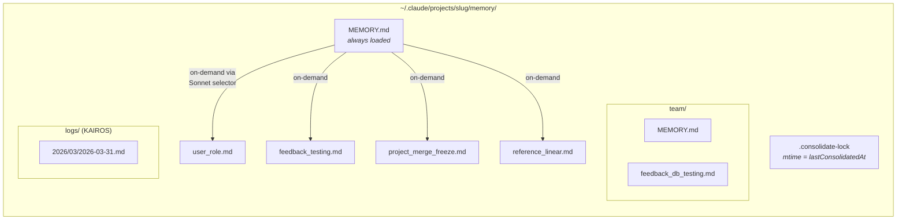
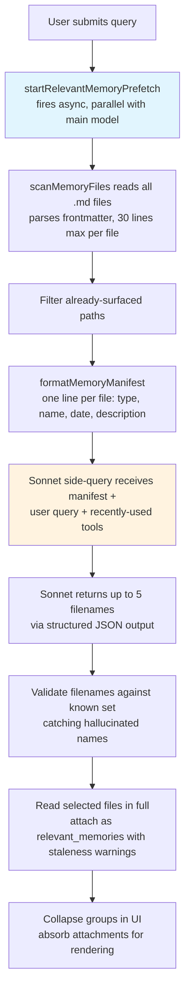
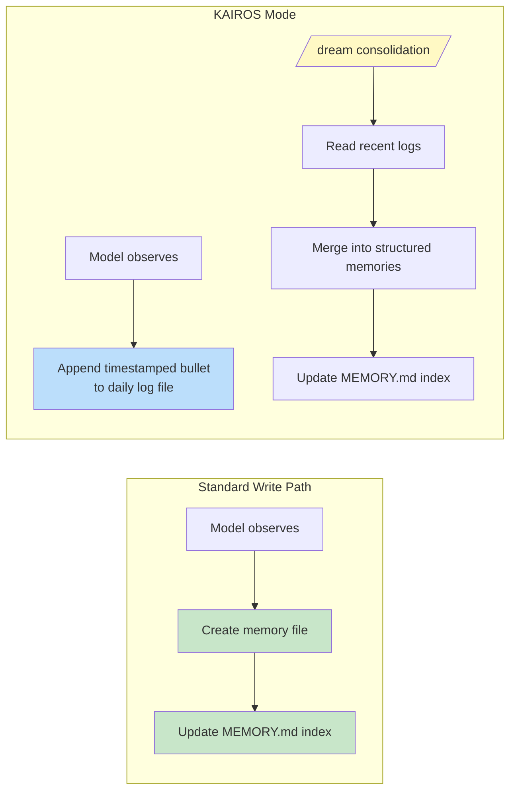

<a id="chapter-11-memory----learning-across-conversations"></a>

# 제11장: 메모리 — 대화를 넘어 이어지는 학습

<a id="the-stateless-problem"></a>

## 무국적 문제

지금까지의 모든 장에서는 단일 세션 내에 존재하는 기계에 대해 설명했습니다. 에이전트 루프가 실행되고, 도구가 실행되고, 하위 에이전트가 조정되고, 프로세스가 종료되면 모든 것이 사라집니다. 다음 대화는 동일한 시스템 프롬프트, 동일한 도구 정의, 동일한 모델로 시작되며 이전에 발생한 일에 대한 지식이 전혀 없습니다.

이것이 무상태 아키텍처의 근본적인 한계입니다. 개발자가 월요일에 모델의 테스트 접근 방식을 수정하고 화요일에 모델이 동일한 실수를 범합니다. 사용자는 자신의 역할, 프로젝트의 제약 사항, 코드 스타일에 대한 선호도를 설명하고 모든 새 세션에서는 이에 대해 다시 설명해야 합니다. 모델은 잊어버리지 않습니다. 결코 알지 못합니다. 각 대화는 독립적인 우주입니다.

문제는 이론적인 것이 아닙니다. 그것은 신뢰를 침식하는 구체적인 방식으로 나타납니다. 사용자가 "우리는 테스트에서 모의 ​​테스트가 아닌 실제 데이터베이스 인스턴스를 사용한다는 점을 기억하세요"라고 말하면 다음 주에 모델이 모의 테스트를 생성합니다. 사용자는 초보자 설명이 필요하지 않은 수석 엔지니어라고 설명하고 다음 세션은 튜토리얼 수준의 연습으로 시작됩니다. 메모리가 없으면 모든 세션은 0에서 시작됩니다. 에이전트은 첫날부터 항상 신입사원입니다.

업계의 표준 솔루션은 RAG(Retrieval-Augmented Generation)입니다. 즉, 문서를 벡터에 삽입하고 이를 벡터 데이터베이스에 저장하며 쿼리 시 관련 청크를 검색합니다. 이는 문서, FAQ, 참조 자료 등 지식 기반에 적합합니다. 그러나 에이전트가 세션 전반에 걸쳐 실제로 기억해야 하는 내용과 구조적으로 일치하지 않습니다. 에이전트의 메모리는 지식 기반이 아닙니다. 이는 사용자가 누구인지, 무엇을 수정했는지, 프로젝트의 현재 제약 사항이 무엇인지, 항목을 찾을 수 있는 곳 등 관찰의 모음입니다. 이러한 관찰은 규모가 작고 자주 변경되며 사람이 편집할 수 있어야 합니다. 벡터 데이터베이스는 잘못된 문제를 해결합니다.

Claude Code의 메모리 시스템은 디스크의 파일, Markdown 형식, LLM 기반 리콜, 인프라 없음 등 완전히 다릅니다. 확실한 것은 저장의 단순성과 검색의 지능이 결합되어 두 가지 모두의 정교함보다 더 나은 시스템을 생성한다는 것입니다.

디자인 철학은 전체 시스템을 형성하는 결과를 가져옵니다.

- **사람이 읽을 수 있음.** Claude Code가 기억하는 내용을 확인하려는 사용자는 텍스트 편집기에서 `~/.claude/projects/<slug>/memory/MEMORY.md`을 열 수 있습니다. 특별한 도구도 없고, 암호 해독도 없고, 내보내기 명령도 없습니다.
- **사람이 편집 가능.** 오래된 메모리는 vim으로 수정할 수 있습니다. `rm`을 사용하면 잘못된 메모리를 삭제할 수 있습니다. 사용자는 에이전트의 지식에 대한 완전한 권한을 갖습니다.
- **버전 관리 가능.** 팀 메모리를 git에 커밋할 수 있습니다. 메모리 변경 사항은 Markdown이므로 완전히 다릅니다.
- **제로 인프라.** 메모리 시스템은 오프라인으로 작동하고 서버 없이 작동하며 파일 시스템이 있는 모든 OS에서 작동합니다. 스키마가 없기 때문에 마이그레이션 경로가 없습니다.
- **디버그 가능.** 메모리가 예기치 않게 작동하는 경우 진단 경로는 쿼리 로그 및 데이터베이스 검사가 아닌 `ls` 및 `cat`입니다.

모델은 소스 코드를 편집하는 데 사용하는 것과 동일한 도구인 `FileWriteTool` 및 `FileEditTool`을 사용하여 메모리를 읽고 씁니다(6장에서 소개). 특별한 메모리 API는 없습니다. 시스템 프롬프트는 모델에 2단계 쓰기 프로토콜(파일 생성, 인덱스 업데이트)을 가르치고 모델은 새로운 지침에 따라 기존 기능을 사용하여 이를 실행합니다. 이는 아키텍처 원칙에 따른 도구 재사용입니다. 즉, 메모리 시스템은 에이전트에 연결된 하위 시스템이 아니라 기존 기능을 사용하는 에이전트의 긴급 동작입니다.

여기에서 파일 기반 선택이 작동하는 더 깊은 이유가 있습니다. AI 에이전트의 메모리는 기존 애플리케이션의 메모리와 근본적으로 다릅니다. 기존 애플리케이션의 데이터베이스는 시스템 데이터의 정보 소스인 신뢰할 수 있는 상태를 유지합니다. 에이전트의 기억에는 *관찰*, 즉 특정 시점에 사실이었으며 여전히 사실일 수도 있고 아닐 수도 있는 것들이 저장됩니다. 파일은 이러한 인식론적 상태를 자연스럽게 전달합니다. 관찰이 기록된 시기를 나타내는 수정 시간이 있습니다. 관찰 내용이 잘못되었음을 아는 사람은 해당 내용을 읽고, 편집하고, 삭제할 수 있습니다. 데이터베이스는 영속성과 권위를 암시합니다. Markdown 파일은 누군가가 적어서 업데이트해야 할 수 있는 메모를 제안합니다. 저장 매체는 데이터의 성격을 전달합니다. 이는 복음이 아닌 작업 노트입니다.

<a id="per-project-scoping"></a>

### 프로젝트별 범위 지정

메모리 범위는 작업 디렉터리가 아닌 git 저장소 루트로 지정됩니다. 사용자가 `src/components/`에서 터미널을 열고 `tests/`에서 다른 터미널을 열면 두 세션 모두 동일한 메모리 디렉터리를 공유합니다. 해결 논리는 먼저 표준 git 루트를 찾은 후 프로젝트 루트로 돌아갑니다.

기본 경로 확인은 먼저 정식 git 루트를 찾아 프로젝트 루트로 돌아갑니다. 이렇게 하면 동일한 저장소의 모든 git 작업 트리가 단일 메모리 디렉터리를 공유하게 됩니다.

`findCanonicalGitRoot` 호출은 동일한 저장소의 모든 git 작업 트리가 단일 메모리 디렉터리를 공유하도록 보장합니다. git 루트는 정리되어(`sanitizePath()`을 통해 슬래시가 대시가 됨) 일반 디렉터리 이름을 생성합니다.

```
~/.claude/projects/-Users-alex-code-myapp/memory/
```

완전히 채워진 메모리 디렉터리는 시스템 구조를 나타냅니다.



명명 규칙은 `<type>_<topic>.md`이라는 의미를 갖습니다. 유형 접두사는 코드에 의해 강제되지 않지만 프롬프트 지침의 일부이므로 디렉토리를 시각적으로 스캔하고 메모리 환경을 쉽게 이해할 수 있습니다.

---

<a id="the-four-type-taxonomy"></a>

## 네 가지 유형의 분류

모든 것이 기억할 가치가 있는 것은 아닙니다. 기억 시스템은 모든 기억을 정확히 네 가지 유형으로 제한합니다.

네 가지 유형은 **사용자**, **피드백**, **프로젝트**, **참조**입니다.

분류는 단일 기준을 중심으로 설계되었습니다. **이 지식은 현재 프로젝트 상태에서 파생될 수 있습니까?** 코드 패턴, 아키텍처, 파일 구조, Git 기록 - 이 모든 것은 코드베이스를 읽어서 다시 파생될 수 있습니다. 그들은 제외됩니다. 네 가지 유형은 다시 파생될 수 없는 것을 포착합니다.

**사용자 메모리**는 역할, 목표, 책임, 전문 지식 수준 등 개인에 대한 정보를 기록합니다. React를 처음 접하는 선임 Go 엔지니어는 초보 프로그래머와 다른 설명을 듣습니다.

**피드백 추억**은 작업에 접근하는 방법(수정 및 확인)에 대한 지침을 포착합니다. 시스템은 모델에 두 가지를 모두 기록하도록 명시적으로 지시합니다. "수정 사항만 저장하면 사용자가 이미 검증한 접근 방식에서 벗어나게 됩니다." 각 피드백 메모리에는 규칙 자체, 이유(주로 과거 사건)가 포함된 `**Why:**` 라인, 트리거 조건이 포함된 `**How to apply:**` 라인 등 특정 구조가 있습니다.

**프로젝트 메모리**는 누가 무엇을, 왜, 언제까지 하는지 등 진행 중인 작업 상황을 기록합니다. 프롬프트에서는 상대 날짜를 절대 날짜로 변환하는 것을 강조합니다. "목요일"은 "2026-03-05"가 되므로 메모리는 몇 주 후에도 해석 가능한 상태로 유지됩니다.

**참조 메모리**는 북마크입니다. 즉, 외부 시스템에 정보가 있는 위치를 가리키는 포인터입니다. 선형 프로젝트 URL, Grafana 대시보드, Slack 채널. 이는 모델에게 무엇을 찾아야 하는지가 아니라 어디를 봐야 하는지 알려줍니다.

<a id="the-taxonomy-as-filter"></a>

### 필터로서의 분류

네 가지 유형은 단순한 카테고리가 아니라 필터입니다. 메모리로 간주되는 것을 정확하게 정의함으로써 시스템은 메모리로 간주되지 않는 것을 암시적으로 정의합니다. 분류가 없으면 Eager 모델은 코드 패턴, 아키텍처 다이어그램, 오류 메시지 등 모든 것을 저장합니다. 모두 코드베이스에서 파생됩니다. 이를 저장하면 원본에서 더 나은 소스로 제공되는 병렬적이고 잠재적으로 오래된 정보 복사본이 생성됩니다.

분류법은 또한 기억력을 버팀목으로 삼는 미묘한 실패를 방지합니다. 모델이 아키텍처 결정을 메모리로 저장하면 아키텍처를 이해하기 위해 코드베이스 읽기를 중단합니다. 파생 가능한 정보를 제외함으로써 시스템은 모델이 현재 코드 상태를 유지하도록 강제합니다.

제외 목록은 코드 패턴, Git 기록, 디버깅 솔루션, CLAUDE.md의 모든 항목, 임시 작업 세부정보 등 명시적입니다. 이러한 제외는 사용자가 명시적으로 저장을 요청하는 경우에도 적용됩니다. 사용자가 "이 PR 목록을 기억하세요"라고 말하면 모델은 "그것에 대해 *놀랐거나* *불분명한* 내용은 무엇이었습니까?"라는 메시지를 뒤로 보내도록 지시받습니다. 그 놀라운 부분은 간직할 가치가 있습니다. 원시 목록은 그렇지 않습니다. 이 명령어는 제외 재정의 명령어가 추가되었을 때 0/2에서 3/3까지 진행되는 평가를 통해 검증되었습니다.

<a id="frontmatter-as-contract"></a>

### 계약서로서의 머리말

모든 메모리 파일은 세 가지 필수 필드가 있는 YAML 머리말을 사용합니다.

```markdown
---
name: {{memory name}}
description: {{one-line description -- used to decide relevance}}
type: {{user, feedback, project, reference}}
---
```

`description`은 가장 부하를 많이 받는 필드입니다. 이는 관련성 선택기(아래에서 설명하는 Sonnet 부가 쿼리)가 이 메모리를 표시할지 여부를 결정하는 데 사용하는 것입니다. "테스트 내용"과 같은 모호한 설명은 너무 광범위하게 일치하거나 전혀 일치하지 않습니다. "통합 테스트는 모의가 아닌 실제 DB에 도달해야 합니다. 모의 발산 Q4로 인해 소모됩니다."와 같은 구체적인 설명은 중요한 대화와 정확히 일치합니다. 설명은 검색 엔진이 아닌 뉘앙스, 맥락 및 의도를 이해할 수 있는 언어 모델이 사용하는 메모리의 검색 색인입니다.

머리말은 또한 스캐닝 시스템이 불러오는 동안 읽는 파일의 유일한 부분이기도 합니다. `scanMemoryFiles()`은 각 파일을 처음 30줄까지 읽어 헤더를 추출합니다. 파일이 명시적으로 선택되어 로드될 때까지 본문은 비공개입니다.

---

<a id="the-write-path"></a>

## 쓰기 경로

메모리 쓰기는 표준 파일 도구를 사용하여 실행되는 2단계 프로세스입니다.

**1단계: 메모리 파일 쓰기.** 모델은 YAML 앞부분을 사용하여 메모리 디렉터리에 `.md` 파일을 생성합니다.

```markdown
---
name: Testing Policy
description: Integration tests must hit real DB, not mocks
type: feedback
---

Don't mock the database in integration tests.

**Why:** We got burned last quarter when mocked tests passed but production
queries hit edge cases the mocks didn't cover.

**How to apply:** Any test file under `__tests__/` that touches database
operations should use the real PGlite instance from test-utils.
```

**2단계: 인덱스 업데이트.** 모델은 `MEMORY.md`에 한 줄 포인터를 추가합니다.

```markdown
- [Testing Policy](feedback_testing.md) -- integration tests must hit real DB
```

각 항목은 약 150자 미만이어야 합니다. 색인은 지식 기반이 아닌 목차입니다.

모델이 기존 메모리를 수정하는 새로운 정보를 학습하면 복제본을 생성하는 대신 `FileEditTool`을 사용하여 기존 파일을 업데이트합니다. 시스템은 내부적으로 메모리 버전을 지정하지 않습니다. 파일은 로컬 파일 시스템에 있고 사용자는 버전 관리를 원하는 경우 `git`을 갖습니다. 프롬프트가 작성되기 전에 `ensureMemoryDirExists()`은 메모리 디렉토리를 생성하고 프롬프트는 모델에 디렉토리가 이미 존재함을 알려주므로 `ls` 및 `mkdir -p`에 대한 낭비를 방지합니다.

---

<a id="the-recall-path"></a>

## 리콜 경로

추억을 쓰는 것은 필요하지만 충분하지는 않습니다. 더 어려운 문제는 검색입니다. 사용자의 쿼리가 주어지면 잠재적으로 수백 개의 메모리 파일 중 어떤 파일을 모델의 컨텍스트에 로드해야 할까요? 모두 로드하면 토큰 예산이 소진됩니다. 아무것도 로드하지 않으면 목적이 무산됩니다. 잘못된 정보를 로드하면 관련 없는 정보에 토큰이 낭비되고 모델의 동작을 변경하는 지식이 누락됩니다.

리콜 시스템은 두 가지 계층으로 운영됩니다. `MEMORY.md` 인덱스는 항상 세션 시작 시 컨텍스트에 로드되어 방향을 제공합니다. 개별 메모리 파일은 턴당 최대 5개의 메모리를 선택하는 LLM 기반 관련성 쿼리를 통해 요청 시 표시됩니다.

<a id="the-full-recall-pipeline"></a>

### 전체 리콜 파이프라인



2단계의 비동기 프리페치가 핵심 성능 결정입니다. 기본 모델이 회상된 컨텍스트가 유용한 지점에 도달할 때쯤이면 일반적으로 보조 쿼리가 이미 완료됩니다. 사용자는 추가 대기 시간을 경험하지 않습니다.

<a id="the-sonnet-side-query"></a>

### 소네트 부가 쿼리

매니페스트는 부가 쿼리로 Sonnet 모델에 전송됩니다. 이 선택기에 대한 시스템 프롬프트는 정확합니다.

선택기에 대한 시스템 프롬프트는 보수적으로 지시합니다. 즉, 현재 쿼리에 유용한 메모리만 포함하고, 불확실한 경우 메모리를 건너뛰고, 이미 사용 중인 도구에 대한 API/사용 문서를 선택하지 마십시오(모델에 이미 해당 도구가 로드되어 있으므로). 하지만 여전히 해당 도구에 대한 경고, 문제점 또는 알려진 문제가 표시됩니다.

응답은 구조화된 출력(`{ selected_memories: string[] }`)을 사용하고 파일 이름은 알려진 세트에 대해 검증됩니다.

이 접근 방식은 지연 시간을 정밀도로 바꾸며 절충 분석은 유익합니다. **키워드 대조**은 빠르지만 맥락을 이해하지 못합니다. "이미 사용 중인 도구에 대한 메모리를 선택하지 마십시오"라고 표현할 수 없습니다. **임베딩 유사성**은 의미론적 일치를 처리하지만 인프라(임베딩 모델, 벡터 저장소, 업데이트 파이프라인)를 도입하고 부정 문제로 어려움을 겪습니다. "데이터베이스 모의 사용 안 함" 임베딩은 "데이터베이스 모의 사용"과 매우 유사합니다. **Sonnet 사이드 쿼리**는 의미적 관련성과 컨텍스트에 대한 이유를 이해하고 부정을 처리하며 인프라가 필요하지 않습니다. 대기 시간 비용은 제한되어 있으며(수백 밀리초) 기본 모델의 초기 처리 뒤에 숨겨져 있습니다.

원격 측정 시스템은 메모리가 선택되지 않은 경우에도 선택 속도를 추적합니다. 0/150의 선택률은 0/3과 다른 의미입니다. 첫 번째는 정밀도 문제를 나타내고 두 번째는 적용 범위 문제를 나타냅니다.

---

<a id="staleness"></a>

## 부실함

부실 시스템은 실제 사용에서 발생한 오류 모드를 해결합니다. 사용자들은 변경된 코드에 대한 파일:라인 인용을 포함하는 오래된 기억이 모델에 의해 사실로 주장되고 있다고 보고했습니다. 인용으로 인해 진부한 주장이 *더* 권위 있게 들리게 되었습니다.

해결책은 만료가 아닙니다. 오래된 추억은 삭제되지 않습니다. 수년간 유효한 제도적 지식이 포함될 수 있습니다. 대신 시스템은 연령 경고를 첨부합니다.

staleness 함수는 메모리의 수명을 일 단위로 계산합니다. 오늘이나 어제의 추억에는 경고가 표시되지 않습니다(함수는 빈 문자열을 반환합니다). 오래된 모든 것에는 메모리 콘텐츠와 함께 주의 사항이 주입됩니다. 즉, 수명을 일 단위로 명시하고 코드 동작 주장 또는 파일:라인 인용이 오래되었을 수 있다는 경고 메시지를 표시하여 현재 코드에 대한 검증을 권고합니다.

오늘이나 어제의 추억에는 경고가 없습니다. 오래된 모든 것에는 메모리 콘텐츠와 함께 부실 경고가 주입됩니다. 사람이 읽을 수 있는 형식("오늘", "어제", "47일 전")은 모델이 날짜 계산에 능숙하지 않기 때문에 존재합니다. 원시 ISO 타임스탬프는 "47일 전"과 같은 방식으로 부실 추론을 유발하지 않습니다. 이는 평가를 통해 검증된 모델 동작에 대한 실증적 관찰입니다. 동일한 본문 텍스트를 사용하여 "기억에서 추천하기 전"의 액션 큐 프레이밍은 3/3 대 0/3의 더 추상적인 "기억하는 내용 신뢰"에 대해 점수를 매겼습니다.

명명할 가치가 있는 철학적 긴장이 있습니다. 진부함 시스템은 기억을 사실이 아닌 가설로 취급합니다. 그러나 모델의 자연스러운 경향은 정보를 자신있게 제시하는 것입니다. 부실 경고는 모델 자신의 목소리에 맞서 싸우는 것입니다. 지침을 따르는 기능을 사용하여 신뢰 생성 경향을 무시하는 것입니다.

---

<a id="memorymd-as-the-always-loaded-index"></a>

## 항상 로드되는 인덱스인 MEMORY.md

모든 대화는 맥락상 `MEMORY.md`으로 시작됩니다. 그것은 메모리가 아닙니다. 실제 메모리 파일에 대한 목차인 색인입니다.

인덱스에는 두 가지 하드 캡이 있습니다.

인덱스에는 200줄과 25,000바이트라는 두 가지 하드 캡이 있습니다.

200라인 캡은 정상적인 성장을 잡아줍니다. 25KB 바이트 제한은 관찰된 실패 모드를 포착합니다. 사용자는 200줄 미만으로 유지되지만 막대한 토큰 예산을 소비하는 긴 줄을 포장합니다. 97번째 백분위수에서 라인이 197개뿐인 MEMORY.md의 무게는 197KB였습니다. 두 가지 제한 중 하나가 실행되면 실행 가능한 지침이 사용자에게 수정 사항을 알려줍니다. "인덱스 항목을 최대 200자 미만의 한 줄로 유지하고 세부 정보를 주제 파일로 이동하세요."

가벼운 Always-On 인덱스와 대용량 온디맨드 콘텐츠로 구성된 이 2계층 아키텍처는 메모리 확장을 가능하게 하는 설계입니다. 150개의 메모리가 있는 프로젝트에는 100,000개의 토큰을 소비하는 150개의 전체 파일이 아니라 약 3,000개의 토큰을 소비하는 150줄의 인덱스가 있습니다.

---

개인의 기억에서 공유된 지식으로의 전환은 자연스러운 일입니다. 테스트 정책, 배포 규칙, 빌드 시스템의 알려진 문제점 등은 팀 전체에서 공유되어야 합니다.

<a id="team-memory"></a>

## 팀 메모리

팀 메모리는 `<autoMemPath>/team/`에 있는 자동 메모리 디렉터리의 하위 디렉터리로, 기능 플래그 뒤에 게이트되어 있으며 자동 메모리를 활성화해야 합니다. 아키텍처 중첩은 의도적인 것입니다. 자동 메모리를 비활성화하면 팀 메모리가 일시적으로 비활성화됩니다.

<a id="defense-in-depth"></a>

### 심층 방어

팀 메모리는 개인 메모리에는 없는 공격 표면을 도입합니다. 팀 동기화 파일은 다른 사용자로부터 제공되며 악의적인 팀원이 경로 탐색을 시도할 수 있습니다. 보안 모델은 세 가지 방어 계층을 사용합니다.

**계층 1: 입력 삭제.** `sanitizePathKey()` 함수는 null 바이트, URL 인코딩 순회(`%2e%2e%2f`), 유니코드 정규화 공격(`../`으로 정규화되는 전자 문자), 백슬래시 및 절대 경로에 대해 유효성을 검사합니다.

**레이어 2: 문자열 수준 경로 유효성 검사.** 삭제 후 `path.resolve()`은 나머지 `..` 세그먼트를 정규화하고 확인된 경로는 팀 디렉터리 접두사(`team-evil/`이 `team/`과 일치하지 않도록 후행 구분 기호 포함)와 비교하여 확인됩니다.

**계층 3: Symlink 확인.** `realpathDeepestExisting()`은 가장 깊은 기존 상위 항목에 대한 Symlink를 확인하여 문자열 수준 검증에서 감지할 수 없는 공격을 포착합니다. `team/evil`이 `/etc/`을 가리키는 심볼릭 링크인 경우 문자열 유효성 검사는 유효한 접두사를 확인하지만 `realpath`은 실제 대상을 나타냅니다.

모든 검증 실패는 `PathTraversalError`을 생성합니다. 부분적인 성공도 없고 대체도 없습니다. 실패가 닫혔습니다.

<a id="scope-guidance"></a>

### 범위 지침

프롬프트는 개인 메모리와 공유 메모리에 대한 모델을 가르칩니다. 사용자 메모리는 항상 비공개입니다. 참조 기억은 일반적으로 팀입니다. 피드백 메모리는 프로젝트 전체 규칙을 나타내지 않는 한 기본적으로 비공개입니다. "개인 피드백 메모리를 저장하기 전에 팀 피드백 메모리와 모순되지 않는지 확인하십시오"라는 교차 확인 지침은 어떤 메모리가 먼저 호출되는지에 따라 충돌하는 지침이 예기치 않게 나타나는 것을 방지합니다.

---

<a id="kairos-mode-append-only-daily-logs"></a>

## KAIROS 모드: 일일 로그 추가만 가능

표준 메모리는 개별 세션을 가정합니다. KAIROS 모드(Claude Code의 보조 모드)는 이러한 가정을 깨뜨립니다. 세션은 오래 지속되며 잠재적으로 며칠 동안 실행될 수 있습니다. 2단계 쓰기 패턴은 연속 작업으로 확장되지 않습니다.

해결책은 캡처와 통합을 구조적으로 분리하는 것입니다.



KAIROS 모드에서는 모델이 날짜 이름의 로그 파일(`<autoMemPath>/logs/YYYY/MM/YYYY-MM-DD.md`)에 추가됩니다. 각 항목은 타임스탬프가 짧은 글머리 기호입니다. 모델에는 "로그를 다시 작성하거나 재구성하지 마십시오"라는 지시가 있습니다. 캡처 중 구조 조정은 통합에 필요한 시간순 신호를 잃습니다.

프롬프트의 경로는 실제 날짜가 아닌 *패턴*으로 설명됩니다. 이는 캐싱 최적화입니다. 날짜가 자정에 변경될 때 메모리 프롬프트가 캐시되고 무효화되지 않습니다. 이 모델은 별도의 `date_change` 첨부 파일에서 현재 날짜를 파생합니다.

<a id="the-dream-consolidation"></a>

### /꿈 통합

통합은 **Orient**(디렉터리 나열, 색인 읽기, 기존 파일 훑어보기), **수집**(로그 검색, 표류된 메모리 확인), **통합**(파일 쓰기 또는 업데이트, 복제 대신 병합), **정리**(200줄 미만의 색인 업데이트, 오래된 포인터 제거)의 4단계로 실행됩니다. 새 파일을 만드는 것보다 기존 파일을 병합하는 데 중점을 두는 것이 중요합니다. 그렇지 않으면 메모리 디렉터리가 사용량에 따라 선형적으로 증가합니다.

<a id="the-consolidation-lock"></a>

### 통합 잠금

잠금 파일 `.consolidate-lock`은 두 가지 목적으로 사용됩니다. 해당 콘텐츠는 보유자의 PID(상호 배제)이고 mtime은 `lastConsolidatedAt`(스케줄링 상태)입니다. 가장 저렴한 것부터 평가되는 세 개의 게이트를 통과하면 자동 드림이 실행됩니다. 즉, 마지막 통합 이후 시간이 24를 초과하고 그 이후 수정된 세션이 5를 초과하며 다른 프로세스가 잠금을 보유하지 않을 때 발생합니다. 충돌 복구는 `process.kill(pid, 0)`을 통해 작동하지 않는 PID를 감지하며, PID 재사용을 방지하기 위해 1시간의 비활성 시간 제한을 적용합니다.

---

<a id="background-extraction"></a>

## 배경 추출

주체는 능동적으로 기억을 쓰기 위한 전체 지침을 가지고 있습니다. 그러나 에이전트는 불완전하며 그 불완전성은 예측 가능합니다. 사용자가 "항상 통합 테스트를 사용하는 것을 기억하세요"라고 말한 다음 즉시 "이제 로그인 버그를 수정하세요"라고 묻는 경우 모델의 관심은 전적으로 버그로 이동합니다. 메모리 절약 명령이 처리되었지만 실행되지 않을 수 있습니다.

각 완전한 쿼리 루프가 끝나면 분기된 에이전트(상위 프롬프트 캐시를 공유함)가 최근 메시지를 분석하고 기본 에이전트가 놓친 모든 메모리를 기록합니다. 현재 턴 범위에서 주체가 이미 메모리를 쓴 경우 추출 에이전트는 해당 범위를 건너뜁니다. 추출 에이전트에는 제한된 도구 예산이 있습니다. 즉, 읽기 전용 도구와 메모리 디렉터리 경로에 대한 쓰기 액세스만 가능합니다. 프롬프트는 2턴 전략을 지시합니다. 즉, 1턴은 병렬로 읽고, 2턴은 병렬로 씁니다.

상호작용은 경쟁적이 아니라 협력적입니다. 주 에이전트의 프롬프트에는 항상 전체 저장 지침이 포함되어 있습니다. 주 에이전트가 저장하면 백그라운드 에이전트가 연기합니다. 그렇지 않은 경우 백그라운드 에이전트가 격차를 포착합니다. 백그라운드 안전망이 있는 기본 경로인 이 패턴은 기본 상호 작용에 부담을 주지 않고 메모리 캡처를 더욱 안정적으로 만듭니다. 어느 것 하나만으로는 충분하지 않습니다.

---

<a id="path-resolution-and-security"></a>

## 경로 확인 및 보안

자동 메모리 경로는 우선 순위 체인을 통해 해결됩니다.

1. **`CLAUDE_COWORK_MEMORY_PATH_OVERRIDE`** -- Cowork의 전체 경로 재정의.
2. **settings.json의 `autoMemoryDirectory`** -- 신뢰할 수 있는 설정 소스만. 프로젝트 설정은 의도적으로 제외됩니다.
3. **기본 계산 경로** -- `~/.claude/projects/<sanitized-git-root>/memory/`.

프로젝트 설정을 제외하는 것은 보안상의 결정입니다. 악의적인 저장소는 `autoMemoryDirectory: "~/.ssh"`으로 `.claude/settings.json`을 커밋할 수 있으며, 메모리 파일에 대한 권한 분할은 모델에 SSH 키에 대한 자동 쓰기 액세스 권한을 부여합니다. 재정의를 정책, 플래그, 로컬 및 사용자 설정(저장소에 커밋할 수 없는 설정)으로 제한함으로써 이 공격 벡터는 폐쇄됩니다.

`isAutoMemPath()` 함수는 순회를 방지하기 위해 접두사 확인 전에 경로를 정규화하고 후행 구분 기호 규칙은 접두사 일치에 디렉터리 경계가 필요하도록 보장합니다.

<a id="the-enabledisable-chain"></a>

### 활성화/비활성화 체인

자동 메모리가 활성화되는지 여부는 `isAutoMemoryEnabled()`에 의해 결정되며 자체 우선 순위 체인(환경 변수, 베어 모드, 영구 저장소가 없는 CCR, 설정, 기본 활성화)을 구현합니다. 비활성화되면 프롬프트 섹션이 삭제되고(모델이 메모리 지침을 받지 않음) 백그라운드 프로세스가 중지됩니다(메모리 추출, 자동 드림, 팀 동기화). 두 게이트 모두 정렬되어야 합니다. 프롬프트를 제거하는 것만으로는 자체 프롬프트가 있는 추출 에이전트가 중지되지 않습니다.

---

<a id="apply-this-designing-agent-memory"></a>

## 적용: 에이전트 메모리 설계

메모리 시스템의 복잡성은 스토리지 인프라가 아닌 행동 계층(즉시 지침, LLM 기반 리콜, 부실 관리, 배경 추출)에 있습니다. 이러한 복잡성 분포는 그 자체로 디자인 원칙입니다.

**파일은 에이전트 메모리에 비해 데이터베이스보다 낫습니다.** 파일은 검사, 편집 및 버전 제어가 가능합니다. 투명성은 신뢰를 구축합니다. 대안이 사용자가 쉽게 읽을 수 없는 데이터베이스인 경우 파일은 신뢰만으로 승리합니다.

**어떻게 저장할 것인지가 아니라 무엇을 저장할 것인지 제한합니다.** 파생 가능성 테스트 - 이 지식을 현재 프로젝트 상태에서 다시 파생할 수 있습니까? -- 실제로 중요한 기억을 보존하면서 잠재적인 기억의 대부분을 제거합니다.

**키워드나 임베딩이 아닌 회상을 위해 LLM을 사용합니다.** LLM 보조 쿼리는 대화에서 이미 사용 가능한 항목에 대한 컨텍스트와 이유를 이해하고 부정을 처리하며 인덱스 유지 관리가 필요하지 않습니다. 대기 시간 비용은 실제적이지만 주 모델 처리 뒤에 제한되어 숨겨져 있습니다.

**부실함을 경고하고 만료하지 마십시오.** 기관의 지식은 수년간 유효한 상태로 유지될 수 있습니다. 연령 경고를 첨부하면 모델이 오래된 기억을 사실이 아닌 가설로 처리할 수 있습니다. 사람이 읽을 수 있는 연령 형식은 원시 타임스탬프와는 달리 올바른 추론을 촉발합니다.

**포획을 위한 안전망을 구축하세요.** 주인공은 기억을 놓치게 됩니다. 최근 대화를 검토하는 백그라운드 추출 에이전트는 기본 상호작용에 부담을 주지 않으면서 시스템의 안정성을 높여줍니다. 주 에이전트가 저장하면 백그라운드 에이전트가 연기합니다.

---

이제 에이전트는 세션 전반에 걸쳐 학습하여 사용자, 선호도, 프로젝트 상태 및 수정 사항에 대한 지식을 축적할 수 있습니다. 메모리 시스템은 에이전트와 사용자의 관계가 모든 상호 작용에서 재설정되는 것이 아니라 시간이 지남에 따라 깊어져야 한다는 철학적 약속을 합니다. 파일 기반 구현을 통해 해당 약속이 디스크에 표시되고 사람이 편집할 수 있으며 코드와 함께 버전 관리가 가능해집니다. 요원의 기억은 블랙박스가 아니다. 이는 모델과 인간 모두가 읽을 수 있는 언어로 작성된 폴더의 메모 모음입니다.

다음 장에서는 Claude Code가 코어 이상으로 기능을 확장하는 방법, 즉 모델에 새로운 동작을 가르치는 기술 시스템과 외부 코드가 20개가 넘는 라이프사이클 지점에서 이러한 동작을 제한하고 수정할 수 있도록 하는 훅 시스템을 살펴봅니다.
