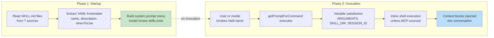
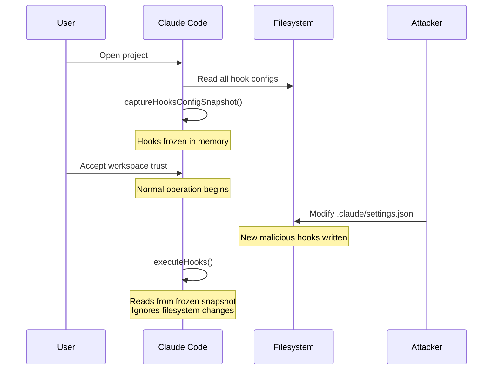
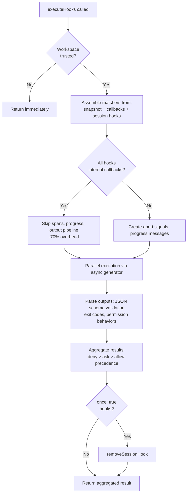

<a id="chapter-12-extensibility----skills-and-hooks"></a>

# 제12장: 확장성 — 스킬과 훅

<a id="two-dimensions-of-extension"></a>

## 확장의 두 가지 차원

모든 확장성 시스템은 두 가지 질문, 즉 시스템이 무엇을 할 수 있는지, 언제 수행하는지에 대한 답을 제공합니다. 대부분의 프레임워크는 이 두 가지를 통합합니다. 즉, 플러그인은 동일한 개체에 기능과 수명 주기 콜백을 모두 등록하고 "기능 추가"와 "기능 가로채기" 사이의 경계가 단일 등록 API로 모호해집니다.

Claude Code는 이들을 깔끔하게 분리합니다. 기술은 모델이 수행할 수 있는 작업을 확장합니다. 슬래시 명령이 되는 마크다운 파일로, 호출 시 대화에 새로운 지침을 삽입합니다. 훅은 언제, 어떻게 일이 발생하는지 확장합니다. 이는 세션 중에 20개가 넘는 개별 지점에서 실행되어 작업을 차단하고, 입력을 수정하고, 강제로 계속하거나 자동으로 관찰할 수 있는 임의 코드를 실행하는 수명 주기 인터셉터입니다.

이별은 우연이 아니다. 기술은 콘텐츠입니다. 프롬프트 텍스트를 추가하여 모델의 지식과 기능을 확장합니다. 훅은 제어 흐름입니다. 모델이 알고 있는 내용을 변경하지 않고 실행 경로를 수정합니다. 기술은 팀의 배포 프로세스를 실행하는 방법을 모델에 가르칠 수 있습니다. 훅은 테스트 도구 모음을 통과하지 않고는 배포 명령이 실행되지 않도록 보장할 수 있습니다. 스킬은 능력을 추가합니다. 훅은 제약 조건을 추가합니다.

이 장에서는 두 시스템을 모두 자세히 다룬 다음 교차하는 위치, 즉 기술이 호출될 때 세션 범위 수명 주기 인터셉터로 등록되는 기술 선언 훅을 조사합니다.

---

<a id="skills-teaching-the-model-new-tricks"></a>

## 기술: 모델에게 새로운 기술 가르치기

<a id="two-phase-loading"></a>

### 2단계 로딩

스킬 시스템의 핵심 최적화는 시작 시 머리말이 로드되지만 전체 콘텐츠는 호출 시에만 로드된다는 것입니다.



**1단계**에서는 각 `SKILL.md` 파일을 읽고 마크다운 본문에서 YAML 머리말을 분할한 다음 메타데이터를 추출합니다. 머리말 필드는 시스템 프롬프트의 일부가 되므로 모델은 스킬이 존재한다는 것을 알 수 있습니다. 마크다운 본문은 클로저에 캡처되지만 처리되지는 않습니다. 50개의 기술이 있는 프로젝트는 50개의 전체 문서가 아닌 50개의 간단한 설명에 대한 토큰 비용을 지불합니다.

**2단계**는 모델이나 사용자가 기술을 호출할 때 실행됩니다. `getPromptForCommand`은 기본 디렉터리 앞에 추가하고, 변수(`$ARGUMENTS`, `${CLAUDE_SKILL_DIR}`, `${CLAUDE_SESSION_ID}`)를 대체하고, 인라인 셸 명령(`!`이 앞에 붙은 백틱)을 실행합니다. 결과는 대화에 삽입된 콘텐츠 블록으로 반환됩니다.

<a id="seven-sources-with-priority"></a>

### 우선순위가 있는 7가지 소스

기술은 7개의 서로 다른 소스에서 제공되며 병렬로 로드되고 우선순위에 따라 병합됩니다.

| 우선순위 | 소스 | 위치 | 메모 |
|----------|--------|----------|-------|
| 1 | 관리형(정책) | `<MANAGED_PATH>/.claude/skills/` | 기업이 통제하는 |
| 2 | 사용자 | `~/.claude/skills/` | 개인용, 어디서나 사용 가능 |
| 3 | 프로젝트 | `.claude/skills/`(집까지 걸어서 이동) | 버전 관리에 체크인했습니다 |
| 4 | 추가 디렉토리 | `<add-dir>/.claude/skills/` | `--add-dir` 플래그를 통해 |
| 5 | 레거시 명령 | `.claude/commands/` | 이전 버전과 호환 가능 |
| 6 | 번들로 제공 | 바이너리로 컴파일됨 | 기능 제한 |
| 7 | MCP | MCP 서버 프롬프트 | 원격, 신뢰할 수 없음 |

중복 제거는 `realpath`을 사용하여 심볼릭 링크와 겹치는 상위 디렉터리를 해결합니다. 먼저 본 소스가 승리합니다. `getFileIdentity` 함수는 컨테이너/NFS 마운트 및 ExFAT에서 신뢰할 수 없는 inode 값에 의존하는 대신 `realpath`을 통해 정식 경로를 확인합니다.

<a id="the-frontmatter-contract"></a>

### 머리말 계약

기술 행동을 제어하는 주요 머리말 필드:

| YAML 필드 | 목적 |
|-----------|---------|
| `name` | 사용자에게 표시되는 표시 이름 |
| `description` | 자동 완성 및 시스템 프롬프트에 표시됨 |
| `when_to_use` | 모델 검색을 위한 자세한 사용 시나리오 |
| `allowed-tools` | 스킬이 사용할 수 있는 도구 |
| `disable-model-invocation` | 자율모델 사용 차단 |
| `context` | 하위 에이전트로 실행하려면 `'fork'` |
| `hooks` | 호출 시 등록된 수명 주기 훅 |
| `paths` | 조건부 활성화를 위한 Glob 패턴 |

`context: 'fork'` 옵션은 자체 컨텍스트 창을 사용하여 하위 에이전트로 스킬을 실행합니다. 이는 기본 대화의 토큰 예산을 오염시키지 않고 상당한 작업이 필요한 스킬에 필수적입니다. `disable-model-invocation` 및 `user-invocable` 필드는 두 개의 서로 다른 액세스 경로를 제어합니다. 둘 다 true로 설정하면 스킬이 보이지 않게 되고 훅 전용 스킬에 유용합니다.

<a id="the-mcp-security-boundary"></a>

### MCP 보안 경계

변수 대체 후 인라인 셸 명령이 실행됩니다. 보안 경계는 절대적입니다. **MCP 기술은 인라인 셸 명령을 실행하지 않습니다.** MCP 서버는 외부 시스템입니다. `` !`rm -rf /` ``을 포함하는 MCP 프롬프트는 허용되는 경우 사용자의 전체 권한으로 실행됩니다. 시스템은 MCP 기술을 콘텐츠로만 처리합니다. 이 신뢰 경계는 15장에서 설명한 더 광범위한 MCP 보안 모델에 연결됩니다.

<a id="dynamic-discovery"></a>

### 동적 검색

스킬은 시작 시에만 로드되는 것이 아닙니다. 모델이 파일에 접근하면 `discoverSkillDirsForPaths`은 `.claude/skills/` 디렉터리를 찾기 위해 각 경로에서 이동합니다. `paths` 프론트매터가 있는 스킬은 `conditionalSkills` 맵에 저장되며 터치된 경로가 패턴과 일치할 때만 활성화됩니다. `paths: "packages/database/**"`을 선언하는 기술은 모델이 데이터베이스 파일을 읽거나 편집할 때까지 보이지 않는 상태로 유지됩니다. 즉, 상황에 맞는 기능 확장입니다.

---

<a id="hooks-controlling-when-things-happen"></a>

## Hooks: 상황이 발생하는 시점 제어

훅은 수명 주기 지점에서 동작을 가로채고 수정하기 위한 Claude Code의 메커니즘입니다. 주요 실행 엔진은 4,900라인을 초과합니다. 시스템은 개인 개발자(사용자 정의 Linting, 검증), 팀(프로젝트에 체크인된 공유 품질 게이트) 및 기업(정책 관리 규정 준수 규칙)의 세 가지 대상을 제공합니다.

<a id="a-real-world-hook-preventing-commits-to-main"></a>

### 실제 훅: Main에 대한 커밋 방지

기계에 뛰어들기 전에 훅가 실제로 어떻게 보이는지 살펴보세요. 팀에서 모델이 `main` 브랜치에 직접 커밋되는 것을 방지하려고 한다고 가정해 보겠습니다.

**1단계: settings.json 구성:**

```json
{
  "hooks": {
    "PreToolUse": [
      {
        "matcher": "Bash",
        "hooks": [
          {
            "type": "command",
            "command": "/path/to/check-not-main.sh",
            "if": "Bash(git commit*)"
          }
        ]
      }
    ]
  }
}
```

**2단계: 쉘 스크립트:**

```bash
#!/bin/bash
BRANCH=$(git rev-parse --abbrev-ref HEAD 2>/dev/null)
if [ "$BRANCH" = "main" ]; then
  echo "Cannot commit directly to main. Create a feature branch first." >&2
  exit 2  # Exit 2 = blocking error
fi
exit 0
```

**3단계: 모델이 경험하는 것.** 모델이 `main` 분기에서 `git commit`을 시도하면 명령이 실행되기 전에 훅가 실행됩니다. 스크립트는 분기를 확인하고 stderr에 쓴 다음 코드 2로 종료합니다. 모델은 "기본에 직접 커밋할 수 없습니다. 먼저 기능 분기를 생성하십시오."라는 시스템 메시지를 확인합니다. 커밋은 실행되지 않습니다. 모델은 분기를 생성하고 대신 거기에서 커밋합니다.

`if: "Bash(git commit*)"` 조건은 스크립트가 모든 Bash 호출이 아닌 git 커밋 명령에 대해서만 실행됨을 의미합니다. 종료 코드 2 블록; 종료 코드 0이 통과됩니다. 다른 종료 코드는 비차단 경고를 생성합니다. 이것이 완전한 프로토콜입니다.

<a id="four-user-configurable-types"></a>

### 사용자가 구성할 수 있는 4가지 유형

Claude Code는 6가지 훅 유형(사용자 구성 가능 4가지, 내부 2가지)을 정의합니다.

**명령 훅**는 셸 프로세스를 생성합니다. 훅 입력 JSON은 stdin으로 파이프됩니다. 훅은 종료 코드와 stdout/stderr을 통해 다시 통신합니다. 이것은 일하는 유형입니다.

**프롬프트 훅**는 단일 LLM 호출을 만들어 `{"ok": true}` 또는 `{"ok": false, "reason": "..."}`을 반환합니다. 전체 에이전트 루프가 없는 경량 AI 기반 검증.

**에이전트 훅**는 다중 턴 에이전트 루프를 실행합니다(최대 50턴, `dontAsk` 권한, 사고 비활성화). 각각은 자체 세션 범위를 갖습니다. 이것은 "테스트 스위트가 새로운 기능을 통과하고 포함하는지 확인"하기 위한 중장비입니다.

**HTTP 훅** 훅 입력을 URL에 게시합니다. 로컬 프로세스 생성 없이 원격 정책 서버 및 감사 로깅을 활성화합니다.

두 가지 내부 유형은 **콜백 훅**(프로그래밍 방식으로 등록됨, 범위 추적을 건너뛰는 빠른 경로를 통해 핫 경로에서 -70% 오버헤드)와 **함수 훅**(에이전트 훅에서 구조화된 출력 적용을 위한 세션 범위 TypeScript 콜백)입니다.

<a id="the-five-most-important-lifecycle-events"></a>

### 가장 중요한 5가지 수명주기 이벤트

훅 시스템은 24개가 넘는 수명 주기 지점에서 실행됩니다. 다섯 가지가 실제 사용을 지배합니다.

**PreToolUse** -- 모든 도구 실행 전에 실행됩니다. 입력을 차단하거나, 수정하거나, 자동 승인하거나, 컨텍스트를 삽입할 수 있습니다. 권한 동작은 엄격한 우선순위(거부 > 요청 > 허용)를 따릅니다. 품질 게이트의 가장 일반적인 훅 포인트입니다.

**PostToolUse** -- 성공적인 실행 후에 실행됩니다. 컨텍스트를 주입하거나 MCP 도구 출력을 완전히 대체할 수 있습니다. 도구 결과에 대한 자동화된 피드백에 유용합니다.

**중지** -- Claude가 응답을 마치기 전에 실행됩니다. 차단 훅은 계속을 강제합니다. 이는 자동화된 확인 루프를 위한 메커니즘입니다. "정말로 완료되었나요?"

**SessionStart** -- 세션이 시작될 때 실행됩니다. 환경 변수를 설정하거나, 첫 번째 사용자 메시지를 무시하거나, 파일 감시 경로를 등록할 수 있습니다. 차단할 수 없습니다(훅은 세션 시작을 차단할 수 없습니다).

**UserPromptSubmit** -- 사용자가 프롬프트를 제출하면 실행됩니다. 모델이 보기 전에 입력 유효성 검사 또는 콘텐츠 필터링을 활성화하여 처리를 차단할 수 있습니다.

**참조 테이블 -- 남은 이벤트:**

| 카테고리 | 이벤트 |
|----------|--------|
| 도구 수명주기 | PostToolUseFailure, PermissionDenied, PermissionRequest |
| 세션 | SessionEnd(1.5초 시간 초과), 설정 |
| 하위 에이전트 | SubagentStart, SubagentStop |
| 압축 | 프리컴팩트, 포스트컴팩트 |
| 알림 | 통지, 모집, 모집결과 |
| 구성 | ConfigChange, InstructionsLoaded, CwdChanged, FileChanged, TaskCreated, TaskCompleted, TeammateIdle |

차단 비대칭은 의도적인 것입니다. 복구 가능한 결정(도구 호출, 중지 조건)을 나타내는 이벤트는 차단을 지원합니다. 취소할 수 없는 사실(세션 시작, API 실패)을 나타내는 이벤트는 그렇지 않습니다.

<a id="exit-code-semantics"></a>

### 종료 코드 의미

명령 훅의 경우 종료 코드는 특정한 의미를 갖습니다.

| 종료 코드 | 의미 | 블록 |
|-----------|---------|--------|
| 0 | 성공, JSON인 경우 stdout이 구문 분석됨 | 아니요 |
| 2 | 차단 오류, stderr이 시스템 메시지로 표시됨 | 예 |
| 기타 | 사용자에게만 표시되는 비차단 경고 | 아니요 |

종료 코드 2는 의도적으로 선택되었습니다. 종료 코드 1은 너무 일반적입니다. 처리되지 않은 예외, 어설션 실패 또는 구문 오류로 인해 종료 1이 생성됩니다. 종료 2를 사용하면 우발적인 적용을 방지할 수 있습니다.

<a id="six-hook-sources"></a>

### 6개의 훅 소스

| 소스 | 신뢰 수준 | 메모 |
|--------|-------------|-------|
| `userSettings` | 사용자 | `~/.claude/settings.json`, 최우선 순위 |
| `projectSettings` | 프로젝트 | `.claude/settings.json`, 버전 관리 |
| `localSettings` | 지역 | `.claude/settings.local.json`, 무시됨 |
| `policySettings` | 기업 | 재정의할 수 없습니다. |
| `pluginHook` | 플러그인 | 우선순위 999(최저) |
| `sessionHook` | 세션 | 인메모리 전용, 스킬별로 등록 |

---

<a id="the-snapshot-security-model"></a>

## 스냅샷 보안 모델

훅은 임의의 코드를 실행합니다. 프로젝트의 `.claude/settings.json`은 모든 도구 호출 전에 실행되는 훅을 정의할 수 있습니다. 사용자가 작업공간 신뢰 대화 상자를 수락한 후 악성 저장소가 훅을 수정하면 어떻게 되나요?

아무것도. 훅 구성은 시작 시 고정됩니다.



`captureHooksConfigSnapshot()`은 시작 중에 한 번 호출됩니다. 이 시점부터 `executeHooks()`은 스냅샷에서 읽으며 암시적으로 설정 파일을 다시 읽지 않습니다. 스냅샷은 명시적 채널(`/hooks` 명령 또는 파일 감시자 감지)을 통해서만 업데이트되며 둘 다 `updateHooksConfigSnapshot()`을 통해 다시 빌드됩니다.

정책 적용 단계: 정책 설정의 `disableAllHooks`은 모든 것을 지웁니다. `allowManagedHooksOnly`은 사용자 및 프로젝트 훅을 제외합니다. 사용자는 `disableAllHooks`을 설정하여 자신의 훅을 비활성화할 수 있지만 엔터프라이즈 관리 훅은 비활성화할 수 없습니다. 정책 계층이 항상 승리합니다.

신뢰 검사 자체(`shouldSkipHookDueToTrust()`)는 사용자가 신뢰 대화 상자를 *거부*할 때 실행되는 SessionEnd 훅와 신뢰가 제시되기 전에 실행되는 SubagentStop 훅라는 두 가지 취약점 이후에 도입되었습니다. 둘 다 동일한 근본 원인을 공유했습니다. 즉, 사용자가 작업공간 코드 실행에 동의하지 않은 수명 주기 상태에서 훅가 실행되었습니다. 수정 사항은 `executeHooks()` 상단에 있는 중앙 집중식 게이트입니다.

---

<a id="execution-flow"></a>

## 실행 흐름



내부 콜백의 빠른 경로는 중요한 최적화입니다. 일치하는 모든 훅가 내부(파일 액세스 분석, 커밋 속성)인 경우 시스템은 범위 추적, 중단 신호 생성, 진행 메시지 및 전체 출력 처리 파이프라인을 건너뜁니다. 대부분의 PostToolUse 호출은 내부 콜백에만 도달합니다.

훅 입력 JSON은 지연 `getJsonInput()` 클로저를 통해 한 번 직렬화되고 모든 병렬 훅에서 재사용됩니다. 환경 주입은 `CLAUDE_PROJECT_DIR`, `CLAUDE_PLUGIN_ROOT`을 설정하고 특정 이벤트의 경우 훅가 환경 내보내기를 작성할 수 있는 `CLAUDE_ENV_FILE`을 설정합니다.

---

<a id="integration-where-skills-meet-hooks"></a>

## 통합: 기술이 훅을 만나는 곳

스킬이 호출되면 해당 스킬의 첫 번째 선언된 훅가 세션 범위 훅로 등록됩니다. 훅의 셸 명령에 대해 `skillRoot`은 `CLAUDE_PLUGIN_ROOT`이 됩니다.

```
my-skill/
  SKILL.md          # The skill content
  validate.sh       # Called by a PreToolUse hook declared in frontmatter
```

스킬의 머리말은 다음과 같이 선언합니다.

```yaml
hooks:
  PreToolUse:
    - matcher: "Bash"
      hooks:
        - type: command
          command: "${CLAUDE_PLUGIN_ROOT}/validate.sh"
          once: true
```

사용자가 `/my-skill`을 호출하면 기술 콘텐츠가 대화에 로드되고 PreToolUse 훅가 등록됩니다. 다음 Bash 도구 호출은 `validate.sh`을 트리거합니다. `once: true`이 설정되었으므로 첫 번째 성공적인 실행 후 훅가 자체적으로 제거됩니다.

에이전트의 경우, 서브에이전트가 `Stop`이 아닌 `SubagentStop`을 트리거하기 때문에 Frontmatter에 선언된 `Stop` 훅은 자동으로 `SubagentStop` 훅로 변환됩니다. 변환이 없으면 에이전트의 중지 확인 훅가 실행되지 않습니다.

<a id="permission-behavior-precedence"></a>

### 권한 동작 우선순위

`executePreToolHooks()`은 차단(`blockingError`을 통해), 자동 승인(`permissionBehavior: 'allow'`을 통해), 강제 요청(`'ask'`을 통해), 거부(`'deny'`을 통해), 입력 수정(`updatedInput`을 통해) 또는 컨텍스트 추가(`additionalContext`을 통해)를 수행할 수 있습니다. 여러 훅가 서로 다른 동작을 반환하면 거부가 항상 승리합니다. 이는 보안 관련 결정에 대한 올바른 기본값입니다.

<a id="stop-hooks-forcing-continuation"></a>

### 훅 중지: 계속 강제 실행

중지 훅가 종료 코드 2를 반환하면 stderr이 피드백으로 모델에 표시되고 대화가 계속됩니다. 이는 단발성 프롬프트 응답을 목표 지향 루프로 전환합니다. Stop 훅은 틀림없이 전체 시스템에서 가장 강력한 통합 지점입니다.

---

<a id="apply-this-designing-an-extensibility-system"></a>

## 적용: 확장성 시스템 설계

**제어 흐름에서 콘텐츠를 분리합니다.** 스킬은 기능을 추가합니다. 훅은 동작을 제한합니다. 두 가지를 결합하면 플러그인이 수행하는 작업과 방지하는 작업을 추론하는 것이 불가능합니다.

**신뢰 경계에서 구성을 고정합니다.** 스냅샷 메커니즘은 동의 순간에 훅을 캡처하고 암시적으로 다시 읽지 않습니다. 시스템이 사용자 제공 코드를 실행하면 TOCTOU 공격이 제거됩니다.

**의미론적 신호에는 일반적이지 않은 종료 코드를 사용하십시오.** 종료 코드 1은 잡음입니다. 처리되지 않은 모든 오류는 잡음을 생성합니다. 차단 신호인 종료 코드 2는 우발적인 시행을 방지합니다. 의도적인 의도가 필요한 신호를 선택하세요.

**애플리케이션 수준이 아닌 소켓 수준에서 유효성을 검사합니다.** SSRF 가드는 비행 전 확인이 아닌 DNS 조회 시간에 실행됩니다. 이렇게 하면 DNS 리바인딩 창이 제거됩니다. 네트워크 대상을 확인할 때 연결에 대한 원자성 검사가 필요합니다.

**일반적인 경우에 맞게 최적화하세요.** 내부 콜백 빠른 경로(-70% 오버헤드)는 대부분의 훅 호출이 내부 콜백에만 적중한다는 것을 인식합니다. 2단계 스킬 로딩은 대부분의 기술이 특정 세션에서 호출되지 않는다는 것을 인식합니다. 각 최적화는 실제 사용량 분포를 목표로 합니다.

확장성 시스템은 전력과 안전 사이의 긴장에 대한 성숙한 이해를 반영합니다. 기술은 MCP 보안 라인(15장)으로 제한된 새로운 기능을 모델에 제공합니다. 훅은 스냅샷 메커니즘, 종료 코드 의미 체계 및 정책 계단식으로 제한되는 모델 작업에 대한 외부 코드 영향을 제공합니다. 어느 시스템도 다른 시스템을 신뢰하지 않으며, 이러한 상호 불신이 이 조합을 대규모로 안전하게 배포할 수 있게 만드는 요인입니다.

다음 장에서는 Claude Code가 어떻게 반응형 터미널 UI를 60fps로 렌더링하고 5개의 터미널 프로토콜에 걸쳐 입력을 처리하는지 시각적 계층으로 전환합니다.
