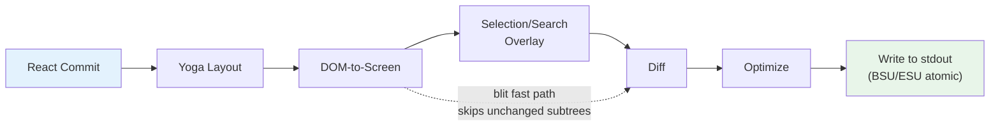
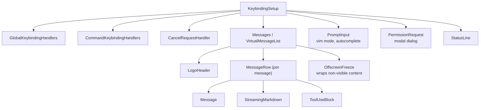

<a id="chapter-13-the-terminal-ui"></a>

# 제13장: 터미널 UI

<a id="why-build-a-custom-renderer"></a>

## 맞춤형 렌더러를 구축하는 이유는 무엇입니까?

터미널은 브라우저가 아닙니다. DOM, CSS 엔진, 컴포지터, 유지 모드 그래픽 파이프라인이 없습니다. stdout으로 가는 바이트 스트림과 stdin에서 오는 바이트 스트림이 있습니다. 레이아웃, 스타일 지정, 비교, 적중 테스트, 스크롤, 선택 등 두 스트림 사이의 모든 항목은 처음부터 새로 개발되어야 합니다.

Claude Code에는 반응형 UI가 필요합니다. 프롬프트 입력, 스트리밍 마크다운 출력, 권한 대화 상자, 진행률 스피너, 스크롤 가능한 메시지 목록, 검색 강조 표시 및 vim 모드 편집기가 있습니다. React는 이러한 종류의 컴포넌트 트리를 선언하기 위한 확실한 선택입니다. 그러나 React는 렌더링할 호스트 환경이 필요하며 터미널은 이를 제공하지 않습니다.

표준적인 대답은 Ink입니다. Flexbox 레이아웃을 위해 Yoga를 기반으로 구축된 터미널용 React 렌더러입니다. Claude Code는 Ink로 시작한 다음 인식할 수 없을 정도로 포크했습니다. 스톡 버전은 200x120 터미널에서 프레임당 셀당 하나의 JavaScript 개체를 할당합니다. 즉, 16ms마다 24,000개의 개체가 생성되고 가비지 수집됩니다. ANSI로 인코딩된 텍스트의 전체 행을 비교하여 문자열 수준에서 비교합니다. 블릿 최적화, 이중 버퍼링, 셀 수준 더티 추적 개념이 없습니다. 초당 한 번씩 새로 고치는 간단한 CLI 대시보드의 경우에는 괜찮습니다. 사용자가 수백 개의 메시지가 포함된 대화를 스크롤하는 동안 LLM 에이전트가 60fps로 토큰을 스트리밍하는 경우 이는 시작이 아닙니다.

Claude Code에 남아 있는 것은 Ink의 개념적 DNA(React reconciler, Yoga 레이아웃, ANSI 출력)를 공유하지만 중요한 경로를 다시 구현하는 사용자 정의 렌더링 엔진입니다. 즉, 셀당 개체 대신 압축된 유형의 배열, 프레임당 문자열 대신 풀 기반 문자열 인터닝, 셀 수준 비교를 통한 이중 버퍼 렌더링, 인접한 터미널 쓰기를 최소 이스케이프 시퀀스로 병합하는 최적화 프로그램입니다.

결과는 Claude에서 토큰을 스트리밍하는 동안 200열 터미널에서 60fps로 실행됩니다. 방법을 이해하려면 React가 조정하는 사용자 정의 DOM, 해당 DOM을 터미널 출력으로 변환하는 렌더링 파이프라인, 가비지 수집에 빠지지 않고 몇 시간 동안 시스템을 활성 상태로 유지하는 풀 기반 메모리 관리, 그리고 이 모든 것을 하나로 묶는 구성 요소 아키텍처라는 네 가지 계층을 조사해야 합니다.

---

<a id="the-custom-dom"></a>

## 커스텀 DOM

React의 조정자는 조정해야 할 것이 필요합니다. 브라우저에서는 이것이 DOM입니다. Claude Code의 터미널에서는 7개의 요소 유형과 1개의 텍스트 노드 유형이 있는 사용자 정의 인메모리 트리입니다.

요소 유형은 터미널 렌더링 개념에 직접 매핑됩니다.

- **`ink-root`** -- 잉크 인스턴스당 하나씩 문서 루트
- **`ink-box`** -- Flexbox 컨테이너, `<div>`과 동일한 터미널
- **`ink-text`** -- 단어 줄 바꿈을 위한 Yoga 측정 기능이 있는 텍스트 노드
- **`ink-virtual-text`** -- 다른 텍스트 노드 내부에 중첩된 스타일 텍스트(텍스트 컨텍스트 내부에 있을 때 `ink-text`에서 자동으로 승격됨)
- **`ink-link`** -- OSC 8 이스케이프 시퀀스를 통해 렌더링되는 하이퍼링크
- **`ink-progress`** -- 진행률 표시기
- **`ink-raw-ansi`** -- 구문 강조 코드 블록에 사용되는 알려진 크기의 사전 렌더링된 ANSI 콘텐츠

각 `DOMElement`은 렌더링 파이프라인에 필요한 상태를 전달합니다.

```typescript
// Illustrative — actual interface extends this significantly
interface DOMElement {
  yogaNode: YogaNode;           // Flexbox layout node
  style: Styles;                // CSS-like properties mapped to Yoga
  attributes: Map<string, DOMNodeAttribute>;
  childNodes: (DOMElement | TextNode)[];
  dirty: boolean;               // Needs re-rendering
  _eventHandlers: EventHandlerMap; // Separated from attributes
  scrollTop: number;            // Imperative scroll state
  pendingScrollDelta: number;
  stickyScroll: boolean;
  debugOwnerChain?: string;     // React component stack for debug
}
```

`attributes`에서 `_eventHandlers`을 분리한 것은 의도적인 것입니다. React에서 핸들러 ID는 렌더링할 때마다 변경됩니다(수동으로 메모하지 않는 한). 핸들러가 속성으로 저장된 경우 모든 렌더링은 노드를 더티로 표시하고 전체 다시 그리기를 트리거합니다. 이를 별도로 저장함으로써 조정자의 `commitUpdate`은 노드를 손상시키지 않고 핸들러를 업데이트할 수 있습니다.

`markDirty()` 함수는 DOM 돌연변이와 렌더링 파이프라인 사이의 다리입니다. 노드의 콘텐츠가 변경되면 `markDirty()`은 모든 상위 항목을 살펴보고 각 요소에 `dirty = true`을 설정하고 리프 텍스트 노드에서 `yogaNode.markDirty()`을 호출합니다. 이는 깊게 중첩된 텍스트 노드에서 단일 문자 변경이 전체 경로를 루트로 다시 렌더링하도록 예약하는 방식입니다. 단, 해당 경로만 해당됩니다. 형제 하위 트리는 깨끗하게 유지되며 이전 프레임에서 삭제될 수 있습니다.

`ink-raw-ansi` 요소 유형은 특별히 언급할 가치가 있습니다. 코드 블록이 이미 구문 강조된 경우(ANSI 이스케이프 시퀀스 생성) 해당 시퀀스를 다시 구문 분석하여 문자와 스타일을 추출하는 것은 낭비입니다. 대신 사전 강조 표시된 콘텐츠는 Yoga에 정확한 크기를 알려주는 `rawWidth` 및 `rawHeight` 속성이 있는 `ink-raw-ansi` 노드에 래핑됩니다. 렌더링 파이프라인은 원시 ANSI 콘텐츠를 개별 스타일 문자로 분해하지 않고 출력 버퍼에 직접 씁니다. 이로 인해 초기 강조 단계 이후 구문 강조 코드 블록이 본질적으로 비용이 0이 됩니다. UI에서 가장 비용이 많이 드는 시각적 요소는 렌더링 비용도 가장 저렴합니다.

`ink-text` 노드의 측정 함수는 동기적으로 실행되며 다른 처리를 막는 Yoga의 레이아웃 계산 안에서 동작하므로 이해해 둘 필요가 있습니다. 이 함수는 사용 가능한 너비를 받아 텍스트의 크기를 반환해야 합니다. `wrap` 스타일 속성(`wrap`, `truncate`, `truncate-start`, `truncate-middle`)에 따라 줄 바꿈을 처리하고, 문자소 클러스터의 경계를 지켜 여러 코드 포인트로 이루어진 이모지가 줄 사이에서 나뉘지 않도록 합니다. CJK 전각 문자는 각각 2열로 올바르게 계산하고, 시각적 너비가 0인 ANSI 이스케이프 코드는 너비 계산에서 제외합니다. 이 모든 처리는 노드당 마이크로초 단위로 끝나야 합니다. 화면에 텍스트 노드가 50개 보이는 대화라면 레이아웃을 계산할 때마다 측정 함수가 50번 호출되기 때문입니다.

---

<a id="the-react-fiber-container"></a>

## 반응 섬유 컨테이너

조정자 브리지는 `react-reconciler`을 사용하여 사용자 지정 호스트 구성을 만듭니다. 이는 React DOM 및 React Native가 사용하는 것과 동일한 API입니다. 주요 차이점: Claude Code는 `ConcurrentRoot` 모드에서 실행됩니다.

```typescript
createContainer(rootNode, ConcurrentRoot, ...)
```

ConcurrentRoot는 지연 로드 구문 강조를 위한 Suspense, 스트리밍 중 비차단 상태 업데이트를 위한 전환 등 React의 동시 기능을 활성화합니다. 대안인 `LegacyRoot`은 동기식 렌더링을 강제하고 마크다운 재분석이 심한 동안 이벤트 루프를 차단합니다.

호스트 구성 메소드는 React 작업을 사용자 정의 DOM에 매핑합니다.

- **`createInstance(type, props)`**은 `createNode()`을 통해 `DOMElement`을 생성하고, 초기 스타일과 속성을 적용하고, 이벤트 핸들러를 연결하고, 디버그 속성을 위해 React 구성 요소 소유자 체인을 캡처합니다. 소유자 체인은 `debugOwnerChain`으로 저장되며 `CLAUDE_CODE_DEBUG_REPAINTS` 모드에서 전체 화면 재설정을 특정 구성 요소에 적용하는 데 사용됩니다.
- **`createTextInstance(text)`**은 `TextNode`을 생성합니다. 그러나 텍스트 컨텍스트 내에 있는 경우에만 해당됩니다. 조정자는 원시 문자열을 `<Text>`으로 래핑해야 한다고 규정합니다. 텍스트 컨텍스트 외부에서 텍스트 노드를 생성하려고 시도하면 렌더링 시간이 아닌 조정 시간에 버그 클래스를 포착합니다.
- **`commitUpdate(node, type, oldProps, newProps)`**은 얕은 비교를 통해 이전 소품과 새 소품을 비교한 다음 변경된 사항만 적용합니다. 스타일, 속성 및 이벤트 핸들러에는 각각 고유한 업데이트 경로가 있습니다. diff 함수는 변경된 사항이 없으면 `undefined`을 반환하여 불필요한 DOM 변형을 완전히 방지합니다.
- **`removeChild(parent, child)`**은 트리에서 노드를 제거하고 Yoga 노드를 반복적으로 해제한 다음(해제된 WASM 메모리에 액세스하지 않도록 `free()` 전에 `unsetMeasureFunc()` 호출) 포커스 관리자에게 알립니다.
- **`hideInstance(node)` / `unhideInstance(node)`**은 `isHidden`을 전환하고 `Display.None`과 `Display.Flex` 사이에서 Yoga 노드를 전환합니다. Suspense 대체 전환을 위한 React의 메커니즘입니다.
- **`resetAfterCommit(container)`**은 중요한 훅입니다. `rootNode.onComputeLayout()`을 호출하여 Yoga를 실행한 다음 `rootNode.onRender()`을 호출하여 터미널 페인트를 예약합니다.

조정자는 커밋 주기당 2개의 성능 카운터인 Yoga 레이아웃 시간(`lastYogaMs`)과 총 커밋 시간(`lastCommitMs`)을 추적합니다. 이는 Ink 클래스가 보고하는 `FrameEvent`으로 흘러 들어가 프로덕션에서 성능 모니터링을 가능하게 합니다.

이벤트 시스템은 브라우저의 캡처/버블 모델을 반영합니다. `Dispatcher` 클래스는 캡처(루트에서 대상으로), 대상에서 및 버블(대상에서 루트로)의 세 단계로 전체 이벤트 전파를 구현합니다. 이벤트 유형은 React 스케줄링 우선순위에 매핑됩니다. 즉, 키보드 및 클릭에 대해 개별적(가장 높은 우선순위, 즉시 처리됨), 스크롤 및 크기 조정에 대해 연속적(지연 가능)입니다. 디스패처는 적절한 React 일괄 처리를 위해 모든 이벤트 처리를 `reconciler.discreteUpdates()`으로 래핑합니다.

터미널에서 키를 누르면 결과 `KeyboardEvent`이 사용자 정의 DOM 트리를 통해 전달되며, 키보드 이벤트가 브라우저 DOM 요소를 통해 버블링되는 것과 똑같이 포커스가 있는 요소에서 루트까지 버블링됩니다. 경로에 있는 모든 핸들러는 `stopPropagation()` 또는 `preventDefault()`을 호출할 수 있으며 의미 체계는 브라우저 사양과 동일합니다.

---

<a id="the-rendering-pipeline"></a>

## 렌더링 파이프라인

모든 프레임은 7단계를 거치며 각 단계는 개별적으로 시간이 측정됩니다.



각 단계의 시간은 개별적으로 측정되며 `FrameEvent.phases`에 보고됩니다. 이 단계별 계측은 성능 문제를 진단하는 데 필수적입니다. 프레임이 30ms가 걸릴 때 병목 현상이 요가의 텍스트 재측정(2단계)인지, 크고 더러운 하위 트리를 걷는 렌더러(3단계)인지, 느린 터미널의 표준 출력 역압(7단계)인지 알아야 합니다. 대답에 따라 수정 사항이 결정됩니다.

**1단계: React 커밋 및 Yoga 레이아웃.** 조정자는 상태 업데이트를 처리하고 `resetAfterCommit`을 호출합니다. 이는 루트 노드의 너비를 `terminalColumns`으로 설정하고 `yogaNode.calculateLayout()`을 실행합니다. Yoga는 CSS flexbox 사양에 따라 전체 flexbox 트리를 한 번에 계산합니다. 즉, 모든 노드에서 flex-grow, flex-shrink, padding, margin, gap, alignment 및 Wrapping을 해결합니다. 결과(`getComputedWidth()`, `getComputedHeight()`, `getComputedLeft()`, `getComputedTop()`)는 노드별로 캐시됩니다. `ink-text` 노드의 경우 Yoga는 레이아웃 중에 사용자 정의 측정 함수(`measureTextNode`)를 호출합니다. 이 함수는 단어 줄 바꿈 및 문자소 측정을 통해 텍스트 크기를 계산합니다. 이는 가장 비용이 많이 드는 노드별 작업입니다. 유니코드 문자소 클러스터, CJK 이중 너비 문자, 이모티콘 시퀀스 및 텍스트 콘텐츠에 포함된 ANSI 이스케이프 코드를 처리해야 합니다.

**2단계: DOM에서 화면으로.** 렌더러는 DOM 트리를 깊이 우선으로 탐색하여 `Screen` 버퍼에 문자와 스타일을 씁니다. 각 문자는 패킹된 셀이 됩니다. 출력은 완전한 프레임입니다. 터미널의 모든 셀에는 정의된 문자, 스타일 및 너비가 있습니다.

**3단계: 오버레이.** 텍스트 선택 및 검색 강조 표시는 화면 버퍼를 내부에서 수정하고 일치하는 셀의 스타일 ID를 뒤집습니다. 선택 항목은 반전 비디오를 적용하여 친숙한 "강조 표시된 텍스트" 모양을 만듭니다. 검색 강조 표시는 보다 공격적인 시각적 처리를 적용합니다. 즉, 현재 일치 항목에는 반전 + 노란색 전경 + 굵은 글씨 + 밑줄이 적용되고 다른 일치 항목에는 반전만 적용됩니다. 이는 버퍼를 오염시킵니다. `prevFrameContaminated` 플래그로 추적되어 다음 프레임이 블릿 빠른 경로를 건너뛰는 것을 알 수 있습니다. 오염은 의도적인 균형입니다. 버퍼를 내부에서 수정하면 오버레이가 지워진 후 전체 손상 프레임 하나를 희생하면서 별도의 오버레이 버퍼 할당(200x120 터미널에서 48KB 절약)을 피할 수 있습니다.

**4단계: Diff.** 새 화면은 전면 프레임의 화면과 셀별로 비교됩니다. 변경된 셀만 출력을 생성합니다. 비교는 셀당 두 개의 정수 비교(두 개의 `Int32` 단어로 묶음)이며 diff는 전체 화면이 아닌 손상 사각형을 이동합니다. 정상 상태 프레임(스피너 틱만 작동)에서는 24,000개 셀 중 3개 셀에 대한 패치가 생성될 수 있습니다. 각 패치는 커서 이동 시퀀스와 ANSI로 인코딩된 셀 내용을 포함하는 `{ type: 'stdout', content: string }` 개체입니다.

**5단계: 최적화.** 동일한 행의 인접한 패치가 단일 쓰기로 병합됩니다. 중복 커서 이동이 제거됩니다. 패치 N이 열 10에서 끝나고 패치 N+1이 열 11에서 시작하는 경우 커서는 이미 올바른 위치에 있으므로 이동 시퀀스가 ​​필요하지 않습니다. 스타일 전환은 `StylePool.transition()` 캐시를 통해 사전 직렬화되므로 "굵은 빨간색"에서 "어두운 녹색"으로 변경하는 것은 비교 및 ​​직렬화 작업이 아닌 캐시된 단일 문자열 조회입니다. 최적화 프로그램은 일반적으로 순진한 셀당 출력에 비해 바이트 수를 30-50% 줄입니다.

**6단계: 쓰기.** 최적화된 패치는 ANSI 이스케이프 시퀀스로 직렬화되고 단일 `write()` 호출을 통해 stdout에 기록되며 이를 지원하는 터미널의 동기 업데이트 마커(BSU/ESU)로 래핑됩니다. BSU(동기화 업데이트 시작, `ESC [ ? 2026 h`)는 터미널에 모든 후속 출력을 버퍼링하라고 지시하고 ESU(`ESC [ ? 2026 l`)는 터미널에 플러시를 지시합니다. 이는 프로토콜을 지원하는 터미널에서 눈에 띄는 찢어짐을 제거합니다. 즉, 전체 프레임이 원자적으로 나타납니다.

모든 프레임은 `FrameEvent` 객체를 통해 타이밍 분석을 보고합니다.

```typescript
interface FrameEvent {
  durationMs: number;
  phases: {
    renderer: number;    // DOM-to-screen
    diff: number;        // Screen comparison
    optimize: number;    // Patch merging
    write: number;       // stdout write
    yoga: number;        // Layout computation
  };
  yogaVisited: number;   // Nodes traversed
  yogaMeasured: number;  // Nodes that ran measure()
  yogaCacheHits: number; // Nodes with cached layout
  flickers: FlickerEvent[];  // Full-reset attributions
}
```

`CLAUDE_CODE_DEBUG_REPAINTS`이 활성화되면 전체 화면 재설정은 `findOwnerChainAtRow()`을 통해 소스 React 구성 요소에 기인합니다. 이는 React DevTools의 "Highlight Updates"에 해당하는 터미널입니다. 이는 어떤 구성 요소가 전체 화면을 다시 그리는지 보여줍니다. 이는 렌더링 파이프라인에서 발생할 수 있는 가장 비용이 많이 드는 일입니다.

블릿 최적화는 특별한 주의를 기울일 가치가 있습니다. 노드가 더럽지 않고 이전 프레임 이후 위치가 변경되지 않은 경우(노드 캐시를 통해 확인) 렌더러는 하위 트리를 다시 렌더링하는 대신 `prevScreen`에서 현재 화면으로 셀을 직접 복사합니다. 이는 정상 상태 프레임을 매우 저렴하게 만듭니다. 스피너만 틱하는 일반적인 프레임에서 블릿은 화면의 99%를 덮고 스피너의 3-4개 셀만 처음부터 다시 렌더링됩니다.

블릿은 세 가지 조건에서 비활성화됩니다.

1. **`prevFrameContaminated`이 true임** -- 선택 오버레이 또는 검색 강조 표시가 전면 프레임의 화면 버퍼를 내부에서 수정했으므로 해당 셀을 "올바른" 이전 상태로 신뢰할 수 없습니다.
2. **절대 위치 노드가 제거되었습니다** -- 절대 위치 지정은 노드가 형제가 아닌 셀 위에 그려졌을 수 있으며 해당 셀을 실제로 소유한 요소에서 다시 렌더링해야 함을 의미합니다.
3. **레이아웃 변경됨** -- 모든 노드의 캐시된 위치는 현재 계산된 위치와 다릅니다. 즉, 블릿이 셀을 잘못된 좌표에 복사한다는 의미입니다.

손상 직사각형(`screen.damage`)은 렌더링 중에 기록된 모든 셀의 경계 상자를 추적합니다. 차이점은 이 직사각형 내의 행만 검사하고 변경되지 않은 영역은 완전히 건너뜁니다. 스트리밍 메시지가 80-100행을 차지하는 120행 터미널에서 diff는 120행 대신 20행을 확인하므로 비교 작업이 6배 감소합니다.

---

<a id="double-buffer-rendering-and-frame-scheduling"></a>

## 이중 버퍼 렌더링 및 프레임 스케줄링

Ink 클래스는 두 개의 프레임 버퍼를 유지합니다.

```typescript
private frontFrame: Frame;  // Currently displayed on terminal
private backFrame: Frame;   // Being rendered into
```

각 `Frame`에는 다음이 포함됩니다.

- `screen: Screen` -- 셀 버퍼(`Int32Array`으로 패킹됨)
- `viewport: Size` -- 렌더링 시 터미널 크기
- `cursor: { x, y, visible }` - 터미널 커서를 주차할 위치
- `scrollHint` -- 대체 화면 모드에 대한 DECSTBM(스크롤 영역) 최적화 힌트
- `scrollDrainPending` -- ScrollBox에 처리할 남은 스크롤 델타가 있는지 여부

각 렌더링 후에 프레임은 `backFrame = frontFrame; frontFrame = newFrame`으로 교체됩니다. 이전 전면 프레임은 다음 후면 프레임이 되어 블릿 최적화를 위한 `prevScreen`과 셀 수준 비교를 위한 기준을 제공합니다.

이 이중 버퍼 설계는 할당을 제거합니다. 매 프레임마다 새로운 `Screen`을 생성하는 대신 렌더러는 백 프레임의 버퍼를 재사용합니다. 스왑은 포인터 할당입니다. 이 패턴은 그래픽 프로그래밍에서 빌려온 것입니다. 여기서 이중 버퍼링은 렌더러가 다른 프레임에 쓰는 동안 디스플레이가 전체 프레임에서 읽도록 하여 찢어짐을 방지합니다. 터미널 컨텍스트에서 티어링은 문제가 되지 않습니다(BSU/ESU 프로토콜이 이를 처리합니다). 문제는 16ms마다 48KB 이상의 형식화된 배열을 포함하는 `Screen` 개체를 할당하고 삭제하는 데 따른 GC 압력입니다.

렌더링 스케줄링은 선행 및 후행 가장자리가 활성화된 상태에서 16ms(약 60fps)의 lodash `throttle`을 사용합니다.

```typescript
const deferredRender = () => queueMicrotask(this.onRender);
this.scheduleRender = throttle(deferredRender, FRAME_INTERVAL_MS, {
  leading: true,
  trailing: true,
});
```

마이크로태스크 연기는 우연이 아닙니다. `resetAfterCommit`은 React의 레이아웃 효과 단계 전에 실행됩니다. 여기서 렌더러가 동기적으로 실행되면 `useLayoutEffect`에 설정된 커서 선언이 누락됩니다. 마이크로태스크는 레이아웃 효과 후에 실행되지만 동일한 이벤트 루프 틱 내에서 실행됩니다. 즉, 터미널에는 일관된 단일 프레임이 표시됩니다.

스크롤 작업의 경우 4ms(FRAME_INTERVAL_MS >> 2)의 별도 `setTimeout`은 스로틀을 방해하지 않고 더 빠른 스크롤 프레임을 제공합니다. 스크롤 변형은 React를 완전히 우회합니다. `ScrollBox.scrollBy()`은 DOM 노드 속성을 직접 변경하고 `markDirty()`을 호출하고 마이크로태스크를 통해 렌더링을 예약합니다. React 상태 업데이트가 없고 조정 오버헤드가 없으며 단일 휠 이벤트에 대한 전체 메시지 목록을 다시 렌더링하지 않습니다.

**크기 조정 처리**는 동기식이며 디바운싱되지 않습니다. 터미널 크기가 조정되면 `handleResize`은 레이아웃 일관성을 유지하기 위해 치수를 즉시 업데이트합니다. 대체 화면 모드의 경우 프레임 버퍼를 재설정하고 `ERASE_SCREEN`을 즉시 작성하는 대신 다음 원자 BSU/ESU 페인트 블록으로 연기합니다. 지우기를 동기적으로 작성하면 렌더링에 소요되는 ~80ms 동안 화면이 공백으로 남게 됩니다. 이를 원자 블록으로 연기하면 새 프레임이 완전히 준비될 때까지 이전 콘텐츠가 계속 표시됩니다.

**대체 화면 관리**는 또 다른 레이어를 추가합니다. `AlternateScreen` 구성 요소는 마운트 시 DEC 1049 대체 화면 버퍼에 들어가고 높이를 터미널 행으로 제한합니다. `useLayoutEffect`이 아닌 `useInsertionEffect`을 사용하여 `ENTER_ALT_SCREEN` 이스케이프 시퀀스가 ​​첫 번째 렌더링 프레임 전에 터미널에 도달하도록 합니다. `useLayoutEffect`을 사용하면 너무 늦습니다. 첫 번째 프레임이 기본 화면 버퍼에 렌더링되어 전환되기 전에 눈에 보이는 플래시가 생성됩니다. `useInsertionEffect`은 레이아웃 효과 전과 브라우저(또는 터미널)가 그리기 전에 실행되어 전환이 원활하게 이루어집니다.

---

<a id="pool-based-memory-why-interning-matters"></a>

## 풀 기반 메모리: 인턴이 중요한 이유

200열 x 120행 터미널에는 24,000개의 셀이 있습니다. 각 셀이 `char` 문자열, `style` 문자열 및 `hyperlink` 문자열을 포함하는 JavaScript 개체인 경우 프레임당 72,000개의 문자열 할당과 셀 자체에 대한 24,000개의 개체 할당이 추가됩니다. 60fps에서는 초당 576만 번 할당됩니다. V8의 가비지 수집기는 이를 처리할 수 있지만 프레임이 누락된 것처럼 나타나는 일시 중지 없이는 처리할 수 없습니다. GC 일시 중지는 일반적으로 1~5ms이지만 예측할 수 없습니다. 스트리밍 토큰 업데이트 중에 발생하여 사용자가 출력을 볼 때 눈에 띄는 끊김 현상이 발생할 수 있습니다.

Claude Code는 압축형 배열과 3개의 인턴 풀을 통해 이를 완전히 제거합니다. 결과: 셀 버퍼에 대한 프레임당 개체 할당이 0입니다. 유일한 할당은 풀 자체(대부분의 문자와 스타일이 첫 번째 프레임에서 인턴되고 이후 재사용되기 때문에 상각됨)와 diff에 의해 생성된 패치 문자열(stdout.write에 문자열 또는 버퍼 인수가 필요하므로 피할 수 없음)에 있습니다.

**셀 레이아웃**은 인접한 `Int32Array`에 저장된 셀당 2개의 `Int32` 단어를 사용합니다.

```
word0: charId        (32 bits, index into CharPool)
word1: styleId[31:17] | hyperlinkId[16:2] | width[1:0]
```

동일한 버퍼에 대한 병렬 `BigInt64Array` 보기를 사용하면 대량 작업이 가능합니다. 행을 지우는 것은 개별 필드를 0으로 만드는 대신 64비트 단어에 대한 단일 `fill()` 호출입니다.

**CharPool**은 문자열을 정수 ID로 인턴합니다. ASCII에 대한 빠른 경로가 있습니다. 128개 항목 `Int32Array`은 문자 코드를 풀 인덱스에 직접 매핑하여 `Map` 조회를 완전히 피합니다. 멀티바이트 문자(이모지, CJK 표의 문자)는 `Map<string, number>`에 속합니다. 인덱스 0은 항상 공백이고, 인덱스 1은 항상 빈 문자열입니다.

```typescript
export class CharPool {
  private strings: string[] = [' ', '']
  private ascii: Int32Array = initCharAscii()

  intern(char: string): number {
    if (char.length === 1) {
      const code = char.charCodeAt(0)
      if (code < 128) {
        const cached = this.ascii[code]!
        if (cached !== -1) return cached
        const index = this.strings.length
        this.strings.push(char)
        this.ascii[code] = index
        return index
      }
    }
    // Map fallback for multi-byte characters
    ...
  }
}
```

**StylePool**은 ANSI 스타일 코드 배열을 정수 ID로 인턴합니다. 영리한 부분: 각 ID의 비트 0은 스타일이 공백 문자(배경색, 반전, 밑줄)에 가시적 영향을 미치는지 여부를 인코딩합니다. 전경 전용 스타일은 짝수 ID를 얻습니다. 공간에 표시되는 스타일은 이상한 ID를 갖습니다. 이를 통해 렌더러는 스타일 정의를 조회하지 않고 단일 비트마스크 확인(`if (!(styleId & 1) && charId === 0) continue`)으로 보이지 않는 공간을 건너뛸 수 있습니다. 또한 풀은 두 스타일 ID 사이에 미리 직렬화된 ANSI 전환 문자열을 캐시하므로 "굵은 빨간색"에서 "어두운 녹색"으로 전환하는 것은 비교 및 ​​직렬화 작업이 아니라 캐시된 문자열 연결입니다.

**HyperlinkPool**은 OSC 8 하이퍼링크 URI를 인턴합니다. 인덱스 0은 하이퍼링크가 없음을 의미합니다.

세 개의 풀은 모두 전면 및 후면 프레임에서 공유됩니다. 이는 중요한 설계 결정입니다. 풀이 공유되기 때문에 인터닝된 ID는 프레임 전체에서 유효합니다. 블릿 최적화는 다시 인터닝하지 않고 `prevScreen`에서 현재 화면으로 팩형 셀 단어를 직접 복사할 수 있습니다. diff는 문자열 조회 없이 ID를 정수로 비교할 수 있습니다. 각 프레임에 자체 풀이 있는 경우 blit은 복사된 모든 셀을 다시 삽입해야 합니다(이전 ID로 문자열을 찾은 다음 새 풀에 삽입). 이는 blit의 성능 이점을 대부분 무효화합니다.

풀은 긴 세션 동안 무제한적인 증가를 방지하기 위해 주기적으로(5분마다) 재설정됩니다. 마이그레이션 패스는 전면 프레임의 라이브 셀을 새로운 풀에 다시 삽입합니다.

**CellWidth**는 2비트 분류로 이중 와이드 문자를 처리합니다.

| 가치 | 의미 |
|-------|---------|
| 0(좁음) | 표준 단일 열 문자 |
| 1(와이드) | CJK/이모지 헤드 셀, 두 개의 열을 차지 |
| 2(스페이서테일) | 와이드 문자의 두 번째 열 |
| 3(스페이서 헤드) | 소프트 랩 연속 마커 |

이는 `word1`의 하위 2비트에 저장되어 패킹된 셀의 너비 검사를 무료로 만듭니다. 일반적인 경우에는 필드 추출이 필요하지 않습니다.

추가 셀별 메타데이터는 압축된 셀이 아닌 병렬 배열에 있습니다.

- **`noSelect: Uint8Array`** -- 텍스트 선택에서 콘텐츠를 제외하는 셀별 플래그입니다. 복사된 텍스트에 표시되어서는 안 되는 UI 크롬(테두리, 표시기)에 사용됩니다.
- **`softWrap: Int32Array`** -- 단어 줄 바꿈 연속을 나타내는 행별 마커입니다. 사용자가 부드럽게 줄 바꿈된 줄에서 텍스트를 선택하면 선택 논리는 줄 바꿈 지점에 줄바꿈을 삽입하지 않는다는 것을 알고 있습니다.
- **`damage: Rectangle`** -- 현재 프레임에 기록된 모든 셀의 경계 상자입니다. 차이점은 이 직사각형 내의 행만 검사하고 변경되지 않은 영역은 완전히 건너뜁니다.

이러한 병렬 배열은 선택, 복사 및 최적화에 필요한 메타데이터를 제공하면서 압축 셀 형식(diff 내부 루프의 캐시 압력을 증가시키는) 확장을 방지합니다.

`Screen`은 차원 및 풀 참조를 사용하는 `createScreen()` 팩토리도 노출합니다. 화면을 생성하면 `BigInt64Array` 뷰의 `fill(0n)`을 통해 `Int32Array`이 0이 됩니다. 이는 마이크로초 단위로 전체 버퍼를 지우는 단일 기본 호출입니다. 이는 크기 조정(새 프레임 버퍼가 필요한 경우) 및 풀 마이그레이션(이전 화면의 셀이 새 풀에 다시 삽입되는 경우) 중에 사용됩니다.

---

<a id="the-repl-component"></a>

## REPL 구성요소

REPL(`REPL.tsx`)은 약 5,000줄입니다. 이는 코드베이스에서 가장 큰 단일 구성 요소이며, 그 이유는 전체 대화형 경험의 조정자이기 때문입니다. 모든 것이 그것을 통해 흐릅니다.

구성 요소는 대략 9개의 섹션으로 구성됩니다.

1. **가져오기**(~100줄) -- 부트스트랩 상태, 명령, 기록, 훅, 구성 요소, 키 바인딩, 비용 추적, 알림, 떼/팀 지원, 음성 통합을 가져옵니다.
2. **기능 플래그가 지정된 가져오기** -- `require()`이 포함된 `feature()` 가드를 통해 음성 통합, 사전 모드, 간단한 도구 및 코디네이터 에이전트의 조건부 로딩
3. **상태 관리** -- 메시지, 입력 모드, 보류 중인 권한, 대화 상자, 비용 임계값, 세션 상태, 도구 상태 및 에이전트 상태를 포괄하는 광범위한 `useState` 호출
4. **QueryGuard** -- 활성 API 호출 수명주기를 관리하여 동시 요청이 서로 겹치는 것을 방지합니다.
5. **메시지 처리** -- 쿼리 루프에서 들어오는 메시지를 처리하고, 순서를 표준화하고, 스트리밍 상태를 관리합니다.
6. **도구 권한 흐름** -- 도구 사용 블록과 PermissionRequest 대화 상자 간의 권한 요청을 조정합니다.
7. **세션 관리** -- 대화 재개, 전환, 내보내기
8. **키 바인딩 설정** -- 키 바인딩 공급자 연결: `KeybindingSetup`, `GlobalKeybindingHandlers`, `CommandKeybindingHandlers`
9. **렌더 트리** -- 위의 모든 항목을 바탕으로 최종 UI를 구성합니다.

렌더 트리는 전체 화면 모드에서 전체 인터페이스를 구성합니다.



`OffscreenFreeze`은 터미널 렌더링과 관련된 성능 최적화입니다. 메시지가 뷰포트 위로 스크롤되면 해당 React 요소가 캐시되고 해당 하위 트리가 고정됩니다. 이렇게 하면 오프스크린 메시지의 타이머 기반 업데이트(스피너, 경과 시간 카운터)가 터미널 재설정을 트리거하는 것을 방지할 수 있습니다. 이것이 없으면 사용자가 메시지 47을 보고 있더라도 메시지 3의 회전 표시기로 인해 전체 다시 그리기가 발생합니다.

구성 요소는 전체적으로 React Compiler에 의해 컴파일됩니다. 수동 `useMemo` 및 `useCallback` 대신 컴파일러는 슬롯 배열을 사용하여 표현식별 메모를 삽입합니다.

```typescript
const $ = _c(14);  // 14 memoization slots
let t0;
if ($[0] !== dep1 || $[1] !== dep2) {
  t0 = expensiveComputation(dep1, dep2);
  $[0] = dep1; $[1] = dep2; $[2] = t0;
} else {
  t0 = $[2];
}
```

이 패턴은 코드베이스의 모든 구성 요소에 나타납니다. `useMemo`(훅 수준에서 메모)보다 더 세밀한 세부성을 제공합니다. 렌더링 함수 내의 개별 표현식은 자체 종속성 추적 및 캐싱을 갖습니다. REPL과 같은 5,000라인 구성 요소의 경우 이는 렌더링당 수백 건의 잠재적인 불필요한 재계산을 제거합니다.

---

<a id="selection-and-search-highlighting"></a>

## 선택 및 검색 강조 표시

텍스트 선택 및 검색 강조 표시는 화면 버퍼 오버레이로 작동하며 기본 렌더링 이후, 차이점 이전에 적용됩니다.

**텍스트 선택**은 대체 화면에서만 가능합니다. Ink 인스턴스는 `SelectionState` 추적 앵커 및 초점 지점, 드래그 모드(문자/단어/줄) 및 화면 밖으로 스크롤된 캡처된 행을 보유합니다. 사용자가 클릭하고 드래그하면 선택 핸들러가 이러한 좌표를 업데이트합니다. `onRender` 동안 `applySelectionOverlay`은 영향을 받은 행을 탐색하고 `StylePool.withSelectionBg()`을 사용하여 셀 스타일 ID를 내부에서 수정합니다. 이는 역 비디오가 추가된 새 스타일 ID를 반환합니다. 화면 버퍼의 이러한 직접적인 변형으로 인해 `prevFrameContaminated` 플래그가 존재합니다. 전면 프레임의 버퍼가 오버레이에 의해 수정되었으므로 다음 프레임에서는 블릿 최적화를 위해 이를 신뢰할 수 없으며 전체 손상 비교를 수행해야 합니다.

마우스 추적은 SGR 1003 모드를 사용하여 클릭, 끌기 및 열/행 좌표와 함께 동작을 보고합니다. `App` 구성 요소는 다중 클릭 감지를 구현합니다. 두 번 클릭하면 단어가 선택되고, 세 번 클릭하면 줄이 선택됩니다. 감지에는 500ms 시간 초과 및 1셀 위치 허용 오차가 사용됩니다(마우스는 다중 클릭 카운터를 재설정하지 않고도 클릭 사이에 한 셀을 이동할 수 있음). 하이퍼링크 클릭은 의도적으로 이 시간 초과로 지연됩니다. 링크를 두 번 클릭하면 브라우저를 여는 대신 단어가 선택되어 사용자가 텍스트 편집기에서 기대하는 동작과 일치합니다.

분실된 릴리스 복구 메커니즘은 사용자가 터미널 내부에서 드래그를 시작하고 창 밖으로 마우스를 이동한 후 릴리스하는 경우를 처리합니다. 터미널은 누르기와 드래그를 보고하지만 해제(창 밖에서 발생한)는 보고하지 않습니다. 복구하지 않으면 선택 항목이 영구적으로 드래그 모드에 고정됩니다. 복구는 버튼을 누르지 않은 상태에서 마우스 모션 이벤트를 감지하여 작동합니다. 드래그 상태에 있고 버튼이 없는 모션 이벤트를 수신하면 버튼이 창 외부에서 해제되었다고 추론하고 선택을 완료합니다.

**검색 강조표시**에는 두 가지 메커니즘이 동시에 실행됩니다. 스캔 기반 경로(`applySearchHighlight`)는 쿼리 문자열을 찾기 위해 보이는 셀을 탐색하고 SGR 역 스타일을 적용합니다. 위치 기반 경로는 메시지 기준으로 저장된 `scanElementSubtree()`에서 미리 계산된 `MatchPosition[]`을 사용하고 누적된 ANSI 코드(역 + 노란색 전경 + 굵은 글씨 + 밑줄)를 사용하여 "현재 일치" 노란색 강조 표시가 있는 알려진 오프셋에 이를 적용합니다. 역과 결합된 노란색 전경은 노란색 배경이 됩니다. 역이 활성화되면 터미널은 fg/bg를 바꿉니다. 밑줄은 노란색이 기존 배경색과 충돌하는 테마에 대한 대체 가시성 표시입니다.

**커서 선언**은 미묘한 문제를 해결합니다. 터미널 에뮬레이터는 실제 커서 위치에 IME(Input Method Editor) 사전 편집 텍스트를 렌더링합니다. 문자를 작성하는 CJK 사용자는 커서가 터미널이 자연스럽게 고정하는 화면 하단이 아니라 텍스트 입력 캐럿에 있어야 합니다. `useDeclaredCursor` 훅을 사용하면 구성 요소가 각 프레임 뒤에 커서가 있어야 하는 위치를 선언할 수 있습니다. Ink 클래스는 `nodeCache`에서 선언된 노드의 위치를 ​​읽고 이를 화면 좌표로 변환한 다음 diff 후에 커서 이동 시퀀스를 내보냅니다. 화면 판독기와 돋보기도 물리적 커서를 추적하므로 이 메커니즘은 CJK 입력뿐만 아니라 접근성에도 도움이 됩니다.

기본 화면 모드에서 선언된 커서 위치는 `frame.cursor`(로그 업데이트의 상대 이동 불변성을 위해 콘텐츠 하단에 유지되어야 함)과 별도로 추적됩니다. 대체 화면 모드에서는 문제가 더 간단합니다. 모든 프레임은 `CSI H`(커서 홈)으로 시작하므로 선언된 커서는 프레임 끝에서 방출되는 절대 위치일 뿐입니다.

---

<a id="streaming-markdown"></a>

## 스트리밍 마크다운

LLM 출력 렌더링은 터미널 UI가 직면하는 가장 까다로운 작업입니다. 토큰은 초당 10-50개씩 한 번에 하나씩 도착하며, 각 토큰은 코드 블록, 목록, 굵은 텍스트 및 인라인 코드를 포함할 수 있는 메시지의 내용을 변경합니다. 모든 토큰의 전체 메시지를 다시 구문 분석하는 순진한 접근 방식은 규모면에서 재앙이 될 수 있습니다.

Claude Code는 세 가지 최적화를 사용합니다.

**토큰 캐싱.** 모듈 수준 LRU 캐시(500개 항목)는 콘텐츠 해시로 입력된 `marked.lexer()` 결과를 저장합니다. 캐시는 가상 스크롤 중에 React 마운트 해제/재마운트 주기를 유지합니다. 사용자가 이전에 표시된 메시지로 다시 스크롤하면 마크다운 토큰이 다시 구문 분석되는 대신 캐시에서 제공됩니다.

**빠른 경로 감지.** `hasMarkdownSyntax()`은 단일 정규 표현식을 통해 처음 500자에서 마크다운 마커를 확인합니다. 구문이 발견되지 않으면 전체 GFM 구문 분석기를 우회하여 단일 단락 토큰을 직접 구성합니다. 이렇게 하면 일반 텍스트 메시지에서 렌더링당 약 3ms가 절약됩니다. 이는 초당 60프레임을 렌더링할 때 중요합니다.

**지연 구문 강조.** 코드 블록 강조는 React `Suspense`을 통해 로드됩니다. `MarkdownBody` 구성 요소는 대체 수단으로 `highlight={null}`을 사용하여 즉시 렌더링한 다음 cli-highlight 인스턴스를 사용하여 비동기적으로 확인합니다. 사용자는 스타일이 지정되지 않은 코드를 즉시 확인한 다음 한두 프레임 후에 색상이 나타납니다.

스트리밍 케이스가 주름을 더해줍니다. 모델에서 토큰이 도착하면 마크다운 콘텐츠가 점진적으로 늘어납니다. 모든 토큰의 전체 콘텐츠를 다시 구문 분석하는 것은 메시지 과정에서 O(n^2)입니다. 빠른 경로 감지는 도움이 됩니다. 대부분의 스트리밍 콘텐츠는 파서를 완전히 우회하는 일반 텍스트 단락이지만 코드 블록과 목록이 있는 메시지의 경우 LRU 캐시가 실제 최적화를 제공합니다. 캐시 키는 콘텐츠 해시이므로 10개의 토큰이 도착하고 마지막 단락만 변경되면 변경되지 않은 접두사에 대해 캐시된 구문 분석 결과가 재사용됩니다. 마크다운 렌더러는 변경된 꼬리만 다시 구문 분석합니다.

`StreamingMarkdown` 구성요소는 정적 `Markdown` 구성요소와 다릅니다. 콘텐츠가 여전히 생성되는 경우를 처리합니다. 즉, 엄격한 구문 검사와 함께 전체 GFM 구문 분석을 적용하는 불완전한 코드 펜스(` ``` ` without a closing fence), partial bold markers, and truncated list items. The streaming variant is more forgiving in its parsing -- it does not error on unclosed syntax because the closing syntax has not arrived yet. When the message finishes streaming, the component transitions to the static `Markdown` 렌더러)입니다.

코드 블록의 구문 강조는 렌더링 파이프라인에서 가장 비용이 많이 드는 요소별 작업입니다. 100줄 코드 블록은 cli-highlight로 강조 표시하는 데 50~100ms가 걸릴 수 있습니다. 강조 표시 라이브러리 자체를 로드하는 데는 200-300ms가 걸립니다(수십 개 언어에 대한 문법 정의가 번들로 제공됨). 두 비용 모두 React `Suspense` 뒤에 숨겨져 있습니다. 코드 블록은 즉시 일반 텍스트로 렌더링되고, 강조 표시 라이브러리는 비동기식으로 로드되며, 해결되면 코드 블록이 색상으로 다시 렌더링됩니다. 사용자는 코드를 즉시 확인하고 잠시 후에 색상을 지정합니다. 이는 라이브러리가 로드되는 동안 300ms의 빈 프레임보다 훨씬 더 나은 경험입니다.

---

<a id="apply-this-rendering-streaming-output-efficiently"></a>

## 적용: 스트리밍 출력을 효율적으로 렌더링

터미널 렌더링 파이프라인은 작업 제거에 대한 사례 연구입니다. 디자인을 이끄는 세 가지 원칙은 다음과 같습니다.

**모든 것을 인턴하세요.** 스타일, 문자, URL 등 수천 개의 셀에 나타나는 값이 있는 경우 이를 한 번 저장하고 정수 ID로 참조하세요. 정수 비교는 하나의 CPU 명령어입니다. 문자열 비교는 루프입니다. 내부 루프가 60fps에서 프레임당 24,000번 실행될 때 정수의 `===`과 문자열의 `===`의 차이는 부드러운 스크롤링과 눈에 보이는 지연의 차이입니다.

**적절한 수준에서 비교.** 셀 수준 비교는 비용이 많이 들 것으로 보입니다. 프레임당 24,000번의 비교입니다. 그러나 이는 셀(패킹된 단어)당 두 개의 정수 비교이며 정상 상태 프레임에서는 첫 번째 셀을 확인한 후 대부분의 행에서 diff가 빠져 나옵니다. 전체 화면을 다시 렌더링하고 이를 stdout에 쓰는 대안은 프레임당 100KB 이상의 ANSI 이스케이프 시퀀스를 생성합니다. diff는 일반적으로 1KB 미만을 생성합니다.

**React에서 핫 경로를 분리합니다.** 스크롤 이벤트는 마우스 입력 빈도(잠재적으로 초당 수백 개)에 도달합니다. React의 조정자(상태 업데이트, 조정, 커밋, 레이아웃, 렌더링)를 통해 각각을 라우팅하면 이벤트당 5~10ms의 대기 시간이 추가됩니다. DOM 노드를 직접 변경하고 마이크로태스크를 통해 렌더링을 예약함으로써 스크롤 경로가 1ms 미만으로 유지됩니다. React는 최종 페인트에만 관여하며 어쨌든 실행됩니다.

이러한 원칙은 터미널뿐만 아니라 모든 스트리밍 출력 시스템에 적용됩니다. 로그 뷰어, 채팅 클라이언트, 모니터링 대시보드 등 실시간 데이터를 렌더링하는 웹 애플리케이션을 구축하는 경우에도 동일한 장단점이 적용됩니다. 인턴 반복 값. 이전 프레임과 비교합니다. 반응형 프레임워크에서 핫 경로를 차단하세요.

장기 실행 세션에 적용되는 네 번째 원칙은 **주기적으로 정리**입니다. 새로운 캐릭터와 스타일이 인턴됨에 따라 Claude Code의 풀은 단조롭게 늘어납니다. 여러 시간의 세션 동안 풀은 더 이상 라이브 셀에서 참조하지 않는 수천 개의 항목을 축적할 수 있습니다. 5분 재설정 주기는 이러한 성장을 제한합니다. 5분마다 새로운 풀이 생성되고 전면 프레임의 셀이 마이그레이션되고(새 풀에 다시 삽입됨) 이전 풀은 가비지가 됩니다. 이는 JavaScript GC가 풀 항목의 의미론적 활성 상태를 볼 수 없기 때문에 애플리케이션 수준에서 적용되는 세대별 수집 전략입니다.

일반 객체에 대해 `Int32Array`을 사용하기로 한 결정은 GC 압력을 넘어 메모리 지역성이라는 미묘한 이점을 제공합니다. diff가 24,000개의 셀을 비교할 때 연속된 형식의 배열을 탐색합니다. 최신 CPU는 순차 메모리 액세스를 프리페치하므로 전체 화면 비교는 L1/L2 캐시 내에서 실행됩니다. 셀당 개체 레이아웃은 셀을 힙 전체에 분산시켜 모든 비교를 캐시 누락으로 만듭니다. 성능 차이는 측정 가능합니다. 200x120 화면에서 형식화된 배열 diff는 0.5ms 이내에 완료되는 반면, 동등한 객체 기반 diff는 3~5ms가 걸립니다. 이는 다른 파이프라인 단계와 결합할 때 16ms 프레임 예산을 초과하기에 충분합니다.

다섯 번째 원칙은 고정 크기 그리드로 렌더링하는 모든 시스템에 적용됩니다: **손상 범위 추적**. 각 화면의 `damage` 직사각형은 렌더링 중에 작성된 셀의 경계 상자를 기록합니다. 차이점은 이 직사각형을 참조하고 그 외부의 행을 완전히 건너뜁니다. 스트리밍 메시지가 120행 터미널의 하위 20행을 차지할 때 diff는 120행이 아닌 20행을 검사합니다. blit 최적화(blit된 영역이 아닌 다시 렌더링된 영역에 대해서만 손상 사각형을 채우는)와 결합하면 이는 일반적인 경우(대화의 나머지 부분이 정적일 때 하나의 메시지 스트리밍이 화면 버퍼의 일부에 닿는 경우)를 의미합니다.

더 넓은 교훈: 렌더링 시스템의 성능은 단일 작업을 빠르게 만드는 것이 아닙니다. 운영을 완전히 없애는 것입니다. 블릿은 재렌더링을 제거합니다. 손상 직사각형은 차이를 제거합니다. 풀 공유는 재입국을 없애줍니다. 패킹된 셀은 할당을 제거합니다. 각 최적화는 전체 작업 범주를 제거하고 곱셈적으로 누적됩니다.

수치를 표현하자면: 200x120 터미널에서 최악의 프레임(모든 것이 더러워지고, 블릿이 없고, 전체 화면 손상이 있음)은 약 12ms가 걸립니다. 최상의 프레임(하나의 더티 노드, 다른 모든 항목 블릿, 3행 손상 직사각형)은 1ms 미만이 걸립니다. 시스템은 최선의 경우에 대부분의 시간을 소비합니다. 스트리밍 토큰 도착은 하나의 더티 텍스트 노드를 트리거하여 일반적으로 화면의 10~30개 행인 메시지 컨테이너까지 상위 항목을 더티로 만듭니다. 블릿은 다른 90-110개의 행을 처리합니다. 손상 직사각형은 diff를 더티 영역으로 제한합니다. 풀 조회는 정수 작업입니다. 하나의 토큰을 스트리밍하는 데 드는 안정적인 상태의 비용은 렌더링 파이프라인 자체가 아니라 Yoga 레이아웃(더티 텍스트 노드와 그 조상을 다시 측정)과 마크다운 재분석에 의해 결정됩니다.


---


