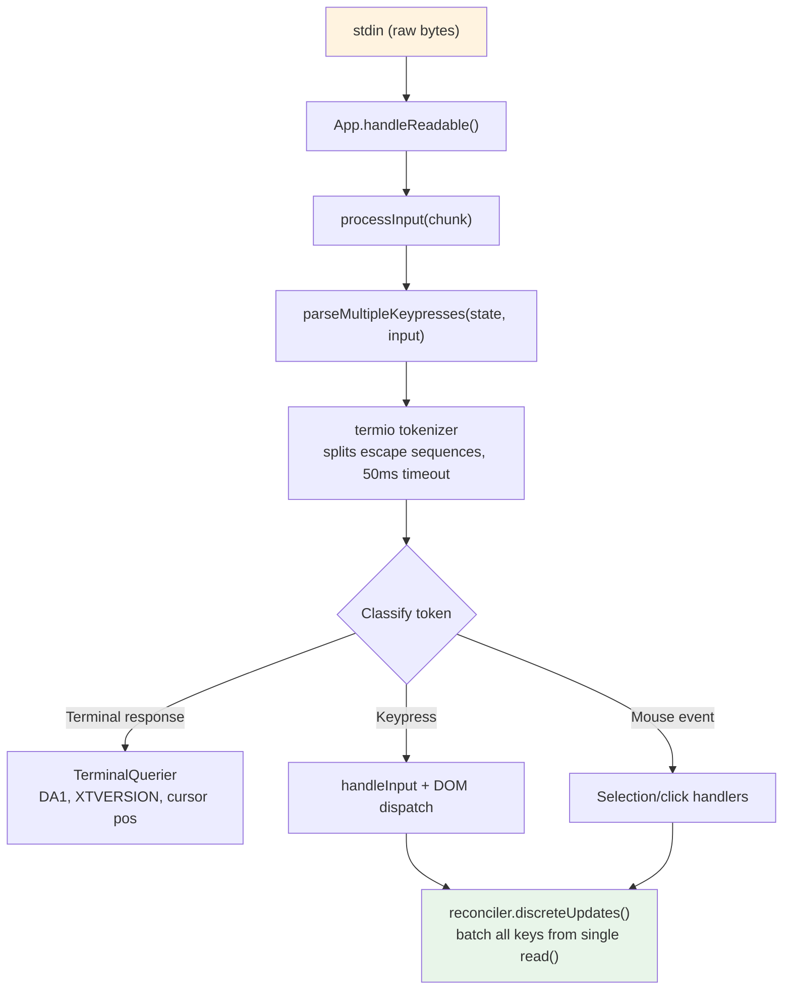
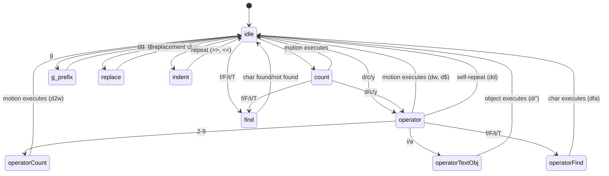

<a id="chapter-14-input-and-interaction"></a>

# 제14장: 입력과 상호작용

<a id="raw-bytes-meaningful-actions"></a>

## 원시 바이트, 의미 있는 작업

Claude Code에서 Ctrl+X를 누른 다음 Ctrl+K를 누르면 터미널은 아마도 200밀리초 간격으로 구분된 2바이트 시퀀스를 보냅니다. 첫 번째는 `0x18`(ASCII CAN)입니다. 두 번째는 `0x0B`(ASCII VT)입니다. 이들 바이트 중 어느 것도 "제어 문자" 이외의 고유한 의미를 갖지 않습니다. 입력 시스템은 시간 초과 창 내에서 순서대로 도착하는 이 두 바이트가 실행 중인 모든 하위 에이전트를 종료하는 `chat:killAgents` 작업에 매핑되는 코드 `ctrl+x ctrl+k`을 구성한다는 것을 인식해야 합니다.

원시 바이트와 종료된 에이전트 사이에서 6개의 시스템이 활성화됩니다. 토크나이저는 이스케이프 시퀀스를 분할하고, 파서는 5개의 터미널 프로토콜에 걸쳐 이를 분류하고, 키 바인딩 확인자는 시퀀스를 컨텍스트별 바인딩과 일치시키고, 코드 상태 머신은 다중 키 시퀀스를 관리하고, 핸들러는 작업을 실행하고, React는 결과 상태 업데이트를 단일 렌더링으로 일괄 처리합니다.

이러한 시스템 중 어느 것에도 어려움이 없습니다. 그것은 말단 다양성의 조합적 폭발에 있습니다. iTerm2는 Kitty 키보드 프로토콜 시퀀스를 보냅니다. macOS 터미널은 레거시 VT220 시퀀스를 보냅니다. SSH를 통한 Ghostty는 xterm 수정OtherKeys를 보냅니다. tmux는 구성에 따라 이들 중 하나를 먹거나 변환하거나 통과할 수 있습니다. Windows 터미널에는 VT 모드에 대한 고유한 특징이 있습니다. 입력 시스템은 모든 것에서 올바른 `ParsedKey` 객체를 생성해야 합니다. 왜냐하면 사용자는 터미널이 어떤 키보드 프로토콜을 사용하는지 알 필요가 없기 때문입니다.

이 장에서는 원시 바이트에서 해당 환경 전반에 걸쳐 의미 있는 작업까지의 경로를 추적합니다.

디자인 철학은 점진적인 향상과 우아한 저하입니다. Kitty 키보드 프로토콜을 지원하는 최신 터미널에서 Claude Code는 전체 수정자 감지(Ctrl+Shift+A는 Ctrl+A와 다름), 수퍼 키 보고(Cmd 단축키) 및 명확한 키 식별 기능을 제공합니다. SSH를 통한 레거시 터미널에서는 사용 가능한 최상의 프로토콜로 대체되어 일부 수정자 구별이 손실되지만 핵심 기능은 그대로 유지됩니다. 사용자에게는 터미널이 지원되지 않는다는 오류 메시지가 표시되지 않습니다. 글로벌 검색에는 `ctrl+shift+f`을 사용하지 못할 수도 있지만 기록 검색에는 `ctrl+r`을 어디에서나 사용할 수 있습니다.

---

<a id="the-key-parsing-pipeline"></a>

## 키 파싱 파이프라인

입력은 stdin에 바이트 덩어리로 도착합니다. 파이프라인은 이를 단계별로 처리합니다.



토크나이저는 기초입니다. 터미널 입력은 명시적인 프레임 없이 인쇄 가능한 문자, 제어 코드 및 멀티바이트 이스케이프 시퀀스를 혼합하는 바이트 스트림입니다. stdin의 단일 `read()`은 PTY에서 얼마나 빠른 바이트가 도착하는지에 따라 `\x1b[1;5A`(Ctrl+위쪽 화살표)을 반환하거나 한 번의 읽기에서는 `\x1b`을 반환하고 다음 읽기에서는 `[1;5A`을 반환할 수 있습니다. 토크나이저는 부분 이스케이프 시퀀스를 버퍼링하고 완전한 토큰을 내보내는 상태 시스템을 유지합니다.

불완전한 수열 문제는 근본적이다. 토크나이저는 `\x1b` 하나만 보면 이것이 Esc 키인지 CSI 시퀀스의 시작인지 알 수 없습니다. 바이트를 버퍼링하고 50ms 타이머를 시작합니다. 연속이 도착하지 않으면 버퍼가 플러시되고 `\x1b`이 Escape 키 누르기가 됩니다. 그러나 플러시하기 전에 토크나이저는 `stdin.readableLength`을 확인합니다. 바이트가 커널 버퍼에서 대기 중인 경우 타이머는 플러시하는 대신 재설정됩니다. 이는 이벤트 루프가 50ms를 초과하여 차단되고 연속 바이트가 이미 버퍼링되었지만 아직 읽혀지지 않은 경우를 처리합니다.

붙여넣기 작업의 경우 시간 초과가 500ms로 확장됩니다. 붙여넣은 텍스트는 크기가 크고 여러 덩어리로 도착할 수 있습니다.

단일 `read()`의 모든 구문 분석된 키는 하나의 `reconciler.discreteUpdates()` 호출로 처리됩니다. 이는 100자를 붙여넣으면 100자가 아닌 하나의 다시 렌더링이 생성되도록 React 상태 업데이트를 일괄 처리합니다. 일괄 처리가 없으면 붙여넣기의 각 문자는 전체 조정 주기(상태 업데이트, 조정, 커밋, 요가 레이아웃, 렌더링, 비교, 쓰기)를 트리거합니다. 사이클당 5ms에서 100자 붙여넣기를 처리하는 데 500ms가 걸립니다. 일괄 처리를 사용하면 동일한 페이스트에 5ms 주기가 걸립니다.

<a id="stdin-management"></a>

### 표준 입력 관리

`App` 구성 요소는 참조 계산을 통해 원시 모드를 관리합니다. 구성 요소에 원시 입력(프롬프트, 대화 상자, vim 모드)이 필요한 경우 `setRawMode(true)`을 호출하여 카운터를 증가시킵니다. 더 이상 원시 입력이 필요하지 않으면 `setRawMode(false)`을 호출하여 감소합니다. 원시 모드는 카운터가 0에 도달한 경우에만 비활성화됩니다. 이는 터미널 응용 프로그램의 일반적인 버그를 방지합니다. 구성 요소 A는 원시 모드를 활성화하고, 구성 요소 B는 원시 모드를 활성화하고, 구성 요소 A는 원시 모드를 비활성화하고, 원시 모드가 전체적으로 비활성화되었기 때문에 갑자기 구성 요소 B의 입력이 중단됩니다.

원시 모드가 처음 활성화되면 앱은 다음을 수행합니다.

1. 초기 입력 캡처를 중지합니다(React가 마운트되기 전에 키 입력을 수집하는 부트스트랩 단계 메커니즘).
2. stdin을 원시 모드로 전환합니다(라인 버퍼링 없음, 에코 없음, 신호 처리 없음).
3. 비동기 입력 처리를 위해 `readable` 리스너를 연결합니다.
4. 괄호 안에 붙여넣기를 활성화합니다(그래서 붙여넣은 텍스트를 식별할 수 있음).
5. 포커스 보고 활성화(앱이 터미널 창에서 포커스를 얻거나 잃는 시기를 알 수 있도록)
6. 확장된 키 보고 활성화(Kitty 키보드 프로토콜 + xterm 수정OtherKeys)

비활성화하면 이 모든 것이 반대 순서로 반전됩니다. 신중한 시퀀싱은 이스케이프 시퀀스 누출을 방지합니다. 원시 모드를 비활성화하기 전에 확장 키 보고를 비활성화하면 앱이 구문 분석을 중지한 후에도 터미널이 Kitty로 인코딩된 시퀀스를 계속 보내지 않도록 할 수 있습니다.

`onExit` 신호 처리기(`signal-exit` 패키지를 통해)는 예기치 않은 종료 시에도 정리가 발생하도록 보장합니다. 프로세스가 SIGTERM 또는 SIGINT를 수신하면 핸들러는 원시 모드를 비활성화하고 터미널 상태를 복원하며 활성화된 경우 대체 화면을 종료하고 프로세스가 종료되기 전에 커서를 다시 표시합니다. 이 정리가 없으면 충돌이 발생한 Claude Code 세션은 커서나 에코 없이 터미널을 원시 모드로 남겨두게 됩니다. 즉, 사용자는 터미널을 복구하려면 맹목적으로 `reset`을 입력해야 합니다.

---

<a id="multi-protocol-support"></a>

## 다중 프로토콜 지원

터미널은 키보드 입력을 인코딩하는 방법에 동의하지 않습니다. Kitty와 같은 최신 터미널 에뮬레이터는 전체 수정자 정보와 함께 구조화된 시퀀스를 보냅니다. SSH를 통한 레거시 터미널은 해석을 위해 컨텍스트가 필요한 모호한 바이트 시퀀스를 보냅니다. Claude Code의 파서는 사용자의 터미널이 그 중 하나일 수 있기 때문에 5개의 개별 프로토콜을 동시에 처리합니다.

**CSI u(Kitty 키보드 프로토콜)**은 최신 표준입니다. 형식: `ESC [ codepoint [; modifier] u`. 예: `ESC[13;2u`은 Shift+Enter이고, `ESC[27u`은 수정자 없이 Escape입니다. 코드 포인트는 키를 명확하게 식별합니다. 즉, Escape-the-key와 Escape-as-sequence-prefix 사이에는 모호성이 없습니다. 수정자 단어는 Shift, Alt, Ctrl 및 Super(Cmd)를 개별 비트로 인코딩합니다. Claude Code는 시작 시 `ENABLE_KITTY_KEYBOARD` 이스케이프 시퀀스를 통해 이를 지원하는 터미널에서 이 프로토콜을 활성화하고 `DISABLE_KITTY_KEYBOARD`을 통해 종료 시 비활성화합니다. 프로토콜은 쿼리/응답 핸드셰이크를 통해 감지됩니다. 애플리케이션은 `CSI ? u`을 보내고 터미널은 `CSI ? flags u`으로 응답합니다. 여기서 `flags`은 지원되는 프로토콜 수준을 나타냅니다.

**xterm 수정OtherKeys**는 Kitty 프로토콜이 협상되지 않는 SSH를 통한 Ghostty와 같은 터미널에 대한 대체입니다. 형식: `ESC [ 27 ; modifier ; keycode ~`. 매개변수 순서는 CSI u와 반대입니다. 수정자는 키코드 앞에 오고 그 다음에는 키코드가 옵니다. 이는 파서 버그의 일반적인 소스입니다. 프로토콜은 `CSI > 4 ; 2 m`을 통해 활성화되고 터미널의 TERM 식별이 감지되지 않을 때 Ghostty, tmux 및 xterm에 의해 방출됩니다(`TERM_PROGRAM`이 전달되지 않는 SSH를 통해 공통).

**레거시 터미널 시퀀스**는 `ESC O` 및 `ESC [` 시퀀스를 통한 기능 키, 화살표 키, 숫자 패드, 홈/끝/삽입/삭제 및 40년 동안 터미널 발전을 통해 축적된 VT100/VT220/xterm 변형의 전체 모음 등 모든 것을 포괄합니다. 파서는 두 가지 정규식을 사용하여 이를 일치시킵니다. `ESC O/N/[/[[` 접두사 패턴(기능 키, 화살표 키 및 수정된 변형 일치)에 대한 `FN_KEY_RE`과 메타 키 코드에 대한 `META_KEY_CODE_RE`(`ESC` 다음에 단일 영숫자, 기존 Alt+키 인코딩)이 사용됩니다.

레거시 시퀀스의 문제점은 모호성입니다. `ESC [ 1 ; 2 R`은 상황에 따라 Shift+F3 또는 커서 위치 보고서일 수 있습니다. 파서는 개인 마커 검사를 통해 이 문제를 해결합니다. 커서 위치 보고서는 `CSI ? row ; col R`(`?` 개인 마커 포함)을 사용하고 수정된 기능 키는 `CSI params R`(이 없음)을 사용합니다. 이러한 명확성은 Claude Code가 표준 CPR 대신 DECXCPR(확장 커서 위치 보고서)을 요청하는 이유입니다. 확장된 형식은 모호하지 않습니다.

터미널 식별은 또 다른 복잡성을 추가합니다. 시작 시 Claude Code는 `XTVERSION` 쿼리(`CSI > 0 q`)를 보내 터미널의 이름과 버전을 검색합니다. SSH를 통해 전파되지 않는 환경 변수인 `TERM_PROGRAM`과 달리 응답(`DCS > | name ST`)은 SSH 연결 후에도 유지됩니다. 터미널 ID를 알면 파서가 터미널별 문제를 처리할 수 있습니다. 예를 들어 xterm.js(VS Code의 통합 터미널에서 사용됨)는 기본 xterm과 다른 이스케이프 시퀀스 동작을 가지며 식별 문자열(`xterm.js(X.Y.Z)`)을 통해 파서는 이러한 차이점을 설명할 수 있습니다.

**SGR 마우스 이벤트**는 `ESC [ < button ; col ; row M/m` 형식을 사용합니다. 여기서 `M`은 press이고 `m`은 release입니다. 버튼 코드는 작업을 인코딩합니다. 왼쪽/가운데/오른쪽 클릭은 0/1/2, 휠 위/아래는 64/65(휠 비트와 0x40 OR'd), 드래그는 32+(모션 비트와 0x20 OR')입니다. 휠 이벤트는 `ParsedKey` 객체로 변환되어 키 바인딩 시스템을 통해 흐릅니다. 클릭 및 드래그 이벤트는 선택 핸들러로 라우팅되는 `ParsedMouse` 객체가 됩니다.

**괄호로 묶인 붙여넣기**는 `ESC [200~` 및 `ESC [201~` 마커 사이에 붙여넣은 콘텐츠를 래핑합니다. 붙여넣은 텍스트에 포함된 이스케이프 시퀀스에 관계없이 마커 사이의 모든 내용은 `isPasted: true`이 포함된 단일 `ParsedKey`이 됩니다. 이는 붙여넣은 코드가 명령으로 해석되는 것을 방지합니다. 이는 사용자가 `\x03`(원시 바이트로 Ctrl+C임)이 포함된 코드 조각을 붙여넣을 때 중요한 안전 기능입니다.

파서의 출력 유형은 명확하게 구별된 공용체를 형성합니다.

```typescript
type ParsedKey = {
  kind: 'key';
  name: string;        // 'return', 'escape', 'a', 'f1', etc.
  ctrl: boolean; meta: boolean; shift: boolean;
  option: boolean; super: boolean;
  sequence: string;    // Raw escape sequence for debugging
  isPasted: boolean;   // Inside bracketed paste
}

type ParsedMouse = {
  kind: 'mouse';
  button: number;      // SGR button code
  action: 'press' | 'release';
  col: number; row: number;  // 1-indexed terminal coordinates
}

type ParsedResponse = {
  kind: 'response';
  response: TerminalResponse;  // Routed to TerminalQuerier
}
```

`kind` 판별자는 다운스트림 코드가 각 입력 유형을 명시적으로 처리하도록 보장합니다. 키는 실수로 마우스 이벤트로 처리될 수 없습니다. 터미널 응답은 실수로 키 누르기로 해석될 수 없습니다. `ParsedKey` 유형은 디버깅을 위한 원시 `sequence` 문자열도 전달합니다. 사용자가 "Ctrl+Shift+A를 눌러도 아무 일도 일어나지 않습니다"라고 보고하면 디버그 로그는 터미널이 보낸 바이트 시퀀스를 정확하게 표시할 수 있으므로 문제가 터미널의 인코딩, 파서의 인식 또는 키 바인딩 구성에 있는지 진단할 수 있습니다.

`ParsedKey`의 `isPasted` 플래그는 보안에 매우 중요합니다. 괄호로 묶인 붙여넣기가 활성화되면 터미널은 붙여넣은 내용을 마커 시퀀스로 래핑합니다. 파서는 결과 키 이벤트에 대해 `isPasted: true`을 설정하고 키 바인딩 확인자는 붙여넣은 키에 대한 키 바인딩 일치를 건너뜁니다. 이것이 없으면 `\x03`(원시 바이트로 Ctrl+C) 또는 이스케이프 시퀀스가 ​​포함된 텍스트를 붙여넣으면 애플리케이션 명령이 트리거됩니다. 이를 통해 붙여넣은 내용은 바이트 내용에 관계없이 리터럴 텍스트 입력으로 처리됩니다.

파서는 또한 터미널 응답, 즉 쿼리에 대한 응답으로 터미널 자체에서 보낸 시퀀스를 인식합니다. 여기에는 장치 속성(DA1, DA2), 커서 위치 보고서, 키티 키보드 플래그 응답, XTVERSION(터미널 식별) 및 DECRPM(모드 상태)이 포함됩니다. 이는 입력 핸들러가 아닌 `TerminalQuerier`으로 라우팅됩니다.

```typescript
type TerminalResponse =
  | { type: 'decrpm'; mode: number; status: number }
  | { type: 'da1'; params: number[] }
  | { type: 'da2'; params: number[] }
  | { type: 'kittyKeyboard'; flags: number }
  | { type: 'cursorPosition'; row: number; col: number }
  | { type: 'osc'; code: number; data: string }
  | { type: 'xtversion'; version: string }
```

**수정자 디코딩**은 XTerm 규칙을 따릅니다. 즉, 수정자 단어는 `1 + (shift ? 1 : 0) + (alt ? 2 : 0) + (ctrl ? 4 : 0) + (super ? 8 : 0)`입니다. `ParsedKey`의 `meta` 필드는 Alt/Option(비트 2)에 매핑됩니다. `super` 필드는 고유합니다(비트 8, macOS에서는 Cmd). Cmd 단축키는 OS에 의해 예약되어 있고 다른 프로토콜이 자동으로 삼키는 슈퍼 수정 키를 보고하는 Kitty 프로토콜을 터미널이 사용하지 않는 한 터미널 애플리케이션에서 캡처할 수 없기 때문에 이러한 구별이 중요합니다.

stdin-gap 감지기는 간격 후 5초 동안 입력이 도착하지 않을 때 터미널 모드 재어설션을 트리거합니다. 이는 멀티플렉서 또는 OS에 의해 터미널의 키보드 모드가 재설정되었을 수 있는 tmux 재연결 및 노트북 깨우기 시나리오를 처리합니다. 재어설션이 실행되면 `ENABLE_KITTY_KEYBOARD`, `ENABLE_MODIFY_OTHER_KEYS`, 괄호로 묶인 붙여넣기 및 포커스 보고 시퀀스를 다시 보냅니다. 이것이 없으면 tmux 세션에서 분리했다가 다시 연결하면 키보드 프로토콜이 자동으로 레거시 모드로 다운그레이드되어 나머지 세션에 대한 수정자 감지가 중단됩니다.

<a id="the-terminal-io-layer"></a>

### 터미널 I/O 레이어

파서 아래에는 `ink/termio/`의 구조화된 터미널 I/O 하위 시스템이 있습니다.

- **csi.ts** -- CSI(Control Sequence Introducer) 시퀀스: 커서 이동, 지우기, 영역 스크롤, 괄호로 묶인 붙여넣기 활성화/비활성화, 포커스 이벤트 활성화/비활성화, Kitty 키보드 프로토콜 활성화/비활성화
- **dec.ts** -- DEC 비공개 모드 시퀀스: 대체 화면 버퍼(1049), 마우스 추적 모드(1000/1002/1003), 커서 가시성, 괄호 안에 붙여넣기(2004), 포커스 이벤트(1004)
- **osc.ts** -- 운영 체제 명령: 클립보드 액세스(OSC 52), 탭 상태, iTerm2 진행 표시기, tmux/스크린 멀티플렉서 래핑(멀티플렉서 경계를 통과해야 하는 시퀀스에 대한 DCS 패스스루)
- **sgr.ts** -- 그래픽 변환 선택: ANSI 스타일 코드 시스템(색상, 굵게, 기울임꼴, 밑줄, 역순)
- **tokenize.ts** -- 이스케이프 시퀀스 경계 감지를 위한 상태 저장 토크나이저

멀티플렉서 래핑은 주목할 가치가 있습니다. Claude Code가 tmux 내에서 실행되면 특정 이스케이프 시퀀스(예: Kitty 키보드 프로토콜 협상)가 외부 터미널을 통과해야 합니다. tmux는 DCS 통과(`ESC P ... ST`)를 사용하여 이해하지 못하는 시퀀스를 전달합니다. `osc.ts`의 `wrapForMultiplexer` 함수는 멀티플렉서 환경을 감지하고 시퀀스를 적절하게 래핑합니다. 이것이 없으면 Kitty 키보드 모드는 tmux 내에서 자동으로 실패하고 사용자는 Ctrl+Shift 바인딩이 작동을 멈춘 이유를 결코 알 수 없습니다.

<a id="the-event-system"></a>

### 이벤트 시스템

`ink/events/` 디렉토리는 7가지 이벤트 유형(`KeyboardEvent`, `ClickEvent`, `FocusEvent`, `InputEvent`, `TerminalFocusEvent` 및 기본 `TerminalEvent`)을 사용하여 브라우저 호환 이벤트 시스템을 구현합니다. 각각은 `target`, `currentTarget`, `eventPhase`을 전달하고 `stopPropagation()`, `stopImmediatePropagation()` 및 `preventDefault()`을 지원합니다.

`ParsedKey`을 래핑하는 `InputEvent`은 이전 구성 요소에서 계속 사용할 수 있는 레거시 `EventEmitter` 경로와의 역호환성을 위해 존재합니다. 새로운 구성 요소는 캡처/버블 단계와 함께 DOM 스타일 키보드 이벤트 전달을 사용합니다. 두 경로 모두 동일한 구문 분석 키에서 실행되므로 항상 일관성이 있습니다. stdin에 도착하는 키는 정확히 하나의 `ParsedKey`을 생성하며, 이는 `InputEvent`(레거시 리스너의 경우)과 `KeyboardEvent`(DOM 스타일 디스패치의 경우)을 모두 생성합니다. 이 이중 경로 설계를 통해 기존 구성 요소를 손상시키지 않고 EventEmitter 패턴에서 DOM 이벤트 패턴으로 점진적인 마이그레이션이 가능합니다.

---

<a id="the-keybinding-system"></a>

## 키바인딩 시스템

키 바인딩 시스템은 종종 서로 얽혀 있는 세 가지 문제를 분리합니다. 즉, 어떤 키가 어떤 작업을 트리거하는지(바인딩), 작업이 실행될 때 어떤 일이 발생하는지(핸들러), 어떤 바인딩이 현재 활성화되어 있는지(컨텍스트)입니다.

<a id="bindings-declarative-configuration"></a>

### 바인딩: 선언적 구성

기본 바인딩은 `defaultBindings.ts`에서 각각 컨텍스트로 범위가 지정된 `KeybindingBlock` 객체의 배열로 정의됩니다.

```typescript
export const DEFAULT_BINDINGS: KeybindingBlock[] = [
  {
    context: 'Global',
    bindings: {
      'ctrl+c': 'app:interrupt',
      'ctrl+d': 'app:exit',
      'ctrl+l': 'app:redraw',
      'ctrl+r': 'history:search',
    },
  },
  {
    context: 'Chat',
    bindings: {
      'escape': 'chat:cancel',
      'ctrl+x ctrl+k': 'chat:killAgents',
      'enter': 'chat:submit',
      'up': 'history:previous',
      'ctrl+x ctrl+e': 'chat:externalEditor',
    },
  },
  // ... 14 more contexts
]
```

플랫폼별 바인딩은 정의 시 처리됩니다. 이미지 붙여넣기는 macOS/Linux에서는 `ctrl+v`이지만 Windows에서는 `alt+v`입니다(여기서 `ctrl+v`은 시스템 붙여넣기임). 모드 순환은 VT 모드를 지원하는 터미널에서는 `shift+tab`이지만, VT 모드가 지원되지 않는 Windows 터미널에서는 `meta+m`입니다. 기능 플래그 바인딩(빠른 검색, 음성 모드, 터미널 패널)은 조건부로 포함됩니다.

사용자는 `~/.claude/keybindings.json`을 통해 모든 바인딩을 재정의할 수 있습니다. 파서는 수정자 별칭(`ctrl`/`control`, `alt`/`opt`/`option`, `cmd`/`command`/`super`/`win`), 키 별칭(`esc`)을 허용합니다. -> `escape`, `return` -> `enter`), 코드 표기법(`ctrl+k ctrl+s`과 같이 공백으로 구분된 단계) 및 기본 키 바인딩을 해제하는 null 작업. null 작업은 바인딩을 정의하지 않는 것과 다릅니다. 기본 바인딩이 실행되는 것을 명시적으로 차단합니다. 이는 터미널에서 사용할 키를 회수하려는 사용자에게 중요합니다.

<a id="contexts-16-scopes-of-activity"></a>

### 상황: 16개 활동 범위

각 컨텍스트는 특정 바인딩 세트가 적용되는 상호 작용 모드를 나타냅니다.

| 맥락 | 활성 상태일 때 |
|---------|------------|
| 글로벌 | 항상 |
| 채팅 | 프롬프트 입력이 집중됨 |
| 자동완성 | 완료 메뉴가 표시됩니다. |
| 확인 | 권한 대화상자가 표시됩니다. |
| 스크롤 | 스크롤 가능한 콘텐츠가 포함된 Alt 화면 |
| 성적 증명서 | 읽기 전용 스크립트 뷰어 |
| 역사검색 | 역이력 검색(ctrl+r) |
| 작업 | 백그라운드 작업이 실행 중입니다. |
| 도움말 | 도움말 오버레이가 표시됩니다 |
| 메시지선택기 | 되감기 대화상자 |
| 메시지작업 | 메시지 커서 탐색 |
| 차이점 대화상자 | 차이점 뷰어 |
| 선택 | 일반 선택 목록 |
| 설정 | 구성 패널 |
| 탭 | 탭 탐색 |
| 바닥글 | 바닥글 표시 |

키가 도착하면 확인자는 현재 활성 컨텍스트(React 구성 요소 상태에 따라 결정됨)에서 컨텍스트 목록을 작성하고 우선 순위를 유지하면서 중복을 제거하고 일치하는 바인딩을 검색합니다. 마지막으로 일치하는 바인딩이 우선합니다. 이는 사용자 재정의가 기본값보다 우선 적용되는 방식입니다. 컨텍스트 목록은 키를 누를 때마다 다시 작성되므로(비용이 저렴합니다. 최대 16개 문자열의 배열 연결 및 중복 제거) 컨텍스트 변경 사항은 구독이나 리스너 메커니즘 없이 즉시 적용됩니다.

컨텍스트 디자인은 중첩된 모달이라는 까다로운 상호 작용 패턴을 처리합니다. 실행 중인 작업 중에 권한 대화 상자가 나타나면 `Confirmation` 및 `Task` 컨텍스트가 모두 활성화될 수 있습니다. `Confirmation` 컨텍스트가 우선순위를 가지므로(나중에 구성 요소 트리에 등록됨) `y`은 작업 수준 바인딩이 아닌 "승인"을 트리거합니다. 대화 상자가 닫히면 `Confirmation` 컨텍스트가 비활성화되고 `Task` 바인딩이 재개됩니다. 이 스태킹 동작은 컨텍스트 목록의 우선순위 순서에서 자연스럽게 나타납니다. 특별한 모달 처리 코드가 필요하지 않습니다.

<a id="reserved-shortcuts"></a>

### 예약된 단축키

모든 것이 리바운드될 수는 없습니다. 시스템은 세 가지 예약 계층을 시행합니다.

**재바인딩 불가**(하드코딩된 동작): `ctrl+c`(인터럽트/종료), `ctrl+d`(종료), `ctrl+m`(모든 터미널에서 Enter와 동일합니다. 다시 바인딩하면 Enter가 중단됩니다).

**터미널 예약**(경고): `ctrl+z`(SIGTSTP), `ctrl+\`(SIGQUIT). 이는 기술적으로 바인딩될 수 있지만 대부분의 구성에서 애플리케이션이 이를 보기 전에 터미널이 이를 가로챌 것입니다.

**macOS 예약**(오류): `cmd+c`, `cmd+v`, `cmd+x`, `cmd+q`, `cmd+w`, `cmd+tab`, `cmd+space`. OS는 터미널에 도달하기 전에 이를 가로챕니다. 이를 바인딩하면 실행되지 않는 바로가기가 생성됩니다.

<a id="the-resolution-flow"></a>

### 해결 흐름

키가 도착하면 해결 경로는 다음과 같습니다.

1. 컨텍스트 목록 작성: 구성요소의 등록된 활성 컨텍스트와 글로벌, 우선순위가 보존된 중복 제거
2. 병합된 바인딩 테이블에 대해 `resolveKeyWithChordState(input, key, contexts)`을 호출합니다.
3. `match`에서: 보류 중인 코드를 지우고 이벤트에서 핸들러 `stopImmediatePropagation()`을 호출합니다.
4. `chord_started`에서: 보류 중인 키 입력을 저장하고, 전파를 중지하고, 코드 시간 초과를 시작합니다.
5. `chord_cancelled`에서: 보류 중인 코드를 지우고 이벤트가 종료되도록 합니다.
6. `unbound`에서: 코드 지우기 - 이는 명시적인 바인딩 해제(사용자가 작업을 `null`으로 설정)이므로 전파는 중지되지만 핸들러는 실행되지 않습니다.
7. `none`에서: 다른 핸들러로 이동

"마지막 승리" 해결 전략은 기본 바인딩과 사용자 바인딩이 모두 `Chat` 컨텍스트에서 `ctrl+k`을 정의하는 경우 사용자 바인딩이 우선한다는 것을 의미합니다. 이는 로드 시 재정의 맵을 구축하는 대신 정의 순서에 따라 바인딩을 반복하고 마지막 일치를 유지하여 일치 시 평가됩니다. 장점: 컨텍스트별 재정의가 자연스럽게 작성됩니다. 사용자는 `Confirmation`의 `enter`에 영향을 주지 않고 `Chat`의 `enter`을 재정의할 수 있습니다.

---

<a id="chord-support"></a>

## 코드 지원

`ctrl+x ctrl+k` 바인딩은 두 개의 키 입력이 함께 단일 동작을 형성하는 코드입니다. 리졸버는 상태 머신을 통해 이를 관리합니다.

열쇠가 도착하면:

1. 리졸버는 보류 중인 코드 접두사에 이를 추가합니다.
2. 바인딩의 코드가 이 접두사로 시작하는지 확인합니다. 그렇다면 `chord_started`을 반환하고 보류 중인 키 입력을 저장합니다.
3. 전체 코드가 바인딩과 정확히 일치하면 `match`을 반환하고 보류 상태를 지웁니다.
4. 코드 접두어가 아무것도 일치하지 않으면 `chord_cancelled`을 반환합니다.

`ChordInterceptor` 구성요소는 코드 대기 상태 동안 모든 입력을 차단합니다. 1000ms의 시간 제한이 있습니다. 두 번째 키 입력이 1초 이내에 도착하지 않으면 코드가 취소되고 첫 번째 키 입력이 삭제됩니다. `KeybindingContext`은 보류 상태에 대한 동기 액세스를 위해 `pendingChordRef`을 제공하여 첫 번째 상태 업데이트가 완료되기 전에 두 번째 키 입력이 처리되도록 할 수 있는 React 상태 업데이트 지연을 방지합니다.

코드 디자인은 readline 편집 키를 가리는 것을 방지합니다. 코드가 없으면 "에이전트 종료"에 대한 키 바인딩은 `ctrl+k`일 수 있습니다. 그러나 이는 사용자가 터미널 텍스트 입력에서 기대하는 readline의 "줄 끝까지 종료"입니다. `ctrl+x`을 접두어로 사용함으로써(readline의 자체 코드 접두어 규칙과 일치) 시스템은 단일 키 편집 단축키와 충돌하지 않는 바인딩의 네임스페이스를 얻습니다.

구현은 대부분의 코드 시스템이 놓치는 극단적인 경우를 처리합니다. 사용자가 `ctrl+x`을 누른 다음 코드의 일부가 아닌 문자를 입력하면 어떻게 됩니까? 조심스럽게 다루지 않으면 해당 문자가 삼켜질 것입니다. 코드 인터셉터가 입력을 소비하고 코드가 취소되어 문자가 사라집니다. 이 경우 Claude Code의 `ChordInterceptor`은 `chord_cancelled`을 반환하므로 보류 중인 입력은 삭제되지만 일치하지 않는 문자는 일반 입력 처리로 넘어갑니다. 성격은 사라지지 않습니다. 코드 접두어만 삭제됩니다. 이는 사용자가 Emacs 스타일 코드 접두사에서 기대하는 동작과 일치합니다.

---

<a id="vim-mode"></a>

## 빔 모드

<a id="the-state-machine"></a>

### 상태 머신

vim 구현은 철저한 유형 검사 기능을 갖춘 순수 상태 시스템입니다. 유형은 문서입니다.

```typescript
export type VimState =
  | { mode: 'INSERT'; insertedText: string }
  | { mode: 'NORMAL'; command: CommandState }

export type CommandState =
  | { type: 'idle' }
  | { type: 'count'; digits: string }
  | { type: 'operator'; op: Operator; count: number }
  | { type: 'operatorCount'; op: Operator; count: number; digits: string }
  | { type: 'operatorFind'; op: Operator; count: number; find: FindType }
  | { type: 'operatorTextObj'; op: Operator; count: number; scope: TextObjScope }
  | { type: 'find'; find: FindType; count: number }
  | { type: 'g'; count: number }
  | { type: 'operatorG'; op: Operator; count: number }
  | { type: 'replace'; count: number }
  | { type: 'indent'; dir: '>' | '<'; count: number }
```

이는 12개의 변형이 있는 구별된 조합입니다. TypeScript의 철저한 검사를 통해 `CommandState.type`의 모든 `switch` 문이 12가지 사례를 모두 처리하도록 보장합니다. 통합에 새 상태를 추가하면 모든 불완전한 스위치에서 컴파일 오류가 발생합니다. 상태 머신은 데드 상태나 누락된 전환을 가질 수 없습니다. 유형 시스템에서는 이를 금지합니다.

각 상태가 다음 전환에 필요한 데이터를 정확히 전달하는 방법에 주목하세요. `operator` 상태는 어떤 연산자(`op`)와 이전 개수를 알고 있습니다. `operatorCount` 상태는 숫자 누산기(`digits`)를 추가합니다. `operatorTextObj` 상태는 범위(`inner` 또는 `around`)를 추가합니다. 어떤 국가도 필요하지 않은 데이터를 전달하지 않습니다. 이는 단지 좋은 취향이 아닙니다. 핸들러가 이전 명령에서 오래된 데이터를 읽는 전체 버그 클래스를 방지합니다. `find` 상태에 있는 경우 `FindType` 및 `count`이 있습니다. 대기 중인 운영자가 없으므로 운영자가 없습니다. 유형은 불가능한 상태를 표현할 수 없게 만듭니다.

상태 다이어그램은 다음과 같은 내용을 담고 있습니다.



`idle`에서 `d`을 누르면 `operator` 상태가 됩니다. `operator`에서 `w`을 누르면 `w` 모션으로 `delete`이 실행됩니다. `d`을 다시 누르면(`dd`) 줄 삭제가 트리거됩니다. `2`을 누르면 `operatorCount`이 입력되므로 `d2w`은 "다음 2단어 삭제"가 됩니다. `i`을 누르면 `operatorTextObj`이 입력되므로 `di"`은 "따옴표 안 삭제"가 됩니다. 모든 중간 상태는 그 이상도 그 이하도 아닌 다음 전환에 필요한 컨텍스트를 정확하게 전달합니다.

<a id="transitions-as-pure-functions"></a>

### 순수 함수로서의 전환

`transition()` 함수는 현재 상태 유형을 10개의 핸들러 함수 중 하나로 전달합니다. 각각은 `TransitionResult`을 반환합니다.

```typescript
type TransitionResult = {
  next?: CommandState;    // New state (omitted = stay in current)
  execute?: () => void;   // Side effect (omitted = no action yet)
}
```

실행되지 않고 부작용이 반환됩니다. 전환 함수는 순수합니다. 상태와 키가 주어지면 다음 상태를 반환하고 선택적으로 작업을 수행하는 클로저를 반환합니다. 호출자는 효과를 실행할 시기를 결정합니다. 이는 상태 머신을 간단하게 테스트 가능하게 만듭니다. 상태와 키를 제공하고, 반환된 상태를 주장하고, 클로저를 무시합니다. 이는 또한 전환 기능이 편집기 상태, 커서 위치 또는 버퍼 내용에 종속되지 않음을 의미합니다. 이러한 세부 정보는 생성 시 클로저에 의해 캡처되며 전환 시 상태 머신에서 사용되지 않습니다.

`fromIdle` 핸들러는 진입점이며 전체 vim 어휘를 다룹니다.

- **카운트 접두어**: `1-9`은 `count` 상태로 들어가 숫자를 누적합니다. `0`은 특별합니다. 숫자가 이미 누적되지 않은 경우 카운트 숫자가 아닌 "줄 시작" 동작입니다.
- **연산자**: `d`, `c`, `y` `operator` 상태로 들어가 모션 또는 텍스트 개체가 범위를 정의할 때까지 기다립니다.
- **찾기**: `f`, `F`, `t`, `T` `find` 상태로 들어가서 검색할 문자를 기다립니다.
- **G-접두사**: `g`은 복합 명령(`gg`, `gj`, `gk`)에 대해 `g` 상태로 전환됩니다.
- **바꾸기**: `r`이 `replace` 상태로 들어가고 대체 문자를 기다립니다.
- **들여쓰기**: `>`, `<` `indent` 상태를 입력합니다(`>>` 및 `<<`의 경우).
- **간단한 동작**: `h/j/k/l/w/b/e/W/B/E/0/^/$` 즉시 실행, 커서 이동
- **즉시 실행되는 명령**: `x`(문자 삭제), `~`(대/소문자 전환), `J`(줄 결합), `p/P`(붙여넣기), `D/C/Y`(연산자 단축키), `G`(끝으로 이동), `.` (점-반복), `;/,`(반복 찾기), `u`(실행 취소), `i/I/a/A/o/O`(삽입 모드 시작)

<a id="motions-operators-and-text-objects"></a>

### 모션, 연산자 및 텍스트 개체

**모션**은 키를 커서 위치에 매핑하는 순수 함수입니다. `resolveMotion(key, cursor, count)`은 모션 `count`을 여러 번 적용하고 커서가 이동을 멈추면 단락합니다(열 0을 지나 왼쪽으로 이동할 수 없습니다). 이 단락은 줄 끝의 `3w`에 중요합니다. 줄 바꿈이나 오류가 아닌 마지막 단어에서 중지됩니다.

모션은 연산자와 상호 작용하는 방식에 따라 분류됩니다.

- **독점**(기본값) - 대상의 문자는 범위에 포함되지 않습니다. `dw`은 다음 단어의 첫 번째 문자까지 삭제합니다.
- **포함** (`e`, `E`, `$`) -- 대상의 문자가 포함됩니다. `de` 현재 단어의 마지막 문자까지 삭제합니다.
- **Linewise** (`j`, `k`, `G`, `gg`, `gj`, `gk`) -- 연산자와 함께 사용하면 범위가 전체 라인을 포함하도록 확장됩니다. `dj`은 두 커서 위치 사이의 문자뿐만 아니라 현재 줄과 그 아래 줄도 삭제합니다.

**연산자**는 범위에 적용됩니다. `delete`은 텍스트를 제거하고 이를 레지스터에 저장합니다. `change`은 텍스트를 제거하고 삽입 모드로 들어갑니다. `yank`은 수정 없이 레지스터에 복사됩니다. `cw`/`cW` 특수 사례는 vim 규칙을 따릅니다. 즉, 변경 단어는 다음 단어의 시작 부분이 아니라 현재 단어의 끝 부분으로 이동합니다(`dw`과 달리).

흥미로운 엣지 케이스 중 하나는 `[Image #N]` 칩 스냅입니다. 단어 모션이 이미지 참조 칩(터미널에서 단일 시각적 단위로 렌더링됨) 내부에 도달하면 범위가 전체 칩을 포괄하도록 확장됩니다. 이는 사용자가 원자 요소로 인식하는 부분 삭제를 방지합니다. 모션 시스템이 전체 칩을 단일 단어로 처리하기 때문에 `[Image #3]`의 절반을 삭제할 수 없습니다.

추가 명령은 예상되는 전체 vim 어휘를 포함합니다: `x`(문자 삭제), `r`(문자 대체), `~`(대소문자 전환), `J`(줄 결합), `p`/`P`(줄별/문자별 인식으로 붙여넣기), `>>` / `<<`(2칸 간격으로 들여쓰기/내어쓰기), `o`/`O`(아래/위 줄을 열고 삽입 모드로 들어감).

**텍스트 개체**는 커서 주위의 경계를 찾습니다. 그들은 "커서가 안에 있는 '사물'은 무엇입니까?"라는 질문에 대답합니다.

단어 개체(`iw`, `aw`, `iW`, `aW`)는 텍스트를 문자소로 분할하고 각각을 단어-문자, 공백 또는 구두점으로 분류하고 선택 항목을 단어 경계로 확장합니다. `i`(내부) 변형은 단어만 선택합니다. `a`(주변) 변형에는 주변 공백이 포함됩니다. 즉, 후행 공백이 선호되며, 줄 끝에 있는 경우 선행 공백으로 돌아갑니다. 대문자 변형(`W`, `aW`)은 공백이 아닌 시퀀스를 단어로 처리하고 구두점 경계를 무시합니다.

견적 개체(`i"`, `a"`, `i'`, `a'`, `` i` ``, `` a` ``)는 현재 줄에서 쌍으로 된 견적을 찾습니다. 쌍은 순서대로 일치합니다(첫 번째와 두 번째 인용문이 쌍을 형성하고, 세 번째와 네 번째 인용문이 다음 쌍을 형성하는 등). 커서가 첫 번째와 두 번째 따옴표 사이에 있으면 일치하는 것입니다. `a` 변형에는 따옴표 문자가 포함됩니다. `i` 변형은 이를 제외합니다.

브래킷 객체(`ib`/`i(`, `ab`/`a(`, `i[`/`a[`, `iB`/`i{`/`aB`/`a{`, `i<`/`a<`) 일치하는 구분 기호에 대한 깊이 추적 검색을 수행합니다. 깊이 0에서 일치하는 쌍을 찾을 때까지 중첩 수를 유지하면서 커서 바깥쪽으로 검색합니다. 이는 중첩된 괄호를 올바르게 처리합니다. `foo((bar))` 내부의 `d i (`은 `(bar)`이 아닌 `bar`을 삭제합니다.

<a id="persistent-state-and-dot-repeat"></a>

### 지속 상태 및 점 반복

vim 모드는 명령 전반에 걸쳐 유지되는 `PersistentState`, 즉 vim을 vim처럼 느끼게 만드는 "메모리"를 유지합니다.

```typescript
interface PersistentState {
  lastChange: RecordedChange;   // For dot-repeat
  lastFind: { type: FindType; char: string };  // For ; and ,
  register: string;             // Yank buffer
  registerIsLinewise: boolean;  // Paste behavior flag
}
```

모든 변경 명령은 삽입, 연산자+모션, 연산자+textObj, 연산자+찾기, 바꾸기, 문자 삭제, 대/소문자 전환, 들여쓰기, 줄 열기 및 조인을 포함하는 구별된 공용체인 `RecordedChange`으로 자체적으로 기록됩니다. `.` 명령은 기록된 개수, 연산자 및 동작을 사용하여 현재 커서 위치에서 정확히 동일한 편집 내용을 재현하여 지속 상태에서 `lastChange`을 재생합니다.

찾기-반복(`;` 및 `,`)은 `lastFind`을 사용합니다. `;` 명령은 같은 방향으로 마지막 찾기를 반복합니다. `,` 명령은 방향을 바꿉니다. `f`은 `F`이 되고, `t`은 `T`이 되며, 그 반대도 마찬가지입니다. 즉, `fa`(다음 'a' 찾기) 후에 `;`은 다음 'a'를 앞으로 찾고 `,`은 다음 'a'를 뒤로 찾습니다. 즉, 사용자가 검색한 방향을 기억할 필요가 없습니다.

레지스터는 잡아당겨 삭제된 텍스트를 추적합니다. 레지스터 내용이 `\n`으로 끝나면 라인 단위로 플래그가 지정되어 붙여넣기 동작이 변경됩니다. `p`은 현재 라인 아래에 삽입하고(커서 뒤가 아님) `P`은 위에 삽입합니다. 이러한 구별은 사용자에게는 보이지 않지만 vim 사용자가 지속적으로 사용하는 "줄 삭제, 다른 곳에 붙여넣기" 작업 흐름에는 중요합니다.

---

<a id="virtual-scrolling"></a>

## 가상 스크롤

긴 Claude Code 세션은 긴 대화를 만들어냅니다. 과도한 디버깅 세션에서는 각각 마크다운, 코드 블록, 도구 사용 결과 및 권한 레코드가 포함된 200개 이상의 메시지가 생성될 수 있습니다. 가상화가 없다면 React는 각각 고유한 상태, 효과 및 메모 캐시가 있는 200개 이상의 구성 요소 하위 트리를 메모리에 유지하게 됩니다. DOM 트리에는 수천 개의 노드가 포함됩니다. 요가 레이아웃은 모든 프레임에서 모든 것을 방문합니다. 터미널을 사용할 수 없게 됩니다.

`VirtualMessageList` 구성요소는 뷰포트에 표시되는 메시지와 위와 아래의 작은 버퍼만 렌더링하여 이 문제를 해결합니다. 수백 개의 메시지가 있는 대화에서 이는 500개의 React 하위 트리(각각 마크다운 구문 분석, 구문 강조 및 도구 사용 블록 포함)를 마운트하는 것과 15개를 마운트하는 것의 차이입니다.

구성요소는 다음을 유지합니다.

- 메시지당 **높이 캐시**, 터미널 열 개수가 변경되면 무효화됨
- 스크립트 검색 탐색을 위한 **점프 핸들**(색인으로 이동, 다음/이전 일치)
- 웜 캐시 지원으로 **검색 텍스트 추출**(사용자가 `/`을 입력하면 모든 메시지가 소문자로 사전 설정됨)
- **고정 프롬프트 추적** - 사용자가 입력에서 다른쪽으로 스크롤하면 마지막 프롬프트 텍스트가 상단에 컨텍스트로 표시됩니다.
- **메시지 작업 탐색** -- 되감기 기능을 위한 커서 기반 메시지 선택

`useVirtualScroll` 훅은 `scrollTop`, `viewportHeight` 및 누적 메시지 높이를 기반으로 탑재할 메시지를 계산합니다. 버스트 `scrollTo` 호출이 React의 비동기 재렌더링을 지나 경주할 때 빈 화면을 방지하기 위해 `ScrollBox`에서 스크롤 클램프 범위를 유지합니다. 이는 스크롤 위치가 DOM 업데이트를 초과할 수 있는 가상화된 목록의 고전적인 문제입니다.

가상 스크롤과 마크다운 토큰 캐시 간의 상호 작용은 주목할 가치가 있습니다. 메시지가 뷰포트 밖으로 스크롤되면 해당 React 하위 트리가 마운트 해제됩니다. 사용자가 뒤로 스크롤하면 하위 트리가 다시 마운트됩니다. 캐싱이 없으면 사용자가 스크롤하여 지나간 모든 메시지에 대해 마크다운을 다시 구문 분석해야 한다는 의미입니다. 모듈 수준 LRU 캐시(콘텐츠 해시로 키가 지정된 500개 항목)는 구성 요소가 마운트 및 마운트 해제되는 횟수에 관계없이 비용이 많이 드는 `marked.lexer()` 호출이 고유한 메시지 콘텐츠당 최대 한 번 발생하도록 보장합니다.

`ScrollBox` 구성 요소 자체는 `useImperativeHandle`을 통해 명령형 API를 제공합니다.

- `scrollTo(y)` -- 절대 스크롤, 고정 스크롤 모드 중단
- `scrollBy(dy)` - `pendingScrollDelta`에 누적되고 렌더러에 의해 제한된 속도로 배수됩니다.
- `scrollToElement(el, offset)` -- 위치 읽기를 `scrollAnchor`을 통해 렌더링 시간으로 연기합니다.
- `scrollToBottom()` -- 고정 스크롤 모드를 다시 활성화합니다.
- `setClampBounds(min, max)` -- 가상 스크롤 창을 제한합니다.

모든 스크롤 변형은 DOM 노드 속성으로 직접 이동하고 React의 조정자를 우회하여 마이크로태스크를 통해 렌더링을 예약합니다. `markScrollActivity()` 호출은 백그라운드 간격(스피너, 타이머)에 다음 틱을 건너뛰도록 신호를 보내 활성 스크롤 중에 이벤트 루프 경합을 줄입니다. 이는 협조적 스케줄링 패턴입니다. 스크롤 경로는 백그라운드 작업에 "대기 시간에 민감한 작업 중입니다. 양보해 주십시오."라고 알려줍니다. 백그라운드 간격은 다음 틱을 예약하기 전에 이 플래그를 확인하고 스크롤이 활성화된 경우 한 프레임씩 지연합니다. 그 결과 여러 개의 스피너와 타이머가 백그라운드에서 실행 중인 경우에도 일관되게 부드러운 스크롤이 이루어집니다.

---

<a id="apply-this-building-a-context-aware-keybinding-system"></a>

## 적용: 상황 인식 키 바인딩 시스템 구축

Claude Code의 키 바인딩 아키텍처는 편집기, IDE, 그리기 도구, 터미널 멀티플렉서 등 모달 입력이 있는 모든 애플리케이션에 대한 템플릿을 제공합니다. 주요 통찰력:

**핸들러와 별도의 바인딩.** 바인딩은 데이터입니다(키가 어떤 작업 이름에 매핑되는지). 핸들러는 코드입니다(액션이 실행될 때 발생하는 작업). 이를 별도로 유지한다는 것은 사용자 정의를 위해 바인딩을 JSON으로 직렬화할 수 있는 반면 핸들러는 관련 상태를 소유하는 구성 요소에 남아 있음을 의미합니다. 사용자는 구성 요소 코드를 건드리지 않고도 `ctrl+k`을 `chat:submit`에 리바인드할 수 있습니다.

**최상급 개념으로서의 컨텍스트.** 하나의 단순 키맵 대신 애플리케이션 상태에 따라 활성화 및 비활성화되는 컨텍스트를 정의합니다. 대화 상자가 열리면 `Confirmation` 컨텍스트가 활성화되고 해당 바인딩이 `Chat` 바인딩보다 우선합니다. 대화 상자가 닫히면 `Chat` 바인딩이 재개됩니다. 이렇게 하면 이벤트 핸들러를 통해 분산된 `if (dialogOpen && key === 'y')`의 조건부 수프가 제거됩니다.

**명시적 기계로서의 코드 상태.** 다중 키 시퀀스(코드)는 단일 키 바인딩의 특별한 경우가 아닙니다. 이는 시간 초과 및 취소 의미 체계가 있는 상태 기계가 필요한 다른 종류의 바인딩입니다. 이를 명시적으로 만들면(전용 `ChordInterceptor` 구성 요소 및 `pendingChordRef`을 사용하여) React의 상태 업데이트가 아직 전파되지 않았기 때문에 코드의 두 번째 키 입력이 다른 핸들러에서 사용되는 미묘한 버그를 방지할 수 있습니다.

**조기 예약하고 명확하게 경고합니다.** 해결 시간이 아닌 정의 시간에 다시 바인딩할 수 없는 키(시스템 단축키, 터미널 제어 문자)를 식별합니다. 사용자가 `ctrl+c`을 바인딩하려고 하면 절대 실행되지 않는 바인딩을 자동으로 수락하는 대신 구성 로드 중에 오류를 표시합니다. 이것이 작동하는 키 바인딩 시스템과 신비한 버그 보고서를 생성하는 시스템의 차이점입니다.

**터미널 다양성을 위한 설계.** Claude Code의 키 바인딩 시스템은 핸들러 수준이 아닌 바인딩 수준에서 플랫폼별 대안을 정의합니다. 이미지 붙여넣기는 OS에 따라 `ctrl+v` 또는 `alt+v`입니다. 모드 순환은 VT 모드 지원에 따라 `shift+tab` 또는 `meta+m`입니다. 각 작업의 핸들러는 어떤 키가 해당 작업을 트리거하는지에 관계없이 동일합니다. 이는 테스트가 플랫폼 키 조합당 하나가 아닌 작업당 하나의 코드 경로를 포함한다는 것을 의미합니다. 그리고 새로운 터미널 문제가 나타나면(예를 들어 Node 24.2.0 이전에 VT 모드가 없는 Windows 터미널) 수정 사항은 핸들러 코드의 분산된 `if (platform === 'windows')` 검사 세트가 아니라 바인딩 정의의 단일 조건부입니다.

**탈출 해치를 제공합니다.** null 작업 바인딩 해제 메커니즘은 작지만 중요합니다. 터미널 멀티플렉서 내에서 Claude Code를 실행하는 사용자는 `ctrl+t`(todos 토글)이 멀티플렉서의 탭 전환 바로가기와 충돌하는 것을 발견할 수 있습니다. keybindings.json에 `{ "ctrl+t": null }`을 추가하면 바인딩이 완전히 비활성화됩니다. 키 누름은 멀티플렉서로 전달됩니다. null 바인딩 해제가 없으면 사용자의 유일한 옵션은 `ctrl+t`을 원하지 않는 다른 작업에 다시 바인딩하거나 멀티플렉서를 재구성하는 것입니다. 둘 다 좋은 경험이 아닙니다.

vim 모드 구현은 **유형 시스템이 상태 시스템을 적용하도록 합니다**라는 교훈을 하나 더 추가합니다. 12가지 변형 `CommandState` 공용체를 사용하면 스위치 문의 상태를 잊는 것이 불가능해집니다. `TransitionResult` 유형은 상태 변경과 부작용을 분리하여 기계를 순수 기능으로 테스트할 수 있게 만듭니다. 애플리케이션에 모달 입력이 있는 경우 모드를 구별된 공용체로 표현하고 컴파일러가 완전성을 확인하도록 합니다. 유형을 정의하는 데 소요된 시간은 런타임 버그를 제거함으로써 그 자체로 가치가 있습니다.

대안을 고려해보세요: 변경 가능한 상태와 명령형 조건을 사용하는 vim 구현입니다. `fromOperator` 핸들러는 각 분기가 공유 변수를 변경하는 `if (mode === 'operator' && pendingCount !== null && isDigit(key))` 검사의 중첩입니다. 새 상태(예: 매크로 기록 모드)를 추가하려면 새 상태가 처리되는지 확인하기 위해 모든 분기를 감사해야 합니다. 구별된 공용체를 사용하면 컴파일러가 감사를 수행합니다. 즉, 새 변형을 추가하는 PR은 모든 스위치 문이 이를 처리할 때까지 빌드되지 않습니다.

이것이 Claude Code 입력 시스템의 더 깊은 교훈입니다. 모든 계층(토크나이저, 파서, 키 바인딩 확인자, vim 상태 머신)에서 아키텍처는 구조화되지 않은 입력을 유형이 지정되고 철저하게 처리되는 구조로 가능한 한 빨리 변환합니다. 원시 바이트는 파서 경계에서 `ParsedKey`이 됩니다. `ParsedKey`은 키 바인딩 경계에서 작업 이름이 됩니다. 작업 이름은 구성 요소 경계에서 형식화된 처리기가 됩니다. 각 변환은 가능한 상태의 공간을 좁히고 각 축소는 TypeScript의 유형 시스템에 의해 시행됩니다. 키 입력이 애플리케이션 로직에 도달할 때쯤이면 모호성은 사라집니다. "키가 정의되지 않으면 어떻게 되나요?" “수식어 조합이 불가능하면 어떡하지?”는 없다. 유형은 이미 해당 상태의 존재를 금지했습니다.

두 장이 함께 하나의 이야기를 전합니다. 13장에서는 렌더링 시스템이 어떻게 불필요한 작업을 제거하는지 보여주었습니다. 즉, 변경되지 않은 영역 블릿팅, 반복 값 삽입, 셀 수준에서의 비교, 손상 범위 추적 등이 있었습니다. 14장에서는 입력 시스템이 어떻게 모호성을 제거하는지 보여주었습니다. 다섯 가지 프로토콜을 하나의 유형으로 구문 분석하고, 상황에 맞는 바인딩에 대해 키를 확인하고, 모달 상태를 철저한 공용체로 표현했습니다. 렌더링 시스템은 "어떻게 24,000개의 셀을 초당 60회 칠합니까?"라고 대답합니다. 입력 시스템은 "조각난 생태계에서 바이트 스트림을 의미 있는 작업으로 어떻게 전환합니까?"라고 대답합니다. 두 답변 모두 동일한 원칙을 따릅니다. 즉, 복잡성을 한 번에 올바르게 처리할 수 있는 경계까지 밀어넣어 모든 다운스트림이 깨끗하고 형식화되었으며 제한된 데이터에서 작동하도록 합니다. 터미널은 혼돈이다. 신청은 순서입니다. 경계 코드는 하나를 다른 코드로 변환하는 어려운 작업을 수행합니다.

---

<a id="summary-two-systems-one-design-philosophy"></a>

## 요약: 두 개의 시스템, 하나의 디자인 철학

13장과 14장에서는 터미널 인터페이스의 두 부분, 즉 출력과 입력을 다루었습니다. 서로 다른 관심사에도 불구하고 두 시스템 모두 동일한 아키텍처 원칙을 따릅니다.

**인터닝 및 간접 참조.** 렌더링 시스템은 문자, 스타일 및 하이퍼링크를 풀로 인턴하여 핫 경로 전체에서 문자열 비교를 정수 비교로 대체합니다. 입력 시스템은 이스케이프 시퀀스를 파서 경계에서 구조화된 `ParsedKey` 객체로 인턴하여 바이트 수준 패턴 일치를 핸들러 경로 전체에 걸쳐 입력된 필드 액세스로 대체합니다.

**계층화된 작업 제거.** 렌더링 시스템은 각각 불필요한 계산 범주를 제거하는 5가지 최적화(더티 플래그, 블릿, 손상 직사각형, 셀 수준 차이, 패치 최적화)를 스택합니다. 입력 시스템은 각각 모호성 범주를 제거하는 세 가지(토크나이저, 프로토콜 파서, 키 바인딩 확인자) 스택입니다.

**순수 함수 및 유형화된 상태 기계.** vim 모드는 유형화된 전환이 있는 순수 상태 기계입니다. 키 바인딩 확인자는 (키, 컨텍스트, 코드 상태)에서 확인 결과까지의 순수 기능입니다. 렌더링 파이프라인은 (DOM 트리, 이전 화면)에서 (새 화면, 패치)까지의 순수 기능입니다. 부작용은 핵심 로직이 아닌 경계(stdout에 쓰기, React에 디스패치)에서 발생합니다.

**환경 전반에 걸쳐 점진적인 성능 저하.** 렌더링 시스템은 터미널 크기, 대체 화면 지원 및 동기화된 업데이트 프로토콜 가용성에 맞게 조정됩니다. 입력 시스템은 Kitty 키보드 프로토콜, xterm 수정OtherKeys, 레거시 VT 시퀀스 및 멀티플렉서 통과 요구 사항에 맞게 조정됩니다. 두 시스템 모두 작동을 위해 특정 터미널이 필요하지 않습니다. 둘 다 더 유능한 터미널에서 더 좋아집니다.

이러한 원칙은 터미널 애플리케이션에만 국한되지 않습니다. 이는 고주파수 입력을 처리하고 다양한 런타임 환경에서 지연 시간이 짧은 출력을 생성해야 하는 모든 시스템에 적용됩니다. 터미널은 이러한 원칙을 위반하면 즉시 눈에 띄는 성능 저하(프레임 삭제, 키 입력 삼키기, 깜박임)가 발생할 정도로 제약 조건이 엄격한 환경입니다. 그 날카로움이 그를 훌륭한 선생님으로 만든다.

다음 장에서는 UI 계층에서 프로토콜 계층으로 이동합니다. Claude Code가 MCP를 구현하는 방법은 모든 외부 서비스를 일류 도구로 만드는 범용 도구 프로토콜입니다. 터미널 UI는 사용자 경험의 마지막 단계를 처리합니다. 즉, 데이터 구조를 화면의 픽셀로 변환하고 키 입력을 애플리케이션 작업으로 변환합니다. MCP는 에이전트의 자체 코드베이스 외부에 있는 도구를 검색, 연결 및 실행하는 첫 번째 확장성을 처리합니다. 그 사이에서 메모리 시스템(11장)과 스킬/훅 시스템(12장)은 지능 및 제어 계층을 정의합니다. 전체 시스템의 품질 상한선은 네 가지 모두에 따라 달라집니다. 즉, 지연된 UI를 보상하는 모델 지능이 없고, 필요한 도구에 도달할 수 없는 모델을 보상하는 렌더링 성능이 없습니다.
