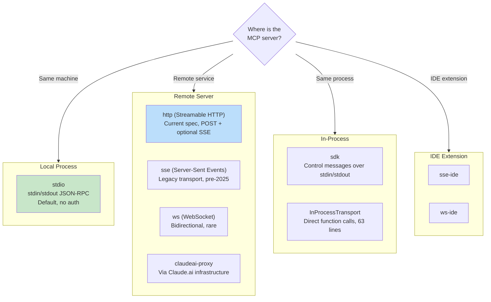
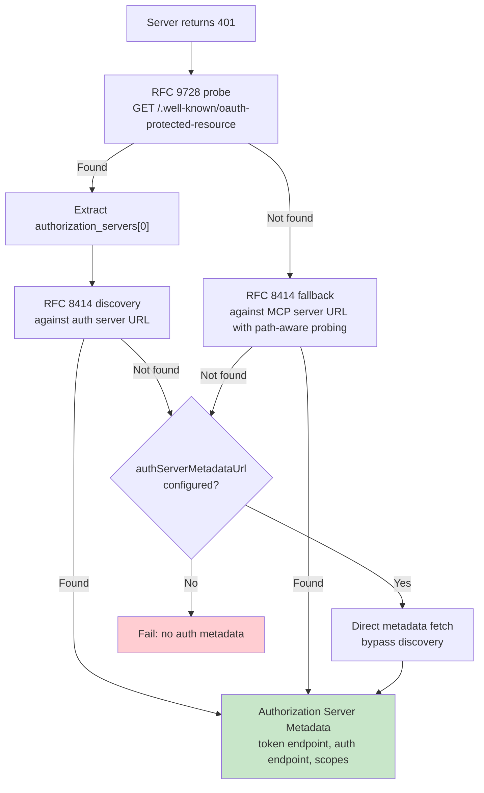

<a id="chapter-15-mcp----the-universal-tool-protocol"></a>

# 제15장: MCP — 범용 도구 프로토콜

<a id="why-mcp-matters-beyond-claude-code"></a>

## MCP가 Claude Code 이상으로 중요한 이유

이 책의 다른 모든 장은 Claude Code의 내부에 관한 것입니다. 이것은 다릅니다. Model Context Protocol은 모든 에이전트가 구현할 수 있는 개방형 사양이며 Claude Code의 MCP 하위 시스템은 현존하는 가장 완벽한 프로덕션 클라이언트 중 하나입니다. 외부 도구(모든 에이전트, 모든 언어, 모든 모델)를 호출해야 하는 에이전트를 구축하는 경우 이 장의 패턴이 직접 전달됩니다.

핵심 제안은 간단합니다. MCP는 클라이언트(에이전트)와 서버(도구 공급자) 간의 도구 검색 및 호출을 위한 JSON-RPC 2.0 프로토콜을 정의합니다. 클라이언트는 `tools/list`을 보내 서버가 제공하는 것을 검색한 다음 `tools/call`을 보내 실행합니다. 서버는 입력에 대한 이름, 설명 및 JSON 스키마를 사용하여 각 도구를 설명합니다. 이것이 전체 계약입니다. 그 밖의 모든 것(전송 선택, 인증, 구성 로딩, 도구 이름 정규화)은 깨끗한 사양을 실제 세계와 접촉해도 살아남을 수 있는 것으로 바꾸는 구현 작업입니다.

Claude Code의 MCP 구현은 `types.ts`, `client.ts`, `auth.ts` 및 `InProcessTransport.ts`의 네 가지 핵심 파일에 걸쳐 있습니다. 이들은 8개의 전송 유형, 7개의 구성 범위, 두 개의 RFC에 대한 OAuth 검색 및 MCP 도구를 내장 도구와 구별할 수 없게 만드는 도구 래핑 계층(6장에서 다룬 것과 동일한 `Tool` 인터페이스)을 지원합니다. 이 장에서는 각 계층을 살펴봅니다.

---

<a id="eight-transport-types"></a>

## 8가지 운송 유형

MCP 통합의 첫 번째 디자인 결정은 클라이언트가 서버와 통신하는 방식입니다. Claude Code는 8가지 전송 구성을 지원합니다.



세 가지 디자인 선택은 주목할 가치가 있습니다. 첫째, `stdio`이 기본값입니다. `type`이 생략되면 시스템은 로컬 하위 프로세스를 가정합니다. 이는 초기 MCP 구성과 역호환됩니다. 둘째, 페치 래퍼 스택: 스텝업 감지 외부, 기본 페치 외부에서 시간 초과 래핑입니다. 각 래퍼는 하나의 문제를 처리합니다. 셋째, `ws-ide` 분기에는 Bun/Node 런타임 분할이 있습니다. Bun의 `WebSocket`은 기본적으로 프록시 및 TLS 옵션을 허용하는 반면 Node에는 `ws` 패키지가 필요합니다.

**어떤 것을 사용해야 하는 경우.** 로컬 도구(파일 시스템, 데이터베이스, 사용자 정의 스크립트)의 경우 `stdio` -- 네트워크 없음, 인증 없음, 파이프만 있음. 원격 서비스의 경우 `http`(스트리밍 가능 HTTP)이 현재 사양 권장 사항입니다. `sse`은 레거시이지만 널리 배포됩니다. `sdk`, IDE 및 `claudeai-proxy` 유형은 해당 생태계 내부에 있습니다.

---

<a id="configuration-loading-and-scoping"></a>

## 구성 로딩 및 범위 지정

MCP 서버 구성은 병합 및 중복 제거된 7개 범위에서 로드됩니다.

| 범위 | 소스 | 신뢰 |
|-------|--------|-------|
| `local` | 작업 디렉토리의 `.mcp.json` | 사용자 승인이 필요합니다 |
| `user` | `~/.claude.json` mcpServers 필드 | 사용자 관리 |
| `project` | 프로젝트 수준 구성 | 공유 프로젝트 설정 |
| `enterprise` | 관리형 엔터프라이즈 구성 | 조직에서 사전 승인함 |
| `managed` | 플러그인 제공 서버 | 자동 검색됨 |
| `claudeai` | Claude.ai 웹 인터페이스 | 웹을 통해 사전 승인됨 |
| `dynamic` | 런타임 주입(SDK) | 프로그래밍 방식으로 추가됨 |

**중복 제거는 이름 기반이 아닌 콘텐츠 기반입니다.** 이름은 다르지만 명령이나 URL이 동일한 두 서버는 동일한 서버로 인식됩니다. `getMcpServerSignature()` 함수는 정식 키(로컬 서버의 경우 `stdio:["command","arg1"]`, 원격 서버의 경우 `url:https://example.com/mcp`)를 계산합니다. 서명이 수동 구성과 일치하는 플러그인 제공 서버는 억제됩니다.

---

<a id="tool-wrapping-from-mcp-to-claude-code"></a>

## 도구 래핑: MCP에서 Claude Code까지

연결이 성공하면 클라이언트는 `tools/list`을 호출합니다. 각 도구 정의는 내장 도구에서 사용되는 것과 동일한 인터페이스인 Claude Code의 내부 `Tool` 인터페이스로 변환됩니다. 래핑 후에는 모델이 기본 제공 도구와 MCP 도구를 구분할 수 없습니다.

포장 과정은 4단계로 구성됩니다.

**1. 이름 정규화.** `normalizeNameForMCP()`은 유효하지 않은 문자를 밑줄로 바꿉니다. 정규화된 이름은 `mcp__{serverName}__{toolName}` 뒤에 옵니다.

**2. 설명 잘림.** 최대 2,048자까지 가능합니다. OpenAPI 생성 서버가 `tool.description`에 15~60KB를 덤프하는 것으로 관찰되었습니다. 이는 단일 도구에 대해 턴당 약 15,000개의 토큰입니다.

**3. 스키마 통과.** 도구의 `inputSchema`이 API에 직접 전달됩니다. 변환이 없고 래핑 시 검증도 없습니다. 스키마 오류는 등록 시간이 아닌 호출 시간에 나타납니다.

**4. 주석 매핑.** MCP 주석은 동작 플래그에 매핑됩니다. `readOnlyHint`은 동시 실행에 안전한 도구를 표시하고(7장의 스트리밍 실행기에서 설명한 대로) `destructiveHint`은 추가 권한 조사를 트리거합니다. 이러한 주석은 MCP 서버에서 나옵니다. 악의적인 서버는 파괴적인 도구를 읽기 전용으로 표시할 수 있습니다. 이는 허용되는 신뢰 경계이지만 이해해야 할 사항입니다. 사용자가 서버를 선택했으며 파괴적인 도구를 읽기 전용으로 표시하는 악성 서버가 실제 공격 벡터입니다. 주석을 완전히 무시하는 대안으로 인해 합법적인 서버가 사용자 경험을 개선하지 못하게 되므로 시스템은 이러한 절충안을 받아들입니다.

---

<a id="oauth-for-mcp-servers"></a>

## MCP 서버용 OAuth

원격 MCP 서버에는 인증이 필요한 경우가 많습니다. Claude Code는 RFC 기반 검색, 앱 간 액세스 및 오류 본문 정규화를 통해 전체 OAuth 2.0 + PKCE 흐름을 구현합니다.

<a id="discovery-chain"></a>

### 디스커버리 체인



일부 OAuth 서버는 RFC를 구현하지 않기 때문에 `authServerMetadataUrl` 탈출 해치가 존재합니다.

<a id="cross-app-access-xaa"></a>

### XAA(교차 앱 액세스)

MCP 서버 구성에 `oauth.xaa: true`이 있으면 시스템은 ID 공급자를 통해 페더레이션 토큰 교환을 수행합니다. 하나의 IdP 로그인으로 여러 MCP 서버의 잠금이 해제됩니다.

<a id="error-body-normalization"></a>

### 오류 본문 정규화

`normalizeOAuthErrorBody()` 함수는 사양을 위반하는 OAuth 서버를 처리합니다. Slack은 JSON 본문에 오류가 묻혀 있는 오류 응답에 대해 HTTP 200을 반환합니다. 이 함수는 2xx POST 응답 본문을 살펴보고 본문이 `OAuthErrorResponseSchema`과 일치하지만 `OAuthTokensSchema`과 일치하지 않으면 HTTP 400에 대한 응답을 다시 작성합니다. 또한 Slack 관련 오류 코드(`invalid_refresh_token`, `expired_refresh_token`, `token_expired`)를 표준 `invalid_grant`으로 정규화합니다.

---

<a id="in-process-transport"></a>

## 공정 내 운송

모든 MCP 서버가 별도의 프로세스일 필요는 없습니다. `InProcessTransport` 클래스를 사용하면 동일한 프로세스에서 MCP 서버와 클라이언트를 실행할 수 있습니다.

```typescript
class InProcessTransport implements Transport {
  async send(message: JSONRPCMessage): Promise<void> {
    if (this.closed) throw new Error('Transport is closed')
    queueMicrotask(() => { this.peer?.onmessage?.(message) })
  }
  async close(): Promise<void> {
    if (this.closed) return
    this.closed = true
    this.onclose?.()
    if (this.peer && !this.peer.closed) {
      this.peer.closed = true
      this.peer.onclose?.()
    }
  }
}
```

전체 파일은 63줄입니다. 두 가지 디자인 결정에 주목할 가치가 있습니다. 첫째, `send()`은 동기 요청/응답 주기에서 스택 깊이 문제를 방지하기 위해 `queueMicrotask()`을 통해 전달합니다. 둘째, `close()`은 피어에 캐스케이드되어 반개방 상태를 방지합니다. Chrome MCP 서버와 컴퓨터 사용 MCP 서버는 모두 이 패턴을 사용합니다.

---

<a id="connection-management"></a>

## 연결 관리

<a id="connection-states"></a>

### 연결 상태

각 MCP 서버 연결은 `connected`, `failed`, `needs-auth`(30개의 서버가 동일한 만료된 토큰을 독립적으로 검색하지 못하도록 15분 TTL 캐시 포함), `pending` 또는 `disabled`의 5가지 상태 중 하나로 존재합니다.

<a id="session-expiry-detection"></a>

### 세션 만료 감지

MCP의 Streamable HTTP 전송은 세션 ID를 사용합니다. 서버가 다시 시작되면 요청은 JSON-RPC 오류 코드 -32001과 함께 HTTP 404를 반환합니다. `isMcpSessionExpiredError()` 함수는 두 신호를 모두 확인합니다. 실용적이지만 깨지기 쉬운 오류 코드를 감지하기 위해 오류 메시지에 문자열 포함을 사용한다는 점에 유의하세요.

```typescript
export function isMcpSessionExpiredError(error: Error): boolean {
  const httpStatus = 'code' in error ? (error as any).code : undefined
  if (httpStatus !== 404) return false
  return error.message.includes('"code":-32001') ||
    error.message.includes('"code": -32001')
}
```

감지되면 연결 캐시가 지워지고 호출이 한 번 다시 시도됩니다.

<a id="batched-connections"></a>

### 일괄 연결

로컬 서버는 3개 배치로 연결되고(생성 프로세스는 파일 설명자를 소진할 수 있음), 원격 서버는 20개 배치로 연결됩니다. React 컨텍스트 제공자 `MCPConnectionManager.tsx`은 수명 주기를 관리하여 새 구성과 현재 연결을 비교합니다.

---

<a id="claudeai-proxy-transport"></a>

## Claude.ai 프록시 전송

`claudeai-proxy` 전송은 중개자를 통한 연결이라는 일반적인 에이전트 통합 패턴을 보여줍니다. Claude.ai 가입자는 웹 인터페이스를 통해 MCP "커넥터"를 구성하고 CLI는 공급업체 측 OAuth를 처리하는 Claude.ai의 인프라를 통해 라우팅됩니다.

`createClaudeAiProxyFetch()` 함수는 401 이후 다시 읽지 않고 요청 시 `sentToken`을 캡처합니다. 여러 커넥터의 동시 401에서 다른 커넥터의 재시도가 이미 토큰을 새로 고쳤을 수 있습니다. 또한 이 함수는 새로 고침 핸들러가 false(다른 커넥터가 잠금 파일 경합에서 승리한 "ELOCKED 경합" 경우)를 반환하는 경우에도 동시 새로 고침을 확인합니다.

---

<a id="timeout-architecture"></a>

## 시간 초과 아키텍처

MCP 시간 초과는 계층화되어 있으며 각각 다른 실패 모드로부터 보호됩니다.

| 레이어 | 기간 | 보호합니다 |
|-------|----------|------------------|
| 연결 | 30s | 연결할 수 없거나 느리게 시작되는 서버 |
| 요청별 | 60초(요청당 최신) | 오래된 시간 초과 신호 버그 |
| 도구 호출 | ~27.8시간 | 합법적으로 긴 작업 |
| 인증 | OAuth 요청당 30초 | 연결할 수 없는 OAuth 서버 |

요청별 시간 제한은 강조할 가치가 있습니다. 초기 구현에서는 연결 시 단일 `AbortSignal.timeout(60000)`을 생성했습니다. 60초의 유휴 시간이 지나면 다음 요청이 즉시 중단됩니다. 즉, 신호가 이미 만료되었습니다. 수정 사항: `wrapFetchWithTimeout()`은 모든 요청에 ​​대해 새로운 시간 초과 신호를 생성합니다. 또한 이를 삭제하는 런타임 및 프록시에 대한 최종 단계 방어로 `Accept` 헤더를 정규화합니다.

---

<a id="apply-this-integrating-mcp-into-your-own-agent"></a>

## 적용: MCP를 자체 에이전트에 통합

**stdio로 시작하고 나중에 복잡도를 추가하세요.** `StdioClientTransport`은 생성, 파이프, 종료 등 모든 것을 처리합니다. 한 줄의 구성, 하나의 전송 클래스 및 MCP 도구가 있습니다.

**이름을 정규화하고 설명을 자릅니다.** 이름은 `^[a-zA-Z0-9_-]{1,64}$`과 일치해야 합니다. 충돌을 방지하려면 접두사 `mcp__{serverName}__`을 사용하세요. 최대 설명은 2,048자입니다. 그렇지 않으면 OpenAPI 생성 서버는 컨텍스트 토큰을 낭비하게 됩니다.

**인증을 천천히 처리하세요.** 서버가 401을 반환할 때까지 OAuth를 시도하지 마세요. 대부분의 stdio 서버에는 인증이 필요하지 않습니다.

**내장 서버에 대해 프로세스 내 전송을 사용합니다.** `createLinkedTransportPair()`은 제어하는 서버에 대한 하위 프로세스 오버헤드를 제거합니다.

**도구 주석을 존중하고 출력을 삭제합니다.** `readOnlyHint`을 사용하면 동시 실행이 가능합니다. 모델을 오도할 수 있는 악성 유니코드(양방향 재정의, 너비가 0인 조이너)에 대한 응답을 삭제합니다.

MCP 프로토콜은 의도적으로 최소한의 두 가지 JSON-RPC 방법입니다. 이러한 방법과 프로덕션 배포 사이의 모든 것은 엔지니어링입니다. 즉, 8개의 전송, 7개의 구성 범위, 2개의 OAuth RFC 및 시간 초과 계층화입니다. Claude Code의 구현은 해당 엔지니어링이 규모에 따라 어떤 모습인지 보여줍니다.

다음 장에서는 에이전트가 로컬 호스트를 넘어 도달할 때 어떤 일이 발생하는지 살펴봅니다. 즉, Claude Code가 클라우드 컨테이너에서 실행되고, 웹 브라우저의 명령을 받아들이고, 자격 증명 주입 프록시를 통해 API 트래픽을 터널링할 수 있게 해주는 원격 실행 프로토콜입니다.
