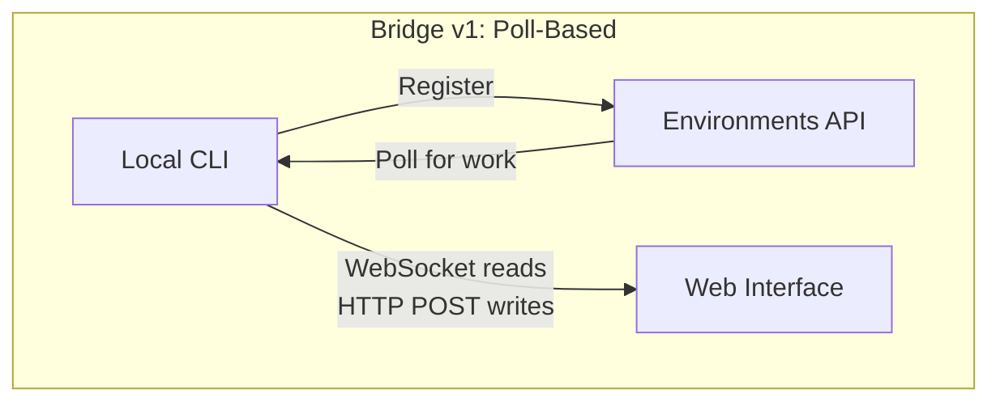
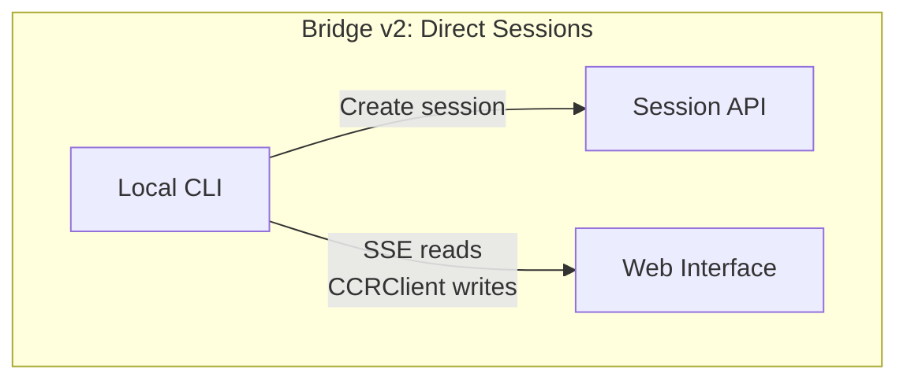
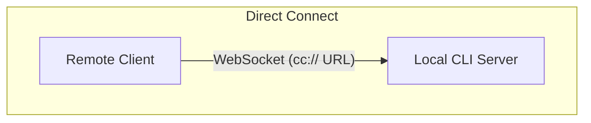
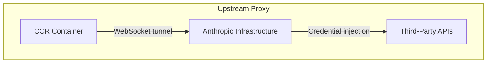

<a id="chapter-16-remote-control-and-cloud-execution"></a>

# 제16장: 원격 제어와 클라우드 실행

<a id="the-agent-reaches-beyond-localhost"></a>

## 에이전트가 로컬 호스트 너머에 도달함

지금까지의 모든 장에서는 Claude Code가 코드가 있는 동일한 시스템에서 실행된다고 가정했습니다. 터미널은 로컬입니다. 파일 시스템은 로컬입니다. 모델 응답은 키보드와 작업 디렉터리를 모두 소유하는 프로세스로 다시 스트리밍됩니다.

이러한 가정은 브라우저에서 Claude Code를 제어하거나, 클라우드 컨테이너 내에서 실행하거나, LAN에서 서비스로 노출하려는 순간 깨집니다. 에이전트는 웹 브라우저, 모바일 앱 또는 자동화된 파이프라인에서 지침을 수신할 수 있는 방법이 필요합니다. 터미널에 앉아 있지 않은 사람에게 권한 메시지를 전달하고 에이전트를 대신하여 자격 증명을 주입하거나 TLS를 종료할 수 있는 인프라를 통해 API 트래픽을 터널링합니다.

Claude Code는 각기 다른 토폴로지를 다루는 네 가지 시스템으로 이 문제를 해결합니다.

<div class="diagram-grid">









</div>

이러한 시스템은 공통 설계 철학을 공유합니다. 즉, 읽기 및 쓰기는 비대칭이고, 재연결은 자동이며, 오류는 점진적으로 저하됩니다.

---

<a id="bridge-v1-poll-dispatch-spawn"></a>

## Bridge v1: 폴링, 디스패치, 생성

v1 브리지는 환경 기반 원격 제어 시스템입니다. 개발자가 `claude remote-control`을 실행하면 CLI는 환경 API에 등록하고 작업을 폴링하며 세션당 하위 프로세스를 생성합니다.

등록하기 전에 런타임 기능 게이트, OAuth 토큰 유효성 검사, 조직 정책 확인, 데드 토큰 감지(동일한 만료된 토큰으로 3회 연속 실패 후 크로스 프로세스 백오프), 첫 번째 시도에서 실패할 등록의 약 9%를 제거하는 사전 토큰 새로 고침 등 사전 검사가 실행됩니다.

일단 등록되면 브리지는 긴 폴 루프에 들어갑니다. 작업 항목은 세션(세션 토큰, API 기본 URL, MCP 구성 및 환경 변수가 포함된 `secret` 필드 포함) 또는 상태 확인으로 도착합니다. 브리지는 100개의 빈 폴링마다 "작업 없음" 로그 메시지를 제한합니다.

각 세션은 stdin/stdout에서 NDJSON을 통해 통신하는 하위 Claude Code 프로세스를 생성합니다. 권한 요청은 브리지 전송을 통해 사용자가 승인하거나 거부하는 웹 인터페이스로 이동합니다. 왕복은 대략 10~14초 내에 완료되어야 합니다.

---

<a id="bridge-v2-direct-sessions-and-sse"></a>

## Bridge v2: 직접 세션 및 SSE

v2 브리지는 등록 없음, 폴링 없음, 승인 없음, 하트비트 없음, 등록 취소 없음 등 전체 환경 API 계층을 제거합니다. 동기: v1에서는 작업을 파견하기 전에 서버가 시스템의 기능을 알아야 했습니다. V2는 수명주기를 세 단계로 축소합니다.

1. **세션 생성**: OAuth 자격 증명이 포함된 `POST /v1/code/sessions`.
2. **브리지 연결**: `POST /v1/code/sessions/{id}/bridge`. `worker_jwt`, `api_base_url` 및 `worker_epoch`을 반환합니다. 각 `/bridge` 호출은 에포크에 부딪힙니다. 이는 등록입니다.
3. **개방형 전송**: 읽기용 SSE, 쓰기용 `CCRClient`.

전송 추상화(`ReplBridgeTransport`)는 공통 인터페이스 뒤에 v1과 v2를 통합하므로 메시지 처리 시 어느 세대와 통신하는지 알 필요가 없습니다.

401로 인해 SSE 연결이 끊어지면 시퀀스 번호 커서를 유지하면서 새 `/bridge` 호출의 새로운 자격 증명으로 전송이 다시 빌드됩니다. 즉, 메시지가 손실되지 않습니다. 쓰기 경로는 프로세스 전체 환경 변수 대신 인스턴스별 `getAuthToken` 클로저를 사용하여 동시 세션에서 JWT 누출을 방지합니다.

<a id="the-flushgate"></a>

### 플러시게이트

미묘한 순서 문제: 브리지는 웹 인터페이스에서 실시간 쓰기를 허용하는 동안 대화 기록을 보내야 합니다. 기록 플러시 중에 실시간 쓰기가 도착하면 메시지가 순서대로 전달될 수 있습니다. `FlushGate`은 플러시 POST 중에 실시간 쓰기를 대기열에 추가하고 완료되면 순서대로 비웁니다.

<a id="token-refresh-and-epoch-management"></a>

### 토큰 갱신 및 에포크 관리

v2 브리지는 만료되기 전에 작업자 JWT를 사전에 새로 고칩니다. 새로운 시대는 이것이 새로운 자격 증명을 가진 동일한 작업자임을 서버에 알려줍니다. Epoch 불일치(409 응답)는 적극적으로 처리됩니다. 두 연결이 모두 닫히고 예외가 호출자를 해제하여 분할 브레인 시나리오를 방지합니다.

---

<a id="message-routing-and-echo-deduplication"></a>

## 메시지 라우팅 및 에코 중복 제거

두 브리지 세대 모두 `handleIngressMessage()`을 중앙 라우터로 공유합니다.

1. JSON을 구문 분석하고 제어 메시지 키를 정규화합니다.
2. `control_response`을 권한 핸들러로 라우팅하고, `control_request`을 요청 핸들러로 라우팅합니다.
3. `recentPostedUUIDs`(에코 제거) 및 `recentInboundUUIDs`(재전송 제거)에 대해 UUID를 확인합니다.
4. 검증된 사용자 메시지를 전달합니다.

<a id="boundeduuidset-o1-lookup-ocapacity-memory"></a>

### BoundedUUIDSet: O(1) 조회, O(용량) 메모리

브리지에 에코 문제가 있습니다. 메시지가 읽기 스트림에서 다시 에코되거나 전송 전환 중에 두 번 전달될 수 있습니다. `BoundedUUIDSet`은 순환 버퍼로 지원되는 FIFO 경계 세트입니다.

```typescript
class BoundedUUIDSet {
  private buffer: string[]
  private set: Set<string>
  private head = 0

  add(uuid: string): void {
    if (this.set.size >= this.capacity) {
      this.set.delete(this.buffer[this.head])
    }
    this.buffer[this.head] = uuid
    this.set.add(uuid)
    this.head = (this.head + 1) % this.capacity
  }

  has(uuid: string): boolean { return this.set.has(uuid) }
}
```

두 인스턴스가 병렬로 실행되며 각각 용량은 2000입니다. 세트를 통한 O(1) 조회, 순환 버퍼 제거를 통한 O(용량) 메모리, 타이머 또는 TTL 없음. 알 수 없는 제어 요청 하위 유형은 무음이 아닌 오류 응답을 받습니다. 즉, 서버가 결코 오지 않는 응답을 기다리지 못하게 합니다.

---

<a id="the-asymmetric-design-persistent-reads-http-post-writes"></a>

## 비대칭 디자인: 영구 읽기, HTTP POST 쓰기

CCR 프로토콜은 비대칭 전송을 사용합니다. 읽기 흐름은 영구 연결(WebSocket 또는 SSE)을 통해, 쓰기는 HTTP POST를 통해 이루어집니다. 이는 의사소통 패턴의 근본적인 비대칭성을 반영합니다.

읽기는 서버에서 시작되는 빈도가 높고 대기 시간이 낮으며 토큰 스트리밍 중에 초당 수백 개의 작은 메시지입니다. 지속적인 연결이 유일하게 합리적인 선택입니다. 쓰기는 빈도가 낮고 클라이언트에서 시작되며 확인이 필요합니다. 즉, 초당 메시지가 아닌 분당 메시지입니다. HTTP POST는 안정적인 전달, UUID를 통한 멱등성 및 로드 밸런서와의 자연스러운 통합을 제공합니다.

단일 WebSocket에서 이를 통합하려고 하면 결합이 생성됩니다. 쓰기 중에 WebSocket이 삭제되면 재시도 논리가 필요하며 "전송되지 않았지만 승인이 손실됨"과 "전송되지 않음"을 구별해야 합니다. 별도의 채널을 사용하면 각 채널을 독립적으로 최적화할 수 있습니다.

---

<a id="remote-session-management"></a>

## 원격 세션 관리

`SessionsWebSocket`은 CCR WebSocket 연결의 클라이언트 측을 관리합니다. 재연결 전략은 실패 유형을 구별합니다.

| 실패 | 전략 |
|---------|----------|
| 4003(인증되지 않음) | 즉시 중지하고 재시도하지 않음 |
| 4001(세션을 찾을 수 없음) | 최대 3회 재시도, 선형 백오프(압축 중 일시적) |
| 기타 일시적인 | 지수 백오프, 최대 5회 시도 |

`isSessionsMessage()` 유형 가드는 의도적으로 허용되는 `type` 필드 문자열이 있는 모든 개체를 허용합니다. 하드코딩된 허용 목록은 클라이언트가 업데이트되기 전에 새 메시지 유형을 자동으로 삭제합니다.

---

<a id="direct-connect-the-local-server"></a>

## 직접 연결: 로컬 서버

Direct Connect는 가장 간단한 토폴로지입니다. Claude Code는 서버로 실행되고 클라이언트는 WebSocket을 통해 연결됩니다. 클라우드 중개자도 없고 OAuth 토큰도 없습니다.

세션에는 `starting`, `running`, `detached`, `stopping`, `stopped`의 5가지 상태가 있습니다. 메타데이터는 서버를 다시 시작해도 재개될 수 있도록 `~/.claude/server-sessions.json`으로 유지됩니다. `cc://` URL 체계는 로컬 연결에 대한 명확한 주소 지정을 제공합니다.

---

<a id="upstream-proxy-credential-injection-in-containers"></a>

## 업스트림 프록시: 컨테이너에 자격 증명 삽입

업스트림 프록시는 CCR 컨테이너 내에서 실행되며 특정 문제, 즉 에이전트가 신뢰할 수 없는 명령을 실행할 수 있는 컨테이너의 아웃바운드 HTTPS 트래픽에 조직 자격 증명을 삽입하는 문제를 해결합니다.

설정 순서는 다음과 같이 신중하게 지정됩니다.

1. `/run/ccr/session_token`에서 세션 토큰을 읽습니다.
2. Bun FFI를 통해 `prctl(PR_SET_DUMPABLE, 0)`을 설정하여 프로세스 힙의 동일한 UID ptrace를 차단합니다. 이것이 없으면 프롬프트 주입 `gdb -p $PPID`이 메모리에서 토큰을 긁어낼 수 있습니다.
3. 업스트림 프록시 CA 인증서를 다운로드하고 시스템 CA 번들과 연결합니다.
4. 임시 포트에서 로컬 CONNECT-to-WebSocket 릴레이를 시작합니다.
5. 토큰 파일 연결 해제 - 이제 토큰은 힙에만 존재합니다.
6. 모든 하위 프로세스에 대한 환경 변수를 내보냅니다.

모든 단계가 열리지 않습니다. 오류가 발생하면 세션을 종료하는 대신 프록시가 비활성화됩니다. 올바른 절충안 - 실패한 프록시는 일부 통합이 작동하지 않지만 핵심 기능은 계속 사용할 수 있음을 의미합니다.

<a id="protobuf-hand-encoding"></a>

### Protobuf 핸드 인코딩

터널을 통과하는 바이트는 `UpstreamProxyChunk` protobuf 메시지로 래핑됩니다. 스키마는 간단합니다(`message UpstreamProxyChunk { bytes data = 1; }`). Claude Code는 protobuf 런타임을 가져오는 대신 10줄로 직접 인코딩합니다.

```typescript
export function encodeChunk(data: Uint8Array): Uint8Array {
  const varint: number[] = []
  let n = data.length
  while (n > 0x7f) { varint.push((n & 0x7f) | 0x80); n >>>= 7 }
  varint.push(n)
  const out = new Uint8Array(1 + varint.length + data.length)
  out[0] = 0x0a  // field 1, wire type 2
  out.set(varint, 1)
  out.set(data, 1 + varint.length)
  return out
}
```

10개의 줄이 전체 protobuf 런타임을 대체합니다. 단일 필드 메시지는 종속성을 정당화하지 않습니다. 비트 조작으로 인한 유지 관리 부담은 공급망 위험보다 훨씬 낮습니다.

---

<a id="apply-this-designing-remote-agent-execution"></a>

## 적용: 원격 에이전트 실행 설계

**별도의 읽기 및 쓰기 채널.** 읽기가 고주파수 스트림이고 쓰기가 저주파 RPC인 경우 이를 통합하면 불필요한 결합이 발생합니다. 각 채널이 독립적으로 실패하고 복구되도록 합니다.

**중복 제거 메모리를 바인딩합니다.** BoundedUUIDSet 패턴은 고정 메모리 중복 제거를 제공합니다. 최소 한 번 전달 시스템에는 무한한 세트가 아닌 제한된 중복 제거 버퍼가 필요합니다.

**실패 신호에 비례하여 재연결 전략을 세우세요.** 영구 실패는 재시도하면 안 됩니다. 일시적인 오류는 백오프를 사용하여 다시 시도해야 합니다. 모호한 실패는 낮은 한도로 다시 시도해야 합니다.

**적대적 환경에서는 비밀을 힙에만 유지합니다.** 파일에서 토큰을 읽고, ptrace를 비활성화하고, 파일 링크를 해제하면 파일 시스템과 메모리 검사 공격 벡터가 모두 제거됩니다.

**보조 시스템에 대한 페일오픈.** 업스트림 프록시는 핵심 기능(모델 추론)이 아닌 향상된 기능(자격 증명 주입)을 제공하기 때문에 페일오픈됩니다.

원격 실행 시스템은 더 깊은 원칙을 인코딩합니다. 즉, 에이전트의 핵심 루프(5장)는 명령이 어디서 오고 결과가 어디로 가는지에 대해 불가지론적이어야 합니다. 브리지, Direct Connect 및 업스트림 프록시는 전송 계층입니다. 그 위의 메시지 처리, 도구 실행 및 권한 흐름은 사용자가 터미널에 앉아 있든 WebSocket 반대편에 앉아 있든 상관없이 동일합니다.

다음 장에서는 다른 운영 문제인 성능을 검토합니다. Claude Code가 시작, 렌더링, 검색 및 API 비용 전반에 걸쳐 밀리초와 토큰을 어떻게 계산하는지 살펴봅니다.
