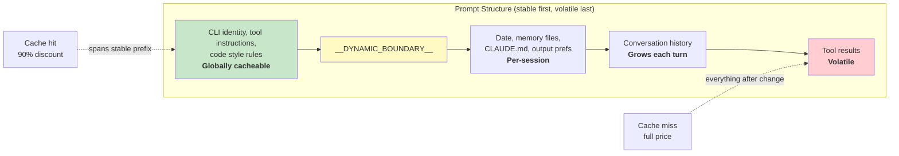

<a id="chapter-17-performance----every-millisecond-and-token-counts"></a>

# 제17장: 성능 — 밀리초 하나, 토큰 하나까지

<a id="the-senior-engineers-playbook"></a>

## 수석 엔지니어의 플레이북

에이전트 시스템의 성능 최적화는 하나의 문제가 아닙니다. 5개입니다:

1. **시작 대기 시간** -- 키 입력부터 첫 번째 유용한 출력까지의 시간입니다. 사용자는 실행 속도가 느린 도구를 포기합니다.
2. **토큰 효율성** -- 오버헤드 대비 유용한 콘텐츠가 소비하는 컨텍스트 창의 비율입니다. 컨텍스트 창은 가장 제한된 리소스입니다.
3. **API 비용** -- 턴당 달러 금액입니다. 프롬프트 캐싱을 사용하면 이를 90%까지 줄일 수 있지만 시스템이 여러 차례에 걸쳐 캐시 안정성을 유지하는 경우에만 가능합니다.
4. **렌더링 처리량** -- 스트리밍 출력 중 초당 프레임 수입니다. 13장에서는 렌더링 아키텍처를 다루었습니다. 이 장에서는 속도를 유지하는 성능 측정 및 최적화에 대해 다룹니다.
5. **검색 속도** -- 키를 누를 때마다 270,000개의 경로 코드베이스에서 파일을 찾는 데 걸리는 시간입니다.

Claude Code는 명백한 것(메모)부터 미묘한 것(사전 필터링 퍼지 검색을 위한 26비트 비트맵)에 이르는 기술로 다섯 가지 모두를 공격합니다. 방법론에 대한 참고 사항: 이는 이론적인 최적화가 아닙니다. Claude Code는 100% 내부 사용자와 0.5% 외부 사용자로 샘플링된 50개 이상의 스타트업 프로파일링 체크포인트와 함께 제공됩니다. 아래의 모든 최적화는 직관이 아닌 이 계측기의 데이터에 의해 동기가 부여되었습니다.

---

<a id="saving-milliseconds-at-startup"></a>

## 시작 시 밀리초 절약

<a id="module-level-io-parallelism"></a>

### 모듈 수준 I/O 병렬성

진입점 `main.tsx`은 의도적으로 "모듈 범위에서 부작용 없음"을 위반합니다.

```typescript
profileCheckpoint('main_tsx_entry');
startMdmRawRead();       // fires plutil/reg-query subprocesses
startKeychainPrefetch();  // fires both macOS keychain reads in parallel
```

그렇지 않으면 두 개의 macOS 키체인 항목에 대해 ~65ms의 순차적 동기 생성 비용이 발생합니다. 둘 다 모듈 수준에서 실행 후 잊어버리기 약속으로 실행함으로써 CPU가 유휴 상태가 되는 동안 ~135ms의 모듈 로드와 병렬로 실행됩니다.

<a id="api-preconnection"></a>

### API 사전 연결

`apiPreconnect.ts`은 초기화 중에 Anthropic API에 `HEAD` 요청을 실행하여 TCP+TLS 핸드셰이크(100-200ms)를 설정 작업과 겹칩니다. 대화형 모드에서는 중첩이 제한되지 않습니다. 즉, 사용자가 입력하는 동안 연결이 따뜻해집니다. 요청은 `applyExtraCACertsFromConfig()` 및 `configureGlobalAgents()` 이후에 발생하므로 웜 연결은 올바른 전송 구성을 사용합니다.

<a id="fast-path-dispatch-and-deferred-imports"></a>

### 빠른 경로 디스패치 및 지연된 가져오기

CLI 진입점에는 특수 하위 명령에 대한 조기 반환 경로가 포함되어 있습니다. -- `claude mcp`은 React REPL을 로드하지 않고, `claude daemon`은 도구 시스템을 로드하지 않습니다. 무거운 모듈은 필요한 경우에만 동적 `import()`을 통해 로드됩니다: OpenTelemetry(~400KB + ~700KB gRPC), 이벤트 로깅, 오류 대화 상자, 업스트림 프록시. `LazySchema`은 Zod 스키마 구성을 첫 번째 검증으로 연기하여 시작 이후 비용을 증가시킵니다.

---

<a id="saving-tokens-in-the-context-window"></a>

## 컨텍스트 창에 토큰 저장

<a id="slot-reservation-8k-default-64k-escalation"></a>

### 슬롯 예약: 8K 기본, 64K 에스컬레이션

가장 영향력 있는 단일 최적화:

기본 출력 슬롯 예약은 8,000개 토큰이며, 잘리면 64,000개로 증가됩니다. API는 모델의 응답을 위해 `max_output_tokens` 용량을 예약합니다. 기본 SDK 값은 32K-64K이지만 프로덕션 데이터에 따르면 p99 출력 길이는 4,911 토큰입니다. 기본적으로 8~16배 초과 예약되어 턴당 24,000~59,000개의 토큰이 낭비됩니다. Claude Code는 8K로 제한되고 드물게 잘리는 경우(요청의 1% 미만) 64K로 재시도합니다. 200K 창의 경우 사용 가능한 컨텍스트가 12~28% 향상됩니다. 무료입니다.

<a id="tool-result-budgeting"></a>

### 도구 결과 예산

| 한도 | 가치 | 목적 |
|-------|-------|---------|
| 도구별 문자 | 50,000 | 초과 시 결과가 디스크에 유지됨 |
| 도구별 토큰 | 100,000 | ~400KB 텍스트 상한 |
| 메시지별 집계 | 200,000자 | N개의 병렬 도구가 한 번에 예산을 낭비하는 것을 방지합니다. |

메시지별 집계가 핵심 통찰력입니다. 이것이 없으면 "src/의 모든 파일 읽기"는 각각 40K 문자를 반환하는 10개의 병렬 읽기를 생성할 수 있습니다.

<a id="context-window-sizing"></a>

### 컨텍스트 창 크기 조정

기본 200K 토큰 창은 모델 이름 또는 실험 처리에 대한 `[1m]` 접미사를 통해 1M까지 확장 가능합니다. 사용량이 한계에 도달하면 4레이어 압축 시스템이 오래된 콘텐츠를 점진적으로 요약합니다. 토큰 계산은 클라이언트 측 추정이 아닌 API의 실제 `usage` 필드에 고정되어 있으며 신속한 캐싱 크레딧, 사고 토큰 및 서버 측 변환을 고려합니다.

---

<a id="saving-money-on-api-calls"></a>

## API 호출 비용 절감

<a id="the-prompt-cache-architecture"></a>

### 프롬프트 캐시 아키텍처



Anthropic의 프롬프트 캐시는 정확한 접두어 일치를 기반으로 작동합니다. 단일 토큰이 중간 접두사를 변경하면 그 이후의 모든 것은 캐시 미스입니다. Claude Code는 안정적인 부분이 먼저 오고 불안정한 부분이 마지막에 오도록 전체 프롬프트를 구성합니다.

`shouldUseGlobalCacheScope()`이 true를 반환하면 동적 경계 이전의 시스템 프롬프트 항목은 `scope: 'global'`을 얻습니다. 동일한 Claude Code 버전을 실행하는 두 사용자는 접두사 캐시를 공유합니다. MCP 스키마는 사용자별이므로 MCP 도구가 있으면 전역 범위가 비활성화됩니다.

<a id="sticky-latch-fields"></a>

### 끈끈한 래치 필드

5개의 부울 필드는 "고정" 패턴을 사용합니다. 일단 true이면 세션 동안 true로 유지됩니다.

| 래치 필드 | 예방하는 것 |
|-------------|-----------------|
| `promptCache1hEligible` | 세션 중간 초과분 전환 캐시 TTL 변경 |
| `afkModeHeaderLatched` | Shift+Tab은 버스팅 캐시를 전환합니다. |
| `fastModeHeaderLatched` | 재사용 대기시간 이중 버스팅 캐시 진입/종료 |
| `cacheEditingHeaderLatched` | 세션 중간 구성으로 캐시 무효화 전환 |
| `thinkingClearLatched` | 캐시 미스가 확인된 후 사고 모드 전환 |

각각은 세션 중에 변경되면 캐시된 프롬프트의 ~50,000-70,000개 토큰이 파열되는 헤더 또는 매개변수에 해당합니다. 래치는 캐시를 보존하기 위해 세션 중간 토글을 희생합니다.

<a id="memoized-session-date"></a>

### 메모된 세션 날짜

```typescript
const getSessionStartDate = memoize(getLocalISODate)
```

이것이 없으면 날짜가 자정에 변경되어 캐시된 접두사 전체가 무효화됩니다. 오래된 날짜는 외관상의 문제입니다. 캐시 버스트는 전체 대화를 다시 처리합니다.

<a id="section-memoization"></a>

### 섹션 메모

시스템 프롬프트 섹션은 2계층 캐시를 사용합니다. 대부분의 콘텐츠는 `/clear` 또는 `/compact`까지 캐시된 `systemPromptSection(name, compute)`을 사용합니다. 핵 옵션 `DANGEROUS_uncachedSystemPromptSection(name, compute, reason)`은 매 턴마다 다시 계산합니다. 명명 규칙에 따라 개발자는 캐시 중단이 필요한 이유를 문서화해야 합니다.

---

<a id="saving-cpu-in-rendering"></a>

## 렌더링 시 CPU 절약

13장에서는 렌더링 아키텍처(패키지 형식 배열, 풀 기반 인턴, 이중 버퍼링 및 셀 수준 비교)를 자세히 다루었습니다. 여기서는 성능 측정과 속도를 유지하는 적응형 동작에 중점을 둡니다.

터미널 렌더러는 `throttle(deferredRender, FRAME_INTERVAL_MS)`을 통해 60fps로 조절됩니다. 단말기가 흐릿해지면 간격이 30fps로 두 배가 됩니다. 스크롤 배수 프레임은 최대 스크롤 속도를 위해 1/4 간격으로 실행됩니다. 이러한 적응형 조절은 렌더링이 필요한 것보다 더 많은 CPU를 소비하지 않도록 보장합니다.

React Compiler(`react/compiler-runtime`)는 코드베이스 전체에서 구성 요소 렌더링을 자동으로 메모합니다. 수동 `useMemo` 및 `useCallback`은 오류가 발생하기 쉽습니다. 컴파일러는 구성을 통해 올바른 결과를 얻습니다. 사전 할당된 고정 개체(`Object.freeze()`)는 일반적인 렌더 경로 값에 대한 할당을 제거합니다. 즉, 대체 화면 모드에서 프레임당 하나의 할당이 저장되어 수천 개의 프레임이 합쳐집니다.

전체 렌더링 파이프라인 세부 사항(`CharPool`/`StylePool`/`HyperlinkPool` 인터닝 시스템, 블릿 최적화, 손상 직사각형 추적, OffscreenFreeze 구성 요소)에 대해서는 13장을 참조하세요.

---

<a id="saving-memory-and-time-in-search"></a>

## 검색 시 메모리 및 시간 절약

퍼지 파일 검색은 키를 누를 때마다 실행되어 270,000개 이상의 경로를 검색합니다. 3개의 최적화 레이어가 이를 몇 밀리초 미만으로 유지합니다.

<a id="the-bitmap-pre-filter"></a>

### 비트맵 사전 필터

모든 색인화된 경로는 소문자로 구성된 26비트 비트맵을 가져옵니다.

```typescript
// Pseudocode — illustrates the 26-bit bitmap concept
function buildCharBitmap(filepath: string): number {
  let mask = 0
  for (const ch of filepath.toLowerCase()) {
    const code = ch.charCodeAt(0)
    if (code >= 97 && code <= 122) mask |= 1 << (code - 97)
  }
  return mask  // Each bit represents presence of a-z
}
```

검색 시: `if ((charBits[i] & needleBitmap) !== needleBitmap) continue`. 쿼리 문자가 누락된 경로는 즉시 실패합니다. 즉, 정수 비교 1회만 가능하고 문자열 작업은 불가능합니다. 거부율: "test"와 같은 광범위한 쿼리의 경우 ~10%, 희귀 문자가 포함된 쿼리의 경우 90%+입니다. 비용: 경로당 4바이트, 270,000개 경로의 경우 ~1MB.

<a id="score-bound-rejection-and-fused-indexof-scan"></a>

### Score-Bound Rejection 및 Fused indexOf Scan

비트맵에서 살아남은 경로는 비용이 많이 드는 경계/camelCase 점수 매기기 전에 점수 한도 확인에 직면합니다. 최상의 점수가 현재 상위 K 임계값을 이길 수 없으면 경로를 건너뜁니다.

JSC(Bun) 및 V8(노드) 모두에서 SIMD 가속된 `String.indexOf()`을 사용하여 간격/연속 보너스 계산을 통해 실제 일치하는 퓨즈 위치를 찾습니다. 엔진의 최적화된 검색은 수동 문자 루프보다 훨씬 빠릅니다.

<a id="async-indexing-with-partial-queryability"></a>

### 부분 쿼리 기능을 갖춘 비동기 인덱싱

대규모 코드베이스의 경우 `loadFromFileListAsync()`은 작업의 ~4ms마다 이벤트 루프를 생성합니다(카운트 기반이 아닌 시간 기반 - 기계 속도에 맞춰 조정). `queryable`(첫 번째 청크에서 해결되어 즉각적인 부분 결과 활성화)과 `done`(전체 인덱스 완료)이라는 두 가지 약속을 반환합니다. 사용자는 파일 목록을 사용할 수 있게 된 후 5-10ms 이내에 검색을 시작할 수 있습니다.

수익률 확인에서는 `performance.now()`의 비용을 상각하기 위해 분기 없는 모듈로-256인 `(i & 0xff) === 0xff`을 사용합니다.

---

<a id="the-memory-relevance-side-query"></a>

## 메모리 관련성 부차 쿼리

한 가지 최적화는 토큰 효율성과 API 비용의 교차점에 있습니다. 11장에서 설명했듯이 메모리 시스템은 포함할 메모리 파일을 선택하기 위해 기본 Opus 모델이 아닌 경량 Sonnet 모델 호출을 사용합니다. 관련 없는 메모리 파일을 포함하지 않음으로써 절약되는 토큰에 비해 비용(빠른 모델의 최대 출력 토큰 256개)은 무시할 수 있습니다. 관련 없는 단일 2,000개 토큰 메모리는 API 호출의 부차 쿼리 비용보다 낭비되는 컨텍스트에서 더 많은 비용을 발생시킵니다.

---

<a id="speculative-tool-execution"></a>

## 도구 추측 실행

`StreamingToolExecutor`은 전체 응답이 완료되기 전에 스트리밍되는 도구 실행을 시작합니다. 읽기 전용 도구(Glob, Grep, Read)는 병렬로 실행할 수 있습니다. 쓰기 도구에는 독점적인 액세스가 필요합니다. `partitionToolCalls()` 기능은 연속된 안전 도구를 배치로 그룹화합니다. [읽기, 읽기, Grep, 편집, 읽기, 읽기]는 세 개의 배치([읽기, 읽기, Grep] 동시, [편집] 직렬, [읽기, 읽기] 동시)가 됩니다.

결정론적 모델 추론을 위해 결과는 항상 원래 도구 순서로 산출됩니다. 형제 중단 컨트롤러는 Bash 도구에 오류가 발생하면 병렬 하위 프로세스를 종료하여 리소스 낭비를 방지합니다.

---

<a id="streaming-and-the-raw-api"></a>

## 스트리밍과 Raw API

Claude Code는 SDK의 `BetaMessageStream` 도우미 대신 원시 스트리밍 API를 사용합니다. 도우미는 도구 입력 길이의 모든 `input_json_delta` -- O(n^2)에 대해 `partialParse()`을 호출합니다. Claude Code는 원시 문자열을 축적하고 블록이 완료되면 한 번 구문 분석합니다.

스트리밍 워치독(`CLAUDE_STREAM_IDLE_TIMEOUT_MS`, 기본값 90초)은 청크가 도착하지 않으면 중단하고 재시도하며 프록시 실패 시 비스트리밍 `messages.create()`으로 대체됩니다.

---

<a id="apply-this-performance-for-agentic-systems"></a>

## 적용: 에이전트 시스템의 성능

**컨텍스트 창 예산을 감사하세요.** `max_output_tokens` 예약과 실제 p99 출력 길이 사이의 차이는 낭비되는 컨텍스트입니다. 엄격한 기본값을 설정하고 잘릴 경우 에스컬레이션합니다.

**캐시 안정성을 위한 설계.** 프롬프트의 모든 필드는 안정적이거나 일시적입니다. 안정적인 것을 먼저, 휘발성을 마지막에 두십시오. 안정적인 접두사에 대한 대화 중간 변경 사항을 달러 비용이 드는 버그로 처리하십시오.

**시작 I/O를 병렬화합니다.** 모듈 로딩은 CPU에 바인딩됩니다. 키체인 읽기 및 네트워크 핸드셰이크는 I/O 바인딩됩니다. 가져오기 전에 I/O를 시작합니다.

**검색을 위해 비트맵 사전 필터를 사용합니다.** 값비싼 점수를 매기기 전에 후보자의 10-90%를 거부하는 저렴한 사전 필터는 항목당 4바이트에서 상당한 승리를 거두었습니다.

**중요한 부분을 측정하세요.** Claude Code에는 내부적으로 100%, 외부적으로 0.5% 샘플링된 50개 이상의 시작 체크포인트가 있습니다. 측정 없는 성과 작업은 추측일 뿐입니다.

---

마지막 관찰: 이러한 최적화의 대부분은 알고리즘적으로 정교하지 않습니다. 비트맵 사전 필터, 순환 버퍼, 메모이제이션, 인턴 - 이것이 CS의 기본입니다. 정교함은 어디에 적용할지 아는 것입니다. 시작 프로파일러는 밀리초의 위치를 ​​알려줍니다. API 사용 필드는 토큰의 위치를 ​​알려줍니다. 캐시 적중률은 돈이 어디에 있는지 알려줍니다. 항상 측정이 먼저이고 최적화가 두 번째입니다.
