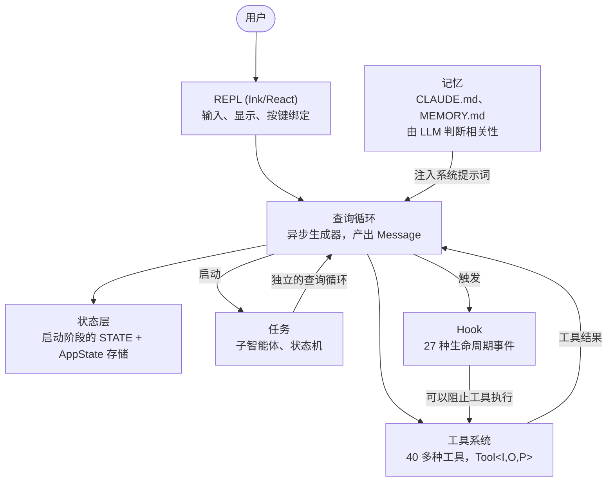
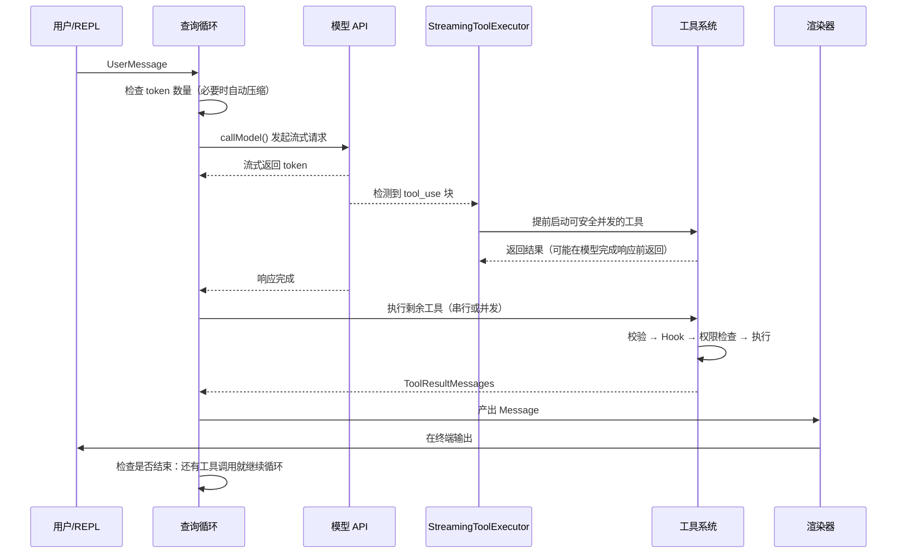
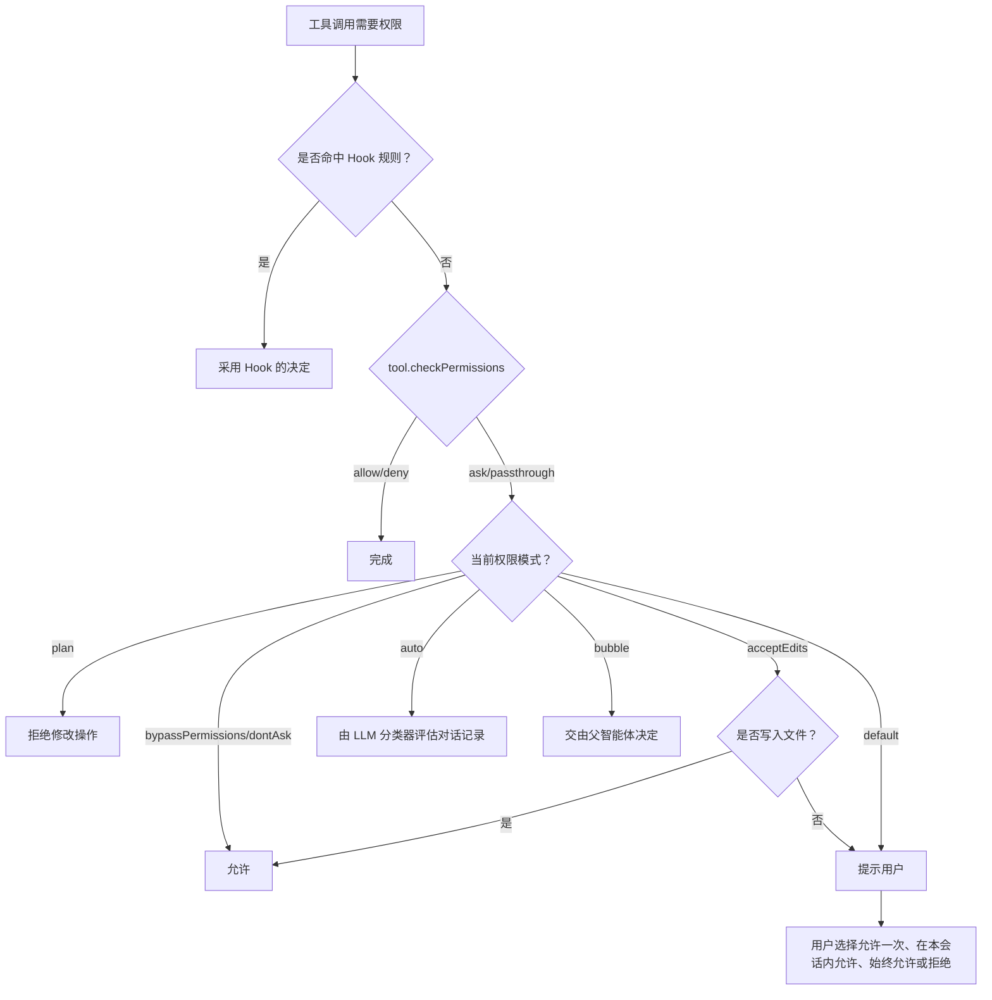
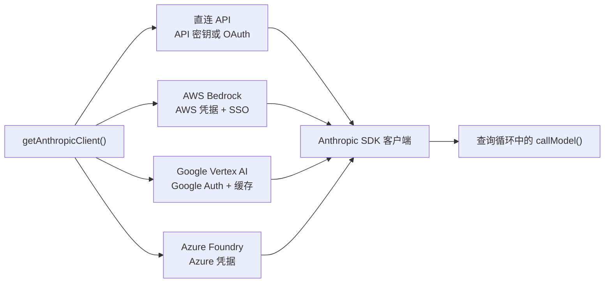
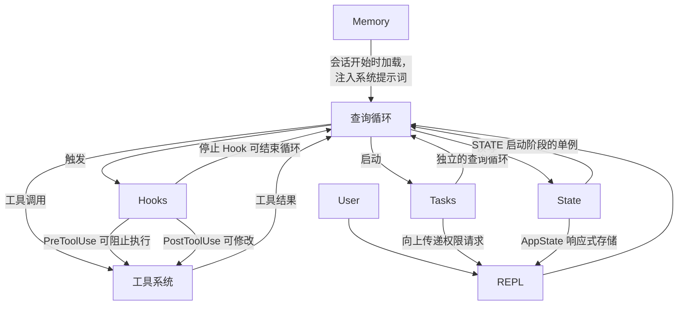

# 第 1 章：AI 智能体的架构

## 认识这个系统

传统的命令行工具（CLI）就像一个函数。它接收参数，执行工作，然后退出。`grep` 不会自行决定再运行一次 `sed`。`curl` 不会根据下载的内容打开并修改文件。它的约定很简单：一条命令对应一个动作，输出是确定的。

智能体式 CLI 打破了这套约定的每一条规则。它接收自然语言提示词，自行选择工具，按实际情况所需的顺序执行，评估结果，然后继续循环，直到任务完成或用户叫停。所谓“程序”，是一个围绕语言模型运转的循环，指令序列由模型在运行时（Runtime）生成。工具调用（Tool Calling）产生副作用，模型的推理决定控制流。

Claude Code 是 Anthropic 将这一理念用于生产的实现。这个由近两千个文件组成的 TypeScript 单体应用，将终端变成一个由 Claude 驱动的完整开发环境。它已交付给数十万开发者，因此每一项架构决策都关系到实际使用。本章会帮你建立对整个系统的认识。六个抽象定义了整个系统，一条数据流把它们串在一起。熟悉从按键到最终输出的主路径后，就可以在后续各章逐段深入。

下面是一次回顾式拆解。这六个抽象来自将生产级智能体（Agent）交付给大量用户时遇到的实际压力，并非一开始就在白板上规划好的。以它们实际演变成的样子来理解系统，有助于把握全书其余部分的内容。

---

## 六个核心抽象

Claude Code 建立在六个核心抽象之上。其余部分，包括 400 多个工具函数文件、从其他项目分叉而来的终端渲染器、Vim 模拟和费用跟踪器，都为这六个抽象服务。



下面逐一说明这些抽象的职责及其存在的原因。

**1. 查询循环（Query Loop）**（`query.ts`，约 1,700 行）。系统的核心是一个 AsyncGenerator（异步生成器）。它以流式方式接收模型响应，收集并执行工具调用，将结果追加到消息历史，然后继续循环。REPL、SDK、子智能体（Sub-Agent）以及无界面的 `--print` 都通过这同一个函数运行。它产出供 UI 消费的 `Message` 对象，返回类型则是名为 `Terminal` 的可辨识联合类型，精确表示循环停止的原因：正常完成、用户中止、token 预算耗尽、停止 Hook（Stop Hook）介入、达到轮数上限，或遇到不可恢复的错误。生成器模式天然支持背压（Backpressure），也便于取消，并能为终止状态提供类型。[第 5 章](ch05-agent-loop.md)将详解循环内部的实现。

**2. 工具系统**（`Tool.ts`、`tools.ts`、`services/tools/`）。工具是智能体与外部环境交互的途径，例如读取文件、运行 shell 命令、编辑代码或搜索网页。用途简单，背后的机制却相当丰富。每个工具都实现一套接口，涵盖标识、模式定义、执行、权限和渲染。工具的职责超出普通函数。它自带权限逻辑，声明能否并发执行，并负责报告进度和渲染 UI。系统将工具调用划分为并发和串行的批次。流式执行器甚至可以在模型完成响应前就启动可安全并发的工具。[第 6 章](ch06-tools.md)将完整介绍工具接口和执行流程。

**3. 任务**（`Task.ts`、`tasks/`）。任务是后台工作单元，主要用来运行子智能体。任务遵循状态机（State Machine）`pending -> running -> completed | failed | killed`。`AgentTool` 启动新的 `query()` 生成器，而且这个生成器有自己的消息历史、工具集和权限模式。任务为 Claude Code 提供了递归能力，智能体可以委派给子智能体，子智能体又可以继续委派。

**4. 状态**（两层）。系统在两个层级维护状态。一个可变单例（`STATE`）保存约 80 个会话级基础设施字段，例如工作目录、模型配置、费用跟踪、遥测计数器和会话 ID。它在启动时初始化，之后直接修改，无需响应式机制。一个精简的响应式存储（34 行，接口形态类似 Zustand）驱动 UI，其中包括消息、输入模式、工具审批和进度指示器。这种拆分源于两层状态的更新方式。基础设施状态很少变化，无需触发重新渲染。UI 状态则不断变化，必须触发重新渲染。[第 3 章](ch03-state.md)将深入介绍这套双层架构。

**5. 记忆**（`memdir/`）。记忆是智能体跨会话保留的上下文，分为项目级（仓库中的 `CLAUDE.md` 文件）、用户级（`~/.claude/MEMORY.md`）和团队级（通过符号链接共享）。会话开始时，系统扫描所有记忆文件并解析文档头部元数据，再由 LLM 选出与当前对话相关的记忆。Claude Code 借此“记住”代码库的约定、架构决策和调试历史。

**6. Hook（钩子）**（`hooks/`、`utils/hooks/`）。Hook 是用户定义的生命周期拦截器，共有 27 种触发事件和 4 种执行类型：shell 命令、单次 LLM 提示词、多轮智能体对话和 HTTP webhook。Hook 可以阻止工具执行、修改输入、注入额外上下文，或直接结束整个查询循环。权限系统（Permission System）本身也有一部分通过 Hook 实现。`PreToolUse` Hook 可以在交互式权限提示出现之前拒绝工具调用。

---

## 从按键到输出的主路径

沿着系统追踪一次请求。用户输入“为登录函数添加错误处理”，然后按 Enter。



这条路径里有三个细节。

第一，查询循环以生成器实现。REPL 通过 `for await` 主动拉取消息，自然形成背压：如果 UI 处理不过来，生成器就会暂停。选择这种模式而非事件发射器或可观察流，是有意为之。

第二，工具执行和模型的流式处理（Streaming）可以重叠。`StreamingToolExecutor` 可以在模型完成响应前就启动可安全并发的工具。例如，模型还在生成响应剩余部分时，`Read` 调用就可能已经结束并返回结果。这是推测执行（Speculative Execution）。如果模型的最终输出使这次工具调用失效，系统就会丢弃结果。这种情况很少发生，但确实有可能。

第三，整个循环可以在更新上下文后重新进入下一轮。模型发出工具调用后，系统将结果追加到消息历史，再用更新后的上下文调用模型。工具结果的处理也在同一个循环里，无需单独的阶段。模型只要停止发出工具调用，就表示任务完成。

---

## 权限系统

Claude Code 能在你的机器上运行任意 shell 命令、编辑文件、启动子进程、发起网络请求，还能修改 Git 历史。缺少权限系统会带来严重的安全问题。

系统定义了七种权限模式，按宽松程度从高到低排列：

| 模式 | 行为 |
|------|----------|
| `bypassPermissions` | 允许所有操作并跳过检查。仅供内部使用和测试。 |
| `dontAsk` | 允许所有操作并照常记录日志，不提示用户。 |
| `auto` | 由对话记录分类器（LLM）决定允许还是拒绝。 |
| `acceptEdits` | 自动批准文件编辑，其他修改操作都需提示用户。 |
| `default` | 标准交互模式。用户逐项审批。 |
| `plan` | 只读模式。所有修改操作都被阻止。 |
| `bubble` | 将决定交给父智能体（子智能体模式）。 |

当一次工具调用需要获得权限时，系统会依照固定的顺序作出决定：



`auto` 模式会单独发起一次轻量的 LLM 调用，参照对话记录对工具调用进行分类。分类器读取工具输入的精简表示，据此判断操作是否符合用户的要求。这个模式让 Claude Code 可以半自主地工作，自动批准常规操作，同时标记可能偏离用户意图的操作。

子智能体默认使用 `bubble` 模式，因此无法自行批准危险操作。权限请求逐级传给父智能体，最终可提交给用户。这能防止子智能体在用户毫不知情的情况下运行破坏性命令。

---

## 多服务提供商架构

Claude Code 可以通过四种基础设施访问 Claude。系统的其余部分无需感知使用了哪一种。



Anthropic SDK 针对每家云服务提供商都提供了包装类，它们暴露的接口与直连 API 客户端一致。`getAnthropicClient()` 工厂函数读取环境变量和配置，确定使用哪家服务提供商，构造相应的客户端并返回。之后，`callModel()` 和其他所有使用方都通过统一的 Anthropic 客户端接口与之交互。

系统在启动时选定服务提供商，并将这一选择保存在 `STATE` 中。查询循环无需检查当前使用哪家服务提供商。因此，从直连 API 切换到 Bedrock 只需改动配置。智能体循环（Agent Loop）、工具系统和权限模型都独立于具体的服务提供商。

---

## 构建系统

Claude Code 既是 Anthropic 的内部工具，也是公开的 npm 包。两者共用一套代码，编译时的功能开关决定构建产物包含哪些内容。

```typescript
// Conditional imports guarded by feature flags
const reactiveCompact = feature('REACTIVE_COMPACT')
  ? require('./services/compact/reactiveCompact.js')
  : null
```

`feature()` 函数来自 Bun 内置的打包器 API `bun:bundle`。构建时，每个功能开关都会解析为布尔字面量。开关为假时，打包器通过死代码消除彻底移除 `require()` 调用。相应的模块既不会加载，也不会打包或发布。

代码统一在顶层用 `feature()` 控制是否执行 `require()`。这正是这里选用 `require()` 而非 `import` 的原因：条件为假时，打包器可以完全消除动态 `require()`。动态 `import()` 返回的 Promise 则必须由打包器保留，因此无法这样消除。

颇具讽刺意味的是，早期 npm 版本附带的源码映射包含 `sourcesContent`。其中保存了完整的原始 TypeScript 源码，包括仅供内部使用的代码路径。功能开关成功剔除了运行时代码，源码映射却还保留着原始代码。Claude Code 的源码由此变得公开可读。

---

## 各部分如何连接

这六个抽象组成了一张依赖图：



记忆作为系统提示词的一部分进入查询循环。查询循环驱动工具执行，工具结果以消息的形式反馈给查询循环。任务递归地运行查询循环，各自拥有独立的消息历史。Hook 在预定义的节点拦截查询循环。各部分都会读写状态，响应式存储负责把状态连接到 UI。

查询循环和工具系统之间的循环依赖是整个系统的根本特征。模型生成工具调用，工具执行并产生结果。结果追加到消息历史，模型看到结果后决定下一步。这个过程会持续到模型停止发出工具调用，或者受到 token 预算、轮数上限、用户中止等外部约束而终止。

从输入到输出的主路径贯穿全书。[第 2 章](ch02-bootstrap.md)追踪系统如何启动，直到这条路径可以运行。第 3 章解释沿途读写的双层状态架构。[第 4 章](ch04-api-layer.md)介绍查询循环调用的 API 层。再往后的每一章都会深入这条路径中的一个环节。

---

## 学以致用

如果你在构建智能体系统，也就是由 LLM 在运行时决定采取哪些行动的系统，可以借鉴 Claude Code 的这些架构模式。

**生成器循环模式。** 用异步生成器实现智能体循环。生成器天然支持背压，消费者可以按自己的节奏拉取数据。调用生成器的 `.return()` 就能取消执行，带类型的返回值则能表达终止状态。在基于回调或事件发射器的智能体循环中，很难确定循环何时结束、为何结束。生成器让终止原因可以直接通过类型系统表达。

**自描述的工具接口。** 让每个工具自行声明并发安全性、权限要求和渲染行为。集中式编排器如果掌握每个工具的细节，就会演变成一个包揽过多职责的对象，每加一个工具都必须更新它。自描述的工具可以线性扩展，添加第 N+1 个工具时无需修改现有代码。

**分开管理基础设施状态和响应式状态。** 部分状态变化需要更新 UI。会话配置、费用跟踪和遥测数据适合放在普通的可变对象里。消息历史、进度指示器和审批队列则适合放在响应式存储中。如果把所有状态都做成响应式的，就会给那些只在启动时修改一次、之后反复读取上千次的状态增加订阅开销和复杂度。双层设计分别对应这两种访问模式。

**通过权限模式统一决策。** 定义少量有名称的模式（`plan`、`default`、`auto`、`bypass`），让每项权限决定都通过模式来解析。在各个工具的实现中分散编写 `if (isAllowed)` 检查，容易造成权限执行不一致。如果所有工具都走同一条基于模式的决策链，只要知道当前模式，就能推断系统如何执行权限控制。

**通过任务实现递归智能体架构。** 让子智能体运行同一种智能体循环的新实例，并拥有自己的消息历史。权限请求经由 `bubble` 模式向上传递。如果给子智能体单独写执行路径，其行为和错误处理可能会逐渐偏离主循环。子智能体复用同一个循环，就会继承同样的行为保证。
