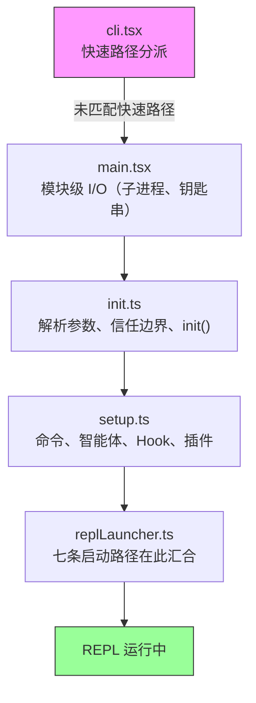
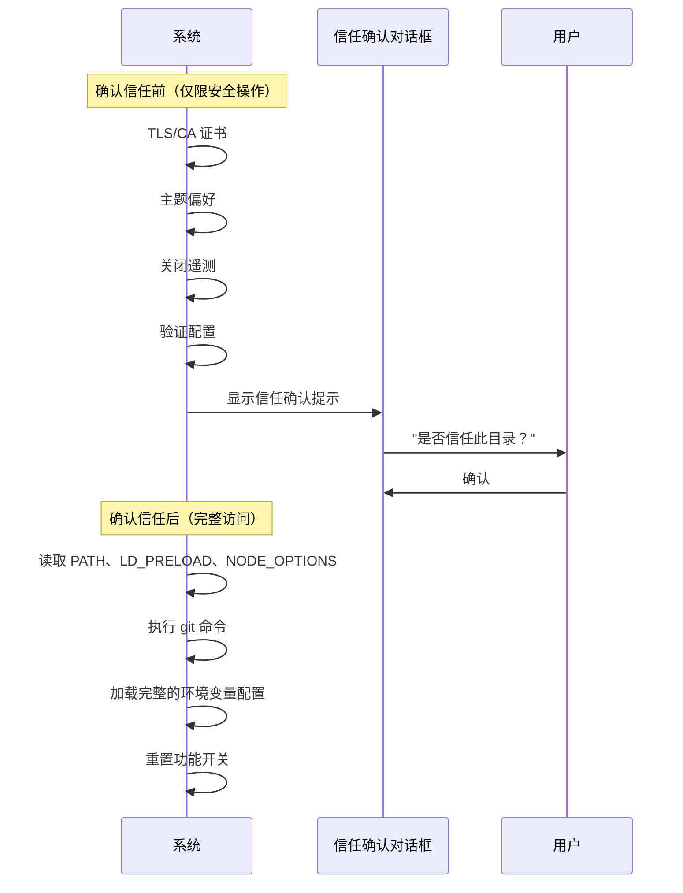

# 第 2 章：快速启动——启动流水线

[第 1 章](ch01-architecture.md)勾勒了 Claude Code 的架构，本章沿着这张图追踪系统进入可用状态的过程。六项抽象所涉及的每个组件，包括查询循环、工具系统、状态层、Hook（钩子）和记忆，都必须在用户看到光标之前完成初始化。留给这一切的预算只有 300 毫秒。

300 毫秒是人们感到工具即时响应的时间阈值。超过这个阈值，命令行界面（CLI）就会显得迟缓。超出太多，开发者就会弃用它。本章介绍的所有机制都服务于同一个目标，即把启动时间控制在这条线以内。

启动要完成四件事，即验证环境、建立安全边界、配置通信层和渲染界面。这四件事必须在 300 毫秒内全部完成。架构上的关键做法是让其中一些工作重叠执行，仔细安排先后顺序，并尽量削减工作量，从而在这个复杂系统看似难以达到的时间预算内完成启动。

本章的时间戳均为近似值，来自代码库自身的性能分析检查点，反映了现代硬件上典型的热启动耗时。冷启动会更慢。比具体数字更重要的是操作之间的关系，包括哪些操作重叠执行、哪些会阻塞后续步骤，以及哪些会延后执行。

---

## 流水线的结构

启动流水线依次经过五个文件。每个文件都会缩小系统下一步要处理的范围。



每个文件只做移交控制权前必须完成的工作。`cli.tsx` 尽可能在导入开销较大的模块前退出。`main.tsx` 通过导入求值时的副作用启动耗时操作。`init.ts` 解析配置并建立信任边界（Trust Boundary）。`setup.ts` 注册系统能力。`replLauncher.ts` 选择相应的入口并启动界面。

三种并行策略加快了启动过程：

1. **在模块级启动子进程。** *在导入求值期间*，通过副作用发起钥匙串读取和 MDM 读取。剩余的静态导入耗时约 135 毫秒，子进程在此期间并行运行。
2. **在设置阶段利用 Promise 并行执行。** 套接字绑定、创建 Hook 快照、加载命令和加载智能体定义同时进行。
3. **将预取推迟到渲染之后。** Git 状态、模型能力和 AWS 凭证等信息在用户输入第一条消息前用不到，因此等输入提示符显示后再预取。

第四种策略不太显眼，却同样重要，即**使用动态导入推迟模块求值**。代码库至少有十几处使用 `await import('./module.js')`，以便按需加载代码。OpenTelemetry（400 KB 加上 700 KB 的 gRPC）只在初始化遥测时加载。React 组件只在渲染时加载。每次动态导入都用冷路径上的延迟换取热路径上的速度。首次使用时才会触发模块求值，启动时便可省去加载可能永远用不上的模块的开销。

---

## 阶段 0：快速路径分派（cli.tsx）

进程最先进入的文件 `cli.tsx` 只负责判断是否需要执行完整的启动流水线。`claude --version`、`claude --help` 和 `claude mcp list` 等调用只需要返回特定结果。为这些调用加载 React、初始化遥测、读取钥匙串并设置工具系统，只会增加开销。

具体做法是检查 `argv`，只动态导入所需的处理函数，并在其余系统组件加载前退出。

```typescript
// Pseudocode for the fast-path pattern
if (args.length === 1 && args[0] === '--version') {
  const { printVersion } = await import('./commands/version.js')
  await printVersion()
  process.exit(0)
}
```

快速路径约有十几条，涵盖版本、帮助、配置、MCP 服务器管理和更新检查。它们都遵循同一种模式：各自只动态导入一个模块、调用一个函数，然后退出。代码库的其余部分都不会加载。

这是启动过程反复采用的一条原则，即**越清楚用户的意图，要做的工作就越少**。`argv` 数组反映了用户的意图。如果用户只想做一件具体的事，执行路径也应当只覆盖这件事。

如果没有匹配的快速路径，`cli.tsx` 就会继续导入完整的 `main.tsx`，正式开始启动。

---

## 阶段 1：模块级 I/O（main.tsx）

导入 `main.tsx` 时，模块级副作用会在求值期间触发，先于文件中任何函数的调用。这是整个启动流程中对性能影响最大的手段：

```typescript
// These run at import time, not at call time
const mdmPromise = startMDMSubprocess()
const keychainPromise = readKeychainCredentials()
```

JavaScript 引擎对 `main.tsx` 的其余部分及其传递依赖求值时，耗时约 138 毫秒，这两个 Promise 对应的操作已经开始执行。MDM（移动设备管理）子进程会检查组织的安全策略。钥匙串读取会获取已存储的凭证。这两个操作都受 I/O 限制，若按常规顺序执行，就会在关键路径上串行等待。

模块求值占用 JavaScript 引擎的这段时间，可以和 I/O 重叠。首次调用 `main.tsx` 导出的函数时，这两个 Promise 往往已经兑现。

这种做法要求在相关文件中关闭 ESLint 对顶层 `await` 和模块作用域副作用的检查。代码库有一条专门检查 `process.env` 访问方式的自定义 ESLint 规则，允许受控的模块级副作用，同时阻止在其他位置发生不受控的副作用。

---

## 阶段 2：参数解析与信任确认（init.ts）

`init()` 函数采用记忆化（Memoization），可以安全地调用多次，每次都返回相同的结果。REPL、打印模式和 SDK 模式等多个入口都可能调用 `init()`，而记忆化保证初始化只执行一次。

该函数通过 Commander 解析命令行参数，从全局设置、项目设置和环境变量等多个来源加载配置，随后到达启动流水线中最重要的边界。

### 信任边界

在越过信任边界之前，系统以受限模式运行。越过之后，系统获得全部能力。Claude Code 需要读取环境变量，而环境变量可能被恶意篡改，这正是设置这道边界的原因。



这道边界要解决的是 Claude Code 能否信任*运行环境*。恶意的 `.bashrc` 可以设置 `LD_PRELOAD`，向每个子进程注入代码。信任确认对话框确保用户明确同意在一个可能由他人配置过的目录中运行 Claude Code。

系统有十项依赖信任状态的操作。用户在对话框中确认以前，系统只执行安全操作，例如配置 TLS 证书、应用主题偏好和关闭遥测。用户确认之后，系统才会读取可能带来风险的环境变量（`PATH`、`LD_PRELOAD`、`NODE_OPTIONS`），执行 git 命令，并应用完整的环境配置。

### `preAction` Hook

Commander 的 `preAction` Hook 是这一设计的关键。Commander 解析命令结构，包括选项、子命令和位置参数。这个阶段不执行命令。解析完成后、匹配的命令处理函数运行前，会触发 `preAction` Hook：

```typescript
program.hook('preAction', async (thisCommand) => {
  await init(thisCommand)
})
```

快速路径命令在加载 Commander 之前就由 `cli.tsx` 处理，因此无需承担 `init()` 的开销。只有需要完整运行环境的命令才会触发初始化。

---

## 阶段 3：设置（setup.ts）

`init()` 完成后，`setup()` 注册系统需要的全部能力：

```mermaid
gantt
    title 阶段 3：并行设置
    dateFormat X
    axisFormat %Lms

    section 串行
    注册命令   :0, 5
    section 并行
    加载智能体定义      :5, 15
    注册 Hook      :5, 12
    初始化插件  :5, 20
    连接 MCP 服务器 :5, 25
```



命令、智能体、Hook 和插件的注册尽可能并行执行。经过设置阶段，系统从掌握自身配置走到具备全部运行能力。设置完成后，每个工具都已注册，每个 Hook 都已接入，系统可以处理用户输入。

设置阶段也负责创建用于安全判定的 Hook 快照。系统只从磁盘读取一次 Hook 配置，将其冻结为不可变快照，并在本次会话的剩余时间内持续使用该快照。此后对磁盘上 Hook 配置文件的修改都会被忽略。这样可以防止攻击者在会话开始后修改 Hook 规则。冻结的快照是权限判定的唯一依据。

---

## 阶段 4：启动（replLauncher.ts）

七条代码路径最终都汇集到 `replLauncher.ts`，分别对应交互式 REPL、打印模式（`--print`）、SDK 模式、恢复会话（`--resume`）、继续会话（`--continue`）、管道模式和无界面模式。启动器检查 `init()` 生成的配置，再分派到对应的入口。

以下两个例子展示了不同入口的行为：

**交互式 REPL**是标准情形。启动器挂载 React/Ink 组件树，启动终端渲染器，然后进入事件循环。用户看到输入提示符后就可以开始输入。

**打印模式**（`--print`）从 `argv` 接收一条提示词。启动器创建一个无界面的查询循环，无需 React 组件树。循环运行到结束，输出以流式方式写入 stdout，随后进程退出。它和交互式 REPL 共用同一个智能体循环（Agent Loop），只改变了呈现方式。

七条路径最终都会调用第 1 章介绍的 `query()`，也就是同一个智能体循环。启动路径决定循环如何呈现给调用方，包括使用交互式终端、单次执行或 SDK 协议。这种汇合让架构便于测试，也让行为可预测。无论用户如何调用 Claude Code，系统的核心行为都相同。

---

## 启动时间线

完整流水线的各个阶段在时间上安排如下：

```mermaid
gantt
    title 启动时间线（约 240ms）
    dateFormat X
    axisFormat %Lms

    section 阶段 0
    检查快速路径          :0, 5

    section 阶段 1
    模块求值        :5, 143
    MDM 子进程（并行） :8, 60
    读取钥匙串（并行）  :8, 50

    section 阶段 2
    Commander 解析参数          :143, 146
    init()                   :146, 160
    信任边界           :160, 175

    section 阶段 3
    setup() + 并行注册 :175, 210

    section 阶段 4
    选择启动路径    :210, 215
    首次渲染             :215, 240
```



关键路径依次经过模块求值、Commander 参数解析、初始化和设置。模块求值耗时约 138 毫秒，是最耗时的阶段。MDM 和钥匙串读取这两项并行 I/O 与模块求值重叠，通常在需要其结果之前就已完成。

### 性能预算

| 阶段 | 耗时 | 执行内容 |
|-------|------|-------------|
| 检查快速路径 | ~5ms | 检查 `argv`，条件允许时提前退出 |
| 模块求值 | ~138ms | 加载导入树，启动并行 I/O |
| Commander 解析参数 | ~3ms | 解析选项和子命令 |
| init() | ~14ms | 解析配置，建立信任边界 |
| setup() | ~35ms | 注册命令、智能体、Hook 和插件 |
| 启动和首次渲染 | ~25ms | 选择路径、挂载 React、首次绘制 |
| **总计** | **~240ms** | 控制在 300ms 的预算内 |

在现代设备上，总耗时约 240 毫秒，比 300 毫秒的预算少 60 毫秒。冷启动时，例如重启后的首次运行且操作系统缓存为空，模块求值可能超过 200 毫秒，使总耗时更接近上限。

---

## 迁移系统

初始化期间还有一个子系统负责模式迁移（Schema Migration）。Claude Code 将配置和会话数据存放在本地文件和目录中。版本升级导致存储格式发生变化时，系统会在启动时自动运行迁移。

每项迁移都是一个带版本号的函数。系统将当前模式版本与最高迁移版本作比较，按顺序执行待处理的迁移，然后更新版本。迁移具有幂等性，且只涉及较小的本地文件，因此执行很快。整个迁移过程通常不到 5 毫秒。迁移失败时，系统会记录错误并继续启动，因为对本地配置而言，可用性优先于严格一致性。

---

## 启动流程对系统设计的启示

启动流水线逐步缩小处理范围。每个阶段都为下一阶段排除一些可能性：

- 阶段 0 从“任意 CLI 调用”筛到“需要完整启动”
- 阶段 1 从“所有模块都要加载”推进到“模块加载与 I/O 并行”
- 阶段 2 将“未知环境”变成“可信且已配置的环境”
- 阶段 3 将“尚未提供任何能力”变成“全部能力已注册”
- 阶段 4 从“七种可能的模式”确定为“一条具体的启动路径”

REPL 开始渲染时，所有决定都已做出。查询循环接收到的是完整配置好的环境，运行模式、可用工具和适用权限都已明确。300 毫秒既是性能目标，也迫使系统在启动阶段集中完成这些决策，避免启动演变成把决策推迟并分散到代码各处的惰性初始化。

---

## 学以致用

**让 I/O 与初始化重叠。** 在模块求值时提前启动耗时操作，例如创建子进程、读取凭证和检查网络。JavaScript 引擎此时正在执行同步工作，可以利用这段时间并行处理 I/O。具体做法是在文件顶部写 `const promise = startSlowThing()`，在使用结果时写 `await promise`。

**尽早缩小处理范围。** 启动流水线的五个文件形成一个漏斗，每个阶段都排除了后续阶段无需执行的工作。快速路径分派最能体现这一点，这条原则也适用于其他阶段。如果在解析时就能确定某条代码路径没有必要执行，便可跳过它。

**明确设置信任边界。** 如果应用程序要从自己无法控制的环境中读取信息，例如环境变量、配置文件和 Shell 设置，就要明确区分“用户同意前即可安全读取的信息”和“用户同意后才可读取的信息”。这道边界可以防止恶意环境在用户有机会评估风险之前篡改应用的运行环境。

**对初始化函数进行记忆化。** 让初始化具备幂等性，两次调用应产生相同的结果。多个入口都可能触发初始化，这样可以消除调用顺序引起的错误。记忆化的实现很简单，却能预防一整类重复初始化的缺陷。

**让出执行权前捕获早期输入。** 在事件驱动的系统中，初始化期间到达的用户输入可能会丢失。Claude Code 会在任何异步工作开始前从 `argv` 中捕获初始提示词。即使初始化比预期更慢，`claude "fix the bug"` 中的提示词也不会丢失。
