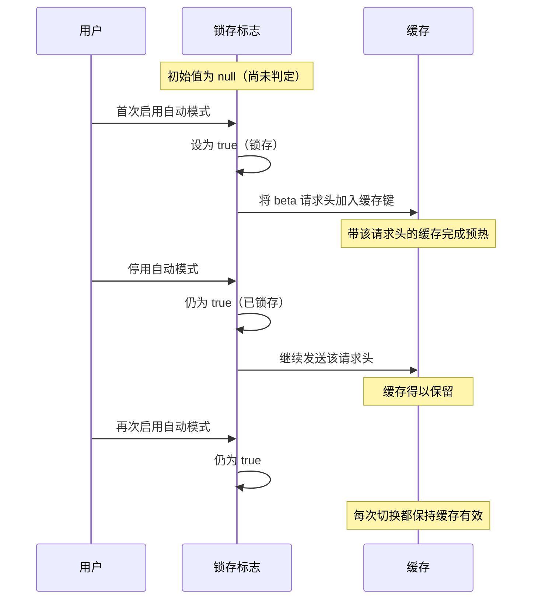
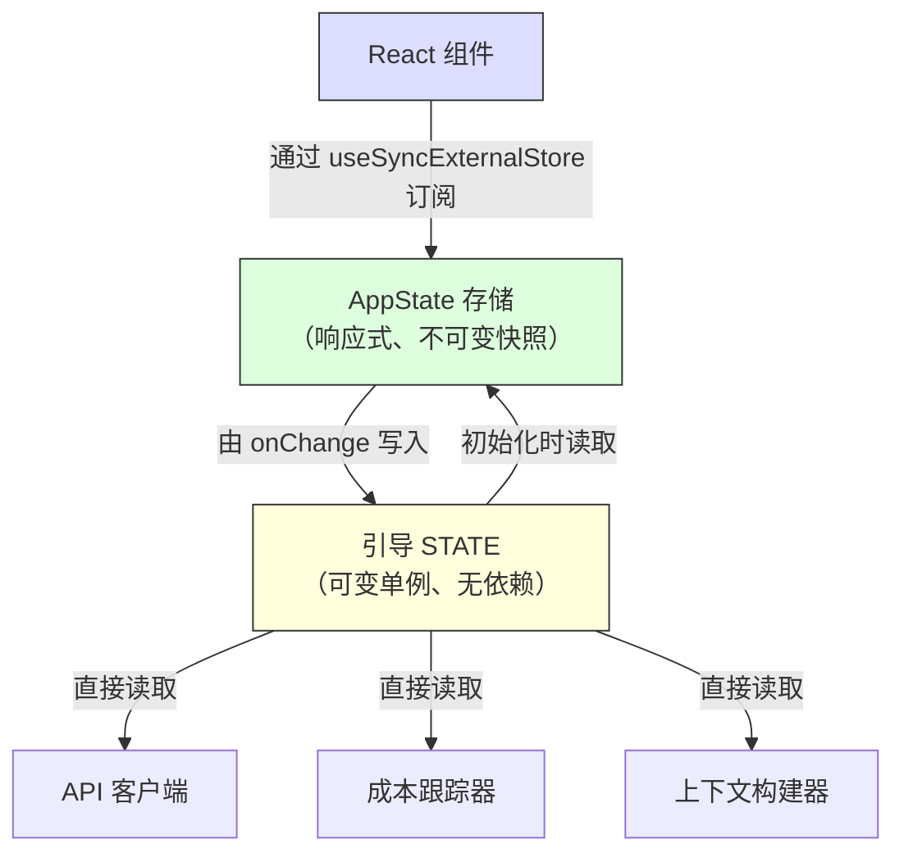

# 第 3 章：状态的双层架构

[第 2 章](ch02-bootstrap.md)追踪了从进程启动到首次渲染的引导流程。流程结束时，系统的运行环境已经配置就绪。具体配置了什么？会话 ID、当前模型、消息历史、成本跟踪器和权限模式分别存在哪里？为什么放在那里？

每个长时间运行的应用最终都会遇到这个问题。简单的 CLI 工具用 `main()` 里的几个变量就能解决。Claude Code 则是一个通过 Ink 渲染的 React 应用。它的进程生命周期以小时计，插件可以在任意时刻加载，API 层需要用缓存的上下文构造提示词，成本跟踪器需要在进程重启后恢复数据，还有几十个基础设施模块需要读写共享数据，同时避免彼此导入。

把所有状态放进同一个全局存储很快就会遇到问题。如果成本跟踪器更新的存储同时驱动 React 重新渲染，每次 API 调用都会触发整棵组件树的协调。引导、上下文构建、成本跟踪和遥测等基础设施模块无法导入 React。它们会在 React 挂载前、卸载后，甚至在根本没有组件树的环境中运行。把所有数据塞进一个与 React 集成的存储，会在整个导入关系图上造成循环依赖。

Claude Code 采用双层架构（Two-Tier Architecture）来解决这个问题：用可变的进程级单例保存基础设施状态，再用一个精简的响应式存储保存 UI 状态。本章介绍这两层、负责衔接它们的副作用机制，以及依赖这套基础的子系统。后续各章都以理解状态存在哪里、为何这样存放为前提。

---

## 3.1 引导状态与进程级单例

### 为什么使用可变单例

引导状态模块（`bootstrap/state.ts`）在进程启动时创建一个可变对象，整个进程只创建这一次。

```typescript
const STATE: State = getInitialState()
```

这行代码上方的注释写着 `AND ESPECIALLY HERE`。类型定义上方两行还写着 `DO NOT ADD MORE STATE HERE - BE JUDICIOUS WITH GLOBAL STATE`。从措辞看，写下注释的工程师已经吃过全局对象失去约束的苦头。

这里适合使用可变单例，有三个理由。第一，引导状态必须在任何框架初始化之前可用，也就是 React 挂载、存储创建、插件加载之前。只有在模块作用域初始化，才能保证模块一经导入，状态就已经可用。第二，这些数据天然属于进程级，例如会话 ID、遥测计数器、成本累加值和缓存的路径。这里无需比较前后状态、通知订阅者或记录撤销历史。第三，这个模块必须位于导入依赖图的叶子位置。如果它导入 React、存储或任何服务模块，就会形成循环，破坏第 2 章介绍的引导顺序。它只依赖工具类型和 `node:crypto`，因此可以从任何位置导入。

### 约 80 个字段

`State` 类型包含约 80 个字段。下面几组字段说明了它涵盖的范围。

**标识与路径。** `originalCwd`、`projectRoot`、`cwd`、`sessionId`、`parentSessionId`。进程启动时，通过 `realpathSync` 解析 `originalCwd`，再将它规范化为 NFC。这个字段之后始终保持不变。

**成本与指标。** `totalCostUSD`、`totalAPIDuration`、`totalLinesAdded`、`totalLinesRemoved`。这些值在会话中单调累加，进程退出时持久化到磁盘。

**遥测。** `meter`、`sessionCounter`、`costCounter`、`tokenCounter`。这些都是 OpenTelemetry 句柄，在遥测初始化之前为 null。

**模型配置。** `mainLoopModelOverride`、`initialMainLoopModel`。用户在会话中切换模型时，系统设置覆盖值。

**会话标志。** `isInteractive`、`kairosActive`、`sessionTrustAccepted`、`hasExitedPlanMode`。这些布尔值控制整个会话期间的行为。

**缓存优化。** `promptCache1hAllowlist`、`promptCache1hEligible`、`systemPromptSectionCache`、`cachedClaudeMdContent`。这些字段用于避免重复计算和提示词缓存（Prompt Cache）失效。

### Getter 和 Setter 模式

模块始终将 `STATE` 对象留在内部，通过约 100 个独立的 getter 和 setter 函数提供访问。

```typescript
// Pseudocode — illustrates the pattern
export function getProjectRoot(): string {
  return STATE.projectRoot
}

export function setProjectRoot(dir: string): void {
  STATE.projectRoot = dir.normalize('NFC')  // NFC normalization on every path setter
}
```

这种模式将访问封装起来，确保每个路径 setter 都执行 NFC 规范化（避免 macOS 上的 Unicode 不匹配），也便于收窄类型、保持引导模块的独立性。代价是代码膨胀：80 个字段对应约 100 个函数。但在这个代码库里，一次无意的写入就可能让 50,000 token 的提示词缓存失效，显式访问更合适。

### 信号模式

引导模块位于有向无环图（DAG）的叶子位置，无法导入监听者，因此使用一个名为 `createSignal` 的精简发布/订阅原语。`sessionSwitched` 信号只有一个消费者，即负责同步 PID 文件的 `concurrentSessions.ts`。模块通过 `onSessionSwitch = sessionSwitched.subscribe` 对外暴露订阅接口，调用方自行注册，引导模块无需知道订阅者是谁。

### 五个保持型锁存标志

引导状态中最微妙的是五个遵循同一模式的布尔标志，称为保持型锁存标志（Sticky Latches）。某项功能在一次会话中首次启用后，对应标志就一直保持为 `true`，直到会话结束。它们都服务于同一个目标：保留提示词缓存。



Claude API 支持服务端提示词缓存。连续的请求共用同一段系统提示词前缀时，服务器可以复用缓存的计算结果。不过，缓存键还包含 HTTP 请求头和请求体字段。如果第 N 次请求带有某个 beta 请求头，第 N+1 次却省略了它，即使提示词完全相同，也会发生缓存失效。对于超过 50,000 token 的系统提示词，一次缓存未命中的成本很高。

这五个锁存标志各有用途。

| 锁存标志 | 防止的问题 |
|-------|-----------------|
| `afkModeHeaderLatched` | 通过 Shift+Tab 切换自动模式时，AFK beta 请求头随之出现或消失 |
| `fastModeHeaderLatched` | 进入或退出快速模式的冷却期时，快速模式请求头随之变化 |
| `cacheEditingHeaderLatched` | 远程功能标志的变动让所有活跃用户的缓存失效 |
| `thinkingClearLatched` | 在确认缓存未命中时触发（空闲超过 1 小时）。防止重新启用思考块导致刚预热的缓存失效 |
| `pendingPostCompaction` | 供遥测使用的一次性消费标志，区分上下文压缩导致的缓存未命中和 TTL 到期导致的未命中 |

五个标志都使用三态类型 `boolean | null`。初始值 `null` 表示“尚未判定”，`true` 表示“已锁定为开启”。一旦设为 `true`，它们就不会再回到 `null` 或 `false`。这就是锁存的基本特性。

实现方式如下。

```typescript
function shouldSendBetaHeader(featureCurrentlyActive: boolean): boolean {
  const latched = getAfkModeHeaderLatched()
  if (latched === true) return true       // Already latched -- always send
  if (featureCurrentlyActive) {
    setAfkModeHeaderLatched(true)          // First activation -- latch it
    return true
  }
  return false                             // Never activated -- don't send
}
```

为什么不始终发送所有 beta 请求头？因为请求头是缓存键的一部分，发送一个无法识别的请求头会产生不同的缓存命名空间。锁存机制确保系统只在确实需要时进入某个缓存命名空间，随后留在其中。

---

## 3.2 AppState 与响应式存储

### 34 行实现

UI 状态存储位于 `state/store.ts`。

存储的实现约 30 行，由捕获 `state` 变量的闭包、阻止无效更新的 `Object.is` 相等性检查、同步的监听者通知，以及处理副作用（Side Effects）的 `onChange` 回调组成。基本结构如下。

```typescript
// Pseudocode — illustrates the pattern
function makeStore(initial, onTransition) {
  let current = initial
  const subs = new Set()
  return {
    read:      () => current,
    update:    (fn) => { /* Object.is guard, then notify */ },
    subscribe: (cb) => { subs.add(cb); return () => subs.delete(cb) },
  }
}
```

整套实现只用 34 行。一个捕获可变变量的闭包、一组保存在 Set 中的监听者，以及一次 `Object.is` 相等性检查就足够了。中间件、开发者工具、时间旅行调试和 action 类型都可以省去。它用自己的代码实现了 Zustand 的核心模式。

其中几项设计值得细看。

**更新函数模式。** 接口只接受 `setState((prev) => next)` 这种形式，不接受 `setState(newValue)`。每次变更都接收当前状态并据此生成下一状态，避免并发修改使用过时状态。

**`Object.is` 相等性检查。** 如果更新函数返回同一个引用，这次更新就是空操作，既不会触发监听者，也不会执行副作用。这项检查对性能很重要：组件展开状态并提交更新时，如果值没有变化，就可以返回原引用，避免重新渲染。

**`onChange` 先于监听者执行。** 可选回调 `onChange` 同时接收旧状态和新状态，会在任何订阅者收到通知前同步执行。这样可以处理必须在 UI 重新渲染前完成的副作用，见第 3.4 节。

**省去中间件和开发者工具。** 存储只需要三种操作（读取、设置、订阅）、一次 `Object.is` 相等性检查和一个同步 `onChange` 回调。自己维护这 34 行代码，就可以精确控制语义，半分钟内读完整个实现。

### AppState 类型

`AppState` 类型约有 452 行，定义 UI 渲染所需的全部数据结构。大多数字段都包在 `DeepImmutable<>` 中，包含函数类型的字段则显式排除在外。

```typescript
export type AppState = DeepImmutable<{
  settings: SettingsJson
  verbose: boolean
  // ... ~150 more fields
}> & {
  tasks: { [taskId: string]: TaskState }  // Contains abort controllers
  agentNameRegistry: Map<string, AgentId>
}
```

交叉类型让大多数字段保持深层不可变，同时允许包含函数、Map 和可变引用的字段例外处理。默认采用完全不可变的类型，仅在类型系统与运行时（Runtime）语义冲突的位置放宽约束。

### 与 React 集成

存储通过 `useSyncExternalStore` 与 React 集成。

```typescript
// Standard React pattern — useSyncExternalStore with a selector
export function useAppState<T>(selector: (state: AppState) => T): T {
  const store = useContext(AppStoreContext)
  return useSyncExternalStore(
    store.subscribe,
    () => selector(store.getState()),
  )
}
```

要让 `Object.is` 比较跳过不必要的重新渲染，选择器必须返回已有子对象的引用。如果写成 `useAppState(s => ({ a: s.a, b: s.b }))`，每次求值都会构造一个新对象，状态每变更一次，组件就重新渲染一次。Zustand 的使用者也面临同样的约束：比较开销低，但编写选择器的人必须理解引用同一性。

---

## 3.3 两层状态如何协作

两层通过明确且精简的接口通信。



初始化时，引导状态流入 AppState。`getDefaultAppState()` 从磁盘读取设置（引导阶段已协助定位），检查功能标志（引导阶段已判定），并设置初始模型（引导阶段已根据 CLI 参数和设置解析）。

AppState 则通过副作用将变更传回引导状态。用户切换模型时，`onChangeAppState` 调用引导模块中的 `setMainLoopModelOverride()`。设置发生变化时，系统会清空引导状态中的凭据缓存。

两层之间从不共享引用。导入引导状态的模块无需了解 React。读取 AppState 的组件也无需了解进程级单例。

以用户输入 `/model claude-sonnet-4` 为例，可以看到数据如何流动。

1. 命令处理函数调用 `store.setState(prev => ({ ...prev, mainLoopModel: 'claude-sonnet-4' }))`
2. 存储通过 `Object.is` 检查发现状态有变化
3. `onChangeAppState` 执行并检测到模型变更，调用 `setMainLoopModelOverride()` 更新引导状态，再调用 `updateSettingsForSource()` 写入磁盘
4. 存储通知所有订阅者，React 组件重新渲染，显示新的模型名称
5. 下一次 API 调用通过引导状态中的 `getMainLoopModelOverride()` 读取模型

第 1 至 4 步同步执行。第 5 步中的 API 客户端可能几秒后才运行，届时会读取第 3 步更新过的引导状态。两层由此完成交接。UI 存储记录用户选中的模型，引导状态则是 API 客户端实际使用模型的依据。

一条 ESLint 规则限制 `bootstrap/state.ts` 只能导入允许集合中的模块，从而保证依赖图无环：引导层独立于其他层，AppState 在初始化时依赖引导层，React 依赖 AppState。

---

## 3.4 通过 onChangeAppState 处理副作用

两层在 `onChange` 回调中同步。每次调用 `setState` 都会触发 `onChangeAppState`，由它接收前后状态并决定执行哪些外部副作用。

**权限模式同步**是主要用途。在集中式处理函数出现前，8 条以上的权限模式修改路径里，只有 2 条会将变更同步到远程会话（CCR）。其余 6 条路径涉及 Shift+Tab 轮换、对话框选项、斜杠命令、回退、桥接回调等，都更新了 AppState，却没有通知 CCR。外部元数据因此逐渐与本地状态脱节。

修复方式是将通知从各个修改点收拢到一处，统一根据状态差异触发。源代码注释列出了出问题的各条路径，并指出“上面那些分散的调用点无需改动”。集中处理副作用后，各条路径天然都能得到覆盖。

**模型变更**会让引导状态与 UI 渲染的内容保持同步。**设置变更**会清空凭据缓存并重新应用环境变量。**详细输出开关**和**展开视图**会持久化到全局配置。

这种集中处理状态差异的副作用机制，本质上是把观察者模式（Observer Pattern）用在一次状态变更的差异上。副作用种类的增长远慢于状态修改点的增长，所以它比各处分别发出事件更容易扩展。

---

## 3.5 构建上下文

`context.ts` 中有三个采用记忆化的异步函数，用于构建放在每次对话开头的系统提示词上下文。每个函数在整个会话中只计算一次。

`getGitStatus` 通过 `Promise.all` 并行执行五条 git 命令，生成一个包含当前分支、默认分支、近期提交和工作树状态的文本块。`--no-optional-locks` 标志阻止 git 获取可能干扰另一个终端中并发 git 操作的写锁。

`getUserContext` 加载 CLAUDE.md 的内容，再通过 `setCachedClaudeMdContent` 将它缓存到引导状态。这份缓存化解了一个循环依赖：自动模式分类器需要 CLAUDE.md 的内容，但加载 CLAUDE.md 要经过文件系统，文件系统操作要通过权限检查，权限检查又会调用分类器。把内容缓存到处于 DAG 叶子位置的引导状态即可打破循环。

这三个上下文函数都采用 Lodash 的 `memoize`，计算一次后一直使用缓存。这些缓存没有 TTL。如果每 5 分钟重新计算一次 git 状态，变化就会让服务端提示词缓存失效。系统提示词甚至会告诉模型：“这是对话开始时的 git 状态。请注意，它是当时的快照。”

---

## 3.6 跟踪成本

每个 API 响应都会经过 `addToTotalSessionCost`。它按模型累加用量、更新引导状态、向 OpenTelemetry 上报，并递归处理 advisor 工具的用量，也就是响应中嵌套的模型调用。

成本状态保存在项目配置文件中，可以在进程重启后恢复。会话 ID 是恢复的校验条件。只有持久化的会话 ID 与正在恢复的会话匹配，才会恢复其中的成本数据。

直方图使用蓄水池抽样（Reservoir Sampling，算法 R），在限制内存占用的同时保留分布特征。容量为 1,024 个样本的蓄水池用于计算 p50、p95 和 p99 百分位数。为什么不算一个滚动平均值就好？因为平均值看不出分布形状。一个会话中 95% 的 API 调用耗时 200 毫秒、5% 耗时 10 秒，平均耗时和所有调用都耗时 690 毫秒的会话一样，用户体验却截然不同。

---

## 3.7 本章回顾

这个代码库从一个简单的 CLI，发展到拥有约 450 行状态类型定义、约 80 个进程状态字段、一套副作用机制、多个持久化边界和一组缓存优化锁存标志的系统。这些都是随着需求逐步形成的。缓存失效的成本变得可衡量之后，才加上了锁存标志。发现 8 条权限同步路径中有 6 条出问题后，才将副作用集中到 `onChange`。CLAUDE.md 缓存也是在循环依赖出现后才加入的。

这是复杂应用中状态自然演化的方式。双层架构提供了足够的结构来承载这种增长。新增引导状态字段不会影响 React 渲染，新增 AppState 字段不会造成导入循环。同时，这套架构还有足够的灵活性，能容纳最初设计时未预见的用法。

---

## 3.8 状态架构一览

| 属性 | 引导状态 | AppState |
|---|---|---|
| **位置** | 模块作用域内的单例 | React 上下文 |
| **可变性** | 通过 setter 修改 | 通过更新函数生成不可变快照 |
| **订阅者** | 通过信号（发布/订阅）订阅特定事件 | React 通过 `useSyncExternalStore` 订阅 |
| **何时可用** | 导入时（React 挂载之前） | Provider 挂载之后 |
| **持久化** | 在进程退出处理函数中执行 | 经由 onChange 写入磁盘 |
| **相等性检查** | 不适用（直接读取） | 用 `Object.is` 检查引用 |
| **依赖** | DAG 叶子（无导入依赖） | 从代码库各处导入类型 |
| **测试时重置** | `resetStateForTests()` | 创建新的存储实例 |
| **主要使用方** | API 客户端、成本跟踪器、上下文构建器 | React 组件、副作用处理逻辑 |

---

## 学以致用

**按访问方式划分状态。** 会话 ID 放在单例里，是因为 React 挂载之前就要读取它，而且写入时无需通知订阅者。权限模式放在响应式存储里，是因为修改时需要触发重新渲染和副作用。根据访问方式选择状态所属的层，架构就自然清晰了。

**使用保持型锁存。** 只要和缓存打交道，无论是提示词缓存、CDN 还是查询缓存，都会遇到同样的问题：会话中途切换功能可能改变缓存键，导致缓存失效。功能一旦开启，它对缓存键的影响就保留到会话结束。三态类型 `boolean | null` 让意图一目了然：“尚未判定／已开启／开启后不再关闭”。当缓存不由自己控制时，这个模式尤其有用。

**集中处理状态差异产生的副作用。** 多条代码路径都能改变同一状态时，在存储的 `onChange` 回调里检测哪些字段发生了变化。这样，覆盖范围由机制保证，所有状态变更都能触发相应处理，无需每个修改点各自记得发通知。

**用 34 行自己维护的代码实现所需操作。** 如果需求刚好是读取、设置、订阅和变更回调，最小实现就能让你完全掌控操作语义。在状态管理错误会带来实际成本的系统里，这种透明性很有价值。判断何时可以省去依赖，也是设计的一部分。

**有意识地选择进程退出作为持久化边界。** 多个子系统在进程退出时持久化状态。取舍很明确：非正常终止（SIGKILL、OOM）会丢失累积的数据。这里可以接受这种损失，因为数据用于诊断，且计数器每个会话会增加数百次，每次状态变化都写磁盘的代价太高。

---

本章介绍的双层架构以引导单例承载基础设施状态，以响应式存储承载 UI 状态，并由副作用衔接两层。后续各章都建立在此基础上。对话循环（第 4 章）从经过记忆化的构建函数读取上下文。工具系统（第 5 章）从 AppState 检查权限。智能体（Agent）系统（[第 8 章](ch08-sub-agents.md)）在 AppState 中创建任务条目，同时在引导状态中追踪成本。要理解任意一个系统如何运作，得先知道状态存在哪里以及为什么。

有些字段跨越了两层的边界。主循环模型在两层都存在，AppState 里的 `mainLoopModel` 用于 UI 渲染，引导状态里的 `mainLoopModelOverride` 供 API 客户端读取。`onChangeAppState` 处理函数让二者保持同步。数据的重复是双层划分的代价。如果让 API 客户端导入 React 存储，或让 React 组件从进程级单例读取数据，就会破坏这套架构所依赖的依赖方向。在集中同步的前提下，保留少量可控的重复数据，可以避免依赖关系变得盘根错节。
