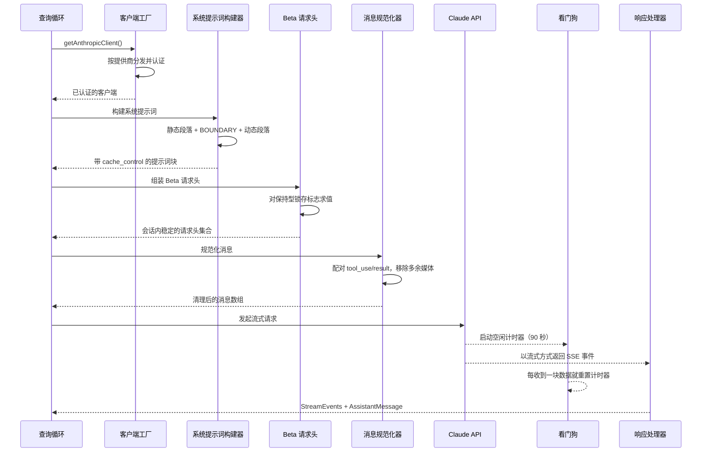
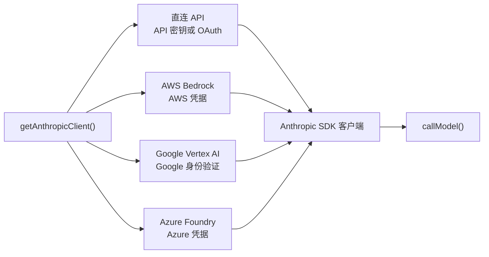
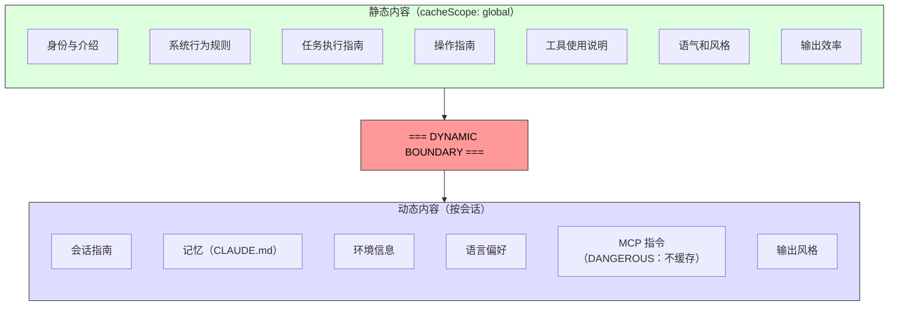

# 第 4 章：与 Claude 通信——API 层

[第 3 章](ch03-state.md)说明了状态存在哪里，以及两层状态如何通信。现在来看状态如何派上用场：系统需要与语言模型通信。Claude Code 的启动流程、状态系统和权限框架，都在为这一刻服务。

这一层要处理的故障比系统的其他任何部分都多。它必须通过同一个透明接口接入四家云服务提供商。构建系统提示词时，它必须精确到字节地考虑服务器端提示词缓存（Prompt Cache）的工作方式，因为一个段落放错位置，就可能让超过 50,000 个 token 的缓存失效。处理流式响应时，它必须主动探测故障，因为 TCP 连接可能悄无声息地断开。它还必须在整个会话中维持不变量，避免对话途中改变功能开关时，性能在无明显征兆的情况下骤降。

下面从头到尾追踪一次 API 调用。

---

## 多提供商客户端工厂

`getAnthropicClient()` 是所有模型通信的统一工厂函数。它返回一个 Anthropic SDK 客户端，按部署所选的提供商配置。

分发完全由环境变量控制，按固定优先级判断。四种提供商专用的 SDK 类都通过 `as unknown as Anthropic` 转换为 `Anthropic`。源码中的注释很坦率：“我们一直在谎报返回类型。”这种刻意的类型擦除让所有调用方看到统一的接口。其余代码不会按提供商分支。

各提供商的 SDK 采用动态导入。`AnthropicBedrock`、`AnthropicFoundry` 和 `AnthropicVertex` 都是带有各自依赖树的大型模块。动态导入确保未使用的提供商模块不会加载。

提供商在启动时选定，并存入启动状态 `STATE`。查询循环从不检查当前使用的是哪家提供商。从直连 API 切换到 Bedrock，只需更改配置，代码无需改动。

### buildFetch 封装

每次向外发出的 fetch 调用都会经过封装，注入 `x-client-request-id` 请求头，其值是为每个请求生成的 UUID。请求超时时，服务器不会为响应分配请求 ID。没有客户端 ID，API 团队就无法把超时和服务器日志关联起来。这个请求头补上了这一环。它只发给 Anthropic 自有端点，因为第三方提供商可能拒绝未知的请求头。

---

## 构建系统提示词

系统提示词是整个系统中对缓存最敏感的数据。Claude API 提供服务器端提示词缓存。多个请求中完全相同的提示词前缀可以缓存，从而降低延迟和成本。一段包含 200K 个 token 的对话，可能有 50–70K 个 token 与上一回合完全相同。缓存一旦失效，服务器就得重新处理这部分内容。

### 动态边界标记

提示词由多个字符串段落组成，其中有一条关键的分界线。

边界之前的内容在不同会话、用户和组织之间完全一致，可使用最高级别的服务器端缓存。边界之后包含用户特定的内容，因此降为按会话缓存。

段落的命名刻意设计得醒目。添加新段落时，必须在 `systemPromptSection`（安全，可缓存）和 `DANGEROUS_uncachedSystemPromptSection`（会使缓存失效，须填写原因字符串）之间选择。`_reason` 参数在运行时（Runtime）不使用，但它承担强制记录的作用。每个会让缓存失效的段落都得在源码里解释原因。

### 2^N 问题

`prompts.ts` 中的一条注释解释了为什么条件段落必须放在边界之后。

> 这里的每个条件都是一个运行时二进制位。如果放在边界之前，就会让 Blake2b 前缀哈希的变体数量成倍增加（2^N）。

边界之前每多一个布尔条件，全局缓存中的不同条目数就会翻倍。三个条件产生 8 个变体，五个条件产生 32 个。静态段落刻意不设条件。由打包器解析的编译期功能开关可以放在边界之前。运行时检查必须放在边界之后，例如当前模型是否为 Haiku、用户是否启用了自动模式。

这类约束往往要等到有人违反它才会显现。一名出于好意的工程师如果在边界之前加入一个由用户设置控制的段落，可能悄无声息地把全局缓存分割成多个变体，让整个服务集群的提示词处理成本翻倍。

---

## 流式处理

### 直接使用 SSE，跳过 SDK 的上层封装

流式处理（Streaming）直接采用 `Stream<BetaRawMessageStreamEvent>`，跳过 SDK 上层的 `BetaMessageStream`。因为 `BetaMessageStream` 会在每个 `input_json_delta` 事件上调用 `partialParse()`。对于 JSON 输入很大的工具调用（例如编辑数百行文件），每收到一块数据都要从头解析越来越长的 JSON 字符串，复杂度为 O(n^2)。Claude Code 自己负责累积工具输入，因此这些局部解析只是额外开销。

### 空闲看门狗

TCP 连接可能在没有通知的情况下断开。服务器可能崩溃，负载均衡器可能静默丢弃连接，企业代理也可能超时。SDK 的请求超时只覆盖初始 fetch。一旦收到 HTTP 200，超时条件就已解除。如果响应体停止传输，就没有机制能检测到。

看门狗用 `setTimeout` 实现，每收到一块数据就重置计时器。90 秒没有收到数据时，系统中止流式响应，改用非流式方式重试。45 秒时会发出警告。看门狗触发时会把事件连同客户端请求 ID 一起记入日志，以便关联排查。

### 回退到非流式请求

当响应传到一半出现网络错误、停滞或截断，系统会回退到同步的 `messages.create()` 调用。这可处理代理返回 HTTP 200、响应体却不是 SSE 的情况，也可处理代理中途截断 SSE 流的情况。

流式工具执行启用时，可以禁用这个回退机制，因为回退会重跑整个请求，可能导致工具执行两次。

---

## 提示词缓存系统

### 三个层级

提示词缓存分为三个层级。

**临时缓存（默认）。** 按会话缓存，由服务器设定 TTL，约 5 分钟。所有用户均可使用。

**1 小时 TTL。** 符合条件的用户可使用延长缓存。资格由订阅状态决定，并锁定在启动状态中。第 3 章的 `promptCache1hEligible` 保持型锁存标志确保，即使会话中途的超额用量状态发生变化，TTL 也不会变。

**全局作用域。** 系统提示词的缓存条目跨会话、跨组织共享。提示词的静态部分对所有 Claude Code 用户完全相同，一份缓存即可服务所有用户。存在 MCP 工具时，会禁用全局作用域，因为 MCP 工具定义随用户而异，会将缓存分割成数百万个不同的前缀。

### 保持型锁存标志如何生效

第 3 章介绍过的五个保持型锁存标志，在构建请求时求值。每个标记初始为 `null`，一旦设为 `true`，在本会话剩余时间内都会保持 `true`。标记代码上方的注释说得很明确：“用于动态 Beta 请求头的保持开启的锁存标志。每个请求头从首次发送起，在本会话剩余时间里都会继续发送，这样会话中途切换功能开关就不会改变服务器端的缓存键，也不会让约 50–70K 个 token 的缓存失效。”

参见[第 3 章第 3.1 节](ch03-state.md#五个保持型锁存标志)，了解锁存模式、五个具体标记，以及为什么不应始终发送所有请求头。

---

## queryModel 生成器

`queryModel()` 是一个约 700 行的 AsyncGenerator（异步生成器），负责编排（Orchestration）整个 API 调用生命周期。它产出 `StreamEvent`、`AssistantMessage` 和 `SystemAPIErrorMessage` 对象。

请求按以下顺序组装。

1. **检查紧急停用开关。** 最昂贵模型档位的保护措施。
2. **组装 Beta 请求头。** 按模型组装，并应用保持型锁存标志。
3. **构建工具 schema。** 通过 `Promise.all()` 并行构建，延迟加载的工具在被发现前不纳入其中。
4. **规范化消息。** 修复未配对的 tool_use/tool_result，移除多余媒体和过时的消息块。
5. **构建系统提示词块。** 在动态边界处拆分，分配缓存作用域。
6. **在重试封装中运行流式请求。** 处理 529（过载）、备用模型切换、思考降级和 OAuth 刷新。

### 输出 token 上限

默认输出上限为 8,000 个 token，低于通常的 32K 或 64K。生产数据显示，输出的第 99 百分位为 4,911 个 token，标准上限预留了 8–16 倍的空间。当响应达到上限时（不到 1% 的请求），系统以 64K 上限从头重试一次。以服务集群的规模来看，这能显著降低成本。

### 错误处理与重试

`withRetry()` 本身也是异步生成器，产出 `SystemAPIErrorMessage` 事件，让界面显示重试状态。重试策略如下。

- **529（过载）。** 等待后重试，必要时对快速模式降级。
- **切换备用模型。** 主模型失败时尝试备用模型，例如从 Opus 切换到 Sonnet。
- **思考降级。** 上下文窗口溢出时降低思考预算。
- **OAuth 401。** 刷新 token，再重试一次。

采用生成器模式后，“服务器过载，5 秒后重试……”这样的进度可直接进入事件流，无需另设通知渠道。

---

## 学以致用

**将提示词缓存视为架构约束。** 大多数 LLM 应用只把缓存“打开”。Claude Code 用这项约束来决定提示词顺序、段落结果的记忆化、请求头锁存和配置管理。前缀组织得当，可以命中 50K 个 token 的缓存。组织不当，每个回合都要重新处理全部内容。这个差异是系统中影响成本最大的因素。

**用 DANGEROUS 命名代价高昂的例外路径。** 如果某个不变量很容易被无意破坏，用醒目的前缀命名例外路径有三个作用。它让代码审查者看到哪里打破了约束，要求开发者用必填参数写明原因，也让人更愿意遵循安全的默认做法。除了缓存，这也适用于任何代价不易察觉的操作。

**为流式响应加上看门狗。** SDK 的请求在收到 HTTP 200 后就满足了超时检查，但响应体随时可能停止传输。每收到一块数据就重置的 `setTimeout` 可以检测到这种情况。非流式回退可以处理代理的故障，例如 HTTP 200 搭配非 SSE 响应体，或在传输途中截断。企业环境中，这些情况比你预想的更常见。

**重试时用生成器产出状态事件。** 将重试封装写成产出状态事件的异步生成器，调用方就能把重试进度作为事件流的一部分显示。备用模型机制（Opus 失败时尝试 Sonnet）尤其有助于提高生产环境的韧性。

**为快速路径设置独立入口。** 有些 API 调用无需工具搜索、顾问集成、思考预算和流式基础设施。Claude Code 的 `queryHaiku()` 为压缩、分类等内部操作提供精简路径，跳过所有与智能体相关的处理。独立函数和精简接口可以防止这些复杂性意外渗入。

---

## 下一步

API 层是后续各章的基础。[第 5 章](ch05-agent-loop.md)将介绍查询循环怎样利用流式响应驱动工具执行，包括工具怎样在模型完成响应前就开始执行。[第 6 章](ch06-tools.md)将说明对话接近上下文上限时，压缩系统怎样保持缓存效率。[第 7 章](ch07-concurrency.md)将介绍每条智能体线程怎样获得自己的消息数组和请求链。

这些系统继承了这里确立的约束：缓存稳定性是架构不变量，客户端工厂屏蔽提供商差异，锁存机制保证会话内配置稳定。API 层负责发送请求，也为每个其他子系统规定了运行规则。
