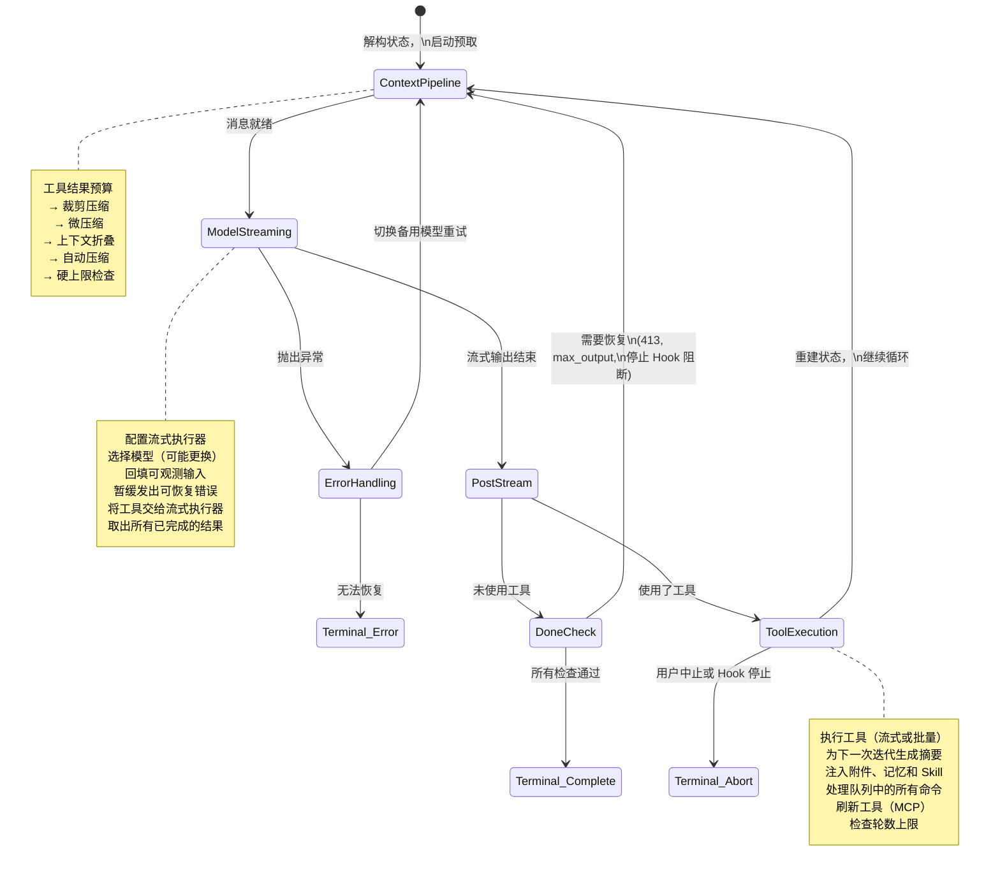
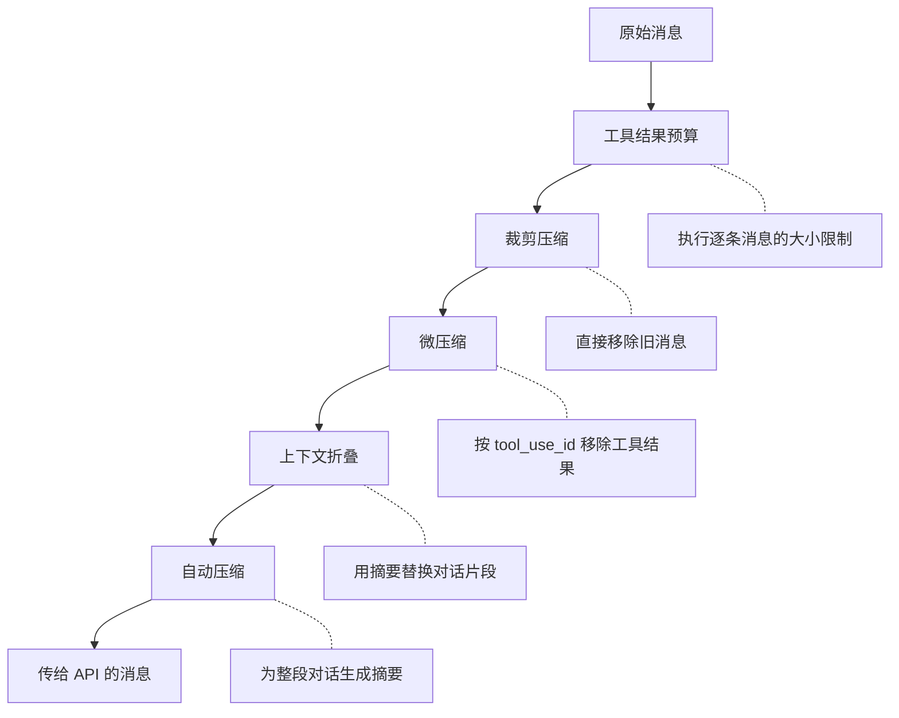
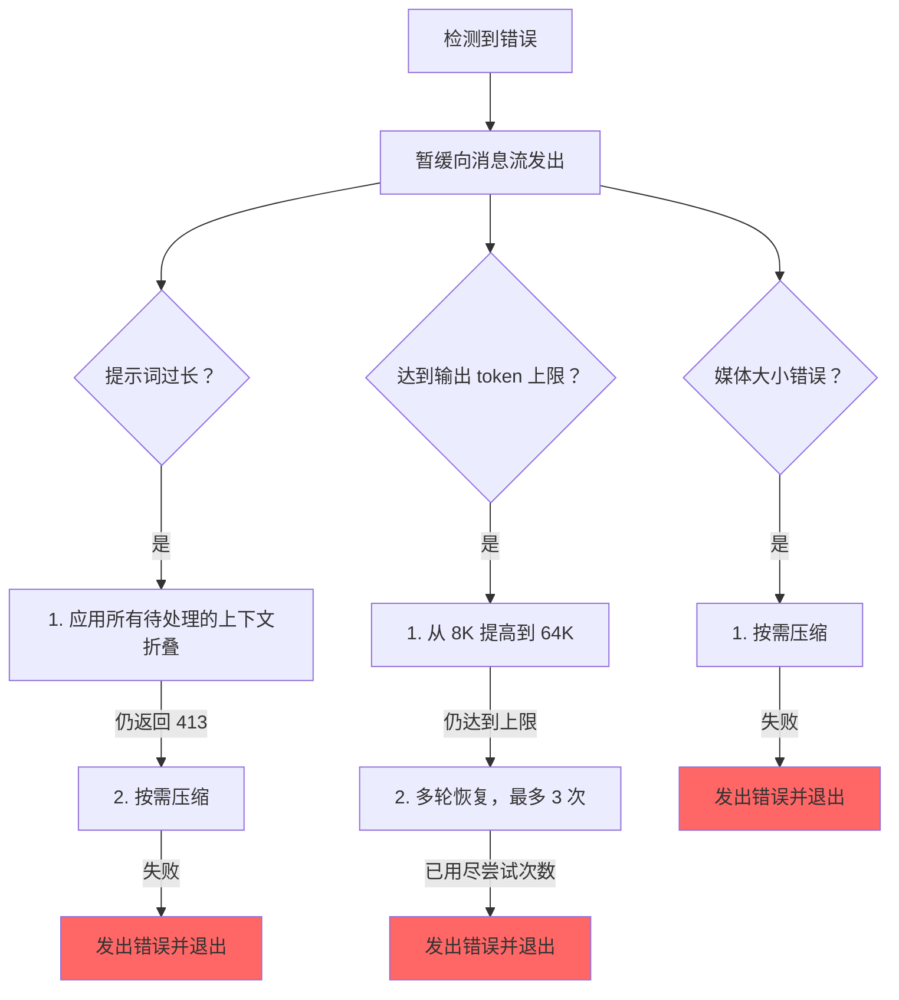

# 第 5 章：智能体循环

## 系统的核心

[第 4 章](ch04-api-layer.md)介绍了 API 层如何将配置转换为流式 HTTP 请求，包括客户端的构建、系统提示词的组装，以及如何通过服务器发送事件接收响应。这一层负责与模型通信的具体机制。一次 API 调用还不足以构成智能体（Agent）。智能体按循环运行：调用模型、执行工具、把结果反馈给模型，再次调用模型，直到任务完成。

每个系统都有自己的核心。数据库的核心是存储引擎，编译器的核心是中间表示。在 Claude Code 中，核心是 `query.ts`。这个 1,730 行的文件包含一个 AsyncGenerator（异步生成器），负责运行每次交互，从 REPL 中的第一次按键，到无界面模式下通过 `--print` 启动的最后一次工具调用。

这并不夸张。与模型通信、执行工具、管理上下文、从错误中恢复，以及决定何时停止，全部走同一条代码路径，即 `query()` 函数。REPL、SDK、子智能体（Sub-Agent）和无界面运行器都调用它。只要在用 Claude Code，就在运行 `query()`。

这个文件信息密集。它的复杂性与盘根错节的继承层次不同，更像一艘潜艇：船体只有一个，里面有许多冗余系统，每一套都是因为海水曾找到入侵途径才加上的。每个 `if` 分支都有来历。每条暂缓发出的错误消息背后，都有过 SDK 使用方在恢复途中断开的真实故障。每个熔断阈值都根据真实会话调校过，那些会话曾在无限循环中耗掉数千次 API 调用。

本章从头到尾追踪整个智能体循环（Agent Loop）。读完以后，你会明白循环做了什么、每个机制为何存在，以及缺少它会出什么问题。

---

## 为什么使用异步生成器

第一个架构问题是，为什么用生成器实现智能体循环，而不用基于回调的事件发射器？

```typescript
// Simplified — shows the concept, not the exact types
async function* agentLoop(params: LoopParams): AsyncGenerator<Message | Event, TerminalReason>
```

实际签名会产出多种消息和事件，并返回一个可辨识联合类型，表示循环停止的原因。

按重要性排序，有三个理由。

**背压（Backpressure）。** 事件发射器无论消费者是否就绪都会发出事件。生成器只在消费者调用 `.next()` 时产出值。REPL 的 React 渲染器忙于绘制上一帧时，生成器自然暂停。SDK 使用方处理工具结果时，生成器也会等待。由此避免缓冲区溢出、消息丢失以及生产者快而消费者慢的问题。

**返回值语义。** 生成器的返回类型是 `Terminal`，这是一个精确表示循环停止原因的可辨识联合类型。是正常完成、用户中止、token 预算耗尽、停止 Hook（Stop Hook）干预、达到轮数上限，还是遇上不可恢复的模型错误？一共有 10 种终止状态。调用方无需订阅一个“结束”事件后寄望事件数据里带有原因。调用方可通过 `for await...of` 或 `yield*` 获取带类型的返回值。

**通过 `yield*` 组合。** 外层 `query()` 通过 `yield*` 委托给 `queryLoop()`，透明地转发每个产出的值和最终返回值。`handleStopHooks()` 等子生成器也采用相同模式。这样就形成了清晰的职责链，省去回调、层层嵌套的 Promise 和转发事件的样板代码。

这个选择也有代价。JavaScript 的异步生成器无法倒退或分叉，但智能体循环无需这两种能力。它是一个严格向前推进的状态机（State Machine）。

还有一点容易忽略。`function*` 语法让函数惰性执行。首次调用 `.next()` 前，函数体不会执行。因此 `query()` 会立即返回，配置快照、记忆预取和预算跟踪器等开销较大的初始化工作，等消费者开始取值后才会发生。对 REPL 来说，这意味着循环执行第一行代码之前，React 渲染流水线就已就绪。

---

## 调用方提供哪些参数

在追踪循环之前，先看看它接收什么。

```typescript
// Simplified — illustrates the key fields
type LoopParams = {
  messages: Message[]
  prompt: SystemPrompt
  permissionCheck: CanUseToolFn
  context: ToolUseContext
  source: QuerySource         // 'repl', 'sdk', 'agent:xyz', 'compact', etc.
  maxTurns?: number
  budget?: { total: number }  // API-level task budget
  deps?: LoopDeps             // Injected for testing
}
```

值得注意的字段如下。

- **`querySource`** 是一个字符串判别字段，可取 `'repl_main_thread'`、`'sdk'`、`'agent:xyz'`、`'compact'` 或 `'session_memory'` 等值。许多条件分支以它为判断依据。负责压缩的智能体使用 `querySource: 'compact'`，避免硬上限检查造成死锁，因为它必须能够运行才能降低 token 数。

- **`taskBudget`** 是 API 层的任务预算（`output_config.task_budget`），与 `+500k` 自动续跑的 token 预算功能不同。`total` 是整个智能体回合的预算，`remaining` 在每次迭代中根据累计 API 用量计算，并在跨越压缩边界时调整。

- **`deps`** 用于可选的依赖注入，默认使用 `productionDeps()`。测试可以在这里替换为模拟的模型调用、模拟的压缩逻辑和确定性的 UUID。

- **`canUseTool`** 返回指定工具是否获准使用。这一层负责权限检查，核对信任设置、Hook 决策和当前权限模式。

---

## 两层入口

公共 API 在实际循环外包了一层轻量封装。

外层函数包装内层循环，跟踪本回合消费了哪些排队命令。内层循环完成后，已消费的命令被标记为 `'completed'`。如果循环抛出异常，或生成器通过 `.return()` 关闭，就不会发出完成通知。失败的回合不应把命令标记为处理成功。回合中经由 `/` 斜杠命令或任务通知入队的命令，在循环内标记为 `'started'`，在外层封装中标记为 `'completed'`。如果循环抛出异常，或生成器通过 `.return()` 关闭，完成通知就不会发出。这是有意为之，失败的回合不应把命令标记为处理成功。

---

## 状态对象

循环把状态保存在一个带类型的对象里。

```typescript
// Simplified — illustrates the key fields
type LoopState = {
  messages: Message[]
  context: ToolUseContext
  turnCount: number
  transition: Continue | undefined
  // ... plus recovery counters, compaction tracking, pending summaries, etc.
}
```

十个字段各有用途。

| 字段 | 用途 |
| --- | --- |
| `messages` | 对话历史，每次迭代都会增长 |
| `toolUseContext` | 可变上下文，包含工具、中止控制器、智能体状态和选项 |
| `autoCompactTracking` | 跟踪压缩状态，包含回合计数器、回合 ID、连续失败次数和已压缩标志 |
| `maxOutputTokensRecoveryCount` | 达到输出 token 上限时进行多轮恢复的尝试次数，最多 3 次 |
| `hasAttemptedReactiveCompact` | 一次性保护标志，防止按需压缩无限循环 |
| `maxOutputTokensOverride` | 提高上限时设为 64K，之后清除 |
| `pendingToolUseSummary` | 上一次迭代发起的 Haiku 摘要 Promise，在本次流式处理（Streaming）期间兑现 |
| `stopHookActive` | 防止因阻断而重试时再次运行停止 Hook |
| `turnCount` | 单调递增的计数器，用于检查是否达到 `maxTurns` |
| `transition` | 上一次迭代继续运行的原因，首次迭代为 `undefined` |

### 可变循环中的不可变状态转换

循环中的每条 `continue` 语句都遵循这一模式。

```typescript
const next: State = {
  messages: [...messagesForQuery, ...assistantMessages, ...toolResults],
  toolUseContext: toolUseContextWithQueryTracking,
  autoCompactTracking: tracking,
  turnCount: nextTurnCount,
  maxOutputTokensRecoveryCount: 0,
  hasAttemptedReactiveCompact: false,
  pendingToolUseSummary: nextPendingToolUseSummary,
  maxOutputTokensOverride: undefined,
  stopHookActive,
  transition: { reason: 'next_turn' },
}
state = next
```

每处继续执行的位置都构造一个完整的新 `State` 对象。它既不做 `state.messages = newMessages`，也不做 `state.turnCount++`，而是重建整个对象。这样，每次转换都能说明自身的行为。阅读任何一处 `continue`，都能看出哪些字段发生变化、哪些字段得到保留。新状态的 `transition` 字段记录循环继续的原因，测试据此断言是否走了正确的恢复路径。

---

## 循环体

下面是一次迭代的完整执行骨架。



这就是整个循环。从记忆、子智能体到错误恢复，Claude Code 的每项功能都向这一迭代结构提供输入，或从中获取结果。

---

## 上下文管理：四层压缩

每次调用 API 前，消息历史最多经过四个上下文管理阶段。这些阶段按特定顺序运行，顺序很重要。



### 第 0 层：工具结果预算

在任何压缩之前，`applyToolResultBudget()` 对工具结果施加逐条消息的大小限制。没有有限 `maxResultSizeChars` 的工具不受这项约束。

### 第 1 层：裁剪压缩

这是最轻量的操作。裁剪会把旧消息直接从数组中移除，并产出一条边界消息，通知界面已发生移除。它会报告释放了多少 token，这个数字会传给自动压缩的阈值检查。

### 第 2 层：微压缩

微压缩按 `tool_use_id` 找出不再需要的工具结果并移除。采用缓存微压缩时，它会修改 API 缓存，边界消息会延迟到 API 响应之后再发出。这是因为客户端对 token 的估算不可靠，API 响应中的实际 `cache_deleted_input_tokens` 才表明究竟释放了多少。

### 第 3 层：上下文折叠

上下文折叠用摘要替换一段段对话。它有意安排在自动压缩之前。如果折叠使上下文降到自动压缩阈值以下，自动压缩就无需执行。这样可以保留较细粒度的上下文，避免把所有内容替换成一份整体摘要。

### 第 4 层：自动压缩

这是开销最大的操作。它为整段 Claude 对话建立分支，以便总结历史。实现中设有熔断器，连续失败 3 次后就停止尝试。这可防止生产环境中曾出现的严重故障：会话一直超出上下文上限，陷入压缩、失败、重试的无限循环，每天耗掉 25 万次 API 调用。

### 自动压缩阈值

这些阈值根据模型的上下文窗口计算。

```
effectiveContextWindow = contextWindow - min(modelMaxOutput, 20000)

Thresholds (relative to effectiveContextWindow):
  Auto-compact fires:      effectiveWindow - 13,000
  Blocking limit (hard):   effectiveWindow - 3,000
```

| 常量 | 值 | 用途 |
| --- | --- | --- |
| `AUTOCOMPACT_BUFFER_TOKENS` | 13,000 | 在有效窗口上限之前为触发自动压缩预留空间 |
| `MANUAL_COMPACT_BUFFER_TOKENS` | 3,000 | 预留空间，让 `/compact` 仍能运行 |
| `MAX_CONSECUTIVE_AUTOCOMPACT_FAILURES` | 3 | 熔断阈值 |

13,000 个 token 的缓冲区让自动压缩远早于硬上限触发。自动压缩阈值和硬上限之间的区间是按需压缩的作用范围。如果主动的自动压缩失败或被禁用，按需压缩会捕获 413 错误并执行压缩。

### token 计数

标准计数函数 `tokenCountWithEstimation` 将 API 最近一次响应报告的权威 token 计数，与此后新增消息的粗略估算结合起来。估算较为保守，倾向于把数量估高，因此自动压缩会略早触发，避免触发偏晚。

---

## 模型响应的流式处理

### callModel() 循环

API 调用位于支持切换备用模型的 `while(attemptWithFallback)` 循环中。

```typescript
let attemptWithFallback = true
while (attemptWithFallback) {
  attemptWithFallback = false
  try {
    for await (const message of deps.callModel({ messages, systemPrompt, tools, signal })) {
      // Process each streamed message
    }
  } catch (innerError) {
    if (innerError instanceof FallbackTriggeredError && fallbackModel) {
      currentModel = fallbackModel
      attemptWithFallback = true
      continue
    }
    throw innerError
  }
}
```

启用后，`StreamingToolExecutor` 在流式处理期间一收到工具的 `tool_use` 块就开始执行，无需等待完整响应结束。[第 7 章](ch07-concurrency.md)介绍如何把工具编排成并发批次。

### 暂缓发出错误

这是文件中最重要的模式之一。可恢复的错误暂不进入生成器产出的消息流。

```typescript
let withheld = false
if (contextCollapse?.isWithheldPromptTooLong(message)) withheld = true
if (reactiveCompact?.isWithheldPromptTooLong(message)) withheld = true
if (isWithheldMaxOutputTokens(message)) withheld = true
if (!withheld) yield yieldMessage
```

为什么要暂缓发出？因为 Cowork、桌面应用等 SDK 使用方会在收到带 `error` 字段的任何消息后终止会话。如果先产出提示词过长的错误，再通过按需压缩成功恢复，使用方早已断开。恢复循环仍在运行，却没有接收方。因此该错误会暂缓发出，并放入 `assistantMessages`，使后续恢复检查能找到它。只有所有恢复路径都失败时，才会把暂缓的消息发出去。

### 切换备用模型

主模型负载较高而抛出 `FallbackTriggeredError` 时，循环捕获异常、切换模型并重试。思考签名与模型绑定，把一个模型的受保护思考块重放给另一个备用模型会导致 400 错误。代码会在重试前移除签名块，并将失败尝试中所有遗留的助手消息标为删除，以便界面移除它们。

---

## 错误恢复：逐级升级

`query.ts` 有多级错误恢复措施。每当前一级失败，就触发干预力度更高的下一级。



### 防止无限重试

最危险的故障形态是无限循环。代码设有多重保护。

1. **`hasAttemptedReactiveCompact`** 是一次性标志。每种错误类型只触发一次按需压缩。
2. **`MAX_OUTPUT_TOKENS_RECOVERY_LIMIT = 3`** 为多轮恢复尝试设定硬上限。
3. **自动压缩熔断。** 连续失败 3 次后，自动压缩彻底停止尝试。
4. **收到错误响应时跳过停止 Hook。** 最后一条消息为 API 错误时，代码会在执行停止 Hook 前直接返回。注释解释了原因：“错误 → Hook 阻断 → 重试 → 错误 → ……（Hook 每轮都注入更多 token）。”
5. **停止 Hook 导致重试时保留 `hasAttemptedReactiveCompact`。** 停止 Hook 返回阻断错误并强制重试时，按需压缩的保护标志会保留。注释记录了曾经的故障：“在这里重置为 false 曾导致无限循环，耗掉数千次 API 调用。”

每项保护都来自生产环境中实际发生过的故障。

---

## 示例推演：“修复 auth.ts 中的缺陷”

为了具体展示循环如何运行，下面追踪一段真实交互的三次迭代。

**用户输入：** `Fix the null pointer bug in src/auth/validate.ts`（修复 `src/auth/validate.ts` 中的空指针缺陷）

**第 1 次迭代：模型读取文件。**

进入循环后，先执行上下文管理。对话还很短，无需压缩。模型流式输出：“我先看一下文件。”它发出一个 `tool_use` 块，即 `Read({ file_path: "src/auth/validate.ts" })`。流式执行器发现该工具可安全并发执行，立即启动它。等模型输出完响应文本，文件内容已经在内存里了。

流式处理结束后，模型已经使用了工具，因此进入工具调用路径。`Read` 的结果是带行号的文件内容，会加入 `toolResults`。后台启动一个生成 Haiku 摘要的 Promise。随后用新消息和 `transition: { reason: 'next_turn' }` 重建状态，继续循环。

**第 2 次迭代：模型编辑文件。**

再次执行上下文管理，此时仍低于阈值。模型流式输出：“我看到第 42 行的缺陷了，`userId` 可能为 null。”它发出 `Edit({ file_path: "src/auth/validate.ts", old_string: "const user = getUser(userId)", new_string: "if (!userId) return { error: 'unauthorized' }\nconst user = getUser(userId)" })`。

`Edit` 无法安全地并发执行，因此流式执行器会把它排队，直到响应结束。接着启动 14 步执行流水线：通过 Zod 校验，回填输入时展开路径，PreToolUse Hook 检查权限（用户批准），最后应用编辑。第 1 次迭代中待完成的 Haiku 摘要在流式处理期间兑现，结果作为 `ToolUseSummaryMessage` 产出。重建状态，循环继续。

**第 3 次迭代：模型宣布完成。**

模型流式输出：“我加了一条守卫子句，修复了空指针缺陷。”这次没有 `tool_use` 块，因此进入完成路径。无需从提示词过长的错误中恢复，也没达到输出 token 上限。停止 Hook 执行后没有返回阻断错误。token 预算检查通过。循环返回 `{ reason: 'completed' }`。

总计 3 次 API 调用、2 次工具执行和 1 次用户授权提示。流式工具执行、与 API 调用重叠运行的 Haiku 摘要生成，以及完整的权限流水线，都由同一个 `while(true)` 结构处理。

---

## token 预算

用户可以为一个回合指定 token 预算，例如 `+500k`。模型完成一次响应后，预算系统决定继续还是停止。

`checkTokenBudget` 按三条规则在继续和停止之间作出选择。

1. **子智能体总是停止。** 预算只适用于顶层。
2. **完成阈值为 90%。** 若 `turnTokens < budget * 0.9`，则继续。
3. **检测收益递减。** 继续执行至少 3 次后，如果本次和上次增量均低于 500 个 token，则提前停止。此时每次继续执行产生的输出越来越少。

决定继续时，系统会注入一条提醒消息，告诉模型还剩多少预算。

---

## 停止 Hook：让模型继续工作

模型结束响应且没有请求使用任何工具时，就会运行停止 Hook。此时模型认为任务已完成，Hook 则判断任务是否真的完成。

流水线先为模板任务分类，启动提示词建议和记忆提取等后台任务，然后执行停止 Hook 本身。如果停止 Hook 返回阻断错误，例如“你说已经完成，但代码检查工具发现了 3 个错误”，这些错误会附加到消息历史，循环以 `stopHookActive: true` 继续。这个标志防止重试时再次运行同一批 Hook。

停止 Hook 发出 `preventContinuation` 信号时，循环立即退出并返回 `{ reason: 'stop_hook_prevented' }`。

---

## 状态转换：完整清单

每次离开当前迭代时，都会进入两类状态之一：`Terminal` 表示循环返回，`Continue` 表示循环进入下一次迭代。

### 终止状态（10 种原因）

| 原因 | 触发条件 |
| --- | --- |
| `blocking_limit` | token 数达到硬上限，且自动压缩关闭 |
| `image_error` | 出现 ImageSizeError、ImageResizeError 或不可恢复的媒体错误 |
| `model_error` | 出现不可恢复的 API 或模型异常 |
| `aborted_streaming` | 用户在模型流式输出期间中止 |
| `prompt_too_long` | 所有恢复手段耗尽后，仍有暂缓发出的 413 错误 |
| `completed` | 正常完成（未使用工具、预算耗尽或发生 API 错误） |
| `stop_hook_prevented` | 停止 Hook 明确阻止继续执行 |
| `aborted_tools` | 用户在工具执行期间中止 |
| `hook_stopped` | PreToolUse Hook 阻止继续执行 |
| `max_turns` | 达到 `maxTurns` 上限 |

### 继续状态（7 种原因）

| 原因 | 触发条件 |
| --- | --- |
| `collapse_drain_retry` | 遇到 413 时，上下文折叠处理了所有待应用的折叠项 |
| `reactive_compact_retry` | 遇到 413 或媒体错误后，按需压缩成功 |
| `max_output_tokens_escalate` | 达到 8K 上限，将上限提高到 64K |
| `max_output_tokens_recovery` | 仍达到 64K 上限，进行多轮恢复（最多尝试 3 次） |
| `stop_hook_blocking` | 停止 Hook 返回阻断错误，必须重试 |
| `token_budget_continuation` | token 预算未耗尽，已注入提醒消息 |
| `next_turn` | 使用工具后正常继续 |

---

## 缺失的工具结果：协议保障

API 协议要求每个 `tool_use` 块后都有一个 `tool_result`。对于模型已发出但始终没有对应结果的每个 `tool_use` 块，`yieldMissingToolResultBlocks` 都会构造一条表示错误的 `tool_result` 消息。没有这一保障，流式处理过程中崩溃就会留下未配对的 `tool_use` 块，导致下一次 API 调用出现协议错误。

该函数在三处触发：外层错误处理器（模型崩溃）、备用模型处理器（流式输出期间切换模型）和中止处理器（用户中断）。三条路径的错误消息各不相同，机制相同。

---

## 中止处理：两条路径

中止可以发生在流式处理期间，也可以发生在工具执行期间。两种情形的行为不同。

**流式处理期间中止。** 如果流式执行器已启用，它会取出所有剩余结果，并为队列中的工具生成合成的 `tool_results`。如果没有执行器，则由 `yieldMissingToolResultBlocks` 补齐。检查 `signal.reason` 可以区分强制中止（Ctrl+C）和提交新消息造成的中断（用户输入了新消息）。后者会跳过中断提示消息，因为排队的用户消息已经提供了上下文。

**工具执行期间中止。** 逻辑类似，但中断提示消息会带上 `toolUse: true` 参数，告诉界面中止时工具正在执行。

---

## 思考块规则

Claude 的 thinking 和 redacted_thinking 块必须遵循三条规则。

1. 包含思考块的消息必须属于满足 `max_thinking_length > 0` 的查询。
2. 思考块不能是消息中的最后一个块。
3. 在助手的一段完整执行轨迹中，必须始终保留思考块。

违反任何一条都会引发难以解释的 API 错误。代码在多处处理这些规则：备用模型处理器移除与模型绑定的签名块，压缩流水线保留受保护的尾部，微压缩层始终避开思考块。

---

## 依赖注入

`QueryDeps` 的范围有意收窄，只有四项依赖。

四项注入依赖分别是模型调用器、压缩器、微压缩器和 UUID 生成器。测试通过循环参数传入 `deps`，直接注入替代实现。类型定义使用 `typeof fn`，让签名自动保持同步。除了可变的 `State` 和可注入的 `QueryDeps`，系统还会在进入 `query()` 时为不可变的 `QueryConfig` 建立一次快照。功能开关、会话状态和环境变量只读取一次。可变状态、不可变配置和可注入依赖各自独立，使循环便于测试，也便于最终重构成纯函数 reducer `step(state, event, config)`。

---

## 学以致用：构建自己的智能体循环

**用生成器替代回调。** 生成器自带背压和返回值语义，也可以通过 `yield*` 组合。智能体循环始终向前推进，无需倒退或分叉。

**显式表达状态转换。** 在每处 `continue` 重建完整的状态对象。这里的详尽写法有实际用途，可以防止部分更新引发的缺陷，让每次转换都能说明自己的行为。

**暂缓发出可恢复的错误。** 如果使用方遇到错误就会断开，请等到确认恢复失败后再产出错误。先将错误放进内部缓冲区并尝试恢复，只有用尽恢复手段才发出。

**分层管理上下文。** 轻量操作（移除）在前，重型操作（摘要生成）在后。这样能尽量保留细粒度的上下文，只在必要时才用一份整体摘要。

**给每条重试路径加上熔断保护。** `query.ts` 中每套恢复机制都有明确限制：自动压缩可连续失败 3 次，输出上限恢复最多尝试 3 次，按需压缩最多尝试 1 次。缺少这些限制，第一个触发失败后重试循环的生产会话就可能在一夜之间耗光 API 预算。

如果要从头开始，可以用下面这个最小智能体循环骨架。

```
async function* agentLoop(params) {
  let state = initState(params)
  while (true) {
    const context = compressIfNeeded(state.messages)
    const response = await callModel(context)
    if (response.error) {
      if (canRecover(response.error, state)) { state = recoverState(state); continue }
      return { reason: 'error' }
    }
    if (!response.toolCalls.length) return { reason: 'completed' }
    const results = await executeTools(response.toolCalls)
    state = { ...state, messages: [...context, response.message, ...results] }
  }
}
```

Claude Code 循环的每项功能，都是对其中某一步的扩展。四层压缩扩展了第 3 步（压缩）。暂缓发出错误的模式扩展了模型调用。逐级升级机制扩展了错误恢复。停止 Hook 扩展了未使用工具时的退出路径。从这个骨架开始，遇到某个机制要解决的问题时再加入该机制。

---

## 小结

智能体循环在 1,730 行代码中围绕一个 `while(true)` 完成全部工作。它以流式方式接收模型响应，并发执行工具，通过四层机制执行上下文压缩（Context Compression），从五类错误中恢复，跟踪 token 预算并检测收益递减，运行能让模型回去继续工作的停止 Hook，管理记忆和 Skill 的预取流水线，并最终返回一个带类型的可辨识联合值，准确表示停止原因。

这是系统中最重要的文件，因为只有它接触所有其他子系统。上下文流水线向它提供输入，工具系统接收它的输出。错误恢复包裹它，Hook 可以拦截它。状态层在它运行期间持续存在，界面根据它的输出渲染。

理解了 `query()`，就理解了 Claude Code。其余部分都围绕它运转。
