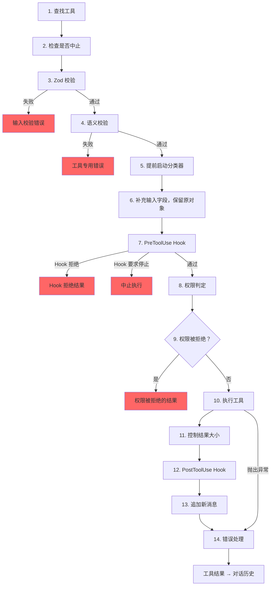

# 第 6 章：工具，从定义到执行

## 系统的神经系统

[第 5 章](ch05-agent-loop.md)介绍了智能体循环（Agent Loop），也就是以流式方式接收模型响应、收集工具调用并反馈结果的 `while(true)` 循环。循环是系统的心跳。不过，只有心跳还不够，还需要一套神经系统，才能把“模型想运行 `git status`”变成实际执行的 shell 命令，同时处理权限检查、结果预算和错误。

工具系统就是这套神经系统。它包括 40 多种工具实现、一个由功能开关控制的集中式注册表、一条 14 步执行流水线、一套支持七种模式的权限判定机制，以及一个能在模型完成响应前启动工具的流式执行器。

Claude Code 中的每次工具调用（Tool Calling），无论是读文件、运行 shell 命令、用 grep 搜索，还是派遣子智能体（Sub-Agent），都经过同一条流水线。统一处理正是这套设计的目的。无论是内置的 Bash 执行器，还是来自第三方 MCP 服务器的工具，都经过同样的校验、权限检查、结果预算控制和错误分类。

`Tool` 接口约有 45 个成员。要理解系统如何运作，先看其中的五个：

1. **`call()`**，执行工具。
2. **`inputSchema`**，校验并解析输入。
3. **`isConcurrencySafe()`**，判断能否并行运行。
4. **`checkPermissions()`**，判断是否允许执行。
5. **`validateInput()`**，判断输入在语义上是否合理。

其余成员，包括 12 个渲染方法、分析 Hook（钩子）和搜索提示，都服务于 UI 和遥测层。先理解这五个成员，就容易理解其他成员的作用。

---

## 工具接口

### 三个类型参数

每个工具都有三个类型参数：

```typescript
Tool<Input extends AnyObject, Output, P extends ToolProgressData>
```

`Input` 是一个 Zod 对象模式，有两个用途。它生成发送到 API 的 JSON Schema，让模型知道应提供哪些参数。它还在运行时（Runtime）通过 `safeParse` 校验模型响应。`Output` 是工具结果的 TypeScript 类型。`P` 是工具在运行期间发出的进度事件类型，BashTool 发出标准输出的数据块，GrepTool 发出匹配数量，AgentTool 发出子智能体的对话记录。

### buildTool() 与保守默认值

工具定义都通过 `buildTool()` 工厂创建 `Tool` 对象。工厂先展开默认值对象，再展开工具自己的定义：

```typescript
// Pseudocode — illustrates the fail-closed defaults pattern
const SAFE_DEFAULTS = {
  isEnabled:         () => true,
  isParallelSafe:    () => false,   // Fail-closed: new tools run serially
  isReadOnly:        () => false,   // Fail-closed: treated as writes
  isDestructive:     () => false,
  checkPermissions:  (input) => ({ behavior: 'allow', updatedInput: input }),
}

function buildTool(definition) {
  return { ...SAFE_DEFAULTS, ...definition }  // Definition overrides defaults
}
```

在关系到安全的地方，默认值会采取保守策略（fail-closed）。新工具若未实现 `isConcurrencySafe`，默认值是 `false`，所以只串行运行。若未实现 `isReadOnly`，默认值也是 `false`，系统会把它当作写操作。若未实现 `toAutoClassifierInput`，则返回空字符串，自动模式的安全分类器会跳过该工具，由通用权限系统处理这次调用，避免通过自动流程绕过权限检查。

`checkPermissions` 是唯一一个未采用保守默认值的成员，它返回 `allow`。从分层权限模型来看，这有其理由。`checkPermissions` 属于工具专用逻辑，在通用权限系统评估过规则、Hook 和基于模式的策略之后才运行。工具通过 `checkPermissions` 返回 `allow`，表示它没有工具层面的异议，访问仍受其他权限层约束。将相关字段放进子对象（如 `options`），并为 `readFileState` 等字段明确命名，就能像使用专用接口一样梳理结构，省去声明、实现和在 40 多处调用点传递五种独立接口类型的工作。

### 并发安全性取决于输入

`isConcurrencySafe(input: z.infer<Input>): boolean` 接收解析后的输入，因为同一工具能否安全并发取决于具体输入。BashTool 是典型例子。`ls -la` 是只读命令，可以安全并发执行，`rm -rf /tmp/build` 则不可以。工具先解析命令，再根据已知安全命令集合逐一给子命令分类。所有非中性部分都是搜索或读取操作时，才会返回 `true`。

### ToolResult 返回类型

每个 `call()` 都返回 `ToolResult<T>`：

```typescript
type ToolResult<T> = {
  data: T
  newMessages?: (UserMessage | AssistantMessage | AttachmentMessage | SystemMessage)[]
  contextModifier?: (context: ToolUseContext) => ToolUseContext
}
```

`data` 是带类型的输出，会序列化到 API 的 `tool_result` 内容块。`newMessages` 让工具向对话注入额外消息，例如 AgentTool 用它追加子智能体的对话记录。`contextModifier` 用于修改后续工具使用的 `ToolUseContext`，`EnterPlanMode` 就通过它切换权限模式。上下文修改函数只会对无法安全并发的工具即时生效。如果工具在并行运行，它的修改函数会进入队列，等该批次完成后再处理。

---

## ToolUseContext：全能对象

`ToolUseContext` 是传入每次工具调用的大型上下文对象，约有 40 个字段。按通常的定义，它确实是一个全能对象（god object）。采用这一设计，是因为拆开传递的代价更大。

BashTool 这样的工具需要终止控制器、文件状态缓存、应用状态、消息历史、工具集、MCP 连接和大约六个 UI 回调。如果分别传入，函数签名可能有 15 个以上的参数。实际做法是用一个上下文对象，按职责组织字段：

**配置**（`options` 子对象）包括工具集、模型名称、MCP 连接和调试开关。在查询开始时设置一次，此后大多保持不变。

**执行状态**包括用于取消的 `abortController`、用于 LRU 文件缓存的 `readFileState`，以及保存完整对话历史的 `messages`。这些字段会在执行过程中变化。

**UI 回调**包括 `setToolJSX`、`addNotification` 和 `requestPrompt`。只在交互式环境（REPL）中接入。SDK 和无界面模式下，这些回调未定义。

**智能体上下文**包括 `agentId` 和 `renderedSystemPrompt`。对于分叉子智能体，后者是冻结的父智能体提示词。由于功能开关的预热状态可能不同，重新渲染可能得到不同的提示词，导致缓存失效。

子智能体所用的 `ToolUseContext` 变体尤其能说明这一点。`createSubagentContext()` 为子智能体创建上下文时，会逐项决定哪些字段共享，哪些隔离。异步智能体的 `setAppState` 变成空操作，`localDenialTracking` 使用新对象，而 `contentReplacementState` 则从父智能体克隆。每个选择都源自生产环境中的一次故障。

---

## 工具注册表

### getAllBaseTools()：唯一权威来源

`getAllBaseTools()` 返回当前进程中可能存在的全部工具。始终可用的工具排在前面，由功能开关决定是否纳入的工具排在后面：

```typescript
const SleepTool = feature('PROACTIVE') || feature('KAIROS')
  ? require('./tools/SleepTool/SleepTool.js').SleepTool
  : null
```

从 `bun:bundle` 导入的 `feature()` 会在打包时求值。如果 `feature('AGENT_TRIGGERS')` 在构建时确定为假，打包器就会移除整个 `require()` 调用。这种死代码消除可以减小二进制文件的体积。

### assembleToolPool()：合并内置工具与 MCP 工具

最终提供给模型的工具集由 `assembleToolPool()` 组装：

1. 获取内置工具，按拒绝规则过滤，隐藏当前 REPL 模式不可见的工具，并检查 `isEnabled()`。
2. 按拒绝规则过滤 MCP 工具。
3. 两组工具分别按名称的字母顺序排序。
4. 拼接两组，内置工具在前，MCP 工具在后。

先排序再拼接是为了保持缓存稳定。API 服务器在最后一个内置工具之后设置提示词缓存（Prompt Cache）断点。如果把所有工具一起排序，MCP 工具就会穿插在内置工具之间。增删 MCP 工具时，内置工具的位置会随之改变，导致缓存失效。

---

## 14 步执行流水线

`checkPermissionsAndCallTool()` 将调用意图转化为实际操作。每次工具调用都经过这 14 个步骤。



### 第 1 至 4 步：校验

**查找工具**在必要时回退到 `getAllBaseTools()` 匹配别名，以兼容工具改名前的旧会话记录。**检查是否中止**可避免处理 Ctrl+C 中止信号传达之前已排队的工具调用，节省计算资源。**Zod 校验**捕捉类型不匹配。对于延迟加载的工具，错误还会提示先调用 ToolSearch。**语义校验**检查模式以外的要求，FileEditTool 会拒绝无实际改动的编辑，有 MonitorTool 可用时，BashTool 会阻止单独执行 `sleep`。

### 第 5 至 6 步：准备

**提前启动分类器**对 Bash 命令并行启动自动模式的安全分类器，可在常见路径上节省数百毫秒。**补充输入字段**会克隆解析后的输入，再添加供 Hook 和权限系统使用的派生字段，例如将 `~/foo.txt` 展开为绝对路径。保留原始输入可以让对话记录保持稳定。

### 第 7 至 9 步：权限判定

**PreToolUse Hook** 提供扩展机制，可以决定权限、修改输入、注入上下文，或直接停止执行。**权限判定**衔接 Hook 与通用权限系统。如果 Hook 已经给出决定，就以它为准。否则 `canUseTool()` 会触发规则匹配、工具专用检查、模式默认策略及交互式提示。**权限拒绝处理**会构造错误消息并执行 `PermissionDenied` Hook。

### 第 10 至 14 步：执行和收尾

**执行工具**使用原始输入运行实际的 `call()`。**控制结果大小**会把超大的输出存入 `~/.claude/tool-results/{hash}.txt`，并用预览替换原输出。**PostToolUse Hook** 可以修改 MCP 输出或阻止后续执行。**追加新消息**会加入子智能体对话记录、系统提醒等消息。**错误处理**为遥测进行错误分类，从可能经过压缩改名的名称中提取可安全上报的字符串，并发出 OTel 事件。

---

## 权限系统

### 七种模式

| 模式 | 行为 |
|------|----------|
| `default` | 执行工具专用检查，遇到未识别的操作时提示用户 |
| `acceptEdits` | 自动允许文件编辑，其他操作会提示用户 |
| `plan` | 只读，拒绝所有写操作 |
| `dontAsk` | 自动拒绝通常会提示用户的操作，用于后台智能体 |
| `bypassPermissions` | 允许所有操作，无需提示 |
| `auto` | 由对话记录分类器判定，通过功能开关控制 |
| `bubble` | 子智能体向父智能体上报权限请求时使用的内部模式 |

### 权限判定顺序

工具调用进入权限判定时，会经过以下环节：

1. **Hook 决定。** 如果 PreToolUse Hook 已返回 `allow` 或 `deny`，就以该决定为准。
2. **规则匹配。** 三组规则 `alwaysAllowRules`、`alwaysDenyRules` 和 `alwaysAskRules` 根据工具名称及可选的内容模式进行匹配。`Bash(git *)` 匹配任何以 `git` 开头的 Bash 命令。
3. **工具专用检查。** 调用工具的 `checkPermissions()` 方法，大多数实现返回 `passthrough`。
4. **模式默认策略。** `bypassPermissions` 允许所有操作。`plan` 拒绝写操作。`dontAsk` 拒绝需要提示的操作。
5. **交互式提示。** 在 `default` 和 `acceptEdits` 模式下，尚未判定的操作会提示用户。
6. **自动模式分类器。** 分类分两阶段，先用快速模型，遇到模棱两可的情况再进行扩展思考。

`safetyCheck` 变体有一个布尔值 `classifierApprovable`。`.claude/` 和 `.git/` 的编辑是 `classifierApprovable: true`，虽不常见，但有时有合理用途。利用 Windows 路径尝试绕过检查则是 `classifierApprovable: false`，这种尝试几乎总是对抗性的。

### 权限规则与匹配

权限规则以 `PermissionRule` 对象存储，包含三部分：记录来源的 `source`（userSettings、projectSettings、localSettings、cliArg、policySettings、session 等）、表示行为的 `ruleBehavior`（allow、deny、ask），以及包含工具名和可选内容模式的 `ruleValue`。

`ruleContent` 字段可以细化匹配范围。`Bash(git *)` 允许任何以 `git` 开头的 Bash 命令。`Edit(/src/**)` 只允许在 `/src` 内编辑。`Fetch(domain:example.com)` 允许从指定域名获取内容。没有 `ruleContent` 的规则匹配该工具的所有调用。

BashTool 的权限匹配器通过 `parseForSecurity()`（一个 Bash AST 解析器）解析命令，并把复合命令拆成子命令。如果 AST 解析失败，例如遇到包含 heredoc 或嵌套子 shell 的复杂语法，匹配器会返回 `() => true`。这是保守处理，意味着 Hook 始终会运行。命令如果复杂到无法解析，就无法有把握地将它排除在安全检查之外。

### 子智能体的 Bubble 模式

在协调器与工作者的协作模式下，子智能体没有终端，无法展示权限提示。`bubble` 模式会把权限请求向上传给父上下文。协调器智能体运行在能访问终端的主线程中，负责发出提示，并将决定传回子智能体。

---

## 工具延迟加载

带有 `shouldDefer: true` 的工具会以 `defer_loading: true` 发送给 API，其中带有名称和描述，省略完整参数模式。这能缩小初始提示词。模型要使用延迟加载的工具，必须先调用 `ToolSearchTool` 加载其模式。如果在加载前就调用该工具，所有带类型的参数都以字符串形式到达，导致 Zod 校验失败，系统会附上针对这一情况的恢复提示。

延迟加载也提高了缓存命中率。以 `defer_loading: true` 发送的工具，只有名称会计入提示词。因此，增删一个延迟加载的 MCP 工具只会改变几个 token，省去数百个 token 的变动。

---

## 结果预算

### 单个工具的大小上限

每个工具都声明 `maxResultSizeChars`：

| 工具 | maxResultSizeChars | 原因 |
|------|-------------------|-----------|
| BashTool | 30,000 | 足以容纳大部分有用的输出 |
| FileEditTool | 100,000 | 差异可能很大，但模型需要查看 |
| GrepTool | 100,000 | 带上下文行的搜索结果增长很快 |
| FileReadTool | Infinity | 工具自身限制 token 数量，持久化结果会导致反复调用 Read |

结果超过上限时，完整内容会保存到磁盘，原结果替换成包含预览和文件路径的 `<persisted-output>` 包装块。必要时，模型可以再用 `Read` 获取完整输出。

### 单次对话的总预算

除了每个工具的上限，`ContentReplacementState` 还跟踪整段对话的总预算。这样就能防止许多未超限的结果累积起来挤满上下文窗口，例如每个工具都返回达到各自上限 90% 的数据。

---

## 代表性工具

### BashTool：最复杂的工具

BashTool 是系统中最复杂的工具。它解析复合命令，将子命令分为只读操作或写操作，管理后台任务，根据魔数识别图像输出，还实现了用于安全预览编辑结果的 sed 模拟。

`splitCommandWithOperators()` 会把 `cd /tmp && mkdir build && ls build` 这样的命令拆成单个子命令，再根据已知安全命令集合（`BASH_SEARCH_COMMANDS`、`BASH_READ_COMMANDS`、`BASH_LIST_COMMANDS`）逐一分类。只有所有非中性部分都安全，复合命令才会被视为只读。中性集合（echo、printf）不参与判定，其中的命令既不会让复合命令变成只读，也不会让它变成只写。

sed 模拟使用 `_simulatedSedEdit`。当用户在权限对话框中批准一条 sed 命令时，系统在沙箱中运行该命令并捕获输出，预先算出编辑结果。预计算的结果作为 `_simulatedSedEdit` 注入输入。`call()` 执行时会直接应用编辑，跳过 shell 执行。这样能确保写入结果与用户预览完全一致，即使文件在预览和执行之间发生变化，也不会因为重新运行命令而产生不同结果。

### FileEditTool：检测文件是否已变更

FileEditTool 与 `readFileState` 集成，这是在整个对话期间维护文件内容和时间戳的 LRU 缓存。应用编辑前，它会检查文件在模型上次读取后是否被修改过。如果文件已被后台进程、其他工具或用户修改，编辑就会被拒绝，系统会提示模型先重新读取文件。

`findActualString()` 的模糊匹配能处理模型把空白写得稍有偏差的常见情况。它在匹配前会规范化空白及引号样式，因此即使编辑所指定的 `old_string` 多了尾随空格，也能匹配实际文件内容。`replace_all` 开关启用批量替换。未启用时，如果匹配位置不唯一，工具就拒绝编辑，要求模型提供足够的上下文以定位唯一位置。

### FileReadTool：支持多种内容的读取工具

FileReadTool 是唯一配置 `maxResultSizeChars: Infinity` 的内置工具。如果将 Read 的输出持久化到磁盘，模型还要用 Read 读取保存的文件，而这个文件可能再次超限，形成无限循环。因此，该工具通过估算 token 数量自行限制大小，从源头截断输出。

它能读取带行号的文本文件、图像（返回 base64 编码的多模态内容块）、PDF（通过 `extractPDFPages()`）、Jupyter 笔记本（通过 `readNotebook()`）和目录（回退到 `ls`）。它还会拦截危险的设备路径（`/dev/zero`、`/dev/random`、`/dev/stdin`），并处理 macOS 截图文件名的特殊情况，例如“Screen Shot”中的 U+202F 窄不换行空格与普通空格的区别。

### GrepTool：通过 head_limit 分页

GrepTool 包装了 `ripGrep()`，并通过 `head_limit` 实现分页。默认上限为 250 条，既能提供足够有用的结果，又避免上下文膨胀。发生截断时，响应会包含 `appliedLimit: 250`，提示模型在下一次调用中用 `offset` 翻页。显式指定 `head_limit: 0` 可以完全取消限制。

GrepTool 会自动排除六个版本控制目录（`.git`、`.svn`、`.hg`、`.bzr`、`.jj`、`.sl`）。模型几乎用不到 `.git/objects` 内的搜索结果，误将二进制包文件纳入搜索还会超出 token 预算。

### AgentTool 与上下文修改函数

AgentTool 启动运行独立查询循环的子智能体。它的 `call()` 会用 `newMessages` 返回子智能体的对话记录，也可以返回 `contextModifier`，将状态变化传回父智能体。由于 AgentTool 默认无法安全并发，同一响应中的多个 Agent 工具调用会串行运行。每个子智能体的上下文修改函数会在下一个子智能体启动前应用。协调模式下则采用并行派遣，协调器将独立任务分给子智能体，`isAgentSwarmsEnabled()` 检查用于启用智能体的并行执行。

---

## 工具如何与消息历史交互

工具结果以结构化消息的形式参与对话，并将数据返回给模型。

API 要求工具结果采用 `ToolResultBlockParam` 对象，按 ID 引用原始的 `tool_use` 块。大多数工具会序列化成文本。对于多模态响应，FileReadTool 可以序列化成 base64 编码的图像内容块。BashTool 通过检查标准输出中的魔数识别图像，相应地切换到图像块。

`ToolResult.newMessages` 让工具超越简单的一问一答，向对话加入额外消息。**智能体对话记录。** AgentTool 把子智能体的消息历史作为附件消息注入。**系统提醒。** 记忆工具注入出现在工具结果之后的系统消息。模型在下一轮能看到这些消息，但它们会在 `normalizeMessagesForAPI` 边界被剥离。**附件消息。** Hook 结果、额外上下文和错误细节都可以携带结构化元数据，供模型在后续轮次引用。

`contextModifier` 是工具改变执行环境的机制。`EnterPlanMode` 执行时返回一个修改函数，将权限模式设为 `'plan'`。`ExitWorktree` 执行时会修改工作目录。工具只能借助这些函数影响后续工具。每次工具调用前都会用展开语法浅拷贝上下文，因而无法直接修改原来的 `ToolUseContext`。编排（Orchestration）层负责强制串行限制，否则两个并发工具同时修改工作目录时，就无法确定以哪个为准。

---

## 如何设计工具系统

**采用保守默认值。** 新工具默认应谨慎运行，只有显式声明后才放宽限制。开发者忘记设置某个开关时，工具仍按安全的方式运行。

**根据输入判断安全性。** `isConcurrencySafe(input)` 和 `isReadOnly(input)` 接收解析后的输入，因为同一工具的安全性会随输入而变。把 BashTool 一律设为串行可以保证正确性，却浪费了并行执行的机会。

**分层管理权限。** 工具专用检查、规则匹配、模式默认策略、交互式提示和自动分类器各自处理不同的情况。单靠其中一种机制无法覆盖所有情况。

**给结果也设定预算。** 输入通常有 token 上限，但工具结果可以任意大，而且会随着对话轮次累积。单个工具的上限可以限制一次调用的输出体积。整个对话的总预算则能防止累积溢出。

**确保错误分类适合遥测上报。** 代码压缩后，`error.constructor.name` 可能被改名。`classifyToolError()` 会从可安全上报的错误消息、errno 代码、稳定的错误名称中提取信息量尽可能大的字符串，始终避免把原始错误消息写入分析日志。

---

## 下一章

本章沿着单次工具调用，追踪了从定义到校验、权限判定、执行和结果预算的全过程。模型很少一次只请求一个工具。[第 7 章](ch07-concurrency.md)会介绍如何将工具调用编排成并发批次。
