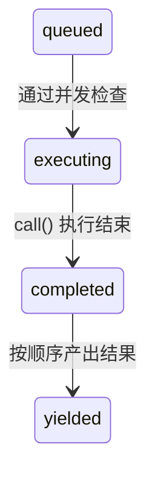

# 第 7 章：并发执行工具

## 等待的代价

[第 6 章](ch06-tools.md)追踪了单次工具调用的生命周期，从 API 响应中的原始 `tool_use` 块开始，经过输入验证、权限检查和执行，直到格式化结果。这条流水线处理一次工具调用，但模型很少只请求一次调用。

Claude Code 在典型的一轮交互中会调用三到五次工具。例如，“读取这两个文件，搜索这个模式，然后编辑这个函数。”模型会在同一条响应中发出所有调用。如果每次调用需要 200 毫秒，顺序执行就要整整一秒。Read 和 Grep 调用互不依赖，并行执行只需 200 毫秒，无需额外工作就能将耗时缩短到五分之一。

有些工具调用存在依赖。修改 `config.ts` 的 Edit 调用不能与另一个修改 `config.ts` 的 Edit 调用并发执行。一个 Bash 命令创建目录后，另一个 Bash 命令才能向该目录写入文件。能否并发取决于具体调用及其输入。

整套并发系统以此为出发点。**系统逐次判断调用能否安全并发（Concurrency Safety）。** `Bash("ls -la")` 可以安全地并行执行，`Bash("rm -rf build/")` 则需要串行执行。同一个工具可以因输入不同而被划入不同的并发类别。系统必须检查输入后才能作出判断。

Claude Code 在两个层面优化并发。第一层是**批次编排（Batch Orchestration）**。完整接收模型响应后，将工具调用划分成并发批次和串行批次，再分别执行。第二层是**推测执行（Speculative Execution）**。*模型仍在流式输出响应时*就开始运行工具，在响应尚未结束时收取结果。两种机制共同省去了大部分原本要花在等待上的时间。

---

## 分批算法

入口是 `toolOrchestration.ts` 中的 `partitionToolCalls()`。它接收一个有序的 `ToolUseBlock` 消息数组，输出一个批次数组。每个批次要么全部由可安全并发的调用组成，要么只包含一个须串行执行的调用。

```typescript
// Pseudocode — illustrates the partition algorithm
type Group = { parallel: boolean; calls: ToolCall[] }

function groupBySafety(calls: ToolCall[], registry: ToolRegistry): Group[] {
  return calls.reduce((groups, call) => {
    const def = registry.lookup(call.name)
    const input = def?.schema.safeParse(call.input)
    // Fail-closed: parse failure or exception → serial
    const safe = input?.success
      ? tryCatch(() => def.isParallelSafe(input.data), false)
      : false
    // Merge consecutive safe calls into one group
    if (safe && groups.at(-1)?.parallel) {
      groups.at(-1)!.calls.push(call)
    } else {
      groups.push({ parallel: safe, calls: [call] })
    }
    return groups
  }, [] as Group[])
}
```

算法从左到右遍历数组，对每次工具调用进行以下处理：

1. **查找工具定义。** 按名称查找。
2. **解析输入。** 通过 `safeParse()` 按工具的 Zod 模式解析输入。解析失败时，按保守策略将调用划为串行。
3. **调用工具定义上的 `isConcurrencySafe(parsedInput)`。** 这一步按输入判断能否并发。Bash 工具解析命令字符串，检查每条子命令是否只读（如 `ls`、`grep`、`cat`、`git status`），只有整条复合命令都属于纯读取操作才返回 `true`。Read 工具总是返回 `true`。Edit 工具总是返回 `false`。系统用 try-catch 包裹该调用。如果 `isConcurrencySafe` 抛出异常，例如 shell-quote 库无法解析 Bash 命令字符串，工具调用就默认串行执行。
4. **并入现有批次或新建批次。** 当前调用和最后一个批次均可安全并发时，将调用追加到该批次。其他情况一律新建批次。

算法生成一系列并发批次和单调用串行批次。下面是一个具体例子：

```
Model requests: [Read, Read, Grep, Edit, Read]

Step 1: Read  → concurrent-safe → new batch {safe, [Read]}
Step 2: Read  → concurrent-safe → append   {safe, [Read, Read]}
Step 3: Grep  → concurrent-safe → append   {safe, [Read, Read, Grep]}
Step 4: Edit  → NOT safe        → new batch {serial, [Edit]}
Step 5: Read  → concurrent-safe → new batch {safe, [Read]}

Result: 3 batches
  Batch 1: [Read, Read, Grep]  — run concurrently
  Batch 2: [Edit]              — run alone
  Batch 3: [Read]              — run concurrently (just one tool)
```

分批采用贪心策略，并保留原顺序。连续的安全调用累积为一个批次，任何需要串行的调用都会中断这段序列并开启新批次。因此，模型发出调用的顺序会影响结果。在两个 Read 调用之间插入一个 Write 调用就会产生三个批次，两次 Read 相邻时只产生两个。实际使用中，模型往往会把读取调用集中在一起，这正是算法重点优化的常见情形。

---

## 批次执行

生成器 `runTools()` 遍历已划分的批次，将各批次交给相应的执行器。

### 并发批次

对于并发批次，`runToolsConcurrently()` 用 `all()` 工具函数并行启动工具，并将活跃生成器的数量限制在并发上限内：

```typescript
// Pseudocode — illustrates the concurrent dispatch pattern
async function* dispatchParallel(calls, context) {
  yield* boundedAll(
    calls.map(async function* (call) {
      context.markInProgress(call.id)
      yield* executeSingle(call, context)
      context.markComplete(call.id)
    }),
    MAX_CONCURRENCY,  // Default: 10
  )
}
```

并发上限默认为 10，可通过 `CLAUDE_CODE_MAX_TOOL_USE_CONCURRENCY` 配置。单条模型响应很少包含超过五六次工具调用，因此 10 已经留足余量。这个上限用于控制异常情况，日常执行通常不会触及。

`all()` 是适配生成器、且带并发上限的 `Promise.all` 变体。它最多同时启动 N 个生成器，先完成的生成器先产出结果。每完成一个，就启动下一个排队的生成器。它的工作方式类似用信号量控制的任务池，并适配了能够产出中间结果的异步生成器。

**上下文修改函数（Context Modifier）入队**是这里需要细致处理的地方。某些工具会产生*上下文修改函数*，即为后续工具转换 `ToolUseContext` 的函数。并发运行时，同一批次中的其他工具正在读取同一个上下文，因此不能立即应用这些修改器。系统会先把它们收集到一个以工具调用 ID 为键的映射中：

```typescript
const queuedContextModifiers: Record<
  string,
  ((context: ToolUseContext) => ToolUseContext)[]
> = {}
```

整个并发批次完成后，系统按工具的提交顺序应用修改器，使上下文的变化可确定：

```typescript
for (const block of blocks) {
  const modifiers = queuedContextModifiers[block.id]
  if (!modifiers) continue
  for (const modifier of modifiers) {
    currentContext = modifier(currentContext)
  }
}
```

目前可安全并发的工具都不会产生上下文修改函数，代码库中的注释也明确指出了这一点。系统仍保留了这套机制，因为 MCP 服务器可以添加工具，自定义只读 MCP 工具也可能确实需要修改上下文，例如更新“已查看文件”的集合。

### 串行批次

串行执行逐个运行工具。系统会立即应用该工具的上下文修改函数，下一个工具看到的是更新后的上下文：

```typescript
for (const toolUse of toolUseMessages) {
  for await (const update of runToolUse(toolUse, /* ... */)) {
    if (update.contextModifier) {
      currentContext = update.contextModifier.modifyContext(currentContext)
    }
    yield { message: update.message, newContext: currentContext }
  }
}
```

串行工具可以改变后续工具所处的环境。Edit 修改文件后，下一个 Read 读到的是修改后的版本。一个 Bash 命令创建目录后，下一个 Bash 命令就能向其中写入。上下文修改函数将这类依赖显式化，让工具能够告知后续调用执行环境发生了哪些变化。

---

## 流式工具执行器

批次编排能在模型响应*到达后*消除多余的串行执行。响应本身的流式传输还提供了进一步优化的机会。典型的多工具响应可能要 2 到 3 秒才能完整到达，而首个工具调用在 500 毫秒后就已经可以解析。何必再等剩下的约 2 秒？

`StreamingToolExecutor` 类实现了推测执行。模型流式输出响应时，每个 `tool_use` 块一经完整解析就交给执行器。模型还在生成下一个工具调用，执行器已经开始运行当前工具。等响应传输结束时，可能已有多个工具完成执行。

```mermaid
gantt
    title 串行执行与流式执行的时间对比
    dateFormat X
    axisFormat %Ls

    section 串行执行
    模型流式输出响应     :a1, 0, 2500
    工具 1（0.2 秒）              :a2, after a1, 200
    工具 2（0.3 秒）              :a3, after a2, 300
    工具 3（0.1 秒）              :a4, after a3, 100

    section 流式执行器
    模型流式输出响应     :b1, 0, 2500
    工具 1 在 0.5 秒时开始      :b2, 500, 700
    工具 2 在 1.2 秒时开始      :b3, 1200, 1500
    流结束后收取工具 3 的结果  :b4, 2500, 2600
```



串行执行共耗时 3.1 秒。流式执行共耗时 2.6 秒，工具 1 和工具 2 在响应传输期间已经完成，实际经过时间缩短了 16%。

工具越多，省下的时间越可观。如果模型请求五次只读工具调用，并用 3 秒流式输出响应，五次调用可以在这 3 秒内全部启动并结束。流结束后已经没有剩余结果要收取。模型响应的最后一个字符一出现，用户几乎立刻就能看到工具结果。

### 工具生命周期

执行器跟踪的每次工具调用依次经历四种状态：



- **queued**：已解析并登记 `tool_use` 块，等待满足并发执行条件。
- **executing**：工具的 `call()` 函数正在运行，结果逐步累积到缓冲区。
- **completed**：执行结束，结果已可产出到对话中。
- **yielded**：结果已经产出，调用进入终止状态。

### addTool() 在流式接收期间将调用入队

```typescript
addTool(block: ToolUseBlock, assistantMessage: AssistantMessage): void
```

每收到一个完整的 `tool_use` 块，流式响应解析器就会调用此方法。方法依次执行以下操作：

1. 查找工具定义。找不到定义时，直接创建一条状态为 `completed` 的记录，并附上错误消息，省去为不存在的工具排队。
2. 解析输入，并按照与 `partitionToolCalls()` 相同的逻辑确定 `isConcurrencySafe`。
3. 加入一项状态为 `'queued'` 的 `TrackedTool`。
4. 调用 `processQueue()`。工具可能随即启动。

`processQueue()` 通过 `void this.processQueue()` 启动，执行器无需等待它返回。`addTool()` 由流式解析器的事件处理函数调用，在这里阻塞会拖住响应解析。工具在后台启动时，解析器可以继续消费响应流。

### processQueue() 检查是否允许执行

执行许可可归纳为一个判定式：

```typescript
// Pseudocode — illustrates the mutual exclusion rule
canRun = noToolsRunning || (newToolIsSafe && allRunningAreSafe)
```

工具只有满足以下任一条件才可以启动：
- **当前没有工具正在执行**（队列为空）。
- **新调用与所有正在执行的调用都可安全并发。**

这是一个互斥约定。须串行执行的调用要求独占运行，期间不能有其他调用在执行。可并发的调用可以同时运行。一旦有须串行的调用开始执行，其他调用就要等待。

`processQueue()` 按顺序遍历所有工具调用，对每个排队的调用检查 `canExecuteTool()`。允许执行就启动它。如果一个须串行的调用暂时不能启动，循环就会通过 *break* 退出，完全停止检查后续调用，以维持串行调用的顺序。如果是可并发的调用暂时无法启动，例如被正在执行的串行调用挡住，循环则通过 *continue* 继续检查。实际中这样做很少有帮助，因为排在阻塞调用后的并发调用通常依赖它的结果。

### executeTool() 的核心执行循环

这个方法负责管理中止控制器、错误级联、进度报告和上下文修改函数，集中了执行流程中较为复杂的逻辑。

**子中止控制器。** 每个工具都有自己的 `AbortController`，它们都是一个共享控制器的子控制器。

中止控制器分为三层。查询级控制器由 REPL 持有，用户按 Ctrl+C 时触发。它下面是由流式执行器持有的同级工具控制器，Bash 出错时触发。每个工具自己的控制器位于第三层。触发同级工具控制器会中止所有正在运行的工具。触发单个工具的控制器会中止该工具。除同级工具出错的情况外，中止信号还会向上传播至查询控制器。例如，权限拒绝需要结束整轮交互时，向上传播可以防止系统悄无声息地丢弃执行器。

权限拒绝依赖这种向上传播。用户在权限对话框中拒绝工具调用时，会触发该工具的中止控制器。信号必须传到查询循环，查询循环才能结束本轮交互。否则查询循环会照常运行，并向模型发送已经失效的拒绝消息。

**同级工具错误级联。** 工具返回错误结果时，执行器会判断是否取消其他同级调用。规则是**只有 Bash 错误才会级联**。Shell 命令出错时，执行器会记录失败，提取出错工具的描述，并触发同级工具控制器，从而取消该批次中正在运行的其他工具。

这样做有实际原因。Bash 命令常常形成隐含的依赖链，例如 `mkdir build && cp src/* build/ && tar -czf dist.tar.gz build/`。`mkdir` 失败后，运行 `cp` 和 `tar` 已经没有意义。立即取消同级工具既省时间，也避免产生令人困惑的错误消息。

Read 和 Grep 的错误各自独立。如果一个文件已被删除，导致读取失败，同时在另一个目录执行的 grep 不受影响。取消 grep 只会浪费已做的工作。

错误级联会为同级工具生成合成错误消息：

```
Cancelled: parallel tool call Bash(mkdir build) errored
```

出错工具的描述包含其命令或文件路径的前 40 个字符，给模型足够的上下文来理解故障。

**进度消息**与结果分开处理。结果存入缓冲区并按顺序产出。进度消息是“正在读取文件……”或“正在搜索……”等状态更新，它们进入 `pendingProgress` 数组，并通过 `getCompletedResults()` 立即产出。新进度到达时，一个用于兑现 Promise 的回调会唤醒 `getRemainingResults()` 循环，避免耗时工具让界面像是卡住了。

**重新处理队列。** 每次工具调用完成后，都会再次调用 `processQueue()`：

```typescript
void promise.finally(() => {
  void this.processQueue()
})
```

原本被并发批次阻塞的串行调用由此获得启动机会。最后一个并发调用结束后，后续串行调用便能通过 `canExecuteTool()` 检查并启动。

### 结果收取

流式执行器公开了两个收取结果的方法，分别用于响应生命周期的两个阶段。

**`getCompletedResults()` 在流式接收期间收取结果。** 这是一个同步生成器，在接收 API 响应流的各数据块之间调用。它依次遍历工具数组，产出已完成调用的结果：

`getCompletedResults()` 是一个按提交顺序遍历工具数组的同步生成器。对于每个工具调用，它先取出所有待处理的进度消息。如果调用已完成，它就产出结果并将调用标记为已产出。关键规则是，遇到仍在执行的串行调用时，遍历**立即中止**。即使后续调用已完成，也不能产出其结果。后续结果可能依赖该串行调用对上下文的修改，因此必须等待。仍在执行的并发调用可以跳过，循环会继续检查后续条目。

中止遍历是维持顺序的机制。如果一个串行调用仍在执行，后续结果即使已经完成也不能产出。后续结果可能依赖该串行调用对上下文的修改，因此必须等待。遇到正在执行的并发调用时，循环会跳过它并继续检查后续条目。

**`getRemainingResults()` 在流结束后收取剩余结果。** 完整收到模型响应后调用这一异步生成器。它会持续循环，直到所有工具调用都已产出结果：

`getRemainingResults()` 负责在流结束后收取剩余结果。它持续循环，直至每个调用都已产出。每次迭代都会处理队列，启动新近解除阻塞的调用，并通过 `getCompletedResults()` 产出已完成的结果。如果还有调用正在执行，但没有新的调用完成，就用 `Promise.race` 等待任一运行中的工具 Promise 完成或收到新进度信号，以先发生者为准。这既避免了忙轮询，也能在发生变化时立即唤醒执行器。没有工具完成且没有新工具能够启动时，执行器就等待任一正在执行的工具完成，或等待新进度到达。这样无需忙轮询，有新动静时也能立即唤醒。

### 保持结果顺序

执行器有意按工具调用的*接收顺序*产出结果，独立于调用的*完成顺序*。

假设模型在一条响应中请求 `[Read("a.ts"), Read("b.ts"), Read("c.ts")]`，三个调用同时启动。`c.ts` 较小，最先读取完毕，接着是 `a.ts`，最后是 `b.ts`。如果按完成顺序产出，对话中就会出现：

```
Tool result: c.ts contents
Tool result: a.ts contents
Tool result: b.ts contents
```

模型发出调用的顺序却是 a、b、c。对话历史必须符合模型的预期，否则下一轮就可能混淆各个结果与请求之间的对应关系。按接收顺序产出结果，对话就能保持连贯：

```
Tool result: a.ts contents  (completed second, yielded first)
Tool result: b.ts contents  (completed third, yielded second)
Tool result: c.ts contents  (completed first, yielded third)
```

代价较小。如果工具 1 较慢，工具 2 至 5 很快完成，较快的结果会留在缓冲区，等工具 1 结束。打乱顺序导致的对话错乱代价要大得多。

### discard() 处理流式请求回退

API 响应流因网络错误或服务器断开而中断时，系统会重新发起 API 调用。但流式执行器可能已启动失败尝试中的工具。这些结果对应的响应从未完整收到，因此已无可归属的响应。

```typescript
discard(): void {
  this.discarded = true
}
```

设置 `discarded = true` 会产生以下效果：
- `getCompletedResults()` 立即返回，且不产出结果。
- `getRemainingResults()` 立即返回，且不产出结果。
- 准备启动的工具会检查 `getAbortReason()`，看到 `streaming_fallback` 后直接收到合成错误，实际调用不会发生。

被丢弃的执行器就此停用。重试会创建一个新的执行器。

---

## 工具的并发特性

各内置工具通过 `isConcurrencySafe()` 方法声明自身的并发特性。分类依据是工具对共享状态的实际影响。

| 工具 | 能否安全并发 | 条件 | 理由 |
|------|-----------------|-----------|-----------|
| **Read** | 始终可以 | -- | 纯读取，无副作用。 |
| **Grep** | 始终可以 | -- | 纯读取，封装了 ripgrep。 |
| **Glob** | 始终可以 | -- | 纯读取，列举文件。 |
| **Fetch** | 始终可以 | -- | HTTP GET，无本地副作用。 |
| **WebSearch** | 始终可以 | -- | 调用搜索服务提供方的 API。 |
| **Bash** | 视情况而定 | 仅限只读命令 | `isReadOnly()` 解析命令并对子命令分类。`ls`、`git status`、`cat`、`grep` 可以安全并发。`rm`、`mkdir`、`mv` 必须串行。 |
| **Edit** | 始终串行 | -- | 修改文件。同时编辑同一个文件会破坏文件内容。 |
| **Write** | 始终串行 | -- | 创建或覆写文件，有同样的文件损坏风险。 |
| **NotebookEdit** | 始终串行 | -- | 修改 `.ipynb` 文件。 |

Bash 工具的分类有些细节。它用 `splitCommandWithOperators()` 按运算符（`&&`、`||`、`;`、`|`）拆分复合命令，再依据已知安全命令的集合给各子命令分类：

- **搜索命令**：`grep`、`rg`、`find`、`fd`、`ag`、`ack`
- **读取命令**：`cat`、`head`、`tail`、`wc`、`jq`、`less`、`file`、`stat`
- **列举命令**：`ls`、`tree`、`du`、`df`
- **中性命令**：`echo`、`printf`（无副作用，也不属于读取命令）

一条复合命令只有在所有非中性子命令都属于搜索、读取或列举时，才会被判为只读。`ls -la && cat README.md` 可以安全并发。`ls -la && rm -rf build/` 中的 `rm` 使整条命令必须串行执行。

---

## 中断行为约定

工具执行期间，用户可以输入一条新消息。系统如何响应，取决于正在执行的工具。

每个工具都声明一个 `interruptBehavior()` 方法，返回 `'cancel'` 或 `'block'`：

- **`'cancel'`**：立即停止工具，丢弃部分结果，处理用户的新消息。用于只执行一部分也无害的工具，如读取和搜索。
- **`'block'`**：让工具继续运行到完成，用户的新消息继续等待。用于中途中断会让系统处于不一致状态的操作，如尚未完成的写入和长时间运行的 Bash 命令。这是默认行为。

流式执行器跟踪当前这组工具能否中断：

执行器检查所有正在执行的工具，以更新可中断状态。只有每个工具都支持取消，整组工具才可中断。只要有一个工具的中断行为是 `'block'`，整组工具就被视为不可中断。

只有所有正在执行的工具都支持取消时，界面才会显示“可中断”的指示。只要有一个工具是 `'block'`，整组就不可中断。这种判断较为保守，但符合预期。如果批次中至少有一个工具会继续运行，对整个批次发起中断就达不到中断的目的。

用户发起中断且所有工具均可取消时，中止控制器以 `'interrupt'` 为原因触发。执行器的 `getAbortReason()` 会逐个检查工具的中断行为。`'cancel'` 工具会收到合成的 `user_interrupted` 错误。`'block'` 工具会继续运行，这类工具本不应出现在整组均可中断的情形中，但代码也处理了这个边缘情况。

---

## 上下文修改函数的串行约定

上下文修改函数是类型为 `(context: ToolUseContext) => ToolUseContext` 的函数，让工具可以告知后续工具，它改动了执行环境中的哪些内容。

约定很简单。**只有串行工具，即无法安全并发的工具，才会应用上下文修改函数。** 源码明确写出了这条规则：

```typescript
// NOTE: we currently don't support context modifiers for concurrent
//       tools. None are actively being used, but if we want to use
//       them in concurrent tools, we need to support that here.
if (!tool.isConcurrencySafe && contextModifiers.length > 0) {
  for (const modifier of contextModifiers) {
    this.toolUseContext = modifier(this.toolUseContext)
  }
}
```

在批次编排路径（`toolOrchestration.ts`）中，系统会收集并发批次产生的修改器，并在批次完成后按提交顺序应用。同一批次中的并发调用看不到彼此对上下文的修改，下一个批次则可以看到。

这种不对称是有意设计的。如果工具 A 修改了上下文，而工具 B 需要读取修改后的上下文，两者就有数据依赖，必须串行执行。按定义，如果两次调用可以安全并发，就不应依赖彼此对上下文的修改。系统通过延后应用修改器来落实这个约定。

---

## 实践建议

Claude Code 的并发模式适用于各种同时编排多个独立操作的系统，可以从中归纳出三条原则。

**依据调用的安全性分批。** `isConcurrencySafe(input)` 接收已解析的输入。逐次检查调用比声明“这类工具始终安全”更精确。在自己的系统中，也应先检查操作参数，再决定能否并行。例如，数据库读取可以并行，对同一行的写入需要串行。单凭操作类型无法作出完整判断。

**在等待 I/O 时进行推测执行。** API 响应仍在传输时，流式执行器就已启动工具。只要生产者较慢、消费者较快，就可以用这种模式，在后续项目仍在生成时处理先到达的项目。HTTP/2 服务器推送、编译器流水线并行以及 CPU 推测执行采用的都是类似结构。前提是在收到完整指令前就能识别可独立处理的工作。

**保持结果的提交顺序。** 按完成顺序产出结果能缩短首个结果的等待时间。但如果消费者，例如这里的语言模型，期望以特定顺序收到结果，重排带来的混淆会消耗更多时间。先缓冲已经完成的结果，再按请求顺序逐一发出。实现只需遍历数组，就能保证顺序正确。

流式执行器模式尤其适用于智能体（Agent）系统。如果智能体循环（Agent Loop）遵循“先思考、再行动”的节奏，且思考阶段会生成多项独立行动，就能让思考的尾段与行动的开端重叠。节省的时间与思考耗时和行动耗时的比值成正比。对语言模型智能体而言，思考耗时即 API 响应生成时间通常占大头，所以能省下相当多的时间。

---

## 小结

Claude Code 的并发系统分两层运作。分批算法（`partitionToolCalls`）把连续的可安全并发调用归入可并行运行的批次，将其他调用各自放入串行批次。每个串行调用都能看到前一个调用产生的影响。流式工具执行器（`StreamingToolExecutor`）更进一步，在模型流式输出响应时就推测性地启动已到达的工具调用，使工具执行与响应生成重叠。

安全模型采用保守设计。系统检查已解析的输入，逐次判断调用的并发安全性。遇到未知工具就默认串行。输入解析失败也默认串行。并发安全检查抛出异常仍默认串行。只有工具明确声明当前调用可安全并发，系统才会并行执行。

错误处理遵循工具之间的依赖关系。Shell 命令常形成隐含的流水线，因此 Bash 错误会波及同级工具。读取和搜索各自独立，错误也各自处理。中止控制器形成查询控制器、同级工具控制器、单个工具控制器三级层次，使各层能够取消自身管理范围内的工作，同时让上一级继续运行。

这套系统在最大程度利用工具调用的并行机会时，仍保证对话历史呈现连贯、有序的操作序列。模型按请求顺序看到工具结果。对用户来说，工具以底层操作所允许的最快速度完成。缓冲区让系统兼顾执行速度和呈现顺序，而它也是系统中实现最简单的部分。
