# 第 8 章：启动子智能体

## 让多个智能体协作

单个智能体（Agent）就能做很多事。它能读取文件、编辑代码、运行测试、搜索网页，并根据结果推理。但单次对话中，一个智能体的能力有明确的上限。上下文窗口会填满，任务会分出需要不同能力的支线，而串行执行工具也会成为瓶颈。应对这些限制，可以让更多智能体协作。

Claude Code 的子智能体系统允许模型请求协助。当父智能体遇到适合委派的任务时，就会调用 `Agent` 工具。例如，将代码库搜索与主对话隔离，安排一次需要对抗性思考的验证，或并行完成几项独立编辑。调用会启动一个完全独立的子智能体（Sub-Agent），它有自己的对话循环、工具集、权限边界和中止控制器。子智能体完成工作后返回结果，父智能体只看到最终输出，内部推理留在子智能体的对话中。

从并行探索文件到协调器与工作者的层级，再到多智能体协作团队，都建立在这一机制上。实现集中在两个文件中：`AgentTool.tsx` 定义模型使用的接口，`runAgent.ts` 实现生命周期。

设计的难点在于，子智能体需要足够的上下文才能完成任务，又要避免为无关信息消耗 token。它的权限边界既要保障安全，也要给实际任务留出空间。生命周期管理必须清理它接触过的所有资源，无需调用方逐项记住。整套机制还要适应各种智能体，从便宜、快速、只读的 Haiku 搜索智能体，到昂贵但全面、在后台运行对抗性测试的 Opus 验证智能体。

本章追踪从模型提出“我需要协助”到子智能体就绪的整个过程。我们会看模型收到的工具定义、构建运行环境的十五步生命周期、六种内置智能体及各自的优化目标、供用户定义自定义智能体的文档前置元数据（frontmatter），以及这些机制体现的设计原则。

本章中的“父智能体”指调用 `Agent` 工具的一方，“子智能体”指被启动的一方。父智能体通常是顶层 REPL 智能体。在协调模式下，协调器启动的工作者就是子智能体。嵌套场景中，子智能体本身也可以启动下一层子智能体，同样的生命周期会递归应用。

编排（Orchestration）层约有 40 个文件，分布在 `tools/AgentTool/`、`tasks/`、`coordinator/`、`tools/SendMessageTool/` 和 `utils/swarm/`。本章聚焦启动机制，包括 AgentTool 的定义和 runAgent 的生命周期。下一章介绍运行时的进度跟踪、结果获取和多智能体协调模式。

---

## AgentTool 的定义

`AgentTool` 以 `"Agent"` 为名注册，保留旧别名 `"Task"`，以兼容早期的对话记录、权限规则和 Hook 配置。它用标准的 `buildTool()` 工厂构建，但它的模式比系统中其他任何工具都更灵活。

### 输入模式

输入模式通过 `lazySchema()` 惰性构造。这是第 6 章介绍过的模式，即到首次使用时才编译 Zod 模式。输入模式分两层，基础模式和加入多智能体及隔离参数的完整模式。

基础字段始终存在：

| 字段 | 类型 | 必填 | 用途 |
|-------|------|----------|---------|
| `description` | `string` | 是 | 简短的任务摘要，用 3 至 5 个词 |
| `prompt` | `string` | 是 | 提供给智能体的完整任务描述 |
| `subagent_type` | `string` | 否 | 指定使用哪种专用智能体 |
| `model` | `enum('sonnet','opus','haiku')` | 否 | 为该智能体指定覆盖模型 |
| `run_in_background` | `boolean` | 否 | 异步启动 |

完整模式加入多智能体参数（团队协作功能启用时）及隔离控制：

| 字段 | 类型 | 用途 |
|-------|------|---------|
| `name` | `string` | 让其他智能体可以通过 `SendMessage({to: name})` 向它发送消息 |
| `team_name` | `string` | 启动时使用的团队上下文 |
| `mode` | `PermissionMode` | 新启动的队友使用的权限模式 |
| `isolation` | `enum('worktree','remote')` | 文件系统隔离策略 |
| `cwd` | `string` | 用来覆盖工作目录的绝对路径 |

多智能体字段支持第 9 章所述的团队协作模式。具名智能体可以并发运行，并用 `SendMessage({to: name})` 彼此发送消息。隔离字段用于保护文件系统。工作树隔离会创建临时 Git 工作树，让智能体在仓库的副本上操作，避免多个智能体同时处理同一代码库时出现编辑冲突。

这个模式的特殊之处在于，**其结构由功能开关动态决定**：

```typescript
// Pseudocode — illustrates the feature-gated schema pattern
inputSchema = lazySchema(() => {
  let schema = baseSchema()
  if (!featureEnabled('ASSISTANT_MODE')) schema = schema.omit({ cwd: true })
  if (backgroundDisabled || forkMode)    schema = schema.omit({ run_in_background: true })
  return schema
})
```

分叉实验启用时，`run_in_background` 会从模式中完全消失，因为走这条路径时所有启动都强制异步。通过 `CLAUDE_CODE_DISABLE_BACKGROUND_TASKS` 禁用后台任务时，也会移除该字段。KAIROS 功能开关关闭时，`cwd` 会被省略。模型只会看到它能使用的字段。

模式同时也是模型的使用说明。模型读取的工具定义会描述模式中的每个字段。直接移除模型不该使用的字段，比在提示词中添加“请勿使用此字段”更有效。模型无法误用它看不到的字段。

### 输出模式

输出是一个可辨识联合类型，包含两个公开变体：

- `{ status: 'completed', prompt, ...AgentToolResult }`，同步执行完成，并附智能体的最终输出。
- `{ status: 'async_launched', agentId, description, prompt, outputFile }`，确认已在后台启动。

另有两个内部变体（`TeammateSpawnedOutput` 和 `RemoteLaunchedOutput`）。它们没有加入导出的模式，以便外部分发构建进行死代码消除。对应功能开关关闭时，打包器会移除这些变体及相关代码路径，缩小分发的二进制文件。

`async_launched` 变体包含 `outputFile`，即智能体完成时写入结果的文件路径。父智能体或其他使用方可以轮询或监视该文件，获得能在进程重启后继续使用的文件系统通信渠道。

### 动态提示词

`AgentTool` 的提示词由 `getPrompt()` 生成，随上下文调整。影响因素包括可用智能体（可直接列出，也可用附件列出以避免提示词缓存失效）、分叉是否启用（启用时增加“何时分叉”的说明）、会话是否处于协调模式（协调器的系统提示词已介绍用法，因此这里只给精简版本），以及订阅等级。非 Pro 用户会收到关于并发启动多个智能体的提示。

把智能体列表放进附件是一项缓存优化。代码注释称，动态工具描述约占全量部署的 10.2% cache_creation token。将智能体列表从工具描述移到附件消息后，工具描述可以保持静态。连接 MCP 服务器或加载插件时，后续 API 调用的提示词缓存就不会因此失效。

使用含动态内容的工具定义时，可以复用这个做法。Anthropic API 缓存系统提示词、工具定义和对话历史构成的提示词前缀，后续请求如果有相同的前缀，就复用缓存计算。如果两次 API 调用之间因为新增智能体或连接 MCP 服务器而改变工具定义，整个缓存就会失效。工具定义属于缓存前缀，将易变内容移到追加在缓存部分之后的附件，既能保留缓存，也能把信息传给模型。

了解了工具定义，下面就可以追踪模型实际发出调用时的流程。

### 功能开关

子智能体系统的功能开关控制在整个代码库中最复杂。至少有十二个功能开关和 GrowthBook 实验，分别控制智能体是否可用、模式里出现哪些参数，以及走哪条代码路径：

| 功能开关 | 控制内容 |
|-------------|----------|
| `FORK_SUBAGENT` | 分叉智能体路径 |
| `BUILTIN_EXPLORE_PLAN_AGENTS` | Explore 和 Plan 智能体 |
| `VERIFICATION_AGENT` | Verification 智能体 |
| `KAIROS` | 覆盖 `cwd`，强制助手异步 |
| `TRANSCRIPT_CLASSIFIER` | 交接分类、`auto` 模式覆盖 |
| `PROACTIVE` | 主动模块集成 |

每个开关或者使用 Bun 死代码消除机制中的 `feature()`（编译时），或者使用 GrowthBook 的 `getFeatureValue_CACHED_MAY_BE_STALE()`（运行时 A/B 测试）。编译时开关会在构建过程中做字符串替换。`FORK_SUBAGENT` 为 `'ant'` 时包含整条分叉路径，为 `'external'` 时可能完全排除这一分支。GrowthBook 开关允许进行在线实验，例如 `tengu_amber_stoat` 可以在不发布新二进制文件的情况下，通过 A/B 测试观察去掉 Explore 和 Plan 智能体是否改变用户行为。

### call() 的决策树

在调用 `runAgent()` 之前，`AgentTool.tsx` 的 `call()` 方法先用决策树处理请求，决定启动哪种智能体及如何启动：

```
1. Is this a teammate spawn? (team_name + name both set)
   YES -> spawnTeammate() -> return teammate_spawned
   NO  -> continue

2. Resolve effective agent type
   - subagent_type provided -> use it
   - subagent_type omitted, fork enabled -> undefined (fork path)
   - subagent_type omitted, fork disabled -> "general-purpose" (default)

3. Is this the fork path? (effectiveType === undefined)
   YES -> Recursive fork guard check -> Use FORK_AGENT definition

4. Resolve agent definition from activeAgents list
   - Filter by permission deny rules
   - Filter by allowedAgentTypes
   - Throw if not found or denied

5. Check required MCP servers (wait up to 30s for pending)

6. Resolve isolation mode (param overrides agent def)
   - "remote" -> teleportToRemote() -> return remote_launched
   - "worktree" -> createAgentWorktree()
   - null -> normal execution

7. Determine sync vs async
   shouldRunAsync = run_in_background || selectedAgent.background ||
                    isCoordinator || forceAsync || isProactiveActive

8. Assemble worker tool pool

9. Build system prompt and prompt messages

10. Execute (async -> registerAsyncAgent + void lifecycle; sync -> iterate runAgent)
```

第 1 至 6 步只负责路由，此时还没有创建智能体。真正的生命周期始于 `runAgent()`。同步路径直接迭代这个生成器，异步路径则用 `runAsyncAgentLifecycle()` 包装它。

路由放在 `call()` 中，是为了让 `runAgent()` 专注于生命周期。`runAgent()` 无须了解队友、远程智能体或分叉实验，只接收解析好的智能体定义并运行。由上层决定使用哪个定义、采用何种隔离，以及同步还是异步运行。这样的分工有利于测试和复用 `runAgent()`。常规 AgentTool 路径会调用它，恢复已转入后台的智能体时，异步生命周期包装器也会调用它。

第 3 步有一道防止递归分叉的检查。分叉子智能体保留工具池中的 `Agent` 工具，以便让工具定义与父智能体在缓存层面完全一致，但反复分叉会失控。系统使用两重检查。`querySource === 'agent:builtin:fork'` 通过子智能体的上下文选项设置，自动压缩后依然有效。`isInForkChild(messages)` 则是备用检查，扫描对话历史中是否存在 `<fork-boilerplate>` 标签。首要检查快速可靠，备用检查覆盖未传入 querySource 的边缘情况。

---

## runAgent 的生命周期

`runAgent.ts` 中的 `runAgent()` 是驱动子智能体整个生命周期的异步生成器。智能体工作时，它会产出 `Message` 对象。分叉、内置、自定义智能体和协调器的工作者都经过同一个函数。这个函数约有 400 行，每行都有用途。

函数签名体现了任务的复杂程度：

```typescript
export async function* runAgent({
  agentDefinition,       // What kind of agent
  promptMessages,        // What to tell it
  toolUseContext,        // Parent's execution context
  canUseTool,           // Permission callback
  isAsync,              // Background or blocking?
  canShowPermissionPrompts,
  forkContextMessages,  // Parent's history (fork only)
  querySource,          // Origin tracking
  override,             // System prompt, abort controller, agent ID overrides
  model,                // Model override from caller
  maxTurns,             // Turn limit
  availableTools,       // Pre-assembled tool pool
  allowedTools,         // Permission scoping
  onCacheSafeParams,    // Callback for background summarization
  useExactTools,        // Fork path: use parent's exact tools
  worktreePath,         // Isolation directory
  description,          // Human-readable task description
  // ...
}: { ... }): AsyncGenerator<Message, void>
```

十七个参数分别反映生命周期需要适应的不同条件。同一个函数需要支持分叉、内置、自定义、同步、异步、工作树隔离智能体和协调器的工作者。统一实现可以避免七种生命周期函数重复同样的逻辑。

`override` 对象为分叉智能体和恢复运行的智能体提供了覆盖入口。它们可以注入预先计算的系统提示词、中止控制器和智能体 ID，省去重新推导。

生命周期分十五步。

### 第 1 步：确定模型

```typescript
const resolvedAgentModel = getAgentModel(
  agentDefinition.model,                    // Agent's declared preference
  toolUseContext.options.mainLoopModel,      // Parent's model
  model,                                    // Caller's override (from input)
  permissionMode,                           // Current permission mode
)
```

判定的优先级从高到低是 **调用方覆盖值 > 智能体定义 > 父智能体模型 > 默认值**。`getAgentModel()` 处理 `'inherit'` 等特殊值（沿用父智能体的模型）和受 GrowthBook 控制、只适用于特定类型的覆盖。例如，对外部用户而言，Explore 智能体默认使用 Haiku。这是最便宜、最快的模型，适合每周运行 3,400 万次的只读搜索任务。

调用方（父智能体的模型）可以在工具调用中传入 `model`，覆盖智能体定义中的选择。遇到特别复杂的搜索，父智能体可以为通常使用便宜模型的智能体换用能力更强的模型，也可以在任务简单时替换昂贵的模型。没有覆盖值时优先使用定义中指定的模型，避免使用 Haiku 的 Explore 智能体无意间沿用父智能体的 Opus 模型。

这条判定链确立了贯穿生命周期的原则：**显式覆盖优先于定义，定义优先于继承，继承优先于默认值。** 权限模式、中止控制器和系统提示词也遵循同样的原则，因此理解一条判定链后，就能推断其他链的行为。

### 第 2 步：创建智能体 ID

```typescript
const agentId = override?.agentId ? override.agentId : createAgentId()
```

智能体 ID 的格式是 `agent-<hex>`，十六进制部分来自 `crypto.randomUUID()`。品牌类型（branded type）`AgentId` 能在类型层面避免把普通字符串误当作智能体 ID。恢复运行的智能体可用覆盖值保留原 ID，以维持对话记录的连续性。

### 第 3 步：准备上下文

分叉智能体和新建智能体在这一步采用不同做法：

```typescript
const contextMessages: Message[] = forkContextMessages
  ? filterIncompleteToolCalls(forkContextMessages)
  : []
const initialMessages: Message[] = [...contextMessages, ...promptMessages]

const agentReadFileState = forkContextMessages !== undefined
  ? cloneFileStateCache(toolUseContext.readFileState)
  : createFileStateCacheWithSizeLimit(READ_FILE_STATE_CACHE_SIZE)
```

分叉智能体会把父智能体的对话历史克隆到 `contextMessages`。`filterIncompleteToolCalls()` 会移除缺少对应 `tool_result` 块的 `tool_use` 块，避免 API 拒绝格式有误的对话。如果分叉时父智能体正在执行工具，就可能出现 tool_use 已发出而结果尚未到达的情况。

文件状态缓存沿用分叉或新建的区别。分叉子智能体收到父智能体缓存的副本，已经“知道”哪些文件被读取过。新建智能体的缓存从空开始。这里用浅拷贝，共享文件内容字符串的引用。分叉子智能体继承包含 50 个文件的缓存，只需复制 50 个引用。各缓存独立进行 LRU 淘汰，按自身访问情况移除条目。

### 第 4 步：省略 CLAUDE.md

Explore 和 Plan 等只读智能体的定义中设有 `omitClaudeMd: true`：

```typescript
const shouldOmitClaudeMd =
  agentDefinition.omitClaudeMd &&
  !override?.userContext &&
  getFeatureValue_CACHED_MAY_BE_STALE('tengu_slim_subagent_claudemd', true)
const { claudeMd: _omittedClaudeMd, ...userContextNoClaudeMd } = baseUserContext
const resolvedUserContext = shouldOmitClaudeMd
  ? userContextNoClaudeMd
  : baseUserContext
```

CLAUDE.md 文件包含项目对提交消息、PR、lint 规则和编码标准的要求。只读搜索智能体不能提交、创建 PR 或编辑文件，因此无需这些内容。父智能体掌握完整上下文，负责解释搜索结果。省略 CLAUDE.md 可以在全量部署中每周节省数十亿 token，抵消有条件注入上下文带来的复杂度。

Explore 和 Plan 的系统上下文也会省略 `gitStatus`。会话开始时生成的 Git 状态快照最长可达 40 KB，而且明确标为可能过时。这些智能体需要 Git 信息时，可以自行运行 `git status` 获取最新状态。

Explore 每周启动 3,400 万次，任何多余的 token 叠加起来都会产生可观成本。应急开关（`tengu_slim_subagent_claudemd`）默认为 true。如果省略内容引发回归，可以通过 GrowthBook 关闭。

### 第 5 步：权限隔离

这是最复杂的一步。每个智能体都有一个自定义的 `getAppState()` 包装器，将自己的权限配置叠加到父智能体的状态：

```typescript
const agentGetAppState = () => {
  const state = toolUseContext.getAppState()
  let toolPermissionContext = state.toolPermissionContext

  // Override mode unless parent is in bypassPermissions, acceptEdits, or auto
  if (agentPermissionMode && canOverride) {
    toolPermissionContext = {
      ...toolPermissionContext,
      mode: agentPermissionMode,
    }
  }

  // Auto-deny prompts for agents that can't show UI
  const shouldAvoidPrompts =
    canShowPermissionPrompts !== undefined
      ? !canShowPermissionPrompts
      : agentPermissionMode === 'bubble'
        ? false
        : isAsync
  if (shouldAvoidPrompts) {
    toolPermissionContext = {
      ...toolPermissionContext,
      shouldAvoidPermissionPrompts: true,
    }
  }

  // Scope tool allow rules
  if (allowedTools !== undefined) {
    toolPermissionContext = {
      ...toolPermissionContext,
      alwaysAllowRules: {
        cliArg: state.toolPermissionContext.alwaysAllowRules.cliArg,
        session: [...allowedTools],
      },
    }
  }

  return { ...state, toolPermissionContext, effortValue }
}
```

这里叠加了四方面的逻辑。

**权限模式优先级。** 父智能体使用 `bypassPermissions`、`acceptEdits` 或 `auto` 模式时，始终采用父智能体的模式，智能体定义无法削弱它。其他情况下应用智能体定义的 `permissionMode`。用户为会话显式选择宽松模式时，这能防止自定义智能体降低安全性。

**避免权限提示。** 后台智能体没有连接终端，无法展示权限对话框。因此系统将 `shouldAvoidPermissionPrompts` 设为 `true`，权限系统会自动拒绝需要提示的操作，避免阻塞。`bubble` 模式是例外。无论同步还是异步，这些智能体都可以将提示转到父智能体的终端。

**自动检查顺序。** 能显示提示的后台智能体（即使用 bubble 模式）设置 `awaitAutomatedChecksBeforeDialog`。先运行分类器和权限 Hook，自动流程仍无法判定时才打断用户。后台任务可以多等一秒，让分类器完成工作，从而避免不必要的提示。

**限定工具权限范围。** 如果提供 `allowedTools`，它会完全替代会话级允许规则，避免父智能体的审批决定沿用到限制了工具权限范围的智能体。SDK 级权限（来自 `--allowedTools` CLI 参数）会保留，因为这是嵌入应用显式设置的安全策略，必须适用于所有智能体。

### 第 6 步：确定可用工具

```typescript
const resolvedTools = useExactTools
  ? availableTools
  : resolveAgentTools(agentDefinition, availableTools, isAsync).resolvedTools
```

分叉智能体使用 `useExactTools: true`，原样传递父智能体的工具数组。这是一项缓存优化。工具定义不同，序列化结果也会不同。例如，不同权限模式会产生不同的工具元数据，而工具块只要有差异，就会导致提示词缓存失效。分叉子智能体需要逐字节相同的前缀。

对于普通智能体，`resolveAgentTools()` 会依次应用多层过滤：
- `tools: ['*']` 表示所有工具。`tools: ['Read', 'Bash']` 表示只有列出的工具。
- `disallowedTools: ['Agent', 'FileEdit']` 将列出的工具从工具池移除。
- 内置和自定义智能体使用不同的基础禁止工具集。
- 异步智能体的工具还要经过 `ASYNC_AGENT_ALLOWED_TOOLS` 过滤。

这样，每种智能体只会看到自己应当使用的工具。Explore 无法调用 FileEdit，Verification 无法调用 Agent，因而不能递归启动子智能体。自定义智能体的默认拒绝列表比内置智能体的更严格。

### 第 7 步：系统提示词

```typescript
const agentSystemPrompt = override?.systemPrompt
  ? override.systemPrompt
  : asSystemPrompt(
      await getAgentSystemPrompt(
        agentDefinition, toolUseContext,
        resolvedAgentModel, additionalWorkingDirectories, resolvedTools
      )
    )
```

分叉智能体通过 `override.systemPrompt` 接收父智能体预先渲染好的系统提示词。这个值由 `toolUseContext.renderedSystemPrompt` 传入，与父智能体上一次 API 调用发送的内容逐字节相同。通过 `getSystemPrompt()` 重新生成可能得到不同的结果。例如，两次调用之间，GrowthBook 的功能开关可能已经预热。系统提示词只要有一个字节不同，整个提示词前缀的缓存就会失效。

普通智能体通过 `getAgentSystemPrompt()` 调用其定义中的 `getSystemPrompt()`，再补充环境信息，包括绝对路径、表情符号的使用指导（Claude 在某些场景中容易用得过多）以及针对特定模型的指令。

### 第 8 步：隔离中止控制器

```typescript
const agentAbortController = override?.abortController
  ? override.abortController
  : isAsync
    ? new AbortController()
    : toolUseContext.abortController
```

这里有三种行为：

- **显式覆盖。** 恢复已转入后台的智能体或执行特殊的生命周期管理时使用，优先级最高。
- **异步智能体获得独立的新控制器。** 用户按 Escape 时，父智能体的中止控制器触发。异步智能体负责用户委派的后台工作，应继续运行，因此使用独立的控制器。
- **同步智能体共享父智能体的控制器。** 按 Escape 会同时停止两者。子智能体正在阻塞父智能体，用户发出停止指令时需要结束整个操作。

选错控制器会直接影响使用体验。如果父智能体中止时异步智能体也被中止，用户每次按 Escape 想追问，后台工作就会丢失。如果同步智能体忽略父智能体的中止指令，用户就只能看着终端卡住。

### 第 9 步：注册 Hook

```typescript
if (agentDefinition.hooks && hooksAllowedForThisAgent) {
  registerFrontmatterHooks(
    rootSetAppState, agentId, agentDefinition.hooks,
    `agent '${agentDefinition.agentType}'`, true
  )
}
```

智能体定义可以在前置元数据中声明自己的 Hook，例如 PreToolUse 和 PostToolUse。系统通过 `agentId` 将这些 Hook 限定在智能体的生命周期内。它们只在该智能体调用工具时触发，并在智能体终止时由 `finally` 块自动清理。

`isAgent: true` 标志（最后一个 `true` 参数）会将 `Stop` Hook 转成 `SubagentStop` Hook。子智能体只触发 `SubagentStop`，不会触发 `Stop`，通过转换可让 Hook 在正确的事件触发时运行。

如果 Hook 受 `strictPluginOnlyCustomization` 限制，系统只注册来自插件、内置定义和策略设置的智能体 Hook，静默跳过由用户控制的智能体（来自 `.claude/agents/`）所声明的 Hook。这样可以防止恶意或配置有误的智能体定义注入绕过安全控制的 Hook。

### 第 10 步：预加载 Skill

```typescript
const skillsToPreload = agentDefinition.skills ?? []
if (skillsToPreload.length > 0) {
  const allSkills = await getSkillToolCommands(getProjectRoot())
  // resolve names, load content, prepend to initialMessages
}
```

智能体定义可以在前置元数据中指定 `skills: ["my-skill"]`。解析时尝试三种策略：精确匹配、加上智能体所属插件的名称作为前缀（例如将 `"my-skill"` 转为 `"plugin:my-skill"`），以及用 `":skillName"` 匹配具有插件命名空间的 Skill 后缀。这样，无论作者使用全限定名称、简称还是相对于插件的名称，都能正确引用 Skill。

已加载 Skill 的内容以用户消息形式加到对话开头，智能体会先“读到” Skill 的指令，再看到任务提示词。主 REPL 的斜杠命令也使用这一机制，这里将它复用于自动注入 Skill。指定多个 Skill 时，通过 `Promise.all()` 并行加载内容以缩短启动时间。

### 第 11 步：初始化 MCP

```typescript
const { clients: mergedMcpClients, tools: agentMcpTools, cleanup: mcpCleanup } =
  await initializeAgentMcpServers(agentDefinition, toolUseContext.options.mcpClients)
```

智能体可在前置元数据中定义自己的 MCP 服务器，作为父智能体客户端的补充。支持两种形式：

- **按名称引用。** `"slack"` 查找已有的 MCP 配置，取得共享并缓存复用的客户端。
- **内联定义。** `{ "my-server": { command: "...", args: [...] } }` 创建一个新客户端，在智能体完成后清理。

清理只针对新建的内联客户端。共享客户端在父智能体层面缓存复用，生命周期长于单个子智能体。这样可以避免它误关闭父智能体或其他智能体仍在使用的 MCP 连接。

MCP 初始化在注册 Hook 和预加载 Skill 之后、创建上下文之前发生。必须先将 MCP 工具合并到工具池，`createSubagentContext()` 才能把工具快照写入智能体的选项。调换顺序，智能体可能完全没有 MCP 工具，或创建了 MCP 工具却未纳入工具池。

### 第 12 步：创建上下文

```typescript
const agentToolUseContext = createSubagentContext(toolUseContext, {
  options: agentOptions,
  agentId,
  agentType: agentDefinition.agentType,
  messages: initialMessages,
  readFileState: agentReadFileState,
  abortController: agentAbortController,
  getAppState: agentGetAppState,
  shareSetAppState: !isAsync,
  shareSetResponseLength: true,
  criticalSystemReminder_EXPERIMENTAL:
    agentDefinition.criticalSystemReminder_EXPERIMENTAL,
  contentReplacementState,
})
```

`utils/forkedAgent.ts` 中的 `createSubagentContext()` 组装新的 `ToolUseContext`。其中有几处隔离设计：

- **同步智能体与父智能体共享 `setAppState`。** 权限获批等状态变化会立即对双方可见，用户看到的是一致的状态。
- **异步智能体使用隔离的 `setAppState`。** 子智能体调用它时，不会写入父智能体的状态。不过 `setAppStateForTasks` 可以访问根存储，因此子智能体仍能更新 UI 所观察的任务进度和完成状态。
- **两者共享 `setResponseLength`**，以便跟踪响应指标。
- **分叉智能体继承 `thinkingConfig`**，使 API 请求在缓存层面保持一致。普通智能体使用 `{ type: 'disabled' }`，关闭思考功能，即扩展推理 token，以控制输出成本。父智能体负责推理，子智能体负责执行。

`createSubagentContext()` 按用途决定哪些通道需要隔离，哪些通道可以共享：

| 对象或设置 | 同步智能体 | 异步智能体 |
|---------|-----------|-------------|
| `setAppState` | 共享（父智能体能看到变化） | 隔离（对父状态为空操作） |
| `setAppStateForTasks` | 共享 | 共享（任务状态必须到达根存储） |
| `setResponseLength` | 共享 | 共享（指标需要全局视图） |
| `readFileState` | 独立缓存 | 独立缓存 |
| `abortController` | 使用父智能体的控制器 | 独立 |
| `thinkingConfig` | 分叉时继承，普通模式下禁用 | 分叉时继承，普通模式下禁用 |
| `messages` | 独立数组 | 独立数组 |

异步智能体的 `setAppState` 隔离，但 `setAppStateForTasks` 始终共享。异步智能体如果将状态变化直接推送给父智能体的响应式存储，父智能体的 UI 就可能意外跳动。不过，全局任务注册表仍需要更新，父智能体才知道后台智能体何时完成。拆分通道兼顾了这两项要求。

### 第 13 步：回调传递可复用缓存的参数

```typescript
if (onCacheSafeParams) {
  onCacheSafeParams({
    systemPrompt: agentSystemPrompt,
    userContext: resolvedUserContext,
    systemContext: resolvedSystemContext,
    toolUseContext: agentToolUseContext,
    forkContextMessages: initialMessages,
  })
}
```

后台摘要服务使用这个回调。异步智能体运行时，摘要服务可使用完全相同的参数构造相同的缓存前缀，再分叉该智能体的对话，定期生成进度摘要而不干扰原对话。所谓参数“可复用缓存”，是指它们生成的 API 请求前缀与智能体正在使用的前缀相同，可以提高缓存命中率。

### 第 14 步：查询循环

```typescript
try {
  for await (const message of query({
    messages: initialMessages,
    systemPrompt: agentSystemPrompt,
    userContext: resolvedUserContext,
    systemContext: resolvedSystemContext,
    canUseTool,
    toolUseContext: agentToolUseContext,
    querySource,
    maxTurns: maxTurns ?? agentDefinition.maxTurns,
  })) {
    // Forward API request starts for metrics
    // Yield attachment messages
    // Record to sidechain transcript
    // Yield recordable messages to caller
  }
}
```

第 3 章的同一个 `query()` 函数驱动子智能体的对话，并将子智能体的消息逐条产出给调用方。同步时由 `AgentTool.call()` 直接迭代生成器，异步时由 `runAsyncAgentLifecycle()` 在独立的异步上下文中消费生成器。

每条产出的消息都会通过 `recordSidechainTranscript()` 写入旁路对话记录。每个智能体都有一个仅追加的 JSONL 文件，以便会话中断后根据记录恢复智能体。记录每条消息的开销为 `O(1)`，只需追加新消息以及对上一条消息 UUID 的引用，保持记录链连续。

### 第 15 步：清理

正常完成、中止或出错时都会运行 `finally` 块。这是代码库里最全面的一段清理流程：

```typescript
finally {
  await mcpCleanup()                              // Tear down agent-specific MCP servers
  clearSessionHooks(rootSetAppState, agentId)      // Remove agent-scoped hooks
  cleanupAgentTracking(agentId)                    // Prompt cache tracking state
  agentToolUseContext.readFileState.clear()         // Release file state cache memory
  initialMessages.length = 0                        // Release fork context (GC hint)
  unregisterPerfettoAgent(agentId)                 // Perfetto trace hierarchy
  clearAgentTranscriptSubdir(agentId)              // Transcript subdir mapping
  rootSetAppState(prev => {                        // Remove agent's todo entries
    const { [agentId]: _removed, ...todos } = prev.todos
    return { ...prev, todos }
  })
  killShellTasksForAgent(agentId, ...)             // Kill orphaned bash processes
}
```

智能体在生命周期内接触过的各个子系统都在这里清理，包括 MCP 连接、Hook、缓存跟踪、文件状态、Perfetto 跟踪、待办条目，以及孤立的 shell 进程。代码注释提及的“超大型会话”会启动数百个智能体，说明了清理的必要性。如果没有清理，每个智能体都可能留下小规模泄漏，长会话中累积起来就会形成可观的内存压力。

`initialMessages.length = 0` 是一条手动给垃圾回收器的提示。分叉智能体的 `initialMessages` 包含父智能体的整个对话历史。将长度设为零可以释放引用，让垃圾回收器回收内存。如果一个带有 20 万 token 上下文的会话启动了五个分叉子智能体，每个子智能体都会产生约 1 MB 的重复消息对象。

长期运行的智能体系统需要逐项清理资源。每一步处理一种泄漏，包括 MCP 连接占用的文件描述符、Hook 占用的应用状态存储内存、文件状态缓存中的文件内容、Perfetto 注册的跟踪元数据、待办条目占用的响应式状态键，以及操作系统层面的 shell 进程。智能体结束时，每个相关子系统都要收到通知。`finally` 集中处理这些通知，生成器协议保证该块运行，因此基于生成器的架构直接关系到正确性。

### 生成器链

整个子智能体系统建立在异步生成器之上，了解这条生成器链，就能看清上述步骤如何衔接：

```mermaid
graph TD
    subgraph Sync Path
        S1[AgentTool.call] -->|直接迭代| S2[runAgent 生成器]
        S2 -->|yield* query| S3[子智能体的查询循环]
        S3 -->|消息| S2
        S2 -->|最终结果| S1
        S1 -->|tool_result| S4[父智能体的查询循环]
    end

    subgraph Async Path
        A1[AgentTool.call] -->|在独立上下文中运行| A2[runAsyncAgentLifecycle]
        A2 -->|包装| A3[runAgent 生成器]
        A3 -->|yield* query| A4[子智能体的查询循环]
        A1 -->|立即返回| A5[父智能体继续运行]
        A4 -->|完成| A6[任务通知]
        A6 -->|注入| A5
    end

    subgraph Fork Path
        F1[AgentTool.call] -->|在独立上下文中强制异步运行| F2[runAsyncAgentLifecycle]
        F2 -->|包装| F3[runAgent 生成器]
        F3 -->|yield* query，使用\n逐字节相同的前缀| F4[子智能体的查询循环]
        F1 -->|立即返回| F5[父智能体继续运行]
        F4 -->|完成| F6[任务通知]
    end
```



基于生成器的架构提供四项能力：

**流式处理（Streaming）。** 消息会逐步流经系统。父智能体或异步生命周期包装器可以逐条观察生成的消息，更新进度指示器、转发指标、写入对话记录，无需缓冲整个对话。

**取消。** 结束异步迭代器会触发 `runAgent()` 中的 `finally` 块。无论智能体正常完成、被用户中止还是抛出错误，十五步中的清理都会执行，这是 JavaScript 异步生成器协议的保证。

**转入后台。** 如果同步智能体耗时太长，可以在运行中途转入后台。迭代器从由 `AgentTool.call()` 迭代的前台环境交给异步上下文中的 `runAsyncAgentLifecycle()`。智能体从原进度继续运行，无需重启。

**进度跟踪。** 每条产出的消息都是一个观测点。异步生命周期包装器通过这些观测点更新任务状态机（State Machine），计算进度百分比，并在智能体完成时生成通知。

---

## 内置智能体类型

内置智能体由 `builtInAgents.ts` 中的 `getBuiltInAgents()` 注册。注册表是动态的，哪些智能体可用取决于功能开关、GrowthBook 实验和会话的入口类型。系统随附六种内置智能体，分别针对特定工作优化。

### General-Purpose

省略 `subagent_type` 且未启用分叉时，这是默认智能体。它可以访问完整的工具集，保留 CLAUDE.md，并通过 `getDefaultSubagentModel()` 选定模型。系统提示词要求它以完成任务为目标：“把任务做完，无需过度打磨，也别做一半就停。”提示词还给出了搜索策略（先广泛搜索，再缩小范围）和文件创建规范（仅在任务需要时创建文件）。

模型不确定需要什么类型的智能体时，通用智能体承担默认的委派工作。它能做父智能体能做的大部分事，但不能启动自己的子智能体。这项限制防止通用子智能体一层层启动更多子智能体，造成指数级扩张，几秒钟内耗尽 API 预算。`Agent` 工具因此列入默认禁止列表。

### Explore

这是只读搜索智能体。它使用最便宜、最快的 Haiku，省略 CLAUDE.md 和 Git 状态。它的工具池移除了 `FileEdit`、`FileWrite`、`NotebookEdit` 和 `Agent`。除了工具层的限制，系统提示词还有 `=== CRITICAL: READ-ONLY MODE ===` 一节明确只读要求。

Explore 是优化最彻底的内置智能体，因为它启动得最频繁，全量部署中每周约 3,400 万次。它被列为一次性智能体（`ONE_SHOT_BUILTIN_AGENT_TYPES`），因此提示词省略 agentId、SendMessage 指令和末尾的用法说明，每次调用少约 135 个字符。以每周 3,400 万次调用计算，提示词每周共减少约 46 亿个字符，相应节省 token。

它受 `BUILTIN_EXPLORE_PLAN_AGENTS` 功能开关和 `tengu_amber_stoat` GrowthBook 实验共同控制。该实验通过 A/B 测试观察移除这些专用智能体的影响。

### Plan

这是软件架构智能体。它和 Explore 使用同一套只读工具，但模型设置为 `'inherit'`，与父智能体具备相同的能力。系统提示词引导它分四步工作：理解需求、全面探索、设计解决方案、细化计划。最后必须列出“实现所需的关键文件”。

Plan 沿用父智能体的模型，因为架构设计需要与实施相当的推理能力。让 Haiku 级模型制定由 Opus 级模型执行的设计，可能产生执行方难以遵循的计划，或产生看似可行却有细微错误、只有更强模型才看得出来的计划。

可用性与 Explore 一样由 `BUILTIN_EXPLORE_PLAN_AGENTS` 和 `tengu_amber_stoat` 共同控制。

### Verification

这是执行对抗性测试的智能体。它使用只读工具，模型设为 `'inherit'`，始终在后台运行（`background: true`），并在终端中以红色显示。它的系统提示词约 130 行，在内置智能体中最详尽。

提示词明确列出模型可能拿来推脱的理由，要求它“识别这些借口，然后反过来做”。每项检查都必须包含一个“执行的命令”区块，附上终端实际输出，避免含糊推断或声称“这样应该能用”。智能体必须至少做一次对抗性探测，涵盖并发、边界、幂等性或孤立资源清理。报告故障前，还必须确认该行为是否出于有意设计，或已在别处处理。

`criticalSystemReminder_EXPERIMENTAL` 字段在每个工具结果后注入提醒，强调任务仅限验证。这能避免模型从“验证”转向“修复”，破坏独立验证的目的。语言模型倾向于提供帮助，而很多场景中的“提供帮助”意味着修复问题。Verification 的价值就在于克制这种倾向。

`background: true` 让 Verification 始终异步运行。验证智能体在后台探测时，父智能体可以继续工作。验证完成后，系统会发出带有结果的通知。这类似于人工代码评审，评审者查看 PR 时，开发者可以继续写代码。

它受 `VERIFICATION_AGENT` 功能开关和 `tengu_hive_evidence` GrowthBook 实验共同控制。

### Claude Code Guide

这是负责查找文档的智能体，回答关于 Claude Code、Claude Agent SDK 和 Claude API 的问题。它使用 Haiku，以 `dontAsk` 权限模式运行，因为只查阅文档，无需提示用户。它有两个硬编码的文档 URL。

它的 `getSystemPrompt()` 会接收 `toolUseContext`，并动态加入项目的自定义 Skill、自定义智能体、已配置的 MCP 服务器、插件命令和用户设置。它可以根据现有配置回答“怎样配置 X？”。

入口是 SDK（TypeScript、Python 或 CLI）时，不提供这个智能体。原文指出，SDK 用户是在 Claude Code 之上构建自己的工具，使用它来询问 Claude Code 的用法并非这一场景的目的。

Guide 是唯一一个根据用户项目动态生成系统提示词的内置智能体。它需要了解已配置的内容，才能有效回答“怎样配置 X？”。这使得 `getSystemPrompt()` 比其他智能体更复杂，但能让文档查询给出更贴合现有配置的答案。

### Statusline Setup

这个智能体专门配置终端状态行。它使用 Sonnet，以橙色显示，仅能调用 `Read` 和 `Edit`。它知道如何将 shell PS1 转义序列转换为 shell 命令、写入 `~/.claude/settings.json`，以及处理 `statusLine` 命令的 JSON 输入格式。

这是职责最窄的内置智能体。状态行配置相对独立，且有特定格式规则，把这些规则塞进通用智能体会增加上下文负担。它始终可用，无需功能开关。

它体现了一个设计原则：**有时，专用智能体比增加上下文的通用智能体更合适。** 给通用智能体提供状态行文档，它大概也能正确完成配置，但模型更大、需要处理的上下文更多，任务和状态行语法的相互作用也更容易让它困惑。只配备 Read、Edit 和专用系统提示词的 Sonnet 智能体能更快、更便宜、更可靠地完成工作。

### Worker 智能体（协调模式）

这个智能体不在 `built-in/` 目录中，而是在协调模式启用时动态加载：

```typescript
if (isEnvTruthy(process.env.CLAUDE_CODE_COORDINATOR_MODE)) {
  const { getCoordinatorAgents } = require('../../coordinator/workerAgent.js')
  return getCoordinatorAgents()
}
```

在协调模式下，Worker 智能体替换所有标准内置智能体。它只有 `"worker"` 一种类型，可以访问完整的工具集。这样简化是因为协调器负责安排每个工作者要做什么。工作者需要能灵活处理协调器分派的任务，因此不必像 Explore 或 Plan 那样专门化。

---

## 分叉智能体

[第 9 章](ch09-fork-agents.md)介绍分叉智能体（Fork Agent）。这类子智能体继承父智能体的完整对话历史、系统提示词和工具数组，用来复用提示词缓存。分叉实验启用且模型在 Agent 工具调用中省略 `subagent_type` 时，会走分叉路径。分叉系统的各项设计都服务于同一个目标，让并行子智能体发出的 API 请求具有逐字节相同的前缀，共享上下文因而可以享受 90% 的缓存折扣。

---

## 通过前置元数据定义智能体

用户和插件可以在 `.claude/agents/` 放置 Markdown 文件以定义自定义智能体。前置元数据模式覆盖智能体的各项配置：

```yaml
---
description: "When to use this agent"
tools:
  - Read
  - Bash
  - Grep
disallowedTools:
  - FileWrite
model: haiku
permissionMode: dontAsk
maxTurns: 50
skills:
  - my-custom-skill
mcpServers:
  - slack
  - my-inline-server:
      command: node
      args: ["./server.js"]
hooks:
  PreToolUse:
    - command: "echo validating"
      event: PreToolUse
color: blue
background: false
isolation: worktree
effort: high
---

# My Custom Agent

You are a specialized agent for...
```

Markdown 正文会成为智能体的系统提示词。前置元数据中的字段直接映射到 `runAgent()` 使用的 `AgentDefinition` 接口。`loadAgentsDir.ts` 中的加载流程用 `AgentJsonSchema` 校验前置元数据，确定来源（用户、插件或策略），然后将智能体注册到可用列表。

智能体定义有四种来源，按优先级排列：

1. **内置智能体**，硬编码在 TypeScript 中，始终可用，但受功能开关控制。
2. **用户智能体**，来自 `.claude/agents/` 中的 Markdown 文件。
3. **插件智能体**，通过 `loadPluginAgents()` 加载。
4. **策略智能体**，通过组织策略设置加载。

模型调用 `Agent` 并指定 `subagent_type` 时，系统在合并后的列表中查找名称，并按权限规则（针对 `Agent(AgentName)` 的拒绝规则）及工具规范中的 `allowedAgentTypes` 过滤。如果找不到请求的智能体类型，或权限规则拒绝它，工具调用就会报错。

组织可以通过插件交付自定义智能体，例如代码评审、安全审计或部署智能体。它们和内置智能体出现在同一份列表中，模型通过同一个接口向它们委派任务。

通过前置元数据定义智能体完全不需要 TypeScript。团队负责人想要一个“PR 评审”智能体，只需编写带有相应前置元数据的 Markdown 文件，放进 `.claude/agents/`，就会出现在团队成员下次会话的智能体列表中。系统提示词来自 Markdown 正文，工具限制、模型偏好和权限模式都用 YAML 声明。其余工作由 `runAgent()` 负责，采用同样的十五步流程、清理逻辑和隔离保证。

智能体定义也可以与代码库一起进行版本控制。仓库随附的智能体可以适配项目架构、约定和工具，并随代码一起演变。团队采用新的测试框架时，可以在加入框架依赖的同一个提交中更新验证智能体的提示词。

安全策略需要区分定义的信任来源。用户智能体（来自 `.claude/agents/`）由用户控制，相关策略启用时，其 Hook、MCP 服务器和工具配置受 `strictPluginOnlyCustomization` 限制。插件智能体和策略智能体由管理员信任，不受这些限制。内置智能体是 Claude Code 二进制文件的一部分。系统精确记录每个定义的 `source`，让安全策略能够识别用户编写的定义与组织批准的定义。

`source` 字段会直接影响行为。如果 MCP 启用了仅允许插件的策略，用户智能体前置元数据中的 MCP 声明会被静默跳过，系统不会建立这些连接。如果 Hook 启用了仅允许插件的策略，系统就不会注册用户智能体前置元数据中的 Hook。智能体仍可运行，只是失去了不受信任的扩展。在策略限制部分功能时继续提供其余能力，是一种平缓降级的做法。

---

## 如何设计智能体类型

无论直接使用 Claude Code 的 AgentTool，还是设计自己的多智能体架构，都可以参考内置智能体的做法，从五个方面确定子智能体的行为。

### 维度 1：它能看到什么？

`omitClaudeMd`、Git 状态省略和 Skill 预加载一起决定智能体能看到哪些信息。只读智能体看到的内容较少，因为它们无需项目约定。专用智能体通过预加载 Skill 获得更多领域知识。

系统提示词、用户上下文和对话历史中的每个 token 都会增加费用并占用工作记忆。Explore 省略 CLAUDE.md，是因为其中的指令与探索任务无关。在每周启动 3,400 万次的规模下，无关内容也会成为能在基础设施账单上看到的成本。设计自己的智能体类型时，可以先问“它需要知道什么才能完成工作？”，再移除其余内容。

### 维度 2：它能做什么？

`tools` 和 `disallowedTools` 字段设定明确边界。Verification 不能编辑文件，Explore 不能执行写操作，General-Purpose 除了启动自己的子智能体外，可以执行其他操作。

工具限制有两个作用。首先是**安全性**，Verification 无法意外“修复”发现的问题，从而保持独立性。其次是**专注**，工具较少的智能体无需花太多时间选择工具。把工具层限制与系统提示词中的指导搭配使用，例如 Explore 的 `=== CRITICAL: READ-ONLY MODE ===`，就是纵深防御。工具强制执行边界，提示词解释边界的原因，让模型不用浪费轮次试图绕开它。

### 维度 3：它怎样与用户交互？

`permissionMode` 和 `canShowPermissionPrompts` 决定智能体是请求权限、自动拒绝，还是把提示向上转给父智能体的终端。不能打断用户的后台智能体必须在预先批准的范围内工作，或将权限请求向上传递。

能够显示提示的后台智能体（bubble 模式）会通过 `awaitAutomatedChecksBeforeDialog` 等待分类器和权限 Hook 运行完毕，再决定是否打断用户。这样，只有自动流程仍无法决定的权限请求才会打断用户。五个后台智能体同时运行时，这项设计可以减少接连出现的权限提示，保持界面可用。

### 维度 4：它与父智能体是什么关系？

同步智能体阻塞父智能体并共享部分状态。异步智能体用自己的中止控制器独立运行。分叉智能体继承完整的对话上下文。这些选择同时影响用户体验（父智能体是否等待）和系统行为（Escape 是否结束子智能体）。

第 8 步对中止控制器的选择正体现了这一点。同步智能体共享父智能体的控制器（按 Escape 会结束两者），异步智能体有独立控制器（按 Escape 后仍运行）。分叉智能体进一步继承父智能体的系统提示词、工具数组和消息历史，尽可能共享提示词缓存。每种关系都有适用场景：同步适合顺序委派（“做完这件事，我再继续”），异步适合并行工作（“你做这件事，我另做一件”），分叉适合依赖大量上下文的委派（“你掌握我知道的一切，现在负责这一部分”）。

### 维度 5：它的成本是多少？

模型选择、思考配置和上下文大小都会影响成本。低成本只读任务使用 Haiku，中等难度任务使用 Sonnet，需要父智能体推理能力的任务则沿用父智能体的模型。非分叉智能体禁用思考功能以控制输出 token 成本，父智能体负责推理，子智能体负责执行。

多智能体系统通常到较晚才考虑成本，而成本是 Claude Code 架构的核心因素之一。单次 Explore 调用用 Opus 替代 Haiku 也能正常工作。但每周调用 3,400 万次时，模型选择会成倍影响成本。一次性优化让每次 Explore 调用少 135 个字符，每周少处理约 46 亿个提示词字符，节省相应的 token。这样的优化会直接影响产品成本是否可承受。

### 统一的生命周期

`runAgent()` 的十五步涵盖了这五个维度，并从同一套组件中为每种智能体组装合适的运行环境。启动子智能体时，系统构建出范围明确、资源受控、相互隔离的执行上下文，让它适合手头工作，并在结束后完整清理。

从使用 Haiku 的只读搜索智能体，到使用 Opus、能访问完整工具集且可向上转交权限请求的分叉子智能体，都会经过相同的十五步。各步骤按配置调整行为：确定模型、准备相应的文件状态、选定权限模式。智能体类型由配置表达，增加类型只需写一份定义，生命周期代码无需修改。

### 设计选择一览

六种内置智能体涵盖了多种组合：

| 智能体 | 模型 | 工具 | 上下文 | 同步或异步 | 用途 |
|-------|-------|-------|---------|------------|---------|
| General-Purpose | 默认 | 全部 | 完整 | 两者皆可 | 通用任务委派 |
| Explore | Haiku | 只读 | 精简 | 同步 | 快速、低成本的搜索 |
| Plan | 继承 | 只读 | 精简 | 同步 | 架构设计 |
| Verification | 继承 | 只读 | 完整 | 始终异步 | 对抗性测试 |
| Guide | Haiku | 读取和网页工具 | 动态 | 同步 | 查阅文档 |
| Statusline | Sonnet | Read 和 Edit | 最小 | 同步 | 配置任务 |

没有两种智能体在五个维度上的选择完全相同。各自针对具体用途做了优化，`runAgent()` 根据智能体定义，将同一套十五步流程应用于所有类型。

下一章深入介绍分叉智能体，以及如何通过提示词缓存降低并行委派的成本。[第 10 章](ch10-coordination.md)接着讨论编排层，包括异步智能体如何通过任务状态机报告进度、父智能体如何取回结果，以及协调器如何让数十个智能体围绕同一目标协作。本章讲如何创建智能体，第 9 章讲如何降低成本，第 10 章讲如何管理它们。
