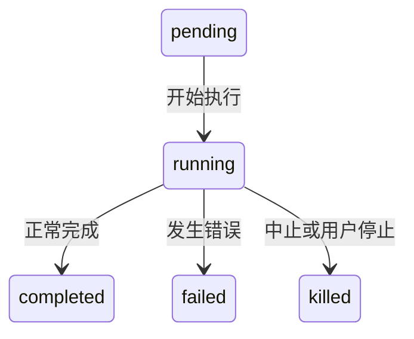
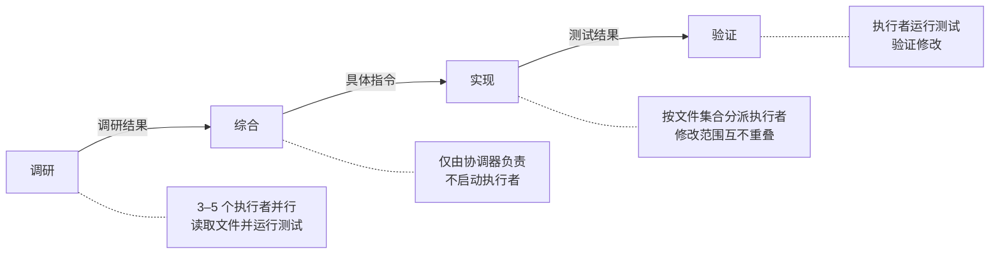
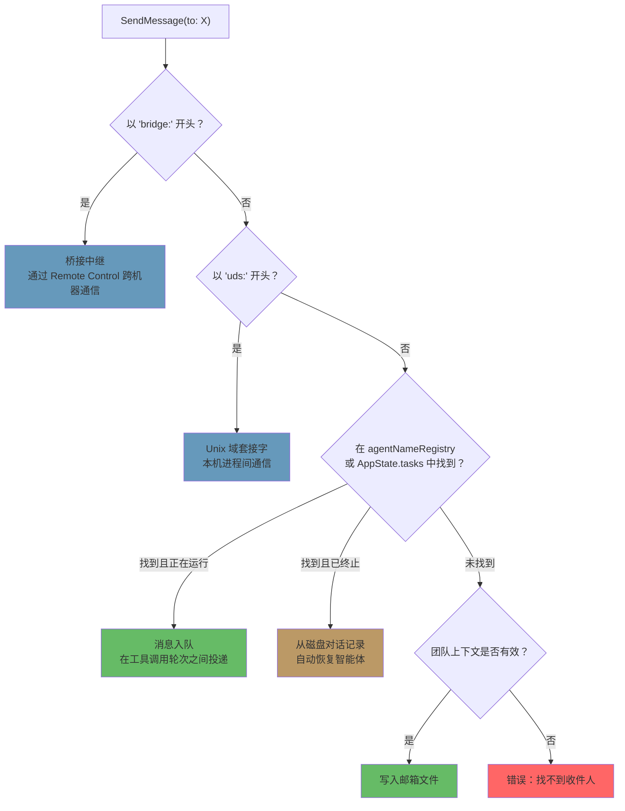

# 第 10 章：任务、协调与智能体集群

## 单线程的局限

第 8 章介绍了如何创建子智能体（Sub-Agent），也就是如何根据智能体定义，经过 15 个步骤建立隔离的执行上下文。第 9 章介绍了如何利用提示词缓存（Prompt Cache）降低并行启动的成本。创建智能体（Agent）和管理智能体是两个不同的问题。本章讨论后者。

单个智能体循环（Agent Loop）只有一个模型和一段对话，每次操作一个工具，但已经能完成很多工作。它能读文件、改代码、运行测试、搜索网页，也能推理复杂问题。不过，它能处理的工作仍有上限。

限制来自并行度和工作范围。大型重构可能需要开发人员修改 40 个文件，每改完一批就运行测试，确认没有破坏原有行为。代码库迁移可能同时涉及前端、后端和数据库。全面的代码审查可能一边阅读几十个文件，一边在后台运行测试套件。这些问题的难点在于涉及面广，需要同时进行多项工作、把任务交给专门的执行者，再协调各方的结果。

Claude Code 为此提供了多个层次的编排（Orchestration）模式，分别应对不同的工作形态。后台任务用于启动后无需持续关注的命令，协调模式用于管理者与执行者的层级分工，智能体集群用于点对点协作。这些模式由统一的通信协议连接起来。

编排层横跨约 40 个文件，分布在 `tools/AgentTool/`、`tasks/`、`coordinator/`、`tools/SendMessageTool/` 和 `utils/swarm/` 下。尽管涉及面广，所有模式都共用同一个状态机（State Machine）。理解它，也就是 `Task.ts` 中的 `Task` 抽象，是理解其他部分的前提。

本章将从底层的任务状态机（Task State Machine）讲到更复杂的多智能体拓扑。

---

## 任务状态机

Claude Code 将每项后台操作都记录为一个任务，包括 shell 命令、子智能体、远程会话和工作流脚本。`Task.ts` 中的任务抽象提供了统一的状态模型，编排层的其他部分都以此为基础。

### 七种类型

系统定义了七种任务类型，各自对应不同的执行模型。

这七种类型分别是 `local_bash`（后台 shell 命令）、`local_agent`（后台子智能体）、`remote_agent`（远程会话）、`in_process_teammate`（集群队友）、`local_workflow`（执行工作流脚本）、`monitor_mcp`（MCP 服务器监控）和 `dream`（推测性的后台思考）。

`local_bash` 和 `local_agent` 最常用，分别承担后台 shell 命令和后台子智能体任务。`in_process_teammate` 是集群的基本组成单元。`remote_agent` 接入远程 Claude Code 运行时（Runtime）环境。`local_workflow` 运行多步骤脚本。`monitor_mcp` 监控 MCP 服务器的健康状态。最特别的是 `dream`，它让智能体等待用户输入时也能在后台进行推测性思考。

每种类型都有一个单字符 ID 前缀，方便快速辨认。

| 类型 | 前缀 | ID 示例 |
|------|--------|------------|
| `local_bash` | `b` | `b4k2m8x1` |
| `local_agent` | `a` | `a7j3n9p2` |
| `remote_agent` | `r` | `r1h5q6w4` |
| `in_process_teammate` | `t` | `t3f8s2v5` |
| `local_workflow` | `w` | `w6c9d4y7` |
| `monitor_mcp` | `m` | `m2g7k1z8` |
| `dream` | `d` | `d5b4n3r6` |

任务 ID 以单个字符开头，例如智能体用 a，bash 用 b，队友用 t。其后是 8 个随机字符，从不依赖大小写区分的字符集（数字和小写字母）中选取。这提供了约 2.8 万亿种组合，足以抵御针对磁盘上任务输出文件的暴力猜测符号链接攻击。

日志里出现 `a7j3n9p2`，读者就能立即认出它是后台智能体。出现 `b4k2m8x1`，则立即知道它是 shell 命令。在可能同时运行几十个任务的系统中，上述前缀虽小，却让日志更好读。

### 五种状态

任务生命周期可以表示为一个简单的有向无环图。



`pending` 是注册后到首次执行前的短暂状态。`running` 表示任务正在执行。三种终止状态是 `completed`（成功）、`failed`（出错）和 `killed`（由用户、协调器或中止信号显式停止）。一个辅助函数用于防止继续操作已经终止的任务。

```typescript
export function isTerminalTaskStatus(status: TaskStatus): boolean {
  return status === 'completed' || status === 'failed' || status === 'killed'
}
```

消息注入检查、状态清除逻辑、孤立任务清理都会调用这个函数。SendMessage 也用它来决定是将消息入队，还是恢复已经终止的智能体。

### 基础状态

每种任务状态都扩展自 `TaskStateBase`，其中包含七种类型共用的字段。

```typescript
export type TaskStateBase = {
  id: string              // Prefixed random ID
  type: TaskType          // Discriminator
  status: TaskStatus      // Current lifecycle position
  description: string     // Human-readable summary
  toolUseId?: string      // The tool_use block that spawned this task
  startTime: number       // Creation timestamp
  endTime?: number        // Terminal-state timestamp
  totalPausedMs?: number  // Accumulated pause time
  outputFile: string      // Disk path for streaming output
  outputOffset: number    // Read cursor for incremental output
  notified: boolean       // Whether completion was reported to parent
}
```

这里有两个字段值得留意。`outputFile` 连接异步执行和父级对话。每个任务把输出写入磁盘文件，父级则可以通过 `outputOffset` 增量读取。`notified` 防止重复发送完成消息。父级收到完成通知后，标志设为 `true`，后续就不会再次发送这条通知。没有这道检查时，两次连续轮询通知队列之间完成的任务可能产生重复通知，让模型误以为有两个任务完成。

### 智能体任务状态

`LocalAgentTaskState` 是最复杂的一种，包含管理后台子智能体整个生命周期所需的全部数据。

```typescript
export type LocalAgentTaskState = TaskStateBase & {
  type: 'local_agent'
  agentId: string
  prompt: string
  selectedAgent?: AgentDefinition
  agentType: string
  model?: string
  abortController?: AbortController
  pendingMessages: string[]       // Queued via SendMessage
  isBackgrounded: boolean         // Was this originally a foreground agent?
  retain: boolean                 // UI is holding this task
  diskLoaded: boolean             // Sidechain transcript loaded
  evictAfter?: number             // GC deadline
  progress?: AgentProgress
  lastReportedToolCount: number
  lastReportedTokenCount: number
  // ... additional lifecycle fields
}
```

三个字段体现了关键设计。`pendingMessages` 是收件箱。`SendMessage` 发给正在运行的智能体时，系统先将消息存入此处，到一轮工具调用结束才取出，保持智能体的轮次结构。`isBackgrounded` 区分从一开始就在后台异步运行的智能体，以及最初在前台同步运行、后来由用户按键转入后台的智能体。`evictAfter` 用于垃圾回收，已经完成而且无需保留的任务会先经历一段宽限期，然后才从内存清除状态。

所有任务状态都存储在 `AppState.tasks` 中，类型是 `Record<string, TaskState>`，以带前缀的 ID 为键。状态存储使用一张扁平映射表。父子关系隐含在对话流程中，由父级持有启动子任务时的 `toolUseId`。

### 任务注册表

每种任务类型都有一个对应的 `Task` 对象，接口很小。

```typescript
export type Task = {
  name: string
  type: TaskType
  kill(taskId: string, setAppState: SetAppState): Promise<void>
}
```

注册表收集各类任务的实现。

```typescript
export function getAllTasks(): Task[] {
  return [
    LocalShellTask,
    LocalAgentTask,
    RemoteAgentTask,
    DreamTask,
    ...(LocalWorkflowTask ? [LocalWorkflowTask] : []),
    ...(MonitorMcpTask ? [MonitorMcpTask] : []),
  ]
}
```

`LocalWorkflowTask` 和 `MonitorMcpTask` 是否纳入注册表取决于功能标志，运行时可能没有这两个对象。`Task` 接口有意保持精简。早期版本曾包含 `spawn()` 和 `render()`，后来发现启动和渲染从来没有通过多态调用，这两个方法就被移除了。每种任务都有自己的启动逻辑、状态管理和渲染方式。实际需要按类型分派的只有 `kill()`，因此接口也只要求这一个方法。

这是通过做减法演进接口的例子。最初的设计设想所有任务类型都共享一套生命周期接口。实际实现差异很大，shell 命令的 `spawn()` 与进程内队友的 `spawn()` 几乎没有共同之处，共享接口也就流于形式。团队最终只保留了真正受益于多态的那个方法。

---

## 通信模式

后台任务要发挥作用，父级就得能观察进度并接收结果。Claude Code 支持三种通信渠道，分别适合不同的访问方式。

### 前台的生成器调用链

智能体同步运行时，父级直接迭代它的异步生成器 `runAgent()`，将每条消息沿调用栈向上产出。用户可以中途把任务转入后台，因此同步循环要同时等待两件事，谁先到就处理谁：“智能体的下一条消息”和“转入后台的信号”。

```typescript
const agentIterator = runAgent({ ...params })[Symbol.asyncIterator]()

while (true) {
  const nextMessagePromise = agentIterator.next()
  const raceResult = backgroundPromise
    ? await Promise.race([nextMessagePromise.then(...), backgroundPromise])
    : { type: 'message', result: await nextMessagePromise }

  if (raceResult.type === 'background') {
    // User triggered backgrounding -- transition to async
    await agentIterator.return(undefined)
    void runAgent({ ...params, isAsync: true })
    return { data: { status: 'async_launched' } }
  }

  agentMessages.push(message)
}
```

如果用户决定把正在执行的同步智能体转成后台任务，前台迭代器会正常结束，触发其 `finally` 块清理资源。智能体随后以同一个 ID 重新启动为异步任务。已经完成的工作得以保留，智能体从上次停下的地方继续，并使用一个不与父级 ESC 键绑定的异步中止控制器。

这项状态转换要处理好并不容易。前台智能体共用父级的中止控制器，按下 ESC 会同时停止两者。后台智能体则需要自己的控制器，使父级按下 ESC 时它仍能继续运行。智能体的消息必须从前台生成器流切换到后台通知系统。任务状态还得切换 `isBackgrounded`，以便 UI 在后台面板中显示任务。这些变化必须原子地完成，避免转换时丢失消息或留下仍在运行的迭代器。下一条消息和后台信号之间的 `Promise.race` 使这一转换成为可能。

### 后台的三种渠道

后台智能体通过磁盘文件、通知和消息队列通信。

**磁盘输出文件。** 每个任务都将输出写到 `outputFile` 路径，该路径是指向智能体 JSONL 格式对话记录的符号链接。父级或其他观察者可以用 `outputOffset` 记录读到的位置，从而增量读取文件。`TaskOutputTool` 将这项能力提供给模型。

```typescript
inputSchema = z.strictObject({
  task_id: z.string(),
  block: z.boolean().default(true),
  timeout: z.number().default(30000),
})
```

当设置为 `block: true` 时，工具会持续轮询，直到任务进入终止状态或达到超时时间。协调器启动执行者并等待结果时，主要依靠这个机制。

**任务通知。** 后台智能体完成任务后，系统生成一条 XML 通知，将它放入队列以便传入父级对话。

```xml
<task-notification>
  <task-id>a7j3n9p2</task-id>
  <tool-use-id>toolu_abc123</tool-use-id>
  <output-file>/path/to/output</output-file>
  <status>completed</status>
  <summary>Agent "Investigate auth bug" completed</summary>
  <result>Found null pointer in src/auth/validate.ts:42...</result>
  <usage>
    <total_tokens>15000</total_tokens>
    <tool_uses>8</tool_uses>
    <duration_ms>12000</duration_ms>
  </usage>
</task-notification>
```

通知作为用户角色的消息注入父级对话，模型会在正常的消息流中看到它。完成通知会直接进入上下文，无需靠专门工具查询。任务状态里的 `notified` 标志可以避免重复投递。

**命令队列。** `LocalAgentTaskState` 的 `pendingMessages` 数组是第三条渠道。`SendMessage` 的目标是正在运行的智能体时，消息会进入队列。

```typescript
if (isLocalAgentTask(task) && task.status === 'running') {
  queuePendingMessage(agentId, input.message, setAppState)
  return { data: { success: true, message: 'Message queued...' } }
}
```

`drainPendingMessages()` 在工具调用轮次的边界取出这些消息，并将它们作为用户消息注入智能体对话。等智能体完成当前这一步再交付新信息，既避免了竞态，也保护了当前状态。

### 进度跟踪

`ProgressTracker` 实时记录智能体的活动。

```typescript
export type ProgressTracker = {
  toolUseCount: number
  latestInputTokens: number        // Cumulative (latest value, not sum)
  cumulativeOutputTokens: number   // Summed across turns
  recentActivities: ToolActivity[] // Last 5 tool uses
}
```

输入和输出 token 采用不同的统计方式，这是由 API 的计费模型决定的。每次调用 API 都会重新发送完整对话，因此输入 token 随调用累积。第 15 轮包含前 14 轮，API 报告的输入 token 数已经反映了当时的总量，取最新值即可。模型每轮都生成新的输出 token，所以输出应按轮累加。如果把累计输入相加，统计会严重偏高。如果只取最近一轮的输出，统计又会严重偏低。

`recentActivities` 数组（最多 5 条）列出便于人阅读的活动记录，例如“读取 src/auth/validate.ts”“Bash: npm test”“编辑 src/auth/validate.ts”。这些记录出现在 VS Code 的子智能体面板和终端的后台任务指示器中，用户无需查看完整对话记录就能了解智能体正在做什么。

对于后台智能体，系统通过 `updateAsyncAgentProgress()` 将进度写入 `AppState`，并通过 `emitTaskProgress()` 发出 SDK 事件。VS Code 子智能体面板使用这些事件实时显示进度条、工具调用次数和活动记录。用户主要凭这些反馈判断后台智能体是否仍在推进，还是陷入了循环。

---

## 协调模式

协调模式将 Claude Code 从一个带后台助手的智能体，变成由协调器（Coordinator）管理多个执行者的架构。在系统的各种编排模式中，这一模式对分工的要求最明确，也体现了对大语言模型应当如何委派工作的思考。

### 协调模式解决什么问题

标准智能体循环只有一段对话和一个上下文窗口。启动的后台智能体独立运行，并通过任务通知报告结果。对于“我继续编辑，你去运行测试”这样的简单委派，这已经足够。碰到复杂的多步骤工作流，它就难以应付了。

以代码库迁移为例，智能体需要（1）了解 200 个文件中现有的写法，（2）设计迁移策略，（3）逐个修改文件，（4）验证没有破坏原有行为。第 1 步和第 3 步适合并行。第 2 步需要综合第 1 步的结果，第 4 步依赖第 3 步。由单个智能体依次执行，大部分 token 预算会花在重复阅读文件上。让多个后台智能体在无协调的情况下执行，又会造成修改不一致。

协调模式把负责思考的智能体和负责执行的智能体分开。协调器处理第 1、2 步，先派出执行者调研，再综合结果。执行者处理第 3、4 步，负责应用修改和运行测试。协调器掌握全局，执行者专注各自的具体任务。

### 启用方式

一个环境变量即可启用协调模式。

```typescript
export function isCoordinatorMode(): boolean {
  if (feature('COORDINATOR_MODE')) {
    return isEnvTruthy(process.env.CLAUDE_CODE_COORDINATOR_MODE)
  }
  return false
}
```

恢复会话时，`matchSessionMode()` 会检查会话中保存的模式是否与当前环境一致。若不一致，就调整环境变量以匹配会话。这样可以避免协调会话被恢复成普通智能体会话，失去对执行者的了解，也可以避免普通会话恢复成协调模式而失去原有工具。模式以会话记录为准，环境变量是在运行时传递该模式的信号。

### 工具限制

协调器的作用来自对工具的约束。在协调模式中，协调器只能使用三个工具。

- **Agent**，启动执行者
- **SendMessage**，与现有执行者通信
- **TaskStop**，终止正在运行的执行者

协调器无法读取文件、编辑代码或运行 shell 命令，因而不能直接操作代码库。这项限制明确了分工。协调器负责思考、规划、拆解任务和综合结果，执行者负责落实。

执行者可用的工具则是完整工具集去掉内部协调工具。

```typescript
const INTERNAL_WORKER_TOOLS = new Set([
  TEAM_CREATE_TOOL_NAME,
  TEAM_DELETE_TOOL_NAME,
  SEND_MESSAGE_TOOL_NAME,
  SYNTHETIC_OUTPUT_TOOL_NAME,
])
```

执行者无法创建自己的子团队，也不能给其他执行者发消息。它们通过正常的任务完成机制报告结果，由协调器综合处理。

### 约 370 行的系统提示词

协调器系统提示词约 370 行，集中记录了用大语言模型做编排时积累下来的委派经验。主要内容如下。

**“绝不把理解工作交给执行者。”** 这是核心原则。协调器必须先综合调研结果，再写出包含文件路径、行号和具体修改内容的提示词。提示词明确指出“根据你的发现修复这个 bug”一类反例。这种指令把*理解*的工作丢给执行者，迫使它重新推导协调器已掌握的上下文。合适的写法是：“在 `src/auth/validate.ts` 第 42 行，从 OAuth 流程调用时，`userId` 参数可能为 null。加一项空值检查，在这种情况下返回 401 响应。”

**“充分发挥并行的能力。”** 提示词建立了清晰的并发模型。调研、探索和读取文件等只读任务可以自由并行。大量写入的任务按文件集合串行。协调器需要判断哪些任务可以重叠，哪些必须按顺序执行。合理的做法是同时启动五个调研执行者，等全部完成后综合结果，再启动三个实现执行者，分别修改互不重叠的文件集合。每次只启动一个执行者，等它结束再启动下一个，会把本可并行的工作串行化。

**任务工作流的阶段。** 提示词规定了四个阶段。



1. **调研**。执行者并行探索代码库，读取文件、运行测试并收集信息。
2. **综合**。协调器亲自阅读全部调研结果，形成统一认识。
3. **实现**。执行者收到协调器根据综合结果拟定的具体指令。
4. **验证**。执行者运行测试并验证修改。

协调器应当逐一完成各阶段。最常见的失败方式是调研后跳过综合，直接进入实现。这样就把理解工作转交给实现阶段的执行者，每个执行者都得从头推导上下文，导致修改不一致，还浪费 token。

**让原执行者继续还是另启一个。** 执行者完成任务后，如果还有后续工作，协调器可以通过 SendMessage 联系原执行者，也可以用 Agent 启动新的执行者。如何选择取决于上下文的重合程度。

- **重合度高，涉及相同文件。** 让原执行者继续。它的上下文里已有文件内容，也理解现有写法，可以在此前工作的基础上推进。另启执行者就得重新读文件、重新理解同样的内容。
- **重合度低，属于不同领域。** 启动新执行者。刚调查完认证系统的执行者可能带着 20,000 个与认证相关的 token，这些上下文对 CSS 重构无用。从干净的上下文开始更省。
- **重合度高，但原执行者失败了。** 启动新执行者，明确说明上次哪里出错。让失败的执行者继续，往往需要先纠正它已经混乱的上下文。重新开始并说明“上次因 X 失败，避开 Y”更可靠。
- **后续工作依赖执行者的输出。** 让原执行者继续，并把输出附在 SendMessage 里。这样它就不用重新推导自己的结论。

**如何编写执行者提示词，以及常见反例。** 提示词说明怎样编写有效的执行指令，也明确列出了应避免的写法。

反例。*“根据你的调研发现，实现修复。”* 这把理解工作交给了执行者。阅读调研结果的是协调器，而这名执行者并未参与那次调研。

反例。*“修复认证模块里的 bug。”* 没有文件路径、行号或 bug 描述，执行者只能从头搜索整个代码库。

反例。*“对其他所有文件做同样的修改。”* 哪些文件？什么修改？协调器知道这些信息，就应该逐一列出来。

合适的写法。*“在 `src/auth/validate.ts` 第 42 行，由 `src/oauth/callback.ts:89` 调用时，`userId` 参数可能为 null。加一项空值检查，在 `userId` 为 null 时返回 `{ error: 'unauthorized', status: 401 }`。然后更新 `src/auth/__tests__/validate.test.ts` 中的测试，覆盖空值情形。”*

写清楚指令的成本只由协调器承担一次，收益是执行者第一次就有机会做对。模糊的提示词看似省事，却可能让协调器省下 30 秒写作时间，换来执行者多花 5 分钟探索。

### 执行者上下文

协调器把可用工具的信息注入自己的上下文，让模型知道执行者能做哪些事。

```typescript
export function getCoordinatorUserContext(mcpClients, scratchpadDir?) {
  return {
    workerToolsContext: `Workers spawned via Agent have access to: ${workerTools}`
      + (mcpClients.length > 0
        ? `\nWorkers also have MCP tools from: ${serverNames}` : '')
      + (scratchpadDir ? `\nScratchpad: ${scratchpadDir}` : '')
  }
}
```

临时工作目录受 `tengu_scratch` 功能标志控制。这个目录位于共享文件系统上，执行者读写它时无需弹出权限提示。借助它，执行者可以持久地共享知识。一个执行者的调研笔记可以通过文件系统成为另一个执行者的输入，无需占用协调器的上下文窗口。

这解决了协调模式的一项基本限制。没有临时工作目录时，信息全要经过协调器。执行者 A 得出结论，协调器用 TaskOutput 读取，再把结论综合进执行者 B 的提示词。协调器必须在上下文窗口中保留全部中间结果，直到完成综合，因此窗口成了瓶颈。有了这个目录，执行者 A 可将结论写入 `/tmp/scratchpad/auth-analysis.md`，协调器再告诉执行者 B：“阅读 `/tmp/scratchpad/auth-analysis.md` 中的认证分析，把对应的做法用到 OAuth 模块。”协调器只需传递引用。

### 与分叉子智能体互斥

协调模式与采用分叉方式的子智能体互斥。

```typescript
export function isForkSubagentEnabled(): boolean {
  if (feature('FORK_SUBAGENT')) {
    if (isCoordinatorMode()) return false
    // ...
  }
}
```

分叉智能体（Fork Agent）继承父级的整段对话上下文，通过共用提示词缓存来降低克隆成本。协调模式的执行者则是独立的智能体，带着全新的上下文和明确的指令启动。两种机制采用不同的委派方式，系统在功能标志层强制二选一。

---

## 智能体集群系统

协调模式采用层级结构，由一个管理者自上而下指挥多个执行者。智能体集群（Agent Swarm）支持点对点协作。多个 Claude Code 实例组成团队，队长通过消息传递协调多名队友（Teammates）。

### 团队上下文

系统用 `teamName` 标识团队，并在 `AppState.teamContext` 中记录团队信息。

```typescript
teamContext?: {
  teamName: string
  teammates: {
    [id: string]: { name: string; color?: string; ... }
  }
}
```

每名队友都有一个可作收件地址的名称，以及便于在 UI 中辨认的颜色。团队文件会持久化到磁盘，因此进程重启后仍能恢复成员关系。

### 智能体名称注册表

后台智能体在启动时可以获得名称。这样就能通过易读的名称来联系它，无需记住随机的任务 ID。

```typescript
if (name) {
  rootSetAppState(prev => {
    const next = new Map(prev.agentNameRegistry)
    next.set(name, asAgentId(asyncAgentId))
    return { ...prev, agentNameRegistry: next }
  })
}
```

`agentNameRegistry` 的类型为 `Map<string, AgentId>`。`SendMessage` 解析 `to` 字段时，会先查这张表。

```typescript
const registered = appState.agentNameRegistry.get(input.to)
const agentId = registered ?? toAgentId(input.to)
```

这样就可以把消息发给 `"researcher"`，无需填写 `a7j3n9p2`。有了这层映射，协调器便能按角色组织工作，更容易推理多智能体工作流。

### 进程内队友

进程内队友和队长在同一个 Node.js 进程中运行，并由 `AsyncLocalStorage` 隔离。它们在基础状态上扩展了团队专用字段。

```typescript
export type InProcessTeammateTaskState = TaskStateBase & {
  type: 'in_process_teammate'
  identity: TeammateIdentity
  prompt: string
  messages?: Message[]                  // Capped at 50
  pendingUserMessages: string[]
  isIdle: boolean
  shutdownRequested: boolean
  awaitingPlanApproval: boolean
  permissionMode: PermissionMode
  onIdleCallbacks?: Array<() => void>
  currentWorkAbortController?: AbortController
}
```

`messages` 最多保留 50 条，这个上限有实际原因。开发期间的分析发现，每个进程内智能体运行 500 多轮后，大约会积累 20 MB 的常驻内存（RSS）。重度用户运行长时间工作流时，曾在 2 分钟内启动 292 个智能体，使 RSS 升至 36.8 GB。UI 表示保留 50 条消息，是为了控制内存。智能体的实际对话仍保留完整历史，截断只作用于提供给 UI 的快照。

`isIdle` 标志支持工作窃取（Work Stealing）模式。空闲队友只等下一条消息，不消耗 token，也不会调用 API。`onIdleCallbacks` 数组让系统在队友从活跃转为空闲时执行回调，可用于“等所有队友完成再继续”之类的编排。

`currentWorkAbortController` 与队友的主中止控制器分开。触发当前工作控制器会取消队友正在执行的这一轮，队友本身仍会运行。这样队长可以发一条更高优先级的消息，使队友中止当前工作并接手新消息。触发主中止控制器则会彻底停止队友。两级控制对应两种中断范围。

`shutdownRequested` 标志用于协作式终止。队长发送关闭请求后，系统设置这个标志。队友可以在适合停下的位置检查它并有序退出，例如先写完当前文件、提交改动或发送最后一条状态更新。直接强制停止则可能让文件停在不一致的状态。

### 邮箱

队友通过基于文件的邮箱通信。若 `SendMessage` 的目标是一名队友，消息就会写进磁盘上收件人的邮箱文件。

```typescript
await writeToMailbox(recipientName, {
  from: senderName,
  text: content,
  summary,
  timestamp: new Date().toISOString(),
  color: senderColor,
}, teamName)
```

消息可以是纯文本、结构化协议消息（关闭请求、计划审批），也可以广播（`to: "*"` 会发送给除发件人外的所有团队成员）。轮询 Hook（钩子）处理传入消息，并将它们送入对应队友的对话。

文件方案有意保持简单，省去了消息代理、事件总线和共享内存通道。文件在进程崩溃后仍会保留，可以用 `cat` 检查邮箱内容，也无需额外的基础设施。系统每个会话只有几十条消息，文件系统调用就能满足所需吞吐量。采用 Redis 消息队列反而会增加运维复杂度、引入依赖和新的故障方式。

广播也沿用这种简单做法。消息发送给 `"*"` 时，发件方遍历团队文件中的所有成员，通过不区分大小写的比较跳过自己，然后逐个写入其他成员的邮箱。

```typescript
for (const member of teamFile.members) {
  if (member.name.toLowerCase() === senderName.toLowerCase()) continue
  recipients.push(member.name)
}
for (const recipientName of recipients) {
  await writeToMailbox(recipientName, { from: senderName, text: content, ... }, teamName)
}
```

广播没有做扇出优化，每个收件人各对应一次文件写入。智能体团队一般只有 3–8 名成员，这个做法已足够。若一个团队有 100 名成员，就需要重新考虑。用于防止 RSS 达到 36 GB 的 50 条消息内存上限，也间接限制了团队的实际规模。

### 权限转发

集群执行者在受限权限下运行。如果某项敏感操作需要批准，可以把请求转给队长。

```typescript
const request = createPermissionRequest({
  toolName, toolUseId, input, description, permissionSuggestions
})
registerPermissionCallback({ requestId, toolUseId, onAllow, onReject })
void sendPermissionRequestViaMailbox(request)
```

执行者遇到需要权限的工具时，bash 分类器会尝试自动批准。如果无法自动批准，系统就通过邮箱将请求转给队长。队长可以在 UI 中查看并批准或拒绝请求，然后触发相应回调，让执行者继续处理。这样执行者能自主执行安全操作，而高风险操作仍由人监督。

---

## 智能体间通信与 SendMessage

`SendMessageTool` 是通用的通信原语。同一个工具接口支持四种路由模式，具体采用哪一种由 `to` 字段的形式决定。

### 输入模式

```typescript
inputSchema = z.object({
  to: z.string(),
  // "teammate-name", "*", "uds:<socket>", "bridge:<session-id>"
  summary: z.string().optional(),
  message: z.union([
    z.string(),
    z.discriminatedUnion('type', [
      z.object({ type: z.literal('shutdown_request'), reason: z.string().optional() }),
      z.object({ type: z.literal('shutdown_response'), request_id, approve, reason }),
      z.object({ type: z.literal('plan_approval_response'), request_id, approve, feedback }),
    ]),
  ]),
})
```

`message` 字段是纯文本和结构化协议消息的联合类型。SendMessage 既能用来随意交谈，例如“这是我的调研结果”，也承担正式的协议交互，例如“我批准你的计划”或“请关闭”。

### 路由分派

`call()` 方法按优先级依次匹配以下路由。



**1. 桥接消息**（`bridge:<session-id>`）。通过 Anthropic 的 Remote Control 服务器跨机器通信。这种方式覆盖范围最广，运行在不同机器、甚至不同大洲的两个 Claude Code 实例也能经由中继通信。发送桥接消息前必须得到用户明确同意。这道安全检查可以防止智能体单方面与远程实例建立通信。否则，被入侵或判断出错的智能体可能向远程会话泄露信息。同意检查使用 `postInterClaudeMessage()`，该函数负责序列化以及通过 Remote Control 中继传输。

**2. UDS 消息**（`uds:<socket-path>`）。通过 Unix 域套接字（Unix Domain Socket，UDS）进行本地进程间通信，适合同一台机器上运行在不同进程中的 Claude Code 实例。例如，一个实例由 VS Code 扩展托管，另一个在终端里运行。UDS 不需要网络往返，由文件系统权限控制访问，并由内核负责交付，因此快速、安全且可靠。`sendToUdsSocket()` 序列化消息，再将其写到 `to` 字段指定的套接字路径。各实例用 `ListPeers` 工具扫描活跃的 UDS 端点，从而发现彼此。

**3. 进程内子智能体路由**（普通名称或智能体 ID）。这是最常用的路径，按以下步骤处理。

- 在 `agentNameRegistry` 中查找 `input.to`
- 找到且正在运行时，调用 `queuePendingMessage()`，等待下一轮工具调用的边界再投递
- 找到但已进入终止状态时，调用 `resumeAgentBackground()`，自动重启智能体
- 在 `AppState` 中找不到时，尝试从磁盘对话记录恢复

**4. 团队邮箱**（团队上下文有效时的后备路径）。消息写入具名收件人的邮箱文件。通配符 `"*"` 会向所有团队成员广播。

### 结构化协议

除纯文本外，SendMessage 还承载两种正式协议。

**关闭协议。** 队长向队友发送 `{ type: 'shutdown_request', reason: '...' }`。队友回复 `{ type: 'shutdown_response', request_id, approve: true/false, reason }`。同意关闭后，进程内队友触发自己的中止控制器，基于 tmux 的队友则会收到 `gracefulShutdown()` 调用。关闭是协作式的，队友在执行关键工作时可以拒绝请求，队长需要处理这种情况。

**计划审批协议。** 处于计划模式的队友必须获批才能执行。队友提交计划，队长以 `{ type: 'plan_approval_response', request_id, approve, feedback }` 回复。只有队长可以批准。这样，队长就能在任何文件被改动前审查执行者的方案，及早发现误解。

### 自动恢复模式

路由机制能自动恢复智能体。`SendMessage` 发给已完成或已被停止的智能体时，系统会重新唤起它，继续处理消息。

```typescript
if (task.status !== 'running') {
  const result = await resumeAgentBackground({
    agentId,
    prompt: input.message,
    toolUseContext: context,
    canUseTool,
  })
  return {
    data: {
      success: true,
      message: `Agent "${input.to}" was stopped; resumed with your message`
    }
  }
}
```

`resumeAgentBackground()` 根据磁盘对话记录重建智能体，步骤如下。

1. 读取侧链 JSONL 会话记录
2. 重建消息历史，滤掉孤立的思考块和未完成的工具调用
3. 重建内容替换状态，保持提示词缓存稳定
4. 从保存的元数据中解析原来的智能体定义
5. 用新的中止控制器重新注册为后台任务
6. 用恢复的历史和作为提示词的新消息调用 `runAgent()`

对协调器来说，向已终止的智能体发消息和向正在运行的智能体发消息是同一个操作。路由层负责处理差异，协调器只需发送消息，无需跟踪每个智能体的运行状态。

没有自动恢复时，协调器得判断哪些智能体还在运行：“`researcher` 还在运行吗？先查一下。它已经结束了，需要再启动一个。那应该用同一个名字吗？上下文还能接上吗？”有了自动恢复，这些判断简化为“给 `researcher` 发消息”。如果它仍在运行，消息会入队。如果它已经终止，系统会带着完整历史恢复它。协调器提示词的复杂度因此大幅降低。

恢复当然有成本。从磁盘记录恢复时，可能要重新读取数千条消息、重建内部状态，并带着完整的上下文窗口发起新的 API 调用。对于长期运行的智能体，耗时和 token 开销都可能很大。协调器作为大语言模型，擅长分析问题和编写指令，但不擅长维护运行记录。自动恢复省去了一整类记录工作，让模型集中处理它擅长的事。

---

## 使用 TaskStop 终止任务

`TaskStopTool` 与 Agent 和 SendMessage 配合，负责终止正在运行的任务。

```typescript
inputSchema = z.strictObject({
  task_id: z.string().optional(),
  shell_id: z.string().optional(),  // Deprecated backward compat
})
```

实现委托给 `stopTask()`，它按任务类型分派。

1. 在 `AppState.tasks` 中查找任务
2. 调用 `getTaskByType(task.type).kill(taskId, setAppState)`
3. 对智能体任务，触发中止控制器，将状态设为 `'killed'`，再启动状态清除计时器
4. 对 shell 任务，终止整个进程组

这个工具还保留了旧别名 `"KillShell"`。任务系统早期比较简单，唯一能在后台运行的操作是 shell 命令。

不同类型的停止机制各有细节。对智能体，系统先触发中止控制器，使 `query()` 循环在下一个产出点退出，然后将状态设为 `'killed'`，启动计时器，以便在宽限期结束后清理任务状态。对 shell 命令，系统向进程组发送信号，先发 `SIGTERM`，如果到超时时间进程还没退出，再发 `SIGKILL`。对进程内队友，终止还会触发面向团队的关闭通知，让其他成员知道这名队友已经退出。

智能体被终止后，状态会在 `AppState.tasks` 中暂时保留。宽限期由 `evictAfter` 控制，期间 UI 可以显示已终止状态，调用方可以读取最后的输出，SendMessage 也仍可自动恢复它。宽限期过后，垃圾回收会清除状态。正常完成的任务也采用同一机制，区分“已结束”（结果可用）和“已清除”（状态已移除）。

---

## 如何选择编排模式

（关于命名：代码库里还有 `TaskCreate`、`TaskGet`、`TaskList` 和 `TaskUpdate` 工具，用于管理结构化待办列表。这是独立于本文后台任务状态机的另一套系统。`TaskStop` 操作 `AppState.tasks`，`TaskUpdate` 操作项目跟踪数据存储。名称重叠是历史遗留问题，经常让模型混淆。）

编排有三种模式可选：后台委派、协调模式和智能体集群。什么时候该用哪一种？

**简单委派**适用于父级有一两项独立任务需要交出去时，即使用带有 `run_in_background: true` 的 Agent 工具。例如继续编辑时在后台跑测试，或在等待构建时搜索代码库。父级保留控制权，在合适的时候查看结果，无需复杂的通信协议。开销很小，只有一条任务状态、一个磁盘输出文件和一条完成通知。

**协调模式**适合能拆成调研、综合和实现三个阶段的问题，尤其是协调器需要综合多名执行者的结果才能安排下一步时。协调器无法直接操作文件，这使得思考和执行各自独立于不同上下文。约 370 行的系统提示词记录了一套实用模式，用来避免大语言模型委派时最常见的错误，即把理解也交给执行者。

**智能体集群**适合需要点对点通信的长期协作会话。工作持续推进，智能体可能在空闲后因新消息而恢复。邮箱支持这种异步协作，协调模式则按启动、等待、综合的同步流程运行。计划审批增加了审查环节，权限转发让团队即使不给每个智能体完整权限，也能维持安全。

可以按实际场景选择。

| 场景 | 模式 | 理由 |
|----------|---------|-----|
| 边编辑边运行测试 | 简单委派 | 只有一个后台任务，无需协调 |
| 搜索代码库中的所有用法 | 简单委派 | 启动后无需跟进，完成后读取输出 |
| 重构 3 个模块中的 40 个文件 | 协调模式 | 调研阶段识别现有模式，综合阶段制定修改方案，执行者按模块并行实施 |
| 开发历时数天且需经过审查的功能 | 智能体集群 | 需要长期运行的智能体、计划审批协议和点对点通信 |
| 修复位置已知的 bug | 单个智能体 | 工作集中且按顺序进行，编排开销大于收益 |
| 迁移数据库架构，同时更新 API 和前端 | 协调模式 | 完成共同的调研和规划阶段后，可分三条工作流独立推进 |
| 由用户监督的结对编程 | 使用计划模式的智能体集群 | 执行者提出方案，队长批准，再由执行者实施 |

这些模式原则上可以共存，实际使用中却有互斥约束。协调模式会禁用分叉子智能体。智能体集群自有一套通信协议，不能与协调器的任务通知混用。会话启动时，环境变量和功能标志决定采用哪种模式，也就决定了整个交互方式。

通常从最简单的模式开始就够了。绝大多数开发工作只需一个智能体，偶尔把任务交给后台执行。协调模式和智能体集群留给那 5% 的情形，问题确实涉及面广、需要并行或持续很久。为修一个只涉及单个文件的 bug 启用协调模式，就像用 Kubernetes 部署静态网站。技术上可行，但架构上不合适。

---

## 编排的成本

讨论编排层体现的设计取向前，先看它在实际运行中的成本。

每个后台智能体都有一段独立的 API 对话、自己的上下文窗口、token 预算和提示词缓存槽位。协调器启动 5 个调研执行者时，就有 6 次并发 API 调用，每次都有各自的系统提示词、工具定义和注入的 CLAUDE.md。单是系统提示词就可能占数千 token，各执行者也可能重复读取别的执行者已经读过的文件，因此额外的 token 开销相当可观。

通信渠道也增加延迟。磁盘输出文件需要文件系统 I/O。任务通知要等到一轮工具调用结束才投递。命令队列增加了一次完整的往返延迟：协调器发出消息，等执行者完成当前工具调用，执行者再处理消息，并把结果写入磁盘供协调器读取。

状态管理也更复杂。系统有七类任务、五种状态，每种任务状态又有数十个字段。之所以加入状态清除逻辑、垃圾回收计时器和内存上限，是因为状态无界增长曾在生产环境中造成实际故障，令 RSS 达到 36.8 GB。

编排是一种有成本的工具，是否使用取决于收益。原本要顺序搜索 5 分钟的代码库，值得派 5 个执行者并行搜索。为了修复一个文件中的拼写错误而启动协调模式，就只有额外开销。

---

## 编排层体现的设计取向

任务状态、邮箱和通知 XML 各自都是直接的工程实现。把它们放在一起，可以看出贯穿这套系统的设计取向。

协调器提示词所说的“绝不把理解工作交给执行者”，反映了依赖上下文窗口推理的一项根本限制。刚拿到空白上下文的执行者，无法直接拥有协调器阅读 50 个文件、综合三份调研报告后形成的认识。要填补这道鸿沟，协调器得把自己的理解提炼成具体、可执行的提示词。模糊的委派既降低效率，也会造成信息损失。

SendMessage 的自动恢复模式优先让接口保持简单。实现涉及读取磁盘对话记录、重建内容替换状态，以及重新解析智能体定义。调用接口却只需要发送一条消息，收件人是否仍在运行都能处理。基础设施承担了这部分复杂性，模型和用户因而可以用更简单的方式理解和使用它。

进程内队友的 50 条消息内存上限，也说明编排系统受实际硬件约束。2 分钟内启动 292 个智能体，导致 RSS 达到 36.8 GB，曾在生产环境中真实发生。抽象再清晰，也要运行在内存有限的硬件上。用户把系统推到极限时，系统必须能够平稳降级。

分层架构本身也体现了一个原则。任务状态机无需知道协调器或智能体集群。通信渠道也与调用方无关，SendMessage 无需判断自己是被协调器、集群队长还是独立智能体调用。协调器提示词叠加在这些机制上，提供工作方法而无需修改底层。每一层都可以独立理解、测试和演进。团队加入智能体集群时无需改动任务状态机，加入协调器提示词时也无需改动 SendMessage。

这种编排由通用原语组合而成。协调器是一个工具受限且带有详细系统提示词的智能体。集群队长是一个带团队上下文、能够访问邮箱的智能体。后台执行者是一个拥有独立中止控制器和磁盘输出文件的智能体。七种任务类型、五种状态和四种路由模式组合在一起，支撑了比各组成部分更丰富的编排方式。

有了编排层，Claude Code 便从串行执行工具的单个智能体，变成更接近开发团队的系统。任务状态机记录任务，通信渠道传递信息，协调器提示词提供工作方法，智能体集群则为不适合严格层级的问题提供点对点协作方式。这些机制让语言模型能协调多个并行执行者，共同处理单次模型调用无法完成的大范围问题。

下一章讨论权限系统（Permission System）。这一安全层决定哪些智能体能执行哪些操作，以及高风险操作如何由执行者上报给人类。缺少权限控制，编排也会放大错误。权限系统让增加的智能体带来更多能力，同时控制风险。
