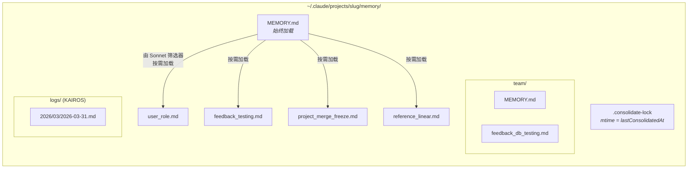
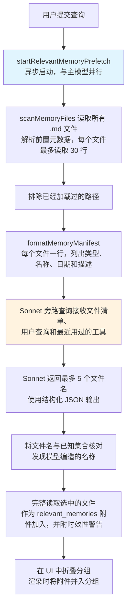
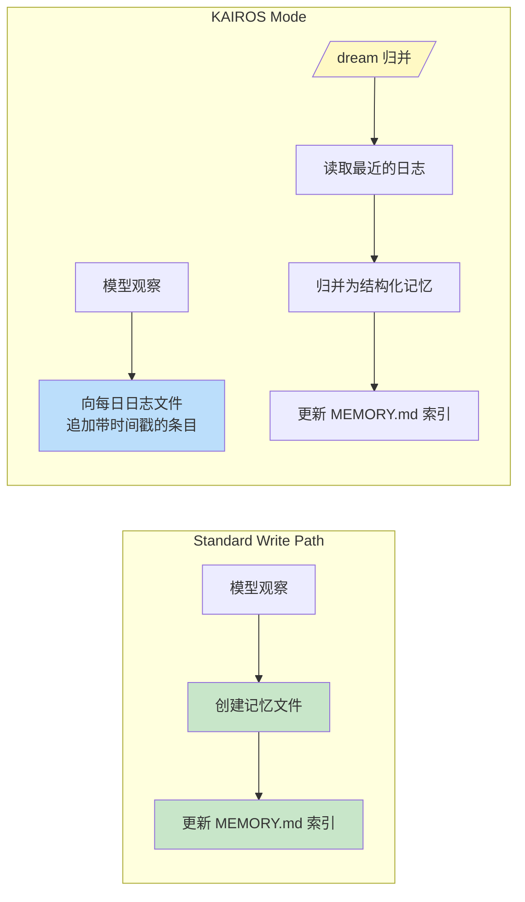

# 第 11 章：记忆与跨对话学习

## 无状态架构的问题

到目前为止，各章介绍的机制都在单次会话内运行。智能体循环（Agent Loop）运行，工具执行，子智能体（Sub-Agent）协作，而进程退出后，这些机制在本次会话中保留的信息随之消失。开启下一次对话时，系统提示词、工具定义和模型都和之前一样，却完全不知道上一次发生过什么。

这是无状态架构的根本局限。开发者周一纠正模型的测试方法，模型周二又犯同样的错。用户解释了自己的职责、项目的约束和喜欢的代码风格，每次新会话却要再解释一遍。对模型而言，这些信息在新对话里从未出现过。每次对话都是独立的。

这个问题会在实际使用中削弱信任。用户说“记住，我们测试用真实数据库实例，别用 mock”，下周模型却生成了用 mock 的测试。用户说明自己是资深工程师，无需入门讲解，下一次会话却从初级教程讲起。缺少记忆，每次会话都得从头开始，智能体永远像第一天入职的新人。

业界的常见方案是检索增强生成（Retrieval-Augmented Generation，RAG）：将文档转换成向量嵌入，存入向量数据库，查询时检索相关片段。这适合保存文档、常见问题和参考资料等知识库内容。智能体需要跨会话记住的则是一组观察记录，例如用户是谁、纠正过什么、项目当前有何限制，以及去哪里查资料。这些记录很小、经常变化，而且必须允许人工编辑。向量数据库并不适合解决这个问题。

Claude Code 的记忆系统选择把 Markdown 文件存到磁盘，由大语言模型（LLM）检索，无需额外基础设施。这种设计让存储保持简单，将判断相关性的工作交给模型。

这项选择影响了整个系统的设计：

- **人可读。** 想知道 Claude Code 记住了什么，可以在任意文本编辑器中打开 `~/.claude/projects/<slug>/memory/MEMORY.md`，无需专用工具、解密或导出命令。
- **人可编辑。** 过时的记忆可以用 vim 修正，错误的记忆可以用 `rm` 删除。用户完全掌控智能体记住的内容。
- **可纳入版本控制。** 团队记忆可以提交到 Git。Markdown 格式便于查看变更差异。
- **无需基础设施。** 记忆系统可以离线使用，无需服务器，任何有文件系统的操作系统都能运行。没有存储模式需要迁移。
- **易于排查。** 如果记忆行为出乎预期，用 `ls` 和 `cat` 就能排查，省去查查询日志和检查数据库的工作。

模型用 `FileWriteTool` 和 `FileEditTool` 读写记忆，和编辑源代码用的是同一套工具（见第 6 章）。系统提示词教模型按两步写入，即创建文件、更新索引。模型按新指令调用现有工具，整个过程无需专用的记忆 API。工具复用本身就是一项架构原则，记忆由智能体运用现有能力产生。

基于文件的设计也反映了智能体记忆与传统应用存储之间的差异。传统应用的数据库保存的是系统数据的权威状态。智能体的记忆保存的是*观察记录*，记录在某个时间点属实的情况，之后可能发生变化。文件能自然地体现这种不确定性。修改时间能反映记录的时间，知道记录有误的人可以读取、编辑或删除文件。数据库给人持久、权威的印象，而 Markdown 文件像一条随手记下、可能需要更新的笔记。存储介质本身就能提示读者，这些内容是供当前工作参考的笔记。

### 按项目划分记忆范围

记忆范围以 Git 仓库根目录为准，与当前工作目录无关。用户在 `src/components/` 和 `tests/` 中各开一个终端，两个会话会共享同一个记忆目录。路径解析优先寻找规范化的 Git 根目录，找不到时回退到项目根目录。

基础路径解析先找规范化的 Git 根目录，找不到时再用项目根目录。这样一来，同一仓库的所有 Git 工作树都共享一个记忆目录。

调用 `findCanonicalGitRoot` 可让同一仓库的各个 Git 工作树共用一个记忆目录。随后用 `sanitizePath()` 净化 Git 根目录路径，把斜杠替换成连字符，生成单层目录名称：

```
~/.claude/projects/-Users-alex-code-myapp/memory/
```

一份内容齐全的记忆目录能展示这个系统的结构：



命名约定为 `<type>_<topic>.md`，文件名能体现含义。类型前缀来自提示词中的指令，无需代码强制执行，这样扫一眼目录就能了解存了哪些记忆。

---

## 四类记忆

需要记住的信息只是其中一部分。系统将所有记忆限定为四种类型：

这四类是 **user**、**feedback**、**project** 和 **reference**。

划分的标准只有一个：**能否从项目当前状态重新得出这项信息？** 代码模式、架构、文件结构和 Git 历史都可以重新查阅代码库得知，因此不保存。四类记忆记录无法用这种方法重新得出的信息。

**用户记忆（user）**记录用户的角色、目标、职责和专业水平。面对一名刚接触 React 的资深 Go 工程师，解释方法应当与面对初学编程的人有所不同。

**反馈记忆（feedback）**记录如何开展工作的指导，既包括纠正，也包括确认。系统明确要求两者都记录：“如果只保存纠正意见，就会逐渐偏离用户已经认可的做法。”每条反馈记忆都有固定结构：先写规则，再用 `**Why:**` 一行说明原因（通常来自过去的事件），最后用 `**How to apply:**` 一行说明何时应用。

**项目记忆（project）**记录正在进行的工作，包括谁在做、为何做、什么时候完成。提示词强调把相对日期转换成绝对日期，例如把“星期四”转换成“2026-03-05”，这样几周后仍能理解记录。

**参考记忆（reference）**像书签一样指明外部系统中的信息位置，例如 Linear 项目 URL、Grafana 仪表盘或 Slack 频道。模型用它们确定去哪里查找。

### 用类型过滤信息

定义什么可以记住，同时也限定了什么不需要保存。如果没有四种类型的约束，积极的模型可能会保存代码模式、架构图、错误消息等一切信息。这些材料都可以从代码库重新得出，另存副本容易过时，直接查源头更可靠。

类型限制还防止模型过度依赖记忆。如果模型把架构决策保存成记忆，就可能不再通过读代码理解架构。排除可重新得出的信息，可以让模型以代码当前状态为依据。

明确排除的内容包括代码模式、Git 历史、调试解决方案、CLAUDE.md 中已有的内容，以及短期任务细节。即便用户明确要求保存，排除规则依然适用。如果用户说“记住这个 PR 列表”，模型应追问：“其中有什么*出人意料*或*不显而易见*的地方？”值得记的是出人意料之处，原始列表可另行查询。加入这条优先遵守排除规则的指令后，评测结果从 0/2 提升到 3/3。

### 前置元数据约定

每个记忆文件都使用 YAML 前置元数据（frontmatter），其中有三个必填字段：

```markdown
---
name: {{memory name}}
description: {{one-line description -- used to decide relevance}}
type: {{user, feedback, project, reference}}
---
```

`description` 是其中最关键的字段。相关性筛选器会根据它决定是否加载这条记忆，后面会介绍作为旁路查询运行的 Sonnet 筛选器。“测试相关”这样的模糊描述可能匹配得过宽，也可能完全匹配不上。“集成测试必须使用真实数据库，不能用 mock，因为第四季度的 mock 与实际行为不一致，造成过故障”则能匹配确实需要这项信息的对话。描述就是记忆的检索索引，由能理解细微差别、上下文和意图的语言模型使用。

在检索记忆时，扫描器只读取文件的前置元数据。`scanMemoryFiles()` 最多读取每个文件的前 30 行以提取头部信息。只有文件被明确选中并加载后，正文才会进入上下文。

---

## 写入流程

模型用普通的文件工具分两步写入记忆。

**第 1 步，写入记忆文件。** 模型在记忆目录中创建一个带有 YAML 前置元数据的 `.md` 文件：

```markdown
---
name: Testing Policy
description: Integration tests must hit real DB, not mocks
type: feedback
---

Don't mock the database in integration tests.

**Why:** We got burned last quarter when mocked tests passed but production
queries hit edge cases the mocks didn't cover.

**How to apply:** Any test file under `__tests__/` that touches database
operations should use the real PGlite instance from test-utils.
```

**第 2 步，更新索引。** 模型在 `MEMORY.md` 中加上一行链接：

```markdown
- [Testing Policy](feedback_testing.md) -- integration tests must hit real DB
```

每条索引项应控制在约 150 个字符以内。索引的用途是为记忆提供目录。

如果模型了解到会改变已有记忆的新信息，就用 `FileEditTool` 更新原文件，避免产生重复项。系统内部不对记忆做版本管理。文件保存在本地，用户需要版本管理时可以使用 `git`。构建提示词之前，`ensureMemoryDirExists()` 会创建记忆目录。提示词会告知模型该目录已存在，避免浪费轮次运行 `ls` 和 `mkdir -p`。

---

## 检索流程

写下记忆之后，还要解决更难的检索问题。收到用户查询时，应该从可能多达数百个记忆文件中选哪些加载到模型上下文？全部加载会耗尽 token 预算，完全不加载就失去了记忆的用途。选错文件会把 token 浪费在无关内容上，还可能漏掉本可以改变模型行为的信息。

检索分两层。会话开始时总会把 `MEMORY.md` 索引加载到上下文中，提供概览。各个记忆文件通过 LLM 相关性查询按需加载，每轮最多五条。

### 完整检索流程



第 2 步的异步预取是关键的性能设计。主模型处理到需要记忆内容时，旁路查询通常已经完成，用户无需多等。

### Sonnet 旁路查询

系统将文件清单发送给 Sonnet 模型执行旁路查询。筛选器的系统提示词有明确的要求：

筛选器应谨慎选择，仅纳入对当前查询有用的记忆，不确定就跳过。对于已经在使用的工具，模型已加载工具本身，因此无需选取其 API 或用法文档，但仍应加载关于这些工具的警告、易踩的坑或已知问题。

响应采用结构化输出 `{ selected_memories: string[] }`，系统会将返回的文件名与已知集合进行校验。

这种做法增加了一些处理时长，换来更高的准确性。**关键词匹配**很快，却无法根据上下文执行“不要为正在使用的工具选择相关记忆”这样的指令。**向量嵌入相似度**可按语义匹配，却需要嵌入模型、向量存储和更新流水线，也难以处理否定。例如，“不要用数据库 mock”和“用数据库 mock”的嵌入十分相近。**Sonnet 旁路查询**懂得判断语义相关性，能结合上下文推理和处理否定，且无需增加基础设施。它的延迟只有数百毫秒，可以与主模型的初始处理重叠。

即使没有选中任何记忆，遥测系统也会记录筛选比例。0/150 和 0/3 的含义不同，前者表明精确性有问题，后者表明覆盖面不足。

---

## 记忆的时效性

时效性机制解决的是实际使用中出现的问题。用户发现，旧记忆中带有指向已变更代码的“文件:行号”引用，模型却将其当成事实陈述。这些引用反而让过时说法显得更权威。

旧记忆可能包含多年有效的组织经验，因此系统保留旧记忆并附上记录时间的警告。

时效性函数以天为单位计算记忆距今多久。今天或昨天记录的记忆不附警告，函数会返回空字符串。更早的记忆会附上一段说明，显示距今的天数，并提示其中关于代码行为的陈述或“文件:行号”引用可能已经过时，应以当前代码为准进行验证。

今天或昨天的记忆不附警告，更早的记忆会在正文旁附上时效性说明。“今天”“昨天”“47 天前”这样的易读格式弥补了模型不擅长计算日期的问题。直接给出 ISO 时间戳，模型往往不会像看到“47 天前”那样考虑信息是否过时。评测证实了这一行为。在正文相同的情况下，提示采取行动的写法“根据记忆给出建议前”得了 3/3，更抽象的“信任你想起的内容”只得了 0/3。

时效性机制把记忆当作待验证的假设，但模型往往会用肯定的语气呈现信息。时效性警告利用模型遵循指令的能力，克制它表达得过于肯定的倾向。

---

## 始终加载的 MEMORY.md 索引

每次对话开始时，上下文中都会有 `MEMORY.md`。它是索引，为实际的记忆文件提供目录。

索引有两项硬性上限。

索引有两项硬性上限：200 行和 25,000 字节。

200 行上限限制了常规增长。25 KB 字节上限针对实际发现的一种情况：用户写入很长的索引行，虽然没超过 200 行，却占用了大量 token。在第 97 百分位，只有 197 行的 MEMORY.md 达到了 197 KB。达到任一上限时，系统会提示用户如何调整：“每条索引项单独一行，长度约 200 字符以内。细节移到主题文件里。”

轻量索引始终加载，详细内容按需加载，双层结构让记忆系统可以扩展。拥有 150 条记忆的项目只需加载一个 150 行的索引，可能占用 3,000 token。把 150 个文件全部加载则可能占用 100,000 token。

---

个人积累的记忆自然会发展为团队共享的知识，例如测试规范、部署约定和构建系统中已知的易错点。

## 团队记忆

团队记忆位于自动记忆目录的 `<autoMemPath>/team/` 子目录下，由功能开关控制，并且要求自动记忆处于启用状态。目录的嵌套反映了这一依赖关系，禁用自动记忆也会禁用团队记忆。

### 纵深防御

团队记忆的文件由其他用户同步，带来了个人记忆所没有的攻击面。恶意团队成员可能试图进行路径遍历。安全模型采用三层防御。

**第 1 层，净化输入。** `sanitizePathKey()` 检查空字节、URL 编码的遍历序列（`%2e%2e%2f`）、Unicode 规范化攻击（能够规范化为 `../` 的全角字符）、反斜杠和绝对路径。

**第 2 层，校验路径字符串。** 净化后，`path.resolve()` 规范化剩余的 `..` 路径段，再检查解析后的路径是否以团队目录为前缀。前缀包含末尾的路径分隔符，避免 `team-evil/` 被误判为 `team/` 的子路径。

**第 3 层，解析符号链接。** `realpathDeepestExisting()` 对最深的已存在祖先路径解析符号链接，可发现仅检查字符串时无法发现的问题。例如，`team/evil` 如果是指向 `/etc/` 的符号链接，字符串检查会看到有效的前缀，但 `realpath` 会揭示其真实目标。

任何一层校验失败都会产生 `PathTraversalError`，拒绝整次操作，也不尝试回退。

### 如何确定共享范围

提示词教模型区分私人记忆和共享记忆。用户记忆始终是私人的。参考记忆通常由团队共享。反馈记忆默认是私人的，代表整个项目的约定时才共享。交叉检查指令要求“保存私人反馈记忆前，检查它是否与团队反馈记忆冲突”，避免检索时因选中的记忆不同而出现互相矛盾的指导。

---

## KAIROS 模式：仅追加的每日日志

标准记忆以一次次独立会话为前提。KAIROS 模式（Claude Code 的助手模式）下，会话长时间运行，可能持续数天，因此两步写入模式不适合连续运行。

系统将记录与归并拆成两个流程：



在 KAIROS 模式下，模型将记忆追加到按日期命名的日志文件（`<autoMemPath>/logs/YYYY/MM/YYYY-MM-DD.md`）。每条记录都是一个带时间戳的简短条目。模型收到的指令是“不要重写或重组日志”，因为收集时改变顺序会破坏归并所需的时间线索。

提示词中给出的是路径格式，日期由模型另行确定。这是一项缓存优化，记忆提示词可以缓存，午夜日期变化时无需使缓存失效。模型通过单独的 `date_change` 附件确定当前日期。

### 用 /dream 归并记忆

归并分四个阶段。**了解现状（Orient）**，列出目录，读取索引，浏览现有文件。**收集（Gather）**，搜索日志，检查与现实不符的记忆。**归并（Consolidate）**，编写或更新文件，合并重复内容。**修剪（Prune）**，更新索引以控制在 200 行以内，并移除过时链接。尽量归并到已有文件，可避免记忆目录随使用量线性增长。

### 归并锁

锁文件 `.consolidate-lock` 有两个用途。文件内容是持锁进程的 PID，用于互斥。文件的修改时间（mtime）就是 `lastConsolidatedAt`，用于调度。自动归并（auto-dream）会先检查开销小的条件，三项条件都满足才启动：距上次归并超过 24 小时、其后有超过 5 个会话发生变更，并且没有其他进程持锁。发生崩溃后，用 `process.kill(pid, 0)` 检测 PID 对应的进程是否已结束，同时使用一小时的过期超时来防止 PID 被复用带来的问题。

---

## 后台提取

主智能体收到完整指令，可以主动写入记忆，但可预见地会发生遗漏。如果用户先说“记住始终使用集成测试”，紧接着说“现在修复登录故障”，模型的注意力就可能转向故障。它处理了保存记忆的指令，却未必执行。

每次完整查询循环结束时，一个与父智能体共享提示词缓存（Prompt Cache）的分叉智能体（Fork Agent）会分析最近的消息，补写主智能体漏掉的记忆。如果主智能体已在当前轮次范围写过记忆，提取智能体就跳过该范围。它的工具权限有限，只能使用只读工具，且仅有记忆目录下路径的写入权限。提示词要求它分两轮处理，第一轮并行读取，第二轮并行写入。

两者通过配合减少遗漏。主智能体的提示词始终包含完整的保存指令。如果主智能体已保存记忆，后台智能体就跳过。主智能体漏写时，后台智能体补齐。主流程和后台补救共同提高记录的可靠性，也不会增加主交互的负担。

---

## 路径解析与安全

自动记忆路径按下面的优先顺序解析：

1. **`CLAUDE_COWORK_MEMORY_PATH_OVERRIDE`**，为 Cowork 指定完整路径的覆盖值。
2. **settings.json 中的 `autoMemoryDirectory`**，只接受来自可信来源的设置，特意排除了项目设置。
3. **计算出的默认路径**，即 `~/.claude/projects/<sanitized-git-root>/memory/`。

排除项目设置出于安全考虑。如果恶意仓库在 `.claude/settings.json` 中提交 `autoMemoryDirectory: "~/.ssh"`，针对记忆文件的权限例外就可能让模型自动获得 SSH 密钥的写入权限。系统将路径覆盖限定在策略、命令行参数、本地和用户设置，这几种设置均不能提交到仓库，从而阻断了这种攻击路径。

`isAutoMemPath()` 函数在检查路径前缀前先将路径规范化，以防路径遍历。前缀末尾要求有路径分隔符，确保匹配发生在目录边界。

### 启用与禁用的判断顺序

`isAutoMemoryEnabled()` 按自己的优先顺序判断是否启用自动记忆，依次检查环境变量、精简模式（bare mode）、无持久存储的 CCR、设置，最后默认启用。禁用时，系统会去掉提示词中的记忆章节，让模型不再收到记忆指令，同时停止后台提取（extract-memories）、自动归并（auto-dream）和团队同步。两处开关必须保持一致，因为提取智能体有自己的提示词，仅去掉主提示词并不会停止它。

---

## 如何设计智能体记忆

记忆系统的复杂性主要在行为层，包括提示词指令、LLM 检索、时效性管理和后台提取。存储层保持简单，这种安排本身就是一项设计原则。

**用文件存储智能体记忆。** 文件易于查看、编辑和纳入版本控制。用户能查看系统记住了什么，就更容易信任它。与用户难以直接查看的数据库相比，文件在可检查性上有优势。

**限制保存的内容。** 先问“能否从项目当前状态重新得出这项信息？”，就能排除大部分潜在的记忆，同时保留真正有价值的内容。

**使用 LLM 检索记忆。** LLM 旁路查询能理解上下文、判断对话中已有的信息、处理否定，而且不需要维护专门的检索索引。它会增加少量延迟，可以与主模型的处理重叠。

**提醒可能过时，保留旧记录。** 组织经验可能多年有效。附上记忆的时间警告，可以让模型把旧记忆作为待验证的假设。人类易读的时间描述，比原始时间戳更容易让模型考虑时效性。

**用后台提取补救漏记。** 主智能体难免漏掉该记住的信息。由后台提取智能体回顾最近的对话，可以在不增加主交互负担的情况下提高可靠性。主智能体已写入记忆时，后台智能体就跳过。

---

现在，智能体可以跨会话学习，逐步积累关于用户、用户偏好、项目状态及历次纠正的知识。记忆系统体现了一项理念：智能体对用户的了解应随时间加深。基于文件的实现让用户可以在磁盘中看到记忆、手动编辑记忆，也可以让记忆随代码一起进行版本控制。智能体的记忆就是目录中的一组笔记，模型和人都读得懂。

下一章介绍 Claude Code 如何在核心能力之外扩展功能。Skill（技能）系统教模型新的行为，Hook（钩子）系统允许外部代码在二十多个生命周期节点约束或修改这些行为。
