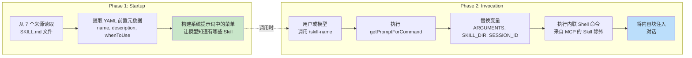
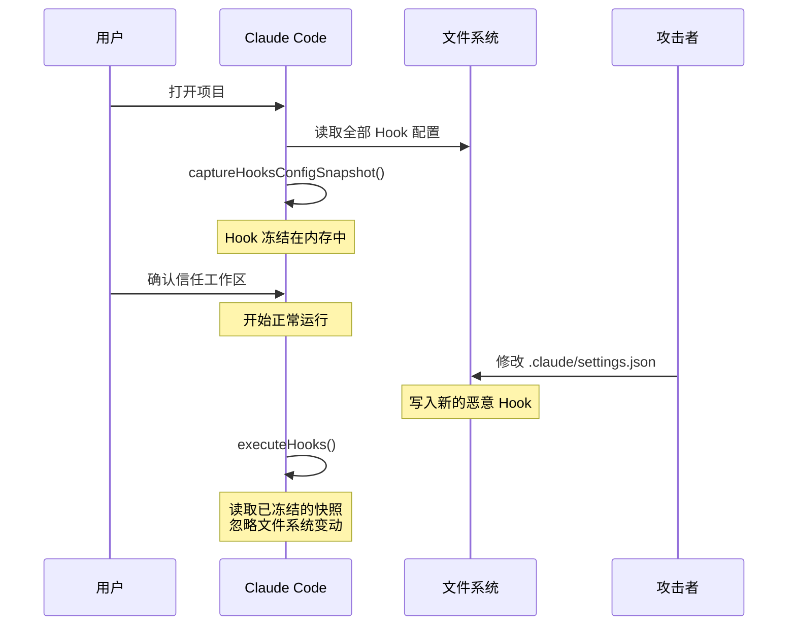
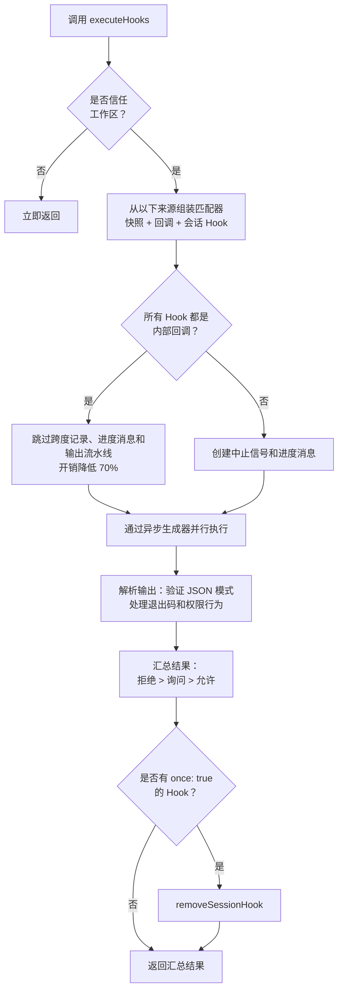

# 第 12 章：可扩展性——Skill 与 Hook

## 扩展的两个维度

每套扩展系统都要回答两个问题：系统能做什么，以及何时执行。多数框架把两者合在一起，让插件在同一个对象中注册能力和生命周期回调。这样一来，“添加功能”和“拦截功能”之间的界线就被单一的注册 API 模糊了。

Claude Code 明确区分了两者。Skill（技能）扩展模型能做的事。它以 Markdown 文件定义，可用作斜杠命令，调用时会向对话注入新指令。Hook（钩子）扩展系统在何时、以何种方式执行操作。它在会话的二十多个生命周期节点拦截操作，可以运行任意代码来阻止操作、修改输入、要求继续执行，或者静默观察。

这种分工是有意设计的。Skill 属于内容，通过添加提示词文本来扩充模型的知识和能力。Hook 属于控制流，可以改变执行路径，同时保持模型已知的信息。例如，Skill 可以教模型执行团队的部署流程，Hook 则可以要求测试套件通过后才允许运行部署命令。前者增加能力，后者施加约束。

本章详细介绍这两套机制，再讨论它们如何结合：Skill 可以声明 Hook，这些 Hook 在该 Skill 被调用时注册为会话级生命周期拦截器。

---

## Skill：为模型增加能力

### 两阶段加载

Skill 系统的主要优化是启动时加载前置元数据（Frontmatter），调用时才加载完整内容。



**阶段 1**读取各个 `SKILL.md` 文件，将 YAML 前置元数据与 Markdown 正文分开，并提取元数据。前置元数据中的字段会成为系统提示词的一部分，让模型知道该 Skill 的存在。Markdown 正文保存在闭包中，留待调用时处理。一个拥有 50 个 Skill 的项目，在启动时只需承担 50 段简短描述的 token 开销。

**阶段 2**在模型或用户调用 Skill 时触发。`getPromptForCommand` 会在开头添加基目录，替换变量（`$ARGUMENTS`、`${CLAUDE_SKILL_DIR}`、`${CLAUDE_SESSION_ID}`），并执行内联 Shell 命令（以 `!` 开头，命令包在反引号中）。返回结果作为内容块注入对话。

### 七个来源及其优先级

Skill 来自七个不同来源，系统并行加载，再按优先级合并：

| 优先级 | 来源 | 位置 | 说明 |
|----------|--------|----------|-------|
| 1 | 托管（策略） | `<MANAGED_PATH>/.claude/skills/` | 由企业控制 |
| 2 | 用户 | `~/.claude/skills/` | 个人配置，所有项目均可使用 |
| 3 | 项目 | `.claude/skills/`（逐级向上查找到主目录） | 纳入版本控制 |
| 4 | 附加目录 | `<add-dir>/.claude/skills/` | 通过 `--add-dir` 选项指定 |
| 5 | 旧版命令 | `.claude/commands/` | 向后兼容 |
| 6 | 内置 | 编译进二进制文件 | 由功能开关控制 |
| 7 | MCP | MCP 服务器提示词 | 来自远端，视为不可信 |

去重时使用 `realpath` 解析符号链接，并处理父目录重叠的情况。先发现的来源优先。`getFileIdentity` 函数通过 `realpath` 获取规范路径，因为 inode 值在容器挂载、NFS 挂载及 ExFAT 上并不可靠。

### 前置元数据约定

以下是控制 Skill 行为的主要前置元数据字段：

| YAML 字段 | 用途 |
|-----------|---------|
| `name` | 向用户显示的名称 |
| `description` | 显示在自动补全和系统提示词中 |
| `when_to_use` | 描述适用场景，供模型发现 Skill |
| `allowed-tools` | 指定 Skill 可以使用的工具 |
| `disable-model-invocation` | 禁止模型自主调用 |
| `context` | 使用 `'fork'` 时以子智能体身份运行 |
| `hooks` | 调用 Skill 时注册的生命周期 Hook |
| `paths` | 控制条件激活的 Glob 模式 |

`context: 'fork'` 让 Skill 作为子智能体（Sub-Agent）运行，并拥有独立的上下文窗口。这样，工作量较大的 Skill 就不会占用主对话的 token 预算。`disable-model-invocation` 和 `user-invocable` 分别控制两种调用途径。将两者都设为 true 会让 Skill 隐藏起来，适用于只提供 Hook 的 Skill。

### MCP 安全边界

变量替换完成后，系统会执行内联 Shell 命令。这条安全边界没有例外：**来自 MCP 的 Skill 一律不执行内联 Shell 命令。** MCP 服务器是外部系统。若允许执行，包含 `` !`rm -rf /` `` 的 MCP 提示词就会以用户的完整权限运行该命令。因此系统只把 MCP Skill 当作内容处理。这条信任边界（Trust Boundary）属于第 15 章讨论的 MCP 安全模型。

### 动态发现

Skill 也可以在启动后发现。模型访问文件时，`discoverSkillDirsForPaths` 从相应路径逐级向上查找 `.claude/skills/` 目录。带有 `paths` 前置元数据的 Skill 会存入 `conditionalSkills` 映射，只有被访问的路径匹配模式时才会激活。例如，声明了 `paths: "packages/database/**"` 的 Skill 会保持隐藏，直到模型读取或编辑数据库文件。系统由此按当前上下文扩展能力。

---

## Hook：控制何时执行操作

Hook 是 Claude Code 在生命周期节点上拦截和修改行为的机制。主执行引擎超过 4,900 行。它服务于三类使用方：个人开发者可以定制静态检查和验证，团队可以将共享的质量检查纳入项目版本控制，企业可以通过策略管理合规规则。

### 实际示例：阻止向 main 直接提交

假设团队希望阻止模型直接向 `main` 分支提交。下面是实现这一规则的 Hook。

**第 1 步：配置 settings.json。**

```json
{
  "hooks": {
    "PreToolUse": [
      {
        "matcher": "Bash",
        "hooks": [
          {
            "type": "command",
            "command": "/path/to/check-not-main.sh",
            "if": "Bash(git commit*)"
          }
        ]
      }
    ]
  }
}
```

**第 2 步：编写 Shell 脚本。**

```bash
#!/bin/bash
BRANCH=$(git rev-parse --abbrev-ref HEAD 2>/dev/null)
if [ "$BRANCH" = "main" ]; then
  echo "Cannot commit directly to main. Create a feature branch first." >&2
  exit 2  # Exit 2 = blocking error
fi
exit 0
```

**第 3 步：观察模型收到的反馈。** 模型尝试在 `main` 分支上执行 `git commit` 时，Hook 会在命令运行前触发。脚本检查分支，向 stderr 写入信息，然后以退出码 2 退出。模型会收到一条系统消息：“不能直接提交到 main。请先创建功能分支。”提交命令被阻止，模型随即创建新分支并在那里提交。

`if: "Bash(git commit*)"` 条件将脚本的执行范围限制在 git commit 命令。退出码 2 阻止执行，退出码 0 放行，其他退出码会产生非阻塞警告。这就是完整的交互协议。

### 四种可由用户配置的类型

Claude Code 定义了六种 Hook，其中四种可由用户配置，另有两种供内部使用。

**命令 Hook（Command Hook）**启动 Shell 进程。Hook 的 JSON 输入经管道传给 stdin，Hook 通过退出码、stdout 和 stderr 返回信息。这是最常用的类型。

**提示词 Hook（Prompt Hook）**发起一次 LLM 调用，返回 `{"ok": true}` 或 `{"ok": false, "reason": "..."}`。它提供轻量级的模型验证，省去完整的智能体循环（Agent Loop）。

**智能体 Hook（Agent Hook）**运行多轮智能体循环，最多 50 轮，权限模式为 `dontAsk`，并关闭思考。每个 Hook 有独立的会话作用域，适合处理“验证测试套件能通过并覆盖新功能”这类较复杂的任务。

**HTTP Hook**通过 POST 将 Hook 输入发往指定 URL，使系统无需启动本地进程就能接入远程策略服务器和审计日志服务。

两种内部类型分别是**回调 Hook（Callback Hook）**和**函数 Hook（Function Hook）**。回调 Hook 通过程序注册，快速路径跳过追踪跨度（Span）的记录，使热路径开销降低 70%。函数 Hook 是会话级 TypeScript 回调，用于强制智能体 Hook 使用结构化输出。

### 最重要的五个生命周期事件

Hook 系统在二十多个生命周期阶段触发。实际使用中最常见的是以下五个：

**PreToolUse** 在每次工具执行前触发。它可以阻止执行、修改输入、自动批准或注入上下文。权限行为遵循严格的优先级：拒绝 > 询问 > 允许。这是实施质量检查最常用的 Hook 节点。

**PostToolUse** 在工具成功执行后触发。它可以注入上下文，也可以完全替换 MCP 工具输出，适合针对工具结果自动提供反馈。

**Stop** 在 Claude 即将结束响应前触发。具有阻塞作用的 Hook 会要求 Claude 继续执行，让系统可以自动验证任务是否确实完成。

**SessionStart** 在会话开始时触发。它可以设置环境变量、覆盖用户的第一条消息或注册要监视的文件路径。会话开始事件不支持阻塞，Hook 无法阻止会话启动。

**UserPromptSubmit** 在用户提交提示词时触发。它可以阻止后续处理，从而在模型看到提示词之前实施输入验证或内容过滤。

**其余事件速查表**

| 类别 | 事件 |
|----------|--------|
| 工具生命周期 | PostToolUseFailure, PermissionDenied, PermissionRequest |
| 会话 | SessionEnd（超时 1.5 秒）, Setup |
| 子智能体 | SubagentStart, SubagentStop |
| 压缩 | PreCompact, PostCompact |
| 通知 | Notification, Elicitation, ElicitationResult |
| 配置 | ConfigChange, InstructionsLoaded, CwdChanged, FileChanged, TaskCreated, TaskCompleted, TeammateIdle |

事件能否阻塞是有意区分的。工具调用和是否停止等尚可改变的决定支持阻塞。会话已经开始或 API 已经出错等既成事实不支持阻塞。

### 退出码语义

命令 Hook 的各个退出码有明确含义：

| 退出码 | 含义 | 是否阻塞 |
|-----------|---------|--------|
| 0 | 成功，stdout 是 JSON 时进行解析 | 否 |
| 2 | 阻塞错误，将 stderr 显示为系统消息 | 是 |
| 其他 | 非阻塞警告，只向用户显示 | 否 |

退出码 2 是有意选择的。退出码 1 太常见，任何未处理的异常、断言失败或语法错误都会产生它。使用退出码 2 可以避免意外阻塞。

### Hook 的六个来源

| 来源 | 信任级别 | 说明 |
|--------|-------------|-------|
| `userSettings` | 用户 | `~/.claude/settings.json`，最高优先级 |
| `projectSettings` | 项目 | `.claude/settings.json`，纳入版本控制 |
| `localSettings` | 本地 | `.claude/settings.local.json`，由 Git 忽略 |
| `policySettings` | 企业 | 无法覆盖 |
| `pluginHook` | 插件 | 优先级 999（最低） |
| `sessionHook` | 会话 | 仅保存在内存中，由 Skill 注册 |

---

## 快照安全模型

Hook 可以执行任意代码。项目的 `.claude/settings.json` 可以定义在每次工具调用前触发的 Hook。如果恶意仓库在用户通过工作区信任确认后修改它的 Hook，会发生什么？

已有 Hook 不受影响。系统在启动时就冻结了 Hook 配置。



`captureHooksConfigSnapshot()` 在启动过程中调用一次。此后 `executeHooks()` 从快照中读取配置，不会隐式重读设置文件。快照仅通过明确的渠道更新，包括 `/hooks` 命令和文件监视器检测到的变动。这两条路径都会通过 `updateHooksConfigSnapshot()` 重建快照。

策略按层级生效。策略设置中的 `disableAllHooks` 清除所有 Hook。`allowManagedHooksOnly` 排除用户和项目 Hook。用户可以设置 `disableAllHooks` 来禁用自己的 Hook，但无法禁用企业托管的 Hook。企业策略始终优先。

信任检查（`shouldSkipHookDueToTrust()`）是在发现两个漏洞之后引入的：用户*拒绝*信任工作区后，SessionEnd Hook 仍会执行，而 SubagentStop Hook 在信任对话框出现前就会触发。两者有同一个根因，即用户尚未同意执行工作区代码，Hook 却已在相应生命周期状态下运行。修复方式是在 `executeHooks()` 入口统一检查信任状态。

---

## 执行流程



内部回调的快速路径是一项重要优化。匹配的 Hook 都是内部回调时，例如文件访问分析和提交归属记录，系统会跳过跨度记录、中止信号创建、进度消息和完整的输出处理流水线。大多数 PostToolUse 调用只会匹配内部回调。

Hook 的 JSON 输入通过惰性执行的 `getJsonInput()` 闭包序列化一次，供所有并行执行的 Hook 复用。环境注入会设置 `CLAUDE_PROJECT_DIR` 和 `CLAUDE_PLUGIN_ROOT`，并针对特定事件设置 `CLAUDE_ENV_FILE`，供 Hook 写入要导出的环境变量。

---

## 集成：Skill 如何结合 Hook

调用 Skill 时，其前置元数据声明的 Hook 会注册为会话级 Hook。该 Hook 的 Shell 命令会通过 `CLAUDE_PLUGIN_ROOT` 获取 `skillRoot`：

```
my-skill/
  SKILL.md          # The skill content
  validate.sh       # Called by a PreToolUse hook declared in frontmatter
```

该 Skill 的前置元数据声明如下：

```yaml
hooks:
  PreToolUse:
    - matcher: "Bash"
      hooks:
        - type: command
          command: "${CLAUDE_PLUGIN_ROOT}/validate.sh"
          once: true
```

用户调用 `/my-skill` 时，系统会将 Skill 内容加载到对话中，同时注册 PreToolUse Hook。下一次 Bash 工具调用会触发 `validate.sh`。由于设置了 `once: true`，该 Hook 会在首次成功执行后自行移除。

对于智能体，前置元数据中声明的 `Stop` Hook 会自动转换成 `SubagentStop` Hook，因为子智能体触发 `SubagentStop` 事件，不触发 `Stop`。如果省去转换，智能体的停止验证 Hook 就不会触发。

### 权限行为优先级

`executePreToolHooks()` 可以阻塞（通过 `blockingError`）、自动批准（通过 `permissionBehavior: 'allow'`）、强制询问（通过 `'ask'`）、拒绝（通过 `'deny'`）、修改输入（通过 `updatedInput`）或添加上下文（通过 `additionalContext`）。多个 Hook 返回不同的权限行为时，拒绝始终优先。这是安全相关决策应有的默认行为。

### 停止 Hook：要求继续执行

停止 Hook（Stop Hook）返回退出码 2 时，stderr 会作为反馈显示给模型，对话则继续。这使一次性的提示与响应变成围绕目标反复执行的循环。停止 Hook 可以说是整套系统中最灵活的集成点。

---

## 实践建议：设计扩展系统

**将内容与控制流分开。** Skill 增加能力，Hook 约束行为。混在一起会让人难以分辨插件究竟执行了哪些操作，又阻止了哪些操作。

**在信任边界冻结配置。** 快照机制在用户同意时捕获 Hook 配置，后续不再隐式重读。系统需要执行用户提供的代码时，这可以消除检查时到使用时（TOCTOU）攻击。

**用不常见的退出码传递具有明确含义的信号。** 任何未处理的错误都可能产生退出码 1，导致难以据此判断是否应阻塞。以退出码 2 表示阻塞，可以避免意外触发。信号应该只能由明确的意图触发。

**在套接字层验证目标。** 服务端请求伪造（SSRF）防护在 DNS 查找时执行，将验证与连接合在一起，从而消除 DNS 重绑定的时间窗口。验证网络目标时，检查必须与建立连接形成原子操作。

**针对常见情形优化。** 内部回调的快速路径将开销降低 70%，依据是大多数 Hook 调用只会命中内部回调。Skill 分两阶段加载，依据是大多数 Skill 在单次会话中不会被调用。两项优化都以实际使用分布为出发点。

这套扩展系统兼顾了能力和安全性。Skill 为模型增加能力，并受 MCP 安全边界约束，详见第 15 章。Hook 让外部代码可以影响模型的动作，并受快照机制、退出码语义和策略层级约束。两套机制各自按自身的信任规则运行，这使它们可以安全地组合并大规模部署。

下一章转向视觉层，介绍 Claude Code 如何以 60 帧每秒渲染响应式终端界面，并处理五种终端协议的输入。
