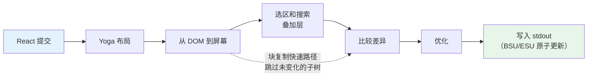
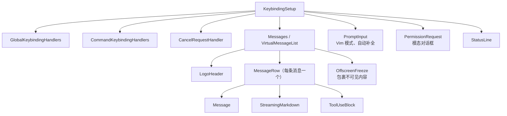

# 第 13 章：终端 UI

## 为什么自建渲染器？

终端没有浏览器提供的 DOM、CSS 引擎、合成器或保留模式图形流水线。它有写入 stdout 的字节流和从 stdin 读入的字节流。在这两股数据流之间，布局、样式、差异比较、命中测试、滚动和选区等机制都要从头实现。

Claude Code 需要响应式 UI，包含提示词输入、流式 Markdown 输出、权限对话框、旋转进度指示器、可滚动的消息列表、搜索高亮和 Vim 模式编辑器。React 很适合声明这样的组件树，但它需要一个用来渲染的宿主环境，而终端本身没有提供。

Ink 是常用方案。它是面向终端的 React 渲染器，用 Yoga 实现 Flexbox 布局。Claude Code 从 Ink 起步，随后大幅改造了自己的分叉版本。原版每帧为每个单元格分配一个 JavaScript 对象。终端为 200×120 时，每 16 毫秒就要创建并回收 24,000 个对象。它按字符串比较差异，以整行的 ANSI 编码文本为单位。它也没有块复制（blit）优化、双缓冲或单元格级脏标记。每秒刷新一次的简单 CLI 仪表盘尚可采用这套方案，但当 LLM 智能体（Agent）以 60 fps 流式显示 token，用户又在浏览数百条消息时，这套方案就无法满足要求。

Claude Code 的自定义渲染引擎沿用了 Ink 的 React 协调器、Yoga 布局和 ANSI 输出，但重写了关键路径。它用紧凑的类型化数组替代单元格对象，通过字符串驻留池复用字符串，结合双缓冲和单元格级差异比较渲染，并用优化器将相邻的终端写入合并为尽量短的转义序列。

这套引擎能在 200 列终端上以 60 fps 渲染 Claude 的流式输出。理解它需要看四个层面：供 React 协调的自定义 DOM、将 DOM 转成终端输出的渲染流水线、让长会话不受垃圾回收拖累的池化内存管理，以及将这些机制组织起来的组件架构。

---

## 自定义 DOM

React 协调器需要一棵可供协调的树。浏览器提供 DOM，Claude Code 的终端则使用自定义内存树，包含七种元素类型和一种文本节点类型。

元素类型直接对应终端渲染中的概念：

- **`ink-root`** 是文档根节点，每个 Ink 实例有一个。
- **`ink-box`** 是 Flexbox 容器，相当于终端里的 `<div>`。
- **`ink-text`** 是文本节点，通过 Yoga 测量函数实现换行。
- **`ink-virtual-text`** 是嵌套在另一文本节点中的带样式文本，处于文本上下文的 `ink-text` 会自动转换为此类型。
- **`ink-link`** 是超链接，通过 OSC 8 转义序列渲染。
- **`ink-progress`** 是进度指示器。
- **`ink-raw-ansi`** 是尺寸已知的预渲染 ANSI 内容，用于带语法高亮的代码块。

每个 `DOMElement` 都携带渲染流水线所需的状态：

```typescript
// Illustrative — actual interface extends this significantly
interface DOMElement {
  yogaNode: YogaNode;           // Flexbox layout node
  style: Styles;                // CSS-like properties mapped to Yoga
  attributes: Map<string, DOMNodeAttribute>;
  childNodes: (DOMElement | TextNode)[];
  dirty: boolean;               // Needs re-rendering
  _eventHandlers: EventHandlerMap; // Separated from attributes
  scrollTop: number;            // Imperative scroll state
  pendingScrollDelta: number;
  stickyScroll: boolean;
  debugOwnerChain?: string;     // React component stack for debug
}
```

`_eventHandlers` 与 `attributes` 特意分开存放。React 中的事件处理函数若未手动做记忆化，每次渲染时标识都可能变化。如果把处理函数存成属性，每次渲染都会把节点标记为脏并触发完整重绘。分开存放后，协调器可通过 `commitUpdate` 更新处理函数，无需把节点标脏。

`markDirty()` 将 DOM 变更传递给渲染流水线。任一节点的内容变化时，`markDirty()` 会沿祖先链向上遍历，对每个元素设置 `dirty = true`，并在叶级文本节点上调用 `yogaNode.markDirty()`。因此，深层文本节点中即使只改了一个字符，也会安排从该节点到根的整条路径重渲染。兄弟子树仍是干净的，可以从上一帧直接复制。

`ink-raw-ansi` 元素值得单独说明。如果代码块已经经过语法高亮，重新解析生成的 ANSI 转义序列来提取字符和样式只会增加开销。`ink-raw-ansi` 会把预先高亮的内容封装起来，用 `rawWidth` 和 `rawHeight` 告诉 Yoga 确切尺寸。渲染流水线直接将原始 ANSI 内容写入输出缓冲区，无需拆成单个带样式字符。首次高亮结束后，此类代码块的渲染开销几乎为零。生成高亮是 UI 中开销最大的视觉操作，写出高亮结果却很便宜。

`ink-text` 的测量函数在 Yoga 的布局阶段运行，整个阶段同步且会阻塞执行。函数接收可用宽度并返回文本尺寸。它按 `wrap` 样式属性执行换行或截断（`wrap`、`truncate`、`truncate-start`、`truncate-middle`），保留字素簇边界，避免把含多个码位的表情符号拆到两行，还要把 CJK 全宽字符计为两列，并从宽度计算中排除无可见宽度的 ANSI 转义序列。每个节点必须在几微秒内完成这些计算，因为 50 个可见文本节点意味着每轮布局会调用 50 次测量函数。

---

## React Fiber 容器

协调桥接层使用 `react-reconciler` 创建自定义宿主配置，React DOM 和 React Native 用的也是这个 API。Claude Code 采用 `ConcurrentRoot` 模式：

```typescript
createContainer(rootNode, ConcurrentRoot, ...)
```

ConcurrentRoot 启用了 React 的并发功能。Suspense 支持懒加载语法高亮，过渡更新在流式输出时避免阻塞。使用 `LegacyRoot` 会强制同步渲染，在 Markdown 重新解析开销较大时阻塞事件循环。

宿主配置的方法将 React 操作映射到自定义 DOM：

- **`createInstance(type, props)`** 通过 `createNode()` 创建 `DOMElement`，应用初始样式和属性，绑定事件处理函数，并记录 React 组件的所有者链以便调试。所有者链存为 `debugOwnerChain`，供 `CLAUDE_CODE_DEBUG_REPAINTS` 模式追踪触发整屏重置的组件。
- **`createTextInstance(text)`** 在文本上下文中创建 `TextNode`。协调器要求用 `<Text>` 包裹原始字符串。尝试在文本上下文之外创建文本节点会抛错，这样协调时就能发现问题。
- **`commitUpdate(node, type, oldProps, newProps)`** 浅比较新旧 props，只应用发生变化的部分。样式、属性和事件处理函数各有更新路径。若没有变化，差异比较函数返回 `undefined`，完全跳过 DOM 变更。
- **`removeChild(parent, child)`** 从树中移除节点，递归释放 Yoga 节点，并通知焦点管理器。释放时先调用 `unsetMeasureFunc()`，再调用 `free()`，避免访问已释放的 WASM 内存。
- **`hideInstance(node)` / `unhideInstance(node)`** 切换 `isHidden`，并在 `Display.None` 与 `Display.Flex` 间切换 Yoga 节点。这是 React 过渡到或离开 Suspense 后备内容的机制。
- **`resetAfterCommit(container)`** 调用 `rootNode.onComputeLayout()` 运行 Yoga，再调用 `rootNode.onRender()` 安排终端绘制。

协调器在每次提交周期跟踪两个性能计数，分别是 Yoga 布局耗时（`lastYogaMs`）和总提交耗时（`lastCommitMs`）。Ink 类通过 `FrameEvent` 上报这些数字，供生产环境监控。

事件系统沿用浏览器的捕获和冒泡模型。`Dispatcher` 类实现完整的事件传播，依次经过捕获（根到目标）、目标阶段和冒泡（目标到根）。事件类型对应 React 的调度优先级。键盘和点击是离散事件，优先级最高，立即处理。滚动和调整大小是连续事件，可以延后。分发器用 `reconciler.discreteUpdates()` 包裹全部事件处理，以便 React 正确批处理。

在终端按键时，产生的 `KeyboardEvent` 经由自定义 DOM 树分发，从焦点元素冒泡到根，与键盘事件在浏览器 DOM 中的传播方式相同。路径上的任一处理函数都能调用 `stopPropagation()` 或 `preventDefault()`，语义与浏览器规范一致。

---

## 渲染流水线

每帧经过七个阶段，各自计时：



各阶段耗时单独记录到 `FrameEvent.phases`。例如一帧耗时 30 毫秒，分阶段计时就能判断瓶颈是 Yoga 重新测量文本（阶段 2）、渲染器遍历大片脏子树（阶段 3），还是终端较慢导致 stdout 出现背压（阶段 7），从而确定应改哪里。

**阶段 1：React 提交和 Yoga 布局。** 协调器处理状态更新并调用 `resetAfterCommit`，把根节点宽度设为 `terminalColumns`，再运行 `yogaNode.calculateLayout()`。Yoga 按 CSS Flexbox 规范一次计算整棵树，确定各节点的伸展、收缩、内边距、外边距、间距、对齐和换行。结果通过 `getComputedWidth()`、`getComputedHeight()`、`getComputedLeft()`、`getComputedTop()` 读取，并按节点缓存。处理 `ink-text` 时，Yoga 在布局阶段调用自定义测量函数 `measureTextNode`，按换行和字素宽度计算文本尺寸。这是每个节点开销最大的操作，要处理 Unicode 字素簇、CJK 全宽字符、表情符号序列以及文本内嵌的 ANSI 转义序列。

**阶段 2：从 DOM 到屏幕。** 渲染器深度优先遍历 DOM，把字符和样式写入 `Screen` 缓冲区。每个字符变成一个紧凑编码的单元格。输出是完整的一帧，终端上的每个单元格都确定了字符、样式和宽度。

**阶段 3：叠加层。** 文本选区和搜索高亮直接修改屏幕缓冲区，切换对应单元格的样式 ID。选区用反显实现常见的文本高亮效果。搜索高亮更明显，当前匹配项用反显、黄色前景、粗体和下划线，其余匹配项只用反显。缓冲区被叠加层改写后，`prevFrameContaminated` 会记录这一状态，让下一帧跳过块复制快速路径。直接修改缓冲区可省去独立的叠加层缓冲区，在 200×120 终端上节省 48 KB。代价是清除叠加层后，有一帧需要按全屏脏区处理。

**阶段 4：比较差异。** 将新屏幕与前台帧逐单元格比较，只有发生变化的单元格才产生输出。每个单元格只需比较两个打包后的 `Int32` 字。差异比较仅遍历脏区矩形。若稳定状态下只有旋转指示器在动，24,000 个单元格中可能只有 3 个产生补丁。每个补丁都是 `{ type: 'stdout', content: string }` 对象，包含光标移动序列和 ANSI 编码的单元格内容。

**阶段 5：优化。** 同一行中相邻的补丁合并为一次写入。多余的光标移动也会被去掉。例如补丁 N 写到第 10 列、补丁 N+1 从第 11 列开始时，光标已在正确位置。`StylePool.transition()` 的缓存预先序列化样式转换，从“粗体红字”切换到“暗绿文字”只需查找缓存字符串，省去比较差异和序列化。相比逐单元格直接输出，优化器通常能减少 30% 至 50% 的字节。

**阶段 6：写入。** 优化后的补丁序列化为 ANSI 转义序列，通过一次 `write()` 写入 stdout。支持同步更新的终端还会在输出两端加上 BSU/ESU 标记。BSU（开始同步更新，`ESC [ ? 2026 h`）让终端缓冲后续输出，ESU（`ESC [ ? 2026 l`）让终端一次性显示缓冲内容。在支持该协议的终端上，整帧以原子方式呈现，避免可见撕裂。

每帧通过 `FrameEvent` 对象上报各阶段耗时：

```typescript
interface FrameEvent {
  durationMs: number;
  phases: {
    renderer: number;    // DOM-to-screen
    diff: number;        // Screen comparison
    optimize: number;    // Patch merging
    write: number;       // stdout write
    yoga: number;        // Layout computation
  };
  yogaVisited: number;   // Nodes traversed
  yogaMeasured: number;  // Nodes that ran measure()
  yogaCacheHits: number; // Nodes with cached layout
  flickers: FlickerEvent[];  // Full-reset attributions
}
```

启用 `CLAUDE_CODE_DEBUG_REPAINTS` 后，`findOwnerChainAtRow()` 会追踪导致整屏重置的 React 组件。它相当于终端版本的 React DevTools 的“高亮更新”，可以显示哪个组件触发了渲染流水线中开销最大的操作，即整屏重绘。

如果节点未标脏，且节点缓存表明位置与上一帧相同，渲染器会直接从 `prevScreen` 向当前屏幕复制单元格，省去重新渲染整个子树。稳定状态下，若只有旋转指示器在动，块复制能处理屏幕的 99%，只需从头渲染指示器的 3 到 4 个单元格。

以下三种情况会禁用块复制：

1. **`prevFrameContaminated` 为 true。** 选区叠加层或搜索高亮直接改写了前台帧的屏幕缓冲区，这些单元格已不能作为准确的上一帧状态。
2. **某个绝对定位节点被移除。** 它可能覆盖非兄弟节点的单元格，因此必须由实际拥有这些单元格的元素重新渲染。
3. **布局位置发生变化。** 某节点的缓存位置与当前计算位置不同，块复制会把单元格写到错误坐标。

脏区矩形（`screen.damage`）是渲染期间所有写入单元格的包围盒。差异比较仅检查矩形涵盖的行，完全跳过未变化区域。若 120 行终端中的流式消息占据第 80 到 100 行，差异比较只检查 20 行，比较工作量降为六分之一。

---

## 双缓冲渲染与帧调度

Ink 类维护两个帧缓冲区：

```typescript
private frontFrame: Frame;  // Currently displayed on terminal
private backFrame: Frame;   // Being rendered into
```

每个 `Frame` 包含：

- `screen: Screen`，即单元格缓冲区，采用紧凑编码的 `Int32Array`。
- `viewport: Size`，即渲染时的终端尺寸。
- `cursor: { x, y, visible }`，即终端光标停留的位置和可见状态。
- `scrollHint`，即备用屏幕模式下的 DECSTBM（滚动区域）优化提示。
- `scrollDrainPending`，即 ScrollBox 是否还有滚动增量等待处理。

每次渲染后，两个帧互换：`backFrame = frontFrame; frontFrame = newFrame`。原前台帧成为下一次使用的后台帧，既提供块复制所用的 `prevScreen`，也作为逐单元格差异比较的基准。

双缓冲省去了逐帧分配。渲染器复用后台帧的缓冲区，无需每帧创建新 `Screen`。交换两个帧只需赋值指针。在图形编程中，这种做法让显示端读取完整帧的同时，渲染端写入另一帧，以防撕裂。终端的撕裂由 BSU/ESU 协议处理，这里主要是避免每 16 毫秒分配又丢弃装有 48 KB 以上类型化数组的 `Screen` 对象，减轻垃圾回收压力。

渲染调度用 lodash 的 `throttle` 以 16 毫秒为间隔节流（约 60 fps），同时启用首沿和尾沿：

```typescript
const deferredRender = () => queueMicrotask(this.onRender);
this.scheduleRender = throttle(deferredRender, FRAME_INTERVAL_MS, {
  leading: true,
  trailing: true,
});
```

`resetAfterCommit` 在 React 的布局副作用阶段前运行。如果在此处同步渲染，就会漏掉 `useLayoutEffect` 中设置的光标声明。微任务在布局副作用之后、同一轮事件循环内执行，终端因此只看到一帧一致的画面。

滚动操作另设 4 毫秒（FRAME_INTERVAL_MS >> 2）的 `setTimeout`，加快滚动帧而不影响节流。滚动操作绕过 React。`ScrollBox.scrollBy()` 直接修改 DOM 节点属性，调用 `markDirty()`，再通过微任务安排渲染。一次滚轮事件无需更新 React 状态、经过协调，或重新渲染整条消息列表。

**大小变化**采用同步处理，不做防抖。终端调整大小时，`handleResize` 立即更新尺寸，让布局保持一致。在备用屏幕模式下，它重置帧缓冲区，并把 `ERASE_SCREEN` 推迟到下一次 BSU/ESU 原子绘制中。如果立即清屏，屏幕会在大约 80 毫秒的渲染过程中空白。延迟到原子绘制中，旧内容会保留到新帧完全准备好。

**备用屏幕管理**由 `AlternateScreen` 组件处理。挂载时进入 DEC 1049 备用屏幕缓冲区，并将高度限制为终端的行数。组件选择 `useInsertionEffect`，因为 `useLayoutEffect` 执行得更晚。这能确保 `ENTER_ALT_SCREEN` 转义序列在第一帧渲染前到达终端。如果使用 `useLayoutEffect`，第一帧就会渲染到主屏幕缓冲区，切换前会明显闪一下。`useInsertionEffect` 在布局副作用和浏览器或终端绘制之前运行，可以平滑地完成切换。

---

## 池化内存管理：为什么要用驻留池？

200 列、120 行的终端有 24,000 个单元格。如果每个单元格都是一个带 `char`、`style` 和 `hyperlink` 字符串的 JavaScript 对象，每帧就要分配 72,000 个字符串和 24,000 个单元格对象。按 60 fps 计算，每秒共分配 576 万次。V8 的垃圾回收器能处理这个规模，但停顿可能导致掉帧。垃圾回收通常只暂停 1 至 5 毫秒，但时机不可预测，可能恰好遇到流式 token 更新，在用户盯着输出时产生可见卡顿。

Claude Code 使用紧凑的类型化数组和三个驻留池，让单元格缓冲区无需逐帧分配对象。分配只发生在池本身和差异比较产生的补丁字符串中。前者的开销可以摊销，因为大多数字符和样式在第一帧就已驻留，后续帧可以复用。后者无法省去，因为 stdout.write 接收字符串或 Buffer 参数。

**单元格布局**用两个 `Int32` 字表示一个单元格，存入连续的 `Int32Array`：

```
word0: charId        (32 bits, index into CharPool)
word1: styleId[31:17] | hyperlinkId[16:2] | width[1:0]
```

同一个缓冲区还有一个并行的 `BigInt64Array` 视图，支持批量操作。例如清空一行时，可对 64 位字调用一次 `fill()`，无需单独清零各字段。

**CharPool** 将字符字符串驻留为整数 ID。ASCII 有快速路径，用一个 128 项的 `Int32Array` 将字符编码直接映射到池索引，省去 `Map` 查询。表情符号或 CJK 表意文字等多字节字符则交给 `Map<string, number>`。索引 0 始终为空格，索引 1 始终为空字符串。

```typescript
export class CharPool {
  private strings: string[] = [' ', '']
  private ascii: Int32Array = initCharAscii()

  intern(char: string): number {
    if (char.length === 1) {
      const code = char.charCodeAt(0)
      if (code < 128) {
        const cached = this.ascii[code]!
        if (cached !== -1) return cached
        const index = this.strings.length
        this.strings.push(char)
        this.ascii[code] = index
        return index
      }
    }
    // Map fallback for multi-byte characters
    ...
  }
}
```

**StylePool** 将 ANSI 样式代码数组驻留为整数 ID。每个 ID 的第 0 位表示样式是否对空格有可见影响，例如背景色、反显或下划线。仅修改前景的样式使用偶数 ID，在空格上可见的样式使用奇数 ID。渲染器只用一次位掩码检查 `if (!(styleId & 1) && charId === 0) continue` 就能跳过不可见空格，无需查询样式定义。池也会缓存任意两个样式 ID 之间预先序列化的 ANSI 转换字符串。从“粗体红字”切换到“暗绿文字”时直接拼接缓存字符串，省去比较差异和序列化。

**HyperlinkPool** 驻留 OSC 8 超链接的 URI。索引 0 表示没有超链接。

前台帧和后台帧共享这三个池，因此驻留 ID 跨帧有效。块复制可以直接将打包的单元格字从 `prevScreen` 复制到当前屏幕，无需重新驻留。差异比较只需比较整数 ID，无需查询字符串。如果每帧都有自己的池，块复制就得为每个单元格按旧 ID 找到字符串，再到新池中重新驻留，抵消大部分性能收益。

池每隔 5 分钟重置，避免长会话中无限增长。迁移过程会把前台帧仍在使用的单元格重新驻留到新池中。

**CellWidth** 用 2 位区分普通和双宽字符的单元格类型：

| 值 | 含义 |
|-------|---------|
| 0 (Narrow) | 占一列的普通字符 |
| 1 (Wide) | CJK 字符或表情符号的首单元格，占两列 |
| 2 (SpacerTail) | 双宽字符的第二列 |
| 3 (SpacerHead) | 软换行续行标记 |

这个值存入 `word1` 的最低两位。常见情况下，检查打包单元格的宽度无需额外提取字段。

其余元数据放在与单元格并行的数组中：

- **`noSelect: Uint8Array`** 是单元格标志，标记哪些内容不参与文本选择，例如复制文本时不应带出的边框和指示器。
- **`softWrap: Int32Array`** 是每行的标记，表示文本在此处软换行并接续。用户跨软换行选择文本时，选区逻辑知道不用在换行处插入换行符。
- **`damage: Rectangle`** 是当前帧所有写入单元格的包围盒。差异比较只检查该矩形涵盖的行，跳过完全未变化的区域。

把这类信息放在并行结构中，可以在保留选区、复制和优化所需元数据的同时，避免扩大单元格编码，减轻差异比较内层循环的缓存压力。

`Screen` 还提供接收尺寸和池引用的工厂函数 `createScreen()`。创建屏幕时，对 `BigInt64Array` 视图调用 `fill(0n)`，将 `Int32Array` 清零。一次原生调用就能在几微秒内清空整个缓冲区。调整终端大小需要新帧缓冲区时，以及迁移池、将旧屏幕单元格重新驻留到新池时，都会用到这一机制。

---

## REPL 组件

REPL（`REPL.tsx`）约有 5,000 行，是代码库里最大的单个组件。它负责组织整个交互流程，各个环节都经过它。

组件大致分为九部分：

1. **导入**（约 100 行）。引入启动状态、命令、历史记录、Hook、组件、按键绑定、费用跟踪、通知、智能体团队协作和语音集成。
2. **按功能开关导入。** 通过 `feature()` 和 `require()` 有条件地加载语音集成、主动模式、Brief 工具和协调者智能体。
3. **状态管理。** 大量调用 `useState`，管理消息、输入模式、待确认权限、对话框、费用阈值，以及会话、工具和智能体的状态。
4. **QueryGuard。** 管理正在运行的 API 调用的生命周期，防止并发请求互相干扰。
5. **消息处理。** 处理查询循环发来的消息，统一消息顺序并管理流式状态。
6. **工具权限流程。** 协调工具调用块与 PermissionRequest 对话框之间的权限请求。
7. **会话管理。** 恢复、切换和导出对话。
8. **配置按键绑定。** 接入 `KeybindingSetup`、`GlobalKeybindingHandlers` 和 `CommandKeybindingHandlers`。
9. **渲染树。** 将上述各部分合成最终 UI。

全屏模式下，渲染树组成完整界面：



`OffscreenFreeze` 是针对终端渲染的性能优化。消息滚出视口上方后，组件缓存它的 React 元素并冻结子树，防止屏幕外消息中由计时器驱动的更新（如旋转指示器、已用时间计数器）触发终端重置。否则，就算用户正在看第 47 条消息，第 3 条消息里的旋转指示器也可能引发整屏重绘。

整个组件由 React Compiler 编译。编译器通过槽位数组为每个表达式加入记忆化处理，省去手动编写 `useMemo` 和 `useCallback`：

```typescript
const $ = _c(14);  // 14 memoization slots
let t0;
if ($[0] !== dep1 || $[1] !== dep2) {
  t0 = expensiveComputation(dep1, dep2);
  $[0] = dep1; $[1] = dep2; $[2] = t0;
} else {
  t0 = $[2];
}
```

这种模式遍布代码库的组件。与在 Hook 层级做记忆化的 `useMemo` 相比，它的粒度更细，渲染函数内的单个表达式各自跟踪依赖并缓存结果。对于 REPL 这样有 5,000 行的组件，这能在每次渲染中省去数百次可能不必要的重复计算。

---

## 文本选择和搜索高亮

文本选区和搜索高亮以叠加层形式写入屏幕缓冲区，时机在主体渲染之后、差异比较之前。

**文本选择**只在备用屏幕模式下可用。Ink 实例用 `SelectionState` 跟踪锚点和焦点、拖选模式（字符、单词或行），以及已滚出屏幕但被记录下来的行。用户点击并拖动时，选区处理器更新这些坐标。运行 `onRender` 时，`applySelectionOverlay` 遍历受影响的行，调用 `StylePool.withSelectionBg()` 取得加入反显效果的新样式 ID，并直接更新单元格。由于叠加层改写了前台帧的缓冲区，`prevFrameContaminated` 会让下一帧停止使用该缓冲区做块复制，改为对全屏脏区进行差异比较。

鼠标跟踪使用 SGR 1003 模式，按列和行汇报点击、拖动和移动的位置。`App` 组件检测连续点击：双击选择单词，三击选择整行。连续点击的超时为 500 毫秒，位置容差为一个单元格。两次点击之间即使鼠标移动了一个单元格，计数也不会重置。超链接的打开操作也会延迟到这一时限结束，从而让双击链接选择单词，符合用户在文本编辑器里的预期。

系统还会处理丢失鼠标释放事件的情况，例如用户在终端里开始拖动，将鼠标移到窗口外再松开。终端报告按下和拖动，却收不到发生在窗口外的释放事件。缺少恢复机制时，选区会一直卡在拖动模式。恢复机制检查没有按键按下的鼠标移动事件。如果正在拖选时收到这类事件，就推断鼠标已在窗口外松开并结束选区操作。

**搜索高亮**由两套机制并行处理。扫描路径（`applySearchHighlight`）遍历可见单元格，查找查询字符串并应用 SGR 反显样式。按位置处理的路径使用 `scanElementSubtree()` 预计算的 `MatchPosition[]`，位置相对于消息存储。它按已知偏移应用当前匹配项的黄色高亮，叠加反显、黄色前景、粗体和下划线。终端反显时会交换前景和背景，所以黄色前景加上反显就成了黄色背景。对于黄色与现有背景颜色相冲的主题，下划线提供后备的可见标记。

**光标声明**解决的是输入法定位。终端模拟器在实际光标处呈现输入法（IME）的预编辑文本。CJK 用户组字时，需要让光标位于文本输入框的插入点，而终端通常把光标留在屏幕底部。`useDeclaredCursor` Hook 让组件声明每帧完成后光标的位置。Ink 类从 `nodeCache` 读出声明节点的位置，转换为屏幕坐标，并在差异输出后发出光标移动序列。屏幕阅读器和放大工具也会跟踪实际光标，因此这一机制既改善 CJK 输入，也有利于无障碍使用。

在主屏幕模式下，声明的光标位置与 `frame.cursor` 分开跟踪。后者必须保持在内容末尾，才能维持日志更新对相对光标移动的约束。备用屏幕模式下，每帧都以 `CSI H`（光标归位）开始，声明的光标位置只需在帧末尾以绝对坐标输出。

---

## 流式 Markdown

渲染 LLM 输出是终端 UI 负担最重的任务。token 逐个到达，每秒 10 至 50 个。每个 token 都会改变消息内容，其中可能包含代码块、列表、粗体或行内代码。如果每到一个 token 就重新解析整条消息，消息一长，开销就难以承受。

Claude Code 使用三项优化：

**词法单元缓存。** 模块级 LRU 缓存有 500 个条目，以内容哈希为键保存 `marked.lexer()` 的结果。虚拟滚动中 React 组件卸载后再挂载，缓存仍然有效。用户滚回曾经可见的消息时，系统直接使用缓存的 Markdown 词法单元。

**快速路径检测。** `hasMarkdownSyntax()` 用一个正则表达式检查前 500 个字符有没有 Markdown 标记。如果没有，就直接构建一个段落词法单元，跳过完整的 GFM 解析器。纯文本消息每帧约能省 3 毫秒，对于每秒 60 帧的渲染来说相当可观。

**延迟加载语法高亮。** 代码块高亮通过 React `Suspense` 加载。`MarkdownBody` 先以 `highlight={null}` 作为后备立即渲染，再异步取得 cli-highlight 实例。用户立即看到没有样式的代码，一两帧之后才显示颜色。

模型流式输出时，Markdown 内容随 token 逐步增长。每个 token 到达就重解析全部内容，在整条消息上会产生 O(n²) 的开销。快速路径检测能让多为纯文本段落的流式内容跳过解析。对于含代码块和列表的消息，主要优化来自 LRU 缓存。缓存键是内容哈希。如果 10 个 token 到达后只有最后一段改变，系统就会复用未变前缀的缓存解析结果，只重新解析有变化的尾部。

`StreamingMarkdown` 组件区别于静态的 `Markdown`，它需要处理仍在生成的内容，例如代码围栏不完整（有开头的 ` ``` ` 却没有结尾）、粗体标记只出现一部分，或列表条目被截断。流式版本的解析更宽容，语法未闭合时不会报错，因为结束标记可能还没到。消息流式输出完成后，组件切换到静态 `Markdown` 渲染器，按完整 GFM 规则解析并严格检查语法。

代码块语法高亮是渲染流水线中单个元素耗时最长的操作。用 cli-highlight 高亮 100 行代码可能需要 50 至 100 毫秒。加载高亮库本身需要 200 至 300 毫秒，因为它打包了数十种语言的语法定义。React `Suspense` 将两项开销隐藏在异步更新中。代码块先以纯文本显示，高亮库异步加载完成后再以彩色重渲染。用户能立刻看到代码，片刻后看到颜色，避免等库加载时出现 300 毫秒的空白画面。

---

## 如何高效渲染流式输出

终端渲染流水线主要通过省去不必要的工作来提高性能。它遵循三个原则：

**让重复值驻留。** 样式、字符或 URL 等值可能在数千个单元格中出现，存一次并用整数 ID 引用即可。整数比较只需一条 CPU 指令，字符串比较需要循环。每秒 60 帧、每帧执行 24,000 次内层循环时，对整数做 `===` 比较还是对字符串做 `===` 比较，会直接影响滚动能否保持流畅。

**选择合适的比较粒度。** 逐单元格比较每帧涉及 24,000 个单元格，看起来开销很大，但每个单元格只需比较两个打包的整数字。稳定状态下，多数行只检查第一个单元格就会跳过。若改为重新渲染整屏并写入 stdout，每帧可能产生超过 100 KB 的 ANSI 转义序列。差异比较通常只产生不到 1 KB 的输出。

**让高频路径绕开 React。** 滚动事件的频率与鼠标输入相同，可能每秒数百次。每次交给 React 协调器，需要经历状态更新、协调、提交、布局和渲染，增加 5 至 10 毫秒延迟。直接修改 DOM 节点，并通过微任务调度渲染，让滚动路径保持在 1 毫秒以内。React 只参与最终绘制。

这些原则也适用于其他流式输出系统，例如渲染实时数据的网页日志查看器、聊天客户端和监控仪表盘。可以把重复值存入驻留池、与上一帧比较差异，让高频路径绕开响应式框架。

长会话还有第四个原则：**定期清理。** 每当新字符和样式驻留时，Claude Code 的池会只增不减。会话持续数小时后，池可能积累数千个没有任何活动单元格引用的条目。五分钟的重置周期限制了增长。每五分钟创建一组新池，把前台帧的单元格迁移过去，重新驻留，再让旧池进入垃圾回收。这是应用层的分代回收，因为 JavaScript 垃圾回收器无法判断池条目在应用语义上是否仍在使用。

`Int32Array` 还有垃圾回收之外的优势，即内存局部性。比较 24,000 个单元格时，差异比较遍历连续的类型化数组。现代 CPU 会为顺序内存访问预取数据，因此整屏比较可以在 L1/L2 缓存中完成。每个单元格独立分配对象，会把对象分散到堆中，导致每次比较都可能发生缓存未命中。在 200×120 的屏幕上，类型化数组的差异比较不到 0.5 毫秒，等价的对象方案需要 3 至 5 毫秒。加上流水线的其他阶段，这足以超出 16 毫秒的帧预算。

第五个原则适用于所有渲染到固定大小网格的系统：**记录脏区边界。** 每个屏幕的 `damage` 矩形记录渲染时写入的单元格的包围盒，差异比较跳过矩形之外的行。流式消息占据 120 行终端的最下面 20 行时，只需比较这 20 行。块复制也会配合这项优化，只有重新渲染的区域计入脏区，复制过来的区域无需计入。常见情况下只有一条消息流式更新，其余对话保持静止，所以只需接触屏幕缓冲区的一小部分。

渲染性能主要来自省去整类操作。块复制省去重新渲染，脏区矩形省去部分差异比较，共享池省去重新驻留，紧凑编码的单元格省去逐个分配。这些优化叠加，进一步放大收益。

在 200×120 的终端上，最坏情况的一帧耗时约 12 毫秒，此时所有节点都标脏，不能块复制，脏区为全屏。最好的情况不到 1 毫秒，此时只有一个脏节点、脏区矩形仅三行，其余全部块复制。大部分时间接近后者。一个流式 token 到达后，会将一个文本节点标脏，再沿祖先链标记到消息容器，通常涉及屏幕的 10 至 30 行。余下 90 至 110 行由块复制处理。脏区矩形将差异比较限制在改动区域，查池则只需执行整数操作。在稳定的流式输出中，主要耗时是 Yoga 布局重新测量脏文本节点及其祖先，还有 Markdown 的重新解析，渲染流水线本身开销较小。


---
