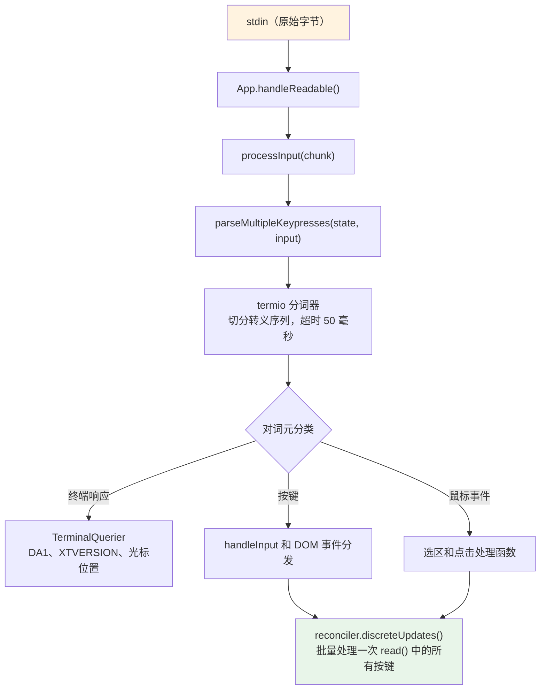
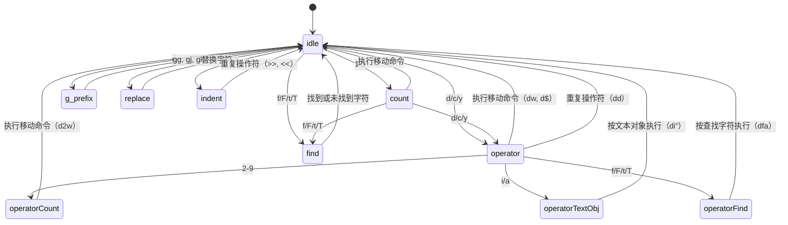

# 第 14 章：输入与交互

## 从原始字节到应用动作

在 Claude Code 中先按 Ctrl+X，再按 Ctrl+K，终端会发送两段字节序列，间隔可能约为 200 毫秒。第一段是 `0x18`（ASCII CAN），第二段是 `0x0B`（ASCII VT）。它们本身只表示控制字符。输入系统必须识别出，在超时窗口内先后到达的这两个字节构成组合键序列 `ctrl+x ctrl+k`，对应 `chat:killAgents` 动作，用于终止所有正在运行的子智能体（Sub-Agent）。

从原始字节到终止智能体（Agent），共有六套机制参与。分词器切分转义序列，解析器按五种终端协议对它们分类，键位绑定解析器在当前上下文的绑定中查找匹配项，组合键状态机（State Machine）管理多次按键，处理函数执行动作，最后 React 将相关状态更新合并到一次渲染中。

真正的难点来自终端之间的差异及其各种组合。iTerm2 发送 Kitty 键盘协议序列，macOS Terminal 发送旧式 VT220 序列，通过 SSH 使用 Ghostty 时会发送 xterm modifyOtherKeys 序列。根据配置，tmux 可能吞掉、转换或透传任一种序列。Windows Terminal 的 VT 模式也有自己的特点。输入系统必须从所有这些输入中生成正确的 `ParsedKey` 对象，使用户无需了解终端采用的是哪一种键盘协议。

本章追踪在这些不同环境下，系统如何从原始字节得到有意义的动作。

设计理念是渐进增强和优雅降级。现代终端支持 Kitty 键盘协议时，Claude Code 可以完整识别修饰键（区分 Ctrl+Shift+A 和 Ctrl+A）、接收 Super 键信息（用于 Cmd 快捷键），并无歧义地识别按键。通过 SSH 使用旧式终端时，它会退回到当前可用的最佳协议，虽然某些修饰键无法区分，核心功能仍然可用。用户不会看到终端不受支持的报错。全局搜索的 `ctrl+shift+f` 可能不可用，但搜索历史记录的 `ctrl+r` 在任何终端上都能使用。

---

## 按键解析流水线

输入以字节块的形式从 stdin 到达，流水线分阶段处理：



分词器（Tokenizer）是这条流水线的基础。终端输入是混合了可打印字符、控制码和多字节转义序列的字节流，没有显式的分帧边界。一次从 stdin 发起的 `read()` 可能读到完整的 `\x1b[1;5A`（Ctrl+向上箭头），也可能第一次只读到 `\x1b`，下一次才读到 `[1;5A`，这取决于字节从 PTY 到达的速度。分词器维护一个状态机，缓存不完整的转义序列，并在序列完整后发出词元。

处理不完整序列是一个基本问题。分词器看到单独的 `\x1b` 时，无法知道它代表 Escape 键还是 CSI 序列的开头。它先缓存这个字节，再启动 50 毫秒计时器。如果没有后续字节到达，就清空缓冲区，将 `\x1b` 作为一次 Escape 按键处理。但在清空之前，分词器会检查 `stdin.readableLength`。如果内核缓冲区中还有字节等待读取，分词器会重启计时器，暂不清空缓冲区。这样，即使事件循环被阻塞超过 50 毫秒，已进入缓冲但还未读取的后续字节也能得到处理。

粘贴操作的超时时间延长到 500 毫秒。粘贴的文本可能很长，并分多个字节块到达。

一次 `read()` 解析出的所有按键都在同一次 `reconciler.discreteUpdates()` 调用中处理。React 状态更新因此得以合并，粘贴 100 个字符只需重新渲染一次。批处理很重要，否则每个字符都会触发完整的协调周期，包括状态更新、协调、提交、Yoga 布局、渲染、差异比较和写入。每个周期耗时 5 毫秒时，粘贴 100 个字符要处理 500 毫秒。合并后，同样的粘贴只需要一个 5 毫秒周期。

### stdin 管理

`App` 组件通过引用计数管理原始模式（Raw Mode）。提示词输入框、对话框或 Vim 模式等组件需要原始输入时，会调用 `setRawMode(true)`，将计数加一。不再需要时调用 `setRawMode(false)`，将计数减一。只有计数降为零，原始模式才会关闭。这样可以防止终端应用中的一种常见错误：组件 A 和组件 B 都启用了原始模式，随后组件 A 关闭它，导致全局原始模式被关闭，组件 B 也无法正常接收输入。

首次启用原始模式时，App 会依次执行以下操作：

1. 停止早期输入捕获，即在 React 挂载之前收集按键的启动机制
2. 将 stdin 置于原始模式，关闭行缓冲、回显和信号处理
3. 添加 `readable` 监听器，异步处理输入
4. 启用括号粘贴（Bracketed Paste），以便识别粘贴的文本
5. 启用焦点报告，让应用知道终端窗口何时获得或失去焦点
6. 启用扩展按键报告，包括 Kitty 键盘协议和 xterm modifyOtherKeys

关闭原始模式时，系统会按相反的顺序撤销这些操作。操作顺序可以防止转义序列漏入后续输入。先关闭扩展按键报告，再关闭原始模式，可以确保应用停止解析之后，终端不会继续发送 Kitty 编码的序列。

通过 `signal-exit` 包安装的 `onExit` 信号处理函数，确保进程意外终止时也会清理。收到 SIGTERM 或 SIGINT 后，它会在进程退出前关闭原始模式、恢复终端状态、退出正在使用的备用屏幕并重新显示光标。如果没有这一步，崩溃的 Claude Code 会话可能使终端留在没有光标、没有回显的原始模式下，用户只能盲打 `reset` 来恢复终端。

---

## 多协议支持

不同终端使用不同的键盘输入编码。Kitty 等现代终端模拟器发送包含完整修饰键信息的结构化序列。通过 SSH 使用的旧式终端会发送有歧义的字节序列，必须结合上下文解释。由于用户可能使用其中任何一种终端，Claude Code 的解析器可以同时处理五种不同的协议。

**CSI u（Kitty 键盘协议）**是现代标准，格式为 `ESC [ codepoint [; modifier] u`。例如，`ESC[13;2u` 表示 Shift+Enter，`ESC[27u` 表示未加修饰键的 Escape。码点可以唯一确定按键，区分作为按键的 Escape 和作为序列前缀的 Escape。修饰键字段用各个位分别编码 Shift、Alt、Ctrl 和 Super（Cmd）。Claude Code 在启动时通过 `ENABLE_KITTY_KEYBOARD` 转义序列为支持的终端启用协议，退出时通过 `DISABLE_KITTY_KEYBOARD` 关闭。协议检测采用查询和响应握手。应用发送 `CSI ? u`，终端以 `CSI ? flags u` 响应，其中 `flags` 表示支持的协议级别。

**xterm modifyOtherKeys** 用于通过 SSH 使用 Ghostty 等未协商 Kitty 协议的情形，格式为 `ESC [ 27 ; modifier ; keycode ~`。其参数顺序与 CSI u 相反，修饰键在前，按键码在后。这是解析器容易出错的地方。协议通过 `CSI > 4 ; 2 m` 启用。未检测到终端的 TERM 标识时，Ghostty、tmux 和 xterm 会发出这种序列。SSH 不转发 `TERM_PROGRAM` 时就常出现这种情况。

**旧式终端序列**涵盖了其他按键，包括采用 `ESC O` 和 `ESC [` 序列的功能键、方向键、数字小键盘、Home/End/Insert/Delete，以及终端演进 40 年积累下来的各种 VT100、VT220 和 xterm 变体。解析器用两个正则表达式匹配这些序列。`FN_KEY_RE` 匹配 `ESC O/N/[/[[` 前缀模式，用于识别功能键、方向键及其修饰键变体。`META_KEY_CODE_RE` 匹配 Meta 键码，即 `ESC` 后接单个字母或数字，这是传统的 Alt+按键编码。

旧式序列的难点在于歧义。`ESC [ 1 ; 2 R` 可以表示 Shift+F3，也可以表示光标位置报告，取决于上下文。解析器通过检查私有标记来消除歧义。光标位置报告使用带 `?` 私有标记的 `CSI ? row ; col R`，带修饰键的功能键使用没有该标记的 `CSI params R`。因此 Claude Code 请求的是 DECXCPR（扩展光标位置报告），它的格式可以唯一识别。

终端识别增加了一层复杂性。Claude Code 启动时会发送 `XTVERSION` 查询（`CSI > 0 q`），获取终端的名称和版本。响应（`DCS > | name ST`）可以通过 SSH 连接传递，而环境变量 `TERM_PROGRAM` 不会经由 SSH 传播。知道终端标识后，解析器就能处理特定终端的差异。例如，VS Code 内置终端使用的 xterm.js 与原生 xterm 对转义序列的处理不同。解析器可以根据标识字符串（`xterm.js(X.Y.Z)`）处理这些差异。

**SGR 鼠标事件**采用 `ESC [ < button ; col ; row M/m` 格式，其中 `M` 表示按下，`m` 表示释放。按键码对操作进行编码，0/1/2 对应左键、中键和右键点击，64/65 对应滚轮向上或向下（0x40 与滚轮位按位或），32 及以上表示拖动（0x20 与移动位按位或）。滚轮事件转换为 `ParsedKey` 对象，交由键位绑定系统处理。点击和拖动事件则成为 `ParsedMouse` 对象，送往选区处理函数。

**括号粘贴**用 `ESC [200~` 和 `ESC [201~` 标记包住粘贴的内容。无论其中包含何种转义序列，标记之间的所有内容都会成为一个带 `isPasted: true` 的 `ParsedKey`。这样可以防止把粘贴的代码解释成命令。例如，用户粘贴包含 `\x03` 的代码片段时，这个原始字节就不会被当成 Ctrl+C。

解析器的输出类型构成一个清晰的可辨识联合类型：

```typescript
type ParsedKey = {
  kind: 'key';
  name: string;        // 'return', 'escape', 'a', 'f1', etc.
  ctrl: boolean; meta: boolean; shift: boolean;
  option: boolean; super: boolean;
  sequence: string;    // Raw escape sequence for debugging
  isPasted: boolean;   // Inside bracketed paste
}

type ParsedMouse = {
  kind: 'mouse';
  button: number;      // SGR button code
  action: 'press' | 'release';
  col: number; row: number;  // 1-indexed terminal coordinates
}

type ParsedResponse = {
  kind: 'response';
  response: TerminalResponse;  // Routed to TerminalQuerier
}
```

`kind` 判别字段确保下游代码显式处理每种输入类型。按键不会被误当成鼠标事件，终端响应也不会被误认为按键。`ParsedKey` 还携带原始 `sequence` 字符串，供调试使用。用户报告“按 Ctrl+Shift+A 没反应”时，调试日志能显示终端发送的确切字节序列，从而定位问题出在终端编码、解析器识别，还是键位绑定配置。

`ParsedKey` 的 `isPasted` 标志对安全至关重要。启用括号粘贴后，终端用标记序列包裹粘贴内容。解析器将生成的按键事件标为 `isPasted: true`，键位绑定解析器会跳过这些事件。如果没有这个标志，粘贴包含 `\x03`（Ctrl+C 的原始字节）或转义序列的文本可能触发应用命令。有了这个标志，无论粘贴内容含有哪些字节，都作为原样文本输入处理。

解析器还会识别终端响应，也就是终端对查询返回的序列。其中包括设备属性（DA1、DA2）、光标位置报告、Kitty 键盘标志响应、XTVERSION（终端标识）和 DECRPM（模式状态）。这些响应会直接交给 `TerminalQuerier`：

```typescript
type TerminalResponse =
  | { type: 'decrpm'; mode: number; status: number }
  | { type: 'da1'; params: number[] }
  | { type: 'da2'; params: number[] }
  | { type: 'kittyKeyboard'; flags: number }
  | { type: 'cursorPosition'; row: number; col: number }
  | { type: 'osc'; code: number; data: string }
  | { type: 'xtversion'; version: string }
```

**修饰键解码**遵循 XTerm 约定，其字段值为 `1 + (shift ? 1 : 0) + (alt ? 2 : 0) + (ctrl ? 4 : 0) + (super ? 8 : 0)`。`ParsedKey` 中的 `meta` 字段对应 Alt/Option（位值 2），`super` 字段另行表示（位值 8，在 macOS 上对应 Cmd）。这种区分很重要，因为 Cmd 快捷键由操作系统保留，终端应用通常无法捕获。采用 Kitty 协议的终端可以报告带 Super 修饰键的按键，这些按键在其他协议中会被静默吞掉。

stdin 输入间隔检测器会在一次间隔之后连续 5 秒没有输入时重新设置终端模式。这涵盖重新连接 tmux 和笔记本电脑从休眠中唤醒的情形，此时终端键盘模式可能已被多路复用器或操作系统重置。重新设置会再次发送 `ENABLE_KITTY_KEYBOARD`、`ENABLE_MODIFY_OTHER_KEYS`、括号粘贴和焦点报告序列。如果没有这一步，从 tmux 会话断开后重新连接，键盘协议会悄悄退回旧式模式，本次会话剩余时间将无法正确识别修饰键。

### 终端 I/O 层

解析器下面是位于 `ink/termio/` 的结构化终端 I/O 子系统：

- **csi.ts** 提供 CSI（控制序列引导符）序列，用于移动光标、擦除、设置滚动区域，以及启停括号粘贴、焦点事件和 Kitty 键盘协议
- **dec.ts** 提供 DEC 私有模式序列，用于备用屏幕缓冲区（1049）、鼠标跟踪模式（1000/1002/1003）、光标可见性、括号粘贴（2004）和焦点事件（1004）
- **osc.ts** 提供 OSC（操作系统命令），用于访问剪贴板（OSC 52）、标签页状态、iTerm2 进度指示和 tmux/screen 多路复用器封装（通过 DCS 透传跨越多路复用器边界的序列）
- **sgr.ts** 提供 SGR（选择图形呈现）序列，即 ANSI 样式代码体系，包括颜色、粗体、斜体、下划线和反显
- **tokenize.ts** 提供有状态分词器，用来检测转义序列的边界

Claude Code 在 tmux 中运行时，某些转义序列需要透传到外层终端，例如 Kitty 键盘协议协商。tmux 使用 DCS 透传（`ESC P ... ST`）转发它无法识别的序列。`osc.ts` 中的 `wrapForMultiplexer` 函数检测多路复用器环境，并封装相应序列。否则 Kitty 键盘模式会在 tmux 中静默失效，用户也无法知道 Ctrl+Shift 绑定为何突然用不了。

### 事件系统

`ink/events/` 目录实现了与浏览器兼容的事件系统，有七种事件类型，包括 `KeyboardEvent`、`ClickEvent`、`FocusEvent`、`InputEvent`、`TerminalFocusEvent` 和基础类型 `TerminalEvent`。每种事件都带有 `target`、`currentTarget` 和 `eventPhase`，并支持 `stopPropagation()`、`stopImmediatePropagation()` 和 `preventDefault()`。

包装 `ParsedKey` 的 `InputEvent` 用于向后兼容旧的 `EventEmitter` 路径，较早的组件可能仍在使用它。新组件使用 DOM 风格的键盘事件分发，包括捕获和冒泡阶段。两条路径源自同一个已解析的按键，因此总能保持一致。stdin 上的每次按键只生成一个 `ParsedKey`，再由它派生一个 `InputEvent`（供旧监听器使用）和一个 `KeyboardEvent`（供 DOM 风格的分发使用）。通过这种双路径设计，系统可以从 EventEmitter 模式逐步迁移到 DOM 事件模式，同时保持现有组件可用。

---

## 键位绑定系统

键位绑定系统区分了三个经常混在一起的问题。绑定定义哪个键触发哪个动作，处理函数定义动作触发后的行为，上下文决定当前有哪些绑定生效。

### 绑定：声明式配置

默认绑定在 `defaultBindings.ts` 中定义为 `KeybindingBlock` 对象数组，每个对象限定在一个上下文内：

```typescript
export const DEFAULT_BINDINGS: KeybindingBlock[] = [
  {
    context: 'Global',
    bindings: {
      'ctrl+c': 'app:interrupt',
      'ctrl+d': 'app:exit',
      'ctrl+l': 'app:redraw',
      'ctrl+r': 'history:search',
    },
  },
  {
    context: 'Chat',
    bindings: {
      'escape': 'chat:cancel',
      'ctrl+x ctrl+k': 'chat:killAgents',
      'enter': 'chat:submit',
      'up': 'history:previous',
      'ctrl+x ctrl+e': 'chat:externalEditor',
    },
  },
  // ... 14 more contexts
]
```

平台专属绑定在定义时确定。粘贴图像在 macOS/Linux 上使用 `ctrl+v`，Windows 上使用 `alt+v`，因为 `ctrl+v` 是系统粘贴快捷键。支持 VT 模式的终端使用 `shift+tab` 切换模式，不支持时，Windows Terminal 使用 `meta+m`。快速搜索、语音模式和终端面板等受功能开关控制的绑定，会按条件加入。

用户可以通过 `~/.claude/keybindings.json` 覆盖任何绑定。解析器接受修饰键别名（`ctrl`/`control`、`alt`/`opt`/`option`、`cmd`/`command`/`super`/`win`）、按键别名（`esc` → `escape`，`return` → `enter`）、组合键序列写法（例如以空格分隔的 `ctrl+k ctrl+s`），以及用于解除默认绑定的空动作。将动作显式设为空值会阻止默认绑定触发，用户就能将该键留给终端使用。省略绑定则会沿用默认值。

### 上下文：16 个活动作用域

每个上下文代表一种交互模式，该模式有一组对应的绑定：

| 上下文 | 生效条件 |
|---------|------------|
| Global | 始终生效 |
| Chat | 提示词输入框有焦点 |
| Autocomplete | 补全菜单可见 |
| Confirmation | 正在显示权限对话框 |
| Scroll | 备用屏幕中有可滚动内容 |
| Transcript | 正在查看只读会话记录 |
| HistorySearch | 正在反向搜索历史记录（ctrl+r） |
| Task | 后台任务正在运行 |
| Help | 正在显示帮助浮层 |
| MessageSelector | 正在显示回退对话框 |
| MessageActions | 正在用光标浏览消息 |
| DiffDialog | 正在查看差异 |
| Select | 正在显示通用选择列表 |
| Settings | 正在显示配置面板 |
| Tabs | 正在切换标签页 |
| Footer | 正在显示页脚指示信息 |

收到按键时，解析器根据 React 组件状态确定当前生效的上下文，构造列表，保留优先级顺序去重，再查找匹配的绑定。最后一个匹配项生效，因此用户覆盖项会优先于默认值。每次按键都会重建上下文列表。这个操作只涉及拼接数组并对最多 16 个字符串去重，开销很小，因此上下文变动会立即生效，也无需订阅或监听机制。

这套设计还能处理嵌套模态界面。任务运行时弹出权限对话框，`Confirmation` 和 `Task` 可能同时生效。`Confirmation` 在组件树中注册得更晚，因此优先。此时 `y` 会触发“批准”。对话框关闭后，`Confirmation` 失效，`Task` 绑定恢复。这个叠加行为由上下文列表的优先级自然产生，无需专门的模态界面处理代码。

### 保留快捷键

系统将受限制的快捷键分为三级：

**不可重新绑定**（行为硬编码）：`ctrl+c`（中断或退出）、`ctrl+d`（退出）、`ctrl+m`（在所有终端中都与 Enter 相同，重新绑定会破坏 Enter 的功能）。

**终端保留**（警告）：`ctrl+z`（SIGTSTP）、`ctrl+\`（SIGQUIT）。技术上可以绑定，但在大多数配置中，终端会在这些键到达应用之前截获它们。

**macOS 保留**（报错）：`cmd+c`、`cmd+v`、`cmd+x`、`cmd+q`、`cmd+w`、`cmd+tab`、`cmd+space`。操作系统会在这些键到达终端之前截获它们，因此对应的绑定永远无法触发。

### 解析流程

收到按键后，解析流程如下：

1. 将组件注册的活跃上下文与 Global 合并成列表，去重并保留优先级顺序
2. 针对合并后的绑定表调用 `resolveKeyWithChordState(input, key, contexts)`
3. 返回 `match` 时，清除待完成的组合键序列，调用处理函数，再对事件调用 `stopImmediatePropagation()`
4. 返回 `chord_started` 时，保存待完成序列中已有的按键，停止传播，再启动组合键计时器
5. 返回 `chord_cancelled` 时，清除待完成的组合键序列，让事件继续交给其他处理函数
6. 返回 `unbound` 时，清除组合键状态。用户把动作设为 `null`，属于显式解除绑定，因此停止传播，也不运行任何处理函数
7. 返回 `none` 时，交给其他处理函数继续处理

按最后一个匹配项生效的策略，如果默认绑定和用户绑定都在 `Chat` 上下文中定义了 `ctrl+k`，则用户的绑定优先。系统在匹配时按定义顺序遍历绑定，并保留最后一个匹配项。这样可以自然地组合各上下文的覆盖设置。用户可单独覆盖 `Chat` 中的 `enter`，而不影响 `Confirmation` 中的 `enter`。

---

## 组合键序列

`ctrl+x ctrl+k` 是一个组合键序列，两次按键共同触发一个动作。解析器用状态机来管理这个过程。

收到按键时：

1. 解析器将该按键追加到任何待完成的组合键前缀
2. 检查是否有绑定的组合键序列以该前缀开头。如果有，返回 `chord_started` 并保存已收到的按键
3. 如果完整的组合键序列与某个绑定完全匹配，返回 `match` 并清除待完成状态
4. 如果组合键前缀没有匹配项，返回 `chord_cancelled`

等待后续按键时，`ChordInterceptor` 组件拦截所有输入。超时为 1000 毫秒。如果第二次按键未在一秒内到达，就取消组合键序列并丢弃第一键。`KeybindingContext` 通过 `pendingChordRef` 提供对待完成状态的同步访问，避免因 React 状态更新延迟，在第一键的状态尚未更新时就处理第二键。

组合键序列避免覆盖 readline 编辑键。如果没有这种序列，“终止智能体”可能绑定到 `ctrl+k`，但用户通常期望它在终端文本输入中保持 readline 的“删除至行尾”功能。采用 `ctrl+x` 作为前缀符合 readline 自身的组合键约定，也为绑定提供了一组不与单键编辑快捷键冲突的序列。

这套实现处理了一个容易忽略的边缘情况。用户按下 `ctrl+x` 后又输入了一个不属于任何组合键序列的字符，如果处理不当，拦截器会先消耗输入，随后取消序列，导致字符丢失。Claude Code 的 `ChordInterceptor` 此时返回 `chord_cancelled`，丢弃待完成的前缀，却让不匹配的字符继续进入常规输入处理。这符合用户对 Emacs 风格组合键前缀的预期。

---

## Vim 模式

### 状态机

Vim 实现采用纯状态机和穷尽类型检查。类型本身就说明了状态机的结构：

```typescript
export type VimState =
  | { mode: 'INSERT'; insertedText: string }
  | { mode: 'NORMAL'; command: CommandState }

export type CommandState =
  | { type: 'idle' }
  | { type: 'count'; digits: string }
  | { type: 'operator'; op: Operator; count: number }
  | { type: 'operatorCount'; op: Operator; count: number; digits: string }
  | { type: 'operatorFind'; op: Operator; count: number; find: FindType }
  | { type: 'operatorTextObj'; op: Operator; count: number; scope: TextObjScope }
  | { type: 'find'; find: FindType; count: number }
  | { type: 'g'; count: number }
  | { type: 'operatorG'; op: Operator; count: number }
  | { type: 'replace'; count: number }
  | { type: 'indent'; dir: '>' | '<'; count: number }
```

这是一个包含 12 种变体的可辨识联合类型。TypeScript 的穷尽检查确保针对 `CommandState.type` 的每条 `switch` 语句都处理全部 12 种情况。向联合类型添加新状态会使所有处理不完整的 switch 产生编译错误。类型系统可以防止状态机出现死状态或缺失转换。

每种状态只携带下一次转换所需的数据。`operator` 状态记录操作符（`op`）和前置计数。`operatorCount` 状态增加用于累积数字的 `digits`。`operatorTextObj` 状态增加范围（`inner` 或 `around`）。这样可以防止处理函数读取上一条命令留下的过期数据。`find` 状态拥有 `FindType` 和 `count` 字段。此时没有待处理的操作符，因此类型也不提供操作符字段，从而无法表示这种非法状态。

状态图展示了转换过程：



在 `idle` 状态按 `d` 会进入 `operator` 状态。在 `operator` 状态按 `w` 会按 `w` 移动命令执行 `delete`。再按一次 `d`（`dd`）则会删除整行。按 `2` 会进入 `operatorCount`，这样 `d2w` 就表示“删除接下来的两个词”。按 `i` 会进入 `operatorTextObj`，这样 `di"` 就表示“删除引号内的内容”。每个中间状态都恰好携带下一次转换所需的上下文。

### 用纯函数表达状态转换

`transition()` 函数根据当前状态类型分派到 10 个处理函数之一。每个处理函数都返回一个 `TransitionResult`：

```typescript
type TransitionResult = {
  next?: CommandState;    // New state (omitted = stay in current)
  execute?: () => void;   // Side effect (omitted = no action yet)
}
```

处理函数以返回值描述副作用，实际执行由调用方决定。给定一个状态和一个按键，纯函数 `transition()` 返回下一状态，并可选地返回一个负责执行动作的闭包。测试因此很简单：输入状态和按键，断言返回的状态即可，闭包可以忽略。转换函数也不依赖编辑器状态、光标位置或缓冲区内容。这些信息在创建闭包时由闭包捕获，状态机在转换时无需读取。

入口是 `fromIdle` 处理函数，覆盖完整的 Vim 命令集：

- **计数前缀**：`1-9` 进入 `count` 状态，累积数字。`0` 比较特殊，已积累数字时才作为计数的一部分，否则表示“移到行首”
- **操作符**：`d`、`c`、`y` 进入 `operator` 状态，等待移动命令或文本对象指定范围
- **查找**：`f`、`F`、`t`、`T` 进入 `find` 状态，等待要查找的字符
- **G 前缀**：`g` 进入 `g` 状态，以处理复合命令（`gg`、`gj`、`gk`）
- **替换**：`r` 进入 `replace` 状态，等待替换字符
- **缩进**：`>`、`<` 进入 `indent` 状态，用于处理 `>>` 和 `<<`
- **简单移动命令**：`h/j/k/l/w/b/e/W/B/E/0/^/$` 立即执行并移动光标
- **立即执行的命令**：`x`（删除字符）、`~`（切换大小写）、`J`（合并行）、`p/P`（粘贴）、`D/C/Y`（操作符快捷命令）、`G`（跳到末尾）、`.`（点号重复）、`;/,`（重复查找）、`u`（撤销）、`i/I/a/A/o/O`（进入插入模式）

### 移动命令、操作符和文本对象

**移动命令（Motion）**是将按键映射到光标位置的纯函数。`resolveMotion(key, cursor, count)` 重复执行移动命令 `count` 次，光标不再移动时会提前结束。例如，光标已经在第 0 列就无法继续左移。这个提前结束行为对行尾执行 `3w` 也很重要。命令会在最后一个词处停下，避免折到下一行或报错。

移动命令按与操作符配合时确定范围的方式分类：

- **不含终点**（默认）：目标位置上的字符不在范围内。`dw` 删除从当前位置开始、到下一个词首字符之前的内容
- **包含终点**（`e`、`E`、`$`）：目标位置上的字符也在范围内。`de` 删除到当前词的最后一个字符，包含该字符
- **按整行**（`j`、`k`、`G`、`gg`、`gj`、`gk`）：配合操作符时，范围扩展到整行。`dj` 会删除当前行和下一行的全部内容

**操作符（Operator）**作用于指定范围。`delete` 删除文本并保存到寄存器。`change` 删除文本并进入插入模式。`yank` 复制文本到寄存器，保留原文。`cw` 和 `cW` 的特殊处理遵循 Vim 约定。修改词的范围只到当前词末尾，而 `dw` 的范围会延伸至下一个词的开头。

一个特殊情况是 `[Image #N]` 图像占位标记的边界吸附。图像引用在终端中渲染成一个视觉单元。如果按词移动时光标落在标记内部，操作范围会扩展到整个标记。移动系统将它视为一个完整的词，用户无法只删除半个 `[Image #3]`。

此外还有一系列常用的 Vim 命令：`x`（删除字符）、`r`（替换字符）、`~`（切换大小写）、`J`（合并行）、`p`/`P`（按整行或字符粘贴）、`>>` / `<<`（以两个空格为一级缩进或减少缩进）、`o`/`O`（在下方或上方新建一行并进入插入模式）。

**文本对象（Text Object）**在光标周围查找边界，确定光标位于哪一段内容中。

词对象（`iw`、`aw`、`iW`、`aW`）把文本切分成字素，将每个字素分为词内字符、空白或标点，再将选区扩展到词的边界。`i`（内部）变体只选中词本身。`a`（周围）变体还包含相邻的空白，优先选中尾随空白，位于行尾时改选前导空白。大写变体（`W`、`aW`）把任何连续的非空白字符视为一个词，忽略标点边界。

引号对象（`i"`、`a"`、`i'`、`a'`、`` i` ``、`` a` ``）在当前行查找成对的引号。引号按顺序配对，第一个与第二个为一对，第三个与第四个为下一对，依此类推。如果光标位于第一和第二个引号之间，就匹配第一对。`a` 变体包括引号本身，`i` 变体只包括引号内部的内容。

括号对象（`ib`/`i(`、`ab`/`a(`、`i[`/`a[`、`iB`/`i{`/`aB`/`a{`、`i<`/`a<`）通过跟踪嵌套深度查找配对的分隔符。它们从光标向外搜索，维护嵌套计数，直到在深度为零时找到匹配的一对。这样就能正确处理嵌套括号。例如，在 `foo((bar))` 中执行 `d i (` 只删除 `bar`，保留所处的内层括号 `(bar)` 中的两个括号字符。

### 跨命令状态与点号重复

Vim 模式维护跨命令保留的 `PersistentState`。正是这种记忆功能让操作体验接近 Vim：

```typescript
interface PersistentState {
  lastChange: RecordedChange;   // For dot-repeat
  lastFind: { type: FindType; char: string };  // For ; and ,
  register: string;             // Yank buffer
  registerIsLinewise: boolean;  // Paste behavior flag
}
```

每条修改文本的命令都会将自身记录为一个 `RecordedChange`。这是可辨识联合类型，覆盖插入、操作符与移动命令、操作符与文本对象、操作符与查找、替换、删除字符、切换大小写、缩进、新建行以及合并行。`.` 命令重放所保留状态中的 `lastChange`，用记录的计数、操作符和移动命令在当前光标位置重现相同的编辑。

重复查找（`;` 和 `,`）使用 `lastFind`。`;` 沿原方向重复上次查找。`,` 会反转方向，`f` 变为 `F`，`t` 变为 `T`，反之亦然。执行 `fa`（向前找下一个 'a'）后，`;` 会继续向前找下一个 'a'，`,` 则向后找上一个 'a'。用户无需记住先前的搜索方向。

寄存器保存复制和删除的文本。内容以 `\n` 结尾时，就标为按整行处理，从而改变粘贴行为：`p` 在当前行下方插入，`P` 在上方插入。用户一般察觉不到这种区分，但 Vim 用户常用的“删除一行，再把它粘贴到其他位置”依赖这一行为。

---

## 虚拟滚动

长时间运行的 Claude Code 会话会产生很长的对话。一次复杂的调试可能生成 200 多条消息，每条都有 Markdown、代码块、工具调用结果和权限记录。若不使用虚拟化，React 就得在内存中维护 200 多棵组件子树，每棵都有自己的状态、副作用和记忆化缓存。DOM 树会包含成千上万个节点，Yoga 每帧布局时都要遍历它们，终端将难以使用。

`VirtualMessageList` 组件只渲染视口内可见的消息，以及上下各一小段缓冲范围。在有数百条消息的对话里，原本可能要挂载 500 棵 React 子树，每棵都要处理 Markdown 解析、语法高亮和工具调用块。使用虚拟化后只需挂载 15 棵。

该组件维护以下数据和接口：

- **高度缓存**，逐条消息记录，终端列数变化时失效
- **跳转接口**，供会话记录搜索使用，可跳到指定索引、下一处或上一处匹配项
- **搜索文本提取**，支持预热缓存，用户输入 `/` 时预先将所有消息转为小写
- **提示词吸顶跟踪**，用户滚动离开输入区时，将最后一条提示词显示在顶部以提供上下文
- **消息操作导航**，通过光标选中消息，供回退功能使用

`useVirtualScroll` Hook（钩子）根据 `scrollTop`、`viewportHeight` 和消息累计高度计算要挂载哪些消息。它在 `ScrollBox` 上维护滚动位置的限制范围，避免一连串 `scrollTo` 调用赶在 React 异步重新渲染之前把位置推得太远，出现空白屏幕。这是虚拟化列表中的典型问题，滚动位置的更新可能比 DOM 更新更快。

虚拟滚动还会用到 Markdown 词元缓存。消息滚出视口时，其 React 子树会卸载，用户滚回时又会重新挂载。如果没有缓存，每次滚经消息都要重新解析 Markdown。模块级 LRU 缓存最多容纳 500 项，以内容哈希为键。不论组件挂载和卸载多少次，同一消息内容只需调用一次开销较大的 `marked.lexer()`。

`ScrollBox` 组件自身通过 `useImperativeHandle` 提供命令式 API：

- `scrollTo(y)` 按绝对位置滚动，退出粘底滚动模式
- `scrollBy(dy)` 将增量累积到 `pendingScrollDelta` 中，由渲染器按限速逐步消费
- `scrollToElement(el, offset)` 通过 `scrollAnchor` 将位置读取推迟到渲染时
- `scrollToBottom()` 重新启用粘底滚动模式
- `setClampBounds(min, max)` 限制虚拟滚动窗口的范围

所有滚动修改都会直接写入 DOM 节点属性，并通过微任务调度渲染，绕过 React 协调器。`markScrollActivity()` 通知后台周期性任务（如旋转动画和计时器）跳过下一次 tick，减少滚动期间对事件循环的争用。这是一种协作式调度。滚动路径表明自己正在处理对延迟敏感的操作，请求后台任务让出执行时间。后台周期性任务在调度下一次 tick 前检查这一标志，发现正在滚动时便推迟一帧。即使后台运行着多个动画和计时器，滚动也能保持流畅。

---

## 实践建议：构建感知上下文的键位绑定系统

Claude Code 的键位绑定架构可供各种具有模态输入的应用借鉴，例如编辑器、IDE、绘图工具和终端多路复用器。主要原则如下。

**将绑定和处理函数分开。** 绑定是数据，描述按键对应的动作名称。处理函数是代码，决定触发动作后执行什么。两者分开后，绑定可以序列化为 JSON 供用户定制，处理函数则保留在持有相关状态的组件中。用户可以把 `ctrl+k` 重新绑定到 `chat:submit`，无需修改组件代码。

**将上下文作为一等概念。** 定义由应用状态启用或停用的上下文，可以让各项绑定按当前的交互状态生效。对话框打开时，`Confirmation` 上下文激活，其绑定优先于 `Chat`。对话框关闭后，`Chat` 的绑定恢复。这样就不用在各事件处理函数里散布 `if (dialogOpen && key === 'y')` 之类的条件判断。

**显式建模组合键状态。** 多次按键组成的序列有自己的超时和取消规则，因此需要状态机。用专门的 `ChordInterceptor` 组件和 `pendingChordRef` 显式表达这一状态，可以防止第二次按键到达时 React 的更新尚未传播，导致该键被另一处理函数消费。

**尽早检查保留键，并给出明确警告。** 在定义时就识别无法重新绑定的键，例如系统快捷键和终端控制字符。用户尝试绑定 `ctrl+c` 时，加载配置阶段就应显示错误，避免静默接受永远不会触发的绑定。这样也能避免用户对这种行为提交难以诊断的错误报告。

**在设计中考虑终端差异。** Claude Code 在绑定定义中提供平台专属的替代键。根据操作系统，粘贴图像用 `ctrl+v` 或 `alt+v`。根据是否支持 VT 模式，切换模式用 `shift+tab` 或 `meta+m`。无论按下哪个键，各动作调用的处理函数都一样。测试只需为每个动作覆盖一条代码路径。遇到新的终端差异，例如 Node 24.2.0 之前 Windows Terminal 不支持 VT 模式，只需在绑定定义中加入一个条件，无需在处理代码各处添加 `if (platform === 'windows')` 检查。

**允许显式解除绑定。** 把动作设为空值的机制很小，却很重要。在终端多路复用器中运行 Claude Code 时，用户可能发现 `ctrl+t`（切换待办事项显示）与多路复用器的标签页切换快捷键冲突。在 keybindings.json 中添加 `{ "ctrl+t": null }` 可以彻底禁用这项绑定，按键就会传给多路复用器。没有这种机制，用户只能将 `ctrl+t` 改绑到自己并不需要的动作，或重新配置多路复用器。

Vim 模式实现还提供了另一条经验：**用类型系统约束状态机**。包含 12 种变体的 `CommandState` 联合类型可以防止 switch 语句漏掉某个状态。`TransitionResult` 类型把状态变化和副作用分开，使状态机可以像纯函数一样测试。应用有模态输入时，可以用可辨识联合类型表达各个模式，让编译器检查分支是否穷尽。花在定义类型上的时间，能通过减少运行时错误收回来。

设想一种使用可变状态和命令式条件的 Vim 实现。`fromOperator` 处理函数会堆满 `if (mode === 'operator' && pendingCount !== null && isDigit(key))` 检查，各分支都会修改共享变量。加入新状态，例如宏录制模式时，需要审核每个分支，确保都处理这个状态。使用可辨识联合类型时，编译器负责这项审核。添加新变体的 PR 要等每个 switch 都处理了它之后才能构建成功。

Claude Code 的输入系统在分词器、解析器、键位绑定解析器和 Vim 状态机各层都尽早将无结构输入转换成具有明确类型且覆盖所有分支的结构。在解析器边界，原始字节成为 `ParsedKey`。到绑定边界，`ParsedKey` 成为动作名称。到组件边界，动作名称对应一个有类型的处理函数。每次转换都缩小可能的状态范围，TypeScript 类型系统负责强制落实。按键到达应用逻辑时，类型已经排除了按键未定义、修饰键组合不可能成立等情况，歧义就此消除。

这两章描述的是同一套设计思路。第 13 章展示渲染系统如何消除不必要的工作，包括块传输未变化区域、驻留重复值、逐单元格比较和跟踪损伤范围。第 14 章展示输入系统如何消除歧义，包括把五种协议解析为统一类型、按上下文查找绑定，以及用穷尽联合类型表达模态状态。渲染系统解决每秒 60 次绘制 24,000 个单元格的问题。输入系统解决如何在各不相同的终端环境中将字节流变为应用动作。两者遵循同一条原则：把复杂性放在边界处理，下游只需要接收结构清晰、类型明确且范围受限的数据。边界代码负责把多种终端行为转换成应用可以一致处理的形式。

---

## 小结：两个系统共有的设计原则

第 13 章和第 14 章分别介绍了终端界面的输出和输入。两个系统各有侧重，却遵循相同的架构原则。

**驻留与间接引用。** 渲染系统把字符、样式和超链接驻留在各自的池中，在热路径上用整数比较代替字符串比较。输入系统在解析器边界把转义序列驻留为结构化的 `ParsedKey` 对象，在整个处理函数路径上用有类型的字段访问代替字节级模式匹配。

**分层消除多余工作。** 渲染系统叠加了五项优化：脏标记、块传输、损伤矩形、单元格级差异比较和补丁优化。每项各自消除一类多余计算。输入系统叠加了分词器、协议解析器和键位绑定解析器三层，各自消除一类歧义。

**纯函数与有类型的状态机。** Vim 模式是带有类型化转换的纯状态机。键位绑定解析器是从按键、上下文和组合键状态得到解析结果的纯函数。渲染流水线也是一个纯函数，以 DOM 树和上一屏幕为输入，返回新屏幕和补丁。写入 stdout、向 React 分发事件等副作用都在边界发生。

**在不同环境下平滑降级。** 渲染系统会根据终端大小、备用屏幕支持和同步更新协议可用性调整。输入系统会适配 Kitty 键盘协议、xterm modifyOtherKeys、旧式 VT 序列和多路复用器透传要求。两套系统都可以在不同终端运行，并能利用功能更丰富的终端提升体验。

这些原则适用于所有需要在多种运行时（Runtime）环境中处理高频输入、提供低延迟输出的系统。终端的约束格外明显，违背这些原则时会立刻表现为丢帧、按键被吞掉或屏幕闪烁。因此，终端是理解这些原则的好例子。

下一章从界面层转入协议层，介绍 Claude Code 如何实现 MCP。这个通用工具协议使外部服务可以作为一等工具使用。终端界面负责用户体验的最后一段，将数据结构变成屏幕上的像素，将按键变成应用动作。MCP 则负责扩展能力的起点，发现、连接并执行智能体自身代码库之外的工具。位于两者之间的记忆系统（第 11 章）与 Skill 和 Hook 系统（第 12 章）提供智能和控制能力。整个系统的质量上限取决于这四个方面。模型再智能也无法弥补界面卡顿，渲染再快也无法弥补模型用不到所需工具的问题。
