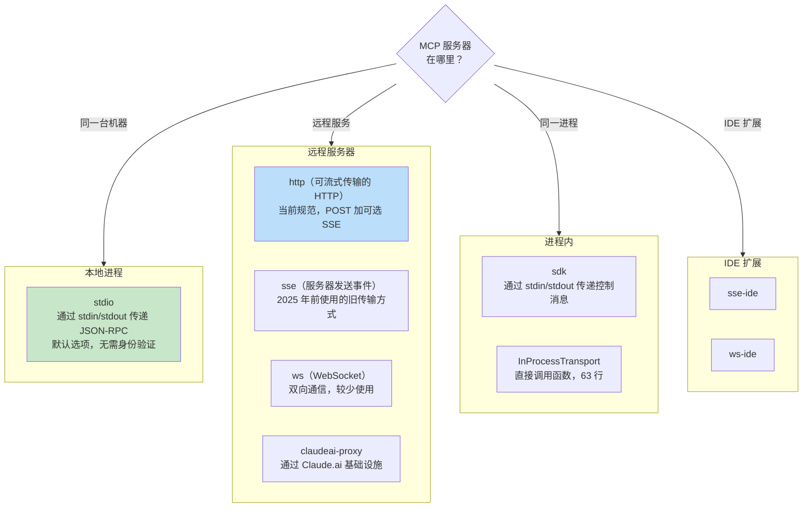
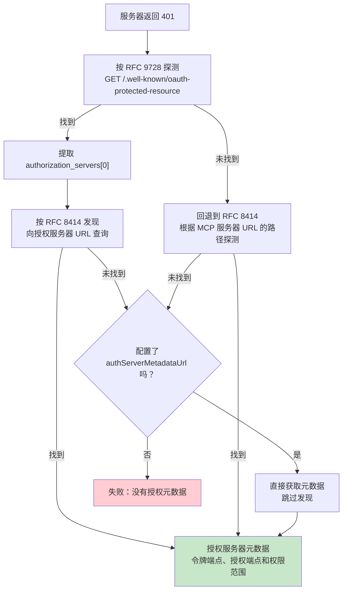

# 第 15 章：MCP，通用工具协议

## 为什么 Claude Code 之外也需要关注 MCP

本书其他章节都在讲 Claude Code 的内部实现。这一章关注的是模型上下文协议（Model Context Protocol，MCP）。这是一项开放规范，任何智能体（Agent）都可以实现，Claude Code 的 MCP 子系统是目前功能最完整的生产级客户端之一。如果你正在构建一个需要调用外部工具的智能体，无论使用哪种语言或模型，本章介绍的模式都可以直接借鉴。

MCP 的核心很简单。它用 JSON-RPC 2.0 定义客户端（智能体）和服务器（工具提供方）之间发现和调用工具的方式。客户端发送 `tools/list` 了解服务器提供哪些工具，再发送 `tools/call` 执行工具。服务器为每个工具提供名称、描述和输入的 JSON Schema。这就是双方的约定。传输方式的选择、身份验证、配置加载和工具名称规范化，都是让这套简洁规范适应实际运行环境的实现工作。

Claude Code 的 MCP 实现有四个核心文件：`types.ts`、`client.ts`、`auth.ts` 和 `InProcessTransport.ts`。它们共同支持八种传输类型、七种配置作用域、依据两项 RFC 的 OAuth 发现，以及一个将 MCP 工具封装为与内置工具一致的层。这里用的就是第 6 章介绍的 `Tool` 接口。本章逐层介绍这些机制。

---

## 八种传输类型

集成 MCP 时，首先要决定客户端如何与服务器通信。Claude Code 支持八种传输配置。



这里有三项设计值得留意。第一，`stdio` 是默认方式。省略 `type` 时，系统假定使用本地子进程，以兼容最早的 MCP 配置。第二，fetch 封装可以叠加。最外层处理超时，中间层检测是否需要升级身份验证，最内层调用基础 fetch。每层只负责一项工作。第三，`ws-ide` 分支会区分 Bun 和 Node 运行时（Runtime）。Bun 的 `WebSocket` 原生接受代理和 TLS 选项，Node 则需要 `ws` 包。

**如何选择传输方式。** 文件系统、数据库和自定义脚本等本地工具可使用 `stdio`，只需管道，无需联网或验证身份。远程服务可使用当前规范推荐的 `http`（可流式传输的 HTTP，Streamable HTTP）。`sse` 是旧方式，但仍广泛部署。`sdk`、IDE 和 `claudeai-proxy` 类型供各自的生态内部使用。

---

## 配置加载与作用域

MCP 服务器配置来自七个作用域。加载后会合并并去重。

| 作用域 | 来源 | 信任方式 |
|-------|--------|-------|
| `local` | 工作目录中的 `.mcp.json` | 需要用户批准 |
| `user` | `~/.claude.json` 的 mcpServers 字段 | 用户管理 |
| `project` | 项目级配置 | 项目共享设置 |
| `enterprise` | 企业托管配置 | 由组织预先批准 |
| `managed` | 插件提供的服务器 | 自动发现 |
| `claudeai` | Claude.ai 网页界面 | 通过网页预先授权 |
| `dynamic` | 运行时注入（SDK） | 由程序添加 |

**按配置内容去重。** 两个服务器即使名称不同，只要命令或 URL 相同，就会被视为同一个服务器。`getMcpServerSignature()` 计算规范化的键，本地服务器的形式为 `stdio:["command","arg1"]`，远程服务器为 `url:https://example.com/mcp`。如果插件提供的服务器签名与手动配置相同，系统就会忽略插件提供的配置。

---

## 将 MCP 工具封装为 Claude Code 工具

连接成功后，客户端调用 `tools/list`。每个工具定义都会转换成 Claude Code 内部的 `Tool` 接口，内置工具也使用同一个接口。封装完成后，模型看到的两种工具没有区别。

封装过程分为四步。

**1. 名称规范化。** `normalizeNameForMCP()` 将无效字符替换为下划线。完整名称采用 `mcp__{serverName}__{toolName}` 格式。

**2. 截断描述。** 描述最多保留 2,048 个字符。实际观察到，通过 OpenAPI 生成的服务器会把 15–60 KB 的内容放入 `tool.description`，单个工具每轮就可能占用约 15,000 个 token。

**3. 原样传递模式。** 工具的 `inputSchema` 直接传给 API。封装时无需转换或验证，因此模式错误会在调用时显现。

**4. 映射注解。** MCP 注解对应行为标志。`readOnlyHint` 标记可安全并发执行的工具，如第 7 章介绍的流式执行器所示。`destructiveHint` 会触发更严格的权限审查。这些注解由 MCP 服务器提供，恶意服务器可能会把具有破坏性的工具标成只读。这里的信任边界来自用户主动启用服务器的决定，恶意服务器谎报工具属性是一种真实的攻击途径。系统接受这一取舍，因为完全忽略注解也会使正常的服务器失去借此改善用户体验的机会。

---

## MCP 服务器的 OAuth

远程 MCP 服务器通常需要身份验证。Claude Code 实现了完整的 OAuth 2.0 + PKCE 流程，包括基于 RFC 的发现、跨应用访问和错误响应体规范化。

### 发现链



有些 OAuth 服务器没有实现这两项 RFC，因此可以通过 `authServerMetadataUrl` 直接提供元数据地址。

### 跨应用访问（Cross-App Access，XAA）

MCP 服务器配置含有 `oauth.xaa: true` 时，系统会通过身份提供方执行联合令牌交换。登录一次身份提供方（IdP），即可访问多个 MCP 服务器。

### 错误响应体规范化

`normalizeOAuthErrorBody()` 处理违反规范的 OAuth 服务器。Slack 会以 HTTP 200 返回错误，把错误信息放在 JSON 响应体里。此函数检查 POST 请求的 2xx 响应体。如果响应体符合 `OAuthErrorResponseSchema` 但不符合 `OAuthTokensSchema`，便将响应状态改为 HTTP 400。它还会把 Slack 特有的错误码（`invalid_refresh_token`、`expired_refresh_token`、`token_expired`）统一成标准的 `invalid_grant`。

---

## 进程内传输

`InProcessTransport` 类支持在同一个进程内运行 MCP 服务器和客户端。

```typescript
class InProcessTransport implements Transport {
  async send(message: JSONRPCMessage): Promise<void> {
    if (this.closed) throw new Error('Transport is closed')
    queueMicrotask(() => { this.peer?.onmessage?.(message) })
  }
  async close(): Promise<void> {
    if (this.closed) return
    this.closed = true
    this.onclose?.()
    if (this.peer && !this.peer.closed) {
      this.peer.closed = true
      this.peer.onclose?.()
    }
  }
}
```

整个文件只有 63 行。有两个细节值得留意。`send()` 通过 `queueMicrotask()` 投递消息，避免同步请求与响应循环造成调用栈过深。`close()` 同时关闭对端，防止连接处于半开状态。Chrome MCP 服务器和 Computer Use MCP 服务器都使用这种模式。

---

## 连接管理

### 连接状态

每个 MCP 服务器连接都处于以下五种状态之一：`connected`、`failed`、`needs-auth`、`pending` 或 `disabled`。其中，需要身份验证的状态带有 TTL 为 15 分钟的缓存，避免 30 台服务器各自发现同一个令牌已经过期。

### 检测会话过期

MCP 的可流式传输 HTTP 使用会话 ID。服务器重启后，请求会返回 HTTP 404，并带有 JSON-RPC 错误码 -32001。`isMcpSessionExpiredError()` 同时检查这两个信号。它通过判断错误消息是否包含指定字符串来检测错误码。这个做法简单实用，却容易受消息格式变化影响。

```typescript
export function isMcpSessionExpiredError(error: Error): boolean {
  const httpStatus = 'code' in error ? (error as any).code : undefined
  if (httpStatus !== 404) return false
  return error.message.includes('"code":-32001') ||
    error.message.includes('"code": -32001')
}
```

检测到过期后，系统会清除连接缓存，并重试调用一次。

### 分批连接

本地服务器每批连接 3 台，因为启动进程可能耗尽文件描述符。远程服务器每批连接 20 台。React 上下文 Provider `MCPConnectionManager.tsx` 管理连接生命周期，比较现有连接和新配置之间的差异。

---

## Claude.ai 代理传输

`claudeai-proxy` 展示了智能体集成的一种常见模式，即通过中间服务连接。Claude.ai 订阅用户在网页上配置 MCP“连接器”，CLI 通过 Claude.ai 的基础设施转发请求，由其处理服务商一侧的 OAuth。

`createClaudeAiProxyFetch()` 以发出请求时记录的 `sentToken` 为准，收到 401 后仍沿用这份记录。多个连接器同时遇到 401 时，另一个连接器的重试可能已经刷新了令牌。即使刷新处理函数返回 false，它也会检查是否有其他请求已刷新令牌。这就是“ELOCKED 争用”的情况，另一个连接器已经抢到了锁文件。

---

## 超时机制

MCP 的超时分为多层，各自防范不同的故障。

| 层级 | 时长 | 防止的问题 |
|-------|----------|------------------|
| 连接 | 30 秒 | 服务器无法访问或启动过慢 |
| 单次请求 | 60 秒（每次请求重新计时） | 复用已过期的超时信号 |
| 工具调用 | 约 27.8 小时 | 需要长时间运行的操作被提前中止 |
| 身份验证 | 每次 OAuth 请求 30 秒 | OAuth 服务器无法访问 |

单次请求超时有一个细节。早期实现仅在建立连接时创建一次 `AbortSignal.timeout(60000)`。空闲 60 秒后，下一次请求会立即中止，因为信号已经过期。修复后，`wrapFetchWithTimeout()` 为每次请求创建新的超时信号。它还会在最后一步规范化 `Accept` 请求头，防止一些运行时和代理丢弃它。

---

## 实践应用：在自己的智能体中集成 MCP

**先用 stdio，再按需引入其他传输方式。** `StdioClientTransport` 负责启动、建立管道和终止进程。一行配置加一个传输类，就能使用 MCP 工具。

**规范化名称并截断描述。** 名称必须匹配 `^[a-zA-Z0-9_-]{1,64}$`。加上 `mcp__{serverName}__` 前缀可以避免名称冲突。描述最多保留 2,048 个字符，否则通过 OpenAPI 生成的服务器会浪费上下文 token。

**按需进行身份验证。** 等服务器返回 401 再尝试 OAuth。大多数 stdio 服务器无需身份验证。

**为内置服务器使用进程内传输。** 对于你控制的服务器，`createLinkedTransportPair()` 可以省去子进程开销。

**采用工具注解，并清理输出。** `readOnlyHint` 允许工具并发执行。清理响应中可能误导模型的恶意 Unicode 字符，例如双向文本覆盖字符和零宽连接符。

MCP 的设计有意保持精简，核心是两个 JSON-RPC 方法。从这两个方法到生产部署，靠的是八种传输方式、七个配置作用域、两项 OAuth RFC 和分层超时。Claude Code 展示了这些工程机制如何支撑实际规模的部署。

下一章讨论智能体如何突破本机范围。借助远程执行协议，Claude Code 可以在云容器中运行、接受网页浏览器发来的指令，并通过注入凭据的代理为 API 流量建立隧道。
