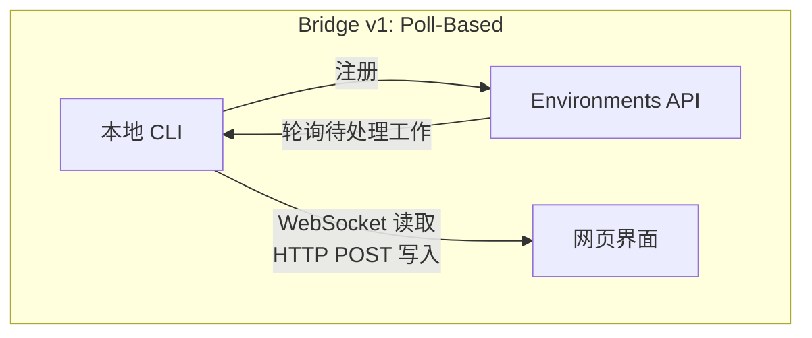
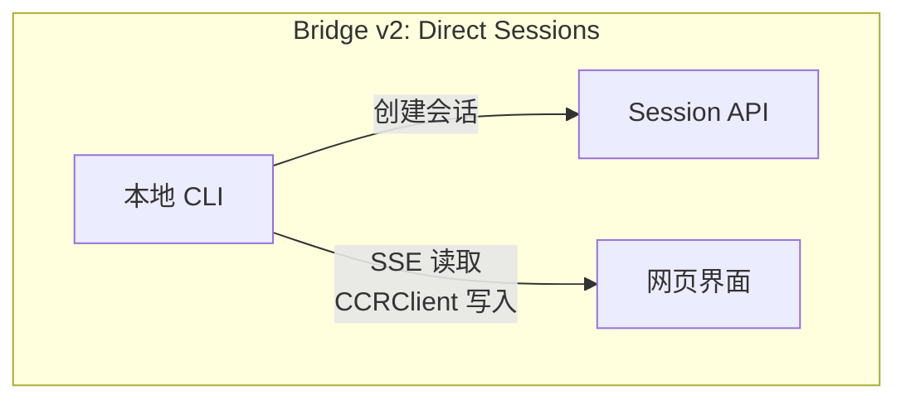
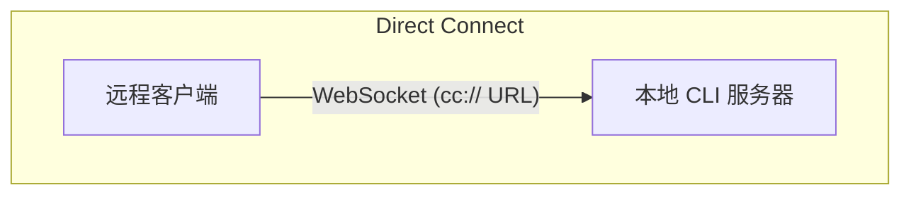
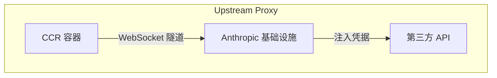

# 第 16 章：远程控制与云端执行

## 智能体走出本机

前面的章节都假定 Claude Code 运行在代码所在的机器上。终端和文件系统都在本地。模型响应以流式方式返回给同一个进程，由它处理键盘输入并管理工作目录。

如果想从浏览器控制 Claude Code、在云容器中运行它，或把它作为局域网服务提供，这一假定就不再成立。智能体需要接收来自网页浏览器、移动应用或自动化流水线的指令，将权限确认转发给没有坐在终端前的人，还要通过隧道将 API 流量交给基础设施，由后者代为注入凭据或终止 TLS。

Claude Code 用四套系统解决这些问题，每套系统对应一种连接拓扑。

<div class="diagram-grid">









</div>

这些系统遵循共同的设计原则。读写使用非对称的路径，连接断开后自动重连，故障发生时平稳降级。

---

## Bridge v1：轮询、分发、启动

Bridge v1 是基于环境的远程控制系统。开发者运行 `claude remote-control` 时，CLI 向 Environments API 注册，轮询待处理工作，并为每个会话启动一个子进程。

注册之前会执行一系列预检，包括运行时功能门控、OAuth 令牌校验、组织策略检查、失效令牌检测，以及主动刷新令牌。如果同一个过期令牌连续失败 3 次，失效检测会触发跨进程退避。主动刷新可以避免约 9% 的注册在首次尝试时失败。

注册成功后，桥接进程进入长轮询循环。收到的工作项有两类。一类是会话，其 `secret` 字段包含会话令牌、API 基础 URL、MCP 配置和环境变量。另一类是健康检查。桥接进程会限制“无待处理工作”日志的频率，每遇到 100 次空轮询才记录一次。

每个会话都会启动一个 Claude Code 子进程，通过 stdin 和 stdout 上的 NDJSON 通信。权限请求经过桥接传输层送到网页界面，由用户批准或拒绝。往返流程必须在约 10–14 秒内完成。

---

## Bridge v2：直建会话与 SSE

Bridge v2 去掉了整个 Environments API 层，无需注册、轮询、确认、发送心跳或注销。v1 要求服务器先了解机器的能力，再分发工作。v2 将生命周期缩为三步。

1. **创建会话。** 使用 OAuth 凭据调用 `POST /v1/code/sessions`。
2. **连接桥接。** 调用 `POST /v1/code/sessions/{id}/bridge`。返回 `worker_jwt`、`api_base_url` 和 `worker_epoch`。每次调用 `/bridge` 都会递增 epoch，这次调用本身就是注册。
3. **打开传输通道。** 读操作使用 SSE，写操作使用 `CCRClient`。

传输抽象 `ReplBridgeTransport` 为 v1 和 v2 提供统一接口，消息处理逻辑无需判断正在使用哪一代桥接。

如果 SSE 连接因 401 响应而断开，传输层会再次调用 `/bridge`，用新凭据重建连接，同时保留序列号游标，避免消息丢失。写路径使用每个实例自己的 `getAuthToken` 闭包，省去进程级环境变量，防止 JWT 在并发会话之间泄漏。

### FlushGate

这里有一个容易忽略的顺序问题。桥接进程既要发送对话历史，又要接收网页界面的实时写入。如果发送历史的过程中有实时写入到达，消息可能乱序。`FlushGate` 在发送历史的 POST 请求期间将实时写入排队，待请求完成后按顺序处理。

### 令牌刷新和 epoch 管理

Bridge v2 会在工作进程的 JWT 到期前主动刷新。新的 epoch 告诉服务器，工作进程还是同一个，只是换了凭据。遇到 epoch 不匹配（409 响应）时，系统会关闭两条连接并抛出异常，退出当前调用流程，防止产生脑裂。

---

## 消息路由与回显去重

两代桥接都使用 `handleIngressMessage()` 作为中心路由器。

1. 解析 JSON，规范化控制消息的键。
2. 将 `control_response` 交给权限处理器，将 `control_request` 交给请求处理器。
3. 检查 UUID 是否已在 `recentPostedUUIDs`（回显去重）或 `recentInboundUUIDs`（重复投递去重）中。
4. 转发通过校验的用户消息。

### BoundedUUIDSet：O(1) 查找，O(capacity) 内存

桥接有一个回显问题：消息可能在读取流中原样返回，也可能在切换传输方式时被投递两次。`BoundedUUIDSet` 是由环形缓冲区支撑的有界集合，按先进先出的顺序淘汰元素。

```typescript
class BoundedUUIDSet {
  private buffer: string[]
  private set: Set<string>
  private head = 0

  add(uuid: string): void {
    if (this.set.size >= this.capacity) {
      this.set.delete(this.buffer[this.head])
    }
    this.buffer[this.head] = uuid
    this.set.add(uuid)
    this.head = (this.head + 1) % this.capacity
  }

  has(uuid: string): boolean { return this.set.has(uuid) }
}
```

两个实例并行运行，容量各为 2000。Set 提供 O(1) 查找，环形缓冲区通过淘汰旧条目将内存控制在 O(capacity)，无需计时器或 TTL。遇到未知的控制请求子类型时，系统返回错误响应，避免服务器一直等待不会到来的响应。

---

## 非对称设计：持久连接读取，HTTP POST 写入

CCR 协议采用非对称传输。读取走持久连接（WebSocket 或 SSE），写入走 HTTP POST。这反映了两种通信模式的基本差异。

读操作频率高、延迟低，由服务器发起。流式传输 token 时，每秒可能有数百条小消息。持久连接适合这种场景。写操作由客户端发起，频率低，需要确认，每分钟只有几条消息。HTTP POST 提供可靠投递，可以借助 UUID 实现幂等，也便于与负载均衡器集成。

把两者合到同一个 WebSocket 会产生耦合。如果在写入期间断开，就得实现重试逻辑，还要区分“未发送”和“已发送但确认丢失”。使用独立通道可分别优化两条路径。

---

## 远程会话管理

`SessionsWebSocket` 管理 CCR WebSocket 连接的客户端一侧。重连策略按故障类型而定。

| 故障 | 策略 |
| --- | --- |
| 4003（未获授权） | 立即停止，无重试 |
| 4001（未找到会话） | 最多重试 3 次，线性退避（压缩期间可能短暂出现） |
| 其他临时故障 | 指数退避，最多尝试 5 次 |

`isSessionsMessage()` 类型守卫接受任何具有字符串类型 `type` 字段的对象。这是有意放宽的。写死允许列表会导致客户端更新前静默丢弃新增的消息类型。

---

## Direct Connect：本地服务器

Direct Connect 的拓扑最简单。Claude Code 作为服务器运行，客户端通过 WebSocket 连接。整个过程无需云端中介或 OAuth 令牌。

会话有五种状态：`starting`、`running`、`detached`、`stopping`、`stopped`。元数据持久化到 `~/.claude/server-sessions.json`，以便服务器重启后恢复会话。`cc://` URL 方案为本地连接提供直接的寻址方式。

---

## 上游代理：在容器内注入凭据

上游代理运行在 CCR 容器中，负责向容器发出的 HTTPS 流量注入组织凭据。智能体可能在这个容器内执行不受信任的命令。

设置步骤经过仔细排序。

1. 从 `/run/ccr/session_token` 读取会话令牌。
2. 通过 Bun FFI 设置 `prctl(PR_SET_DUMPABLE, 0)`，阻止具有相同 UID 的进程通过 ptrace 检查当前进程的堆内存。没有这项保护时，通过提示词注入触发的 `gdb -p $PPID` 可能被用来从内存中提取令牌。
3. 下载上游代理的 CA 证书，与系统 CA 证书包拼接。
4. 在临时端口启动本地中继，将 CONNECT 转成 WebSocket。
5. 解除令牌文件的链接。此时令牌仅存在于堆内存中。
6. 导出环境变量，供所有子进程使用。

每一步都采用故障放行策略。出错时禁用代理，会话继续运行。这种取舍保留了核心功能，即使代理失败导致部分集成无法使用。

### 手动编码 Protobuf

经过隧道的字节封装在 `UpstreamProxyChunk` protobuf 消息中。消息模式很简单，即 `message UpstreamProxyChunk { bytes data = 1; }`。Claude Code 用十行代码手动编码，省去了 protobuf 运行时。

```typescript
export function encodeChunk(data: Uint8Array): Uint8Array {
  const varint: number[] = []
  let n = data.length
  while (n > 0x7f) { varint.push((n & 0x7f) | 0x80); n >>>= 7 }
  varint.push(n)
  const out = new Uint8Array(1 + varint.length + data.length)
  out[0] = 0x0a  // field 1, wire type 2
  out.set(varint, 1)
  out.set(data, 1 + varint.length)
  return out
}
```

十行代码替代了整个 protobuf 运行时。单字段消息无需引入这项依赖，位运算的维护负担远低于引入依赖的供应链风险。

---

## 学以致用：设计智能体远程执行

**使用独立的读写通道。** 当读取是高频流式传输、写入是低频 RPC 时，合并两者会引入不必要的耦合。让两个通道各自处理故障和恢复。

**限制去重所占的内存。** BoundedUUIDSet 模式在固定的内存预算内处理去重。任何采用至少一次投递的系统都需要有界的去重缓冲区。

**根据故障信号调整重连策略。** 永久故障应停止重试，临时故障应退避重试，性质不明的故障应严格限制重试次数。

**在对抗性环境中仅将机密保留在堆内存。** 从文件读取令牌、禁用 ptrace，再解除文件链接，可以消除通过文件系统和检查内存发起的攻击途径。

**辅助系统采用故障放行。** 上游代理提供的是凭据注入这项增强功能，核心的模型推理可在代理失效时继续提供。

这些远程执行系统体现了一条更深层的原则。智能体的核心循环（[[第 5 章](ch05-agent-loop.md)](ch05-agent-loop.md)）无需关心指令从哪里来、结果发往哪里。桥接、Direct Connect 和上游代理都属于传输层。无论用户坐在终端前，还是在 WebSocket 的另一端，上层的消息处理、工具执行和权限流程都相同。

[下一章](ch17-performance.md)讨论另一项运行问题，即 Claude Code 如何优化启动、渲染、搜索和 API 成本，节省每一毫秒和每一个 token。
