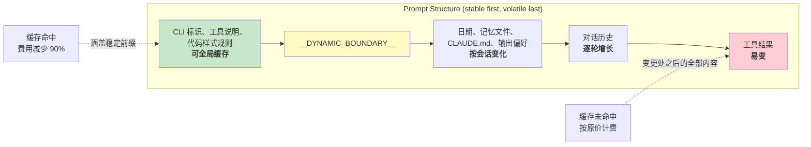

# 第 17 章：性能，每一毫秒和每个 token 都重要

## 资深工程师的优化方法

智能体系统的性能优化涉及五个方面：

1. **启动延迟**，从按键到首次获得有用输出的时间。工具启动慢，用户就容易放弃使用。
2. **token 利用率**，上下文窗口中有用内容相对于额外开销所占的比例。上下文窗口是限制最严的资源。
3. **API 成本**，每轮交互的费用。提示词缓存（Prompt Cache）可以降低 90% 的成本，前提是系统能跨轮次保持缓存稳定。
4. **渲染吞吐量**，流式输出时每秒渲染的帧数。[第 13 章](ch13-terminal-ui.md)介绍了渲染架构，本章关注让渲染保持流畅的性能测量和优化。
5. **搜索速度**，每次按键时，在有 27 万条路径的代码库中找到文件所需的时间。

Claude Code 对这五个方面都有优化，既有常见的记忆化（Memoization），也有用 26 位位图预过滤模糊搜索候选项这样的做法。Claude Code 内置 50 多个启动性能检查点，内部用户采样率为 100%，外部用户为 0.5%。下文的每项优化都来自这些测量数据。

---

## 缩短启动时间

### 在模块顶层并行执行 I/O

入口 `main.tsx` 有意打破“模块作用域不应产生副作用”的约定：

```typescript
profileCheckpoint('main_tsx_entry');
startMdmRawRead();       // fires plutil/reg-query subprocesses
startKeychainPrefetch();  // fires both macOS keychain reads in parallel
```

如果按顺序同步启动子进程，读两项 macOS 钥匙串条目约需 65 毫秒。把两项读取作为无需等待的 Promise 在模块顶层发起，就能与约 135 毫秒的模块加载重叠，利用原本会闲置的 CPU 时间。

### 预连接 API

`apiPreconnect.ts` 在初始化期间向 Anthropic API 发出 `HEAD` 请求，让耗时 100 至 200 毫秒的 TCP 和 TLS 握手与初始化工作重叠。交互模式下，用户可以在输入时完成连接预热，重叠时间不受初始化耗时限制。请求在 `applyExtraCACertsFromConfig()` 和 `configureGlobalAgents()` 执行后发出，确保预热的连接使用正确的传输配置。

### 快速分派与延迟导入

CLI 入口为专用子命令提供提前返回路径。`claude mcp` 不加载 React REPL，`claude daemon` 不加载工具系统。OpenTelemetry（约 400 KB，加约 700 KB 的 gRPC）、事件日志、错误对话框和上游代理等较重的模块只在需要时通过动态 `import()` 加载。`LazySchema` 将构建 Zod 模式推迟到首次校验，把这项开销移到启动之后。

---

## 节省上下文窗口的 token

### 预留输出空间，默认 8K，必要时升到 64K

单项影响最大的优化是缩减默认预留的输出空间。

默认预留 8,000 个输出 token，响应被截断时提高到 64,000。API 按 `max_output_tokens` 为模型响应预留空间。SDK 默认值为 32K 至 64K，但生产数据中输出长度的第 99 百分位（p99）只有 4,911 个 token。默认预留量过高，达到所需空间的 8 至 16 倍，每轮浪费 24,000 至 59,000 个 token 的空间。Claude Code 默认将其限制在 8K，少数请求发生截断时（不到 1%）才用 64K 重试。对于 200K 的窗口，这样就能腾出 12% 至 28% 的可用上下文空间。

### 工具结果预算

| 限制 | 上限 | 用途 |
|-------|-------|---------|
| 单个工具的字符数 | 50,000 | 超限时将结果保存到磁盘 |
| 单个工具的 token 数 | 100,000 | 文本上限约为 400 KB |
| 单条消息的总字符数 | 200,000 字符 | 避免同轮内多个并行工具的结果耗尽预算 |

单条消息的总上限尤其重要。缺少这项限制时，“读取 src/ 中的所有文件”可能并行发起 10 次读取，每次返回 40K 个字符。

### 上下文窗口大小

默认上下文窗口为 200K 个 token，可通过模型名称的 `[1m]` 后缀或实验配置扩展到 1M。用量接近上限时，四层上下文压缩（Context Compression）机制会逐步压缩较早的内容。token 计数以 API 实际返回的 `usage` 字段为准，因此会计入提示词缓存减免、思考 token 和服务端转换。

---

## 降低 API 调用费用

### 提示词缓存架构



Anthropic 的提示词缓存要求前缀精确匹配。前缀中有一个 token 变化，从该处往后的内容就无法命中缓存。Claude Code 因此把稳定内容放在提示词开头，把易变内容放在末尾。

`shouldUseGlobalCacheScope()` 返回 true 时，动态边界之前的系统提示词条目会设置 `scope: 'global'`。运行同一版本 Claude Code 的两个用户可以共享前缀缓存。如果有 MCP 工具，则禁用全局范围，因为 MCP 模式因用户而异。

### 保持型锁存标志

五个布尔字段使用保持型锁存标志（Sticky Latch）模式。一旦变为 true，就持续到会话结束：

| 锁存字段 | 防止的问题 |
|-------------|-----------------|
| `promptCache1hEligible` | 会话中途的超额状态切换导致缓存 TTL 变化 |
| `afkModeHeaderLatched` | 按 Shift+Tab 切换时使缓存失效 |
| `fastModeHeaderLatched` | 进入和退出冷却期时各触发一次缓存失效 |
| `cacheEditingHeaderLatched` | 会话中途切换配置使缓存失效 |
| `thinkingClearLatched` | 确认缓存未命中后切换思考模式 |

每个字段都对应一个请求头或参数。如果它在会话中途变更，就会使约 50,000 至 70,000 个已缓存的提示词 token 失效。这些锁存标志通过限制会话中的切换来保留缓存。

### 对会话日期做记忆化

```typescript
const getSessionStartDate = memoize(getLocalISODate)
```

不做记忆化，日期会在午夜变化，让整个缓存前缀失效。沿用会话开始日期只影响显示，而缓存失效会导致整段对话重新处理。

### 对提示词段落做记忆化

系统提示词的各个段落使用两层缓存。大部分内容使用 `systemPromptSection(name, compute)`，缓存保留到执行 `/clear` 或 `/compact`。少数必须逐轮重算的段落使用 `DANGEROUS_uncachedSystemPromptSection(name, compute, reason)`。这个命名和参数要求开发者说明为何必须让缓存失效。

---

## 减少渲染的 CPU 开销

[第 13 章](ch13-terminal-ui.md)详述了渲染架构，包括紧凑的类型化数组、驻留池、双缓冲和单元格级差异比较。这里关注性能测量，以及维持渲染速度的自适应机制。

终端渲染器用 `throttle(deferredRender, FRAME_INTERVAL_MS)` 将渲染节流至 60 fps。终端失去焦点时，间隔加倍，帧率降至 30 fps。为尽快处理剩余滚动量，滚动帧采用四分之一的间隔。这种自适应节流让渲染只用必要的 CPU 时间。

React Compiler（`react/compiler-runtime`）自动对整个代码库中的组件渲染做记忆化。手动使用 `useMemo` 和 `useCallback` 容易出错，编译器会自动处理。常用的渲染路径值通过预分配冻结对象（`Object.freeze()`）复用。备用屏幕模式下，每帧少一次分配，数千帧下来就能省下可观开销。

完整渲染流水线的细节，包括 `CharPool`、`StylePool` 和 `HyperlinkPool` 驻留池、块复制优化、脏区矩形跟踪及 OffscreenFreeze 组件，请参见[第 13 章](ch13-terminal-ui.md)。

---

## 节省搜索的内存和时间

每次按键都会对 27 万多条文件路径执行模糊搜索。三层优化让搜索耗时保持在几毫秒以内。

### 位图预过滤

每条已索引的路径都有一个 26 位位图，记录包含哪些小写英文字母：

```typescript
// Pseudocode — illustrates the 26-bit bitmap concept
function buildCharBitmap(filepath: string): number {
  let mask = 0
  for (const ch of filepath.toLowerCase()) {
    const code = ch.charCodeAt(0)
    if (code >= 97 && code <= 122) mask |= 1 << (code - 97)
  }
  return mask  // Each bit represents presence of a-z
}
```

搜索时执行 `if ((charBits[i] & needleBitmap) !== needleBitmap) continue`。只要路径缺少查询中的任一字母，用一次整数比较就能立即排除，无需操作字符串。搜索 “test” 这类常见词时约能排除 10% 的路径，查询含少见字母时能排除 90% 以上。每条路径占 4 字节，27 万条约占 1 MB。

### 按得分上界排除与合并 indexOf 扫描

通过位图预过滤的路径，在计算开销较大的词边界和驼峰命名得分前，先做一次得分上界检查。如果最高可能得分也无法超过当前前 K 名的门槛，就跳过该路径。

实际匹配用 `String.indexOf()` 把查找位置与计算间隔和连续匹配的加分合并在一起。JSC（Bun）和 V8（Node）都用 SIMD 加速这项操作，运行时引擎的优化搜索明显快于手动逐字符循环。

### 异步建索引，支持部分查询

在大型代码库中，`loadFromFileListAsync()` 每执行约 4 毫秒就将控制权交还给事件循环。按耗时而非条目数调度，可以适应不同机器的速度。函数返回两个 Promise。`queryable` 在首批索引完成时兑现，使用户可以立即查询部分结果。`done` 在完整索引建成时兑现。文件列表可用后，用户在 5 至 10 毫秒内即可开始搜索。

让出控制权的检查使用 `(i & 0xff) === 0xff`，以无分支的模 256 计算摊销调用 `performance.now()` 的开销。

---

## 记忆相关性旁路查询

有一项优化同时提高了 token 利用率，也降低了 API 成本。[第 11 章](ch11-memory.md)介绍过，记忆系统用一次轻量的 Sonnet 调用来选择要纳入的记忆文件，主查询仍由 Opus 负责。与略过无关文件所节省的 token 相比，一次快速模型调用的成本很小，输出上限仅为 256 个 token。一条无关的 2,000 token 记忆浪费的上下文空间，其成本就高于一次旁路查询（Side Query）的 API 调用费用。

---

## 推测执行工具

流式工具执行器（Streaming Tool Executor）`StreamingToolExecutor` 会在工具调用流式到达时启动推测执行（Speculative Execution），此时完整响应尚未结束。只读工具（Glob、Grep、Read）可以并行，写入工具需要独占访问。`partitionToolCalls()` 将连续的可安全并发工具划入同一批。例如，[Read, Read, Grep, Edit, Read, Read] 分成三批：[Read, Read, Grep] 并发，[Edit] 串行，[Read, Read] 并发。

执行器始终按原工具顺序产出结果，让模型收到确定顺序的输入。Bash 工具出错时，同批工具的中止控制器会终止并行子进程，避免浪费资源。

---

## 流式处理与原始 API

Claude Code 直接使用原始流式 API。SDK 的 `BetaMessageStream` 辅助组件会对每个 `input_json_delta` 调用 `partialParse()`，其时间开销随工具输入长度按 O(n²) 增长。Claude Code 先累积原始字符串，等数据块完整之后只解析一次。

流式监视器（`CLAUDE_STREAM_IDLE_TIMEOUT_MS`，默认 90 秒）在迟迟没有收到数据块时会中止并重试。代理出现故障时，回退到非流式的 `messages.create()`。

---

## 如何优化智能体系统的性能

**核对上下文窗口预算。** `max_output_tokens` 的预留量与实际输出长度 p99 之间的差距，会白白占用上下文空间。可以设一个较紧的默认值，发生截断时再提高。

**保持缓存稳定。** 把提示词中稳定的字段放在前面，易变的字段放在后面。对话过程中，稳定前缀的任何变更都应视为会增加费用的问题。

**并行执行启动 I/O。** 模块加载受 CPU 限制，钥匙串读取和网络握手受 I/O 限制。可以在导入模块之前发起 I/O。

**用位图预过滤搜索结果。** 在开销较大的评分之前排除 10% 至 90% 的候选项，每个条目只需 4 字节。

**用测量定位瓶颈。** Claude Code 有 50 多个启动性能检查点，内部采样率为 100%，外部为 0.5%。缺少测量数据，性能优化就只能靠猜测。

---

位图预过滤、环形缓冲区、记忆化和驻留都是计算机科学的基础方法。真正需要判断的是把它们用在哪里。启动性能分析器揭示时间花在哪儿，API 用量字段揭示 token 花在哪儿，缓存命中率则解释费用花在哪儿。先测量，再优化。
